Here are fully detailed, exam-ready answers for **Batch 1 (Q1–Q8)**. These questions come from the **introductory part of the syllabus** (network fundamentals and the application layer), which sits before Unit 3 in your course. Where relevant I connect back to your Unit 3–5 notes, and anything I add beyond a standard textbook treatment (Kurose & Ross, which your PDFs reference) is marked. Save this as `Question_Bank_Batch1_Answers.md`.

---

# Computer Networks — Question Bank Answers, Batch 1 (Q1–Q8)

---

## Q1. Explain the roles of the network edge, access network, and network core in delivering data from a user's device to an Internet service.

### A. Topic Introduction

The Internet is best understood as three cooperating regions: the **edge** where data is created and consumed, the **access network** that connects the user to the first network point, and the **core** that transports data between networks. A web request crosses all three.

### B. Exam-Ready Definition

> The **network edge** consists of the end systems (hosts) and their applications where data originates and terminates. The **access network** is the first-hop physical and link-layer network (e.g., Ethernet, Wi-Fi, DSL, cable/DOCSIS, fibre) that connects an end system to the first router. The **network core** is the mesh of interconnected routers and links (ISPs, backbones, IXPs) that forwards packets from source network to destination network.

### C. The Three Regions in Detail

**1. Network edge**
- Contains **end systems / hosts**: laptops, phones, servers, IoT devices.
- Runs the **application layer (HTTP, DNS, SMTP) and transport layer (TCP/UDP)** — this is where your Unit 3 transport protocols live.
- Produces **messages**; applications decide reliability and meaning (as your Unit 3 notes stressed: TCP/UDP answer *"which application endpoint gets the data, and what service does it get"*).
- Edge devices are **not part of the forwarding path** — they are sources and sinks.

**2. Access network**
- The **"last mile"** connecting the device to the first router.
- Technologies: **home Ethernet + Wi-Fi, DSL over telephone lines, cable with DOCSIS over HFC (your Unit 5 topic), FTTH, 4G/5G cellular**.
- Is typically a **shared medium** — hence the Unit 5 concern of *medium access control* (Wi-Fi CSMA/CA, DOCSIS upstream grants).
- The first router reached is commonly the **default gateway** (Unit 4: the catch-all route for off-subnet traffic).

**3. Network core**
- A **network of networks**: routers, high-capacity links, ISPs, Internet Exchange Points.
- Performs the Unit 4 functions: **routing (control plane)** to compute paths, and **forwarding (data plane)** to move each packet using **longest-prefix matching**.
- Provides **best-effort, connectionless (datagram) service** — no per-flow circuit state; packets may take different paths.
- Large providers may use **MPLS** internally (Unit 5: push/swap/pop) to steer traffic along engineered paths.

### D. Diagram — End-to-End Journey

**Diagram 1 — Edge → Access → Core → Service (Added diagram):**

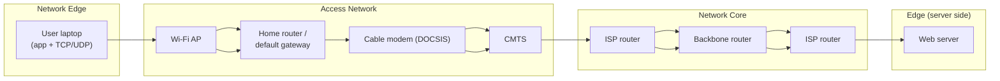

**Explanation:** The laptop (edge) sends the request over Wi-Fi and through the home router (access), the CMTS connects into the ISP, and core routers forward the packet across the Internet to the server (edge). Each hop uses a **different link-layer frame** (Unit 5 one-hop principle), while the IP packet stays logically the same (Unit 4).

### E. How They Cooperate — Worked Walk-Through

1. **Edge:** the browser creates an HTTP request; TCP segments it; IP addresses it (Units 3–4).
2. **Access:** the request crosses Wi-Fi/Ethernet/DOCSIS frames; if the cable upstream is shared, the modem must wait for a **grant** (Unit 5).
3. **Core:** each router does **longest-prefix match**, decrements TTL, replaces the frame, forwards (Unit 4).
4. **Edge (server):** the destination host decapsulates and delivers to the application socket.

### F. Key Points for Exams

- Edge = where data is **created/consumed** (hosts, applications).
- Access = **first hop**, often shared, often the bottleneck and where MAC protocols matter.
- Core = **routers + links**, datagram/best-effort forwarding; reliability is added **end-to-end** by TCP, not by the core.
- The three layers of geography map onto your unit structure: Unit 3 (edge transport), Unit 4 (core), Unit 5 (access links).

**Likely follow-up:** *"Why is the core designed as simple best-effort?"* — because keeping the core stateless and simple lets it scale to billions of flows; intelligence is pushed to the **edge** (the "end-to-end principle").

---

## Q2. Compare circuit switching and packet switching. State two reasons why packet switching is suitable for bursty Internet traffic.

### A. Topic Introduction

Before data can flow, the network must decide whether to **reserve** a path (circuit switching) or **share** it on demand (packet switching). This is one of the most examined comparisons in networking.

### B. Exam-Ready Definitions

> **Circuit switching** establishes a **dedicated end-to-end path with reserved resources (bandwidth, buffers)** before communication begins; that path is held for the entire session. **Packet switching** breaks data into **packets** that are transmitted **independently**, using links **on demand and sharing them statistically** among all users, with no reservation.

### C. Detailed Comparison Table

| Aspect | Circuit switching | Packet switching |
|---|---|---|
| **Setup** | **Call setup required** before any data (like a telephone call) | **No setup**; first packet just goes |
| **Resource reservation** | **Dedicated** bandwidth reserved along the whole path | **Shared on demand**; no reservation |
| **Path** | All data follows the **same physical path** | Packets may, in principle, **take different paths** (Unit 4 datagram model) |
| **Header per unit** | Data usually carries no per-call destination address after setup | **Every packet carries a full destination address** (Unit 4) |
| **Resource use when idle** | **Wasted** — reserved bandwidth sits idle even with no data | **Never idle for others** — other users can use the capacity |
| **Performance** | Fixed bandwidth, **no queuing delay after setup**, guaranteed rate | **Queuing delay and possible packet loss** when demand exceeds capacity |
| **Failure behaviour** | Circuit **must be re-established** on failure (Unit 4 VC property) | **Routing adapts**; subsequent packets take a new route |
| **Efficiency for data** | Good only for **constant-rate, long-duration** traffic | Good for **bursty** traffic |
| **Examples** | Traditional telephone network; ATM virtual circuits; MPLS paths are *conceptually related* (Unit 5) | **The Internet (IP)** |

**Diagram 2 — Sharing model contrast (Added diagram):**

```mermaid
gantt
    title Circuit switching: each call gets a dedicated slot (wasted when silent)
    dateFormat X
    axisFormat %s
    section Link
    "Call A (reserved)"    :0, 1
    "Call B (reserved)"    :1, 2
    "Call C (reserved)"    :2, 3
```

```text
Packet switching: link time shared on demand
| A | B | A | A,B collide→queue | C | B | A |  ...  (no idle gaps)
```

*(Added explanation: in circuit switching the four time slots are permanently allocated even if the users are silent; in packet switching, whenever A is quiet, B and C fill the gaps.)*

### D. Why Packet Switching Suits Bursty Internet Traffic (the required two reasons)

1. **Resource efficiency / no wasted idle capacity.** Internet traffic is bursty: a user loads a page, then reads for 30 seconds (silence), then downloads a video. Circuit switching would **reserve** peak-rate bandwidth for the whole session and leave it idle during pauses. Packet switching lets **many users share the same links statistically**, so the network needs capacity for the *average* aggregate load, not the sum of individual *peak* rates — supporting far more users per link.

2. **No setup overhead and adaptive routing.** Web traffic consists of **many short transfers** to different destinations (each web object may come from a different server). Performing a circuit setup/teardown for each short transfer would add large setup delays and state in every intermediate device (Unit 4 VC table). With packet switching, the first packet of a new flow can leave **immediately**, and if a link or router fails, **routing can adapt so subsequent datagrams take a new route** (Unit 4 VC-vs-datagram table).

### E. The Trade-Off to State in Exams

Packet switching buys this efficiency at the cost of **queuing delays and congestion-induced packet loss** (Q5), and of **no bandwidth guarantee** — which is why applications that need guarantees use TCP + application logic rather than network reservation (Unit 4: "best effort is a service contract").

---

## Q3. What is a network protocol? Explain how protocol rules help two devices communicate, using one Internet application as an example.

### A. Topic Introduction

The Internet has no central brain — billions of devices from different vendors interoperate only because everyone follows **precise, public rules**. Those rules are protocols.

### B. Exam-Ready Definition

> A **network protocol** is a formally defined set of rules governing the **format (syntax), order (sequence/timing), and actions (semantics)** of messages exchanged between communicating entities. It specifies **what** is sent, **in what order**, and **what each party must do on receiving a message** — so devices from different manufacturers can interoperate without prior customisation.

### C. The Three Elements of a Protocol (learn to name these)

| Element | Meaning | Example |
|---|---|---|
| **Syntax** | The **format/structure** of the message (fields, encoding) | HTTP request starts with a method line: `GET /index.html HTTP/1.1` |
| **Semantics** | The **meaning** of each field and what action to take | `GET` means "return the representation of this resource"; status `200` means success |
| **Timing / sequencing** | **Order and pacing** of exchange | Client sends request **first**; server responds; TCP establishes a connection **before** HTTP bytes flow |

### D. Worked Example: Fetching a Web Page (HTTP + supporting protocols)

**Diagram 3 — Protocol rules in a web fetch (Added diagram):**

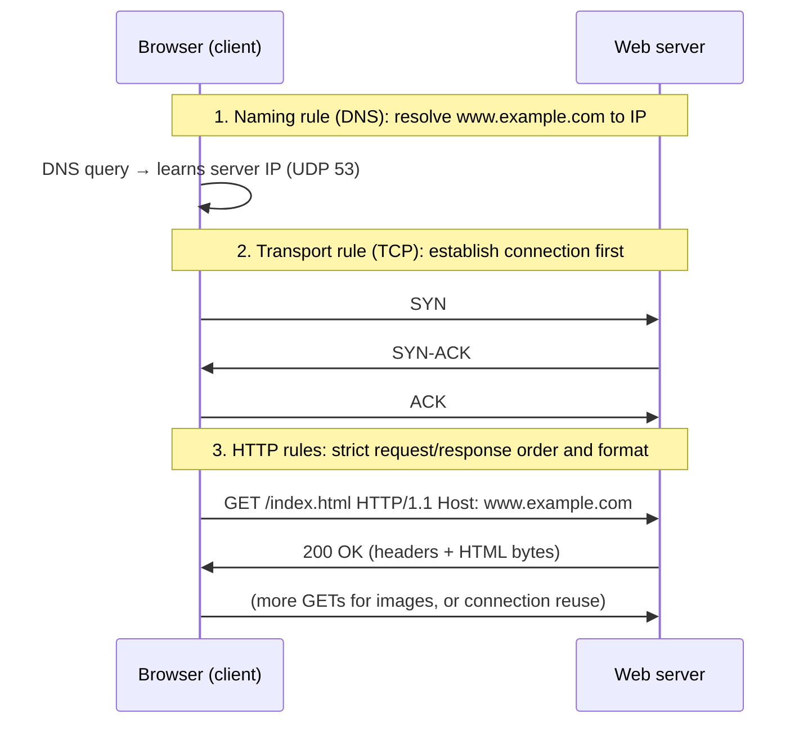

**How each rule makes communication possible (step by step):**

1. **Address identification (DNS protocol):** before anything else, the browser must learn the server's IP. The DNS protocol defines the exact query/response format, so the browser's resolver and any DNS server in the world can interoperate (see Q7).
2. **Connection establishment (TCP protocol, Unit 3):** the **three-way handshake (SYN → SYN-ACK → ACK)** guarantees both endpoints agree on starting sequence numbers before data flows. Without this agreed order, the server could not distinguish new data from old duplicates.
3. **Message format (HTTP protocol):** the request must begin with a **method line**, then headers, then (optionally) a body. Because the format is standardised, **any browser works with any server** — Chrome, Firefox and curl all produce messages the server can parse.
4. **Response semantics (HTTP protocol):** the server replies with a **status line** (`200 OK`, `404 Not Found`, `301 Moved`) plus headers. The client knows exactly what to do: render the body, follow a redirect, show an error.
5. **Timing rules:** HTTP/1.1 defines whether the connection is reused (persistent — Q8); TCP defines retransmission and windowing so a lost segment is recovered without the application knowing (Unit 3: `min(rwnd, cwnd)`).

**Key insight to state:** no single device *knows* the whole web; each only obeys its layer's protocol, and **strict layering of protocols** (application semantics → transport reliability → IP delivery → link frames — exactly the layering lesson from your Unit 3/4 notes) is what turns a collection of independent devices into a working application service.

### E. Exam Points

- Define protocol with the **three elements** (syntax, semantics, timing).
- Give a concrete message exchange (the `GET` example is ideal).
- Emphasise **interoperability**: heterogeneity is possible *only* because protocols are public standards (IETF RFCs).

---

## Q4. Distinguish transmission delay from propagation delay. For each delay, state one factor that affects it.

### A. Exam-Ready Definitions

> **Transmission delay** is the time needed to **push all of the packet's bits onto the link** — it depends on the packet's length and the link's transmission rate.
>
> **Propagation delay** is the time needed for a bit to **physically travel across the link** from one end to the other — it depends on the link's **length** and the **propagation speed of the signal** in the medium.

### B. The Formulas (memorise)

```text
Transmission delay:  d_trans = L / R
  L = packet length (bits)
  R = link transmission rate / bandwidth (bits per second)

Propagation delay:   d_prop = d / s
  d = physical length of the link (metres)
  s = propagation speed of the signal in the medium
      (~2×10^8 m/s in fibre/copper, ~3×10^8 m/s in free space)
```

*(Added explanation: these are the standard Kurose & Ross definitions, which your PDF's references list.)*

### C. Detailed Distinction Table

| Aspect | Transmission delay | Propagation delay |
|---|---|---|
| **What it measures** | Time to **inject/serialize** all bits onto the wire | Time for a **signal to physically travel** the distance |
| **Formula** | **L / R** | **d / s** |
| **Factors that affect it** | 1. **Packet length (L)** — bigger packet, longer delay; 2. **Link rate (R)** — faster link, shorter delay | 1. **Link length (d)** — longer distance, longer delay; 2. **Propagation speed (s)** — depends on the **medium** (fibre, copper, radio) |
| **Depends on router workload?** | No (it is a property of the link + packet) | No (a property of physics) |
| **Improves when…** | You upgrade to a **higher-bandwidth** link | Only by **shortening the path** or using a faster medium |
| **Intuition** | Time for a **truck to be loaded** onto the highway | Time for the **truck to drive** the highway's length |

### D. Worked Numerical Example (Added, using the formulas)

**Given:** a **1000-byte** packet (L = 8000 bits) on a **100 Mbps** link (R = 10⁸ bps) of length **2000 km** (d = 2×10⁶ m) with fibre propagation speed s = 2×10⁸ m/s.

- **Transmission delay** = L/R = 8000 / 10⁸ = **8 × 10⁻⁵ s = 80 μs**.
- **Propagation delay** = d/s = 2×10⁶ / 2×10⁸ = **10⁻² s = 10 ms**.

**Meaning:** on this long, fast link, **propagation dominates** — upgrading the link speed would not help much, but moving the server closer would. Conversely, on a short **slow** link (e.g., 1 Mbps, 100 m), transmission delay dominates instead. This is why both quantities matter and neither is "always bigger".

### E. Where They Fit in Total Nodal Delay

**Diagram 4 — Total nodal delay (Added diagram):**

```text
d_nodal = d_proc + d_queue + d_trans + d_prop
          └─at router─┘└─at queue─┘└─on link──────┘
```

| Component | Where it occurs | Cause |
|---|---|---|
| **Processing delay** | Router | Header inspection, checksum, lookup (Unit 4 router operation) |
| **Queuing delay** | Router output buffer | Traffic arrival rate > service rate (variable; causes loss — Q5) |
| **Transmission delay** | Link (sender side) | **L / R** |
| **Propagation delay** | Link (travel) | **d / s** |

**Exam tip:** the classic confusion — *a faster (higher-bandwidth) link reduces transmission delay but does nothing to propagation delay; a shorter link reduces propagation but may not reduce transmission if the rate is unchanged.*

---

## Q5. Explain why packets may be lost when a router receives traffic faster than it can transmit. How can packet loss affect an application using TCP?

### A. Topic Introduction

This question connects the **data-plane mechanics of a router** (Unit 4, Section 3) with the **transport layer's recovery machinery** (Unit 3). It is a favourite "link-the-layers" exam question.

### B. Why Loss Happens — The Router Buffer Mechanism

**Diagram 5 — Output buffer overflow (Added diagram):**

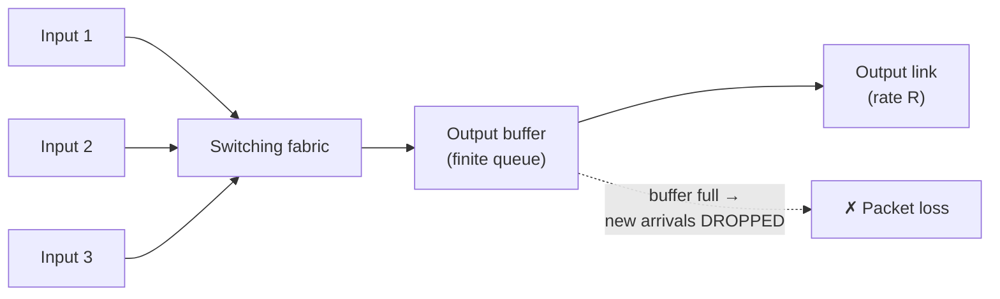

**Step-by-step reasoning:**

1. **Arrival rate vs service rate:** a router's output link can transmit at rate R (bits/s). If packets **arrive at the output port faster than they leave**, they must **wait in the output buffer/queue** (Unit 4: *"if several inputs send towards the same output, packets may queue even when the switching fabric is fast"*).
2. **Finite buffers:** the buffer has **finite size** (Unit 4: *"finite buffers eventually overflow"*). When it is **full, the router must drop the arriving packet** — it has nowhere to put it.
3. **Congestion amplification:** losses don't relieve the congestion — senders typically **retransmit**, injecting even more traffic (Unit 3: *"sending even more traffic after such losses can make the situation worse"*).
4. **Also lost:** packets whose **TTL expires** at a router are discarded (Unit 4: TTL=0 → discard + ICMP Time Exceeded) — a different cause of "loss" worth mentioning for full marks.
5. **Bufferbloat caveat:** even *bigger* buffers only trade drops for **excessive queuing delay** (Unit 4: bufferbloat) — loss can't be eliminated by buffering alone.

### C. How Packet Loss Affects a TCP Application

**Diagram 6 — TCP loss recovery (Added diagram):**

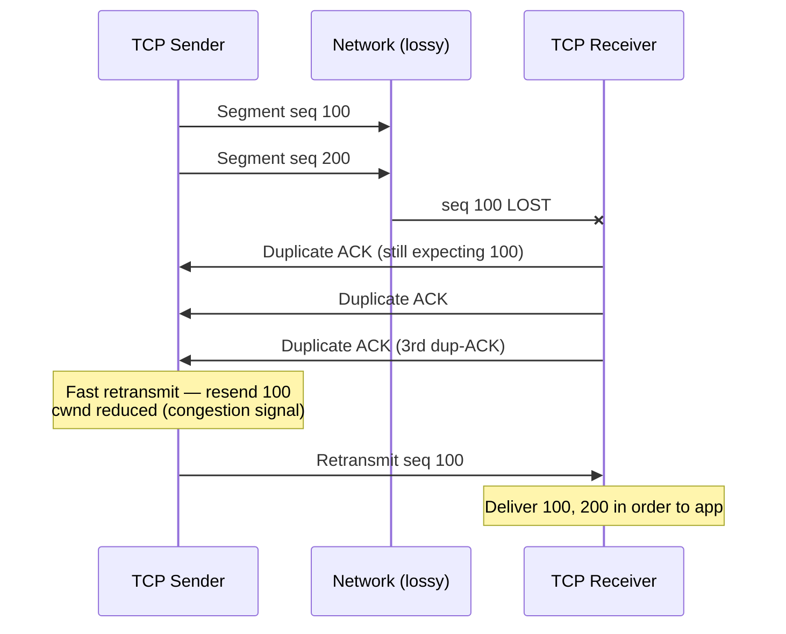

**Effects on the TCP application (numbered for the exam):**

1. **Latency, not corruption:** TCP **detects** the loss (via timeouts and duplicate ACKs — Unit 3) and **retransmits** the missing segment. The application never sees a corrupted data stream; instead it sees **added delay** equal to the recovery time (often roughly an RTT for fast retransmit, much more for a timeout).
2. **Throughput reduction:** after loss, classic TCP **reduces its congestion window (cwnd)** — slow start or congestion-avoidance restart (Unit 3, Section 12). So the app's achievable sending rate drops, then ramps back up. Under persistent loss, throughput is capped.
3. **Jitter and stalls:** for a file transfer the effect is slower completion; for **interactive** TCP traffic (e.g., a game or chat over TCP) recovery delay appears as **stalls**, since TCP delivers bytes **in order** — a lost segment makes later in-order-arrived data wait (the head-of-line behaviour your Unit 3 notes contrasted with UDP).
4. **No data corruption, but possible timeout failures:** if congestion is severe and recovery takes too long, applications may see **connection timeouts or resets**.
5. **Contrast worth adding:** a **UDP** app (Unit 3) would simply have a missing datagram — no automatic retransmission; the application must tolerate or repair the gap itself. This contrast shows that **the same router loss has very different application-visible effects depending on the transport**.

> **One-line exam conclusion:** *Router loss arises from output-buffer overflow under congestion; TCP converts loss into retransmission delay and reduced congestion window, so the application experiences higher latency and lower throughput rather than corrupted data.*

---

## Q6. Differentiate forwarding and routing in the network core. What information does a router use to forward an arriving packet?

### A. Exam-Ready Definitions (directly from your Unit 4 notes)

> **Forwarding** moves an arriving packet from a router **input** to the correct **output interface**, using the forwarding table. It is a **local, per-router action performed for each packet** (the **data plane**).
>
> **Routing** determines **end-to-end paths** and creates the information used to **populate forwarding tables**. It is a **network-wide control process** that responds to topology, metric or policy changes (the **control plane**).

### B. Detailed Comparison

| Aspect | Forwarding | Routing |
|---|---|---|
| **Scope** | **Local** — one router | **Network-wide** — all routers coordinate |
| **When** | **For every packet**, at line speed | Periodically / on topology change |
| **Speed requirement** | Must be extremely **fast** (hardware) | Can be **slower** (software) |
| **Function** | Move packet input → correct output port | Compute paths; run RIP/OSPF/BGP (Unit 4) |
| **Plane** | **Data plane** | **Control plane** |
| **Analogy** | Driving on a road using a signpost | Cartography — making the map that feeds the signposts |

**Diagram 7 — Control plane feeds data plane (Added diagram, as in your Unit 4 notes):**

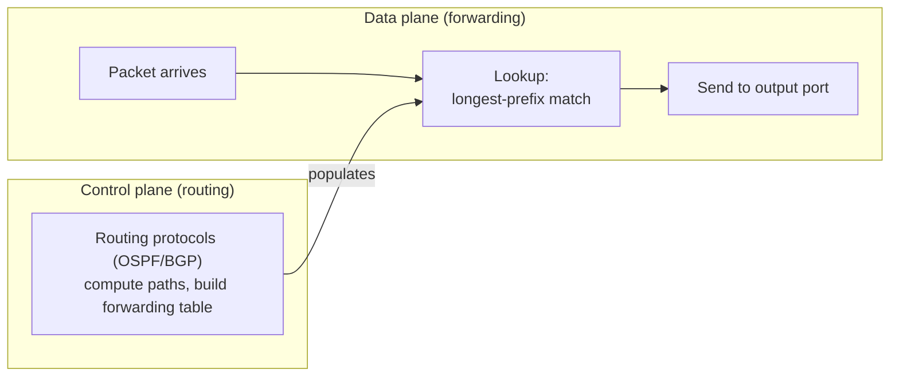

### C. What Information Does the Router Use to Forward? (the second part — answer precisely)

1. **The packet's destination IP address** (from the IP header — Unit 4, IPv4 header, Destination field).
2. **The router's forwarding table**, containing **destination prefixes + output interfaces/next hops** — e.g., Unit 4's example table (10.0.0.0/8 → I1, …, 0.0.0.0/0 → ISP).
3. **Longest-prefix matching rule:** the router selects the entry whose prefix is the **longest and therefore most specific** among all matching prefixes. (Unit 4 example: 192.168.10.25 matches both /16 and /24 → /24 wins; 8.8.8.8 matches only the default → ISP.)
4. **Per-hop header updates:** it **decrements TTL** (discarding at zero, Unit 4), **recomputes the header checksum**, and **builds a new link-layer frame** for the next hop (Unit 5: the frame changes every hop; IP endures).
5. *(For completeness)* **Policy/QoS context:** policy, filtering and queuing decisions may be applied at the output port (Unit 4 router steps), and in an **MPLS domain** the lookup key is the **incoming label + interface context**, not the IP prefix (Unit 5, Section 12.2) — a sophisticated point that earns credit.

> **Exam trap (from your Unit 4 misconceptions):** *"A router selects a route using the full IP address only"* is **false** — routers match **prefixes** and choose the **longest valid match**.

### D. Structure Tip

Answer this as: definition pair → comparison table → the 5-item list of forwarding inputs → the longest-prefix example → the frame-replacement boundary ("router removes the link frame, IP continues, TTL changes").

---

## Q7. Explain how DNS supports web access. Distinguish A/AAAA records from MX records and state the purpose of DNS caching.

### A. Topic Introduction

Humans use names; the network uses IP addresses. **DNS (Domain Name System)** is the Internet's **name-to-address directory**, and it is the *first* protocol invoked in almost every web access (as in Q3's example).

### B. Exam-Ready Definition

> **DNS** is a hierarchical, distributed **application-layer** naming service that translates **human-readable hostnames** (e.g., `www.example.com`) into **IP addresses** (and other resource data). It runs primarily over **UDP port 53**, organised as a hierarchy of **root, top-level-domain (TLD) and authoritative** servers, with local **recursive resolvers** performing lookups on behalf of clients.

### C. How DNS Supports Web Access — Step by Step

**Diagram 8 — Recursive DNS lookup for a web fetch (Added diagram):**

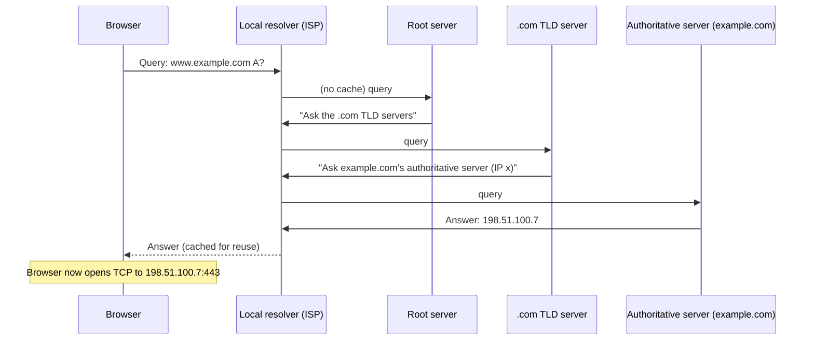

**Why DNS is essential for web access:**
1. The browser **cannot start TCP** to a server it cannot address — DNS provides the IP **before** the three-way handshake.
2. Lookups are **recursive** (the resolver does the work on the client's behalf) and **iterative** (the resolver asks root → TLD → authoritative in turn).
3. DNS also supports **load distribution** (a name may map to multiple IPs, rotated per answer) and **mail routing** (MX — below), so it is much more than a phone book.

### D. A/AAAA Records vs MX Records

| Feature | **A / AAAA record** | **MX record** |
|---|---|---|
| **Purpose** | Maps a **hostname → IP address** for general connectivity | Specifies the **mail server(s)** that accept email **for a domain** |
| **Data returned** | **A** = IPv4 **32-bit address**; **AAAA** = IPv6 **128-bit address** (the AAAA name reflects the 128-bit IPv6 address from your Unit 4 notes) | **Priority value + mail server hostname** |
| **Points to** | The destination machine itself | A **hostname** which must itself be resolved (usually via an A/AAAA record) — an extra indirection |
| **Used by** | Browsers, HTTP clients, any app connecting to a host | **Mail transfer agents (SMTP servers)** delivering mail to `@example.com` |
| **Example** | `www.example.com.  IN A 198.51.100.7` | `example.com. IN MX 10 mail.example.com.` |

**Key distinction sentence for exams:** *A/AAAA answers "what is the IP address of this host?" for the host you are connecting to; MX answers "which host receives this domain's email?" — and it returns a hostname plus priority, not an IP directly.*

### E. Purpose of DNS Caching

> **DNS caching** stores query answers **temporarily** (at the browser, OS stub resolver, and recursive resolvers) according to a **Time-To-Live (TTL)** carried in each record.

**Purposes (list all four for full marks):**
1. **Reduces lookup latency** — a cached answer is served in microseconds instead of a multi-server hierarchy walk.
2. **Reduces DNS traffic/load** — popular domains are resolved once and reused by many clients.
3. **Improves resilience** — resolution can still succeed from cache if an upper-level DNS server is temporarily unreachable.
4. **Control via TTL:** the TTL lets zone owners control **how quickly changes (like a new server IP) propagate** — shorter TTL = faster updates but more queries.

*(Added note: A-record answers feed the IP used in the TCP connection of Q3; if you need consistency with your Unit 4 notes, IPv6 uses **AAAA** records, and your Unit 4 case study mentioned "DNS AAAA records" as a dual-stack deployment requirement.)*

---

## Q8. Explain persistent and non-persistent HTTP connections. Also explain how web caching and cookies solve different problems.

### A. Topic Introduction

HTTP is a client–server application-layer protocol. How many **TCP connections** it uses per web page (persistent vs non-persistent) affects delay; **web caching** and **cookies** are two independent enhancements that solve two very different problems — one about **efficiency**, one about **state/identity**.

### B. Exam-Ready Definitions

> In **non-persistent HTTP**, each object (each HTML file, image, etc.) requires its **own TCP connection**, which is closed after that object is delivered. In **persistent HTTP**, **one TCP connection carries multiple request/response exchanges** for successive objects, remaining open across them (default in HTTP/1.1).

### C. Detailed Explanation

**Diagram 9 — Non-persistent vs persistent HTTP (Added diagram):**

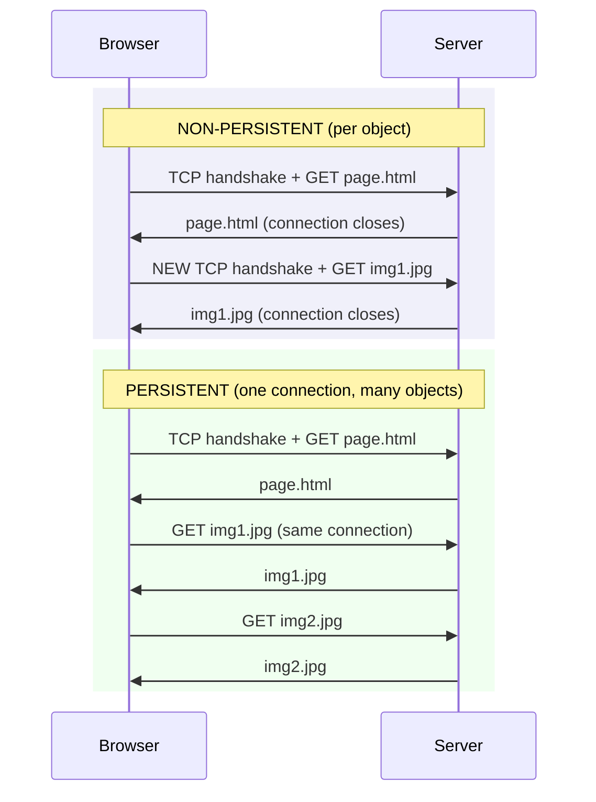

**Comparison table:**

| Aspect | Non-persistent HTTP | Persistent HTTP |
|---|---|---|
| **TCP connections** | **One per object** | **One for many objects** |
| **Setup cost** | Handshake (+ slow start) repeated **per object** | Paid **once** |
| **Delay** | Higher — 2 RTTs per object (setup + request/response) roughly | Lower — after the first object, ~1 RTT per object |
| **Server resources** | More sockets/time-wait churn | Fewer connections, but held open |
| **HTTP version** | Original HTTP/1.0 behaviour | **HTTP/1.1 default** |

*(Added numerical flavour: with RTT = 50 ms and 10 objects, non-persistent serially costs ≈ 10 × (2 RTT) = 1 s just in RTTs; persistent costs ≈ 2 RTT + 9 RTT = 0.55 s — and less with pipelining. State assumptions clearly in exams.)*

### D. Web Caching — Solving the *Efficiency/Distance* Problem

> A **web cache (proxy server)** stores copies of recently fetched objects and serves subsequent requests for them **locally**, on behalf of clients.

**How it works (ordered steps):**
1. The browser sends the request to the **proxy** instead of the origin server.
2. If the cache holds a **fresh** copy of the object → it returns it immediately (**cache hit**) — no cross-Internet trip.
3. If not (**cache miss**) → the proxy fetches from the origin server, stores a copy, and forwards it.
4. **Conditional requests** (`If-Modified-Since`) let the proxy verify with the origin whether its copy is still valid — so users see fresh content without full re-downloads.

**Problems it solves:**
- **Latency:** hits are served from a nearby, fast link.
- **Bandwidth cost:** repeated objects cross the access/ISP links once, not per-user (access-link bottleneck relief — connects to Q1's access network).
- **Server load:** origin servers handle far fewer requests.
- **CDNs** are the global, distributed evolution of the same idea.

### E. Cookies — Solving the *Stateless-Server* Problem

> HTTP itself is **stateless**: each request is independent and the server has no memory of previous requests. **Cookies** let a site attach **state** to a specific user across requests and sessions.

**How they work (ordered steps):**
1. On first visit, the server responds with a header `Set-Cookie: ID=1678`.
2. The browser **stores** the cookie and, on every subsequent request **to that site**, includes `Cookie: ID=1678`.
3. The server maps the ID to its own records → a **session**: shopping cart, logged-in identity, preferences, targeted content.

**Problems it solves:**
- Maintaining **sessions/login state** over a stateless protocol.
- **Personalisation** and continuity across visits.
- *(Privacy trade-off worth stating: cookies also enable third-party tracking.)*

### F. The Required Distinction — Two Different Problems

| | **Web caching** | **Cookies** |
|---|---|---|
| **Problem solved** | **Performance**: repeated fetching of the same objects over slow/expensive links | **Statelessness**: HTTP has no memory of users between requests |
| **Mechanism** | **Server-side store** of object copies (proxy cache), freshness via conditional requests | **Client-side store** of small ID strings, echoed back to the server |
| **Who benefits** | Users (speed), ISPs (bandwidth), origin servers (load) | The **site** (state, identity) — and the user via personalisation |
| **Where it lives** | Between client and origin (proxy/CDN) | In the **browser**, keyed per site |
| **Relationship to persistent HTTP** | All are **complementary**: persistent connections reduce per-object connection cost; caches reduce transfer cost; cookies add state — a modern web page typically uses all three | |

> **One-line exam conclusion:** *Persistent vs non-persistent HTTP is about how many TCP connections a page consumes; caching solves the cost of repeatedly moving the same objects across the network; cookies solve the statelessness of HTTP. The first two are performance mechanisms; cookies are a state mechanism — they solve different problems and operate together.*

---

## Batch 1 Quick-Revision Box

| Q | Core exam anchor |
|---|---|
| 1 | Edge (hosts/apps) → Access (first hop, shared) → Core (routers, best-effort datagram) |
| 2 | Circuit = reserve path; packet = share on demand. Bursty reasons: **no idle waste**, **no setup + adaptive routing** |
| 3 | Protocol = syntax + semantics + timing; example: DNS → TCP handshake → `GET` → `200 OK` |
| 4 | d_trans = **L/R** (packet length, link rate); d_prop = **d/s** (distance, medium speed) |
| 5 | Loss = output buffer overflow under congestion; TCP → retransmission delay + cwnd reduction |
| 6 | Forwarding = local per-packet (data plane); routing = network-wide (control plane); lookup = **longest prefix match** |
| 7 | DNS = name→IP before TCP; **A/AAAA = host→IP; MX = domain→mail server (+priority)**; caching = latency/load/resilience, TTL-controlled |
| 8 | Non-persistent = 1 TCP/object; persistent = 1 TCP/many objects; **caching = performance, cookies = state** |

---

✅ **Batch 1 complete (Q1–Q8).** Paste **Batch 2 (Q9–16)** whenever ready, and I'll continue in the same format — and at the end I can merge all batches into one consolidated answer-bank `.md` file.

---

Here are fully detailed, exam-ready answers for **Batch 2 (Q9–Q16)**. These map closely to your **Unit 3 (Transport Layer)** notes and the application-layer material — I'll link back to those notes wherever the answer draws on them. Save this as `Question_Bank_Batch2_Answers.md`.

---

# Computer Networks — Question Bank Answers, Batch 2 (Q9–Q16)

---

## Q9. Compare client-server and peer-to-peer application architectures. Give one suitable use case for each and explain how their scaling behaviour differs.

### A. Topic Introduction

Every networked application must answer one design question first: **who provides the service, and who consumes it?** The two dominant answers are the **client-server (C/S)** architecture and the **peer-to-peer (P2P)** architecture.

### B. Exam-Ready Definitions

> **Client-server architecture:** a dedicated, always-on **server** host holds the data/service; **clients** initiate requests and receive responses. Clients do not communicate with each other directly — the server is the intermediary.
>
> **Peer-to-peer architecture:** there is **minimal or no reliance on dedicated servers**. Hosts (called **peers**) are **interconnected and act as both clients and servers**, exchanging data directly with one another. Each peer contributes its own resources (storage, bandwidth, CPU).

### C. Detailed Comparison

| Aspect | Client-Server | Peer-to-Peer |
|---|---|---|
| **Role of hosts** | Fixed: server serves, clients request | **Dynamic: every peer is both client and server** |
| **Infrastructure** | Requires **data centres, dedicated always-on servers**, static/well-known IP (DNS A-record — Q7) | **Self-scaling** from user-contributed devices; no central data centre |
| **Control & management** | **Centralised** — easy to administer, update, secure, back up | **Decentralised** — harder to control, police or update |
| **Failure behaviour** | **Single point of failure** (server down = service down); mitigated by replication/load balancers | **Resilient** — no critical single node; peers join/leave freely (churn) |
| **Data location** | All content on server(s) | Content **distributed** among peers |
| **Trust / security** | Server is a known, administrable entity | Harder: malicious peers, no central authority |
| **Cost model** | Provider pays for all bandwidth and servers | Cost **distributed to users** |
| **Typical examples** | Web (HTTP), email (SMTP/IMAP), DNS | BitTorrent file distribution, video conferencing/multiparty calls, blockchain networks |

### D. Suitable Use Cases (one each, as required)

1. **Client-server — online banking / web portal (e.g., a university exam portal).**
   The data must be **authoritative, consistent and centrally controlled**: transactions, authentication, student records. Clients (browsers) only request; the server holds the single source of truth. This matches your Unit 3 end-to-end HTTPS story: browser → TCP port 443 → server demultiplexes to the correct socket.

2. **P2P — distributing a large software update or open dataset (e.g., Linux ISOs via BitTorrent).**
   The same multi-gigabyte file must reach **thousands of users quickly and cheaply**. Each downloader simultaneously **uploads chunks to other downloaders**, so the distribution capacity *grows* as more people join — with almost no central infrastructure cost.

### E. Scaling Behaviour — The Key Difference (the required part)

> **Self-scalability of P2P:** in client-server, **each new client adds load that only the server must carry** (its bandwidth and processing). In P2P, **each new peer adds both demand *and* service capacity**, because every peer uploads to others while it downloads.

**Diagram 1 — Scaling contrast (Added diagram):**

```text
CLIENT-SERVER                       PEER-TO-PEER
     S (server: all load)              P1 ←→ P2
   ╱  │  ╲                             │  ╳  │      every pair exchanges
  C1  C2  C3   C4 ... Cn              P3 ←→ P4      directly
 ──────────────────                ─────────────────
 Server bandwidth =                Aggregate capacity
 demand × n  (bottleneck)          GROWS with the number of peers
```

**Concrete scaling reasoning (Added numerical intuition):**
- Suppose a 4 GB file must reach 1,000 users, and the server's uplink is 100 Mbps.
  - **C/S:** the server must upload 4 GB × 1,000 = 4,000 GB serially-ish → distribution time is **minutes to hours**, bounded by server bandwidth.
  - **P2P:** as soon as even 10 peers hold pieces, the *aggregate* upload capacity is the **sum of all peers' uplinks** — typically far exceeding any single server. Distribution time grows far more slowly than linearly with the number of receivers.
- **C/S scaling strategies** (why it is still dominant): add servers, load balancers, and — crucially — **CDNs** (content distribution networks), which are effectively *managed, server-side* distributed caches (connect to Q8's web caching).

**Trade-off sentence for the conclusion:** *P2P scales automatically and cheaply for large, identical-content distribution, but gives up central control, consistency guarantees and security; C/S offers control, consistency and security, but every bit of scaling must be purchased and engineered.*

---

## Q10. Explain the meanings of HTTP status codes 200, 301, 404 and 503. Give a plausible situation in which a website might return each code.

### A. Topic Introduction

Every HTTP response begins with a **status line**: `HTTP/1.1 <code> <phrase>`. Status codes are the server's three-digit verdict telling the client what happened and (implicitly) what to do next. They are grouped: **1xx informational, 2xx success, 3xx redirection, 4xx client error, 5xx server error**.

### B. Exam-Ready Definition

> An **HTTP status code** is a standardised three-digit number returned by a web server in the first line of its response, indicating the **result category** of the request: success (2xx), redirection (3xx), client-caused error (4xx), or server-side failure (5xx).

### C. The Four Codes (definition + plausible situation, as required)

| Code | Name | Meaning | Plausible situation |
|---|---|---|---|
| **200** | **OK** | The request **succeeded**; the requested representation is in the response body | A browser requests `GET /index.html` and the server delivers the homepage normally |
| **301** | **Moved Permanently** | The requested resource has a **new permanent URL**; the browser should update its records and re-request from the new location (Location header) | A site migrates from `http://oldsite.com` to `https://newsite.com` — every old request is answered 301 so search engines and bookmarks follow permanently |
| **404** | **Not Found** | The server **cannot find the requested resource** at this URL; the server itself is fine | A user follows a **broken or mistyped link** (e.g., `/studen-portal` instead of `/student-portal`) or the page was deleted |
| **503** | **Service Unavailable** | The **server (or an intermediary) is temporarily unable to handle the request** — overloaded or down for maintenance; often with a `Retry-After` header | During **result-day traffic**, thousands of students hit the result portal simultaneously; the backend is overwhelmed and replies 503 (relates to Q5's congestion — here the overload is at the *server*, not a router) |

**Diagram 2 — Status-code flow intuition (Added diagram):**

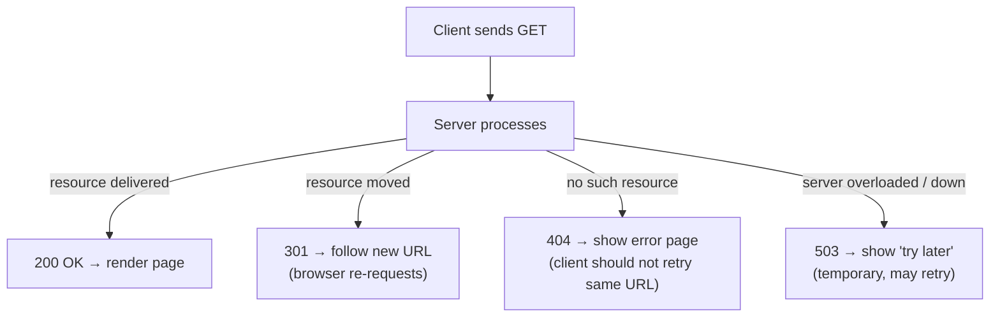

**Additional exam points:**
- **200 vs 404 ownership of the fault:** 4xx means the *client's* request is the problem (bad URL); 5xx means the *server* failed even for a valid request. This distinction is exactly the kind of precision your Unit 4 notes demand ("ping works, website fails" troubleshooting — a 404/503 implies reachability succeeded but the application layer failed).
- **301 vs 302:** 301 is *permanent* (bookmarks/SEO updated); 302 would be *temporary*. Mentioning this contrast earns credit.

---

## Q11. Explain the different roles of SMTP and IMAP or POP3. Why can an email reach a student's mailbox while the student's laptop is switched off?

### A. Topic Introduction

Email uses **two different protocols for two different journeys**: SMTP moves mail *between* mail servers (and from sender to server), while IMAP or POP3 moves mail *from the recipient's server to the recipient's device*. Confusing them is a classic exam error.

### B. Exam-Ready Definitions

> **SMTP (Simple Mail Transfer Protocol)** is a **push** protocol, running over **TCP port 25** (submission uses 587), used to **transfer mail** from a sender's mail client/agent **to the sender's mail server**, and **between mail servers** across the Internet.
>
> **IMAP (Internet Message Access Protocol, port 143/993)** and **POP3 (Post Office Protocol v3, port 110/995)** are **retrieval (pull) protocols** used by the recipient's client to **fetch mail from the recipient's mail server mailbox**.

### C. Division of Roles

| Aspect | **SMTP** | **IMAP / POP3** |
|---|---|---|
| **Direction of data flow** | **Push** — sender's side pushes mail onward | **Pull** — recipient's client pulls mail down |
| **Where used** | Sender client → sender server; **server → server** (the actual Internet delivery) | Recipient's server → recipient's device |
| **Model of the mailbox** | Irrelevant — it only transports | IMAP: **mail stays on the server**, folders synchronised across devices; POP3: typically **download-and-(optionally) delete** |
| **Multi-device use** | — | **IMAP suits it** (phone + laptop see the same state); POP3 historically did not |
| **Analogy** | The **postal carrier** carrying letters between post offices | Opening your **post-office box** to collect your letters |

### D. Why the Mail Arrives While the Laptop Is Off (the required explanation)

**Diagram 3 — Mail path with store-and-forward (Added diagram):**

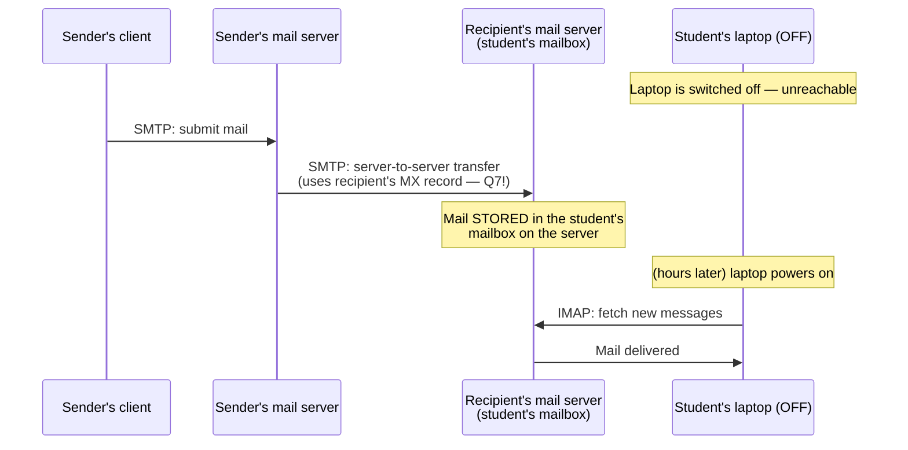

**Step-by-step reasoning (the marks are here):**

1. **Store-and-forward architecture:** email is not delivered directly device-to-device. The recipient's **mailbox lives on the mail server, not on the laptop**.
2. When the mail reaches the recipient's server (via SMTP, using the **MX record** from Q7 to find *which* server accepts mail for the student's domain), the server **stores it on disk**. It does **not need the recipient's device to be online**.
3. The student's laptop is only involved at **retrieval time**: whenever it is next switched on, its mail client uses **IMAP/POP3 to pull** whatever has accumulated. Until then the mail simply waits.
4. *(Contrast for depth: instant-messaging apps generally cannot deliver to a device that is offline in the same way, because the "mailbox" is the device session; email's design is explicitly asynchronous.)*

> **One-line exam conclusion:** *SMTP delivers mail server-to-server into a server-side mailbox; the recipient's device being off is irrelevant because IMAP/POP3 retrieval happens later, whenever the client reconnects.*

---

## Q12. Differentiate TCP flow control and TCP congestion control. Mention the roles of rwnd and cwnd.

### A. Direct Answer (this is straight from your Unit 3 notes, Sections 11–12)

> **Flow control** solves an **endpoint problem**: a fast sender must not overflow the **receiving application's TCP buffer**. The receiver advertises **`rwnd`** — the free space in its receive buffer — and the sender must not exceed it.
>
> **Congestion control** solves a **network problem**: routers and links along the path can become **overloaded** when too much traffic is injected. The sender estimates network conditions and limits itself with **`cwnd`**, reacting to loss, duplicate ACKs, delay/ECN signals.

### B. Comparison Table (from Unit 3, Section 12.1 — memorise)

| Aspect | Flow control | Congestion control |
|---|---|---|
| **Protects** | **Receiving endpoint** | **Network path / shared capacity** |
| **Main question** | *Can the receiver accept more bytes?* | *Can the network carry more traffic without harmful congestion?* |
| **TCP variable** | **`rwnd`** (receive window) | **`cwnd`** (congestion window), plus `ssthresh` and algorithm state |
| **Signal/source** | **Receiver advertises** available buffer in every segment | **Loss, ACKs, timing/ECN** reveal network conditions |
| **What failure looks like without it** | Receiver buffer overflow → dropped segments → wasteful retransmissions | Router queues overflow → **packet loss, rising delay, possible collapse** (Q5) |

### C. Roles of rwnd and cwnd (the required part — be precise)

**rwnd (receive window):**
- Computed by the receiver: **rwnd = available free space in the TCP receive buffer** (Unit 3, Section 11.1: `rwnd = RcvBuffer − buffered-unconsumed data`).
- Advertised to the sender in **every TCP segment**; it changes dynamically as the application reads data.
- Worked example (Unit 3): buffer 12,000 bytes, 8,500 buffered → **rwnd = 3,500 bytes**.
- If rwnd = 0, the sender pauses but uses the **persist mechanism/window probes** to avoid deadlock (Unit 3, Section 11.3).

**cwnd (congestion window):**
- Maintained **locally by the sender** (the receiver never sees it as a field — it is *inferred state*).
- Grown by **slow start** (exponential per RTT: 1→2→4→8 MSS) and **congestion avoidance** (additive, ~1 MSS per RTT); reduced on **loss** (classic Reno model — state this explicitly per your notes' "important precision").
- Its job is to **probe** how much the *network* can carry, not how much the receiver can absorb.

### D. The Combined Limit (must state — this is the exam's favourite sentence)

```text
effective sending window ≤ min(rwnd, cwnd)
```

**Meaning:** a huge receiver buffer **cannot force TCP to ignore congestion**, and an uncongested network **cannot force a receiver to accept more data than it can buffer** (Unit 3, Section 12.1).

**Diagram 4 — Two independent limits (Added diagram):**

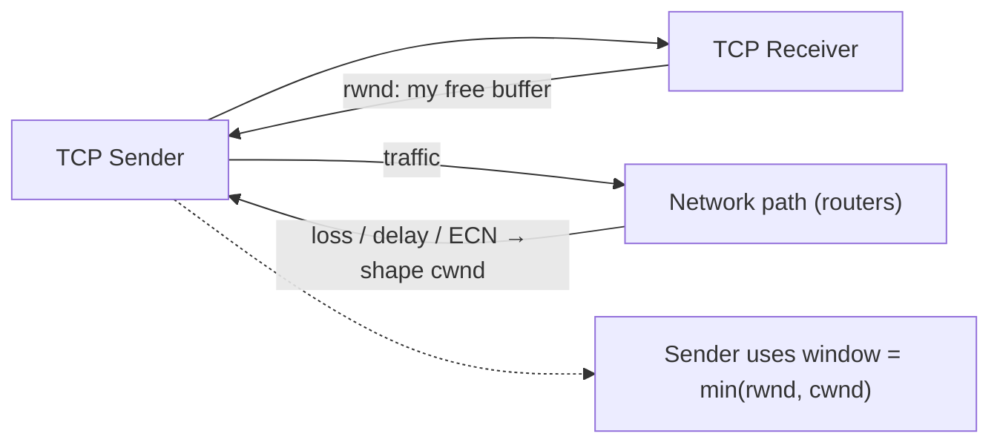

> **Memory line (from your Unit 3 notes):** *Flow control asks "can the receiver absorb more data?" — congestion control asks "can the network carry more traffic?" TCP must respect both.*

---

## Q13. Explain the UDP service model. State two reasons why an application may choose UDP and two important services that basic UDP does not provide.

### A. Exam-Ready Definition (from your Unit 3 notes, Section 3)

> **UDP** is a **connectionless** transport protocol. It provides **process-to-process delivery using port numbers** and includes a **checksum for error detection**, but it **does not establish a connection, guarantee delivery, maintain ordering, retransmit lost data, or provide built-in flow/congestion control**.

### B. What the Service Model Includes and Excludes

| Service | UDP provides? |
|---|---|
| Process addressing (ports) | ✅ Yes |
| Multiplexing / demultiplexing | ✅ Yes |
| Error detection (checksum) | ✅ Yes |
| Reliable delivery (ACK/retransmission) | ❌ No |
| Ordered delivery | ❌ No |
| Flow control | ❌ No |
| Congestion control | ❌ No |

**Also quote the misconception correction** (Unit 3, Section 3.3): *"UDP is unreliable" does not mean every packet is lost — it means UDP gives the application **no guarantee** that a datagram will arrive, arrive once, or arrive in order. Applications may add their own mechanisms above UDP.*

### C. Two Reasons an Application May Choose UDP (required — pick any two, give both below for safety)

1. **Low overhead and no connection setup:** the **UDP header is only 8 bytes**, and there is **no TCP-style handshake** — the very first packet can carry data. For tiny request/response exchanges (DNS queries — Q7) or real-time flows, eliminating handshake RTTs matters (Unit 3, Section 3.1).
2. **Timeliness beats retransmission (no head-of-line waiting):** for live voice/video, a **late packet is often useless**; UDP does not hold later datagrams hostage while a missing one is recovered. The application can tolerate or conceal small losses (jitter buffers, FEC) (Unit 3, Section 3.4).
3. *(Additional acceptable reasons: application control — implement exactly the reliability/timing/congestion behaviour needed, e.g., QUIC over UDP; and multicast/broadcast support for one-to-many delivery.)*

### D. Two Important Services Basic UDP Does NOT Provide (required — pick any two)

1. **Reliable, ordered delivery:** UDP will not detect a *lost* datagram (only *corrupted* ones, via checksum), will not retransmit, and delivers datagrams to the socket in arrival order — which may differ from send order. No ACKs, no sequence-based recovery.
2. **Flow control / congestion control:** UDP sends as fast as the application asks; it will **not slow down** for a slow receiver (no rwnd equivalent) and **does not react to network congestion** — a misbehaving UDP app can worsen congestion (the "responsible UDP application must regulate its own sending" point from your Unit 3 case study).

---

## Q14. Distinguish host-to-host delivery from process-to-process delivery. Explain how IP addresses and port numbers work together when a browser connects to a web server.

### A. Exam-Ready Definitions (from your Unit 3 notes, Sections 1–2)

> **Host-to-host delivery** is the **network layer's (IP's)** job: getting a packet from the **source host to the destination host** across interconnected networks. It answers: *"Which host should this packet reach, and how do I forward it?"*
>
> **Process-to-process delivery** is the **transport layer's** extension of that service: getting the data to the **correct application process/socket** on that host. It answers: *"Which application endpoint on that host should receive the data, and what service should it get?"*

### B. Division of Labour Table

| Aspect | Host-to-host | Process-to-process |
|---|---|---|
| **Layer** | Network (IP) | Transport (TCP/UDP) |
| **Identifier** | **IP address** (32-bit IPv4 / 128-bit IPv6) | **Port number (16 bits)** |
| **Implemented in** | Hosts **and every router** | **End hosts only**; routers don't run TCP/UDP for forwarded traffic (Unit 3, Section 2) |
| **Data unit** | IP datagram | TCP segment / UDP datagram |
| **Granularity** | Whole machine | Individual application/socket |

> **Exam-ready distinction (quote from your Unit 3 notes):** IP addresses identify **interfaces/hosts for routing**; port numbers identify **application endpoints/processes**. Together, **IP address + port identify a transport endpoint**. (Also recall the misconception: *"IP address identifies an application"* is **false**.)

### C. How They Work Together — Browser → Web Server (worked example)

**Diagram 5 — Two-level addressing in action (Added diagram):**

```mermaid
sequenceDiagram
    participant B as Browser (192.168.10.20, port 52341)
    participant R as Routers (forward on IP only)
    participant S as Web server (203.0.113.50)
    Note over B: Needs https://server → resolves IP first (DNS, Q7)
    B->>R: IP packet: src 192.168.10.20 → dst 203.0.113.50<br/>TCP: src port 52341 → dst port 443
    Note over R: Routers use ONLY the IP destination<br/>(longest-prefix match, Unit 4) to forward;<br/>they ignore ports
    R->>S: packet arrives at host 203.0.113.50
    Note over S: IP layer done — host reached.<br/>TCP demultiplexes: dst port 443 → HTTPS socket
    S->>B: reply: src IP 203.0.113.50:443 → dst 192.168.10.20:52341
    Note over B: Demultiplexed back to the right browser tab<br/>by port 52341
```

**Step-by-step reasoning (the marks are here):**

1. **DNS gives the IP address** of the server (203.0.113.50) — host-level destination determined (Q7).
2. **The OS assigns an ephemeral source port** (e.g., 52341) to the browser's socket; the **destination port is well-known 443** for HTTPS (Unit 3, Section 1.3 port ranges: well-known 0–1023).
3. **Every router along the path forwards using only the IP destination** — longest-prefix matching (Unit 4). Ports are **end-host information**; routers do not use them to route.
4. **When the packet reaches the host**, IP's job ends. The transport layer **demultiplexes by destination port 443** and hands the segment to the HTTPS process.
5. **The reverse path works symmetrically:** the server replies to IP 192.168.10.20, port 52341, so the laptop's OS can demultiplex the reply to the exact browser connection even while other applications communicate simultaneously — this is precisely **multiplexing/demultiplexing** (Unit 3, Section 1.2).

> **One-line conclusion:** *The IP address carries the packet to the right machine; the port number carries the data inside that machine to the right application. The pair (IP, port) uniquely identifies a transport endpoint.*

---

## Q15. Explain the purposes of source port, destination port, length and checksum in a UDP datagram. What can the checksum detect, and what does UDP do when delivery fails?

### A. The UDP Header (from your Unit 3 notes, Section 3.2 — 8 bytes, four 16-bit fields)

**Diagram 6 — UDP datagram structure (Added diagram, per Unit 3):**

```text
 0                   15 16                  31
+----------------------+----------------------+
|    Source Port       |   Destination Port   |  ← 4 bytes header
+----------------------+----------------------+
|       Length         |       Checksum       |  ← 4 bytes header
+----------------------+----------------------+
|              Application data                |  ← variable payload
+----------------------------------------------+
```

### B. Purpose of Each Field (the required part)

| Field | Purpose (from Unit 3 notes) |
|---|---|
| **Source Port (16 bits)** | Port of the **sending process**. Lets the receiver know **where to send replies** (demultiplexing return traffic). **May be zero** in limited IPv4 cases where no reply port is needed. |
| **Destination Port (16 bits)** | Identifies the **receiving service** on the destination host — the transport layer uses it to deliver the datagram to the **correct socket/process** (e.g., 53 → DNS). |
| **Length (16 bits)** | **Total UDP header plus payload length in bytes**; **minimum value is 8** (header only). Lets the receiver know where the UDP datagram ends within the IP payload. |
| **Checksum (16 bits)** | Detects **corruption in header/payload**; also covers selected IP information through a **pseudo-header** (so the datagram is verified to have arrived at the correct host/network context). |

### C. What the Checksum Can Detect (precision matters)

> **Exam-ready statement (quote from your Unit 3 notes):** *"UDP uses a 16-bit one's-complement checksum for error detection over the pseudo-header, UDP header and data."*

**It CAN detect:**
- **Bit corruption** anywhere in the UDP header or payload, computed with 16-bit one's-complement addition and end-around carry (Unit 3, Section 4.3).
- **Mis-delivery at the IP level** — because the **pseudo-header** includes source/destination IP information; if the datagram was delivered to the wrong host/context, the checksum fails (Unit 3, Section 4.1).
- If the received sum (including the checksum) does **not yield all 1s**, the datagram is **discarded**.

**It CANNOT do (state for full marks):**
- It is **error detection, not correction** — it does not tell the receiver how to repair the data.
- It is **not cryptographic authentication** — it "cannot prove that an attacker did not deliberately modify a packet" (Unit 3, Section 4).
- It is **not perfect** — some error patterns can go undetected (same caveat as Unit 5's parity/CRC discussion: a valid check never proves absolute absence of error).

### D. What UDP Does When Delivery Fails (the sharp answer)

> **Nothing, at the transport layer.** UDP has **no ACKs, no timers, no retransmission, no sequence-number recovery**.
> - A datagram **lost in the network** is simply gone — UDP never knows.
> - A datagram **failing the checksum** at the receiver is **discarded silently** — no error report to the sender from UDP itself.
>
> **Recovery, if needed, is the application's responsibility** — the application may add its own retransmission, sequencing, FEC or selective reliability above UDP (your Unit 3 notes: "many applications add their own mechanisms above UDP when required"; the QUIC/HTTP-3 example is the flagship: *"an excellent example of 'UDP transport' not implying an unreliable application service"*). End-to-end reliability could alternatively come from the *application's own* protocol logic rather than a transport protocol.

> **Common-mistake guard (from your Unit 3 notes, Section 15):** "UDP has no checksum" is **false** — UDP *has* a checksum field; **lack of retransmission is not lack of error detection**.

---

## Q16. A sender transmits a packet but does not receive an acknowledgement before its timer expires. Explain why a reliable data transfer protocol retransmits the packet. How should the receiver handle a duplicate?

### A. Topic Introduction

This is the heart of the **ARQ (Automatic Repeat reQuest)** family from your Unit 3 notes, Section 5. The scenario is the classic **timeout** event of rdt 3.0 / stop-and-wait.

### B. Why Retransmission Is Necessary (the reasoning the examiner wants)

**Diagram 7 — The timeout ambiguity (Added diagram):**

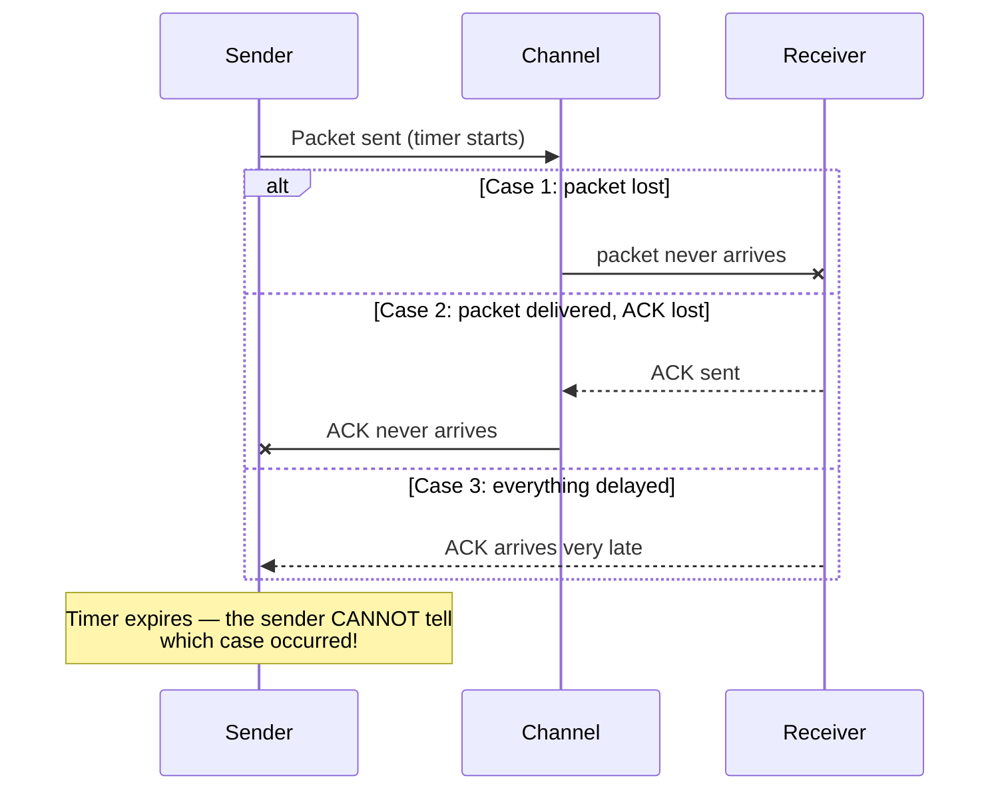

**Step-by-step reasoning:**

1. **The channel offers no certainty.** When the timer expires, three possibilities exist: (a) the **packet was lost**, (b) the packet arrived but **its ACK was lost**, or (c) the ACK is merely **delayed**. The sender **cannot distinguish** among them.
2. **A reliable protocol must make progress in the worst case.** If the packet (or its ACK) is genuinely lost, waiting longer delivers nothing. The **only universal-safe action** is to **retransmit** — if the original was lost, this recovers delivery; if only the ACK was lost, the retransmission is *redundant but harmless* (see part C).
3. **Loss cannot be detected without retransmission.** The link layer may have checksummed the frame (Unit 5), but a checksum on a frame that *never arrives* helps nobody — only **timers + retransmission** handle **loss**, which is exactly the problem/mechanism pairing from your Unit 3 table (Section 5.1: "Packet loss → Timer and retransmission").
4. **Why the timer, specifically:** the timer provides the *evidence deadline* — the sender "waits only a limited period for evidence of delivery; expiry triggers recovery" (Unit 3, building blocks of reliability).

### C. How the Receiver Should Handle a Duplicate

**The two tools: sequence numbers + (re)ACK.**

1. **Detect the duplicate with the sequence number.** Every packet carries a sequence number so "the receiver can recognise duplicates" (Unit 3, Section 5.1). In a **stop-and-wait protocol with 1-bit sequence numbers**: the receiver tracks the sequence number of the **last in-order packet delivered**.
2. **Discard the duplicate data — do not deliver it twice to the application.** Without this check, a retransmission caused by a *lost ACK* would be **delivered a second time**, corrupting the data stream (the very reason sequence numbers exist).
3. **Re-acknowledge the duplicate.** This is the subtle, high-mark point: the receiver **must send an ACK again** (for the sequence number it is waiting on / just delivered). Why? Because the duplicate arrives precisely in **Case 2 above — the original ACK was lost**. If the receiver discarded the data *and stayed silent*, the sender would **time out again and again forever** — a deadlock of repeated retransmissions. Re-ACKing breaks that loop: the sender finally receives an ACK and advances.

**Diagram 8 — Correct duplicate handling (Added diagram):**

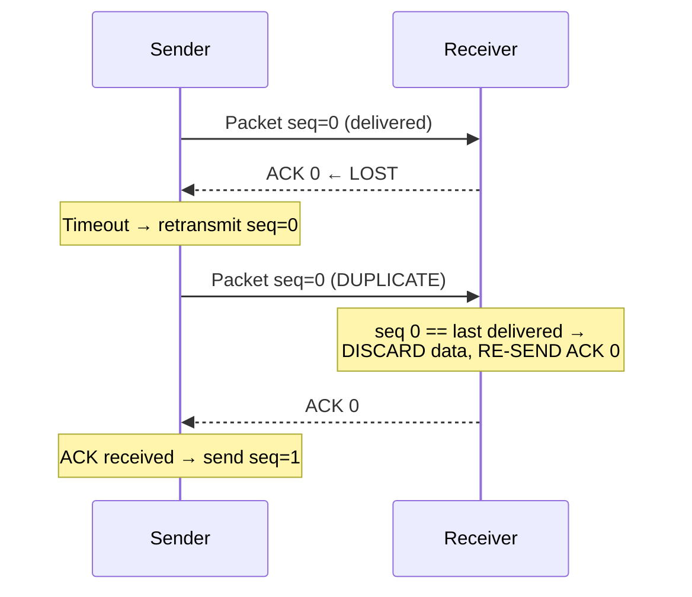

**Rule summary for the exam:**

| Situation at receiver | Action on data | Action on ACK |
|---|---|---|
| Packet is **new** (expected seq) | **Accept and deliver** upward | Send ACK for that seq |
| Packet is a **duplicate** (seq = already delivered) | **Discard** | **Re-send ACK** for that seq |
| Packet is **out of order / corrupt** | Discard (textbook stop-and-wait & GBN receiver) | Re-send ACK of last in-order packet (GBN-style cumulative ACK) |

> **One-line conclusion:** *Retransmission is the only action that works whether the packet or its ACK was lost; the receiver neutralises the redundancy of retransmission by discarding duplicates identified via sequence numbers — while re-acknowledging them so the sender's timer loop terminates.*

*(Extension worth one sentence: pipelined protocols generalise this — Go-Back-N retransmits from the missing packet onward on timeout, while Selective Repeat retransmits only the missing packet — your Unit 3, Sections 7–8.)*

---

## Batch 2 Quick-Revision Box

| Q | Core exam anchor |
|---|---|
| 9 | C/S: server = bottleneck, central control; **P2P self-scales** (each peer adds demand *and* capacity). Use cases: banking portal vs BitTorrent |
| 10 | 200 = success; **301 = permanent redirect** (site migration); 404 = client's bad URL; **503 = temporary server overload** (result-day) |
| 11 | **SMTP = push** (client→server, server→server); **IMAP/POP3 = pull**; mail waits in the **server mailbox** while laptop is off (store-and-forward) |
| 12 | Flow control = receiver (**rwnd**); congestion control = network (**cwnd**); effective window = **min(rwnd, cwnd)** |
| 13 | UDP = ports + checksum only. Choose for: **8-byte header/no handshake**, timeliness. Lacks: **reliability/ordering**, **flow/congestion control** |
| 14 | IP = host-to-host (routers use only IP); port = process-to-process (end hosts demultiplex); endpoint = **(IP, port)** |
| 15 | UDP fields: src port (reply address), dst port (service), length (header+payload, min 8), checksum (pseudo-header+header+data). Checksum **detects, never repairs/authenticates**; on failure UDP does **nothing** |
| 16 | Timeout = can't tell lost packet vs lost ACK → **retransmit**; receiver **discards duplicates (seq numbers) but re-ACKs** to break the resend loop |

---

✅ **Batch 2 complete (Q9–Q16).** Paste **Batch 3 (Q17–24)** whenever ready — same format throughout, and a consolidated `.md` file at the end if you want it.

---

Here are fully detailed, exam-ready answers for **Batch 3 (Q17–Q24)**. Q17–Q19 map to your **Unit 4 (Network Layer)** notes; Q20–Q22 map to your **Unit 5 (Link Layer)** notes; Q23–Q24 are **numerical problems** solved with complete step-by-step working. Save this as `Question_Bank_Batch3_Answers.md`.

---

# Computer Networks — Question Bank Answers, Batch 3 (Q17–Q24)

---

## Q17. Compare IPv4 and IPv6 with respect to address size, notation, header design, and address-space scalability.

### A. Topic Introduction

IPv4's 32-bit address space proved too small for a world of billions of connected devices. IPv6 was designed chiefly to provide **vastly larger addressing** and improve **protocol extensibility and forwarding efficiency** (your Unit 4 notes, Section 10). This comparison is a guaranteed-style exam question, and your Unit 4 notes contain the master table.

### B. Comparison Across the Four Required Aspects

**1. Address size**

| | IPv4 | IPv6 |
|---|---|---|
| Size | **32 bits** | **128 bits** |
| Address space | 2³² ≈ 4.29 billion addresses | 2¹²⁸ ≈ **340 undecillion** addresses — enough to give every device on Earth (and far beyond) many globally unique addresses |

**2. Notation**

| | IPv4 | IPv6 |
|---|---|---|
| Format | **Dotted decimal**, four decimal octets separated by dots: `192.168.10.77` | **Eight groups of four hexadecimal digits** separated by colons; **leading zeros in a group may be dropped**, and **one longest run of all-zero groups may be replaced by `::`** (may appear **only once**) |
| Prefix notation | CIDR: `192.168.10.77/26` | Same CIDR idea: `2001:db8::/32`; /64 is standard for LANs |
| Example of compression (from your Unit 4 notes, Section 11.1): | — | Full: `2001:0db8:0000:0000:0000:ff00:0042:8329` → Compressed: **`2001:db8::ff00:42:8329`** |

**3. Header design**

| Field aspect | IPv4 (Unit 4, Section 4.1) | IPv6 (Unit 4, Section 10.1) |
|---|---|---|
| **Header size** | **Variable, minimum 20 bytes** (IHL field, minimum 5 × 4 bytes; options add more) | **Fixed 40 bytes** — simpler, faster parsing |
| **Checksum** | **Present** (16-bit header checksum, recomputed at every router as TTL changes) | **Absent** — removed to speed forwarding; upper layers (TCP/UDP) already checksum |
| **Fragmentation** | **Routers may fragment** transit packets (unless DF set); fields: Identification, Flags, Fragment Offset | **Routers never fragment transit packets**; the **source is responsible** for sizing/fragmentation; uses Path MTU Discovery |
| **Options** | Inside the variable header (slow path) | Moved to **extension headers** (chained via Next Header field) |
| **Key fields** | TTL, Protocol (ICMP=1, TCP=6, UDP=17), DSCP/ECN | Traffic Class, **Flow Label** (identifies a flow for consistent handling), Payload Length, Next Header, **Hop Limit** (like TTL) |
| **Broadcast** | Supported (limited + directed) | **No broadcast; multicast/anycast used** |

**4. Address-space scalability**

- IPv4 (32 bits) is **exhausted**: mitigations include **private addresses + NAT/PAT** (Unit 4, Section 9), CIDR aggregation, and address markets — all workarounds that **break the end-to-end addressing model** (Unit 4: NAT "breaks pure end-to-end addressing").
- IPv6 (128 bits) needs **no NAT for address scarcity**: every device can have a globally routable address; **SLAAC** autoconfiguration, **/64 subnets**, hierarchical **aggregation-friendly** allocation.
- Key precision from your Unit 4 notes: *"IPv6 is **not merely 'IPv4 with more addresses'**"* — it changes **address representation, discovery (ND replaces ARP), multicast use, header processing, fragmentation responsibility and configuration**. However, it **remains a best-effort datagram network layer** and still relies on routing.
- Transition: because they are separate protocols, coexistence uses **dual stack, tunnelling, and translation (NAT64/DNS64)** (Unit 4, Section 12).

**Master summary table (adapted from your Unit 4 notes, Section 10.2):**

| Aspect | IPv4 | IPv6 |
|---|---|---|
| Address size | 32 bits | 128 bits |
| Base header | Variable, minimum 20 bytes | Fixed 40 bytes |
| Header checksum | Present | Absent |
| Router fragmentation | Possible unless DF set | Not performed by routers |
| Broadcast | Supported | No broadcast; multicast/anycast used |
| Configuration | Manual/DHCPv4 | SLAAC, DHCPv6 and manual options |
| Address resolution | ARP | Neighbour Discovery using ICMPv6 |
| Options | Within variable header | Extension headers |

---

## Q18. Explain the purpose of ICMP and describe any three situations in which ICMP messages are useful in IP networks.

### A. Exam-Ready Definition (from your Unit 4 notes, Section 13)

> **ICMP** carries **control, error-reporting and diagnostic information** associated with IP. It is **encapsulated inside IP** (Protocol = 1) but is conceptually a companion to the network layer. **ICMP reports a problem; it generally does not repair the failed packet or make IP reliable.**

### B. Purpose (state all three roles)

1. **Error reporting:** informs the sender *why* a datagram could not be delivered (unreachable, expired, too large).
2. **Control/diagnostic support:** supports reachability testing and path discovery tools used in network troubleshooting.
3. **Not a fix:** ICMP is informational — it never retransmits or repairs; that is TCP's/application's job (it is error *reporting*, not error *recovery* — contrast with Unit 5 error detection, which operates on frames).

### C. Three (Plus More) Situations Where ICMP Is Useful

**1. Reachability testing — Echo Request/Reply (ping).**
A host sends an ICMP Echo Request; the destination replies with an Echo Reply. The reply **confirms a round trip at that moment**. Useful when verifying whether a host is reachable at the IP layer after a configuration change. *(Caveats from your notes: a successful ping doesn't prove the application is healthy; a failed ping doesn't prove the host is down — ICMP may be filtered.)*

**2. Path discovery / hop mapping — Time Exceeded (traceroute).**
When a datagram's **TTL/Hop Limit reaches zero**, the router **discards it and returns ICMP Time Exceeded**. Traceroute deliberately sends probes with TTL = 1, 2, 3, … so successive routers reveal themselves hop by hop (see the diagram in your Unit 4 notes). Useful for locating **where reachability stops or becomes asymmetric** during troubleshooting (Unit 4 troubleshooting step 4).

**3. MTU negotiation — Destination Unreachable / "Fragmentation Needed" (IPv4) and Packet Too Big (ICMPv6).**
If a packet **exceeds the next-hop MTU** and **DF (Don't Fragment) is set** (or it's IPv6, where routers never fragment), the router drops the packet and sends this ICMP message reporting the **required MTU**. The source then reduces its packet size — this is the heart of **Path MTU Discovery**. Useful in diagnosing the classic *"small pings work but large uploads stall"* failure (Unit 4, symptom table) — and why **blanket-blocking ICMP breaks PMTUD**.

*(Additional acceptable situations: **Destination Unreachable** for a closed UDP port or no route; **Redirect** suggesting a better first hop on a local network — though often restricted for security; **DAD failure reports** in IPv6 Neighbour Discovery.)*

**Diagram 1 — ICMP in action across situations (Added diagram):**

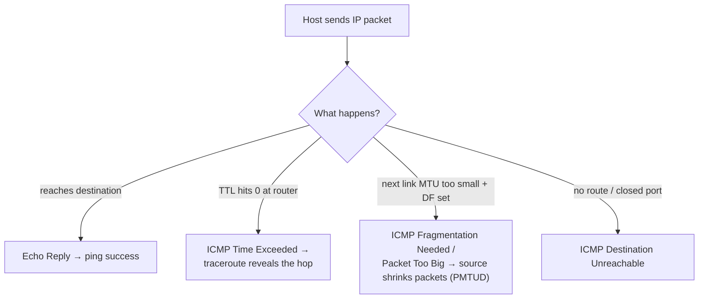

> **Troubleshooting principle (quote from your notes):** *Use ICMP as evidence, not as a complete diagnosis. Combine it with routing tables, interface counters, DNS tests, TCP/application tests, packet capture and monitoring.*

---

## Q19. Explain the DHCP Discover, Offer, Request and Acknowledgement sequence. What information besides an IP address can a client obtain through DHCP?

### A. Exam-Ready Definition (from your Unit 4 notes, Section 9.1)

> **DHCP (Dynamic Host Configuration Protocol)** automates host configuration. A joining client obtains an IP address and other network parameters through the four-message **DORA** sequence: **D**iscover → **O**ffer → **R**equest → **A**cknowledgement, exchanged with a DHCP server (typically broadcast on the local link).

### B. The DORA Sequence — Step by Step

**Diagram 2 — DHCP DORA (from your Unit 4 notes, redrawn):**

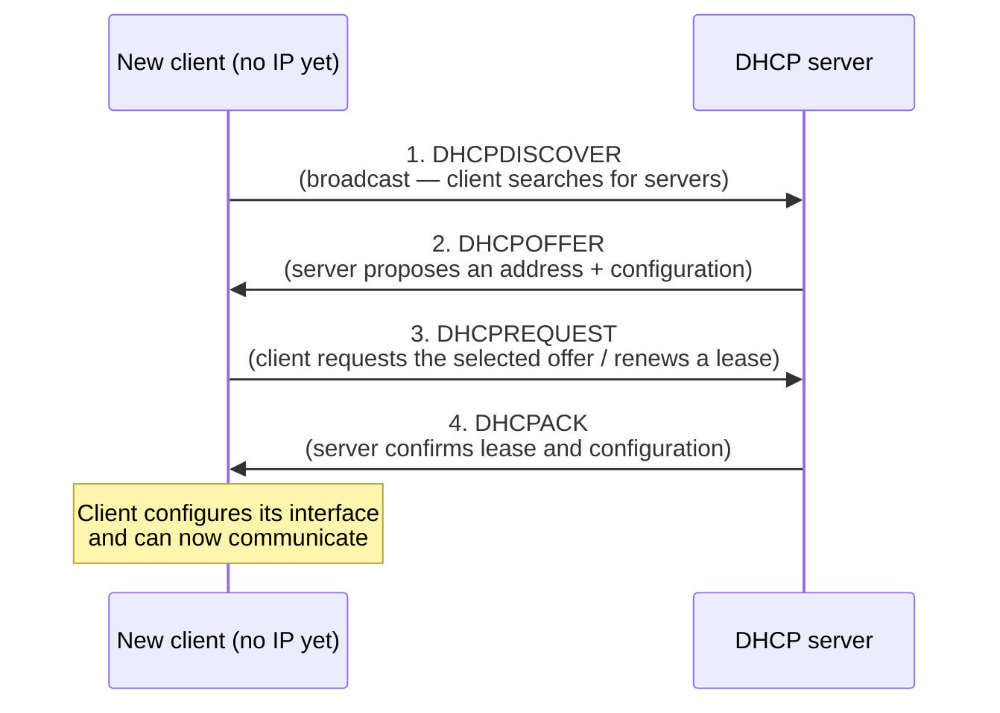

| Step | Message | Purpose (from your notes) |
|---|---|---|
| 1 | **DHCPDISCOVER** | Client **without an address searches** for DHCP servers (broadcast, since it has no address/gateway yet) |
| 2 | **DHCPOFFER** | Server **proposes** an address and configuration (may include lease duration) |
| 3 | **DHCPREQUEST** | Client **formally requests the selected offer** (if multiple servers offered) / renews an existing lease |
| 4 | **DHCPACK** | Server **confirms** the lease and configuration; client may now use the address |

**Supporting facts from your notes (quote-worthy):**
- A **DHCP relay** can forward client requests **between subnets** so every LAN does not need its own server.
- **Leases expire or are renewed** — the assignment is temporary, and *"DHCP assignment does not permanently prove user identity"* (relevant in the Unit 4 troubleshooting: a `169.254.x.x` address signals **DHCP failure** → link-local self-assignment).

### C. What Else a Client Obtains Besides an IP Address (the required list)

From your Unit 4 notes (Section 9 opening: *"Hosts need an address, prefix, default gateway and often DNS resolver information"*):

1. **Subnet mask / prefix length** — so the host knows which destinations are on-link vs off-link.
2. **Default gateway (default router) address** — where to send all off-subnet traffic (Q6/Q14's next hop).
3. **DNS resolver addresses** — so the host can resolve names (Q7).
4. **Lease duration / renewal timers** (T1/T2) — how long the address is valid.
5. *(Other common options worth listing: domain name, NTP server addresses, and other DHCP options — e.g., option 66/67 used for network booting.)*

> **One-line conclusion:** *DHCP delivers the complete "network bootstrap kit" — address + prefix + gateway + DNS + lease parameters — so a device becomes fully operational without manual configuration.*

---

## Q20. Explain the purpose of error detection at the link layer. Briefly describe parity and CRC, and state why CRC is generally better for detecting burst errors.

### A. Purpose of Link-Layer Error Detection (from your Unit 5 notes, Section 3)

> **Noise, interference, weak signals or faulty hardware can change transmitted bits.** Error control adds **redundant information** to a frame so the receiver can test the received sequence. **Detection says an error is likely present; correction identifies enough information to reconstruct the intended bits.** A valid check **never proves absolute absence of error** because undetected patterns can exist.

**Why at the link layer specifically:**
- Link media (copper, radio, fibre) experience **bit errors**, especially **bursts** of consecutive corrupted bits.
- Detecting (and discarding) a corrupt **frame immediately at the receiver adapter** prevents corrupted data from propagating up the stack or across the network — cheaper to catch early.
- Ethernet's **FCS** is the concrete example: *"CRC-based detection of transmission errors"* (Unit 5, Section 2 table); if the FCS fails, **the receiving interface normally discards the frame** (Unit 5, Section 6.2).
- Remember the detection-vs-correction boundary (Unit 5 "Do not confuse" box): *a checksum or CRC detects corruption; it does not inherently tell the receiver which original bit values to restore. Recovery usually means retransmission or an error-correcting code.*

### B. Parity — Brief Description (Unit 5, Section 4)

> With **even parity**, add one parity bit so the **total number of 1s is even** (odd parity makes it odd). If the receiver observes the wrong parity, corruption occurred. **Two bit flips may preserve the parity**, so single parity is a **limited test**.

- **Cost:** 1 extra bit.
- **Detects:** any **odd** number of flipped bits.
- **Misses:** any **even** number of flips (including 2) — the classic weakness.
- *(Two-dimensional parity improves on this: parity by rows **and** columns; a single-bit error is caught by one failing row and one failing column whose **intersection identifies the bad bit** — even allowing correction of a single error.)*

### C. CRC — Brief Description (Unit 5, Section 6)

> **CRC treats a bit string as polynomial coefficients over GF(2)** (addition/subtraction = XOR, no carry/borrow). Sender and receiver agree on a **generator G** (first and last bits 1). If G has **r + 1 bits**, the sender **appends r zeros to data D**, **divides by G using XOR long division**, and **replaces the zeros with the r-bit remainder R**. The receiver **divides the full codeword by G; a nonzero remainder indicates an error**.

- **Worked example** (your Unit 5 notes): D = 1101, G = 1011 → r = 3, append 000 → 1101000 → remainder **001** → codeword **1101001**; receiver gets remainder 000 if unchanged.
- **Ethernet FCS uses a specified 32-bit CRC** (Unit 5, Section 6.2).

### D. Why CRC Is Generally Better for Burst Errors (the required statement)

1. **Bursts are the dominant real-world error pattern.** *"Many real channel errors affect consecutive bits, called bursts"* (Unit 5, Section 6.2). Parity is weakest against exactly these patterns.
2. **Guaranteed burst coverage (from your Unit 5 notes, Section 6.1):** a CRC **detects all burst errors of length at most r** when the generator has degree r and a nonzero constant term; it also detects **all single-bit errors when G has more than one nonzero term**. Parity guarantees nothing beyond odd-flip detection.
3. **Mathematical structure:** CRC checks the *entire* frame as a polynomial-division residue; any burst that changes the remainder pattern is caught. Parity aggregates the whole frame into **one bit** of information — a single bit cannot represent "where/how" errors occurred, and even counts of flips cancel out.
4. **Hardware efficiency:** *"CRC arithmetic is efficient in hardware"* (shifregister + XOR), so strong detection costs very little — which is why **Ethernet uses a 32-bit CRC FCS** while simple parity survives only in low-cost serial links and as a building block (2-D parity, Hamming codes).

> **One-line conclusion:** *Parity offers 1-bit protection against odd numbers of flips; CRC offers polynomial-division-based detection that catches all bursts up to length r — and since real link errors come in bursts, CRC (as in Ethernet's 32-bit FCS) is the appropriate link-layer choice.*

---

## Q21. Differentiate parity, checksum, and CRC as error-detection techniques at a conceptual level.

### A. Conceptual Framing

All three add **redundancy** so the receiver can test the received sequence — but they differ in **how much redundancy, what mathematics, and which error patterns** they catch.

| Dimension | **Parity** | **Checksum** | **CRC** |
|---|---|---|---|
| **Core idea** | Make the count of 1s **even/odd** | **Sum** fixed-size words (16-bit) with **end-around carry**; transmit the complement | **Polynomial division** over GF(2): divide data (plus r zeros) by a generator G; transmit remainder R |
| **Mathematics** | Counting / XOR of all bits | Modular one's-complement addition | **Modulo-2 polynomial arithmetic** |
| **Redundancy** | **1 bit** | 16 bits (one checksum word) | r bits (e.g., 32 in Ethernet FCS) |
| **Detects** | Any **odd number** of flipped bits | Many **word-level** errors (used in TCP/UDP/IP headers) | **All single-bit errors** (if G has >1 nonzero term); **all bursts of length ≤ r**; many longer bursts |
| **Misses** | **Any even number** of flips | Certain compensating error patterns (e.g., equal-magnitude changes in opposite directions within a word sum) | **Never guaranteed** for all bursts longer than r — "never claim a CRC catches every possible error" |
| **Where used** | Simple serial links; 2-D parity grids; Hamming-code building block | **Internet protocols**: UDP, TCP, IP header (checksum from Unit 3) | **Link layer**: **Ethernet FCS (32-bit)**, Wi-Fi, many storage/media formats |
| **Cost/complexity** | Trivial (1 XOR tree) | Cheap (addition) | Very cheap in **hardware** (shift register + XOR), stronger guarantees |
| **Correction ability** | None alone (2-D variant can **locate** a single bit) | None | None (detection only — recovery = retransmission or FEC) |

### B. Conceptual Explanation of Each (short, exam-friendly)

**1. Parity — "one bit of bookkeeping."** Count the 1s; add a bit to fix the total to even (or odd). Elegant and nearly free, but any **even number** of flips restores the count — it detects *that something odd happened*, not *where* or *how much*.

**2. Checksum — "arithmetic summary of the whole message."** Split data into 16-bit words, add them with **end-around carry** (wrapping any overflow), and transmit the **one's complement** of the sum (Unit 5, Section 5: receiver's valid result is **0xFFFF**, or all zeros after complementing). Because many bits participate in the sum, more error patterns are caught than with parity — but errors that **cancel arithmetically** (equal and opposite changes) can slip through.

**3. CRC — "remainder of a polynomial division."** Treat the frame as a polynomial over GF(2) and divide by an agreed generator; the remainder is the check value. Division *amplifies* error effects: any change to the data changes the remainder in structured ways, giving **provable guarantees for single-bit errors and bursts up to length r** — the strongest of the three for link-layer burst errors.

**Diagram 3 — Conceptual escalation of detection power (Added diagram):**

```text
Detection power / redundancy →

Parity       ▮                      1 bit, odd-flip only
Checksum     ▮▮▮▮                   16 bits, word-level sum
CRC          ▮▮▮▮▮▮▮▮▮              r bits, polynomial division,
                                    guaranteed burst ≤ r coverage
```

### C. Shared Limitation to State (from your Unit 5 notes)

> All three are **detection, not correction**, and **none proves absolute absence of error**: *"A valid check never proves absolute absence of error because undetected patterns can exist."* Recovery from a detected error means **retransmission** (e.g., Wi-Fi ARQ, TCP) or an **error-correcting code** (FEC).

---

## Q22. The data bits are 1011011. Determine the even-parity bit and the transmitted bit sequence. Explain why a receiver might fail to detect two flipped bits using simple parity.

### A. Solution

**Given:** data = **1011011** (7 bits). Parity scheme: **even parity** (total number of 1s must be even).

**Step 1 — Count the 1s in the data.**
`1011011` → 1, 0, 1, 1, 0, 1, 1 → count = **5 ones** (odd).

**Step 2 — Determine the even-parity bit.**
To make the total even, the parity bit must be **1** (5 + 1 = 6 ones, even).

> **Even-parity bit = 1**

**Step 3 — Form the transmitted sequence.**
Convention (as in your Unit 5 notes, Section 4): the parity bit is **appended at the end**.

> **Transmitted bit sequence = 1011011**1** → `10110111`**

*(Cross-check with your Unit 5 notes' own table: data `1011011`, number of 1s = 5, even-parity bit = 1, transmitted bits = **10110111** — matches exactly.)*

**Receiver-side check:** count the 1s in the received 8 bits. If the count is **even** → accept; if **odd** → corruption detected.

### B. Why Two Flipped Bits Can Escape Detection (the required explanation)

**Step 1 — What parity actually measures.** The parity bit encodes **exactly one bit of information**: whether the number of 1s is even or odd. The receiver's entire test is: *"is the 1-count even?"* — nothing more.

**Step 2 — Effect of one flip vs two flips on the 1-count:**

| Flips | Effect on count of 1s | Parity result |
|---|---|---|
| **1 bit flips** (0→1 or 1→0) | count changes by **±1** → **odd ↔ even** | Parity check **fails** → error detected ✓ |
| **2 bits flip** | count changes by 0 (one 1→0 and one 0→1) or ±2 (two 1→0) | count **stays even** → check **passes** ✗ |

**Step 3 — The failure mechanism, explicitly:**
- If one flipped bit was a **1→0** and the other a **0→1**, the total number of 1s is **unchanged** — the count is still even, so the receiver accepts the frame as valid.
- If both flips were **1→0** (or both **0→1**), the count changes by **2** — even changes even parity to even. Again undetected.

**Worked demonstration (Added, using our data):**
Transmitted: `10110111` (six 1s — even). Suppose bits 2 and 5 flip: `1`**0**`110111` → `1`**1**`1`**0**`0111` = `11100111` — still six 1s → **even parity holds → error silently accepted**. The receiver has no way to know anything is wrong.

**Step 4 — The general principle:** one bit of redundancy can only "see" one dimension of the error space. It partitions all possible received words into two classes (even/odd) — an even number of flips keeps the word in the **correct class**. Detection of *k* errors requires the code's **minimum Hamming distance d ≥ k + 1** (your Unit 5, Section 3.1: a code with minimum distance *d* detects up to *d − 1* errors); simple parity has d = 2, so it detects only **1-bit** errors, and any 2-bit corruption is a valid codeword.

> **One-line conclusion:** *Even parity bit = 1; transmitted sequence = 10110111. Two flips escape because they change the count of 1s by an even amount (0 or ±2), preserving even parity — a fundamental limit of a 1-bit check, not a fluke.*

*(Remedy worth one sentence: two-dimensional parity or CRC provide the extra redundancy needed to catch such multi-bit patterns.)*

---

# Medium Answer Questions

## Q23. A 1,500-byte packet crosses two 10 Mbps links separated by one router. Each link is 400 km long and the propagation speed is 2 × 10⁸ m/s. The router introduces 0.5 ms processing delay and 1.5 ms queueing delay. Ignore all other delays. Calculate the total end-to-end delay.

### Step 1 — Organise the Given Information

| Quantity | Value |
|---|---|
| Packet length, **L** | 1,500 bytes = 1,500 × 8 = **12,000 bits** |
| Link rate, **R** (each of the two links) | 10 Mbps = 10 × 10⁶ bps |
| Link length, **d** (each link) | 400 km = 4 × 10⁵ m |
| Propagation speed, **s** | 2 × 10⁸ m/s |
| Router processing delay | 0.5 ms |
| Router queueing delay | 1.5 ms |
| Other delays | ignored |

**What to find:** total end-to-end delay across **two links + one router**.

**Formulas (Unit 4 delay model, as in Q4):**
- Transmission delay per link: **d_trans = L / R**
- Propagation delay per link: **d_prop = d / s**
- Total = 2 × d_trans + 2 × d_prop + d_processing + d_queueing

### Step 2 — Transmission Delay (per link)

```text
d_trans = L / R = 12,000 / (10 × 10⁶) = 1.2 × 10⁻³ s = 1.2 ms
```

Two links → **2 × 1.2 = 2.4 ms**

### Step 3 — Propagation Delay (per link)

```text
d_prop = d / s = (4 × 10⁵) / (2 × 10⁸) = 2 × 10⁻³ s = 2 ms
```

Two links → **2 × 2 = 4 ms**

### Step 4 — Router Delays

```text
Processing = 0.5 ms
Queueing   = 1.5 ms
```

### Step 5 — Total End-to-End Delay

| Component | Calculation | Delay |
|---|---|---|
| Transmission (2 links) | 2 × (12,000 / 10⁷) | 2.4 ms |
| Propagation (2 links) | 2 × (4×10⁵ / 2×10⁸) | 4.0 ms |
| Router processing | given | 0.5 ms |
| Router queueing | given | 1.5 ms |
| **TOTAL** | 2.4 + 4.0 + 0.5 + 1.5 | **8.4 ms** |

> **✅ Total end-to-end delay = 8.4 ms**

### Step 6 — Interpretation

- **Propagation dominates** (4 ms of 8.4 ms ≈ 48%) because the links are long (400 km each) — a consequence of physics, unaffected by link speed upgrades.
- Transmission delay is significant (2.4 ms) because 10 Mbps is slow by modern standards — this portion would shrink on a faster link.
- **Diagram 4 — Delay accumulation across the path (Added diagram):**

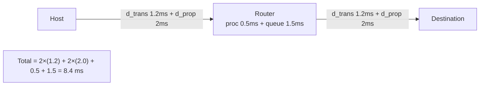

*(Common student error to avoid: forgetting to **double** the per-link delays for two links, or using 1,500 bits instead of 1,500 × 8 = 12,000 bits.)*

---

## Q24. A 240 MB file is transferred over a path containing links of 100 Mbps, 40 Mbps, and 80 Mbps. Ignore protocol overhead. Identify the bottleneck and calculate the ideal transfer time. If the 40 Mbps bottleneck is shared equally by four simultaneous long-lived transfers, estimate the rate available to each transfer and the new transfer time.

### Part 1 — Identify the Bottleneck

**Principle:** on a multi-hop path with no other constraints, the **end-to-end throughput** is limited by the **slowest link** (the **bottleneck link**), because every bit must pass through every link.

**Given rates:** 100 Mbps → 40 Mbps → 80 Mbps.

```text
Path:  [Host] --100 Mbps--> [Router] --40 Mbps--> [Router] --80 Mbps--> [Server]
                                   ▲
                          BOTTLENECK: 40 Mbps
```

> **Bottleneck link = 40 Mbps** → effective end-to-end throughput ≈ **40 Mbps**.

### Part 2 — Ideal Transfer Time

**Given:** File size = 240 MB (using decimal MB, 1 MB = 10⁶ bytes — state your assumption).

**Step 1 — Convert the file to bits:**

```text
240 MB = 240 × 10⁶ bytes × 8 bits/byte = 1.92 × 10⁹ bits
```

**Step 2 — Apply the formula:**

```text
Transfer time = Data / Throughput = 1.92 × 10⁹ bits / (40 × 10⁶ bps)
              = 48 seconds
```

> **✅ Ideal transfer time = 48 seconds**

*(Note: if your course uses binary MB, 1 MB = 2²⁰ bytes: 240 × 2²⁰ × 8 = 2.013 × 10⁹ bits → time ≈ 50.3 s. State the assumption you use; the decimal convention gives the clean 48 s.)*

### Part 3 — Bottleneck Shared by Four Transfers

**Assumption:** the 40 Mbps bottleneck is **fairly shared equally** by four simultaneous **long-lived** transfers, and the 100 Mbps and 80 Mbps links still have ample spare capacity for each flow.

**Step 1 — Rate per transfer:**

```text
Rate per transfer = 40 Mbps ÷ 4 = 10 Mbps per transfer
```

> **✅ Each transfer gets ≈ 10 Mbps**

*(This is exactly the statistical-sharing behaviour of packet switching from Q2 — and, at a microscopic level, what TCP congestion control (Unit 3) approximates via AIMD among competing flows.)*

**Step 2 — Check the other links still suffice:**
- Each flow also traverses the 100 Mbps link: 4 × 10 = 40 Mbps ≪ 100 Mbps ✓
- Each flow also traverses the 80 Mbps link: 4 × 10 = 40 Mbps ≪ 80 Mbps ✓
- So the bottleneck remains the 40 Mbps link; no additional constraint appears. ✓

**Step 3 — New transfer time:**

```text
New transfer time = 1.92 × 10⁹ bits / (10 × 10⁶ bps) = 192 seconds
```

> **✅ New transfer time = 192 seconds (3 minutes 12 seconds)**

### Part 4 — Summary Table and Interpretation

| Scenario | Effective rate | Transfer time |
|---|---|---|
| Alone on the path | **40 Mbps** (bottleneck) | **48 s** |
| Sharing the 40 Mbps bottleneck with 3 other flows | **10 Mbps** | **192 s** |

**Interpretation:**
- **4× slower** when sharing — the bottleneck divides its capacity, not the path's fastest link.
- The 100 Mbps and 80 Mbps links never mattered — **a chain is only as fast as its slowest link**.
- Real networks add protocol overhead, TCP slow-start ramp-up and congestion-control dynamics, so actual times exceed these ideal values (the question says to ignore these).
- **Diagram 5 — Bottleneck sharing (Added diagram):**

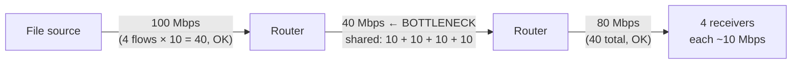

---

## Batch 3 Quick-Revision Box

| Q | Core exam anchor |
|---|---|
| 17 | IPv4: 32-bit, dotted decimal, **variable 20-byte header + checksum + router fragmentation**; IPv6: **128-bit, colon-hex with `::` once, fixed 40-byte header, no checksum, no router fragmentation, ND replaces ARP** |
| 18 | ICMP = IP's error/diagnostic companion (IP protocol 1); three uses: **ping (Echo), traceroute (Time Exceeded), PMTUD (Packet Too Big/Fragmentation Needed)** |
| 19 | DORA: **Discover → Offer → Request → ACK**; also delivers **subnet mask, default gateway, DNS servers, lease timers** |
| 20 | Link detection prevents corrupt frames propagating; parity = 1 bit/odd flips; CRC = polynomial division, **catches all bursts ≤ r** |
| 21 | Parity = count; checksum = 16-bit one's-complement sum; CRC = GF(2) polynomial division — increasing power, all detection-only |
| 22 | 1011011 has **5 ones** → parity bit **1** → **10110111**; two flips change the count by 0/±2 → parity preserved → undetected |
| 23 | 2×(L/R) + 2×(d/s) + proc + queue = **2.4 + 4.0 + 0.5 + 1.5 = 8.4 ms** |
| 24 | Bottleneck **40 Mbps** → **48 s**; shared by 4 → **10 Mbps each → 192 s** |

---

✅ **Batch 3 complete (Q17–Q24).** The numericals (Q23, Q24) follow your Unit 4 delay model and bottleneck principle — worth re-deriving once by hand before the exam. Paste **Batch 4 (Q25–32)** whenever ready.

---
Here are fully detailed, exam-ready answers for **Batch 4 (Q25–Q32)**. Q25–Q26 cover protocol stack fundamentals and delay calculations; Q27–Q31 are **applied application-layer scenarios** (these are "apply" questions, so answers must trace sequences, not just define terms); Q32 is straight from your **Unit 3 notes, Section 7.2**. Save this as `Question_Bank_Batch4_Answers.md`.

---

# Computer Networks — Question Bank Answers, Batch 4 (Q25–Q32)

---

## Q25. Explain encapsulation as application data moves down the protocol stack at the sender and decapsulation at the receiver. Name the data unit at the transport, network and link layers.

### A. Exam-Ready Definition

> **Encapsulation** is the process by which each layer at the **sender** takes the data from the layer above, **adds its own header** (and sometimes a trailer) containing layer-specific control information, and passes the result down to the layer below. **Decapsulation** is the reverse process at the **receiver**: each layer **removes and processes the corresponding header** and passes the payload upward. Each layer's headers are read **only by the peer layer** at the other end.

### B. The Process — Step by Step at the Sender

**Diagram 1 — Encapsulation down the stack (Added diagram):**

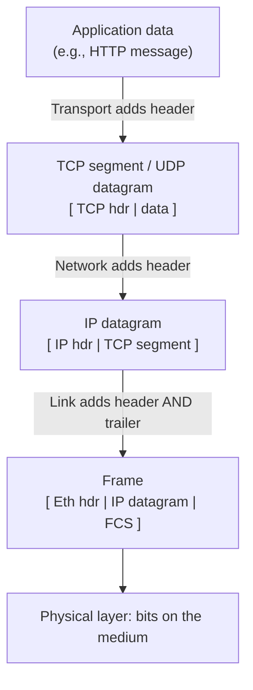

**Numbered steps (sender):**
1. **Application layer:** the browser produces an **application message** (e.g., an HTTP request). It passes the message to the transport layer via a socket.
2. **Transport layer (TCP/UDP):** adds a **transport header** — source/destination **ports** (process addressing), sequence numbers/ACK fields (TCP), or length/checksum (UDP). The unit becomes a **TCP segment** (or **UDP datagram**). TCP may first divide a large application message into multiple segments (Unit 3: segmentation).
3. **Network layer (IP):** adds an **IP header** — source/destination **IP addresses**, TTL/Hop Limit, Protocol field (6 = TCP, 17 = UDP), Total Length. The unit becomes an **IP datagram** (Unit 4, Section 4.2: *"IP adds an IPv4 header, producing an IP datagram"*).
4. **Link layer:** adds a **link header** (source/destination **MAC addresses**, type field) **and often a trailer** (Ethernet's **FCS** — CRC-based error detection, Unit 5). The unit becomes a **frame**, and the frame's payload may be padded.
5. **Physical layer:** converts the frame to **signals** (electrical/optical/radio) for the medium.

### C. Decapsulation at the Receiver

1. **Link layer (adapter):** checks the frame (FCS); if valid, **removes the link header/trailer** and passes the payload (the IP datagram) upward. *A corrupt frame is normally discarded* (Unit 5).
2. **Network layer:** checks the IP header (destination IP = this host), decrements logic already done by routers; **removes the IP header** and uses the **Protocol field** to decide the upper-layer handler (TCP/UDP) — this is why TTL and Protocol are *not* the same (Unit 4, Section 4.3).
3. **Transport layer:** uses the **destination port** to **demultiplex** the segment to the correct socket/process (Unit 3, Section 1.3); performs its services (reordering, ACKs, flow control for TCP); **removes the transport header**.
4. **Application layer:** the process receives the **message** and interprets its semantics (HTTP status, mail content, etc.).

**Diagram 2 — Peer-to-peer view (Added diagram):**

```text
Sender                        Receiver
App  ────── message ───────── App    ← semantic peers
TCP  ────── segment ────────  TCP    ← transport peers
IP   ────── datagram ───────  IP     ← network peers
Eth  ────── frame ──────────  Eth    ← link peers (per hop!)
        (frames change at EVERY router; the layers above do not)
```

### D. Data Units at Each Layer (the required names — memorise)

| Layer | Data unit (PDU) | Header information added |
|---|---|---|
| Application | **Message** | Protocol semantics (HTTP request, DNS query) |
| **Transport** | **Segment** (TCP) / **Datagram** (UDP) | Ports, sequence/ACK, checksum |
| **Network** | **Datagram** (IP packet) | IP addresses, TTL, Protocol |
| **Link** | **Frame** | MAC addresses + **FCS trailer** |
| Physical | **Bits** | — |

> **Key exam boundary (from your Unit 4 notes):** a **router removes and replaces the link-layer frame at each hop; the IP packet continues across the route** (TTL changes). So encapsulation/decapsulation of the *link header* happens **at every hop**, while transport/application encapsulation happens **only at the two end hosts**.

---

## Q26. A 1,000-byte packet is sent on a 20 Mbps link. Calculate its transmission delay. Explain whether doubling the physical length of the link changes this delay.

### A. Solution

**Given information:**
- Packet length, **L** = 1,000 bytes = 1,000 × 8 = **8,000 bits**
- Link rate, **R** = 20 Mbps = 20 × 10⁶ bps

**Formula (from the delay model — Q4/Batch 3 Q23):**

```text
Transmission delay = L / R
```

**Substitution and calculation:**

```text
d_trans = 8,000 bits / (20 × 10⁶ bits/s)
        = 4 × 10⁻⁴ s
        = 0.4 ms
```

> **✅ Transmission delay = 0.4 ms (400 μs)**

### B. Does Doubling the Physical Link Length Change This Delay?

> **✅ No — transmission delay is completely independent of link length.**

**Reasoning (the marks are in the explanation):**

1. **Look at the formula:** d_trans = **L / R**. It contains only the **packet length** and the **link's transmission rate (bandwidth)**. The physical distance **d does not appear anywhere in it**.
2. **Physical meaning:** transmission delay is the time to **push/serialize all the packet's bits onto the link at the link's rate** — like the time to load a truck onto a highway. Loading time depends on the truck's size and the loading rate, **not on how long the highway is**.
3. **What doubling the length actually changes:** the **propagation delay**:

```text
d_prop = d / s   →   doubling d doubles the propagation delay
```

   e.g., if the link were 400 km at s = 2 × 10⁸ m/s: d_prop = 2 ms originally; after doubling to 800 km, d_prop = **4 ms** — but d_trans remains **0.4 ms**.

4. **Correct statement of independence:** each delay is governed by different variables —

| Delay | Formula | Depends on | Does NOT depend on |
|---|---|---|---|
| **Transmission** | L / R | packet length L, link rate R | link **length**, propagation speed |
| **Propagation** | d / s | link length d, medium speed s | packet length, link rate |

> **One-line conclusion:** *d_trans = 8,000 / 20×10⁶ = 0.4 ms. Doubling the link length leaves transmission delay unchanged at 0.4 ms — length affects only propagation delay (d/s), not the bit-injection time (L/R).*

---

## Q27. A student enters an HTTPS URL for a university portal for the first time. Apply application-layer concepts to explain the sequence from hostname resolution to the first page display. Include the roles of DNS, transport/TLS setup, HTTP request-response, and cookies or caching.

### A. Why This Question Is "Apply"

"**First time**" is the key word: no browser cache, no DNS cache, no cookies exist yet — so every step runs in full. Trace the sequence in order and attach the right protocol to each stage.

### B. Full Sequence — Step by Step

**Diagram 3 — First HTTPS visit, complete flow (Added diagram):**

```mermaid
sequenceDiagram
    participant U as Student's browser
    participant D as DNS system
    participant S as Portal server (TCP 443)
    Note over U,D: PHASE 1 — DNS (no cache: full lookup)
    U->>D: Query www.university.edu A/AAAA?
    D-->>U: IP address (e.g., 203.0.113.50)
    Note over U,S: PHASE 2 — TCP setup (transport layer)
    U->>S: SYN → SYN-ACK → ACK (port 443)
    Note over U,S: PHASE 3 — TLS handshake (application-adjacent security)
    U->>S: ClientHello (ciphers, key share)
    S->>U: ServerHello + certificate
    U->>U: Verify certificate (identity + encryption keys agreed)
    Note over U,S: PHASE 4 — HTTP request/response (inside TLS)
    U->>S: GET / HTTP/1.1  Host: www.university.edu
    S->>U: 200 OK + Set-Cookie: SESSIONID=... + HTML
    Note over U: PHASE 5 — render page; more GETs for images/CSS/JS
```

**Phase 1 — DNS hostname resolution (why: humans use names, IP needs addresses).**
- The browser first checks its own **DNS cache** and the OS cache — **empty, because this is the first visit**.
- The query goes to the configured **recursive resolver** (obtained via DHCP — Q19), which performs the hierarchical lookup: **root → TLD (.edu) → authoritative server** for `university.edu` (Q7 diagram).
- The answer is an **A record** (IPv4) and/or **AAAA record** (IPv6, Unit 4) → e.g., `203.0.113.50`, and it is **cached with its TTL** for future visits (Q31 will show why this caching matters).

**Phase 2 — Transport setup: TCP three-way handshake.**
- HTTPS runs over **TCP**, so before any HTTP bytes can flow, the endpoints establish connection state: **SYN → SYN-ACK → ACK** (Unit 3, Section 10.2). The browser uses an **ephemeral source port** (e.g., 52341) toward **destination port 443** (Unit 3, port ranges).
- Why TCP and not UDP: the portal page must arrive **complete, correct and in order** (Unit 3: TCP's reliable ordered byte stream).

**Phase 3 — TLS handshake (security layer inside the "S" of HTTPS).**
- The client and server negotiate encryption: the server presents its **certificate**; the browser validates it against trusted authorities (proving it really is the university's server); keys are established.
- Layering lesson (your Unit 3 notes): **HTTPS does not replace TCP/IP** — TLS encrypts the HTTP bytes and hands them to TCP as an ordinary **byte stream**. Reliability is TCP's job; confidentiality/integrity is TLS's; delivery is IP's.

**Phase 4 — HTTP request–response (application semantics).**
- The browser sends: `GET / HTTP/1.1` with a **Host header** (naming the portal — one server may host many sites) (Q29).
- The server responds **`200 OK`** with the homepage HTML; further objects (CSS, images) are fetched by subsequent requests — over the **same persistent connection** (HTTP/1.1 default, Q8) if supported.

**Phase 5 — Cookies and caching in this first visit.**
- **Cookies:** the server may issue `Set-Cookie: SESSIONID=...`. Since this is the first visit, **no cookie is sent by the browser** (there is nothing to send); from the second request onward, the browser echoes the cookie so the server can maintain **session state** over stateless HTTP (Q8, Q30 — e.g., keeping a student logged in).
- **Web caching:** on a first visit the **browser cache is empty (cold cache)** → all objects come from the origin (or an intermediary cache/CDN on its behalf). Objects downloaded now are **stored with freshness metadata**, so a *second* visit can serve them locally — faster and cheaper (Q8). DNS results are likewise cached per their **TTL** (Q31).

> **One-line conclusion:** *DNS resolves the name (full hierarchy walk, results cached) → TCP connects to port 443 → TLS authenticates and encrypts → HTTP exchanges GET/200 for the page → cookies begin a session and caching prepares for faster future visits. The order is strict: no TCP without an IP from DNS; no HTTP before TLS; no page without HTTP.*

---

## Q28. Apply application-layer concepts to trace an email sent from Alice at one domain to Bob at another domain. Explain the roles of the Mail User Agent, SMTP, DNS MX records, the receiving mail server, and IMAP/POP or webmail access.

### A. The Cast (roles first — the examiner wants these named precisely)

| Actor | Role |
|---|---|
| **Mail User Agent (MUA)** | The mail **program the human uses** — Thunderbird, Outlook, phone mail app, or webmail in a browser. Composes, reads, submits and fetches mail. |
| **Mail server (MTA — Message Transfer Agent)** | Server-side process that **stores mailboxes** and **relays mail** using SMTP. Alice's domain and Bob's domain each run one. |
| **SMTP** | The **push/transfer protocol**: Alice's MUA → Alice's server, and server → server across the Internet (port 25 between servers; 587 for client submission). |
| **DNS MX record** | Tells the world **which host accepts mail for Bob's domain** (and with what **priority** if there are several) (Q7). |
| **IMAP/POP3/webmail** | The **retrieval step**: Bob's client pulls mail from Bob's server mailbox (IMAP 143/993, POP3 110/995) or reads it through webmail over HTTP(S). |

### B. The Trace — End to End

**Diagram 4 — Alice → Bob email path (Added diagram):**

```mermaid
sequenceDiagram
    participant A as Alice's MUA
    participant AS as Alice's mail server (MTA)
    participant D as DNS
    participant BS as Bob's mail server (MTA)
    participant B as Bob's MUA (laptop/phone)
    Note over A,AS: STEP 1 — submission
    A->>AS: SMTP (port 587): "Here is mail for bob@other.edu"
    Note over AS,D: STEP 2 — find Bob's server
    AS->>D: MX query for other.edu
    D-->>AS: MX 10 → mail.other.edu (+ its A record IP)
    Note over AS,BS: STEP 3 — Internet transfer
    AS->>BS: SMTP (port 25): server-to-server push
    Note over BS: STEP 4 — storage in Bob's mailbox<br/>(Bob's device need NOT be online — Q11)
    Note over B,BS: STEP 5 — retrieval (whenever Bob connects)
    B->>BS: IMAP: fetch new messages
    BS->>B: Messages delivered / synchronised
```

**Step-by-step explanation:**

1. **Alice composes and submits (MUA + SMTP).** Alice's MUA formats the message (headers: From, To, Subject; body) and **pushes** it to her own mail server using **SMTP**. Her server does not yet know how to reach Bob — it only accepts responsibility for the message.
2. **Locating Bob's server (DNS MX).** Alice's server queries DNS for **`other.edu MX`**. The MX answer gives the **hostname of the mail exchanger** (e.g., `mail.other.edu`) plus a **priority**; the server then resolves that hostname's **A/AAAA record** to get an IP. *(This is the precise role of MX: mail for the domain, not for a single web host — the distinction from Q7.)*
3. **Server-to-server transfer (SMTP push).** Alice's server opens an SMTP session **directly to Bob's mail server** and transfers the message. SMTP is a **push protocol** — Alice's side initiates everything; Bob's device is irrelevant at this stage.
4. **Storage (store-and-forward — why offline delivery works).** Bob's server **writes the message into Bob's mailbox on its disk**. Delivery is complete from the network's perspective even though **Bob's laptop is switched off** (Q11's core answer). If Bob's server is unreachable, Alice's server **queues and retries** — store-and-forward in both directions.
5. **Retrieval (IMAP/POP3 or webmail).** When Bob next connects, his MUA either:
   - uses **IMAP** — mail **stays on the server**; folders and read/unread state **synchronise across all his devices** (phone + laptop consistent); or
   - uses **POP3** — typically **downloads** messages to one device (optionally deleting from the server); or
   - opens **webmail** — the browser speaks **HTTP(S)** to a web application, which internally uses IMAP/storage on Bob's server.

> **One-line conclusion:** *The MUA composes; SMTP pushes Alice→her server→Bob's server (with DNS MX finding Bob's exchanger); the mailbox lives server-side; IMAP/POP3/webmail merely retrieve later. Two protocols, two journeys — never SMTP for retrieval.*

---

## Q29. An HTTP request contains a method, request target, Host header and message body. Explain the purpose of each. When would POST be more appropriate than GET?

### A. Anatomy of an HTTP Request

```text
GET /courses/networks/syllabus.pdf HTTP/1.1     ← request line: METHOD + target + version
Host: www.university.edu                        ← headers (one per line)
User-Agent: Mozilla/5.0 ...
Accept: text/html,application/pdf
                                                ← blank line separates headers from body
[ message body — empty for GET; data for POST ] ← body
```

### B. Purpose of Each Part

| Component | Purpose |
|---|---|
| **Method** | The **action/verb** the client wants performed on the resource — defines the semantics of the request. Common methods: **GET** (retrieve), **POST** (submit data for processing), **PUT** (store), **DELETE** (remove), HEAD (headers only). The server's status code (Q10) reports the outcome. |
| **Request target** | The **identifier of the resource** on the server — the path (and query string) of the URL, e.g., `/courses/networks/syllabus.pdf` or `/search?q=router`. Combined with the Host header, it uniquely locates the object. |
| **Host header** | Names **which website** (hostname) the request is for. Essential because **many websites can share one physical server / one IP address**; the IP layer delivers to the machine, but the Host header lets the server software pick the correct site among virtual hosts. (It is mandatory in HTTP/1.1.) |
| **Message body** | Optional **payload carrying data** associated with the request — form fields, uploaded files, JSON for APIs. Typically **empty for GET** (GET retrieves; parameters ride in the URL query string) and **populated for POST** (data rides in the body). |

### C. When POST Is More Appropriate Than GET (the required part — give criteria + example)

**Rule of thumb: GET is for *reading*; POST is for *causing an effect* or *sending sensitive/bulky data*.** Use POST when:

1. **The request changes server state** (non-idempotent). Submitting an exam registration, placing an order, updating a student record — these must not be casually repeated or pre-fetched. A GET could be triggered by a crawler, a prefetcher, or a simple page reload, causing unintended repeats; POST signals intent to modify.
2. **The data is sensitive** (passwords, exam answers, payment details). In GET, parameters appear **in the URL** — visible in browser history, server logs, and the address bar, and often cached. POST carries them **in the message body**, keeping them out of URLs and logs. *(Caveat for full marks: plain HTTP encrypts nothing — the privacy benefit of POST assumes HTTPS, which encrypts the whole exchange anyway (Q27).)*
3. **The data is large or of arbitrary type.** URLs have practical length limits and are constrained to URL-safe characters; file uploads (assignment submission) must go in a POST **body**.

**Concrete university example:** submitting the **examination form** should be `POST /exams/register` with the details in the body (state change + sensitive + possibly long data), while **viewing** the timetable should be `GET /timetable` (safe, repeatable, cacheable — which also lets web caches serve it, Q30).

| | GET | POST |
|---|---|---|
| Semantics | Retrieve (safe, idempotent) | Submit/process (may change state) |
| Data location | URL query string | Message body |
| Sensitive data in logs/history? | Yes | No |
| Cacheable / bookmarkable | Yes | Generally no |
| Example | View brochure | Submit results form |

---

## Q30. A university portal serves a public course brochure and individual student results. Recommend suitable caching behaviour for each resource and explain the privacy risk of caching them incorrectly.

### A. The Two Resources Are Fundamentally Different

| Resource | Nature | Personal? | Changes? |
|---|---|---|---|
| **Course brochure** | Public, static content | No — identical for every user | Rarely (per semester) |
| **Student results** | **Per-user private dynamic content** | **Yes — sensitive personal data** | Can change (revaluation, updates) |

The caching decision follows directly from these two properties: **personalisation and privacy**.

### B. Recommended Caching Behaviour

**1. Public course brochure — cache aggressively.**
- Mark it **cacheable**: allow browser caches, proxy caches and CDNs to store it (e.g., long freshness lifetime, `Cache-Control: public, max-age=...` — an appropriate header-based answer at this level).
- **Benefits:** faster page loads for thousands of students; reduced load on the portal server; reduced bandwidth on the access network (Q8: caching's purpose). Conditional requests (`If-Modified-Since`) can validate freshness after brochure updates (Q8).
- *(Practical note: use a modest max-age or revalidation so a brochure update propagates within an acceptable time.)*

**2. Individual student results — do NOT cache in shared caches; at most minimal private caching.**
- Mark it **non-cacheable by shared intermediaries**: `Cache-Control: private, no-store` (or `no-cache` with mandatory revalidation) and disable any proxy/CDN caching of the response.
- The browser itself may keep a copy only under strict `private` semantics — but for highly sensitive data, `no-store` (nothing cached anywhere, including back/forward cache) is the safe recommendation.

**Diagram 5 — Correct vs incorrect cache scoping (Added diagram):**

```mermaid
flowchart LR
    B["Student A's browser"] --> P["Shared proxy / CDN cache"]
    P --> S["Portal server"]
    B -- "brochure: cacheable (public)" --> P
    P -.->|"serves cached copy to<br/>Student B, C, D — fine"| O["Other students"]
    B -- "results: no-store / private" --> P
    P -.->|"✗ must NEVER store or<br/>re-serve Student A's results<br/>to Student B"| X["Privacy breach!"]
```

### C. The Privacy Risk of Caching Incorrectly (the required explanation)

**Scenario of the failure:** suppose the results page is cached like the brochure — stored in a **shared proxy/CDN cache** or served from an aggressively cached page.

1. **Wrong-user delivery:** the cache keys responses by **URL**, not by user. Student A fetches `/results` while logged in; the cache stores the response. Student B later requests the **same URL** — the cache may serve **Student A's marks to Student B** without even contacting the server. If the results URL carries the session as a query parameter (`/results?student=A123`) the risk is even more direct.
2. **Shared-machine leakage:** on a lab computer, browser-cached results pages may be visible from the **back button or local cache** to the next user of that machine.
3. **Consequences:** disclosure of **personal academic data** to unauthorised parties — a privacy (and in many jurisdictions, legal) violation; loss of trust; institutional liability.

**Why the brochure carries no such risk:** its content is **identical for all users and non-personal**, so "serving A's copy to B" is harmless — indeed it is the entire point of caching.

> **One-line conclusion:** *Public, identical-for-everyone content → cacheable (`public, max-age`); personalised, sensitive content → `private, no-store`, never in shared caches. The risk of mis-caching results is that a cache keyed only by URL can replay one student's private marks to another.*

---

## Q31. A university changes its portal's IP address, but some users continue reaching the old server. Explain how DNS caching and record TTL can cause this behaviour. Describe one precaution that should be taken before the migration.

### A. The Mechanism — DNS Caching and TTL (from Q7)

**Recall (Q7):** every DNS answer travels with a **Time-To-Live (TTL)** — the number of seconds the answer may be reused. Caches holding the record include the **browser cache, the OS stub resolver cache, and recursive resolvers at the ISP**, plus the authoritative server itself.

**Diagram 6 — Stale-cache migration problem (Added diagram):**

```mermaid
sequenceDiagram
    participant Old as Old server (203.0.113.10)
    participant D as DNS (portal TTL = 86400 = 24 h)
    participant C as Resolver caches
    participant New as New server (203.0.113.50)
    Note over D: Migration day: A record changed<br/>→ 203.0.113.50
    U1["User with cached old record"]-->"still uses 203.0.113.10"-->Old
    Note over U1: TTL not yet expired →<br/>resolver never re-queries → OLD server
    U2["User with fresh/expired cache"]-->"new query"-->D
    D-->"new IP 203.0.113.50"-->U2
    U2-->"reaches NEW server"-->New
    Note over Old,New: Both servers stay live until<br/>all caches expire (up to old TTL)
```

**Step-by-step explanation:**

1. **Before migration:** the portal's **A record** `www.university.edu → 203.0.113.10` was served with a **TTL of, say, 86,400 s (24 hours)**.
2. **During migration:** the university updates the authoritative record to `203.0.113.50`. **Authoritative answers are correct immediately** — but **caches don't know that**.
3. **The stale window:** any resolver/browser that fetched the old answer **less than TTL seconds ago** is **contractually allowed to keep using it**. It will not re-query until its cached copy **expires**. So for up to **the length of the old TTL**, a fraction of users keep reaching the **old IP**.
4. **Result:** a split population — users with fresh caches reach the **new server**; users with unexpired caches reach the **old server** — until every cache ages out. The longer the old TTL was, the longer the split persists.

*(Note for precision: users "reaching the old server" is only a problem if the old server is down or out of date — which is why the precaution below matters.)*

### B. Precautions Before Migration (state at least one; two earn credit)

**1. Lower the TTL well in advance (the primary precaution).**
- Days before migration, **reduce the portal record's TTL** to a short value (e.g., 300 s). Wait **at least the previous long TTL** so all caches have picked up the short-TTL version.
- **Effect:** at migration time, caches expire within minutes, so the split period shrinks from *hours* to *minutes*.

**2. Keep the old server running during the transition window (coexistence).**
- Leave the old IP serving (or **redirecting** to the new portal — an HTTP 301, Q10) until the maximum old TTL has elapsed, so users with stale caches still get valid content instead of errors.

*(Other acceptable precautions: publish the new address through a second mechanism (CDN/hostname); monitor traffic on both servers to confirm the old one has drained to zero before decommissioning; ensure sessions/state work on the new server so the switchover is seamless.)*

> **One-line conclusion:** *Caches honour the TTL they were given; users with unexpired old records keep resolving to the old IP until the TTL lapses. Lowering the TTL in advance (and keeping the old server alive meanwhile) shrinks or eliminates the stale window.*

---

## Q32. In a Go-Back-N system, the sender transmits packets 0, 1, 2, and 3. Packet 2 is lost, while packet 3 reaches the receiver. Apply Go-Back-N rules to explain the sender and receiver behaviour until recovery. State how Selective Repeat would behave differently.

### A. Setup and GBN Rules Being Applied

**Assumption:** sender window N ≥ 4, so all four packets can be in flight. The textbook GBN rules (your Unit 3, Section 7.1) that govern this trace:

- **Receiver:** accepts **only the next expected, in-order packet**; an **out-of-order packet is discarded**; it **repeats a cumulative ACK** for the highest contiguous in-order data received.
- **Sender:** keeps a **timer for the oldest unacknowledged packet (base)**; on **timeout, retransmits all outstanding packets from base onward** ("goes back").
- **Cumulative ACK n** means "everything through n received in order."

### B. The Trace Until Recovery (your Unit 3, Section 7.2 — apply each rule explicitly)

**Diagram 7 — GBN timeline with packet 2 lost (Added diagram, per Unit 3):**

```mermaid
sequenceDiagram
    participant S as Sender
    participant R as Receiver
    S->>R: Pkt 0  → accepted (expected 0)
    R-->>S: ACK 0 (cumulative: through 0)
    S->>R: Pkt 1  → accepted (expected 1)
    R-->>S: ACK 1 (cumulative: through 1)
    S-xR: Pkt 2  ✗ LOST
    S->>R: Pkt 3  → arrives OUT OF ORDER (expected 2)
    Note over R: DISCARD pkt 3 (textbook GBN receiver)
    R-->>S: repeat ACK 1 (highest contiguous in-order = 1)
    Note over S: Timer for base (pkt 2) EXPIRES
    S->>R: RETRANSMIT 2 (from base onward)
    S->>R: RETRANSMIT 3
    Note over R: now accepted in order: 2, then 3
    R-->>S: ACK 3 (cumulative through 3) → window slides past 3
```

**Event-by-event (this table is essentially your Unit 3 Section 7.2 worked loss example):**

| Event | Sender behaviour | Receiver behaviour |
|---|---|---|
| Sends 0, 1, 2, 3 | All four pipelined (window permits) | — |
| **Pkt 0 arrives** | — | In order → accepts, delivers; **ACK 0** |
| **Pkt 1 arrives** | — | In order → accepts, delivers; **ACK 1** |
| **Pkt 2 is lost** | Unaware yet; timer for base (2) running | Still expecting 2 |
| **Pkt 3 arrives** | — | **Out of order → discarded** (textbook GBN); **repeats ACK 1** ("received in order through 1") |
| **Timer for base expires** | **Retransmits packet 2 AND packet 3** (all outstanding from base onward) — it "goes back" | — |
| **2 and 3 arrive** | — | Accepts 2, delivers; accepts 3, delivers; **ACK 3** (cumulative) |
| Recovery complete | Window slides past 3 | Both packets delivered in order |

**The key GBN lesson to state:** packet 3 was **transmitted correctly and arrived safely — and was still thrown away and sent again**, because a textbook GBN receiver accepts only the exact next expected packet. **One loss → multiple retransmissions**, which wastes bandwidth, especially on large windows or high bandwidth-delay paths (Unit 3, Section 7.3).

### C. How Selective Repeat Would Behave Differently (the required contrast)

**Apply SR rules (Unit 3, Section 8):** the receiver **accepts and buffers valid out-of-order packets** within its receiver window and **ACKs each packet individually**; the sender **retransmits only the packet** whose delivery failed.

**SR version of the same trace (Unit 3, Section 8.2):**

| Event | SR behaviour (contrast in bold) |
|---|---|
| 0, 1 arrive | Accepted in order, ACKed individually (same as GBN) |
| 2 lost | Gap opens |
| **3 arrives** | **ACCEPTED and BUFFERED, then ACK 3 individually** — *not* discarded merely because 2 is missing |
| 2 times out | Sender **retransmits only 2** — **not 3** |
| 2 arrives | Receiver delivers **2, then the buffered 3**, in order to the application |

**Summary of the differences (memorise — from your Unit 3 Section 9 table):**

| Aspect | Go-Back-N (this trace) | Selective Repeat (same trace) |
|---|---|---|
| Packet 3 on arrival | **Discarded** (out of order) | **Buffered** and individually ACKed |
| Retransmission after timeout | **2 and 3** (from base onward) | **Only 2** |
| Bandwidth wasted | 1 unnecessary retransmission (3) | None |
| Receiver complexity | Lower (no out-of-order buffering) | Higher (buffers, per-packet ACK state) |
| Window limit (k-bit seq numbers) | ≤ 2ᵏ − 1 | ≤ 2^(k−1) |

> **Memory trick (from your Unit 3 notes):** *GBN says "Something went missing; go back and send the tail again." SR says "I already kept the good packets; repeat only what I am missing."*

---

## Batch 4 Quick-Revision Box

| Q | Core exam anchor |
|---|---|
| 25 | Wrap: header (×layers) down; unwrap: header-off up. **Segment (TCP) / datagram (UDP) → IP datagram → frame**; link header replaced every hop, IP endures |
| 26 | d_trans = L/R = 8,000/20×10⁶ = **0.4 ms**; **length-independent** — doubling length only doubles d_prop |
| 27 | First visit = cold caches: **DNS full walk → TCP handshake → TLS → GET/200 → Set-Cookie; page objects cached for next time** |
| 28 | **MUA composes; SMTP pushes server→server; DNS MX finds Bob's exchanger; mailbox lives server-side; IMAP/POP/webmail retrieve later** |
| 29 | Method = verb; target = resource path; Host = picks the site on a shared server; body = data. **POST when state-changing, sensitive, or large** |
| 30 | Brochure → `public, max-age` (cacheable); results → **`private, no-store`**; risk = URL-keyed shared cache serves A's marks to B |
| 31 | Caches keep old A record **until TTL expires** → split users; precaution: **lower TTL in advance** (+ keep old server alive) |
| 32 | GBN: pkt 3 discarded, ACK 1 repeated, timeout → **resend 2 and 3**; SR: **buffer 3, ACK 3, resend only 2** |

---

✅ **Batch 4 complete (Q25–Q32).** Q32 was a direct application of your Unit 3 worked loss example — if you can reproduce Diagram 7 from memory, that question is free marks. Paste **Batch 5 (Q33–40)** whenever ready.

---
Here are fully detailed, exam-ready answers for **Batch 5 (Q33–Q40)**. These questions are heavily drawn from your **Unit 3 (Q33–Q35), Unit 4 (Q36–Q39)** and **Unit 5 (Q40)** notes — so most answers can cite the worked examples directly from your PDFs. Save this as `Question_Bank_Batch5_Answers.md`.

---

# Computer Networks — Question Bank Answers, Batch 5 (Q33–Q40)

---

## Q33. In a Selective Repeat system, the sender transmits packets 0, 1, 2, and 3. Packet 2 is lost, while packet 3 reaches the receiver. Apply Selective Repeat rules to explain the sender and receiver behaviour until recovery. Contrast this with Go-Back-N.

### A. SR Rules Being Applied (your Unit 3 notes, Section 8.1)

- **Receiver:** maintains a **receiver window** of acceptable sequence numbers; **accepts a correct packet even if an earlier packet is missing**, provided it lies in the window; **buffers out-of-order packets** until the gap is filled; **sends an ACK for each correctly received packet** (individual/selective ACKs).
- **Sender:** tracks ACK status **individually** per packet; **retransmits only the packet** whose delivery failed/timed out.

### B. The SR Trace Until Recovery

**Diagram 1 — SR timeline with packet 2 lost (Added diagram, per Unit 3 Section 8.2):**

```mermaid
sequenceDiagram
    participant S as Sender
    participant R as Receiver
    S->>R: Pkt 0 → accepted, delivered
    R-->>S: ACK 0 (individual)
    S->>R: Pkt 1 → accepted, delivered
    R-->>S: ACK 1 (individual)
    S-xR: Pkt 2 ✗ LOST
    S->>R: Pkt 3 → arrives OUT OF ORDER
    Note over R: ACCEPT and BUFFER pkt 3,<br/>send ACK 3 individually
    R-->>S: ACK 3
    Note over S: Timer for pkt 2 only expires
    S->>R: RETRANSMIT 2 ONLY
    Note over R: Gap filled → deliver 2,<br/>then buffered 3, in order
    R-->>S: ACK 2
```

**Event-by-event table (your Unit 3, Section 8.2 worked loss example):**

| Event | What happens |
|---|---|
| Sender sends 0, 1, 2, 3 | The packets are pipelined (window permits) |
| 0 and 1 arrive | Receiver ACKs them **individually** and delivers them in order |
| **2 is lost** | There is now a gap in the sequence |
| **3 arrives** | Receiver **accepts and buffers 3, then ACKs 3 individually** — it does **not** discard 3 merely because 2 is missing |
| **2 times out / loss inferred** | Sender **retransmits only 2** |
| 2 arrives | Receiver can deliver **2 and then the buffered 3** in order to the application — **no needless retransmission of 3 is required** |

**Result:** exactly **one** packet was retransmitted, despite one loss. The application receives 0, 1, 2, 3 in correct order.

### C. Contrast with Go-Back-N on the Same Trace

| Event | **Selective Repeat** | **Go-Back-N (same trace)** |
|---|---|---|
| Packet 3 arrives while 2 missing | **Accepted and buffered**, ACK 3 sent | **Discarded** (out of order); receiver repeats ACK 1 (cumulative) |
| After sender's timer expires | **Retransmits only packet 2** | **Retransmits 2 AND 3** (all outstanding from base onward — it "goes back") |
| Total retransmissions after the loss | **1** (just pkt 2) | **2** (pkts 2 and 3 — pkt 3 wasted) |
| Receiver buffering needed | Higher (holds out-of-order 3) | None (textbook receiver never buffers out-of-order) |

> **Memory trick (quote from your Unit 3 notes):** *SR says "I already kept the good packets; repeat only what I am missing." GBN says "Something went missing; go back and send the tail again."*

*(Worth one sentence for full marks: this efficiency costs complexity — SR needs per-packet timers/ACK state at the sender and an out-of-order buffer at the receiver, and its window is limited to ≤ 2^(k−1) for k-bit sequence numbers.)*

---

## Q34. Compare Go-Back-N and Selective Repeat in their handling of out-of-order packets, acknowledgements and retransmissions. Which protocol may avoid unnecessary retransmissions after one packet is lost?

### A. Direct Answer to the Final Question First

> **Selective Repeat** may avoid unnecessary retransmissions after one packet is lost — it retransmits **only** the missing/failed packet, whereas GBN retransmits the missing packet **and all correctly-received later outstanding packets** from base onward.

### B. The Three Required Aspects Compared (your Unit 3, Section 9 table)

**1. Handling of out-of-order packets**

| | GBN | SR |
|---|---|---|
| Receiver policy | **Normally accepts only the next expected packet**; out-of-order packets are **discarded** in textbook GBN | **Accepts and buffers** valid out-of-order packets **within the receiver window** |
| Consequence | Receiver needs **no out-of-order buffer** (low/simple state) | Receiver needs **out-of-order buffering** until the gap fills |
| Packet following a loss | **Thrown away even though it arrived correctly** | **Kept** and delivered later in order |

**2. Acknowledgements**

| | GBN | SR |
|---|---|---|
| ACK style | **Cumulative**: ACK n confirms *all packets up to n* (highest contiguous in-order data) | **Individual/selective**: each correctly received packet/block is ACKed separately |
| Receiver on out-of-order arrival | **Repeats** the last cumulative ACK | Sends an ACK **for that specific packet** |
| ACK's meaning | "Everything through n is fine" | "This particular packet is fine" |

**3. Retransmissions**

| | GBN | SR |
|---|---|---|
| On timeout | **Retransmits the missing packet and all later outstanding packets from base onward** | **Retransmits only the packet** whose delivery failed |
| Bandwidth efficiency when losses occur | **Can waste bandwidth** by resending good packets — especially with large windows or high bandwidth-delay product | **Usually better** — successful packets need not be resent |
| Cost paid | Simpler sender/receiver logic | **Higher complexity**: per-packet timers, per-packet ACK tracking, receiver buffering |

### C. Full Comparison Summary (from Unit 3, Section 9 — memorise)

| Feature | Go-Back-N | Selective Repeat |
|---|---|---|
| Sender window | Multiple packets in flight | Multiple packets in flight |
| Receiver behaviour | Usually accepts only next expected packet | Can accept/buffer valid out-of-order packets |
| ACK style | Cumulative | Individual/selective |
| On a loss | Retransmits missing packet **and later outstanding packets** from base | Retransmits **only** the missing/failed packet |
| Receiver buffering | Low/simple | Higher; out-of-order buffering |
| Complexity | Lower | Higher |
| Safe window vs k-bit space | **≤ 2ᵏ − 1** | **≤ 2^(k−1)** |

### D. Why the Difference Exists (one level deeper, for the concluding paragraph)

- GBN keeps the receiver trivially simple and pushes the cost of loss to **bandwidth** (resend the tail). SR moves cost to **state and complexity** (buffers, individual timers/ACKs) in exchange for **bandwidth efficiency**.
- Practical middle ground worth mentioning: real protocols (and your Unit 3 "industry reality" note) **combine the ideas** — cumulative ACKs with **selective acknowledgements (SACK)**, timers and loss inference — rather than being pure textbook GBN or SR.

> **One-line conclusion:** *GBN = cumulative ACKs + discard out-of-order + resend-from-base; SR = individual ACKs + buffer out-of-order + resend-only-the-gap. It is Selective Repeat that avoids unnecessary retransmissions after a single loss.*

---

## Q35. A TCP sender receives acknowledgements regularly at first, but later detects packet loss and rising delay. Explain how congestion control responds in principle and why continuing to send at the original rate could worsen the problem.

### A. Reading the Signals

- **Regular ACKs early on** → the network is coping; TCP's congestion window (`cwnd`) is **growing** (slow start doubling per RTT, then additive increase in congestion avoidance — Unit 3, Section 12).
- **Packet loss + rising delay** → the classic congestion evidence: router queues are filling (delay rises), buffers overflow (loss occurs) (Unit 3, Section 12: *"Queues grow, delay rises, buffers overflow and packets are dropped"*).

### B. How Classic (Reno-Style) Congestion Control Responds — In Principle

**Diagram 2 — cwnd response to congestion (Added diagram):**

```text
cwnd
(MSS)
 64 |                          ✗ loss detected
 32 |                    /\   /  \
 16 |              /\   /  \ /    \  window reduced (e.g., halved, Reno-style)
  8 |        /\   /  \ /    \/      → then cautious growth resumes
  4 |      /  \ /
  2 |    /
  1 |  /  ← slow start (exponential)
  0 +--------------------------------→ RTT
```

1. **Loss as a congestion signal.** TCP interprets loss as evidence that the path is congested — *"loss is one signal; delay, ECN and sophisticated models may also influence congestion control"* (Unit 4, industry-reality note; in the classic model, loss is *the* signal).
2. **Reduce the sending rate.** The sender **cuts cwnd** substantially. In the classic Reno-style model: on a **timeout**, the rate is reduced drastically and cautious growth restarts; on **3 duplicate ACKs**, fast retransmit + fast recovery reduce the window (classically by about half) and resume congestion avoidance. *(Precision from your notes: do not state "TCP always halves on every loss" as a universal law — Reno-style rules are the teaching model; CUBIC, BBR and ECN exist.)*
3. **Adjust `ssthresh`** based on the data in flight, separating the aggressive slow-start region from cautious congestion avoidance.
4. **Probe upward again gently.** After reduction, growth resumes — additive increase (~1 MSS per RTT in the classic model) — re-testing how much the network can carry without triggering loss again. This is **AIMD**: Additive Increase, Multiplicative Decrease.
5. **The effective window shrinks:** the sender transmits at most **min(rwnd, cwnd)** — after loss, the smaller **cwnd** is the binding constraint (Unit 3, Section 12.1).

### C. Why Continuing at the Original Rate Would Worsen the Problem (the required reasoning)

1. **Feedback would be ignored.** Loss and rising delay *are* the network's message: "more traffic than I can carry." Continuing to send at the old rate ignores that feedback.
2. **A vicious cycle — congestion collapse:** the sender keeps injecting full-rate traffic; dropped packets must be **retransmitted**, so the *actual* offered load (new data + retransmissions) **rises exactly when the network can least absorb it** (Unit 3: *"sending even more traffic after such losses can make the situation worse"*).
3. **Delays cascade to everyone:** overflowing queues add queuing delay for **all flows** sharing those routers, not just this sender — other well-behaved (TCP) flows suffer too.
4. **Wasted capacity:** every packet dropped after queueing consumed link and buffer resources on its way to the drop point — capacity is spent delivering nothing.
5. **Endpoint remedy:** since the Internet core is best-effort and routers don't negotiate per-flow rates, the **only place congestion can be controlled is the endpoints** — which is precisely why congestion control lives in TCP (end hosts), not in the network layer (your Unit 3/4 layering).

> **One-line conclusion:** *On loss, TCP reduces cwnd (multiplicative decrease, Reno-style), then probes upward additively — because persisting at the original rate means more drops, more retransmissions, longer queues, and collateral damage to every flow sharing the congested path; backing off converts shared congestion into stable, fair sharing.*

---

## Q36. Differentiate forwarding from routing. A router has matching routes 192.168.0.0/16, 192.168.10.0/24 and 0.0.0.0/0. Which route should it choose for destination 192.168.10.25, and why?

### A. Differentiating Forwarding from Routing (your Unit 4, Section 1.1 — verbatim anchor)

| Aspect | **Forwarding** | **Routing** |
|---|---|---|
| **Meaning** | Move an arriving packet from a router **input to the correct output interface**, using the forwarding table | Determine **end-to-end paths** and create information used to **populate forwarding tables** |
| **Scope and timing** | **Local, per-router, performed for each packet** | **Network-wide control process**; responds to topology, metric or policy changes |
| **Plane** | **Data plane** (high-speed per-packet work) | **Control plane** (routing protocols — RIP/OSPF/BGP — or centralised controllers) |
| **Speed** | Line-rate, hardware | Slower, software/protocol-driven |

**Diagram 3 — Routing feeds forwarding (Added diagram):**

```mermaid
flowchart LR
    RP["Routing (control plane):<br/>OSPF/BGP compute paths"] -->|"populates"| FT["Forwarding table<br/>(data plane)"]
    PKT["Packet 192.168.10.25<br/>arrives"] --> FT
    FT --> OUT["Output interface of the<br/>chosen (longest) prefix"]
```

### B. The Route Choice for 192.168.10.25

**Rule (from your Unit 4, Section 2.2 — this is the exact example):** the router uses **longest-prefix matching** — it selects the matching prefix that is the **longest and therefore most specific**.

**Step 1 — Test each route against 192.168.10.25:**

| Route | Does it match 192.168.10.25? | Prefix length |
|---|---|---|
| 192.168.0.0/16 | **Yes** — first 16 bits (192.168) match | /16 (16 bits) |
| 192.168.10.0/24 | **Yes** — first 24 bits (192.168.10) match | /24 (24 bits) |
| 0.0.0.0/0 | **Yes** — default matches everything | /0 (0 bits) |

**Step 2 — Choose the longest matching prefix:**

> **✅ The router chooses 192.168.10.0/24**, because it is the **longest and therefore most specific matching prefix** (/24 beats /16 and /0).

### C. Why Longest-Prefix, in One Paragraph

A longer prefix pins down more of the destination address, so it describes a **smaller, more precisely known** group of destinations — presumably reachable via a more appropriate next hop (e.g., the specific department LAN 192.168.10.0/24) than the broad /16 (a whole site) or the /0 default (the ISP, for everything else). Default routing is the *fallback*: 0.0.0.0/0 is used **only when no more specific route exists** — e.g., a packet for **8.8.8.8** would match *only* the default and go to the ISP (Unit 4, Section 2.2).

> **Common-mistake guard (your Unit 4 misconceptions):** *"A router selects a route using the full IP address only"* is **false** — routers match **prefixes** and choose the **longest valid match**.

---

## Q37. For 192.168.10.77/26, find the subnet mask, network address, broadcast address and traditional usable-host range. Show either the binary AND or block-size method.

### A. Given and Required

- **Given:** host address 192.168.10.77 with prefix **/26**
- **Find:** subnet mask, network address, broadcast address, usable host range

### B. Method 1 — Block-Size Method (fast; from your Unit 4, Sections 6.2–6.3)

**Step 1 — Subnet mask.** /26 = 26 one-bits → **255.255.255.192**
*(Check: 24 bits = 255.255.255.0; two more bits → 128 + 64 = 192 in the fourth octet.)*

**Step 2 — Block size (from your notes' fast method):**
`block size = 256 − mask value = 256 − 192 = 64`

**Step 3 — Block boundaries in the fourth octet:**
0, **64**, 128, 192

**Step 4 — Locate the host.** 77 lies between **64 and 127** → its block starts at 64.

| Result | Value |
|---|---|
| **Network address** | **192.168.10.64** |
| **Broadcast address** | next block − 1 = 128 − 1 = **192.168.10.127** |
| **Usable host range** | network+1 → broadcast−1 = **192.168.10.65 – 192.168.10.126** |
| Usable host count | 2^(32−26) − 2 = 2⁶ − 2 = **62 hosts** |

### C. Method 2 — Binary AND (show either; here is the verification)

```text
IP address   : 192.168.10.77  → ... .01001101   (77 = 64+8+4+1)
Subnet mask  : 255.255.255.192→ ... .11000000
             AND  ──────────────────────────
Network      : ... .01000000   = 64  → 192.168.10.64 ✓
```

*(Added explanation: ANDing preserves the network bits and zeroes the host bits. All host bits set to 1 → 01001111 = 127 → broadcast. ✓ consistent with the block-size result.)*

### D. Final Answers (matching your Unit 4, Section 6.3 worked example exactly)

> - **Subnet mask: 255.255.255.192 (/26)**
> - **Network address: 192.168.10.64**
> - **Broadcast address: 192.168.10.127**
> - **Usable host range: 192.168.10.65 – 192.168.10.126 (62 usable hosts)**

*(Context sentence for the conclusion: the "minus two" reserves the all-zero host part as the network address and the all-ones part as the directed broadcast address — per your Unit 4 formula box: usable = 2^(host bits) − 2.)*

---

## Q38. Two private hosts use the same source port to contact the same Internet server through one public IPv4 address. Explain how PAT keeps the return traffic for the two connections separate.

### A. Setup (this is exactly the Unit 4, Section 9.2 NAT/PAT example)

- Host A: **192.168.1.10:51500** → server **198.51.100.20:443**
- Host B: **192.168.1.11:51500** → server **198.51.100.20:443**
- One public IPv4 address at the NAT edge: **203.0.113.5**

**The problem:** both hosts picked the **same source port (51500)** and talk to the **same server**. The server's replies would look identical: *from 198.51.100.20:443, to 203.0.113.5:51500*. Something must disambiguate them — the private addresses are invisible on the Internet.

### B. How PAT Solves It — Step by Step

> **Definition:** **Port Address Translation (PAT / NAPT)** rewrites both the **address and the port** at the edge device, creating a **translation-table entry per flow**, so many private hosts can share one public IP. It distinguishes simultaneous flows using **translated port numbers**.

**Diagram 4 — PAT translation table in action (Added diagram, per Unit 4):**

```mermaid
flowchart LR
    A["Host A<br/>192.168.1.10:51500"] --> NAT["NAT/PAT edge<br/>203.0.113.5"]
    B["Host B<br/>192.168.1.11:51500"] --> NAT
    NAT -->|"203.0.113.5:40001"| S["Server 198.51.100.20:443"]
    NAT -->|"203.0.113.5:40002"| S
    S -->|"reply to :40001"| NAT
    S -->|"reply to :40002"| NAT
    NAT -->|"de-translate → 192.168.1.10:51500"| A
    NAT -->|"de-translate → 192.168.1.11:51500"| B
```

**The translation table (your Unit 4, Section 9.2):**

| Inside local | Inside/global mapping | Remote service |
|---|---|---|
| 192.168.1.10:51500 | 203.0.113.5:**40001** | 198.51.100.20:443 |
| 192.168.1.11:51500 | 203.0.113.5:**40002** | 198.51.100.20:443 |

**Numbered walk-through:**

1. **Outbound rewrite:** when Host A's packet arrives, PAT assigns a **fresh, currently-unused port** (40001) and rewrites the source to **203.0.113.5:40001**, recording the mapping `(203.0.113.5:40001 ↔ 192.168.1.10:51500, peer 198.51.100.20:443)` in its table. Host B's packet similarly becomes **203.0.113.5:40002** with its own entry.
2. **The two flows now differ at the 4-tuple level:** the server sees two distinct connections — *(203.0.113.5:40001 → 198.51.100.20:443)* and *(203.0.113.5:40002 → 198.51.100.20:443)* — so its replies are addressed to **different ports**, even though the IP is shared.
3. **Return-traffic demultiplexing:** when a reply addressed to **203.0.113.5:40001** arrives, PAT looks up port **40001** in the table and **maps it back to 192.168.1.10:51500** (your notes' exact sentence); the reply to **:40002** goes back to **192.168.1.11:51500**.
4. **State requirement:** this works only because PAT **maintains translation state per flow**; entries are created for outbound connections and expire when idle.

### C. Consequences Worth One Sentence Each (from your Unit 4, Section 9.3)

- PAT **conserves public IPv4 addresses** — this is its purpose.
- It **breaks pure end-to-end addressing** (the server never sees the true source address) and **complicates inbound connections** (an outside host cannot initiate to a private address without a static mapping/port-forward).
- **Security reality:** PAT may incidentally block unsolicited inbound traffic, but **NAT and firewalling are distinct functions**.

> **One-line conclusion:** *PAT keeps the connections separate by assigning each flow a unique translated port (40001 vs 40002) at the shared public address, so return packets arrive at distinguishable ports — and the translation table maps each back to the correct private host and original source port.*

---

## Q39. Compare virtual-circuit and datagram network service models. Why can TCP provide a connection-oriented service even though Internet IP is datagram based?

### A. Comparison of the Two Service Models (your Unit 4, Section 2 — verbatim table)

| Property | **Virtual-circuit network** | **Datagram network** |
|---|---|---|
| **Setup** | Path/state established **before** data transfer | **No network-layer connection setup** required |
| **Router state** | Routers/switches maintain **per-VC or per-flow forwarding state** | Routers normally forward based on **destination address/prefix** |
| **Packet header** | Carries a **short VC/label identifier** | Carries the **complete destination network-layer address** |
| **Path** | Packets of one VC usually **follow the established path** | Different packets can in principle **follow different paths** |
| **Failure handling** | Circuit state/path **may need re-establishment** | **Routing can adapt**; subsequent datagrams may take a new route |
| **Examples** | ATM virtual circuits; **MPLS label-switched paths are conceptually related but not identical** | **The Internet IP service is datagram based** |

**Diagram 5 — VC phases vs datagram forwarding (Added diagram):**

```mermaid
flowchart TD
    subgraph VC["Virtual circuit"]
        S1["Setup: install per-VC state<br/>along chosen path"] --> S2["Data: packets carry VC label,<br/>follow same path"] --> S3["Teardown: release state"]
    end
    subgraph DG["Datagram"]
        D1["No setup"] --> D2["Each packet carries full destination address;<br/>forwarded independently by longest-prefix match"]
    end
```

### B. Why TCP Can Be Connection-Oriented over a Datagram IP (the required reasoning)

**Step 1 — The two layers are different machines.** The VC/datagram distinction is a **network-layer service model**; TCP/UDP are **transport-layer protocols**. Your Unit 4 notes warn explicitly: *"These are network-layer concepts and should not be confused with TCP and UDP."* There is no requirement that layers offer the *same* service model.

**Step 2 — TCP builds the connection at the endpoints, not in the network.**
- **Connection state lives only in the two end hosts** (sequence numbers, windows, ACK state) — **ordinary routers run no TCP** for forwarded traffic (Unit 3, Section 2: transport is *"primarily end hosts"*).
- The "connection" is created by the **three-way handshake** (SYN → SYN-ACK → ACK), which synchronises sequence information *before data flows* (Unit 3, Section 10.2).

**Step 3 — TCP manufactures the guarantees IP doesn't give, using end-to-end mechanisms:**

| IP datagram reality | TCP's end-to-end remedy |
|---|---|
| Packets can be **lost** | ACKs + **timers + retransmission** (Q16) |
| Packets can be **duplicated** | **Sequence numbers** detect and discard duplicates (Q16) |
| Packets can be **reordered** (different datagram paths!) | Sequence numbers **reorder** the byte stream at the receiver |
| No delivery/order guarantee (best-effort) | **Reliable, ordered byte stream** delivered to the application (Unit 3, Section 10.1) |

**Step 4 — The conceptual punchline (quote-worthy):** *"TCP cannot guarantee that the physical network will never lose a packet. Instead, it detects symptoms of loss and recovers… **reliability is an end-to-end service constructed above an unreliable packet network**"* (Unit 3, Section 2.1). Your Unit 4 notes add the misconception guard: *"Connectionless IP does not mean applications cannot have connections. **TCP can create an end-to-end connection over the connectionless IP datagram service. Layers may offer different service models.**"*

> **One-line conclusion:** *A "connection" is an agreement between endpoints, not a property of the wires. IP delivers independent datagrams (possibly on different paths); TCP adds sequence numbers, ACKs, timers and handshake state purely at the end hosts — converting best-effort datagram delivery into a reliable, ordered, connection-oriented service.*

---

## Q40. A shared-medium network experiences increasing contention as more stations become active. Compare random-access protocols with taking-turns protocols. Recommend the more suitable approach under light load and under heavy contention, with reasons.

### A. Setting the Scene (your Unit 5, Sections 7–9)

When several stations share one channel, a **medium access control (MAC) protocol** decides who may transmit and when. Contention (collisions, waiting, wasted transmissions) **grows with the number of active stations** — the problem this question asks about.

### B. Comparison: Random Access vs Taking Turns

**Diagram 6 — The two philosophies (Added diagram):**

```mermaid
flowchart TD
    MAC["Shared medium — who transmits?"]
    MAC --> RA["RANDOM ACCESS<br/>ALOHA / CSMA<br/>Every station decides on its own;<br/>collisions possible, resolved by backoff"]
    MAC --> TT["TAKING TURNS<br/>Polling / token passing<br/>Access is coordinated —<br/>one station transmits at a time"]
```

| Aspect | **Random access** (ALOHA, CSMA) | **Taking turns** (polling, token passing) |
|---|---|---|
| **Core idea** | Stations transmit **whenever they like** (possibly after sensing the channel); **collisions happen and are resolved** by random backoff/retry | Access is **coordinated so one station transmits at a time** — via a **controller inviting stations in sequence (polling)** or a **circulating token** |
| **Collisions** | **Possible and expected**; consume capacity via retries | **Avoided** (by design, one-at-a-time) |
| **Overhead when idle** | **None** — no turn-taking machinery | **Control overhead even when nobody has data**: poll messages circulate, token passes around, stations wait for their turn |
| **Delay when a station has data** | **Immediate** under light load — "no turn must be awaited" | Must **wait for the poll/token** to come around → extra delay, especially with many stations |
| **Adaptivity** | **Simple and adaptive at low load**; no coordinator, no single point of failure | Depends on a **coordinator or token**; *controller failure disrupts service (polling)*, *token loss/recovery needed (token passing)* |
| **Behaviour as load rises** | **Degrades**: collisions and retries multiply, so *"as demand rises, contention, waiting and wasted transmissions can increase"* (Unit 5, Section 7.1); pure ALOHA even caps near **18.4%**, slotted near **36.8%** ideal utilisation | **Holds up well**: *"avoids many collisions"*; coordinated access can prevent much wasted contention — *"predictable"*, and polling can **prioritise and schedule** access |
| **Unit 5 trade-off line** | *"Simple and adaptive at low load; collisions and retries consume capacity"* | *"Avoids many collisions; control overhead and waiting remain"* |

### C. Recommendation Under Each Regime (the required answers, with reasons)

**1. Under LIGHT LOAD → recommend RANDOM ACCESS.**

**Reasons:**
- A station with a frame transmits **immediately** — *"at light load, random access can be quick because no turn must be awaited"* (Unit 5, Section 9).
- Collisions are **rare** (few active stations), so their cost is negligible — the protocol's main weakness barely appears.
- Taking turns would pay its **fixed coordination overhead** (poll/token round-trips) on a mostly-empty channel: every data frame would still wait for the turn to arrive. Pure waste.

**2. Under HEAVY CONTENTION → recommend TAKING TURNS.**

**Reasons:**
- With random access, collision probability **explodes** as more stations contend: transmissions overlap, backoff times grow, and an increasing fraction of channel time is spent on **collided/wasted transmissions** rather than data. (This is the classic instability of ALOHA-family protocols at high load.)
- Taking turns **eliminates collisions by construction** — one station transmits at a time — so at high load essentially **all capacity goes to data**, with coordination overhead becoming a small, acceptable fraction.
- Coordination also enables **prioritisation and scheduling** (polling can invite busy stations more often — Unit 5, Section 9 table).
- The cost — control messages and turn-waiting — matters little at high load because the channel is busy anyway.

### D. Nuance to State for Full Marks

- The choice **depends on load, latency needs, number of users and the medium** (Unit 5, Section 9: *"a sensible choice depends on load, latency needs, number of users and the medium"*). The crossover is the key insight: **random access wins when coordination cost exceeds collision cost; coordinated access wins when collision cost exceeds coordination cost.**
- Real systems blur the line: **DOCSIS upstream** (Unit 5, Section 10) is *scheduled access* — a coordinator (CMTS) grants transmission opportunities, with contention-based request slots — i.e., taking turns *with* controlled contention for the requests themselves. And modern **switched full-duplex Ethernet avoids the whole problem** by giving each station its own link (no shared medium → no contention).

> **One-line conclusion:** *Light load → random access (instant transmission, negligible collisions, zero coordination overhead). Heavy contention → taking turns (one-at-a-time access eliminates the collision waste that would otherwise dominate), at the price of control overhead that becomes irrelevant when the channel is fully busy.*

---

## Batch 5 Quick-Revision Box

| Q | Core exam anchor |
|---|---|
| 33 | SR: **buffer pkt 3, ACK 3 individually, resend only 2**; GBN: discard 3, resend 2 and 3 |
| 34 | Out-of-order: **GBN discards / SR buffers**; ACKs: **cumulative / individual**; retransmit: **from base / only the gap**; **SR avoids unnecessary retransmissions** |
| 35 | Loss = congestion signal → **cut cwnd** (Reno-style), probe additively; persisting → more drops + retransmissions → **congestion collapse** |
| 36 | Forwarding = local per-packet (data plane); routing = network-wide (control plane); choose **192.168.10.0/24** — **longest/most specific match** |
| 37 | /26 → mask **255.255.255.192**; block 64 → network **.64**, broadcast **.127**, usable **.65–.126** (62 hosts) |
| 38 | PAT assigns **unique translated ports (40001/40002)** at the shared public IP; table maps return traffic back to the right private host:port |
| 39 | VC = setup/state/label/fixed path; datagram = no setup/full address/any path; TCP's connection is **endpoint state** (handshake, seq #s, ACKs) built **over** datagram IP |
| 40 | Light load → **random access** (no waiting, rare collisions); heavy → **taking turns** (no collision waste; overhead becomes acceptable) |

---

✅ **Batch 5 complete (Q33–Q40).** Note that Q33/Q34 and Q36/Q37 come straight from your Unit 3 and Unit 4 worked examples — ideal free marks. Paste **Batch 6 (Q41–48)** whenever ready.
---
Here are fully detailed, exam-ready answers for **Batch 6 (Q41–Q46)**. All six map directly to your **Unit 5 (Link Layer)** notes — Q43 and Q44 are the PDF's own worked numericals. Save this as `Question_Bank_Batch6_Answers.md`.

---

# Computer Networks — Question Bank Answers, Batch 6 (Q41–Q46)

---

## Q41. Explain, step by step, how CRC is used by a sender and receiver to detect transmission errors, without performing polynomial division. Why should a valid CRC not be treated as proof that a frame is authentic?

*(Note: "without performing polynomial division" means describe the **procedure conceptually** — the actual division arithmetic is Q44's job.)*

### A. Exam-Ready Definition

> The **Cyclic Redundancy Check (CRC)** treats a bit string as **polynomial coefficients over GF(2)**, where addition and subtraction are both **XOR** (no carry or borrowing). Sender and receiver agree on a **generator bit pattern G** whose **first and last bits are 1**. The sender appends a **remainder** to the data so that the full codeword is exactly divisible by G; the receiver detects an error whenever its division leaves a **nonzero remainder**.

### B. Sender Steps (conceptual, in order)

1. **Agree on the generator G.** Both sides share G in advance; its first and last bits are 1 (this structural property is what gives CRC its detection guarantees — Unit 5, Section 6.1).
2. **Determine r.** If G has **r + 1 bits**, the CRC will be an **r-bit** remainder (e.g., G = 1011 → 4 bits → r = 3).
3. **Append r zeros to the data D.** This creates a placeholder field for the remainder.
4. **Divide (D + r zeros) by G using XOR long division** — modulo-2 arithmetic, no carries/borrows. This is the sender's computation.
5. **Replace the r appended zeros with the r-bit remainder R.** The transmitted **codeword = D followed by R** (e.g., data 1101, R = 001 → codeword **1101001**).
6. **Key property:** because the remainder was subtracted-in (via XOR), the codeword is **exactly divisible by G** — the transmitted frame now encodes a mathematical commitment to its own contents.

### C. Receiver Steps (conceptual, in order)

1. **Receive the full codeword** (data bits + CRC bits).
2. **Divide the entire received codeword by the same G** using the same modulo-2 arithmetic.
3. **Examine the remainder:**
   - **Remainder = 000** → the codeword is consistent with G → **accept as (probably) error-free**.
   - **Remainder ≠ 000** → the bit pattern has been altered in transit → **the frame is corrupted**.
4. **Action on failure:** a corrupted frame is normally **discarded** — e.g., if Ethernet's **FCS (a specified 32-bit CRC)** fails, *"the receiving interface normally discards the Ethernet frame"*; any needed recovery occurs at a **higher layer** or via a **local retransmission mechanism** (Unit 5, Section 6.2).

**Diagram 1 — CRC sender/receiver flow (Added diagram):**

```mermaid
flowchart TD
    S1["Sender: agree generator G"] --> S2["Append r zeros to data D"]
    S2 --> S3["XOR-divide by G → remainder R"]
    S3 --> S4["Transmit codeword = D + R"]
    S4 -->|"over a noisy link"| R1["Receiver: divide whole<br/>codeword by same G"]
    R1 --> Q{"Remainder?"}
    Q -->|"000"| OK["Accept frame"]
    Q -->|"nonzero"| BAD["Discard frame —<br/>corruption detected"]
```

### D. Why a Valid CRC Is NOT Proof of Authenticity (the required part — two distinct reasons)

**Reason 1 — Detection is probabilistic in coverage, not exhaustive.**
> *"A CRC detects all single-bit errors when G has more than one nonzero term, and all burst errors of length at most r… **Longer burst errors may or may not be detected; never claim that a CRC catches every possible error.**"* (Unit 5, Section 6.1)

Certain error patterns **transform one valid codeword into another valid codeword** (the corrupted bits happen to be a multiple of G) — the receiver's remainder is 000 and the corruption passes silently. A valid CRC means *"no error within the detected classes occurred"*, never *"no error occurred."* Your Unit 5 notes state the general principle: *"a valid check never proves absolute absence of error because undetected patterns can exist."*

**Reason 2 — The CRC has no key, so it is not authentication.**
The generator is **public and known to everyone**, including an attacker. Anyone can **deliberately modify a frame and recompute a matching CRC** — the modified frame will pass validation perfectly. Detection therefore guards against **accidental** corruption (noise, interference, faulty hardware), not **malicious** alteration. As your Unit 3 notes put it for the analogous checksum: a check value *"is not cryptographic authentication and cannot prove that an attacker did not deliberately modify a packet."* Authenticity requires keyed mechanisms (e.g., MACs/signatures), which CRC is not.

> **One-line conclusion:** *CRC = append zeros → divide by agreed generator → transmit remainder → receiver re-divides and rejects nonzero remainders. But a valid CRC proves only "consistent with G": some error patterns alias to valid codewords, and since G is public, an attacker can recompute the CRC after tampering — detection, not authenticity.*

---

## Q42. Explain the roles of framing, MAC addressing and the frame check sequence when an IP packet is sent across one Ethernet link. What changes when a router sends the packet onto the next link?

### A. The Scenario

An IP datagram must cross **one Ethernet link** — say, from a laptop to its default gateway. The link layer wraps the datagram in a **frame** that solves three problems: *where the unit starts/ends* (framing), *who is sending to whom on this link* (MAC addressing), and *did it arrive intact* (FCS).

### B. The Three Roles on One Link

**1. Framing — marking the boundaries of the transmitted unit.**
> *"Framing: mark the beginning and end of a transmitted unit"* (Unit 5, Section 1.1).

The link layer **encloses the network-layer packet with link-specific control information**: a header before it and (for Ethernet) an **FCS trailer** after it (Unit 5, Section 1.2). Without unambiguous boundaries, the receiver could not tell where one frame's payload ends and noise/next frame begins. The frame is the **link-layer data unit**; the receiver adapter checks it and passes the payload upward when appropriate.

**Diagram 2 — The Ethernet frame around the IP packet (Added diagram):**

```text
+---------------+--------------+-------------------+----------------+--------+
| Destination   | Source       | Type/Length       |                |  FCS   |
| MAC (gateway) | MAC (laptop) | (0x0800 = IPv4)   |   IP PACKET    | (CRC)  |
+---------------+--------------+-------------------+----------------+--------+
 ←——————————— link-layer header ———————————→  ← payload →  ← trailer →
```

**2. MAC addressing — identifying the sender and intended receiver *on this link*.**
> *"Local addressing: identify the sender and intended receiver on the local medium"* (Unit 5, Section 1.1).

- The **Destination MAC** is the intended **local receiver** — the gateway's interface (or a multicast group / broadcast address); the **Source MAC** is the sender's interface. MACs are **48-bit**, six hex octets, e.g., `02:1A:2B:3C:4D:5E` (Unit 5, Section 2).
- The key subtlety (your Unit 5 ARP example): the laptop sending to **198.51.100.7** puts the **gateway's MAC** in the frame — because MAC addresses serve **local frame delivery**, while the **IP destination remains the distant server** end-to-end. ARP is the bridge that resolves next-hop IP → MAC (Unit 5, Section 2.1).
- The **Type field** tells the receiving adapter *what* the payload is (IPv4) so it can hand it to the right upper-layer handler; the **FCS** position matters as the trailer that validates everything before it.

**3. Frame Check Sequence (FCS) — detecting transmission errors on this link.**
> *"FCS: CRC-based detection of transmission errors"* (Unit 5, Section 2 table).

- The sender computes the CRC over the frame's contents and appends it; the receiver **re-divides by the generator** (Q41). A **nonzero remainder → the frame is discarded** (Unit 5, Section 6.2: "if the FCS fails, the receiving interface normally discards the Ethernet frame").
- Purpose at this layer: don't let **link-corrupted bits** travel further up the stack or across the network. Recovery, if needed, happens at a **higher layer** (e.g., TCP) or via **local retransmission** in some link technologies (e.g., Wi-Fi ARQ).

### C. What Changes When the Router Sends the Packet onto the Next Link

> **Crucial boundary (your Unit 4/Unit 5 one-hop principle):** *"A router normally removes and replaces the link-layer header at each hop. **The IP packet continues across the route**"* — but **everything link-local is rebuilt:**

| Element | On the first link | On the next link (after the router) |
|---|---|---|
| **Frame itself** | Laptop→gateway frame | **A completely new frame** — the router **encapsulates the IP packet in a fresh frame** appropriate for the next link (which may even be a different technology: Ethernet, Wi-Fi, fibre, DOCSIS) |
| **Source MAC** | Laptop's interface | **The router's outgoing interface** |
| **Destination MAC** | Gateway's interface | **The next hop's interface** (found via ARP/ND on the new link) |
| **FCS** | Computed over the first frame | **Recomputed** over the new frame's contents |
| **IP header** | — | **Unchanged** (source/destination IPs persist, *unless translation occurs*, e.g., NAT) except hop-sensitive fields: **TTL decremented** (and IPv4 header checksum recomputed) |

**Diagram 3 — What persists, what is rebuilt (Added diagram):**

```mermaid
flowchart LR
    L["Laptop"] -->|"Frame: src=MAC(laptop)<br/>dst=MAC(gateway)<br/>IP: → 198.51.100.7"| G["Gateway router"]
    G -->|"NEW Frame: src=MAC(router-out)<br/>dst=MAC(next hop) — new FCS<br/>SAME IP packet, TTL−1"| N["Next hop"]
```

> **One-line conclusion:** *On one link, framing delimits the unit, MAC addresses route it across that hop only, and the FCS certifies its integrity. At the router, the entire frame (MACs, FCS, possibly the whole link technology) is rebuilt for the next hop, while the IP packet itself continues — with only TTL changing.*

---

## Q43. Using the 16-bit words 0x1234, 0x5678 and 0x9ABC, calculate the ones-complement checksum. Show the end-around carry step.

### A. Given and Formula

- Words: **0x1234, 0x5678, 0x9ABC** (each 16 bits)
- Rule (your Unit 5, Section 5): add all words; **if a sum exceeds 0xFFFF, wrap the carry into the low end (end-around carry)**; the checksum is the **one's complement** of the final 16-bit sum. Receiver check: summing all words **including the checksum** must yield **0xFFFF**.

### B. Step-by-Step Calculation

**Step 1 — Ordinary addition of the three words:**

```text
  0x1234
+ 0x5678
─────────
  0x68AC
+ 0x9ABC
─────────
 0x10368     ← 17-bit result: the leading "1" is a CARRY out of 16 bits
```

**Step 2 — End-around carry (show this step explicitly):**
The extra high-order `0x1 0000` is **wrapped around and added to the low 16 bits**:

```text
  0x0368     ← low 16 bits of 0x10368
+ 0x0001     ← the wrapped carry
─────────
  0x0369     ← final 16-bit one's-complement sum
```

**Step 3 — One's complement (flip every bit):**

```text
  0x0369 = 0000 0011 0110 1001
 complement ≡ 1111 1100 1001 0110 = 0xFC96
```

> **✅ Checksum = 0xFC96**

**Step 4 — Receiver verification (the meaningful check):**

```text
  0x0369  (data words' wrapped sum)
+ 0xFC96  (received checksum)
─────────
  0xFFFF  ← all 1s → no detectable corruption ✓
          (equivalently: all zeros after complementing)
```

### C. Final Answer Table (matches your Unit 5, Section 5 exactly)

| Step | Hex value |
|---|---|
| Word 1 | 0x1234 |
| Word 2 | 0x5678 |
| Word 3 | 0x9ABC |
| Ordinary sum | 0x10368 |
| End-around carry: 0x0368 + 1 | 0x0369 |
| **Ones complement checksum** | **0xFC96** |

> *(Context sentence: in real protocols the sum also covers header fields and, for TCP/UDP, an IP pseudo-header; this example demonstrates the arithmetic method itself — Unit 5, Section 5.)*

---

## Q44. For data bits 1101 and generator 1011, determine the number of zeros to append, the CRC remainder and the transmitted codeword. State what the receiver checks.

### A. Step 1 — How Many Zeros to Append?

> Rule (your Unit 5, Section 6): *"If G has **r + 1 bits**, the sender appends **r zeros** to the data D."*

- Generator **G = 1011** has **4 bits** → **r = 4 − 1 = 3**.

> **✅ Append 3 zeros** → augmented data = **1101** followed by **000** = **1101000**

### B. Step 2 — Compute the Remainder (mod-2 XOR long division)

**Diagram 4 — The XOR division, step by step (Added working, consistent with the PDF's remainder):**

```text
Dividend: 1 1 0 1 0 0 0      (data 1101 + three appended zeros)
Divisor G: 1 0 1 1

  1101000
⊕ 1011                      ← leading bit 1 → bring down G, XOR
  ───────
  0110000
   1011                     ← next leading 1 → XOR with G
   ───────
   011100
    1011                    ← next leading 1 → XOR
    ───────
    01010
     0000                   ← leading bit 0 → quotient bit 0, shift
     ──────
      1010
      1011                  ← leading 1 → XOR
      ─────
      0001                  ← fewer than 4 bits left → division ends

Remainder R = 001           (must be written as r = 3 bits)
```

> **✅ CRC remainder R = 001**

*(Rule for the working: at each step, if the current leading bit is 1, XOR with G and bring down; if 0, XOR with 0000 and bring down. Continue until every bit of the dividend has been processed. The final ≤(r)-bit leftover is R.)*

### C. Step 3 — Form the Transmitted Codeword

Replace the three appended zeros with the remainder:

```text
Codeword = D followed by R = 1101 001  →  1101001
```

> **✅ Transmitted codeword = 1101001** (your Unit 5, Section 6.1 — identical result)

### D. Step 4 — What the Receiver Checks

> The receiver **divides the entire received codeword by the same generator G = 1011 using modulo-2 arithmetic**:
> - **Remainder = 000 → accept** the frame as consistent (no *detected* error).
> - **Remainder ≠ 000 → error detected** → the frame is discarded (e.g., FCS failure at the Ethernet interface).

**Verification (why the remainder is 000):** by construction, the codeword `1101001` = (1101000 − 001 in mod-2 arithmetic), so it is **exactly divisible by 1011** — as long as transmission does not alter the bits. Any error that changes the pattern will (with the known exceptions of Q41) produce a nonzero remainder.

### E. Answer Summary

| Quantity | Result |
|---|---|
| Generator size → r | 4 bits → **r = 3** |
| Zeros appended | **3** → 1101000 |
| **CRC remainder** | **001** |
| **Transmitted codeword** | **1101001** |
| Receiver's check | Divide codeword by 1011; **000 = OK, nonzero = corrupted (discard)** |

> *(One precision line for full marks: with this generator, all single-bit errors and all bursts of length ≤ 3 are caught — but longer bursts are not guaranteed, so "remainder 000" means "no detected error", not "the frame is certainly authentic.")*

---

## Q45. Compare pure ALOHA, slotted ALOHA, CSMA/CD and CSMA/CA. Explain why CSMA/CD describes shared half-duplex Ethernet rather than normal operation on a modern switched full-duplex link.

### A. The Evolution Story (tells the comparison for you)

ALOHA → CSMA → CSMA/CD → CSMA/CA is a story of **progressively smarter ways to avoid wasting channel time on collisions**:

```text
Pure ALOHA      : transmit blindly; collide; retry later
Slotted ALOHA   : transmit only at slot boundaries → smaller collision window
CSMA            : listen first; transmit only if idle → fewer collisions
CSMA/CD (wires) : + detect collisions DURING transmission; abort + backoff
CSMA/CA (radio) : collisions can't be detected while transmitting
                  → avoid them: sense, random backoff, ACKs confirm delivery
```

### B. The Four Protocols Compared (your Unit 5, Sections 8.1–8.4)

| Aspect | **Pure ALOHA** | **Slotted ALOHA** | **CSMA/CD** | **CSMA/CA** |
|---|---|---|---|---|
| **Transmit when?** | **Any time** a frame is ready | Only **at slot boundaries** | If channel **senses idle**; transmit and **monitor** | If idle **for a required period**, after **random backoff** |
| **Carrier sensing?** | ✗ None | ✗ None | ✓ Yes | ✓ Yes |
| **Collision handling** | Overlapping frames collide → retry after random wait | Same, but only same-slot frames collide | **Detect** during transmission → **stop** → **binary exponential backoff** | Cannot detect → **avoid**: backoff, then **ACKs** reveal success; optional **RTS/CTS** for hidden terminals |
| **Sync needed?** | No | **Yes** (slot clocks) | No | No |
| **Collision window** | **Largest** (2 × frame time) | Smaller (1 frame time) | Small (limited by propagation delay) | Avoided in principle; **hidden terminals** remain a gap |
| **Ideal peak efficiency** | **≈ 1/(2e) ≈ 18.4%** | **≈ 1/e ≈ 36.8%** | Good at moderate load on short links; degrades under heavy load/high BDP | Comparable to slotted-style access; ACK overhead + RTS/CTS overhead |
| **Where used** | Historic packet radio; conceptual baseline | Historic; slot concept in many systems | **Classic shared half-duplex Ethernet** | **Wi-Fi (IEEE 802.11)** |

*(Precision from your notes: the 18.4%/36.8% figures are "theoretical model results, not promised real-network rates", for equal-length frames under ideal Poisson assumptions.)*

### C. Why CSMA/CD Fits *Shared Half-Duplex* Ethernet — Not Modern Switched Full-Duplex (the required explanation)

**1. What CSMA/CD presupposes (the historical setting):**
- Classic Ethernet was a **shared medium** (one coaxial cable / a hub): every station's transmissions **land on the same wire**, so two simultaneous transmissions **collide physically** and both are ruined.
- It was **half-duplex**: a station **cannot transmit and receive at the same time** — so a station can only discover a collision **while it is still transmitting** (it "hears" the garbled carrier). This is exactly why CD works: *"detect a collision while transmitting, stop, then retry after binary exponential backoff"* (Unit 5, Section 8.3).
- CD also needs the frame to be **long enough** that a collision from the farthest station is detected before transmission ends — a constraint tied to the shared geometry.

**2. Why modern switched full-duplex Ethernet makes CD unnecessary:**
> *"Modern switched, full-duplex Ethernet gives each link its own transmit and receive path and does not use collisions as normal operation."* (Unit 5, Section 8.3)

- **Each station gets its own private link to the switch port** — the medium is no longer shared, so there is **nobody to collide with** on that link (the practice-question hint: *"each full-duplex switch port has its own link and independent send/receive directions"*).
- **Full-duplex wiring** provides **simultaneous independent transmit and receive paths** — a station transmitting does not need to "listen to the same wire," so the CD mechanism is physically moot.
- The switch **buffers and schedules** frames (store-and-forward per port); contention, if any, becomes **queuing at the switch**, not electrical collisions on a shared cable.
- Hence the exam-critical framing from your notes: *"Retain CSMA/CD as an important **historical and conceptual** protocol, **not a description of every current Ethernet LAN**"* — and the misconception correction: *"CSMA/CD is active on all modern Ethernet links"* is **false**.

> **One-line conclusion:** *CD requires a shared, half-duplex medium where a transmitting station can hear its own collision; switched full-duplex Ethernet gives every port a private, two-way link, so collisions cannot occur as normal operation — CSMA/CD describes the shared half-duplex past, while Wi-Fi (which also can't detect collisions while transmitting) uses collision avoidance instead.*

---

## Q46. Describe the roles of the cable modem, HFC access network and CMTS in DOCSIS. Why must upstream transmissions from different cable modems be coordinated?

### A. What DOCSIS Is (your Unit 5, Section 10)

> **DOCSIS** = **Data Over Cable Service Interface Specification** — it lets **cable modems provide data service over a hybrid fibre-coaxial (HFC) access network**. The **CMTS** (or equivalent access platform) serves **many modems**. **Downstream** goes from provider → customers; **upstream** goes from modems → provider. The cable segment is a **shared access resource**, so capacity and access decisions matter.

### B. The Three Components and Their Roles

| Component | Role (from your Unit 5 notes) |
|---|---|
| **Cable modem** | **Transfers traffic between the home network and the DOCSIS access segment** — it is the customer-premises device that converts between the home Ethernet/Wi-Fi side and the cable RF side |
| **HFC access network** | The **fibre/coax path shared among access subscribers** — fibre trunks from the provider feed coaxial distribution segments into neighbourhoods; *many homes share the same cable segment* |
| **CMTS (Cable Modem Termination System)** | **Coordinates cable access and connects it toward the provider IP network** — it is the headend/edge platform serving all modems on the segment: scheduling, grants, and the boundary into the ISP |

*(The fourth component from your notes — the customer device/router — creates or consumes IP traffic at the premises; mention it to complete the chain: device → cable modem → HFC → CMTS → provider IP network.)*

**Diagram 5 — DOCSIS architecture (Added diagram):**

```mermaid
flowchart LR
    H1["Home 1<br/>devices"] --> CM1["Cable modem 1"]
    H2["Home 2<br/>devices"] --> CM2["Cable modem 2"]
    H3["Home 3<br/>devices"] --> CM3["Cable modem 3"]
    CM1 --> HFC["HFC plant<br/>(fibre + coax)<br/>SHARED segment"]
    CM2 --> HFC
    CM3 --> HFC
    HFC --> CMTS["CMTS<br/>(coordinates access)"]
    CMTS --> NET["Provider IP network"]
```

### C. Why Upstream Transmissions Must Be Coordinated (the required reasoning)

**1. The upstream is a shared, many-to-one medium.**
All modems on the segment transmit toward the **same CMTS receiver** over the shared HFC plant (Unit 5, Section 10: *"the cable segment is a shared access resource"*). Upstream is the mirror image of downstream: downstream is a one-to-many broadcast the CMTS controls completely; upstream is **many-to-one contention**.

**2. Uncoordinated bursts would collide physically.**
> *"Modems cannot simply transmit arbitrary upstream bursts at will: **simultaneous signals could interfere**."* (Unit 5, Section 10.1)

If two modems transmit upstream bursts at overlapping times on the same channel, their RF signals **superimpose and corrupt each other at the CMTS** — the same collision problem as ALOHA/CSMA (Q45), but on cable.

**3. DOCSIS's solution: request + grant (scheduled access).**
> *"DOCSIS uses upstream channel coordination. A modem **requests bandwidth**, and the access platform **grants transmission opportunities through control information**, with **contention-based request opportunities** also involved."* (Unit 5, Section 10.1)

The cycle: modem requests capacity → CMTS **grants specific transmission opportunities** (timeslots/channel assignments) → modem transmits **only when granted** → collisions are confined to (or largely eliminated from) the data phase. The *request* mini-slots themselves may be contention-based — a deliberate hybrid, like slotted-ALOHA-style contention for the small requests plus scheduled collision-free data transmission.

**Diagram 6 — Upstream request/grant cycle (Added diagram):**

```mermaid
sequenceDiagram
    participant M1 as Modem 1
    participant M2 as Modem 2
    participant C as CMTS
    M1->>C: Request bandwidth
    M2->>C: Request bandwidth (same shared channel)
    C->>M1: Grant: transmit in slot X (channel A)
    C->>M2: Grant: transmit in slot Y (channel A)
    Note over M1,C: Slots X ≠ Y → no upstream collision
```

**4. Why "details vary but the principle holds" (quote-worthy precision).**
> *"The exact channelization and scheduling details vary across DOCSIS generations; **the key link-layer principle is controlled access to a shared upstream**."* (Unit 5, Section 10.1)

**5. Consequence if coordination failed / capacity is contended (ties to the classroom case):**
When several homes upload heavily (e.g., large files at 8 p.m.), **upstream requests queue** and grants wait — so **video calls suffer delay even while downstream download tests look healthy** (Unit 5, classroom case). Coordination prevents *collisions*, but the **shared capacity itself** must still be divided among subscribers — which is why upstream contention is a real, observable bottleneck.

> **One-line conclusion:** *Modem = home↔cable translator; HFC = shared fibre/coax plant; CMTS = coordinator + ISP boundary. Upstream must be coordinated because many modems share one many-to-one channel — simultaneous bursts would interfere at the CMTS — so DOCSIS uses request/grant scheduling: the link-layer principle of controlled access to a shared upstream.*

---

## Batch 6 Quick-Revision Box

| Q | Core exam anchor |
|---|---|
| 41 | CRC steps: agree G → append r zeros → XOR-divide → transmit D+R; receiver: nonzero remainder = error. **Not authentic because**: some errors alias to valid codewords + G is public → attacker can recompute |
| 42 | Framing = boundaries; MAC = **this-link-only** delivery (gateway's MAC, not server's); FCS = per-link CRC. Next link: **new frame, new MACs, new FCS; same IP, TTL−1** |
| 43 | Sum 0x10368 → wrap: 0x0368+1 = **0x0369** → complement = **0xFC96**; receiver: 0x0369+0xFC96 = **0xFFFF** ✓ |
| 44 | G = 1011 (4 bits) → **r = 3 zeros**; remainder **001**; codeword **1101001**; receiver divides by G: **000 = OK, nonzero = discard** |
| 45 | ALOHA (blind, 18.4%) → slotted (36.8%) → **CSMA/CD**: sense + detect-while-sending (needs shared half-duplex) → **CSMA/CA**: avoid + ACKs (radio). Switched full-duplex = private links → no collisions → CD irrelevant |
| 46 | Modem ↔ home/HFC ↔ CMTS ↔ ISP; upstream is **shared many-to-one** → uncoordinated bursts interfere → **request/grant scheduling** |

---

✅ **Batch 6 complete (Q41–Q46).** Q43 and Q44 are your Unit 5 PDF's own worked examples — reproduce the carry-wrap and the XOR division cleanly and those are guaranteed marks. Paste **Batch 7 (Q47–54)** whenever ready.
---
Here are fully detailed, exam-ready answers for **Batch 7 (Q47–Q55)** — the **Long Answer Questions**. Since these are worth the most marks, each answer is structured for a full 8–12 mark response: introduction, definitions, detailed analysis, diagrams/tables, and an explicit conclusion. They integrate all three of your unit notes. Save this as `Question_Bank_Batch7_Answers.md`.

---

# Computer Networks — Question Bank Answers, Batch 7 (Q47–Q55, Long Answer)

---

## Q47. A student reports that a video call is breaking up even though a speed test shows good download throughput. Explain why throughput alone is insufficient to diagnose the problem. Name three other measurements you would investigate.

### A. Why Throughput Alone Is Insufficient (the core analysis)

**1. A speed test and a video call measure different things.**
- A **speed test** measures **bulk download throughput**: it pumps as much data as possible *downstream* for a short period and reports the achieved rate. It exercises mostly the **downstream** direction, tolerates delays (it's not interactive), and hides momentary variations behind an average.
- A **video call** is **interactive, bidirectional, and real-time**. It sends **continuous upstream** traffic (your microphone/camera) while receiving downstream. What destroys a call is not low average bandwidth — it is **variations and delays in packet delivery**.

**2. The call's failure modes are delay/loss-shaped, not bandwidth-shaped.**
Real-time media (your Unit 5 notes, Section 10.2 and the classroom case) fails when:
- **Latency/Jitter rise:** packets arriving late are **useless** — "a packet carrying an old video frame may become useless if it arrives too late." The application displays the next fresh frame rather than waiting; late audio = choppy, robotic, or frozen video. A speed test *averages over* exactly the delays that kill a call.
- **Upstream contention:** the upstream direction may be congested (e.g., DOCSIS upstream shared segment at busy hour — "several homes upload large files at 8 p.m.") while **downstream tests look healthy**. A download-only speed test **never touches the upstream path**.
- **Packet loss:** lost audio/video packets cause gaps and artefacts. TCP-based speed tests retransmit silently (Unit 3), so loss appears only as slightly reduced throughput — invisible to the test, fatal to real-time UDP media.
- **Local Wi-Fi problems:** interference, retries, hidden terminals (Unit 5, Section 8.4) corrupt frames *before they ever reach the Internet* — the ISP's speed is irrelevant to a problem on the **first link** (the access link vs. home Wi-Fi distinction, Unit 5: "the cable modem link, home Wi-Fi link and Internet route are separate parts of the path and should be diagnosed separately").
- **Bufferbloat:** a large router buffer can deliver *good throughput* while adding **hundreds of milliseconds of queuing delay** (Unit 4, Section 3.1) — the worst combination for a call: bandwidth looks fine, interaction feels broken.

**3. Conclusion of the analysis:** throughput is **one necessary but not sufficient** condition. A call needs adequate *sustained* rate in **both directions**, *low and stable* delay, and *low loss*. Diagnosing with throughput alone is like judging a road by its width while ignoring traffic jams and potholes.

### B. Three (Plus) Measurements to Investigate

| # | Measurement | What it reveals | How |
|---|---|---|---|
| **1** | **Latency / RTT and jitter** (and their stability over time) | Whether packets arrive with erratic, high delay — the direct cause of "breaking up." Measure **during the same busy period the problem occurs** | Repeated ping/traceroute while the call runs; RTP/RTC statistics shown by the conferencing app (round-trip, jitter, packet loss counters) |
| **2** | **Packet loss rate** (both directions) | Gaps in audio/video; also distinguishes "network dropping packets" from "delay only" | App statistics; sustained UDP/ICMP probes; interface error/drop counters (Unit 4 troubleshooting step 5–6 evidence) |
| **3** | **Upstream throughput / upload test** | Whether the *uplink* (often the smaller, shared direction — DOCSIS upstream grants, Wi-Fi contention) is the constraint | Upload speed test while the call is active; CMTS-side upstream utilisation if accessible |
| **4** *(bonus)* | **Local Wi-Fi link quality: signal strength (RSSI), retry rate, frame error counts, channel contention** | Separates a weak local radio link from an Internet problem — exactly the two Wi-Fi measurements your Unit 5 case study recommends before "blaming the Internet route" | Wi-Fi diagnostics on the device; AP statistics; test on wired Ethernet for comparison |

**Diagnostic logic to state:** test **wired vs Wi-Fi** → if wired is fine, it's the local radio link; then test **upstream vs downstream** → if upstream is congested at busy times, it's access-network contention; then check **latency/loss stability** → if RTT spikes only when the household/campus is busy, it's queuing/bufferbloat or shared-segment contention.

> **One-line conclusion:** *A speed test reports average downstream capacity, while a call's quality depends on stable, low-latency, low-loss delivery in both directions — so investigate latency/jitter, packet loss, upstream throughput, and local Wi-Fi link quality (signal/retries/contention), each during the failing period.*

---

## Q48. A large study file must be distributed to hundreds of students. Compare downloading it from one central server with controlled peer-to-peer distribution. Consider server upload capacity, peer contribution and one practical limitation of peer-to-peer delivery.

### A. Setting Up the Problem

A file of size **F** must reach **N** students. The two architectures (Q9) behave very differently as N grows, and the difference is governed by **who contributes upload capacity**.

### B. Option 1 — Central Server Download

**Mechanism:** every student opens a TCP connection (or several) to the **one server** and downloads the complete file from it. The server is the **only source of every byte**.

**Server upload capacity analysis:**
- The server must transmit the file **N times**: total upload = **N × F**.
- If the server's uplink is **U_server**, and students download at roughly equal rates, each student's download rate is bounded by:

```text
rate per student ≈ min( student's access rate, U_server / N )   [when N is large]
```

- **Distribution time (serial-ish bound):** T_CS ≈ **N × F / U_server** — it **grows linearly with the number of students**. Doubling the students doubles the completion time (or halves everyone's rate).

**Diagram 1 — Central server bottleneck (Added diagram):**

```text
                    ┌── student 1  (F/N rate)
 U_server shared ───┼── student 2  (F/N rate)      Each added student
 by N students ─────┼── ...                        makes EVERYONE slower.
                    └── student N  (F/N rate)
```

- **Advantages:** simple, centrally controlled, consistent version, easy to secure/log, no client cooperation needed, works behind firewalls/NAT with no special handling.
- **Scaling remedies:** bigger uplink, multiple mirror servers, CDN/cache placement (Q8) — all of which **cost money and must be provisioned for peak demand** (e.g., the night before the exam).

### C. Option 2 — Controlled Peer-to-Peer Distribution

**Mechanism:** the file is split into **chunks**. The server seeds the full file; each student, as they receive chunks, **immediately uploads those chunks to other students** (BitTorrent-style). Everyone is simultaneously a downloader and an uploader.

**Peer contribution analysis:**
- **Aggregate service capacity grows with demand.** With N peers, the total upload capacity is **U_server + Σ(each peer's uplink)**. Each new student adds demand *and* capacity — **self-scaling** (Q9).
- The server no longer sends N full copies; it may need to upload only a **fraction** of the data (often each chunk is fetched from the server by a few peers and then spreads peer-to-peer).
- **Distribution time grows far more slowly** (approximately logarithmically, not linearly, with N under ideal conditions) — a large file can reach hundreds of students in roughly the time it takes to reach a few.

**Diagram 2 — P2P chunk swarming (Added diagram):**

```text
Server (seeds all chunks)          Students (download + upload chunks)
    S ──chucks──▶ P1 ──▶ P2
    │                 ↖──────┘        P1 uploads to P2 while
    └────chucks──▶ P3 ──▶ P4          still downloading others;
                                      aggregate capacity grows with N
```

**"Controlled" matters:** a managed P2P design keeps the swarm within the university (authentication, official client, private tracker), preserves version integrity (hashes verify chunks), and prevents abuse of student uplinks.

### D. Side-by-Side Comparison

| Aspect | Central server | Controlled P2P |
|---|---|---|
| Total server upload | **N × F** (full file, every student) | A **fraction of N × F** (chunks seed the swarm) |
| Capacity source | Server only | Server **+ every peer's uplink** |
| Scaling behaviour | Time grows **linearly** with N; each new student slows everyone | **Self-scaling**: each peer adds capacity; time grows slowly with N |
| Peak-load behaviour | Worst exactly when demand peaks (exam week) | Absorbs peaks — more demand brings more uploaders |
| Control/consistency | Full central control, one authoritative version | Needs hash verification + client control to keep versions consistent |
| Fairness to users | Uniform | Depends on peers' uplinks (fast uploaders help more; incentives like tit-for-tat exist) |
| Infrastructure cost | All bandwidth paid by the university | Cost distributed to students' connections |

### E. One Practical Limitation of Peer-to-Peer Delivery (required — state clearly)

> **Peers are unreliable and voluntary.** Students close their laptops, leave campus, or suspend the client; peers sit behind **NAT/firewalls** that block inbound connections. The swarm can **stall near the end** (the "last-chunk problem": the rarest chunk may exist on only a few, flaky peers), and **if seeders disappear before everyone finishes, distribution halts** — so the server/seeders must stay online anyway until completion is guaranteed. This partially erodes P2P's self-scaling advantage and requires monitoring.

*(Other acceptable limitations: NAT traversal/firewall issues on campus networks; asymmetric home uplinks making contributions weak; administrative/security concerns about P2P traffic.)*

> **One-line conclusion:** *Central server: capacity = one uplink, time ≈ N·F/U (linear bottleneck, but simple and controllable). P2P: capacity grows with the swarm (each peer contributes upload), time scales slowly — but peers are voluntary, NAT-constrained and may vanish, so seeding must be guaranteed. For hundreds of students, controlled P2P wins on scale; the server design wins on control.*

---

## Q49. A backup server uses TCP. At one point, the receiving host is writing data slowly to disk, while the network path is also congested. Analyze how TCP flow control and congestion control act independently in this situation. Explain the roles of rwnd, cwnd, acknowledgements/loss, and why increasing the receiver buffer alone may not solve the throughput problem.

### A. The Scenario Has TWO Independent Bottlenecks

```text
Sender ──▶ [ congested network path ] ──▶ Receiver ──▶ [ slow disk writes ]
                    ▲                                        ▲
             constrains cwnd                          constrains rwnd
```

The path is congested (**network problem**) **and** the receiver drains its buffer slowly (**endpoint problem**). TCP has **two separate mechanisms for these two separate problems** — this is the question's central point (your Unit 3, Sections 11–12).

### B. The Two Mechanisms Acting Independently

**1. Flow control — protecting the receiver (rwnd):**
- The receiver's TCP buffer fills faster than the **application reads** it (slow disk writes).
- The receiver therefore advertises a **smaller rwnd**: `rwnd = RcvBuffer − buffered, unconsumed data` (Unit 3, Section 11.1). E.g., buffer 12,000 with 8,500 buffered → rwnd = 3,500.
- The **sender must not have more unacknowledged data than rwnd allows** — regardless of how fast the network could carry it.
- As the disk catches up, free space grows and the receiver advertises a **larger window**; if the buffer fills completely, **rwnd = 0**, the sender pauses, and the **persist mechanism/window probes** prevent deadlock (Unit 3, Section 11.3).
- **Key property:** rwnd's feedback signal is the **receiver's advertised window carried in every ACK** — not loss.

**2. Congestion control — protecting the network (cwnd):**
- Router queues along the path overflow: **delay rises, then packets drop** (Unit 3, Section 12).
- TCP treats **loss (and duplicate ACKs / rising delay / ECN)** as a congestion signal and **reduces cwnd** (classic Reno: roughly halve on 3 duplicate ACKs via fast recovery; drastic cut and cautious restart on timeout), then probes upward again additively (Q35).
- **Key property:** cwnd's feedback signals are **ACKs and loss** — inferred by the sender; the receiver never announces cwnd.

### C. The Combined Effect

```text
effective sending window ≤ min(rwnd, cwnd)
```

In this scenario **both** terms are small:
- **cwnd small** → because congestion loss just occurred → sender throttles for the *network's* sake.
- **rwnd small** → because the disk drains slowly → sender throttles for the *receiver's* sake.

The sender is limited by whichever is smaller. The two controls act **independently** — each has its own problem, its own signal (advertised window vs. loss/ACKs), and its own variable — but they **intersect** in the min() rule. Neither alone is enough: respecting only rwnd would flood the congested routers; respecting only cwnd would overflow the receiver's buffer.

**Diagram 3 — Two limits, one sender (Added diagram):**

```mermaid
flowchart LR
    S["Backup sender<br/>window = min(rwnd, cwnd)"] --> NET["Congested path<br/>(loss + delay shape cwnd)"]
    NET --> R["Receiver<br/>(slow disk → small rwnd)"]
    R -- "ACKs + advertised rwnd" --> S
    NET -- "loss signals" --> S
```

### D. Why Increasing the Receiver Buffer Alone May Not Solve the Problem (the required analysis)

1. **It only lifts one of the two limits.** A larger `RcvBuffer` raises rwnd, but throughput is **min(rwnd, cwnd)** — if **cwnd is the smaller** value because of path congestion, the bigger buffer changes nothing. The network, not the buffer, is the binding constraint.
2. **Bigger buffers can even hurt the network.** More receiver-side buffering lets the sender keep more data in flight — *more* traffic injected into an already congested path (and if routers enlarge their buffers instead, that is **bufferbloat**: fewer drops but huge queuing delay, Unit 4, Section 3.1).
3. **The root cause of the slow receiver is the disk, not the buffer.** If the application writes slowly, a bigger buffer only **delays** the moment it fills (and rwnd → 0); sustained throughput remains capped by the **application's consumption rate**. The transport can only deliver as fast as the application reads.
4. **What would actually help (showing depth):** fix congestion (the cwnd side will recover as loss subsides); speed the receiver's disk/application consumption; use multiple parallel flows if policy permits; or address upstream/shared-link contention (Q47).

> **One-line conclusion:** *Flow control (rwnd, driven by the receiver's advertised free buffer, reacting to slow disk reads) and congestion control (cwnd, driven by ACKs and loss, reacting to the congested path) operate independently and combine as min(rwnd, cwnd). Enlarging the receiver buffer lifts only rwnd — if cwnd is the smaller limit, or if the disk drains slowly, throughput stays capped.*

---

## Q50. Consider three applications: a software update download, live interactive audio, and a modern HTTP/3 web application. Analyze their transport requirements and justify the suitability of TCP, a UDP-based real-time design, and QUIC over UDP respectively. Your answer should consider reliability, ordering, timeliness, and congestion control.

### A. Framework: What Each Requirement Means

| Requirement | Meaning |
|---|---|
| **Reliability** | Every byte must arrive, intact and exactly once — or the transfer fails |
| **Ordering** | Data must be delivered to the application in the order it was sent |
| **Timeliness** | Fresh data matters more than complete data; late data may be worthless |
| **Congestion control** | The transport must react to network congestion instead of making it worse |

*(Anchor from Unit 3: the lesson of the video-meeting mini-case — "the right transport service depends on application semantics, not a simplistic 'TCP good, UDP bad' rule." This question is that lesson applied three ways.)*

### B. Application 1 — Software Update Download → **TCP**

**Requirements analysis:**
- **Reliability: absolute.** *"For a software installer, one missing or corrupted byte can make the file unusable or dangerous"* (Unit 3, Section 13.2). A silently altered binary is a security disaster; a missing chunk breaks installation.
- **Ordering: required.** The file is a byte sequence; it must be reassembled exactly. (Though chunked downloaders can fetch in parallel, the *final artefact* must be complete and verified.)
- **Timeliness: irrelevant.** Nobody cares if the download takes 30 seconds or 3 minutes — only that it completes correctly. Late bytes are still perfectly good bytes.
- **Congestion control: mandatory.** A multi-hundred-MB transfer is **long-lived and high-volume**; without congestion control it would crush shared paths (Q35). TCP's built-in AIMD makes it a well-behaved citizen that coexists fairly with other flows.

**Justification:** TCP provides **reliable, ordered, connection-oriented byte-stream delivery** with built-in flow control (rwnd) and congestion control (cwnd) — exactly the full package the download needs, with zero application-layer effort. *A UDP-based design here would mean reimplementing reliability, ordering and congestion control by hand — pure cost, no benefit.*

### C. Application 2 — Live Interactive Audio → **UDP-based real-time design (e.g., RTP over UDP)**

**Requirements analysis:**
- **Timeliness: paramount.** Audio must be played out ~continuously; a packet arriving after its playout moment is **worthless** — better to conceal the gap (last-frame repetition, error concealment) than to stall.
- **Reliability: deliberately partial.** Retransmitting audio the listener already "skipped past" is useless. Loss is tolerated up to a threshold and *concealed* (Unit 3, Section 3.4: "applications can tolerate or conceal some loss"; media systems add **jitter buffers, loss recovery or forward error correction**).
- **Ordering: soft.** A small **jitter buffer** resequences *slightly* late packets; anything later is dropped, never waited for.
- **Congestion control: needed but different.** The flow must **regulate its rate** (codec bitrate adaptation) rather than retransmit — a responsible UDP application "must regulate its sending behaviour appropriately" (Unit 3, Section 18 discussion direction), because UDP itself provides no congestion control.

**Justification:** UDP supplies **ports + checksum only** — an 8-byte header, **no handshake**, and crucially **no head-of-line waiting**: one lost datagram does not hold later ones hostage (Unit 3, Section 3.1). The application layer implements *exactly* the selective reliability, timing and FEC it wants — nothing more. This is why real-time media historically used UDP/RTP-style designs.

### D. Application 3 — Modern HTTP/3 Web Application → **QUIC over UDP**

**Requirements analysis:**
- **Reliability + security: required** (it's web content, often private) — like the download, but interactive: page loads should feel instant.
- **Ordering per stream, not per connection:** a page loads many objects at once. A key QUIC advantage: with TCP, one lost segment causes **head-of-line blocking across the whole connection**; QUIC delivers reliability **per stream**, so a loss on the image stream doesn't stall the CSS stream.
- **Timeliness: connection setup speed matters.** Traditional TCP+TLS needs multiple round trips before the first HTTP byte; **QUIC can combine transport and cryptographic handshakes**, cutting setup latency — a direct win for interactive web.
- **Congestion control: built into QUIC**, implemented **in user space** and upgradeable without OS changes.
- **Also: connection migration** — a phone switching from Wi-Fi to cellular can keep its QUIC connection (identified by a connection ID) alive, which TCP cannot.

**Justification (from your Unit 3, Section 3.4 table):** *"UDP supplies a minimal substrate that lets **QUIC implement security, reliability and congestion control in user space**. This is an excellent example of 'UDP transport' **not** implying an unreliable application service."* QUIC gets TCP-grade (and better) semantics — stream multiplexing without head-of-line blocking, integrated TLS 1.3, fast setup — while avoiding the ossified middleboxes that block TCP evolution, by riding on the simple, universally permitted UDP.

### E. Summary Table

| | Software update | Live interactive audio | HTTP/3 web app |
|---|---|---|---|
| **Transport** | **TCP** | **UDP-based real-time (RTP-style)** | **QUIC over UDP** |
| Reliability | Full, mandatory | Selective/concealed loss | Full, **per stream** |
| Ordering | Strict byte order | Jitter-buffered, late = dropped | Per-stream ordering |
| Timeliness | Irrelevant | **Paramount** | Setup latency critical |
| Congestion control | TCP AIMD built-in | App-level rate adaptation | QUIC built-in (user space) |
| Why it fits | Byte-perfect, high-volume, delay-tolerant | No head-of-line waiting, custom FEC/timing | TCP-like service + TLS + multiplexing + fast setup, over the universally supported UDP |

> **One-line conclusion:** *The download needs everything TCP guarantees and nothing TCP costs; the audio call needs timeliness that TCP's retransmission-and-ordering would destroy, so it takes UDP and builds only the reliability it wants; HTTP/3 wants TCP's guarantees *plus* per-stream multiplexing, TLS and fast setup — which QUIC builds in user space over UDP. Same Internet, three different transport bargains.*

---

## Q51. A company has several internal routers and two Internet service-provider connections. Analyze an appropriate routing design using OSPF inside the enterprise and BGP for external connectivity. Compare the basic principles of Link-State and Distance-Vector routing, and explain why RIP may be less suitable as the internal network grows.

### A. The Recommended Design (your Unit 4, Sections 18–20 and the enterprise case)

**Diagram 1 — Enterprise routing design (Added diagram):**

```mermaid
flowchart TD
    subgraph ENT["Enterprise AS — interior: OSPF (possibly areas, Area 0 backbone)"]
        R1["Core router (OSPF)"] --- R2["Distribution router (OSPF)"]
        R2 --- R3["Access router (OSPF)"]
        E1["Edge router"] --- R1
    end
    ISP1["ISP 1"] ---|"eBGP"| E1
    ISP2["ISP 2"] ---|"eBGP"| E1
    Note["IGP (OSPF) makes BGP next hops internally reachable;<br/>BGP decides which external prefixes/policies to use"]
```

**Interior: OSPF (Link-State IGP)**
- Routers form **neighbour relationships (Hello protocol)**, **flood LSAs**, build a **consistent LSDB** per area, and each runs **Dijkstra SPF with itself as root** to compute shortest paths.
- **Areas** limit LSDB/SPF scope; **Area 0** is the backbone; an **ABR** connects and summarises areas; an **ASBR** injects external routes.
- OSPF's **cost metric** can reflect bandwidth — so fast links are genuinely preferred.
- The enterprise's own prefixes live in OSPF; internal reachability is OSPF's entire job.

**Exterior: BGP (path-vector EGP) at the edge**
- **eBGP** sessions with **both ISPs** exchange the company's prefix outward and the Internet's routes inward.
- BGP is a **policy** protocol: with two ISPs the company needs **multihoming policy control** — e.g., prefer ISP 1 for outbound (LOCAL_PREF higher), steer inbound traffic via AS_PATH prepending/MED, fail over automatically when one ISP withdraws routes.
- **Interaction rule (Unit 4, Section 20.1):** *"The IGP ensures a BGP next hop is internally reachable; BGP decides which external prefixes/policies to use."* Careless **redistribution** between the domains can create loops, suboptimal paths or route leaks — keep the boundary clean.

### B. Link-State vs Distance-Vector — Basic Principles (Unit 4, Sections 14, 16.3, 18)

| Dimension | **Link-State (Dijkstra)** | **Distance-Vector (Bellman-Ford)** |
|---|---|---|
| **Information shared** | Each router floods its **local link state** to **all** routers in the area/domain | Each router exchanges only its **distance estimates** with **direct neighbours** |
| **Knowledge built** | Every router reconstructs the **complete topology** (LSDB) | No full topology — only "neighbour X says destination Y is cost n away" |
| **Computation** | Each router runs **Dijkstra locally** → consistent shortest-path tree | Iterative, asynchronous **Bellman-Ford updates**: `D_x(y) = min_v [ c(x,v) + D_v(y) ]` |
| **Failure risk** | LSDB inconsistency; flooding/computation load | **Slow convergence, routing loops, count-to-infinity** (mitigated by split horizon, poison reverse, triggered updates, hold-downs — none universally complete) |
| **Convergence tendency** | Generally **faster** in a designed domain | **Relatively slow** (RIP: periodic full-table updates) |

**Conceptual contrast:** Link-State = *"tell **everyone** about **my links**, then everyone computes the map themselves."* Distance-Vector = *"tell only my **neighbours** my best **distances**, and trust what they tell me."*

### C. Why RIP Becomes Unsuitable as the Network Grows (Unit 4, Section 17)

1. **The 15-hop ceiling.** RIP's metric is **hop count**, and **16 = infinity** — *"usable routes cannot exceed 15 hops."* A growing multi-site enterprise can simply outgrow the protocol's diameter.
2. **The metric ignores link quality.** *"RIP may prefer a two-hop path using slow links over a three-hop path using high-speed links because it counts routers, not bandwidth"* — minimum hop count is not best application performance. A growing network with mixed link speeds needs OSPF's bandwidth-derived **cost**.
3. **Slow convergence and count-to-infinity risk.** As a DV protocol, RIP's convergence is slow, and loops/count-to-infinity are inherent DV hazards (the remedy table reduces but doesn't eliminate them); at scale this means longer routing outages — precisely the symptom the university/company case wants to avoid.
4. **Periodic full-table overhead.** RIP sends **periodic full-table advertisements** (UDP 520); with many routes this wastes bandwidth and CPU compared to OSPF's event-driven, summarizable LSA flooding.
5. **Scale conclusion (Unit 4 exam-ready summary):** RIP's *"advantages are simplicity and low conceptual complexity; limitations include **poor scalability, limited metric quality and slower convergence**"* — for a growing 20-router-plus campus with redundant links, **OSPF is the recommendation** (Q from your Unit 4 question set: it scales via areas, reacts faster, and its cost metric exploits redundant paths properly).

> **One-line conclusion:** *Run OSPF inside (link-state: flood link state → per-router Dijkstra → bandwidth-aware, fast-converging, area-scalable) and eBGP at the edge to both ISPs (path-vector policy: multihoming, LOCAL_PREF/MED, failover) — RIP, with its 15-hop limit, hop-only metric, and slow DV convergence, cannot grow with the network.*

---

## Q52. A university is migrating from IPv4 to IPv6 while retaining dynamic routing inside the campus and connectivity to external ISPs. Analyze the design by explaining the IPv4/IPv6 differences relevant to migration, the role of ICMP, why OSPF is suitable internally, why BGP is used externally, and one practical challenge during IPv4/IPv6 coexistence.

### A. IPv4/IPv6 Differences Relevant to Migration (Unit 4, Sections 10–12)

| Aspect | IPv4 | IPv6 | Migration relevance |
|---|---|---|---|
| **Address size** | 32 bits (scarce; forced NAT) | **128 bits** (every device globally addressable) | Campus can assign global addresses per host; NAT may become optional |
| **Header** | Variable, ≥20 bytes, **checksum present**, router fragmentation possible | **Fixed 40-byte base header, no checksum, routers never fragment** (source uses PMTUD) | Faster forwarding, but the **campus must not rely on router fragmentation** anywhere |
| **Notation/planning** | Dotted decimal, CIDR | Colon-hex with `::` once; **/64 is the standard LAN subnet** | Re-plan addressing: obtain a prefix, design /64 subnets + aggregation |
| **Broadcast / resolution** | Broadcast supported; **ARP** for address resolution | **No broadcast; multicast/anycast**; **Neighbour Discovery over ICMPv6** replaces ARP | Firewall policies must change — ARP-blocking habits don't map to ND |
| **Configuration** | Manual/DHCPv4 | **SLAAC** (router advertisements + locally generated IDs), DHCPv6, privacy extensions | Hosts auto-configure from Router Advertisements; DHCP relay design changes |
| **Protocols affected** | ICMP, IGMP… | **ICMPv6 carries ND (RS/RA, NS/NA, DAD) and PMTUD (Packet Too Big)** | See section B — ICMPv6 is *structural*, not optional |

*(Precision from your notes: IPv6 is "not merely IPv4 with more addresses" — it changes representation, discovery, multicast use, header processing, fragmentation responsibility and configuration, though it remains a best-effort datagram layer.)*

### B. The Role of ICMP in the Migration (Unit 4, Section 13)

1. **Diagnostics carried over:** Echo Request/Reply (**ping**), **Time Exceeded** (**traceroute**) — but now per protocol: the campus needs IPv6 reachability testing, not just IPv4.
2. **ICMPv6 is load-bearing, not just diagnostic:** it implements **Neighbour Discovery** (Router Solicitation/Advertisement — hosts learn routers and prefixes; Neighbour Solicitation/Advertisement — replaces ARP; **Duplicate Address Detection**) and **Packet Too Big**, which is **essential to IPv6 Path MTU Discovery** (routers never fragment!).
3. **Operational rule (quote):** *"indiscriminately blocking ICMPv6 can break essential IPv6 operation"* — and blanket-blocking ICMP in general *"can break diagnosis and core IPv6/PMTU functions."* The campus firewall policy must **permit required ICMP/ICMPv6 types** instead of blanket blocking — and **validate PMTUD** (the IPv6-only path has no fragmentation safety net; the classic failure is "small pings work, large uploads stall").

### C. Why OSPF Internally (dynamic routing retained)

- OSPF is a **Link-State IGP**: Hello-based neighbour discovery, **LSA flooding**, per-area **LSDB**, **Dijkstra SPF** — giving fast, loop-free, bandwidth-aware internal routing that adapts automatically when links fail (the "long routing outages" symptom gets fixed).
- **Areas/ABR/ASBR** scale the design; **OSPFv3** carries IPv6 routes, so the same *design principles* (areas, summarisation, costs) apply to both address families — dual-stack routing with one operational model.
- *(Design caution from the case: "summarise only where address allocation supports accurate summaries" — plan /64 allocation for aggregation.)*

### D. Why BGP Externally

- The university connects to **external ISPs**; inter-domain routing is BGP's exact role: **path-vector, policy-driven** reachability between autonomous systems (AS_PATH loop prevention, NEXT_HOP, LOCAL_PREF, MED, communities).
- With (potentially multiple) ISPs, BGP provides **policy-controlled multihoming and failover** — far beyond what any IGP can express across administrative boundaries.
- *(Unit 4 nuance: "Use BGP … if both ISPs provide appropriate service/ASN arrangements and the university needs policy-controlled multihoming; otherwise provider-managed failover may be simpler.")*

### E. One Practical Challenge During Coexistence (required — analyse one well)

> **Challenge: the protocols are incompatible islands — an IPv4-only host cannot understand an IPv6 packet.** Coexistence therefore needs **dual stack, tunnelling, or translation (NAT64/DNS64)**, and each has costs (Unit 4, Section 12 table): dual stack means **running and securing two protocols everywhere** (firewall rules, monitoring, DHCP scopes, routing for both families); tunnelling adds **overhead and troubleshooting complexity**; translation (NAT64+DNS64) **complicates protocols, logging and end-to-end transparency**.

**Concrete failure modes during migration (make it operational):**
- **DNS asymmetry:** a service published with only an **A record** (no **AAAA**) is unreachable over IPv6; conversely, brokenAAAA records cause clients to time out before falling back (mitigated by **Happy Eyeballs** — clients try v6 and v4 with carefully timed parallelism, preferring viable IPv6 "not blindly").
- **Firewall mismatch:** IPv6 firewall policy lagging IPv4 ("enable routing, firewall policies, monitoring, DNS AAAA records and logging for IPv6 — **not only IPv4**").
- **Blind ICMPv6 blocking** breaking ND/PMTUD (Section B).
- **Checklist compliance** (Unit 4, 12.2): test applications, load balancers, VPNs and cloud paths; **measure actual reachability before changing production preference**; train operators to recognise IPv6 addresses and ICMPv6 dependencies.

> **One-line conclusion:** *Migrate by dual-stacking: re-plan addressing (/64s, AAAA), treat ICMPv6 as essential infrastructure (ND + PMTUD, so filter selectively rather than block), keep OSPF-style link-state routing inside (OSPFv3 for IPv6), and use BGP for policy-controlled ISP connectivity — while managing the core coexistence challenge that v4 and v6 are separate protocols needing dual stack, tunnels or translation, with DNS and firewall parity as the first things to get wrong.*

---

## Q53. An IPv4 datagram has a 20-byte header and 3,980 bytes of data. It must cross a link with MTU 1,500 bytes. Determine the data length, total length, fragment offset and MF flag for each fragment. Explain why offsets use units of eight bytes.

### A. Given and Setup (your Unit 4, Section 5.2 — the exact worked example)

| Given | Value |
|---|---|
| IPv4 header | **20 bytes** |
| Payload (data) | **3,980 bytes** |
| Total datagram size | 20 + 3,980 = **4,000 bytes** |
| Path MTU | **1,500 bytes** |

**Reasoning for fragment sizing:**
1. Each fragment must **carry its own 20-byte header** (Unit 4, Section 5.2: "each fragment needs a 20-byte header").
2. Maximum **data** per fragment = MTU − header = 1,500 − 20 = **1,480 bytes**.
3. 1,480 is **divisible by 8** (1,480 ÷ 8 = 185) — chosen so offset units work exactly (this matters for part D).
4. Payload 3,980 → fragments of 1,480 + 1,480 + remainder (3,980 − 2,960) = **1,020 bytes** → **three fragments**.

### B. The Fragment Table (answer)

| Fragment | **Data bytes** | **Total length** (data + 20) | **Offset** (in 8-byte units) | **MF flag** |
|---|---|---|---|---|
| 1 | 1,480 | **1,500** | 0/8 = **0** | **1** (more follow) |
| 2 | 1,480 | **1,500** | 1,480/8 = **185** | **1** (more follow) |
| 3 | 1,020 | **1,040** | 2,960/8 = **370** | **0** (final fragment) |

**Field-by-field explanation:**
- **Data bytes:** how much of the *original 3,980-byte payload* rides in this fragment.
- **Total length:** the IPv4 header field value — 20-byte header + this fragment's data (1,500 / 1,500 / 1,040; all ≤ MTU ✓).
- **Offset:** where this fragment's **data begins**, counted from the start of the **original payload**, **in 8-byte units** — fragment 2 starts after 1,480 bytes of payload → 1,480/8 = 185; fragment 3 after 2,960 bytes → 370.
- **MF (More Fragments):** set on **all fragments except the final one** — the receiver knows more pieces are coming until it sees MF = 0 (Unit 4, Section 5.1). The **Identification field is copied into all fragments** (same value) so the receiver can group them, and **reassembly happens at the destination**, not at intermediate routers.

**Diagram 2 — Fragmentation map (Added diagram):**

```text
Original payload (3,980 B):
[◄——— 1,480 B ———►][◄——— 1,480 B ———►][◄— 1,020 B —►]
 frag 1: off 0       frag 2: off 185     frag 3: off 370   (8-byte units)
 MF=1                MF=1                MF=0
Each fragment: 20-B header + its data  →  1500 / 1500 / 1040 bytes total
```

### C. Why Offsets Use Units of Eight Bytes (the required explanation)

1. **The Fragment Offset field is only 13 bits wide.** In the 32-bit Identification/Flags/Offset group (Unit 4, Section 4.1), 3 bits go to flags (DF, MF, reserved) and **13 bits** remain for the offset.
2. **13 bits can express at most 2¹³ = 8,192 values.** If offsets counted **single bytes**, the maximum addressable payload position would be only 8,191 bytes — far too small for a datagram whose Total Length can reach **65,535 bytes**.
3. **Counting in 8-byte blocks multiplies the range:** 8,192 × 8 = **65,536 bytes** — exactly covering the maximum IPv4 datagram. The 8-byte unit is the *scaling factor that makes a 13-bit field sufficient* for the whole address space.
4. **The price:** every fragment's **data length must be a multiple of 8 bytes** (except possibly the last). This is precisely why the maximum non-final fragment data was chosen as **1,480** (185 blocks) rather than some non-multiple — and why an odd-sized payload is the *last* fragment's problem (it carries the ragged remainder, as 1,020 does here — note 1,020 need not be a multiple of 8... and indeed 1,020 = 127.5 blocks, which is fine *because the last fragment has no successor* whose offset would depend on it).

*(Design summary sentence: 8-byte units = 2³ scaling chosen to stretch a 13-bit field across a 16-bit datagram-size space, at the cost of 8-byte alignment for all non-final fragments.)*

> **One-line conclusion:** *Three fragments — (1480 B, TL 1500, offset 0, MF 1), (1480 B, TL 1500, offset 185, MF 1), (1020 B, TL 1040, offset 370, MF 0) — reassembled at the destination via matching Identification; offsets use 8-byte units so that a 13-bit field (8,192 counts × 8 = 65,536) can address the full 65,535-byte IPv4 datagram.*

---

## Q54. Explain the basic information shared by routers in Link-State and Distance-Vector routing. How does each approach help a router choose a path, and what problem can arise during Distance-Vector convergence?

### A. The Basic Information Each Approach Shares (Unit 4, Sections 15–16, 18)

| | **Link-State** | **Distance-Vector** |
|---|---|---|
| **What is advertised** | Each router describes its **own local links and their costs** — via **LSAs** — and this is **flooded reliably to ALL routers** in the area/domain | Each router sends its **distance vector** — its current **best-known cost to every destination** — **only to its direct neighbours** |
| **Who consumes it** | Every router consumes *everyone's* LSAs to build a **complete topology map (LSDB)** | Only neighbours consume each other's vectors, then re-advertise *their own* recomputed vectors |
| **Nature of the information** | **Facts about links** ("my cost to you is 2") — small, verifiable, change-driven | **Opinions about paths** ("I can reach Z at cost 6") — second-hand, iterative, potentially stale |

**The philosophical difference to state:** Link-State shares **raw topology facts** and computes conclusions locally; Distance-Vector shares **computed conclusions** (distances) and trusts neighbours' conclusions in turn.

### B. How Each Approach Chooses a Path

**1. Link-State → Dijkstra with itself as root (Unit 4, Section 15.1):**
1. Build the **LSDB** from flooded LSAs → every router has the **identical topology/cost map**.
2. Run **Dijkstra's shortest-path-first** with itself as the root:
   - Initialise N′ with the source; tentative costs to direct neighbours; ∞ elsewhere.
   - Repeatedly **add the smallest-tentative-cost node** to N′; **relax** its neighbours (if path through it is cheaper, update cost + predecessor).
   - Result: a **shortest-path tree**; predecessor pointers give the **next hop** per destination.
3. Install the routes into the forwarding table (the data plane then forwards packets — Dijkstra is not run per packet! Unit 4, Section 20 misconception).

**Worked micro-example (your Unit 4 graph):** costs A-B=2, A-C=5, B-C=1, B-D=2, C-E=1 → from A: B=2, C=3 (via B), D=4 (via B), E=4 (via B-C) — computed from the *global* map.

**2. Distance-Vector → Bellman-Ford relaxation (Unit 4, Section 16):**
1. Each router x maintains **D_x(y)** for every destination y.
2. On receiving neighbour v's vector, it applies:
```text
D_x(y) = min over neighbour v [ c(x,v) + D_v(y) ]
```
   — i.e., *"my best cost to y = the cheapest of (my cost to this neighbour + that neighbour's claimed cost to y)."*
3. **Worked example (your Unit 4, Section 16.1):** router X, costs 2 to A and 5 to B; A advertises Z at 6, B advertises Z at 2 → via A: 2+6 = **8**; via B: 5+2 = **7** → X chooses **cost 7 via B**. (If B later advertises 10, X recomputes min(8, 15) = **8 via A**.)
4. Updates propagate iteratively until no router changes anything — **convergence**.

### C. The Problem During Distance-Vector Convergence: Slow "Bad News" and Count-to-Infinity

**The failure (Unit 4, Section 16.2):** suppose a link/destination fails, but two neighbouring routers **each wrongly believe the other still has an alternate route**. Each keeps a stale cost and re-advertises it to the other; each then **increases its own metric by the link cost and re-advertises again** — the numbers ratchet upward while **packets loop between them**: the **count-to-infinity problem**. *"Bad news travels slowly"*: good news (a cheaper route) spreads in one exchange, but the news of a *loss* must crawl upward one increment at a time (in RIP terms, up to 16 = infinity).

**Diagram 3 — Count-to-infinity sketch (Added diagram):**

```text
Destination Z fails at C.
   A believes (via B): "Z at cost 3"   B believes (via A): "Z at cost 2"
After failure, B hears A's stale "3" → B: 1+3 = 4 → tells A
A hears B's "4" → 1+4 = 5 → tells B ... metrics ratchet 3→4→5→6→…
while packets ping-pong A ↔ B toward a dead destination.
```

**Mitigations (state — with their limits, from Unit 4 Section 16.2 table):**

| Technique | Idea | Limitation |
|---|---|---|
| **Split horizon** | Never advertise a route back on the interface it was learned from | Doesn't solve every multi-router loop |
| **Poison reverse** | Advertise learned routes back with **infinite metric** | Adds traffic; still limited in larger loops |
| **Triggered updates** | Send updates immediately on change, not just periodically | Simultaneous/inconsistent updates can still occur |
| **Hold-down/timers** | Temporarily suppress unstable alternatives | Can **delay** legitimate restored routes |

> Contrast to close with: Link-State avoids this class of problem because every router computes from a **consistent, complete** LSDB — its own risks are instead **flooding/database consistency and computation load** (Unit 4, Section 14 table). *"Fast convergence is valuable, but stability and responsiveness must be balanced."*

> **One-line conclusion:** *LS shares link facts with everyone → each router runs Dijkstra on the full map; DV shares best-cost opinions with neighbours → each applies Bellman-Ford relaxation. DV's hazard at convergence is stale second-hand information: two routers can feed each other false hope, counting the metric to infinity while looping packets — managed, never fully cured, by split horizon, poison reverse, triggered updates and hold-downs.*

---

## Q55. A provider carries customer traffic across an MPLS network, while a campus uses VLANs on its switches. Explain what a VLAN separates and trace the MPLS push, swap and pop operations. Why is an MPLS label different from an IP address?

### A. What a VLAN Separates (Unit 5, Section 11.1)

> An **Ethernet VLAN is a logical broadcast domain**. A switch can assign **ports or tagged frames** to different VLANs; **frames in one VLAN are not simply forwarded into another VLAN by an ordinary layer-2 switch** — **communication between their IP subnets needs a router or layer-3 switch**. A **VLAN tag identifies the logical link context on a trunk; it is not an IP address or an encryption mechanism.**

**What it separates — precisely:**
1. **Layer-2 broadcast domains.** Broadcast/multicast/unknown-unicast flooding in VLAN 10 **never leaks** into VLAN 20 — even on the *same physical switch* (two departments, one box, two isolated L2 islands).
2. **Logical link contexts on a trunk.** A **trunk** between switches carries frames of *multiple* VLANs, each **tagged** so the receiving switch knows which logical LAN the frame belongs to — one physical link, many logical VLANs.

| Physical arrangement | Logical result (Unit 5 table) |
|---|---|
| Same switch, ports in VLAN 10 and VLAN 20 | **Two separate layer-2 broadcast domains** |
| Trunk between switches carries both VLANs | **One physical link transports multiple logical VLANs** |
| Router has interfaces for both VLANs | **IP routing can connect the two, subject to policy** |

**Boundary to quote:** *"Virtualization does not create bandwidth"* — VLANs **separate** traffic logically; they don't add capacity or security by themselves (a VLAN is *not* automatically secure — Unit 5, Section 14).

**Diagram 4 — VLAN separation + inter-VLAN routing (Added diagram):**

```mermaid
flowchart TD
    subgraph SW["One physical switch"]
        P1["Ports: VLAN 10"] --> V10["Broadcast domain 10"]
        P2["Ports: VLAN 20"] --> V20["Broadcast domain 20"]
    end
    SW --> R["Router / L3 switch<br/>(REQUIRED for VLAN 10 ↔ 20)"]
    V10 -.->|"cannot reach VLAN 20<br/>at layer 2"| V20
```

### B. Tracing MPLS Push, Swap and Pop (Unit 5, Section 12)

> **MPLS forwards packets using short, locally significant labels.** At **ingress**, packets are assigned to a **FEC** (forwarding equivalence class — traffic treated alike) and **given a label**; **transit** routers use the **incoming label + interface context** to pick an outgoing label/next hop; at **egress**, the label is **removed** and forwarding continues on the next context.

**The three operations (Unit 5 table):**

| Operation | What happens | Where seen |
|---|---|---|
| **Push** | **Add one or more labels** to a packet | Ingress or service entry |
| **Swap** | **Replace the top label** and forward | Transit within the path |
| **Pop** | **Remove the top label** | Egress or **penultimate-hop** processing |

**The trace with labels 40 → 73 → 91 (your Unit 5, Section 12.1 — reproduce this table):**

| Device | Incoming | Action | Outgoing |
|---|---|---|---|
| **Provider ingress** | IP packet for a selected FEC | **Push label 40** | Label 40 |
| **Transit router A** | Label 40 | **Swap 40 → 73** | Label 73 |
| **Transit router B** | Label 73 | **Swap 73 → 91** | Label 91 |
| **Egress router** | Label 91 | **Pop; forward payload** | IP packet / service payload |

**Diagram 5 — The label-switched path (Added diagram):**

```mermaid
flowchart LR
    IN["Provider ingress<br/>IP packet"] -->|"PUSH 40"| A["Transit A<br/>SWAP 40→73"]
    A -->|"label 73"| B["Transit B<br/>SWAP 73→91"]
    B -->|"label 91"| E["Egress<br/>POP 91"]
    E --> OUT["Payload forwarded on<br/>the next context"]
```

**Operational remarks from your notes:** labels are **illustrative and can change hop by hop**; a **stack** of labels can represent multiple forwarding/service layers; the label number has meaning **only within the relevant forwarding context** — there is no global label space. MPLS enables **traffic engineering and VPN services** — but *"a label alone is neither an end-to-end address nor security encryption,"* and MPLS paths don't automatically guarantee bandwidth or privacy.

### C. Why an MPLS Label Is Different from an IP Address (the required contrast — the exam's favourite MPLS point)

| Dimension | **IP address** | **MPLS label** |
|---|---|---|
| **Scope of meaning** | **Globally structured** (hierarchical: network prefix + host) — meaningful across the entire Internet | **Locally significant** — meaningful only on a given link/between two label-switching routers; **changes at every hop** (40 → 73 → 91) |
| **What it identifies** | A **destination interface/host**, used for **routed reachability** (Unit 5 misconception table: "IP supports routed reachability") | A **forwarding context/FEC** — which pre-established path/treatment to follow; *"labels are forwarding identifiers local to the relevant MPLS context"* |
| **Structure** | Hierarchical, allocated by registries (Unit 4: prefixes, CIDR) | Flat, **arbitrary per-hop numbers** assigned by the provider's control plane |
| **Lifetime in a packet** | Source/destination **persist end-to-end** across the route (absent NAT) | **Pushed, swapped, popped** — consumed along the path; gone at egress |
| **Lookup basis** | **Longest-prefix match** on the destination prefix (Unit 4) | **Exact match** on (incoming label, incoming interface) → outgoing label + next hop (Unit 5, Section 12.2 table) |
| **The crisp one-liner** | Answers: *"where does this packet ultimately belong?"* | Answers: *"which pre-agreed path/treatment should it follow *here*?"* |

**Supporting points from your Unit 5 notes:**
- Misconception corrected: *"An MPLS label is the destination IP address"* → **false** — labels are local forwarding identifiers.
- MPLS sits between link and network layers — the **"layer 2.5"** nickname — but that *"is not a formal OSI layer."*
- In the lookup comparison (Unit 5, 12.2): IP forwarding keys on **destination IP prefix with routing/policy context**; MPLS keys on the **incoming label and forwarding context**, with **paths established by label bindings/control arrangements** rather than per-packet routing lookups.

> **One-line conclusion:** *A VLAN separates layer-2 broadcast domains (VLAN 10 and 20 on one switch are isolated; a router/L3 switch bridges them). MPLS forwards by push (ingress: 40) → swap (40→73→91 per transit hop) → pop (egress) along a pre-established LSP — and its labels differ from IP addresses because they are short, hop-local, context-bound forwarding tokens that change every hop, whereas an IP address is a global, hierarchical, end-to-end destination identity.*

---

## Batch 7 Quick-Revision Box

| Q | Core exam anchor |
|---|---|
| 47 | Throughput ≠ quality: calls die on **delay/jitter, loss, upstream contention, Wi-Fi faults, bufferbloat** → measure latency/jitter, loss, upload rate, Wi-Fi signal/retries |
| 48 | Server: time ≈ **N·F/U**, linear bottleneck; P2P: **capacity grows with swarm**; limitation: **peers vanish / NAT / last-chunk stall** |
| 49 | Two independent limits: **rwnd** (slow disk, advertised window) and **cwnd** (loss/ACKs on congested path); sender uses **min(rwnd, cwnd)**; bigger buffer alone fails if cwnd binds or disk drains slowly |
| 50 | Update → **TCP** (perfect reliability, delay-tolerant); live audio → **UDP real-time** (timeliness, conceal loss); HTTP/3 → **QUIC/UDP** (per-stream reliability, TLS, fast setup, no HOL) |
| 51 | OSPF inside (LS: flood LSAs → Dijkstra, bandwidth cost, areas) + eBGP outside (policy multihoming); RIP fails at scale: **15 hops, hop metric, slow DV convergence** |
| 52 | Migration: /64 + AAAA, no router fragmentation, ND over ICMPv6 (never blanket-block), OSPFv3 inside, BGP to ISPs; challenge: **incompatible islands → dual stack/tunnel/NAT64** + DNS/firewall parity |
| 53 | Fragments: (1480, TL 1500, **off 0**, MF 1), (1480, TL 1500, **off 185**, MF 1), (1020, TL 1040, **off 370**, MF 0); 8-byte units because a **13-bit field × 8 = 65,536** covers the max datagram |
| 54 | LS shares **link facts** with all → local Dijkstra; DV shares **cost opinions** with neighbours → Bellman-Ford; DV convergence risk: **count-to-infinity / loops** (split horizon, poison reverse, triggered updates, hold-downs) |
| 55 | VLAN = **logical L2 broadcast domain** (router/L3 switch for inter-VLAN); MPLS: **push 40 → swap 73 → swap 91 → pop**; label ≠ IP: **hop-local forwarding token vs global end-to-end address** |

---

✅ **Batch 7 complete (Q47–Q55) — that's all 55 questions answered.** Would you like me to now **compile all seven batches into one consolidated `Computer_Networks_Answer_Bank.md`** with a master table of contents, so you have a single printable revision document?
