I have read and analyzed **all 15 pages** of your PDF: *Computer Networks – Unit 3: Transport Layer (M.Sc.-CA)*. Below are the complete, exam-ready notes in Markdown format. Every topic from the PDF is covered, with additional clarifying explanations and diagrams (marked as *"Added explanation"* where I supplement the PDF). All technical values (8-byte UDP header, port ranges, 2^k−1 and 2^(k−1) window rules, min(rwnd, cwnd), etc.) come directly from the PDF.

Save this as `Transport_Layer_Unit3_Notes.md`.

---

# Computer Networks — Unit 3: Transport Layer
### Comprehensive Study Notes (Based on M.Sc.-CA Unit 3 PDF, Pages 1–15)

---

## Table of Contents

1. [Why Do We Need a Transport Layer?](#1-why-do-we-need-a-transport-layer)
2. [Transport Layer and Network Layer Relationship](#2-transport-layer-and-network-layer-relationship)
3. [User Datagram Protocol (UDP)](#3-user-datagram-protocol-udp)
4. [UDP Checksum](#4-udp-checksum)
5. [Concept of Reliable Data Transfer (RDT)](#5-concept-of-reliable-data-transfer-rdt)
6. [Sliding Windows: Vocabulary](#6-sliding-windows-vocabulary)
7. [Go-Back-N (GBN)](#7-go-back-n-gbn)
8. [Selective Repeat (SR)](#8-selective-repeat-sr)
9. [GBN vs Selective Repeat + Bandwidth-Delay Product](#9-gbn-vs-selective-repeat)
10. [TCP: Reliable Byte-Stream Transport](#10-tcp-reliable-byte-stream-transport)
11. [TCP Flow Control](#11-tcp-flow-control)
12. [TCP Congestion Control](#12-tcp-congestion-control)
13. [Industry Reality: Real Networks](#13-industry-reality-what-you-see-in-real-networks)
14. [One End-to-End Story: Opening a Secure Web Page](#14-one-end-to-end-story-opening-a-secure-web-page)
15. [Common Mistakes and Corrections](#15-common-mistakes-and-how-to-correct-them)
16. [Quick Formula and Concept Sheet](#16-quick-formula-and-concept-sheet)
17. [Exam-Oriented Questions with Answer Hints](#17-exam-oriented-questions-with-answer-hints)
18. [Classroom Case Study: Campus Live-Streaming Day](#18-classroom-case-study-campus-live-streaming-day)
19. [Unit 3 Summary](#19-unit-3-summary)
20. [Quick Revision Sheet](#20-quick-revision-sheet)
21. [Glossary of Important Terms](#21-glossary-of-important-terms)
22. [Coverage Checklist](#22-final-coverage-checklist)

**Syllabus coverage (from PDF, Page 1):** Overview of transport layer in the Internet; transport and network layer relationship; UDP; UDP checksum; concept of reliable data transfer; Go-Back-N; Selective Repeat; TCP flow control; TCP congestion control.

> **Learning objective (from PDF):** By the end of this unit, you should be able to explain not only *what* TCP and UDP do, but *why* transport protocols need ports, checksums, acknowledgements, windows and congestion-control mechanisms — and predict what happens when packets are lost, delayed or the receiver/network becomes overloaded.

---

## 1. Why Do We Need a Transport Layer?

### A. Topic Introduction

Imagine a laptop running a browser, WhatsApp, a video call and a cloud backup **at the same time**. IP can deliver packets *to the laptop*, but that is not enough — the operating system must also know **which application** should receive each arriving piece of data. The transport layer sits above IP and provides communication between **application processes**.

### B. Definitions

> **Exam-ready definition:** The **transport layer** is the layer of the network stack that extends the network layer's *host-to-host* delivery service to ***process-to-process*** communication between applications, using port numbers to identify application endpoints and (in TCP's case) adding reliability, ordering, flow control and congestion control.

**Role separation (from PDF):**
- **Network layer:** principally provides *host-to-host* delivery across interconnected networks.
- **Transport layer:** extends that service to *process-to-process* communication between applications.
- **Application layer:** defines *what the communicating programs actually mean* by their messages — e.g., an HTTP request or DNS query.

### C. Transport Layer in the Internet (Page 2)

| Sender side | Receiver side |
|---|---|
| **Application** — HTTP, DNS, SMTP, streaming, games | **Application** — server process or peer process |
| **Transport** — TCP/UDP: process-to-process delivery | **Transport** — TCP/UDP: delivers to correct socket |
| **Network** — IP: host-to-host packet delivery | **Network** — IP: packet reaches destination host |
| **Link + Physical** — Ethernet, Wi-Fi, fibre, radio | **Link + Physical** — local-hop delivery |

**Diagram 1 — Where the transport layer sits (Added diagram, based on PDF table):**

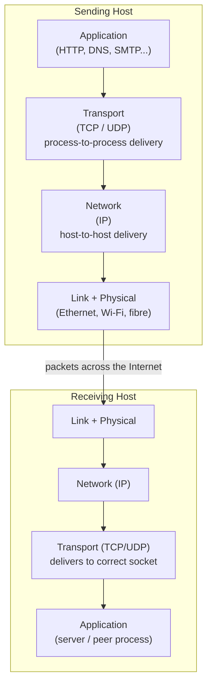

**Explanation:** Each layer on the sender talks logically to its *peer layer* on the receiver, but data physically flows down the sender's stack, across the network, and up the receiver's stack.

**How transport works at the endpoints (from PDF):**
- **At the sending host:** a transport protocol accepts application data, divides or packages it as required, **adds a transport header** and passes the result to IP.
- **At the receiving host:** it **examines the transport header** and delivers the data to the correct receiving process.

**Diagram 2 — Encapsulation and decapsulation at the endpoints (Added diagram):**

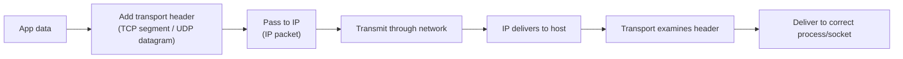

### D. Core Services Provided by Transport Protocols (Page 2 — important table)

| Service | Meaning | TCP | UDP |
|---|---|:---:|:---:|
| **Process addressing** | Uses port numbers to identify sending/receiving application endpoints | Yes | Yes |
| **Multiplexing / demultiplexing** | Combines data from many applications at sender; separates it for the right application at receiver | Yes | Yes |
| **Error detection** | Checksum can reveal corrupted bits | Yes | Yes |
| **Reliable delivery** | Detects loss/duplication and recovers through acknowledgements and retransmission | Yes | No built-in recovery |
| **Ordered delivery** | Presents bytes to the application in the intended order | Yes | No |
| **Flow control** | Prevents sender from overwhelming the receiver | Yes | No |
| **Congestion control** | Adapts sending rate when the network is congested | Yes | No built-in mechanism |

### E. Multiplexing, Demultiplexing and Ports (Pages 2–3)

> **Exam-ready definition:** A **port number** is a **16-bit** number used by TCP or UDP to identify an application endpoint on a host. An IP address gets the packet to the *host*; the transport-layer port helps get the data to the correct *process*. Together, an IP address and port identify a **transport endpoint**.

**Port ranges (IANA — from PDF):**

| Range | Name | Notes / Examples |
|---|---|---|
| 0–1023 | **Well-known ports** | HTTP 80, HTTPS 443, DNS 53 |
| 1024–49151 | **Registered ports** | Commonly assigned to applications/services |
| 49152–65535 | **Dynamic/private ports** | OS often chooses an **ephemeral client port** from an implementation-specific range |

**Example (from PDF):** Your browser may contact `203.0.113.50:443` from a temporary local port such as `52341`. The server needs port 443 to direct the connection to its HTTPS service; the client port helps the laptop distinguish this exchange from other simultaneous connections.

**Diagram 3 — Demultiplexing using ports (Added diagram):**

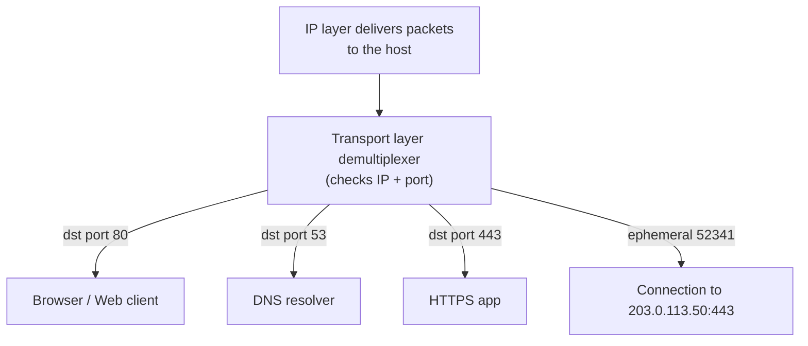

**Explanation:** Many applications share one IP address; the 16-bit port is what lets the transport layer sort arriving data among them (**demultiplexing**), and lets many applications share the outgoing link (**multiplexing**).

### Exam Preparation — Section 1

**Quick revision points:**
- Transport = **process-to-process**; Network = **host-to-host**; Application = message **semantics**.
- Port = **16 bits**; IP + port = transport endpoint.
- Services both TCP and UDP provide: ports, multiplexing/demultiplexing, error detection (checksum).
- Services only TCP provides: reliability, ordering, flow control, congestion control.

**Likely questions:** *"Why is the transport layer needed when IP already delivers packets?"*; *"Differentiate host-to-host and process-to-process delivery."*

**Common mistake:** Saying "IP address identifies an application." ❌ IP identifies a **host/interface**; the **port** identifies the application endpoint. (This exact mistake is corrected on PDF Page 13.)

---

## 2. Transport Layer and Network Layer Relationship

### A. Topic Introduction

The transport layer **cannot replace** the network layer, and the network layer does not provide every service an application may want. **They cooperate.**

**Analogy (from PDF):** IP is the **road system** that can move parcels between buildings; the transport layer is the **reception and delivery mechanism** that gets a parcel to the correct person or department and may additionally track delivery.

### B. Detailed Comparison (Page 3 — important exam table)

| Question | Network layer (IP) | Transport layer (TCP/UDP) |
|---|---|---|
| **Where is it implemented?** | Hosts **and routers** participate in IP forwarding | Primarily **end hosts**; ordinary routers do not run the end-to-end TCP/UDP connection for forwarded traffic |
| **Primary identity** | IP addresses identify interfaces/hosts for routing | Port numbers identify application endpoints/processes |
| **Data unit** | IP packet / datagram | **TCP segment** or **UDP datagram** |
| **Reliability in Internet IP** | Best-effort: packets can be lost, duplicated, delayed or reordered | TCP can build reliable, ordered service on top of IP; UDP largely exposes the best-effort nature of IP |
| **Control scope** | Chooses paths and forwards packets across networks | Controls communication between endpoints; TCP also manages receiver and congestion constraints |

### C. A Crucial Idea: The Lower Layer Limits What the Upper Layer Can Promise

TCP **cannot guarantee** that the physical network will never lose a packet. Instead, it **detects symptoms of loss and recovers**, e.g., by retransmitting data. Thus **reliability is an end-to-end service constructed above an unreliable packet network**.

> **Exam-ready distinction (from PDF):**
> **IP answers:** "Which *host* should this packet reach, and how do I forward it?"
> **TCP/UDP answer:** "Which *application endpoint* on that host should receive the data, and what delivery service should that application get?"

**Diagram 4 — TCP reliability built over best-effort IP (Added diagram):**

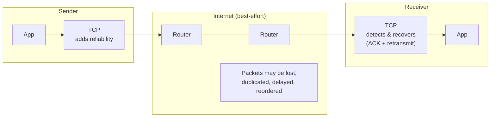

**Exam Preparation:** A favourite long-answer question is *"Explain the relationship between the transport and network layers."* Use the table above + the "roads vs reception desk" analogy + the exam-ready distinction quote.

---

## 3. User Datagram Protocol (UDP)

### B. Exam-Ready Definition (from PDF, Page 3)

> **UDP** is a **connectionless** transport protocol. It provides process-to-process delivery using port numbers and includes a **checksum** for error detection, but it does **not** establish a connection, guarantee delivery, maintain ordering, retransmit lost data, or provide built-in flow/congestion control.

### C. Why Would Anyone Choose UDP? (Pages 3–4)

1. **Low protocol overhead:** the UDP header is only **8 bytes**.
2. **No connection setup:** an application can send a datagram without a TCP-style handshake.
3. **No head-of-line waiting imposed by UDP:** a missing datagram does not force UDP itself to hold later datagrams until recovery.
4. **Application control:** the application can implement exactly the reliability, timing or congestion behaviour it needs.
5. **Supports multicast/broadcast scenarios:** useful where one-to-many delivery is required at IP/link levels.

### D. UDP Header (Page 4)

**Diagram 5 — UDP header format (8 bytes = 64 bits):**

```text
 0                   15 16                  31
+----------------------+----------------------+
|    Source Port       |   Destination Port   |   4 bytes
+----------------------+----------------------+
|       Length         |       Checksum       |   4 bytes
+----------------------+----------------------+
|                                       |  Application data (variable)
+---------------------------------------+
```

| Field | Size | Purpose (from PDF) |
|---|---|---|
| **Source Port** | 16 bits | Port of the sending process; may be **zero** in limited IPv4 cases where no reply port is needed |
| **Destination Port** | 16 bits | Identifies the receiving service |
| **Length** | 16 bits | Total UDP header **plus payload** length in bytes; **minimum is 8** |
| **Checksum** | 16 bits | Detects corruption in header/payload; also covers selected IP information through a **pseudo-header** |

### E. What UDP "Unreliable" Does NOT Mean (Page 4 — common misconception)

> **Common misconception (from PDF):** "UDP is unreliable" does **not** mean every UDP packet is lost or corrupted. It means UDP itself gives the application **no guarantee** that a datagram will arrive, arrive once, or arrive in order. Many applications add their own mechanisms above UDP when required.

### F. Typical Uses and Modern Reality (Page 4 — important table)

| Use | Why UDP can fit | Reality |
|---|---|---|
| **DNS queries** | Small request/response; low setup cost | Traditional DNS commonly uses UDP, while TCP is also used when needed; encrypted DNS mechanisms change the transport picture |
| **Real-time voice/video** | Late data can be less useful than missing data; applications can tolerate or conceal some loss | Media systems may add jitter buffers, loss recovery or forward error correction |
| **Online games** | Fresh state may matter more than retransmitting stale updates | Game protocols often implement selective reliability at the application layer |
| **QUIC / HTTP/3** | UDP supplies a minimal substrate that lets QUIC implement security, reliability and congestion control in user space | Excellent example of "UDP transport" **not** implying an unreliable application service |

### Exam Preparation — Section 3

**Likely questions:** *"Explain UDP with a neat header diagram. Why is it used despite not guaranteeing delivery?"* (a direct exam question on PDF Page 14).

**Quick revision points:**
- UDP header = **8 bytes**, 4 fields, each **16 bits**.
- Minimum UDP **Length** value = **8** (header only, no data).
- UDP gives: ports + checksum. UDP does NOT give: connection, reliability, ordering, retransmission, flow control, congestion control.

---

## 4. UDP Checksum

### A. Topic Introduction & Definition

> **Exam-ready definition (from PDF):** A **checksum** is an error-detection value. The sender computes it from the **UDP header**, the **application data** and an **IP pseudo-header**. The receiver performs a corresponding calculation. If the result is inconsistent, corruption is detected and the datagram is discarded.

**Limitation (from PDF):** A checksum detects many transmission errors, but it is **not cryptographic authentication** and cannot prove that an attacker did not deliberately modify a packet.

### B. What Is Included in the Checksum? (Page 4)

1. **IP pseudo-header:** selected source/destination IP information, protocol identifier and UDP length. Used for the checksum calculation but **not part of the UDP header transmitted as such**.
2. **UDP header:** source port, destination port, length and checksum field (treated appropriately during calculation).
3. **UDP payload:** the application data. If the number of octets is **odd, a zero byte is conceptually padded** for checksum calculation.

**Diagram 6 — Checksum coverage (Added diagram):**

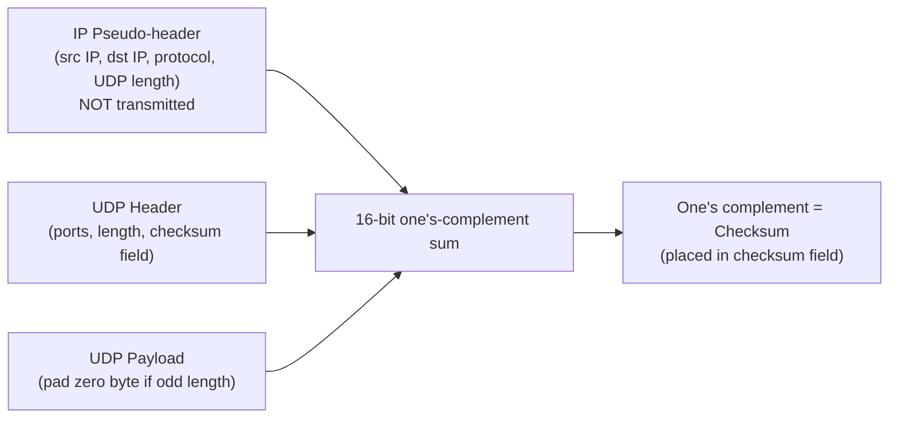

### C. One's-Complement Arithmetic — Simplified Worked Example (Page 5)

Real UDP operates on **16-bit words**. The PDF uses an **illustrative 4-bit version with three words** to make the arithmetic visible (this demonstrates the *method*; it is not the actual UDP word size).

| Step | Operation | Result |
|---|---|---|
| 1 | Add 4-bit words `1001 + 0110` | `1111` |
| 2 | Add next word: `1111 + 0011` | `1 0010` (there is a carry) |
| 3 | **Wrap the end-around carry:** `0010 + 0001` | `0011` |
| 4 | Take **one's complement** of `0011` | `1100` = **checksum** |
| 5 | Receiver adds data words plus checksum using the same end-around carry | **All 1s** indicates consistency |

**Step-by-step walkthrough (Added explanation):**
- **Step 1:** `1001 (9) + 0110 (6) = 1111 (15)` — fits in 4 bits, no carry.
- **Step 2:** `1111 (15) + 0011 (3) = 10010 (18)` — 5 bits, so a carry left the most significant bit.
- **Step 3:** **End-around carry:** drop the extra bit and *add it back* at the low-order end: `0010 + 0001 = 0011`.
- **Step 4:** Flip every bit of `0011` → `1100`. This is the transmitted checksum.
- **Step 5:** At the receiver, summing data + checksum with end-around carry yields `1111` (all 1s) → no detectable corruption.

### D. Real 16-bit Algorithm (Page 5)

1. Place the relevant bytes into **16-bit words in network byte order**.
2. Add all 16-bit words using **one's-complement addition**. If a carry leaves the most significant bit, **wrap it around** and add it to the low-order end.
3. Take the **one's complement** of the final 16-bit sum → that becomes the checksum.
4. At the receiver, a corresponding sum **including the checksum** should yield **all 1 bits** when no detectable corruption is present.

### E. IPv4 vs IPv6 Detail (Page 5 — exam-precision box)

- **UDP over IPv4:** a transmitted checksum value of **zero** can indicate the checksum was *not used*.
- **UDP over IPv6:** the checksum is **generally mandatory** (with narrowly defined exceptions in standards).
- **Safest exam statement (quote this):** *"UDP uses a 16-bit one's-complement checksum for error detection over the pseudo-header, UDP header and data."*

**Exam Preparation:**
- Likely question: *"Explain the UDP checksum"* (direct exam question on Page 14). Answer hint: pseudo-header + UDP header + payload; 16-bit one's-complement sum; end-around carry; complement; receiver check; error detection **not** cryptographic protection.
- **Common mistake:** "Checksum correct means packet is authentic" ❌ — it is error detection only.

---

## 5. Concept of Reliable Data Transfer (RDT)

### A. Topic Introduction

> **Core question (from PDF):** How can a sender and receiver create the **illusion of a reliable channel** even when the underlying channel may corrupt, lose, duplicate, delay or reorder packets?

The answer is a family of mechanisms grouped under **Automatic Repeat reQuest (ARQ)**.

### B. Problems a Reliable Protocol Must Handle (Page 5 — key table)

| Channel problem | Why it matters | Typical mechanism |
|---|---|---|
| **Bit corruption** | Data arrives but some bits are wrong | Checksum/error detection plus ACK/NAK or timeout/retransmission |
| **Packet loss** | Data or acknowledgement never arrives | Timer and retransmission |
| **Duplicate packet** | Retransmission can cause the same data to arrive again | Sequence numbers let receiver recognise duplicates |
| **Reordering** | Later packet can arrive before an earlier one | Sequence numbers, receiver rules and/or buffering |
| **Receiver slower than sender** | Receiver buffer can overflow | Flow control / advertised receiving window |
| **Network overloaded** | Queues fill, delays rise and packets drop | Congestion control adjusts offered load |

### C. Building Blocks of Reliability (Pages 5–6)

| Building block | Purpose |
|---|---|
| **Checksum** | Tells the receiver whether a packet appears corrupted |
| **ACK (acknowledgement)** | Receiver tells sender that data was successfully received |
| **NAK (negative acknowledgement)** | Receiver explicitly reports a problem (in protocols that use NAKs) |
| **Sequence number** | Uniquely identifies packet/order within the protocol window; helps detect duplicates |
| **Timer** | Sender waits only a limited period for evidence of delivery; **expiry triggers recovery** |
| **Retransmission** | Sender sends data again when loss/corruption is inferred |
| **Sliding window** | Allows several packets to be outstanding, greatly improving link utilisation on paths with significant round-trip time |

### D. From Stop-and-Wait to Pipelining (Page 6)

- A **stop-and-wait** protocol sends one packet and **waits for its ACK** before sending the next. It is simple but **wastes capacity**.
- **Worked example (from PDF):** suppose sending a packet takes **1 ms** and the round-trip waiting time is about **100 ms**. The sender may be active for roughly 1 ms and idle for most of the remaining time.
- A **pipelined** protocol keeps **multiple packets "in flight"** before their ACKs return.
- **Go-Back-N** and **Selective Repeat** are two classic pipelined ARQ designs.

**Diagram 7 — Stop-and-Wait vs Pipelining (Added diagram):**

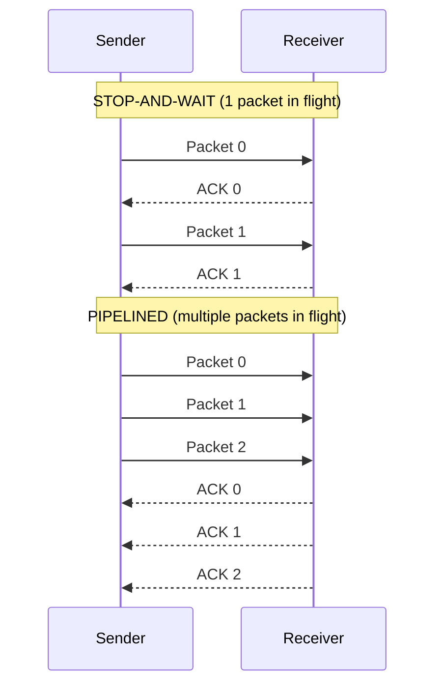

**Explanation:** In stop-and-wait the sender is idle while the ACK travels back. In pipelining, the sender fills the "pipe" with packets, so the link stays busy — this is why sliding windows exist.

> **Key intuition (from PDF):** Reliability is **not free**. More reliability usually needs extra header information, receiver/sender state, acknowledgements, timers, retransmitted bytes and buffering. Protocol design is a **trade-off between correctness, efficiency and complexity**.

---

## 6. Sliding Windows: Vocabulary

### A. Definition

> A **sliding-window** sender maintains a **range of sequence numbers** that it is currently allowed to transmit without waiting. As acknowledgements arrive, the **left edge of the window moves forward** — the window **"slides."**

### B. Vocabulary Table (Page 6 — learn these terms exactly)

| Term | Meaning |
|---|---|
| **Sequence number** | Identifier used to determine the order/identity of transmitted packets or bytes |
| **Sender window** | Sequence numbers the sender is currently permitted to have outstanding |
| **Base** | Oldest unacknowledged packet at the sender |
| **Next sequence number** | Sequence number to assign/send next, if it lies inside the sender window |
| **Receiver window** | Sequence numbers the receiver is currently prepared to accept/buffer |
| **Cumulative ACK** | ACK that confirms **all packets up to some point** (classic GBN/TCP-style) |
| **Individual/selective ACK** | ACK identifying a **particular** correctly received packet/block |

### C. Visual Window Example (Page 6)

```text
Sequence number:   0        1        2        3        4        5        6        7
                +--------+--------+--------+--------+--------+--------+--------+--------+
Status:         | ACKed  | ACKed  |  Sent  |  Sent  | Allowed| Allowed| Not yet| Not yet|
                +--------+--------+--------+--------+--------+--------+--------+--------+
                                    ^                          ^
                                 window left edge           window right edge
                                   (base = 2)                (window = 2..5)
```

**Explanation (from PDF):** If the sender window covers sequence numbers **2 through 5**, packets 2 and 3 might already be **outstanding** while 4 and 5 **may be sent immediately**. Packets 6 and 7 **must wait** until ACKs move the window forward.

**Diagram 8 — Window sliding when an ACK arrives (Added diagram):**

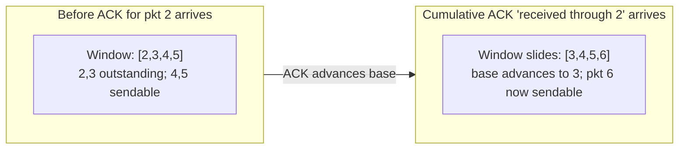

---

## 7. Go-Back-N (GBN)

### B. Exam-Ready Definition (from PDF, Page 7)

> **Go-Back-N (GBN)** is a pipelined reliable-data-transfer protocol in which the sender may have **up to N unacknowledged packets in flight**. The receiver normally accepts **only the next expected packet** and uses **cumulative acknowledgements**. If the oldest outstanding packet **times out**, the sender retransmits **that packet and all later outstanding packets** — it *"goes back."*

### C. Sender and Receiver Behaviour (Page 7 — key table)

| Sender | Receiver |
|---|---|
| May send multiple packets up to sender window size **N** | Normally expects **one specific next sequence number** |
| Keeps track of **base** and **next sequence number** | Accepts in-order packet, delivers it upward and advances expectation |
| Usually maintains a **timer for the oldest unacknowledged packet** | **Out-of-order packet is normally discarded** in textbook GBN |
| Uses **cumulative ACKs** to slide the window | Sends/repeats cumulative ACK for the highest **contiguous in-order** data received |
| On timeout, **retransmits all outstanding packets from base onward** | Does not need to buffer a large set of out-of-order packets in the basic model |

### D. Worked Loss Example — Packet 2 Is Lost (Page 7 — exam classic)

| Event | What happens |
|---|---|
| Sender sends 0, 1, 2, 3 | All four can be in flight if window permits |
| Packet 0 arrives | Receiver accepts 0 and ACKs progress through 0 |
| Packet 1 arrives | Receiver accepts 1; cumulative ACK advances through 1 |
| **Packet 2 is lost** | Receiver is still expecting 2 |
| Packet 3 arrives | Receiver treats 3 as **out of order and discards it**; it repeats an ACK representing data received in order through 1 |
| Timer for oldest outstanding data expires | Sender **retransmits packet 2 and subsequent outstanding packet 3** |
| 2 and 3 arrive | Receiver accepts them in order; sender window eventually advances |

**Diagram 9 — GBN timeline for the loss example (Added diagram):**

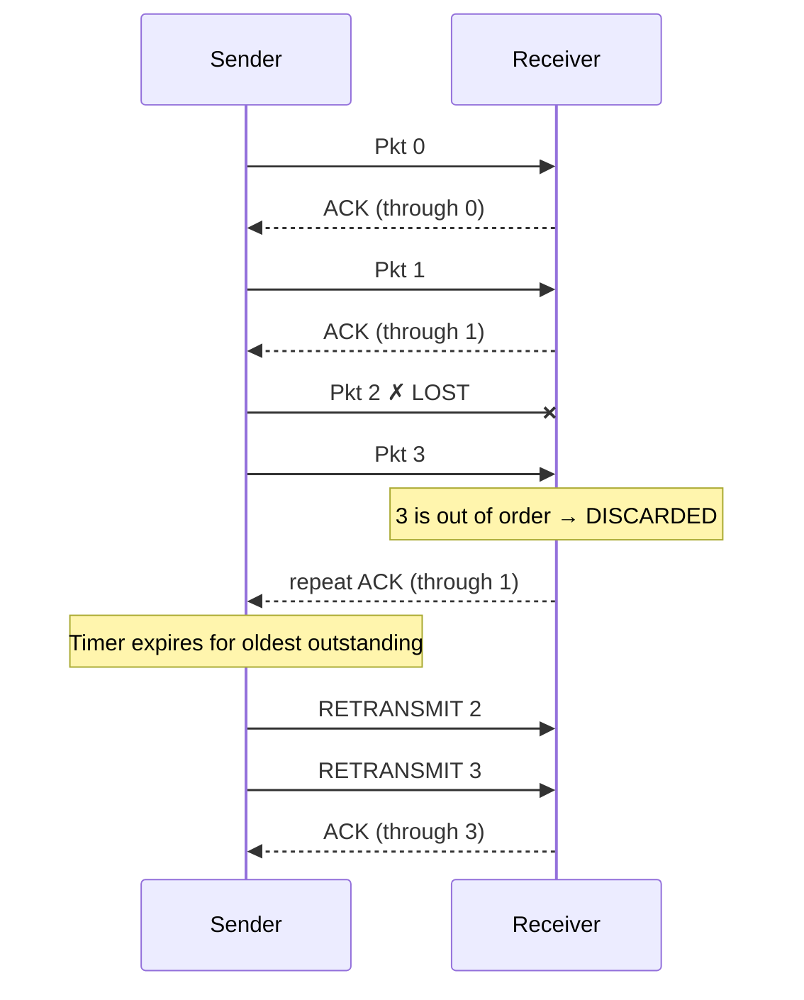

### E. Strength and Weakness (Page 7)

- **Strength:** simpler receiver logic and buffering than Selective Repeat.
- **Weakness:** one loss can cause **many correctly transmitted later packets to be retransmitted**. This wastes bandwidth, especially when the window is large or the path has a **high bandwidth-delay product**.

### F. Sequence-Number Constraint (Page 7 — formula)

If sequence numbers use **k bits**, the sequence-number space has **2^k values**. In the classic GBN analysis, the sender window must be no larger than:

```text
GBN sender window size <= 2^k − 1
```

**Why (Added explanation):** If the window equaled the whole space (2^k), an old packet and a new packet could carry the *same* sequence number after wrapping, and the receiver could not tell a retransmission of an old packet from a new packet. Restricting the window to 2^k − 1 prevents this ambiguity.

---

## 8. Selective Repeat (SR)

### B. Exam-Ready Definition (from PDF, Page 7)

> **Selective Repeat (SR)** is also a pipelined ARQ protocol, but it **retransmits only packets believed to be missing or damaged**. The receiver can **accept and buffer valid out-of-order packets**. When the missing packet finally arrives, buffered packets can be **delivered in order** to the application.

### C. Sender and Receiver Behaviour (Page 8 — key table)

| Sender | Receiver |
|---|---|
| Maintains a window of allowed outstanding sequence numbers | Maintains a **receiver window** of acceptable sequence numbers |
| Tracks ACK status **more individually** than GBN | Accepts a correct packet **even if an earlier packet is missing**, provided it lies in the receiver window |
| Conceptually needs timing/recovery information for **individual** outstanding packets | **Buffers out-of-order packets** until the gap is filled |
| Retransmits **only the packet** whose delivery failed/timeout occurred | Sends an **ACK for each** correctly received packet/block in the textbook model |

### D. Worked Loss Example (Page 8)

| Event | What happens |
|---|---|
| Sender sends 0, 1, 2, 3 | Packets are pipelined |
| 0 and 1 arrive | Receiver ACKs them and delivers them in order |
| **2 is lost** | There is now a gap |
| 3 arrives | Receiver **accepts and buffers 3, then ACKs 3** — it does *not* discard 3 merely because 2 is missing |
| 2 times out / loss inferred | Sender **retransmits only 2** |
| 2 arrives | Receiver delivers 2 and then buffered 3 — **no needless retransmission of 3** |

**Diagram 10 — SR timeline for the same loss (Added diagram):**

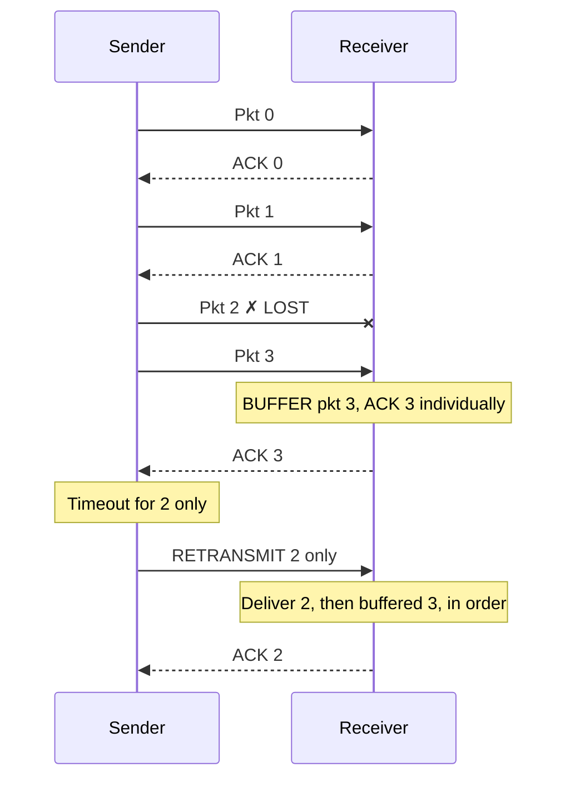

### E. Sequence-Number Constraint (Page 8 — formula)

SR must prevent an **old delayed packet from being mistaken for a new packet** after sequence numbers wrap. Standard safe rule: SR window size should be **at most half the sequence-number space**. With k-bit sequence numbers:

```text
SR window size <= 2^(k−1)
```

**Worked example (from PDF):** with **3-bit** sequence numbers, the space is 0 to 7 (**8 values**), so a **maximum SR window of 4** avoids the classic ambiguity.

---

## 9. GBN vs Selective Repeat

### A. Full Comparison Table (Page 8 — memorise for exams)

| Feature | Go-Back-N | Selective Repeat |
|---|---|---|
| **Sender window** | Multiple packets in flight | Multiple packets in flight |
| **Receiver behaviour** | Usually accepts only next expected packet | Can accept/buffer valid out-of-order packets |
| **ACK style** | **Cumulative** in textbook GBN | **Individual/selective** in textbook SR |
| **On a loss** | Retransmits missing packet **and later outstanding packets** from base | Retransmits **only** the missing/failed packet |
| **Receiver buffering** | Low/simple | Higher; needs out-of-order buffering |
| **Bandwidth efficiency when losses occur** | Can waste bandwidth by resending good packets | Usually better because successful packets need not be resent |
| **Complexity** | Lower | Higher |
| **Safe window vs k-bit sequence space** | ≤ 2^k − 1 | ≤ 2^(k−1) |

> **Memory trick (from PDF):**
> **GBN** says: *"Something went missing; go back and send the tail again."*
> **SR** says: *"I already kept the good packets; repeat only what I am missing."*

### B. Performance Intuition: Bandwidth-Delay Product (Page 9)

**Worked example (from PDF):**
- **Given:** path capacity = 100 Mbps; round-trip time = 50 ms.
- **Formula:** Bandwidth-delay product = capacity × RTT.
- **Calculation:** 100 Mbps × 50 ms = 100 × 10^6 bits/s × 50 × 10^−3 s = **5 × 10^6 bits = 5 megabits**.
- **Meaning:** the path can have about **5 megabits of data "in flight"** before the first acknowledgement returns. **Small windows cannot fully utilise such a path.** Sliding windows exist not only for reliability but also to **keep a network pipeline usefully occupied**.

> **Key idea:** Bandwidth-delay product estimates the data needed in flight to **fill the pipe**.

---

## 10. TCP: Reliable Byte-Stream Transport

### B. Exam-Ready Definition (from PDF, Page 9)

> **Transmission Control Protocol (TCP)** is the Internet transport protocol traditionally used when applications need **reliable, ordered, connection-oriented byte-stream delivery**. It runs at **end hosts** and builds these services **over IP**.

### C. TCP Characteristics (Page 9)

| Characteristic | Meaning |
|---|---|
| **Connection-oriented** | Endpoints establish TCP state before normal application data transfer |
| **Reliable byte stream** | TCP **numbers bytes**, acknowledges progress and retransmits missing data |
| **Full duplex** | Both endpoints can send and receive simultaneously |
| **Ordered delivery** | Application sees the byte stream in order even if IP packets were reordered |
| **Flow control** | Protects the **receiver** |
| **Congestion control** | Protects the **network** and promotes stable sharing of capacity |

### D. Connection Setup — Three-Way Handshake (Page 9)

| Step | Direction | Purpose |
|---|---|---|
| 1. **SYN** | Client → Server | Client proposes starting sequence information and requests connection |
| 2. **SYN-ACK** | Server → Client | Server acknowledges client and sends its own SYN information |
| 3. **ACK** | Client → Server | Client acknowledges server; connection is established for data transfer |

**Diagram 11 — TCP three-way handshake (Added diagram):**

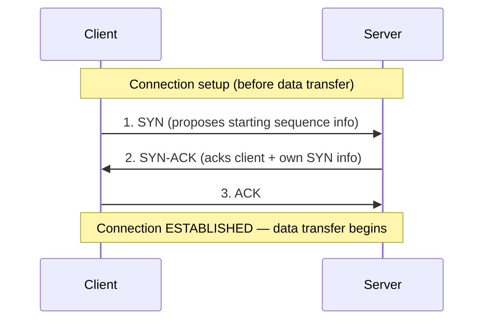

> **Why this matters to Unit 3 (from PDF):** Flow and congestion control maintain **changing TCP state**. TCP is therefore very different from UDP, which has **no TCP-style connection state** or built-in reliable byte-stream service.

---

## 11. TCP Flow Control

### A. Topic Introduction

Flow control solves an **endpoint problem**: a fast sender must not overflow the **receiving application's TCP buffer**. The receiver tells the sender how much additional data it is currently prepared to accept by advertising a **receive window**, commonly called **`rwnd`**.

> **Flow control in one line (from PDF):** Flow control asks: *"Can the receiver absorb more data?"* The controlling signal is the **receiver's advertised capacity**.

### B. Receiver-Buffer Logic (Page 9)

Conceptually, if the receive buffer has capacity **RcvBuffer**, and some bytes are already buffered but not yet consumed by the application, the **remaining free space** becomes the advertised receive window:

```text
rwnd = available free space in the TCP receive buffer
```

The sender limits unacknowledged data so that it **respects the receiver's advertised capacity**. *(In real TCP the exact variables and byte accounting are more detailed, but this is the correct intuition.)*

**Diagram 12 — Receive buffer and rwnd (Added diagram):**

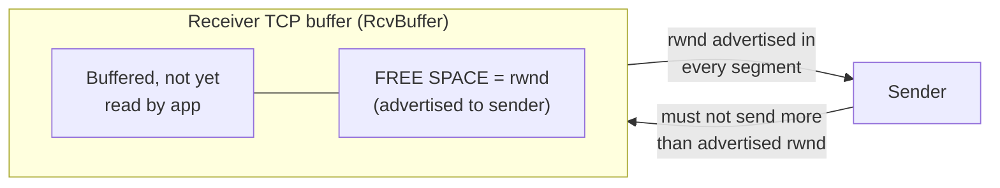

### C. Worked Flow-Control Example (Page 10 — numerical, learn the steps)

**Given information:**

| Given | Value |
|---|---|
| Receiver TCP buffer capacity | 12,000 bytes |
| Data currently buffered and not yet consumed | 8,500 bytes |
| **Free space / advertised rwnd** | **12,000 − 8,500 = 3,500 bytes** |

**Step-by-step (exam method):**
1. Formula: `rwnd = RcvBuffer − (buffered, unconsumed data)`.
2. Substitute: `rwnd = 12,000 − 8,500`.
3. Answer: **rwnd = 3,500 bytes**.
4. **Meaning:** the sender should not have more than 3,500 bytes of unacknowledged data outstanding (relative to the relevant TCP sequence state). When the receiving application **reads data**, free space grows and the receiver can advertise a **larger window**.

### D. What If rwnd Becomes Zero? (Page 10)

- The receiver can advertise a **zero window** when its buffer is full.
- The sender **pauses** normal data transmission, but TCP must still discover when the window opens again.
- TCP uses a **persist mechanism / window probes** to avoid a **deadlock** in which a window update was lost and both sides wait forever.

---

## 12. TCP Congestion Control

### A. Topic Introduction

Congestion control solves a **network problem**. Even if the receiving computer has plenty of buffer space, **routers and links along the path** can become overloaded when too much traffic is injected. Queues grow, delay rises, buffers overflow and **packets are dropped**. Sending even more traffic after such losses can make the situation **worse**.

### B. Flow Control vs Congestion Control (Page 10 — classic comparison question)

| Aspect | Flow control | Congestion control |
|---|---|---|
| **Protects** | Receiving endpoint | Network path / shared capacity |
| **Main question** | Can the receiver accept more bytes? | Can the network carry more traffic without harmful congestion? |
| **Important TCP variable** | `rwnd` (receive window) | `cwnd` (congestion window), plus `ssthresh` and algorithm-specific state |
| **Signal/source** | Receiver advertises available buffer | Loss, acknowledgements and/or timing/ECN signals reveal network conditions |
| **Sender is effectively limited by** | Both receiver and congestion limits | Both receiver and congestion limits |

**Simplified relationship (from PDF — memorise):**

```text
effective sending window <= min(rwnd, cwnd)
```

**Meaning:** a huge receiver buffer **cannot** force TCP to ignore congestion, and an uncongested network **cannot** force a receiver to accept more data than it can buffer.

**Diagram 13 — Two limits on the TCP sender (Added diagram):**

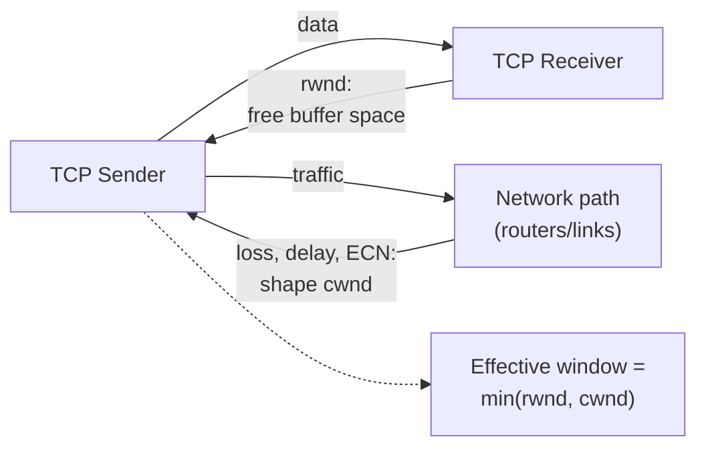

### C. Classic TCP Congestion-Control Phases (Page 11 — key table)

| Mechanism | Core idea | Simplified behaviour |
|---|---|---|
| **Slow start** | Probe available capacity quickly from a small starting congestion window | `cwnd` grows **roughly exponentially per RTT** because each ACK increases the window; modern initial cwnd is not literally one segment |
| **Congestion avoidance** | Probe more cautiously after reaching a threshold | Classic Reno-style description: approximately **additive increase**, around **one MSS per RTT** |
| **Fast retransmit** | Infer loss **before** waiting for the retransmission timeout | Traditionally triggered after **duplicate ACK evidence** (classic teaching model: **3 duplicate ACKs**) |
| **Fast recovery** | Avoid returning all the way to earliest slow-start behaviour after certain loss signals | Classic Reno adjusts `ssthresh`/`cwnd` and continues with congestion avoidance after recovery |
| **Timeout response** | Timeout suggests more severe uncertainty/congestion | Classic algorithms **reduce the sending rate substantially** and restart cautious growth |

### D. Slow Start Is Actually Fast Growth (Page 11 — common misconception)

The name is **historical**. If `cwnd` begins at, say, **10 MSS** in a modern implementation, acknowledgement-driven growth can approximately **double** the amount sent each RTT while in slow start:

```text
10 → 20 → 40 → 80 MSS
```

until a threshold or congestion signal changes behaviour. **Textbook examples may start at 1 MSS to make the arithmetic simple — always follow the values specified in an exam question.**

### E. ssthresh (Slow-Start Threshold) (Page 11)

- `ssthresh` separates the **aggressive probing region** (slow start) from **more cautious congestion avoidance** in classic TCP descriptions.
- After congestion, it is commonly **reduced** based on the amount of data/window in flight.
- Exact behaviour depends on the TCP congestion-control algorithm; **for exam problems, use the rule stated by the teacher/question**.

### F. Worked Classic Example — cwnd Growth (Page 11 — numerical)

| RTT / event | cwnd (illustrative) | Interpretation |
|---|---|---|
| Start | 1 MSS | Textbook starting point |
| After RTT 1 | 2 MSS | Slow start (exponential) |
| After RTT 2 | 4 MSS | Slow start |
| After RTT 3 | 8 MSS | Slow start |
| **Threshold reached** | 8 MSS | Move to **congestion avoidance** |
| Next RTTs | 9, 10, 11 MSS ... | Approximate **additive increase** (classic teaching model) |
| Loss signal | Window reduced | Algorithm reacts; exact cwnd/threshold rules depend on **timeout vs duplicate ACK** and TCP variant |

**Diagram 14 — Classic TCP congestion window behaviour (Added ASCII "sawtooth" diagram):**

```text
cwnd
(MSS)
 64 |                                  /\ loss
 32 |                        /\      /  \  (halve, Reno-style)
 16 |                  /\    /  \    /
  8 |        /\  CA  /  \  /    \  /
  4 |      /  \_____/    \/      \/
  2 |    /   ^ ssthresh = 8 reached
  1 |  /  SS (exponential: 1,2,4,8)
  0 +---------------------------------------> RTT
       SS: double per RTT   CA: +1 MSS per RTT   loss: reduce window
       (SS = Slow Start,     CA = Congestion Avoidance)
```

> **Important precision (from PDF):** Do **not** memorise "TCP always halves cwnd on every loss" as a universal law. **Reno-style** textbook rules are useful for learning **AIMD**, but current operating systems may use algorithms such as **CUBIC**, and congestion signals can include **ECN**. In an exam, **clearly state when you are describing the classic Reno model**.

---

## 13. Industry Reality: What You See in Real Networks

### A. Topic Introduction

The syllabus teaches **foundational mechanisms**. Real production networks retain those ideas but often use **more sophisticated implementations**. Knowing this distinction prevents textbook knowledge from becoming a misconception.

### B. Classroom Concept vs Industry Reality (Page 12 — important table)

| Classroom concept | Industry reality |
|---|---|
| **UDP has no reliability** | Correct at the UDP layer, but an application protocol **above** UDP can implement reliability, congestion control and security. **QUIC is the flagship example.** |
| **GBN and SR are separate textbook protocols** | They are conceptual foundations. Real reliable transports **combine ideas**: cumulative ACKs, selective acknowledgements, retransmission timers, loss inference and buffering |
| **TCP congestion = packet loss** | Loss is **one signal**. Delay, **ECN** and sophisticated models may also influence congestion control |
| **One TCP congestion algorithm** | Different OS/environments can use algorithms such as **CUBIC**; **BBR** takes a model-based approach. The precise default can change by platform/version |
| **More bandwidth always means faster app** | Latency, RTT, loss, window size, server processing and application design also matter. A high-capacity path with poor RTT/loss behaviour may still feel slow |
| **Flow control and congestion control are the same** | They are **separate limits**: receiver capacity versus network capacity. TCP must respect **both** |

### C. Mini Cases (Page 12)

**13.1 Mini case: video meeting.** During a live video call, a packet carrying an **old video frame** may become useless if it arrives too late. The application may prefer to display the **next fresh frame** rather than wait for every lost piece. This is why real-time applications historically used UDP/RTP-style approaches. However, reliability may still be **selectively applied to important control information**.
**Lesson:** the right transport service depends on **application semantics**, not a simplistic "TCP good, UDP bad" rule.

**13.2 Mini case: software download.** For a software installer, **one missing or corrupted byte** can make the file unusable or dangerous. **Reliable ordered delivery** is valuable. **TCP is a natural fit** for such transfers because it handles retransmission, ordering, flow control and congestion control for the application.

**13.3 Mini case: high-speed data centre path.** A **10 Gbps link does not mean a single TCP flow instantly delivers 10 Gbps**. The sender needs enough **data in flight**, the **receive window must be large enough**, the **congestion algorithm must grow cwnd appropriately**, the path must avoid bottlenecks, and endpoints must process traffic fast enough. **Bandwidth, latency and windows interact.**

---

## 14. One End-to-End Story: Opening a Secure Web Page

### A. Scenario

A student opens a university portal. The browser speaks **HTTPS** semantics. Depending on HTTP version and deployment, transport may be **TCP** (HTTP/1.1 or HTTP/2) or **QUIC over UDP** (HTTP/3). Focus on the traditional **TCP** case.

### B. Stage-by-Stage Transport-Layer View (Pages 12–13)

| Stage | Transport-layer view |
|---|---|
| **1. Endpoint identification** | Browser uses destination **port 443** and an **ephemeral source port** |
| **2. TCP setup** | TCP establishes connection state with a **handshake** |
| **3. Application bytes** | Encrypted **TLS records** carrying HTTP data are presented to TCP as **bytes** |
| **4. Segmentation / sequence** | TCP carries ranges of bytes with **sequence information** |
| **5. Reliability** | **ACK/retransmission** mechanisms recover from missing data |
| **6. Flow control** | Receiver advertises **rwnd** so its buffer is not overrun |
| **7. Congestion control** | Sender adapts **cwnd** to network conditions |
| **8. IP service** | Each TCP segment is carried **inside IP packets** across routers |
| **9. Destination delivery** | IP reaches the server host; TCP **demultiplexes** traffic to the correct socket/process |

**Diagram 15 — End-to-end HTTPS-over-TCP story (Added diagram):**

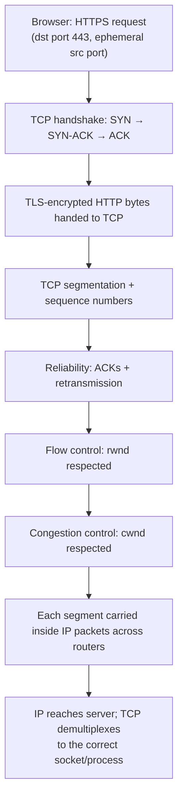

> **Layering lesson (from PDF):** HTTPS does **not** itself replace TCP/IP. Each layer solves a different problem: **application semantics and security above**, **end-to-end transport in TCP/UDP/QUIC-related logic**, and **inter-network delivery in IP**.

---

## 15. Common Mistakes and How to Correct Them

(Page 13 — high-value exam table; memorise the corrections.)

| ❌ Mistake | ✅ Correct understanding |
|---|---|
| "IP address identifies an application." | IP gets traffic to an **interface/host**; transport **ports** help identify application endpoints |
| "UDP has no checksum." | UDP **has a checksum field**. Lack of retransmission is **not** lack of error detection |
| "Checksum correct means packet is authentic." | A checksum is **error detection, not cryptographic authentication** |
| "GBN retransmits only the lost packet." | GBN retransmits **from the missing/oldest outstanding packet onward** after timeout in the textbook model |
| "SR discards every out-of-order packet." | SR can **buffer valid out-of-order packets** within its receiver window |
| "Flow control prevents router congestion." | Flow control protects **receiver capacity**; congestion control manages **network loading** |
| "Slow start means cwnd grows slowly." | Classic slow start is **exponential per RTT**; it is aggressive probing relative to additive congestion avoidance |
| "UDP is always faster than TCP." | UDP has less built-in machinery, but application performance depends on workload, implementation, RTT, loss, security and recovery requirements |

---

## 16. Quick Formula and Concept Sheet

(Page 14 — the one table to revise the night before the exam.)

| Concept | Remember |
|---|---|
| **UDP header length** | **8 bytes** |
| **Port number size** | **16 bits** |
| **UDP checksum** | **16-bit one's-complement** checksum over **pseudo-header + UDP header + data** |
| **GBN sequence space** | With k bits: **2^k** sequence values; classic max sender window **≤ 2^k − 1** |
| **SR sequence space** | Classic safe window **≤ 2^(k−1)** |
| **Bandwidth-delay product** | ≈ **path capacity × round-trip time**; estimates data needed in flight to fill the pipe |
| **Flow-control signal** | **rwnd** — receiver-advertised available window |
| **Congestion-control signal/state** | **cwnd** plus congestion algorithm state; responds to network feedback |
| **Effective TCP limit** | Conceptually bounded by **min(rwnd, cwnd)** |

---

## 17. Exam-Oriented Questions with Answer Hints

(These are the exact 8 questions with hints from PDF Page 14, plus extra practice questions from the unit.)

1. **Explain the relationship between transport and network layers.**
   *Hint:* Host-to-host vs process-to-process; IP address vs port; routers/end hosts; show TCP building reliability over best-effort IP.

2. **Explain UDP with a neat header diagram. Why is it used despite not guaranteeing delivery?**
   *Hint:* Define connectionless service; show the 4 header fields; mention 8-byte header, no handshake/retransmission/order; give DNS/media/QUIC-style examples.

3. **Explain the UDP checksum.**
   *Hint:* Pseudo-header + UDP header + payload; 16-bit one's-complement sum; end-around carry; complement; receiver check; error detection **not** cryptographic protection.

4. **What mechanisms are required for reliable data transfer over an unreliable channel?**
   *Hint:* Checksum, ACK/NAK where used, sequence numbers, timers, retransmissions — explain **why each exists**.

5. **Explain Go-Back-N with an example in which packet 2 is lost.**
   *Hint:* Show pipelining, cumulative ACK, discard of out-of-order packet in textbook receiver, timeout, retransmit 2 **and later outstanding packets**.

6. **Explain Selective Repeat and compare it with GBN.**
   *Hint:* Receiver buffers out-of-order packets; ACKs individually; retransmit only missing packet; compare buffer, efficiency, complexity and **window constraints**.

7. **Differentiate TCP flow control and congestion control.**
   *Hint:* Receiver vs network, `rwnd` vs `cwnd`, advertised buffer vs congestion feedback, effective **min(rwnd, cwnd)**.

8. **Explain classic TCP congestion control.**
   *Hint:* Slow start, `ssthresh`, congestion avoidance, fast retransmit/recovery and timeout response. State that rules are **classic/Reno-style** when applicable.

**Additional practice questions drawn from the unit:**
- Short answer: *What is the size of the UDP header and what does the Length field represent?*
- Short answer: *What are well-known, registered and dynamic port ranges? Give examples.*
- Short answer: *Why is "slow start" actually fast growth?*
- Short answer: *What happens when rwnd = 0, and how does TCP avoid deadlock?* (persist timer / window probes)
- Diagram-based: *Draw and explain the TCP three-way handshake.*
- Diagram-based: *Draw a sliding-window example with a sender window covering sequence numbers 2–5.*
- Numerical: *Given 100 Mbps and 50 ms RTT, compute the bandwidth-delay product.* (Answer: 5 megabits.)
- Numerical: *With 3-bit sequence numbers, what is the maximum SR window and why?* (Answer: 4, because SR window ≤ 2^(k−1) = 2² = 4.)
- Numerical: *Receiver buffer 12,000 bytes with 8,500 bytes buffered — what is rwnd?* (Answer: 3,500 bytes.)

---

## 18. Classroom Case Study: Campus Live-Streaming Day

(Page 15 — excellent discussion/question source.)

**Scenario:** A university streams a convocation to students. The campus network also carries **file downloads** and **examination-portal traffic**. During the event, students report that **video occasionally freezes**, **file downloads slow down**, and the **exam portal remains reachable but takes longer to load**. The video team says: *"Let us use UDP so congestion control will not matter."*

**Questions to practise:**
1. Why might a real-time media application prefer UDP or a UDP-based transport design for some traffic?
2. Why is "UDP means congestion does not matter" a **dangerous** conclusion?
3. Which mechanism protects the TCP receiver if its application cannot consume bytes quickly enough? → *Flow control (rwnd)*
4. Which mechanism should reduce a TCP sender's offered load when the network path becomes congested? → *Congestion control (cwnd)*
5. If one packet in a GBN stream is lost while three later packets arrive, what happens in the textbook model? → *Later packets are discarded; after timeout the sender retransmits from the missing packet onward*
6. How would Selective Repeat behave differently? → *Buffers the out-of-order packets and retransmits only the missing one*
7. Explain why a faster access link alone may not eliminate the observed delay. → *Latency, RTT, loss, window size and shared congestion also matter; more bandwidth alone doesn't fix a congested shared path*

**Discussion direction (from PDF):** Students should separate **application requirements** from **transport mechanisms**. Real-time traffic values timeliness, but **every high-rate flow still shares finite network capacity**. TCP flows react through congestion control; **UDP itself does not provide that control**, so a responsible UDP-based application/protocol must regulate its sending behaviour appropriately. **Flow control protects a receiver, not the shared campus routers.** GBN and SR show why different loss-recovery designs can consume very different amounts of **retransmission bandwidth**.

---

## 19. Unit 3 Summary

(Verbatim key points from PDF Page 15.)

- The transport layer provides **process-to-process** communication above the network layer's **host-to-host** delivery.
- **Ports** enable multiplexing and demultiplexing among many applications on the same host.
- **UDP** is connectionless and lightweight; it provides ports and error detection but no built-in reliable/ordered delivery, flow control or congestion control.
- **UDP checksum** uses one's-complement arithmetic and includes a pseudo-header, UDP header and data.
- **Reliable data transfer** is constructed using error detection, acknowledgements, sequence numbers, timers and retransmissions.
- **Sliding windows** improve utilisation by allowing multiple packets in flight.
- **Go-Back-N** is simpler but can retransmit several good packets after one loss.
- **Selective Repeat** buffers out-of-order packets and retransmits selectively, improving efficiency at the cost of state and complexity.
- **TCP flow control** protects the receiver using **rwnd**.
- **TCP congestion control** protects the network using **cwnd** and algorithmic responses such as slow start and congestion avoidance.
- The sender must respect **both** receiver capacity and network capacity — conceptually, **min(rwnd, cwnd)**.

---

## 20. Quick Revision Sheet

**Numbers to memorise:**

| Value | Fact |
|---|---|
| 8 bytes | UDP header size (also the minimum UDP Length value) |
| 16 bits | Port number size; each UDP header field; checksum word size |
| 0–1023 / 1024–49151 / 49152–65535 | Well-known / registered / dynamic port ranges |
| 80, 443, 53 | HTTP, HTTPS, DNS ports |
| 2^k − 1 | Max GBN sender window (k-bit sequence numbers) |
| 2^(k−1) | Max SR window (k-bit sequence numbers) |
| 3 duplicate ACKs | Classic fast retransmit trigger (teaching model) |
| 1 MSS per RTT | Congestion-avoidance additive increase (Reno teaching model) |
| 5 Mb | BDP of 100 Mbps × 50 ms |
| 3,500 bytes | rwnd in the worked example (12,000 − 8,500) |

**One-line takeaways:**
- IP = *which host*; Transport = *which process + what service*.
- UDP = ports + checksum, nothing else guaranteed.
- Reliability = checksum + ACK + sequence numbers + timer + retransmission.
- GBN = "go back and resend the tail"; SR = "resend only what's missing."
- Flow control protects the **receiver** (rwnd); congestion control protects the **network** (cwnd).
- Effective window = **min(rwnd, cwnd)**.
- Slow start grows **exponentially** per RTT; congestion avoidance grows **additively** (AIMD).

---

## 21. Glossary of Important Terms

| Term | Definition |
|---|---|
| **ARQ** | Automatic Repeat reQuest — family of mechanisms (ACKs, timers, retransmission) that create reliable transfer over an unreliable channel |
| **ACK / NAK** | Acknowledgement (data received OK) / Negative acknowledgement (problem reported) |
| **Bandwidth-delay product** | Capacity × RTT; the amount of data that can be "in flight" on a path |
| **Base** | Oldest unacknowledged packet at the sender |
| **Checksum** | Error-detection value computed over pseudo-header + UDP header + data |
| **Congestion control** | Mechanism adapting the sending rate to protect the network path |
| **Connectionless** | No connection setup/state before sending (UDP) |
| **cwnd** | Congestion window — sender's limit based on network feedback |
| **Demultiplexing** | Delivering arriving segments to the correct application socket using ports |
| **End-around carry** | In one's-complement addition, a carry out of the MSB is wrapped and added to the LSB |
| **Ephemeral port** | Temporary client port chosen by the OS (dynamic range) |
| **Fast retransmit** | Inferring loss from duplicate ACKs before the timeout expires |
| **Flow control** | Mechanism preventing the sender from overwhelming the receiver (rwnd) |
| **GBN** | Go-Back-N — pipelined ARQ with cumulative ACKs; on timeout, retransmits from base onward |
| **MSS** | Maximum Segment Size — the unit in which cwnd growth is often measured |
| **Multiplexing** | Combining data from many applications at the sender |
| **Persist mechanism** | TCP window probes used when rwnd = 0 to avoid deadlock |
| **Pseudo-header** | IP-derived fields (addresses, protocol, UDP length) included in the UDP checksum but not transmitted |
| **rwnd** | Receive window — receiver-advertised free buffer space |
| **Segment / Datagram** | TCP transport unit / UDP transport unit |
| **Sequence number** | Identifier of packet or byte order, used to detect duplicates and reorder |
| **ssthresh** | Slow-start threshold — boundary between slow start and congestion avoidance |
| **Sliding window** | Range of sequence numbers the sender may transmit without waiting; slides as ACKs arrive |
| **SR** | Selective Repeat — pipelined ARQ with individual ACKs and out-of-order buffering |
| **Stop-and-wait** | Send one packet, wait for its ACK; simple but wastes capacity |

---

## 22. Final Coverage Checklist

- [x] Page 1 — Unit title, syllabus coverage, parts A–F map, learning objective ✅
- [x] Page 2 — Why transport layer; layer stack table; core services table (TCP vs UDP); multiplexing/ports (well-known ranges) ✅
- [x] Page 3 — Dynamic ports; port example (203.0.113.50:443); transport vs network layer table; lower-layer-limits idea; UDP definition and motivations ✅
- [x] Page 4 — UDP header diagram and fields; UDP misconception box; typical uses table (DNS, media, games, QUIC); checksum definition and inclusion list ✅
- [x] Page 5 — 4-bit one's-complement worked example (all 5 steps); real 16-bit algorithm; IPv4 vs IPv6 checksum detail; RDT problems table; building blocks (checksum, ACK) ✅
- [x] Page 6 — NAK, sequence numbers, timers, retransmission, sliding window; stop-and-wait vs pipelining (1 ms/100 ms example); sliding-window vocabulary table; visual window example (2–5) ✅
- [x] Page 7 — GBN definition; sender/receiver behaviour table; packet-2-lost worked example; strength/weakness; GBN window ≤ 2^k − 1; SR definition ✅
- [x] Page 8 — SR sender/receiver behaviour; SR worked loss example; SR window ≤ 2^(k−1) with 3-bit example (max window 4); full GBN vs SR comparison table ✅
- [x] Page 9 — Memory trick; bandwidth-delay product (100 Mbps × 50 ms = 5 Mb); TCP definition and characteristics; three-way handshake; rwnd definition ✅
- [x] Page 10 — Flow-control worked example (12,000 − 8,500 = 3,500); rwnd = 0 and persist probes; flow vs congestion control table; min(rwnd, cwnd) ✅
- [x] Page 11 — Congestion-control phases table (slow start, congestion avoidance, fast retransmit/recovery, timeout); slow start is fast growth (10→20→40→80); ssthresh; cwnd worked table; "important precision" on Reno/CUBIC/ECN ✅
- [x] Page 12 — Industry reality table (QUIC, CUBIC/BBR, ECN, etc.); mini cases: video meeting, software download, 10 Gbps data centre ✅
- [x] Pages 12–13 — End-to-end HTTPS story (9 stages); layering lesson; common-mistakes table (8 corrections) ✅
- [x] Page 14 — Quick formula sheet; 8 exam questions with answer hints ✅
- [x] Page 15 — Campus live-streaming case study (7 questions + discussion direction); Unit 3 summary (11 points) ✅

**Notes on fidelity:** All definitions, tables, values, formulas and examples above are taken from the PDF. Diagrams marked *"Added diagram"* and explanations marked *"Added explanation"* are my supplementary visualisations/explanations of concepts that **are** in the PDF — no unsupported facts were introduced. No pages were unreadable; nothing was omitted.

---

### Suggested Next Step

If you'd like, I can next produce:
1. **A condensed 1-page cram sheet** (formulas + comparisons only),
2. **Flashcard-style Q&A** for self-testing, or
3. Continue with **Unit 4 notes** if you upload the next PDF.