I have read and analyzed **all 28 pages** of your PDF: *Computer Networks – Unit 4: The Network Layer (M.Sc.-CA)*. Below are the complete, exam-ready notes in Markdown format. Every topic, table, worked example and formula from the PDF is covered; diagrams marked *"Added diagram"* and explanations marked *"Added explanation"* are my supplements to concepts actually present in the PDF. All technical values (header sizes, port/protocol numbers, prefix tables, Dijkstra graph, etc.) come directly from the PDF.

Save this as `Network_Layer_Unit4_Notes.md`.

---

# Computer Networks — Unit 4: The Network Layer
### Comprehensive Study Notes (Based on M.Sc.-CA Unit 4 PDF, Pages 1–28)

---

## Table of Contents

1. [Purpose and Services of the Network Layer](#1-purpose-and-services-of-the-network-layer)
2. [Virtual-Circuit and Datagram Networks](#2-virtual-circuit-and-datagram-networks)
3. [Inside a Router and Longest-Prefix Matching](#3-inside-a-router-and-longest-prefix-matching)
4. [IPv4](#4-internet-protocol-version-4-ipv4)
5. [MTU, Fragmentation and Path MTU Discovery](#5-mtu-fragmentation-and-path-mtu-discovery)
6. [IPv4 Addressing, Prefixes and CIDR](#6-ipv4-addressing-prefixes-and-cidr)
7. [Subnetting and VLSM](#7-subnetting-and-variable-length-subnet-masks)
8. [IPv4 Address Types and Special Ranges](#8-ipv4-address-types-and-special-ranges)
9. [Address Assignment, DHCP and NAT](#9-address-assignment-dhcp-and-nat)
10. [IPv6](#10-internet-protocol-version-6-ipv6)
11. [IPv6 Addressing and Notation](#11-ipv6-addressing-and-notation)
12. [IPv4-to-IPv6 Transition](#12-ipv4-to-ipv6-transition-and-dual-stack-reality)
13. [ICMP](#13-internet-control-message-protocol-icmp)
14. [Routing: Metrics, Graphs and Design Goals](#14-routing-metrics-graphs-and-design-goals)
15. [Link-State Routing and Dijkstra](#15-link-state-routing-and-dijkstras-algorithm)
16. [Distance-Vector Routing and Bellman-Ford](#16-distance-vector-routing-and-bellman-ford)
17. [RIP](#17-routing-information-protocol-rip)
18. [OSPF](#18-open-shortest-path-first-ospf)
19. [BGP](#19-border-gateway-protocol-bgp)
20. [RIP vs OSPF vs BGP](#20-rip-ospf-and-bgp-compared)
21. [Integrated Case: University Network Redesign](#21-integrated-case-a-university-network-redesign)
22. [Network-Layer Troubleshooting Method](#22-network-layer-troubleshooting-method)
23. [Common Misconceptions and Corrections](#23-common-misconceptions-and-corrections)
24. [Rapid Revision Sheet + Formula Box](#24-rapid-revision-sheet)
25. [Examination and Classroom Questions](#25-examination-and-classroom-questions)
26. [Glossary and References](#26-glossary)
27. [Coverage Checklist](#27-final-coverage-checklist)

**Prescribed syllabus (from PDF, Page 1):** Virtual-circuit and datagram networks; Internet Protocol; IPv4 addressing; IPv6; ICMP; routing; Link-State and Distance-Vector routing algorithms; routing in the Internet; RIP, OSPF and BGP.

> **Central learning outcome (from PDF):** After this unit, you should be able to follow an IP packet across networks, calculate addressing and subnetting decisions, construct shortest-path and distance-vector results, and explain why an enterprise uses different routing protocols inside and between autonomous systems.

> **Study discipline (from PDF, Page 2):** For every protocol, ask four questions: *What information does it carry? Who creates and consumes that information? What state must devices maintain? What failure would the user observe?*

---

## How This Unit Fits into the Internet Stack (Page 2)

Units 1–3 explained the Internet, applications and end-to-end transport. Unit 4 explains how packets are **addressed, forwarded and routed** across interconnected networks. It is the layer that **turns many independent links into an internetwork**.

| Layer | Principal concern | Typical identifiers / protocols |
|---|---|---|
| Application | Meaning of messages between applications | HTTP, DNS, SMTP |
| Transport | Process-to-process delivery | TCP/UDP ports |
| **Network** | **Host/interface reachability across networks** | **IPv4/IPv6 addresses, IP, ICMP, routing** |
| Link | Delivery across one local link | Ethernet/Wi-Fi frames, MAC addresses |

---

## 1. Purpose and Services of the Network Layer

### B. Exam-Ready Definition (from PDF, Page 3)

> The **network layer** moves packets from a **source host** to a **destination host**, potentially through many routers and heterogeneous links. It offers a **logical host-to-host service** to transport protocols. In the Internet, that service is deliberately **best-effort**: IP tries to deliver packets but does **not itself guarantee delivery, order, delay, bandwidth or absence of duplication**.

### C. Two Core Functions (Page 3 — top exam table)

| Function | Meaning | Scope and timing |
|---|---|---|
| **Forwarding** | Move an arriving packet from a router **input** to the correct **output interface**, using the forwarding table | **Local, per-router, performed for each packet** |
| **Routing** | Determine **end-to-end paths** and create information used to populate forwarding tables | **Network-wide** control process; responds to topology, metric or policy changes |

- **Data plane:** the high-speed forwarding work performed on packets.
- **Control plane:** the logic that calculates or distributes routes. It may be implemented by routing protocols on routers, or by **logically centralised controllers**.

**Diagram 1 — Forwarding vs Routing (Added diagram):**

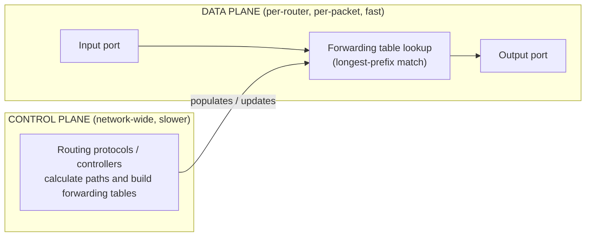

**Explanation:** Routing is the "brain" that computes the map; forwarding is the "reflex" that acts on each packet using the map. The two are related but run at completely different timescales.

### D. What Happens at a Router? (Page 3 — ordered steps)

1. Receive a **link-layer frame** on an input interface and **extract the IP packet**.
2. **Validate** relevant header fields; **decrement** the IPv4 TTL or IPv6 Hop Limit.
3. **Look up** the destination prefix using **longest-prefix matching**.
4. Select the **next hop and output interface**; apply policy, filtering and queuing decisions.
5. **Encapsulate** the packet in a **new link-layer frame** appropriate for the next link and transmit it.

> **Crucial boundary (from PDF):** A router normally **removes and replaces the link-layer header at each hop**. The **IP packet continues across the route**, although hop-sensitive fields such as TTL/Hop Limit change. **TCP/UDP belongs to the end systems**, not to ordinary hop-by-hop forwarding.

**Diagram 2 — Frame replaced at every hop, IP preserved end-to-end (Added diagram):**

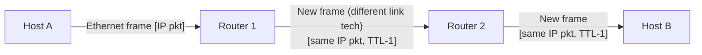

### E. Best Effort Does Not Mean Careless (Page 3)

**Best effort is a service contract, not a quality judgment.** Networks still use robust hardware, queues, routing redundancy and operational controls. The phrase means the IP layer does not promise a specific outcome to each packet. Applications obtain stronger properties through **TCP, application logic, redundancy or specialised network services**.

---

## 2. Virtual-Circuit and Datagram Networks

### A. Topic Introduction

A network can deliver packets using **connection-oriented virtual circuits** or a **connectionless datagram** model. **These are network-layer concepts and should not be confused with TCP and UDP, which are transport-layer protocols.**

### B. Comparison Table (Page 4 — exam classic)

| Property | Virtual-circuit network | Datagram network |
|---|---|---|
| **Setup** | Path/state established **before** data transfer | No network-layer connection setup required |
| **Router state** | Routers/switches maintain **per-VC or per-flow forwarding state** | Routers normally forward based on **destination address/prefix** |
| **Packet header** | Carries a **short VC/label identifier** | Carries **complete destination network-layer address** |
| **Path** | Packets of one VC usually **follow the established path** | Different packets can in principle **follow different paths** |
| **Failure handling** | Circuit state/path may need **re-establishment** | Routing can **adapt**; subsequent datagrams may take a new route |
| **Examples** | ATM virtual circuits; **MPLS label-switched paths are conceptually related but not identical** | **The Internet IP service is datagram based** |

### C. Virtual-Circuit Phases (Page 4)

1. **Setup:** select the path and install mapping/state in intermediate devices.
2. **Data transfer:** packets carry a compact identifier; each device maps *incoming interface/VC → outgoing interface/VC*.
3. **Teardown:** release the associated state/resources.

**Diagram 3 — VC setup → data → teardown vs datagram forwarding (Added diagram):**

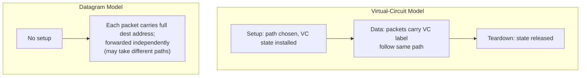

### D. Datagram Forwarding Example (Page 4)

**Forwarding table:**

| Destination prefix | Output interface |
|---|---|
| 10.0.0.0/8 | I1 |
| 172.16.0.0/12 | I2 |
| 192.168.10.0/24 | I3 |
| 192.168.0.0/16 | I4 |
| 0.0.0.0/0 | ISP |

**Worked reasoning (from PDF):**
- A packet for **192.168.10.25** matches **both /16 and /24**. The router chooses **/24** because it is the **longest and therefore most specific matching prefix**.
- A packet for **8.8.8.8** matches **only the default route /0** and goes to the ISP.

> **Common mistake (from PDF):** Connectionless IP does **not** mean applications cannot have connections. **TCP can create an end-to-end connection over the connectionless IP datagram service.** Layers may offer different service models.

---

## 3. Inside a Router and Longest-Prefix Matching

### A. Router Architecture (Page 5)

A conceptual router contains **input ports, a switching fabric, output ports and a routing processor**. Real designs vary, but this model explains where **delay and drops** arise.

| Component | Role | Possible performance issue |
|---|---|---|
| **Input port** | Physical/link termination, parsing and lookup | Input queueing; **head-of-line blocking** |
| **Switching fabric** | Moves packets from inputs to outputs | Internal fabric capacity may limit aggregate throughput |
| **Output port** | Buffers, schedules and transmits packets | Output queue growth and **packet drops** |
| **Routing processor** | Runs control-plane protocols and management logic | Control-plane overload or **slow convergence** |

**Diagram 4 — Router block diagram (Added diagram):**

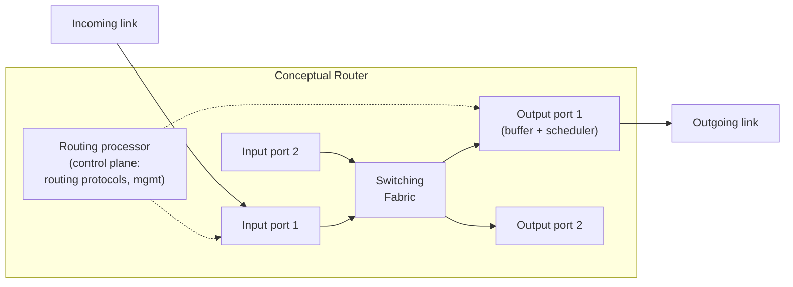

### B. Queueing and Scheduling (Page 5)

- If several inputs send towards the **same output**, packets may queue **even when the switching fabric is fast**.
- **Finite buffers eventually overflow.** Larger buffers reduce some drops but can produce excessive delay (**bufferbloat**).
- **Scheduling disciplines:** FIFO, priority, round robin, weighted fair queuing. They influence **delay, fairness and quality of service**.

### C. Longest-Prefix Matching Practice (Page 5)

**Forwarding table (IPv6 example):**

| Prefix | Interface |
|---|---|
| 2001:db8:10::/48 | A |
| 2001:db8:10:20::/64 | B |
| 2001:db8::/32 | C |
| ::/0 | D |

**Worked reasoning (from PDF):**
- Destination **2001:db8:10:20::99** → uses **B**, because **/64 is the most specific match**.
- Destination **2001:db8:10:30::99** → uses **A**, because it matches **/48 but not the /64 entry**.
- Destination **2001:4860::1** → uses **D**, the **default route**.

> **Forwarding-table insight (from PDF):** A routing protocol may learn **several candidate routes**. The router **selects routes for its routing table**, then derives an **optimised forwarding table**. The two tables are **related but are not always identical internal structures**.

---

## 4. Internet Protocol Version 4 (IPv4)

### B. Exam-Ready Definition (from PDF, Page 6)

> **IPv4** defines the format and handling of datagrams and provides **32-bit addresses**. It is **connectionless and best-effort**. Each datagram is handled **independently**.

### C. IPv4 Header (Page 6 — memorise field sizes)

**Diagram 5 — IPv4 header layout (Added ASCII diagram, fields per PDF):**

```text
 0        4        8               16      19             31
+--------+--------+---------------+-------+---------------+
| Version|  IHL   |   DSCP/ECN    |        Total Length    |
+--------+--------+--------+------+-----------------------+
|        Identification     |Flags|    Fragment Offset     |
+--------+--------+--------+------+-----------------------+
|   TTL   | Protocol |        Header Checksum           |
+---------+----------+----------------------------------+
|                    Source Address                       |
+---------------------------------------------------------+
|                  Destination Address                    |
+---------------------------------------------------------+
|                  Options + Padding (variable)            |
+---------------------------------------------------------+
```

| Field | Size | Purpose (from PDF) |
|---|---|---|
| **Version** | 4 bits | Value **4** identifies IPv4 |
| **IHL** | 4 bits | Header length in **32-bit words; minimum 5 = 20 bytes** |
| **DSCP/ECN** | 8 bits | Traffic treatment and **explicit congestion notification** |
| **Total Length** | 16 bits | Entire datagram length: header plus data; **maximum 65,535 bytes** |
| **Identification, Flags, Fragment Offset** | 32 bits total | Support **IPv4 fragmentation and reassembly** |
| **TTL** | 8 bits | **Decremented at routers; packet discarded at zero** to prevent loops |
| **Protocol** | 8 bits | Next payload protocol, e.g., **ICMP 1, TCP 6, UDP 17** |
| **Header Checksum** | 16 bits | Error detection for **IPv4 header only; recomputed as TTL changes** |
| **Source/Destination** | 32 bits each | IPv4 addresses |
| **Options + padding** | Variable | Optional controls; **uncommon on normal fast paths** |

### D. Encapsulation Example (Page 6)

An **HTTP response** may be carried as application data inside a **TCP segment**. IP adds an **IPv4 header**, producing an **IP datagram**. **Ethernet then adds its own header and trailer for one link.** At the next router the **Ethernet frame changes**, while the **IP source and destination normally remain end-to-end unless address translation occurs** (e.g., NAT).

### E. TTL and Protocol Are Not the Same (Page 6 — common confusion)

- **TTL** limits **how many router hops** the datagram can survive. Despite the historical name, routers normally decrement it by **at least one per hop**.
- **Protocol** tells the destination network stack **which upper-layer handler** should receive the payload.
- **Header checksum** protects the **IPv4 header only**, not the application data. **TCP/UDP checksums cover their own headers and data.**

> **Worked interpretation (from PDF):**
> IPv4 **Version=4, IHL=5, Total Length=1500** means a **20-byte IPv4 header** and **1480 bytes after it**. If **Protocol=6**, that payload **begins with TCP**. If **TTL arrives as 1** at a router, decrementing it to **zero causes discard** and usually an **ICMP Time Exceeded** response.

---

## 5. MTU, Fragmentation and Path MTU Discovery

### B. Definitions (Page 7)

> The **Maximum Transmission Unit (MTU)** is the largest network-layer packet a link can carry in one frame without fragmentation. **Ethernet commonly carries an IP MTU of 1500 bytes**, although other values exist.

### C. IPv4 Fragmentation Fields (Page 7)

| Field | Role |
|---|---|
| **Identification** | **Copied into all fragments** of the original datagram |
| **DF (Don't Fragment)** | If set, a router **must not fragment**; an oversized packet is **dropped** and an **ICMP message may report the required MTU** |
| **MF (More Fragments)** | Set on **all fragments except the final one** |
| **Fragment Offset** | Position of fragment data in the original payload, measured in **8-byte units** |

**Key rule:** **Reassembly occurs at the destination**, not normally at intermediate routers. **Loss of one fragment prevents reassembly** of the complete original datagram.

### D. Worked Fragmentation Example (Page 7 — numerical, very examinable)

**Given:** an IPv4 datagram has a **20-byte header and 3980-byte payload (4000 bytes total)**. It must cross a link with **MTU 1500**. Each fragment needs a **20-byte header**. Maximum data per non-final fragment is **1480 bytes, which is divisible by 8**.

**Step-by-step (Added explanation):**
1. Available data per fragment = MTU − header = 1500 − 20 = **1480 bytes** (1480 ÷ 8 = 185 ✓, so offset units work cleanly).
2. Payload 3980 bytes → fragments carry 1480, 1480, and the remainder 3980 − 2960 = **1020 bytes**.

| Fragment | Data bytes | Total length | Offset | MF |
|---|---|---|---|---|
| 1 | 1480 | 1500 | 0/8 = **0** | **1** |
| 2 | 1480 | 1500 | 1480/8 = **185** | **1** |
| 3 | 1020 | 1040 | 2960/8 = **370** | **0** |

**Meaning:** Offsets are measured in **8-byte blocks of payload data** (1480 = 185 blocks; 2960 = 370 blocks). MF=1 means "more fragments follow"; the last fragment has MF=0.

### E. Why Modern Systems Avoid In-Path Fragmentation (Page 7)

- Extra headers consume bandwidth; fragments create **processing/state overhead**.
- **Firewalls and NAT devices may handle fragments inconsistently.**
- **Path MTU Discovery (PMTUD)** tries to learn the usable packet size. **IPv6 routers never fragment transit packets; the source is responsible for sizing/fragmentation.**
- **Blocking all ICMP can break Path MTU Discovery**, creating *"works for small packets, stalls for large transfers"* failures.

---

## 6. IPv4 Addressing, Prefixes and CIDR

### B. Definitions (Page 8)

> An **IPv4 address contains 32 bits**, commonly written as four decimal octets. Modern addressing uses **Classless Inter-Domain Routing (CIDR)**: an address plus prefix length, such as **192.0.2.64/26**. The first 26 bits identify the **network prefix**; the remaining 6 bits identify **addresses within that block**.

### C. Essential Formulas (Page 8 — memorise)

```text
Host bits = 32 − prefix length
Total addresses = 2^(host bits)
Traditional usable-host count = 2^(host bits) − 2
```

**The "minus two" rule (from PDF):** reserves the **all-zero host part** as the **network address** and the **all-one host part** as the **directed broadcast address**. **It is not universal:** **/31** is used for **point-to-point links** and **/32** identifies a **single host route**.

### D. Common Prefix Sizes (Page 8 — memorise table)

| Prefix | Mask | Total addresses | Traditional usable hosts |
|---|---|---|---|
| /8 | 255.0.0.0 | 16,777,216 | 16,777,214 |
| /16 | 255.255.0.0 | 65,536 | 65,534 |
| /24 | 255.255.255.0 | 256 | 254 |
| /25 | 255.255.255.128 | 128 | 126 |
| /26 | 255.255.255.192 | 64 | 62 |
| /27 | 255.255.255.224 | 32 | 30 |
| /28 | 255.255.255.240 | 16 | 14 |
| /29 | 255.255.255.248 | 8 | 6 |
| /30 | 255.255.255.252 | 4 | 2 |

### E. Binary AND Method (Page 8 — worked example)

To find the network address, perform **bitwise AND** between the IP address and subnet mask.

**Example (from PDF): 192.168.10.77/26**
1. A /26 creates **block sizes of 64 in the last octet**: 0, 64, 128, 192.
2. Since 77 lies in **64–127**, the **network is 192.168.10.64**.
3. **Broadcast is 192.168.10.127**.
4. **Traditional usable range: 192.168.10.65–126** (62 usable hosts).

> **Fast block-size method (from PDF):** For an interesting mask octet, **block size = 256 − mask value**. For **/27** the final mask octet is **224**, so block size is **256 − 224 = 32**. Boundaries are 0, 32, 64, 96, 128, 160, 192, 224.

**Diagram 6 — Address block anatomy for 192.168.10.64/26 (Added diagram):**

```text
+---------------------------+----------------+
|   Network bits (/26)      |   Host bits(6) |
+---------------------------+----------------+
192.168.10.64   → all host bits 0 → NETWORK address
192.168.10.65   → first usable host
192.168.10.126  → last usable host
192.168.10.127  → all host bits 1 → DIRECTED BROADCAST
```

---

## 7. Subnetting and Variable-Length Subnet Masks

### A. Definitions (Page 9)

> **Subnetting** divides an address block into smaller prefixes. **Variable-Length Subnet Masking (VLSM)** allows **different subnet sizes** so address space matches actual need.

**Reliable method (from PDF):** **Order requirements from largest to smallest → choose the smallest sufficient block → allocate on a valid boundary → continue with the next free address.**

### B. Worked VLSM Problem (Page 9 — exam classic, learn the method)

**Allocate 192.168.20.0/24 for departments needing 100, 50, 25 and 10 usable host addresses.**

| Need | Chosen prefix | Block | Network | Usable range | Broadcast |
|---|---|---|---|---|---|
| 100 | /25 (126 usable) | 128 | 192.168.20.0 | 192.168.20.1–126 | 192.168.20.127 |
| 50 | /26 (62 usable) | 64 | 192.168.20.128 | 192.168.20.129–190 | 192.168.20.191 |
| 25 | /27 (30 usable) | 32 | 192.168.20.192 | 192.168.20.193–222 | 192.168.20.223 |
| 10 | /28 (14 usable) | 16 | 192.168.20.224 | 192.168.20.225–238 | 192.168.20.239 |

**Addresses 192.168.20.240–255 remain as one aligned /28 block for future use.**

**Step-by-step method (Added explanation):**
1. **Largest first:** 100 hosts → smallest power-of-two block ≥ 100 (+2 reserved) is **128 → /25**. Allocate at offset 0: `192.168.20.0/25`.
2. Next free address is **.128**. Need 50 → block **64 → /26**: `192.168.20.128/26`.
3. Next free is **.192**. Need 25 → block **32 → /27**: `192.168.20.192/27`.
4. Next free is **.224**. Need 10 → block **16 → /28**: `192.168.20.224/28`.
5. Next free is **.240**; the remaining 16 addresses (.240–.255) form an aligned **/28** for future use.

### C. Route Aggregation (Page 9)

> **Aggregation** advertises **one larger prefix for several contiguous smaller prefixes**. For example, **10.20.0.0/24 through 10.20.3.0/24 share the first 22 bits** and can be summarised as **10.20.0.0/22**, provided the advertiser can correctly reach the entire range.

- **Benefit:** aggregation **reduces routing-table size**.
- **Risk:** an **incorrect summary can attract traffic for unreachable destinations**.

> **Frequent errors (from PDF):**
> - Do **not** allocate a subnet on an **invalid boundary**;
> - Do **not** forget **network/broadcast addresses** in ordinary LAN calculations;
> - Do **not** assign **overlapping blocks**;
> - Do **not** choose a prefix before translating the host requirement into a **power-of-two block**.

---

## 8. IPv4 Address Types and Special Ranges

### B. Special Ranges Table (Page 10 — memorise)

| Range / form | Meaning | Operational note |
|---|---|---|
| **10.0.0.0/8** | Private address space | Not globally routed; usually translated or used privately |
| **172.16.0.0/12** | Private address space | Covers **172.16.0.0–172.31.255.255** |
| **192.168.0.0/16** | Private address space | Common in homes and small networks |
| **127.0.0.0/8** | **Loopback** | 127.0.0.1 tests the **local IP stack; traffic does not leave the host** |
| **169.254.0.0/16** | **IPv4 link-local** | Often self-assigned **when DHCP fails**; not routed beyond the local link |
| **224.0.0.0/4** | **Multicast** | One sender to an identified receiver group |
| **255.255.255.255** | **Limited broadcast** | **Local network only; routers do not forward it** |
| **0.0.0.0/0** | **Default route** | Matches any IPv4 destination if no more specific route exists |
| **0.0.0.0** | **Unspecified address** | Used when a host does not yet know its address |
| **100.64.0.0/10** | **Shared address space** | Used for **carrier-grade NAT**; not ordinary private RFC 1918 space |
| **192.0.2.0/24** | **Documentation** | Reserved for examples; similarly **198.51.100.0/24 and 203.0.113.0/24** |

### C. Unicast, Broadcast, Multicast and Anycast (Page 10)

- **Unicast:** one source sends to **one addressed interface**.
- **Broadcast:** one source targets **all hosts in an IPv4 broadcast domain**; **IPv6 does not use broadcast**.
- **Multicast:** one packet targets a **subscribed group**; network replication can be **more efficient than many unicasts**.
- **Anycast:** the **same address/prefix is announced from multiple locations** and routing delivers a client to a **suitable instance, often topologically nearest** according to policy.

**Diagram 7 — Delivery models (Added diagram):**

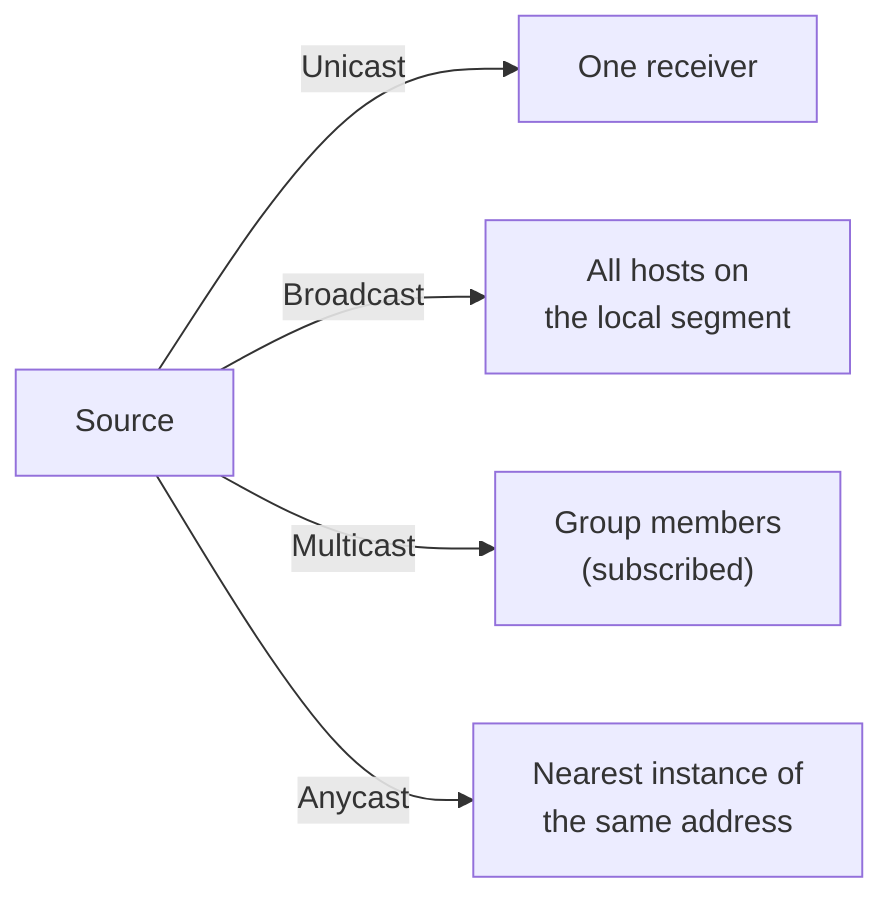

---

## 9. Address Assignment, DHCP and NAT

### A. Topic Introduction

IP addressing is not only arithmetic. Hosts need an **address, prefix, default gateway and often DNS resolver information**. **DHCP automates this configuration. NAT translates addresses — often ports too — at an edge device.**

### B. DHCP DORA Sequence (Page 11 — memorise)

| Step | Message | Purpose |
|---|---|---|
| 1 | **DHCPDISCOVER** | Client without an address **searches** for DHCP servers |
| 2 | **DHCPOFFER** | Server **proposes** an address and configuration |
| 3 | **DHCPREQUEST** | Client **requests** the selected offer / renews a lease |
| 4 | **DHCPACK** | Server **confirms** lease and configuration |

**Diagram 8 — DHCP DORA (Added diagram):**

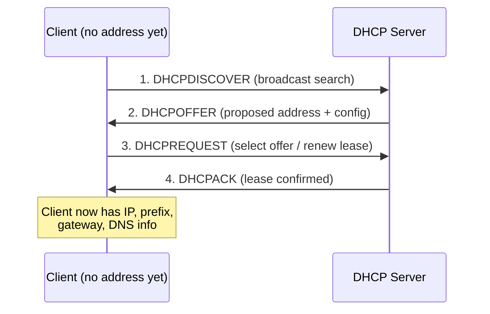

**Notes (from PDF):** A **DHCP relay** can forward client requests **between subnets** so every LAN does not need its own server. **Leases expire or are renewed; DHCP assignment does not permanently prove user identity.**

### C. NAT/PAT Example (Page 11 — understand the mapping)

| Inside local | Inside/global mapping | Remote service |
|---|---|---|
| 192.168.1.10:51500 | 203.0.113.5:**40001** | 198.51.100.20:443 |
| 192.168.1.11:51500 | 203.0.113.5:**40002** | 198.51.100.20:443 |

> **Port Address Translation (PAT)** distinguishes simultaneous flows using **translated port numbers**. Return traffic to **203.0.113.5:40001 is mapped back to 192.168.1.10:51500**.

**Diagram 9 — NAT/PAT flow (Added diagram):**

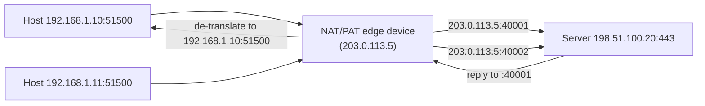

**Explanation:** Both hosts used the same source port (51500), so the NAT device assigned **different translated ports (40001, 40002)** to keep the flows separate.

### D. Benefits and Limitations (Page 11 — key table)

| Benefits | Limitations / design cost |
|---|---|
| Conserves public IPv4 addresses; hides internal addressing; simplifies provider-address changes in some designs | **Breaks pure end-to-end addressing**; complicates inbound connections and some protocols; **requires translation state**; is **not a substitute for a firewall**; makes logging/attribution dependent on time and port records |

> **Security reality (from PDF):** NAT may **incidentally** block unsolicited inbound mappings, but **NAT and firewalling are distinct functions**. Security requires explicit policy, filtering, monitoring and host/application controls.

---

## 10. Internet Protocol Version 6 (IPv6)

### B. Definition (Page 12)

> **IPv6** was designed chiefly to provide **vastly larger addressing** and improve **protocol extensibility and forwarding efficiency**. IPv6 addresses are **128 bits**. The **base header is fixed at 40 bytes**; optional information is carried in **extension headers**.

### C. IPv6 Base Header (Page 12)

| Field | Purpose |
|---|---|
| **Version** | 6 |
| **Traffic Class** | Traffic differentiation and ECN |
| **Flow Label** | Identifies packets belonging to a **flow** for consistent handling |
| **Payload Length** | Bytes **following the 40-byte base header** |
| **Next Header** | Identifies an **extension header or upper-layer protocol** |
| **Hop Limit** | Like IPv4 TTL: **decremented at each router** |
| **Source/Destination Address** | **128-bit** IPv6 addresses |

### D. IPv4 vs IPv6 Comparison (Page 12 — top exam table)

| Aspect | IPv4 | IPv6 |
|---|---|---|
| **Address size** | 32 bits | 128 bits |
| **Base header** | Variable, minimum 20 bytes | **Fixed 40 bytes** |
| **Header checksum** | Present | **Absent** |
| **Router fragmentation** | Possible unless DF set | **Not performed by routers** |
| **Broadcast** | Supported | **No broadcast; multicast/anycast used** |
| **Configuration** | Manual/DHCPv4 | **SLAAC, DHCPv6 and manual options** |
| **Address resolution** | ARP | **Neighbour Discovery using ICMPv6** |
| **Options** | Within variable IPv4 header | **Extension headers** |

> **Not merely "IPv4 with more addresses" (from PDF):** IPv6 changes address representation, discovery, multicast use, header processing, fragmentation responsibility and configuration. However, it **remains a best-effort datagram network layer** and still relies on routing.

---

## 11. IPv6 Addressing and Notation

### B. Notation Rules (Page 13)

> IPv6 addresses are written as **eight groups of four hexadecimal digits**. Each hex digit represents **four bits**. **Leading zeros in a group may be removed**, and **one longest consecutive run of all-zero groups may be replaced by `::`**. The **`::` compression may appear only once** in an address.

**Compression example (from PDF):**
```text
Full:       2001:0db8:0000:0000:0000:ff00:0042:8329
Compressed: 2001:db8::ff00:42:8329
```

*(Added explanation: `0db8 → db8`, `0042 → 42` (leading zeros removed); the run of three zero groups `0000:0000:0000` becomes `::`.)*

### C. Important IPv6 Address Types (Page 13 — memorise)

| Prefix / address | Use |
|---|---|
| **2000::/3** | Global unicast space commonly used on the public Internet |
| **fe80::/10** | **Link-local**; every IPv6 interface uses link-local communication for local functions |
| **fc00::/7** | **Unique local addresses**; commonly locally assigned from **fd00::/8** |
| **ff00::/8** | **Multicast** |
| **::1/128** | **Loopback** |
| **::/128** | **Unspecified** |
| **2001:db8::/32** | **Documentation/examples** |

### D. /64 and Interface Identifiers (Page 13)

- A **/64 is standard for most IPv6 LAN subnets**, leaving **64 bits for the interface identifier**.
- **SLAAC** can form addresses using **router advertisements and locally generated interface identifiers**.
- **Privacy extensions** can use **temporary addresses to reduce long-term tracking**.
- **DHCPv6** may provide addresses or other configuration, depending on design.

### E. Neighbour Discovery (Page 13)

| Mechanism | Purpose |
|---|---|
| **Router Solicitation / Router Advertisement** | Help hosts **learn routers and prefixes** |
| **Neighbour Solicitation / Neighbour Advertisement** | **Resolve neighbours and verify reachability, replacing ARP** |
| **Duplicate Address Detection (DAD)** | Checks whether a **proposed address is already in use** |

> Because these mechanisms **use ICMPv6**, **indiscriminately blocking ICMPv6 can break essential IPv6 operation**.

---

## 12. IPv4-to-IPv6 Transition and Dual-Stack Reality

### A. Topic Introduction

IPv4 and IPv6 are **separate network-layer protocols**; an IPv4-only host **cannot directly understand an IPv6 packet**. Transition is therefore a **coexistence programme rather than a simple overnight header upgrade**.

### B. Transition Approaches (Page 14 — key table)

| Approach | How it works | Trade-off |
|---|---|---|
| **Dual stack** | Devices run **IPv4 and IPv6 simultaneously**; DNS and policy select a usable path | Operationally clear but **requires managing two protocols** |
| **Tunnelling** | One protocol is **encapsulated through a network that carries the other** | Useful across incompatible islands; **adds overhead and troubleshooting complexity** |
| **Translation** | Gateways **translate** between IPv4 and IPv6, e.g., **NAT64 with DNS64** | Enables communication across versions but can **complicate protocols, logging and end-to-end transparency** |

**Diagram 10 — Dual stack, tunnel and translation (Added diagram):**

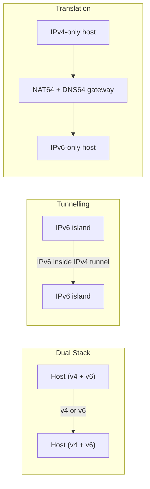

### C. Happy Eyeballs Concept (Page 14)

> Modern client behaviour may try **IPv6 and IPv4 with carefully timed parallelism** so a **broken or slow path does not create a long user-visible delay**. The purpose is **good user experience while preferring viable IPv6 connectivity, not blindly preferring one protocol regardless of reachability**.

### D. Deployment Checklist (Page 14)

- Obtain and plan an IPv6 prefix; design **/64 subnets** and aggregation.
- Enable routing, **firewall policies, monitoring, DNS AAAA records and logging** for IPv6 — not only IPv4.
- Test applications, load balancers, VPNs, security tools and cloud paths.
- Train operations teams to recognise IPv6 addresses and **ICMPv6 dependencies**.
- **Measure actual reachability** before changing production preference.

---

## 13. Internet Control Message Protocol (ICMP)

### B. Exam-Ready Definition (from PDF, Page 15)

> **ICMP** carries **control, error-reporting and diagnostic information** associated with IP. It is **encapsulated inside IP** but is conceptually a companion to the network layer. **ICMP reports a problem; it generally does not repair the failed packet or make IP reliable.**

### C. ICMP Messages Table (Page 15 — memorise)

| Message / function | Typical meaning | Diagnostic use |
|---|---|---|
| **Echo Request / Reply** | Reachability probe and response | Used by **ping**; reply confirms a round trip **at that moment** |
| **Destination Unreachable** | Destination, protocol, port or path condition prevents delivery | Can identify **no route, closed UDP port or fragmentation/MTU issue** |
| **Time Exceeded** | **TTL/Hop Limit reached zero**, or **fragment reassembly timed out** | **Traceroute uses hop-limit expiry to reveal routers** |
| **Redirect** | Router suggests a better first hop on a local network | Often restricted for security; **not a general Internet routing update** |
| **Packet Too Big (ICMPv6)** | Packet exceeds next-hop MTU | **Essential to IPv6 Path MTU Discovery** |

**Diagram 11 — How traceroute works (Added diagram):**

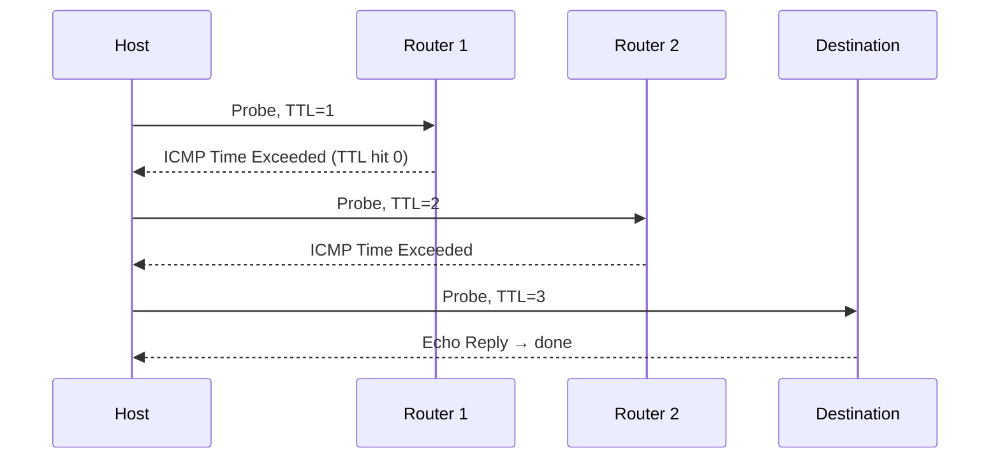

**Explanation:** Traceroute deliberately sends probes with increasing TTL values; each intermediate router discards the packet at TTL=0 and returns **ICMP Time Exceeded**, revealing itself.

### D. Ping and Traceroute Limits (Page 15 — exam-valuable nuance)

- A **successful ping proves that an echo exchange worked**; it does **not** prove an HTTP server, database or application is healthy.
- A **failed ping does not prove the host is down**; ICMP may be **filtered or rate-limited**.
- **Traceroute reveals responding hops for probes**; load balancing, asymmetric paths, tunnels and filtering can make the displayed path **incomplete or variable**.
- **High ICMP response time from one router** may reflect **control-plane de-prioritisation, not necessarily slow forwarding** through that router.

> **Troubleshooting principle (from PDF):** Use ICMP as **evidence, not as a complete diagnosis**. Combine it with routing tables, interface counters, DNS tests, TCP/application tests, packet capture and monitoring.

---

## 14. Routing: Metrics, Graphs and Design Goals

### A. Topic Introduction

Routing **chooses paths through a graph**: **routers are nodes, links are edges**, and each link may have a **cost**. **"Best" can mean lowest configured cost, fewest hops, greatest policy preference or another operational objective — not necessarily shortest physical distance.**

### B. Centralised vs Distributed Approach (Page 16 — top exam table)

| Property | Centralised / global approach | Distributed / decentralised approach |
|---|---|---|
| **Knowledge** | Algorithm uses a **complete topology/cost view** | Each router begins with **neighbour information** and exchanges results |
| **Classic example** | **Link-State / Dijkstra** | **Distance Vector / Bellman-Ford** |
| **Strength** | Can calculate a **consistent shortest-path tree** from known topology | **No single router needs the complete topology map** |
| **Challenge** | **Flooding/database consistency and computation** | **Slow convergence, loops and count-to-infinity risk** |

### C. Static and Dynamic Routes (Page 16)

| Route type | Meaning |
|---|---|
| **Connected route** | Created for a **directly attached active network** |
| **Static route** | **Manually configured**; predictable but **not automatically adaptive** |
| **Default route** | **Catch-all** used when no more specific route exists |
| **Dynamic route** | **Learned through a routing protocol** and updated as topology changes |

### D. Convergence (Page 16)

> **Convergence** is the **process and time by which routers reach a sufficiently consistent view after a change**. During convergence, **transient loops, black holes or suboptimal paths may occur**. **Fast convergence is valuable, but excessive sensitivity can cause route churn. Stability and responsiveness must be balanced.**

---

## 15. Link-State Routing and Dijkstra's Algorithm

### A. Working Model (Page 17)

> In **Link-State** routing, each router:
> 1. **Discovers neighbours and link costs**,
> 2. **Advertises** that information through **reliable flooding**,
> 3. Builds a **link-state database (LSDB)**,
> 4. Runs **Dijkstra's shortest-path-first algorithm with itself as root**.

### B. Dijkstra Procedure (Page 17 — exam algorithm)

1. **Initialise N′ with the source node.** Record tentative cost to each directly connected neighbour; others are **infinity**.
2. **Choose the not-yet-final node with the smallest tentative distance** and add it to N′.
3. **For each neighbour of that node, test whether the path through it gives a lower cost** (relaxation).
4. **Repeat until all reachable nodes are final.** The **predecessor relationships form a shortest-path tree**.

### C. Worked Graph (Page 17 — memorise the method)

**Given (undirected link costs):** A-B=2, A-C=5, B-C=1, B-D=2, C-D=3, C-E=1, D-E=2. **Find shortest paths from A.**

**Diagram 12 — The worked graph (Added diagram, per PDF data):**

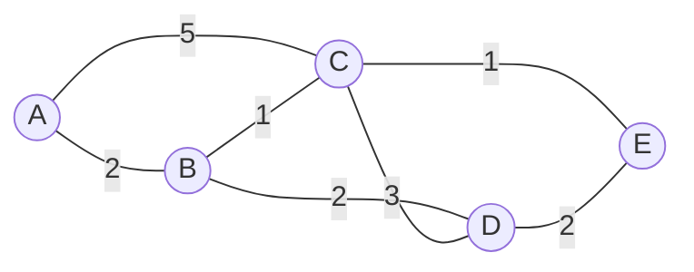

**Iteration table (from PDF):**

| Iteration | Permanent set N′ | Tentative best distances from A |
|---|---|---|
| 0 | {A} | B=2 via A; C=5 via A; D=∞; E=∞ |
| 1: choose B | {A,B} | C=min(5, 2+1)=**3 via B**; D=4 via B; E=∞ |
| 2: choose C | {A,B,C} | D=min(4, 3+3)=4 via B; E=4 via C |
| 3: choose D | {A,B,C,D} | E=min(4, 4+2)=4 via C |
| 4: choose E | {A,B,C,D,E} | Final |

**Final forwarding table (from PDF):**

| Destination | Cost | Shortest path / next hop from A |
|---|---|---|
| B | 2 | A-B / **B** |
| C | 3 | A-B-C / **B** |
| D | 4 | A-B-D / **B** |
| E | 4 | A-B-C-E / **B** |

> **Tie handling (from PDF):** Equal-cost paths can exist. Implementations may choose one or install **multiple equal-cost paths (ECMP)**, subject to protocol and platform behaviour. **Dijkstra calculates costs; forwarding behaviour also depends on policy and implementation.**

---

## 16. Distance-Vector Routing and Bellman-Ford

### B. Definition and Equation (Page 18 — memorise)

> In **Distance-Vector (DV)** routing, router x maintains an estimate **D_x(y)** to every destination y. It knows **link costs to neighbours** and receives each neighbour's **advertised distance vector**. It updates using the **Bellman-Ford relationship**:

```text
D_x(y) = min over neighbour v [ c(x,v) + D_v(y) ]
```

### C. Worked Update (Page 18 — numerical)

**Given:** Router X has link cost **2 to neighbour A** and **5 to neighbour B**. A advertises distance to destination Z as **6**; B advertises distance to Z as **2**.

```text
Via A: 2 + 6 = 8
Via B: 5 + 2 = 7      ← smaller, so X selects cost 7 via B
```

**Follow-up:** If B later advertises **10**, X recomputes: **min(8, 15) = 8 via A**.
*(Added explanation: Via A = 2+6 = 8; Via B = 5+10 = 15; minimum is 8, so X switches back to A.)*

### D. Why Bad News Can Travel Slowly — Count to Infinity (Page 18)

Suppose two neighbours incorrectly believe the other has an alternate route after a failure. They may **repeatedly increase the metric while sending traffic in a loop** — the **count-to-infinity problem**. Remedies **reduce, but do not universally eliminate**, transient issues.

**Remedy table (Page 18 — memorise):**

| Technique | Idea | Limitation |
|---|---|---|
| **Split horizon** | **Do not advertise a route back on the interface from which it was learned** | Does not solve every multi-router loop |
| **Poison reverse** | Advertise that learned route back **with an infinite metric** | Adds information and still has limits in larger loops |
| **Triggered update** | Send an update **soon after a change**, not only on a periodic timer | Simultaneous/inconsistent updates can still occur |
| **Hold-down / timers** | **Temporarily suppress unstable alternatives** | Can delay acceptance of a legitimate restored route |

### E. Link-State vs Distance Vector (Page 18 — top exam table)

| Dimension | Link-State | Distance Vector |
|---|---|---|
| **Shared information** | Local link state is **flooded to all routers** in area/domain | **Distance estimates exchanged with neighbours** |
| **Topology knowledge** | Each router **builds a topology database** | **No full topology inherently required** |
| **Computation** | **Dijkstra locally** | **Bellman-Ford iterative updates** |
| **Failure risks** | LSDB inconsistency; flooding/computation load | **Loops, slow convergence, count-to-infinity** |

---

## 17. Routing Information Protocol (RIP)

### B. Exam-Ready Definition & Summary (from PDF, Page 19)

> **RIP** is a classic **interior distance-vector routing protocol**. Its **metric is hop count**. A directly reachable network has a small metric; **16 represents infinity, so usable routes cannot exceed 15 hops**. This simplicity makes RIP easy to study but **unsuitable for large modern networks**.

> **Exam-ready summary (from PDF):** RIP = **IGP + Distance Vector + hop-count metric + maximum 15 hops + periodic neighbour exchange**. Advantages: **simplicity and low conceptual complexity**. Limitations: **poor scalability, limited metric quality, slower convergence**.

### C. RIP Characteristics (Page 19)

| Characteristic | RIP behaviour |
|---|---|
| **Scope** | Interior Gateway Protocol **within an autonomous system** |
| **Algorithm family** | **Distance Vector** |
| **Metric** | **Hop count**; ignores bandwidth, delay and load |
| **Updates** | **Periodic full-table advertisements**, with **triggered updates** for changes |
| **Transport** | **RIPv2 uses UDP port 520** |
| **RIPv2 improvement** | Supports **CIDR/subnet masks** and **multicast updates**; includes **simple authentication**, though stronger secure designs are preferred |
| **Loop controls** | **Split horizon, route poisoning, timers and maximum metric** |
| **Scale limit** | **15 usable hops; metric 16 is unreachable** |

### D. Example Metric Choice (Page 19 — key insight)

> RIP may prefer a **two-hop path using slow links** over a **three-hop path using high-speed links**, because it **counts routers, not bandwidth**. Therefore *"minimum hop count" is **not** the same as "best application performance."*

**Diagram 13 — RIP's hop-count blind spot (Added diagram):**

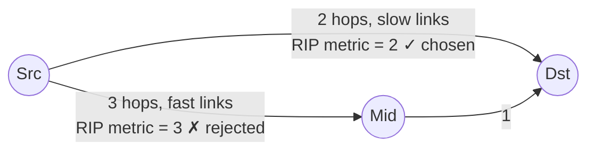

---

## 18. Open Shortest Path First (OSPF)

### B. Exam-Ready Definition (from PDF, Page 20)

> **OSPF** is a **link-state Interior Gateway Protocol**. Routers **form neighbour relationships**, **exchange/flood Link-State Advertisements (LSAs)**, maintain a **link-state database for their area** and run the **Shortest Path First calculation**.

### C. Hierarchical Design (Page 20)

- An OSPF autonomous system can be divided into **areas** to **limit LSDB and SPF scope**.
- **Area 0 is the backbone** through which other areas normally interconnect.
- An **Area Border Router (ABR)** connects areas and can **summarise routes**.
- An **Autonomous System Boundary Router (ASBR)** **introduces external routing information into OSPF**.

**Diagram 14 — OSPF area hierarchy (Added diagram):**

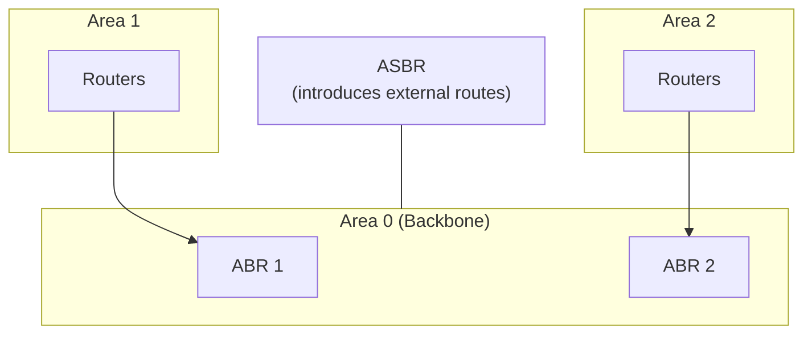

### D. Important OSPF Concepts (Page 20 — memorise)

| Concept | Meaning |
|---|---|
| **Router ID** | 32-bit identifier used by the OSPF process; **not necessarily a currently forwarded interface address** |
| **Hello protocol** | **Discovers/maintains neighbours** and checks compatible parameters |
| **Adjacency** | Relationship through which **selected routers exchange LSDB information** |
| **Cost** | Interface metric used by SPF; usually **derived/configured with reference to bandwidth** |
| **LSA** | Structured advertisement describing **topology or reachability information** |
| **DR/BDR** | On **multi-access networks**, designated/backup designated routers **reduce adjacency and flooding overhead** |
| **Protocol number** | OSPF is carried **directly in IP using protocol number 89, not TCP or UDP** |

### E. Operational Sequence (Page 20 — ordered steps)

1. **Discover neighbour** and verify matching **area, timers, authentication and network parameters**.
2. **Form adjacency** where required and **synchronise LSDBs**.
3. **Flood new LSAs** when topology changes.
4. **Run SPF and install preferred routes**.
5. **Update forwarding state**; convergence depends on **detection, flooding, SPF and installation times**.

> **Common mistake (from PDF):** OSPF does **not** "use Dijkstra to send every packet." **Dijkstra calculates the shortest-path tree after topology knowledge is built. The data plane then forwards individual packets using the resulting forwarding entries.**

---

## 19. Border Gateway Protocol (BGP)

### B. Exam-Ready Definition (from PDF, Page 21)

> **BGP** exchanges **reachability and policy information between autonomous systems** and also distributes external routes inside an AS. It is a **path-vector protocol**, not a shortest-path protocol in the simple Link-State/Distance-Vector sense. **Internet routing is governed by business and security policy as well as connectivity.**

### C. Autonomous Systems and Sessions (Page 21)

- An **Autonomous System (AS)** is a network or group of networks under a **common routing policy**, identified by an **ASN**.
- **eBGP** exchanges routes **between different autonomous systems**.
- **iBGP** distributes BGP information **within the same autonomous system**.
- **BGP runs over TCP port 179**, gaining **reliable session transport**; BGP still needs its own routing state, policy and keepalive logic.

**Diagram 15 — eBGP vs iBGP (Added diagram):**

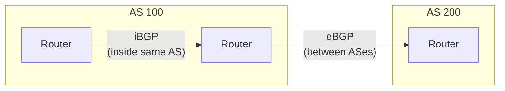

### D. Major Path Attributes (Page 21 — memorise)

| Attribute | Purpose / intuition |
|---|---|
| **AS_PATH** | Sequence of ASNs a route advertisement has traversed; **helps loop prevention and policy** |
| **NEXT_HOP** | Address of the next hop to reach the advertised prefix |
| **LOCAL_PREF** | Used **within an AS to prefer an outbound path**; **higher is commonly preferred** |
| **MED** | **Suggestion to a neighbouring AS** about preferred entry; **lower is commonly preferred** when compared under applicable rules |
| **ORIGIN** | Indicates **how the route originated into BGP** |
| **Communities** | **Tags used to apply and communicate routing policy** |

### E. Simplified Decision Intuition (Page 21)

An operator first **rejects invalid or disallowed routes**, then **applies local policy**. A simplified selection may prefer **higher local preference → shorter AS path → other attributes/tie-breakers**. **Exact ordering varies by implementation and configuration; never reduce BGP to "always choose the shortest AS path."**

> **Policy example (from PDF):** A company may prefer a **customer-learned route over a provider-learned route for commercial reasons, even if the AS path is longer**. **BGP selects policy-compliant reachability, not necessarily minimum latency.**

---

## 20. RIP, OSPF and BGP Compared

### A. Master Comparison Table (Page 22 — memorise; almost guaranteed exam material)

| Dimension | RIP | OSPF | BGP |
|---|---|---|---|
| **Role** | Interior routing | Interior routing | **Inter-domain and policy routing** |
| **Family** | Distance Vector | Link-State | **Path Vector** |
| **Main metric/input** | Hop count | Configured link cost | **Path attributes and policy** |
| **Knowledge exchange** | Routes/distances to neighbours | LSAs flooded within scope | Prefix reachability **plus attributes** |
| **Algorithm intuition** | Bellman-Ford | Dijkstra SPF | **Policy-driven path selection** |
| **Transport** | **UDP 520** | **Directly over IP, protocol 89** | **TCP 179** |
| **Scale** | Small | Medium/large enterprise or provider IGP | Internet-scale policy domains |
| **Loop defence** | Metric infinity and DV techniques | Consistent LSDB/SPF and protocol controls | AS_PATH plus policy controls |
| **Convergence tendency** | Relatively slow | Generally faster inside a designed domain | Policy-sensitive; **stability often prioritised** |

### B. Where Each Fits in One Enterprise (Page 22)

- Inside a **multi-site enterprise, OSPF** can calculate internal paths. A **very small legacy environment might use RIP**, though static routes or OSPF are more common choices.
- At the **Internet edge, BGP** exchanges routes with one or more **ISPs**.
- **Route redistribution** can connect routing domains, but careless redistribution can create **loops, suboptimal paths or route leaks**.
- The **IGP ensures a BGP next hop is internally reachable**; BGP decides **which external prefixes/policies to use**.

**Diagram 16 — RIP/OSPF/BGP placement in an enterprise (Added diagram):**

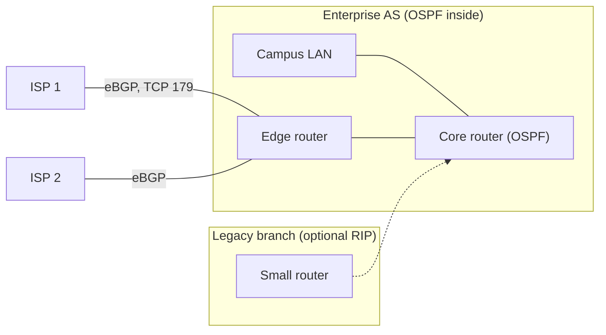

> **One-line memory aid (from PDF):**
> **RIP** asks *"how many hops?"*
> **OSPF** asks *"what is the lowest-cost topology path?"*
> **BGP** asks *"which policy-compliant path should this autonomous system use?"*

---

## 21. Integrated Case: A University Network Redesign

(Page 23 — use as a full design-answer template.)

**Scenario:** A university has a **Pune campus, Mumbai campus and cloud-hosted student portal**. Pune needs four VLANs: **Students 500 hosts, Faculty 120, Administration 60, Servers 30**. The university owns **10.40.0.0/21 privately**, has **one public /29 at each campus**, **two ISPs at Pune**, and **plans IPv6**. Symptoms: **long routing outages, overlapping subnets, blocked ICMP and failed large uploads**.

### 21.1 Addressing Recommendation (from PDF)

| Segment | Minimum block | Example allocation |
|---|---|---|
| Students 500 | **/23** (510 traditional usable) | **10.40.0.0/23** |
| Faculty 120 | **/25** (126 usable) | **10.40.2.0/25** |
| Administration 60 | **/26** (62 usable) | **10.40.2.128/26** |
| Servers 30 | **/27** (30 usable) | **10.40.2.192/27** |

**Reasoning (Added explanation of the table):**
- 500 hosts → need block ≥ 502 → 512 = **2⁹** → host bits 9 → **/23**. (A /24 gives only 254 usable — insufficient.)
- 120 → block 128 → **/25**; 60 → block 64 → **/26**; 30 → block 32 → **/27**. Allocated largest-first on valid boundaries within the /21.

The **remaining /21 space** can be reserved systematically for **links, management, growth and the Mumbai campus**. **Public /29 addresses** should be used **only where needed**; **PAT can serve outbound private hosts**, while published services use **controlled static mappings/load balancers**.

### 21.2 Routing and Resilience Recommendation (from PDF)

- Use **OSPF internally** with a planned area design; **summarise only where address allocation supports accurate summaries**.
- Use **BGP at Pune** if both ISPs provide appropriate service/ASN arrangements and the university needs **policy-controlled multihoming**; otherwise provider-managed failover may be simpler.
- Deploy **IPv6 dual stack** with **/64 LANs**, equivalent firewall policy, **AAAA DNS records** and monitored ICMPv6.
- **Permit required ICMP/ICMPv6 types** instead of blanket blocking; **validate Path MTU Discovery**.
- Use **DHCP relay and redundant DHCP services with non-overlapping scopes**.
- Monitor neighbour state, route changes, interface drops, BGP announcements and **translation-table capacity**.

### 21.3 Student Analysis Prompts (from PDF — practise answering)

1. **Why is /24 insufficient for the 500-host student VLAN?** → /24 gives 256 total / 254 usable < 500; need /23 (510 usable).
2. **What problem could overlapping address space create across a VPN?** → Ambiguous routing; traffic for one site's addresses may be delivered to the wrong site.
3. **Why might a dual-ISP design need BGP, and when might it not?** → BGP gives policy-controlled multihoming; if provider-managed failover suffices, BGP may be unnecessary.
4. **How can blocked ICMP create large-upload failures while small requests work?** → Blocked "Fragmentation Needed"/Packet Too Big breaks PMTUD; small packets fit the MTU but large ones stall.
5. **Which failures are data-plane and which are control-plane failures?** → E.g., a missing/oscillating route is control-plane; drops due to queue overflow are data-plane.

---

## 22. Network-Layer Troubleshooting Method

### A. Eight-Step Method (Page 24 — memorise the structure)

| Step | Question | Evidence |
|---|---|---|
| **1. Local state** | Does the host have a valid address, prefix and gateway? | ipconfig/ip addr, DHCP lease, interface state |
| **2. Local reachability** | Can it reach itself, a local neighbour and default gateway? | ping where permitted, ARP/ND table, VLAN and switch status |
| **3. Forwarding** | Does the gateway have a matching route and correct next hop? | routing/forwarding table; longest-prefix match |
| **4. Path** | Where does reachability stop or become asymmetric? | traceroute, router logs, route advertisements |
| **5. MTU** | Do only large packets fail? | DF probes, ICMP Packet Too Big/Fragmentation Needed |
| **6. Policy/NAT** | Is filtering or translation dropping/rewriting traffic? | firewall counters, NAT state and logs |
| **7. Control plane** | Are routes stable and neighbours established? | RIP/OSPF/BGP state, LSDB, received/advertised routes |
| **8. Application boundary** | Does IP reachability exist but the service fail? | TCP port test, TLS/HTTP response, server health |

**Diagram 17 — Troubleshooting flow (Added diagram):**

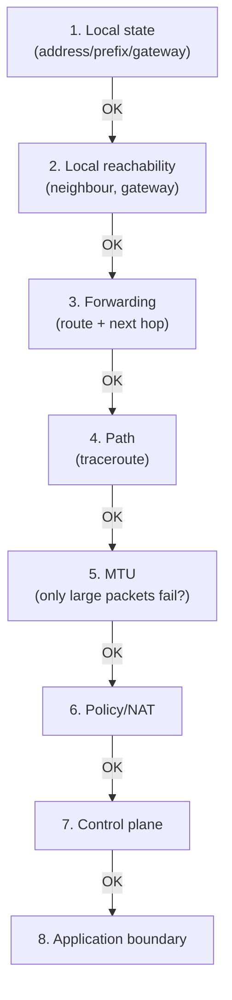

### B. Symptom-to-Layer Reasoning (Page 24 — high-value table)

| Symptom | Likely questions |
|---|---|
| **169.254.x.x address** | Did **DHCP fail**? Is the client in the correct VLAN? Is the **relay/server** reachable? |
| **Gateway reachable, remote subnet not reachable** | Is a **route missing**? Is **return routing** present? Is a **firewall blocking**? |
| **Some websites work; large upload stalls** | **Path MTU Discovery or fragmentation filtering?** |
| **Route oscillates between paths** | Unstable link, metric/policy change, **redistribution or BGP flap?** |
| **IPv4 works, IPv6 fails** | **AAAA/DNS, RA, IPv6 default route, ICMPv6** or firewall mismatch? |
| **Ping works, website fails** | Network reachability exists; inspect **TCP, TLS, DNS application mapping and server state** |

---

## 23. Common Misconceptions and Corrections

(Page 25 — memorise the corrections, not the mistakes.)

| ❌ Misconception | ✅ Correction |
|---|---|
| "IP guarantees delivery because the Internet normally works." | IP is **best-effort**; reliability may be supplied by TCP or applications |
| "A router selects a route using the full IP address only." | Routers match **prefixes** and choose the **longest valid match** |
| "A /24 always provides 256 usable hosts." | It has **256 total** addresses; traditional LAN use provides **254 usable** host addresses |
| "Private addresses are automatically secure." | They are not globally routed, but security still needs **filtering, segmentation and endpoint controls** |
| "NAT is a firewall." | Translation and security policy are **distinct**, even if combined in one device |
| "IPv6 has no need for subnetting." | IPv6 still needs **prefix planning, /64 LANs, aggregation and policy** |
| "Blocking ICMP improves security without cost." | **Selective control** is sensible; **blanket blocking can break diagnosis and core IPv6/PMTU functions** |
| "OSPF sends packets along paths by repeatedly running Dijkstra." | **SPF calculates routes; the forwarding plane then handles packets** |
| "BGP chooses the geographically shortest path." | BGP applies **policy and attributes**; path length is only one factor |
| "RIP, OSPF and BGP are interchangeable." | They solve **different scopes** and use **different information and algorithms** |

---

## 24. Rapid Revision Sheet

(Page 26 — the night-before-the-exam table.)

| Topic | Remember |
|---|---|
| **Forwarding vs routing** | Per-packet **local** action vs **network-wide** path calculation |
| **VC vs datagram** | Connection state/identifier vs independent destination-addressed packets |
| **IPv4** | 32-bit addresses; variable header; TTL, Protocol, checksum and possible router fragmentation |
| **CIDR** | Prefix length identifies network bits; **longest-prefix match** selects the most specific route |
| **Subnetting** | Block size is a **power of two**; allocate VLSM **largest-first on valid boundaries** |
| **NAT/PAT** | Translates addresses/ports **with state**; conserves IPv4 but changes end-to-end model |
| **IPv6** | 128-bit addresses; **fixed 40-byte base header**; extension headers; **no router fragmentation or broadcast** |
| **ICMP** | Control/error/diagnostic companion to IP; ping/traceroute evidence has limits |
| **Link-State** | Flood topology; build LSDB; run **Dijkstra** |
| **Distance Vector** | Exchange distances with neighbours; **Bellman-Ford**; loops/count-to-infinity possible |
| **RIP** | DV IGP, hop count, **maximum 15 hops, UDP 520** |
| **OSPF** | LS IGP, areas/LSAs/SPF, **IP protocol 89** |
| **BGP** | **Path-vector** policy protocol, eBGP/iBGP, AS_PATH, **TCP 179** |

### 24.1 Formula Box (from PDF — memorise verbatim)

```text
IPv4 host bits = 32 − prefix length
Block size = 2^(host bits)
Traditional usable hosts = 2^(host bits) − 2
Distance Vector: D_x(y) = min_v [ c(x,v) + D_v(y) ]
```

---

## 25. Examination and Classroom Questions

(Page 27 — the exact 13 questions from the PDF, with hints Added for practice.)

1. **[BL2] Differentiate forwarding and routing. Explain the roles of the data plane and control plane.**
   *Hint:* Use the two-core-functions table (local/per-packet vs network-wide/control) + the router diagram.
2. **[BL2] Compare virtual-circuit and datagram networks on setup, router state, addressing and failure behaviour.**
   *Hint:* Use the full VC-vs-datagram table; add the ATM/MPLS and Internet-IP examples.
3. **[BL3] For 192.168.44.173/27, determine subnet mask, network address, broadcast address and usable range.**
   *Added worked solution:*
   - Mask /27 = **255.255.255.224**; block size = 256 − 224 = **32**.
   - Boundaries in the last octet: 0, 32, 64, 96, 128, **160**, 192... 173 lies in **160–191**.
   - **Network = 192.168.44.160**; **Broadcast = 192.168.44.191**; **Usable = .161–.190** (30 hosts).
4. **[BL3] Divide 10.10.0.0/24 using VLSM for 80, 40, 20 and 10 hosts. Show all blocks.**
   *Added worked solution:*
   - 80 hosts → block 128 → **/25**: 10.10.0.0/25 (usable .1–.126, broadcast .127).
   - 40 hosts → block 64 → **/26**: 10.10.0.128/26 (usable .129–.190, broadcast .191).
   - 20 hosts → block 32 → **/27**: 10.10.0.192/27 (usable .193–.222, broadcast .223).
   - 10 hosts → block 16 → **/28**: 10.10.0.224/28 (usable .225–.238, broadcast .239).
   - Remaining .240–.255 = aligned /28 spare.
5. **[BL3] Interpret an IPv4 header with IHL=6, Total Length=1000, TTL=2 and Protocol=17.**
   *Added solution:* IHL=6 → header = 6×4 = **24 bytes** (options present); payload = 1000−24 = **976 bytes**; Protocol 17 = **UDP**; TTL=2 means only two router hops remain (a third router would discard it).
6. **[BL4] Analyse why a network where small pings work but large HTTPS uploads fail may have an MTU/ICMP problem.**
   *Hint:* PMTUD broken by blocked ICMP "Fragmentation Needed"/Packet Too Big; small packets fit MTU, large ones stall.
7. **[BL4] Apply Dijkstra to a five-node weighted graph and produce the shortest-path tree and forwarding table.**
   *Hint:* Use the Section 15 procedure and iteration-table format.
8. **[BL4] Demonstrate one Distance-Vector update using the Bellman-Ford equation and explain a possible loop.**
   *Hint:* Use the Section 16 worked update (via A 8, via B 7) and the count-to-infinity discussion.
9. **[BL4] Compare IPv4 and IPv6 headers, fragmentation, addressing, configuration and neighbour discovery.**
   *Hint:* Use the Section 10.2 comparison table.
10. **[BL5] Evaluate whether NAT should be treated as an enterprise security control.**
    *Hint:* NAT ≠ firewall; incidental inbound blocking; security requires explicit policy/filtering/monitoring (Section 9 "Security reality").
11. **[BL5] Recommend RIP or OSPF for a 20-router campus with redundant links and justify the choice.**
    *Hint:* OSPF — better scale, bandwidth-aware cost, faster convergence; RIP's 15-hop limit and hop-count metric are inappropriate.
12. **[BL5] Explain why an ISP needs BGP even if it uses OSPF internally.**
    *Hint:* OSPF = IGP (inside the AS); BGP = inter-domain policy routing; scope, policy, AS_PATH, scale.
13. **[BL6] Design addressing and routing for a three-campus university with IPv4/IPv6, two ISPs and cloud services.**
    *Hint:* Follow the Section 21 case template.

### 25.1 Suggested Long-Answer Structure (from PDF — use in every exam answer)

- Begin with a **precise definition and scope**.
- **Draw or describe** the packet/path/table involved.
- Explain the **mechanism in ordered steps**.
- Include a **worked calculation or protocol-specific evidence** where relevant.
- State **limitations or operational implications**.
- **Conclude by directly answering the decision asked in the question.**

---

## 26. Glossary

(Page 28 — abbreviations exactly as listed.)

| Term | Meaning |
|---|---|
| **ABR** | Area Border Router |
| **AS / ASN** | Autonomous System / Autonomous System Number |
| **ASBR** | Autonomous System Boundary Router |
| **BGP** | Border Gateway Protocol |
| **CIDR** | Classless Inter-Domain Routing |
| **DHCP** | Dynamic Host Configuration Protocol |
| **DV** | Distance Vector |
| **ECMP** | Equal-Cost Multi-Path |
| **eBGP / iBGP** | External / internal BGP |
| **ICMP** | Internet Control Message Protocol |
| **IGP** | Interior Gateway Protocol |
| **LSA / LSDB** | Link-State Advertisement / Database |
| **MTU** | Maximum Transmission Unit |
| **NAT / PAT** | Network / Port Address Translation |
| **ND** | IPv6 Neighbour Discovery |
| **OSPF** | Open Shortest Path First |
| **PMTUD** | Path MTU Discovery |
| **RIP** | Routing Information Protocol |
| **SLAAC** | Stateless Address Autoconfiguration |
| **SPF** | Shortest Path First |
| **TTL** | Time To Live |
| **VLSM** | Variable-Length Subnet Masking |

### Recommended References (from PDF)

- James F. Kurose and Keith W. Ross, *Computer Networking: A Top-Down Approach*.
- Behrouz A. Forouzan, *Data Communications and Networking*.
- Andrew S. Tanenbaum and David J. Wetherall, *Computer Networks*.
- Douglas E. Comer, *Internetworking with TCP/IP, Volume 1*.
- IETF Requests for Comments for protocol details; operational behaviour should be checked against the applicable protocol version and implementation documentation.

> **Final perspective (from PDF):** The network layer is where **addressing, forwarding, topology and policy meet**. Strong answers do not merely name IPv4, OSPF or BGP; they explain **what information each mechanism uses, which devices maintain state, how decisions are made and what happens when the network changes**.

---

## 27. Final Coverage Checklist

- [x] Page 1 — Title, prescribed syllabus, parts A–F map, central learning outcome ✅
- [x] Page 2 — Unit placement in the stack (layer table); 15-hour teaching sequence; study discipline (four questions) ✅
- [x] Page 3 — Network layer purpose; forwarding vs routing; data/control plane; router steps; crucial boundary box; best-effort ≠ careless ✅
- [x] Page 4 — VC vs datagram comparison table; VC phases (setup/data/teardown); datagram forwarding table example (longest-prefix, default route); connectionless-IP misconception ✅
- [x] Page 5 — Router components and performance issues; queueing/scheduling (bufferbloat, FIFO/priority/RR/WFQ); IPv6 longest-prefix practice; forwarding-table vs routing-table insight ✅
- [x] Page 6 — IPv4 definition; full header field table; encapsulation example; TTL vs Protocol vs header checksum; worked interpretation (IHL=5, TL=1500, Protocol=6, TTL=1) ✅
- [x] Page 7 — MTU definition; fragmentation fields (ID, DF, MF, offset, 8-byte units, destination reassembly); worked 4000-byte/MTU-1500 fragmentation table; why in-path fragmentation is avoided ✅
- [x] Page 8 — CIDR definition; essential formulas (minus-two rule, /31, /32 exceptions); common prefix-size table; binary AND method (192.168.10.77/26); fast block-size method (/27 → block 32) ✅
- [x] Page 9 — Subnetting/VLSM definition and method; worked VLSM problem (100/50/25/10 hosts); route aggregation (10.20.0.0/22); frequent-errors box ✅
- [x] Page 10 — Special ranges table (private, loopback, link-local, multicast, broadcast, default, unspecified, CGN, documentation); unicast/broadcast/multicast/anycast ✅
- [x] Page 11 — DHCP DORA table + relay/lease notes; NAT/PAT example table; benefits vs limitations; NAT ≠ firewall security reality ✅
- [x] Page 12 — IPv6 definition; base header fields; IPv4 vs IPv6 comparison table; "not merely IPv4 with more addresses" ✅
- [x] Page 13 — IPv6 notation rules + compression example; address-type table (2000::/3 … 2001:db8::/32); /64 and SLAAC/privacy/DHCPv6; Neighbour Discovery (RS/RA, NS/NA, DAD, ICMPv6 dependence) ✅
- [x] Page 14 — Transition approaches (dual stack, tunnelling, NAT64/DNS64); Happy Eyeballs; deployment checklist ✅
- [x] Page 15 — ICMP definition; message table (Echo, Dest Unreachable, Time Exceeded, Redirect, Packet Too Big); ping/traceroute limits; troubleshooting principle ✅
- [x] Page 16 — Routing as graphs; "best" meaning; centralised vs distributed table; static/dynamic/connected/default routes; convergence ✅
- [x] Page 17 — Link-State model (neighbour discovery, flooding, LSDB, SPF); Dijkstra procedure; worked graph + iteration table + final table; tie handling/ECMP ✅
- [x] Page 18 — Bellman-Ford equation; worked DV update (8 vs 7 → 7 via B; recompute 8 via A); count-to-infinity; remedy table (split horizon, poison reverse, triggered updates, hold-down); LS vs DV table ✅
- [x] Page 19 — RIP definition; characteristics table (UDP 520, metric 16, RIPv2); metric-choice example; exam-ready summary ✅
- [x] Page 20 — OSPF definition; hierarchical design (Area 0, ABR, ASBR); concepts table (Router ID, Hello, adjacency, cost, LSA, DR/BDR, protocol 89); operational sequence; Dijkstra misconception ✅
- [x] Page 21 — BGP definition; AS/eBGP/iBGP/TCP 179; path attributes table; decision intuition; policy example ✅
- [x] Page 22 — RIP/OSPF/BGP master comparison table; enterprise placement; one-line memory aid ✅
- [x] Page 23 — University redesign case: addressing table (/23, /25, /26, /27), routing/resilience recommendations, five analysis prompts ✅
- [x] Page 24 — Eight-step troubleshooting method table; symptom-to-layer reasoning table ✅
- [x] Page 25 — Ten misconceptions and corrections ✅
- [x] Page 26 — Rapid revision sheet (13 topics); formula box ✅
- [x] Page 27 — Thirteen exam questions (BL2–BL6); suggested long-answer structure ✅
- [x] Page 28 — Glossary (22 terms); recommended references; final perspective ✅

**Fidelity note:** All definitions, tables, formulas, worked examples and case data above are taken directly from the PDF. Worked solutions I added for the exam questions (Q3, Q4, Q5) are labelled *"Added"* and use the PDF's own formulas and methods. Diagrams marked *"Added diagram"* visualise data/structures that appear in the PDF. No pages were unreadable; nothing was omitted.

---

### Suggested Next Steps

1. **Practice the numericals by hand:** the /27 subnet problem, VLSM division, fragmentation table, Dijkstra table and Bellman-Ford update are the most likely calculation questions.
2. If you'd like, I can next produce a **1-page cram sheet**, **flashcard Q&A**, or continue with the **next unit's PDF**.