I have read and analyzed **all 11 pages** of your PDF: *Computer Networks – Unit 5: Link Layer (MSc Computer Applications, Course code TE7958)*. Below are the complete, exam-ready notes in Markdown format. Every topic, table, worked example and value from the PDF is covered; diagrams marked *"Added diagram"* and explanations marked *"Added explanation"* are my supplements to concepts actually present in the PDF. All technical values (48-bit MAC, Hamming (7,4), 18.4%/36.8% ALOHA efficiencies, CRC example 1101/1011, checksum 0xFC96, MPLS labels 40/73/91) come directly from the PDF.

Save this as `Link_Layer_Unit5_Notes.md`.

---

# Computer Networks — Unit 5: Link Layer
### Comprehensive Study Notes (Based on MSc-CA Unit 5 PDF, Pages 1–11)

---

## Table of Contents

1. [Where the Link Layer Fits](#1-where-the-link-layer-fits)
2. [Ethernet Frames, MAC Addresses and Switches](#2-ethernet-frames-mac-addresses-and-switches)
3. [Error Detection and Correction](#3-error-detection-and-correction)
4. [Parity Checks](#4-parity-checks)
5. [Internet-Style Ones-Complement Checksum](#5-internet-style-ones-complement-checksum)
6. [Cyclic Redundancy Check (CRC)](#6-cyclic-redundancy-check)
7. [Sharing a Communication Medium](#7-sharing-a-communication-medium)
8. [Random Access Protocols](#8-random-access-protocols)
9. [Taking Turns Protocols](#9-taking-turns-protocols)
10. [DOCSIS Cable Access](#10-docsis-cable-access)
11. [Link Virtualization](#11-link-virtualization)
12. [Multiprotocol Label Switching (MPLS)](#12-multiprotocol-label-switching)
13. [Integrated Packet Walk](#13-integrated-packet-walk)
14. [Common Misconceptions](#14-common-misconceptions)
15. [Exam Revision Sheet](#15-exam-revision-sheet)
16. [Practice Questions and Answer Hints](#16-practice-questions-and-answer-hints)
17. [Short Classroom Case](#17-short-classroom-case)
18. [Key Terms and References](#18-key-terms-and-references)
19. [Quick Revision Summary](#19-quick-revision-summary)
20. [Coverage Checklist](#20-final-coverage-checklist)

**Prescribed syllabus (from PDF, Page 1):** Link layer basics; error detection and correction; parity, checksum and CRC; random access control protocols; taking turns protocols; DOCSIS; link virtualization; Multiprotocol Label Switching.

> **Central question (from PDF):** How does a packet cross **one physical or logical link**, share that link with others, and **detect or repair corruption** before the next hop?

### Learning Outcomes (from PDF, Page 1)

- Explain nodes, links, frames, MAC addresses, encapsulation and hop-by-hop delivery.
- Compute simple parity, ones-complement checksum and CRC examples; **distinguish detection from correction**.
- Compare **random-access, channel-partitioning and taking-turns** approaches, including their collision and delay trade-offs.
- Describe cable broadband using **DOCSIS** and identify how upstream access is coordinated.
- Explain **VLANs, virtual links and the MPLS label push, swap and pop** operations without confusing labels with IP addresses.

---

## 1. Where the Link Layer Fits

### B. Topic Introduction & Definition (Page 2)

> The **network layer** chooses how an IP datagram travels between hosts. The **link layer** carries that datagram **across one adjacent link at a time**. A link might be **Ethernet copper, Wi-Fi radio, fibre or a cable access segment**. **Routers remove the incoming link frame and create a new frame suitable for the next link.**

### C. Layer Scope Table (Page 2)

| Layer | Communication scope | Data unit | Typical identifier |
|---|---|---|---|
| Application | Process message meaning | Message | URL or service name |
| Transport | End-to-end process delivery | TCP segment or UDP datagram | Port number |
| Network | Across routed networks | IP datagram | IP address |
| **Link** | **Adjacent nodes on one link** | **Frame** | **MAC address or link-specific identifier** |
| Physical | Signals on a medium | Bits | Electrical, optical or radio signal |

> **One-hop principle (from PDF):** An IP packet may remain **logically the same packet** across several hops, but **each hop has its own link-layer frame** and source/destination link addresses. **IP TTL or Hop Limit changes at routers.**

**Diagram 1 — Frames change every hop; IP endures (Added diagram):**

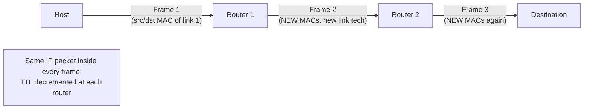

### D. What a Link-Layer Protocol Provides (Page 2)

| Service | Meaning |
|---|---|
| **Framing** | Mark the **beginning and end** of a transmitted unit |
| **Local addressing** | Identify the **sender and intended receiver** on the local medium |
| **Medium access** | Decide **who may transmit** on a shared medium and when |
| **Error detection, sometimes correction** | Recognise changed bits and, in some systems, recover them |
| **Optional local reliability** | **Retransmission on a link** can help, but is **not guaranteed by every link technology** |

**Technology variation (from PDF):** These services vary by technology. **Ethernet frames carry an error-detecting frame check sequence (FCS)**; a corrupt frame is **normally discarded**. **Wi-Fi adds acknowledgements and retransmission at the local link.** Neither link-layer mechanism by itself promises **end-to-end application delivery**.

### E. Nodes, Links, Adapters and Frames (Page 2)

> A **node** is a host, router, switch or other device on a path. An **adapter**, such as an Ethernet network interface or Wi-Fi radio, **implements link functions**. A **frame encloses a network-layer packet with link-specific control information**. The receiving adapter checks that frame and passes its payload upward when appropriate.

**Link-layer action at each point (Page 2 table):**

| At this point | Link-layer action |
|---|---|
| **Source host** | **Encapsulate** IP packet in a frame for its first-hop router or local destination |
| **Router input** | **Receive and check** frame, then **extract** the IP packet |
| **Router output** | **Encapsulate** that packet in a **fresh frame** for the next adjacent link |
| **Destination host** | Check and **remove the final frame**, then pass IP packet upward |

**Diagram 2 — Encapsulation/decapsulation across two links (Added diagram):**

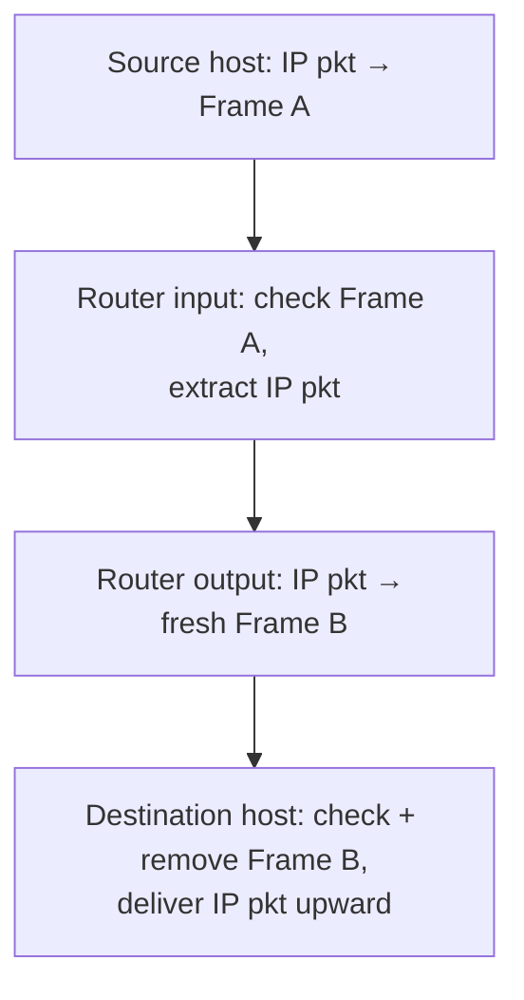

---

## 2. Ethernet Frames, MAC Addresses and Switches

### B. MAC Address Basics (Pages 2–3)

> An **Ethernet MAC address is usually 48 bits** and is written as **six hexadecimal octets**, for example **`02:1A:2B:3C:4D:5E`**. It identifies an **interface within a link-layer environment**. **IP addressing serves routed reachability; MAC addressing serves local frame delivery.** A device may have **multiple interfaces and multiple MAC addresses**.

### C. Ethernet Frame Fields (Page 3 — memorise)

**Diagram 3 — Ethernet frame structure (Added ASCII diagram, fields per PDF):**

```text
+--------+--------+-----------+--------------------+-------+
| Dest   | Source | Type/     | Payload + padding  |  FCS  |
| MAC    | MAC    | Length    | (IP packet etc.)   |       |
| 6 B    | 6 B    | 2 B       | variable           | 4 B   |
+--------+--------+-----------+--------------------+-------+
     ←———— link-layer header ————→  ← payload →   ← trailer →
```

| Ethernet field | Purpose (from PDF) |
|---|---|
| **Destination MAC** | The intended local receiver, **multicast group or broadcast address** |
| **Source MAC** | The sender interface on this Ethernet link |
| **Type or length** | Indicates the **encapsulated protocol** or length interpretation |
| **Payload and padding** | Carries the **IP packet or another network-layer payload** |
| **FCS** | **CRC-based detection of transmission errors** |

### D. Switch Behaviour (Page 3)

> An **Ethernet switch learns which source MAC addresses are reachable on its ports**. It **forwards** a frame to a **known destination port**; when the destination is **unknown, it floods within the relevant VLAN**. A switch **does not normally route IP packets** merely by learning MAC addresses. A **router separates IP networks and recreates frames at each outgoing link**.

**Diagram 4 — Switch learning and forwarding vs router (Added diagram):**

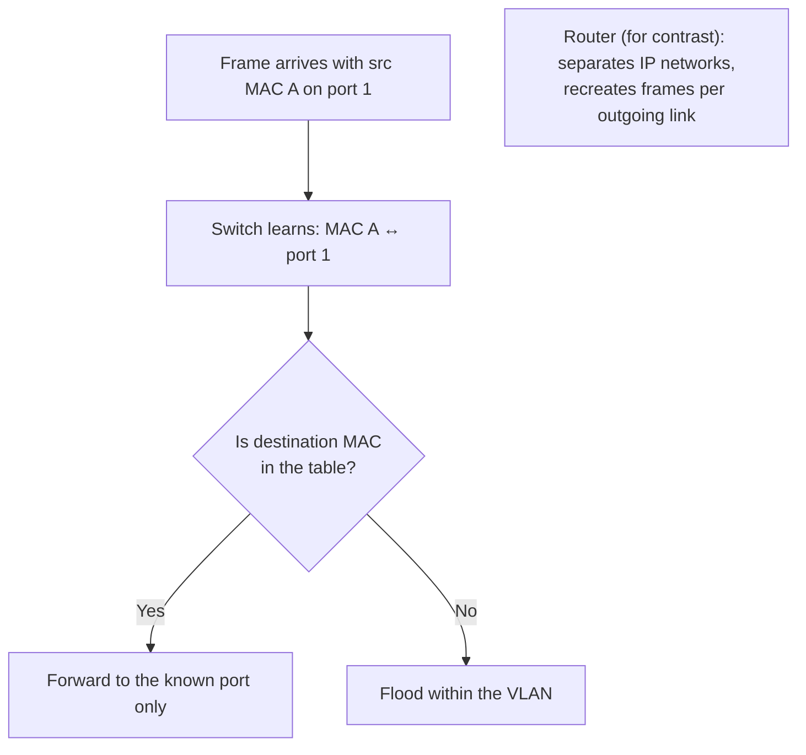

### E. ARP as the Bridge to IPv4 Local Delivery (Page 3 — exam topic)

> On an IPv4 Ethernet LAN, a sender needs the **MAC address of its next-hop IP address**. **ARP asks "who has that IPv4 address?" and learns the corresponding local MAC address.** If the destination is **off-subnet, the host resolves the default gateway's MAC address, not the distant server's MAC address**. **IPv6 uses Neighbor Discovery instead of ARP.**

> **Example (from PDF):** Laptop **192.168.10.20** sends to **198.51.100.7**. The **IP destination remains 198.51.100.7**; the **Ethernet destination MAC on the first hop belongs to the default gateway**.

**Diagram 5 — ARP and next-hop delivery (Added diagram):**

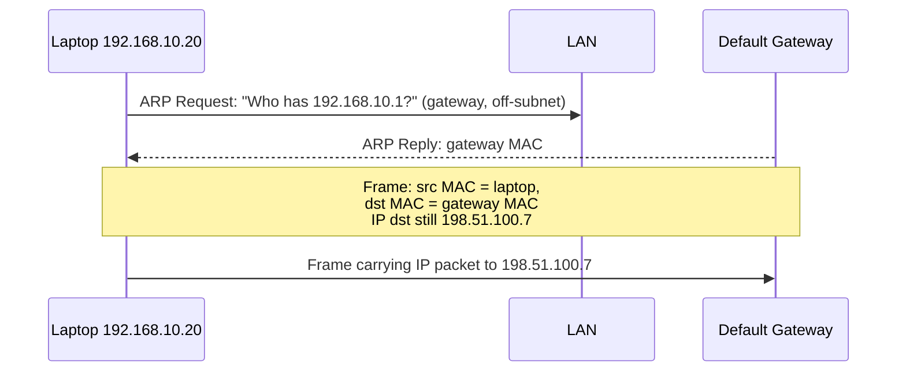

**Explanation:** Because the destination (198.51.100.7) is off-subnet, ARP resolves the **gateway's** MAC, not the remote server's. The IP destination field stays unchanged end-to-end (absent translation).

---

## 3. Error Detection and Correction

### B. Exam-Ready Definitions (Page 3)

> **Noise, interference, weak signals or faulty hardware** can change transmitted bits. Error control adds **redundant information** to a frame so a receiver can test the received sequence. **Detection** says an error is **likely present**; **correction** identifies enough information to **reconstruct the intended bits**. **A valid check never proves absolute absence of error** because undetected patterns can exist.

### C. Error-Control Methods Table (Page 3 — memorise)

| Method | Typical capability | Main idea |
|---|---|---|
| **Single parity bit** | Detect an **odd number of flipped bits** | Force the count of 1s to have chosen parity |
| **Two-dimensional parity** | Detect many patterns and **locate a single-bit error** | Apply parity **by rows and columns** |
| **Ones-complement checksum** | Detect many word-level errors | Add fixed-size words with **end-around carry** |
| **CRC** | Detect **broad classes of burst errors** | **Divide a bit polynomial by a generator** |
| **Forward error correction (FEC)** | **Recover some errors without a retransmission** | Add enough structured redundancy to infer original bits |

### D. Hamming Distance (Page 3 — formula, very examinable)

> The **Hamming distance** between two equal-length bit strings is the **number of positions where they differ**. A code with **minimum distance d** can:
> - **detect up to d − 1 bit errors**, and
> - **correct up to ⌊(d − 1)/2⌋ errors**
>
> under its coding assumptions. This explains **why correction needs more redundancy than detection**.

> **Do not confuse (from PDF):** A checksum or CRC **detects** corruption; it does **not** inherently tell the receiver which original bit values to restore. **Recovery usually means retransmission or an error-correcting code.**

---

## 4. Parity Checks

### B. Definitions (Page 4)

> With **even parity**, add one parity bit so the **total number of 1s is even**. With **odd parity**, make it odd. If the receiver observes the wrong parity, it knows corruption occurred. **Two bit flips may preserve the parity**, so **single parity is a limited test**.

### C. Worked Parity Example (Page 4)

| Data | Number of 1s | Even parity bit | Transmitted bits |
|---|---|---|---|
| 1011001 | 4 | 0 | 1011001**0** |
| 1011011 | 5 | 1 | 1011011**1** |

**Explanation (from PDF):** For **1011011**, five data bits are 1; the **even-parity bit is therefore 1** (total 1s becomes 6, even). If **one** received bit flips, the total becomes odd → error detected. If **two bits flip, the total can remain even** and the simple test can **miss** the error.

### D. Two-Dimensional Parity (Page 4 — worked example)

> Arrange data into rows, add parity to **each row and each column**. If **one bit flips**, **one row check and one column check fail; their intersection identifies the bad bit**. Several simultaneous errors can produce **ambiguous or undetected patterns**, so this is **not universal correction**.

**Parity block (from PDF):**

| Row | Data bits | Row parity |
|---|---|---|
| 1 | 1 0 1 1 | 1 |
| 2 | 0 1 1 0 | 0 |
| 3 | 1 1 0 0 | 0 |
| **Column parity** | **0 0 0 1** | |

**Worked reasoning (from PDF):** In the example, **even parity** is used. If **row 2, column 3 flips from 1 to 0**, **row 2 and column 3 both fail** their checks. **Correct that intersection bit** and verify the full block again.

**Diagram 6 — Locating a single-bit error via 2-D parity (Added diagram):**

```text
            c1   c2   c3   c4  | row parity
row 1   :   1    0    1    1   |  1   ✓
row 2   :   0    1    1→0  0   |  0   ✗ FAIL
row 3   :   1    1    0    0   |  0   ✓
            ----------------
col par.:   0    0    0    1
                 ✓    ✗
Error at intersection: ROW 2 × COLUMN 3 → flip that bit back
```

### E. A Compact Correction Example — Hamming (7,4) (Page 4)

> A **Hamming (7,4)** code places **parity at positions 1, 2 and 4** and **four data bits at positions 3, 5, 6 and 7**. For **data 1011** with even parity, the resulting bits at positions 1 to 7 are **0 1 1 0 0 1 1**. If **bit 6 is flipped**, the parity-check results form **syndrome 6**, identifying the position to repair.

**Diagram 7 — Hamming(7,4) positions (Added diagram, per PDF):**

```text
Position:   1    2    3    4    5    6    7
Role:      P1   P2   D1   P4   D2   D3   D4
Bits:       0    1    1    0    0    1    1
           ← parity →      ← data 1 0 1 1 →
```

> *(From PDF:)* This is a **conceptual example of single-error correction**, not a replacement for the CRC calculation below.

---

## 5. Internet-Style Ones-Complement Checksum

### B. Definition (Page 4)

> The checksum used in several Internet protocols **groups data into 16-bit words**, adds them with **end-around carry**, and **complements every bit** of the final 16-bit sum. When a sum **exceeds 0xFFFF, carry bits are wrapped into the low end**. A receiver sums all words **including the checksum**; a **valid result is 0xFFFF**, or **all zeros after complementing**.

### C. Worked Checksum Example (Page 4 — numerical, exam classic)

| Step | Hex value |
|---|---|
| Word 1 | 0x1234 |
| Word 2 | 0x5678 |
| Word 3 | 0x9ABC |
| Ordinary sum | **0x10368** |
| **End-around carry:** 0x0368 + 1 | **0x0369** |
| **Ones complement checksum** | **0xFC96** |

**Step-by-step method (Added explanation):**
1. Add the 16-bit words: 0x1234 + 0x5678 + 0x9ABC = **0x10368** (a 17-bit result — the top "1" is a carry).
2. **Wrap the carry**: 0x0368 + 0x0001 = **0x0369**.
3. **Complement** every bit of 0x0369 → **0xFC96**. This is the transmitted checksum.
4. **Receiver check:** 0x0369 + 0xFC96 = **0xFFFF** → valid (all 1s). Complementing gives all zeros.

### D. Context and Layer Distinction (Page 4)

> This arithmetic demonstrates the method; actual transport checksums also include specified header fields and, for TCP/UDP, an **IP pseudo-header**. **UDP checksum from Unit 3 is an end-to-end transport check; Ethernet FCS is a per-link check.**

> **Practical note (from PDF):** Checksum detection is useful but **not perfect**. **CRCs are generally stronger against the burst-error patterns common on links. The algorithms protect different data at different layers.**

---

## 6. Cyclic Redundancy Check (CRC)

### B. Exam-Ready Definition (Page 5 — memorise)

> **CRC treats a bit string as polynomial coefficients over GF(2). Addition and subtraction are both XOR, with no carry or borrowing.** Sender and receiver agree on a **generator bit pattern G whose first and last bits are 1**. If G has **r + 1 bits**, the sender:
> 1. **Appends r zeros to the data D**,
> 2. **Divides D followed by zeros by G using XOR long division**,
> 3. **Replaces those zeros with the r-bit remainder R**.
>
> The receiver **divides the full codeword by G; a nonzero remainder indicates an error**.

### C. Worked CRC Example (Page 5 — numerical, exam classic)

**Given:** data **D = 1101**, generator **G = 1011**. G has **four bits, so r = 3**. Append three zeros → **1101000**. **Modulo-2 division by 1011 gives remainder 001. The transmitted codeword is 1101001.**

| Operation | Bit pattern |
|---|---|
| Original data D | 1101 |
| Generator G | 1011 |
| Append three zeros | 1101000 |
| **Computed remainder R** | **001** |
| **Send D followed by R** | **1101001** |
| Receiver division by G | **Remainder 000 if unchanged** |

**The XOR long division, shown step by step (Added explanation, consistent with PDF's remainder 001):**

```text
Dividend: 1 1 0 1 0 0 0   (D + 000)
Generator (aligned):    1 0 1 1

1101000
1011                     ← XOR
─────
0110 000                 ← bring down next bit
 1011                    ← XOR
 ─────
 0111 00
  1011                   ← XOR
  ─────
  0101 0
   0000                  ← leading 0 → quotient bit 0, shift
   ─────
    101 0
    1011                 ← XOR
    ─────
    0001                 ← remainder R = 001 (r = 3 bits)

Codeword transmitted: 1101 001  =  1101001
Receiver: 1101001 ÷ 1011 → remainder 000 → no error detected
```

### D. What a CRC Does and Does Not Detect (Page 5 — precision box)

> The exact generator matters. **A CRC detects all single-bit errors when G has more than one nonzero term, and all burst errors of length at most r when the generator has degree r and a nonzero constant term.** **Longer burst errors may or may not be detected; never claim that a CRC catches every possible error.**

### E. Why CRC Suits Link Frames (Page 5)

- Many real channel errors affect **consecutive bits, called bursts**.
- **CRC arithmetic is efficient in hardware** and provides useful detection of these patterns.
- **Ethernet FCS uses a specified 32-bit CRC.** If the FCS fails, the receiving interface **normally discards** the Ethernet frame; any needed recovery occurs at a **higher layer** or, for some other link technologies, through a **local retransmission mechanism**.

---

## 7. Sharing a Communication Medium

### B. Topic Introduction (Page 5)

> If several stations share one transmission channel, a **medium access control (MAC) protocol** determines **when each may transmit**. A **point-to-point full-duplex link has a different contention problem** from a **shared radio or legacy half-duplex Ethernet segment**. **Do not assume that every technology using an Ethernet frame still experiences collisions.**

### C. MAC Protocol Families (Page 5 — memorise)

| Family | Examples | Basic trade-off |
|---|---|---|
| **Channel partitioning** | Time slots, frequency bands | **Predictable allocation; unused share may be wasted** |
| **Random access** | ALOHA, CSMA | **Simple and adaptive at low load; collisions and retries consume capacity** |
| **Taking turns** | Polling, token passing | **Avoids many collisions; control overhead and waiting remain** |
| **Scheduled access** | DOCSIS upstream grants | **Coordinator assigns transmission opportunities** |

**Diagram 8 — Four families of MAC protocols (Added diagram):**

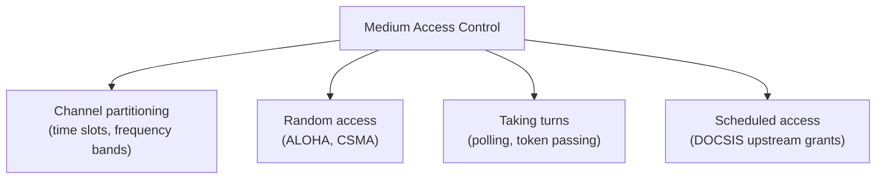

### D. Collision and Propagation (Page 6)

> A **collision occurs when overlapping transmissions interfere** on a shared medium. Stations may start close together **before either has learned that the other is transmitting, because signals take time to propagate**. **Backoff reduces repeated simultaneous retries.** As demand rises, **contention, waiting and wasted transmissions can increase**.

---

## 8. Random Access Protocols

### A. Pure and Slotted ALOHA (Page 6 — memorise the numbers)

> **Pure ALOHA sends whenever a station has a frame.** If frames overlap in time, they **collide and must be retried after a random wait**. **Slotted ALOHA allows starts only at slot boundaries**, reducing the vulnerable interval but **requiring synchronization**.

> For equal-length frames under **ideal Poisson assumptions**, maximum channel utilization is about:
> - **18.4% for pure ALOHA**, and
> - **36.8% for slotted ALOHA**.
>
> *(These are **theoretical model results, not promised real-network rates**.)*

| Feature | Pure ALOHA | Slotted ALOHA |
|---|---|---|
| **Transmit start** | Any time | **At slot boundary** |
| **Clock sync** | Not required | Required |
| **Collision window** | Larger | Smaller |
| **Ideal peak efficiency** | About **1/(2e)** ≈ 18.4% | About **1/e** ≈ 36.8% |

**Diagram 9 — Vulnerable period intuition (Added diagram):**

```text
Pure ALOHA:  frame of station X can collide with any frame that
             started within a full frame-time on either side:
             |---- vulnerable period = 2 × frame time ----|
Slotted ALOHA: transmissions start only at slot edges, so a frame
             can only collide with frames in the SAME slot:
             |--- vulnerable period = 1 × frame time ---| → higher max efficiency
```

### B. Carrier Sense Multiple Access (CSMA) (Page 6)

> **CSMA listens before transmitting.** If the medium is **busy, the station waits; if idle, it may transmit**. Listening **reduces obvious collisions but cannot eliminate them** because of **propagation delay and simultaneous starts**. Variants differ in **how aggressively they transmit when the channel becomes free**.

### C. CSMA/CD and Ethernet Context (Page 6 — key distinction)

> **Classic shared, half-duplex Ethernet used CSMA with collision detection**: **detect a collision while transmitting, stop, then retry after binary exponential backoff.** **Modern switched, full-duplex Ethernet gives each link its own transmit and receive path and does not use collisions as normal operation.** Retain CSMA/CD as an important **historical and conceptual protocol, not a description of every current Ethernet LAN**.

### D. CSMA/CA and Wi-Fi Context (Page 6)

> A Wi-Fi station **cannot generally detect a collision reliably while transmitting its own radio signal**. **CSMA with collision avoidance (CSMA/CA)** therefore:
> 1. **Senses the channel**,
> 2. **Waits for an idle period**,
> 3. **Chooses a random backoff**, and
> 4. **Uses acknowledgements to infer whether delivery succeeded**.
>
> **Optional RTS/CTS exchange can help with hidden terminals but adds overhead.** Wi-Fi behaviour has additional coordination features across generations; this is the foundational model.

> **Hidden terminals (from PDF):** Two clients may **each hear the access point but not one another**. Both can judge the channel idle and **transmit to the access point at the same time**. **Carrier sensing at each client cannot fully solve this geometry.**

**Diagram 10 — Hidden terminal problem (Added diagram):**

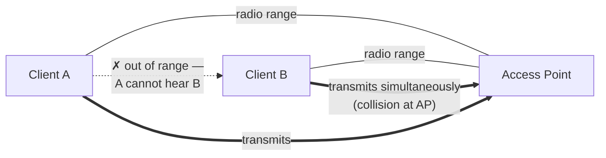

**Diagram 11 — CD vs CA contrast (Added diagram):**

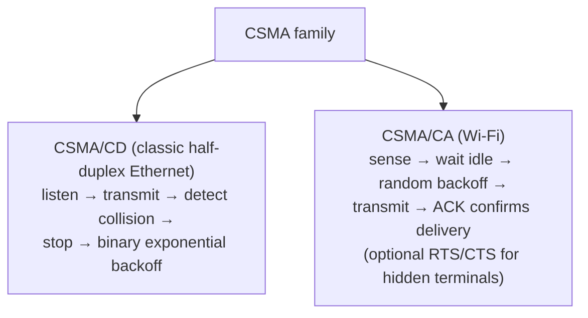

---

## 9. Taking Turns Protocols

### B. Definition (Page 6)

> Taking-turns schemes **coordinate access so one station transmits at a time**. They **trade collision reduction for control messages, delay and possible dependence on a coordinator or token**.

### C. Methods Table (Page 7 — memorise)

| Method | Operation | Strength | Limitation |
|---|---|---|---|
| **Polling** | **Controller invites stations in sequence to send** | Can **prioritize and schedule** access | **Polling overhead; controller failure disrupts service** |
| **Token passing** | A station sends **only while holding a circulating token** | **Orderly access with little collision waste** | **Token loss/recovery** and waiting under light load |
| **Channel partitioning** | Allocate **fixed time/frequency resources** | **Predictable under steady demand** | **Idle allocations waste capacity** |

### D. Choosing a Scheme (Page 7)

> A sensible choice depends on **load, latency needs, number of users and the medium**. At **light load, random access can be quick because no turn must be awaited**. At **high load, coordinated access can prevent much wasted contention**, although **coordination itself consumes resources**.

**Diagram 12 — Load vs access strategy intuition (Added diagram):**

```text
Efficiency
   │        Random access (great at light load,
   │  ╱     degrades as collisions rise)
   │ ╱
   │╱                    Taking turns / coordinated
   │                 ╱   (overhead at light load,
   │             ╱       better under heavy load)
   └──────────────────────────────► Network load
```

---

## 10. DOCSIS Cable Access

### B. Exam-Ready Definition (Page 7)

> **DOCSIS** stands for **Data Over Cable Service Interface Specification**. It lets **cable modems provide data service over a hybrid fibre-coaxial (HFC) access network**. The **Cable Modem Termination System (CMTS)**, or equivalent access platform, **serves many modems**. **Downstream traffic goes from the provider toward customers; upstream traffic goes from modems toward the provider.** The cable segment is a **shared access resource**, so **capacity and access decisions matter**.

### C. Components (Page 7 — memorise)

| Component | Role |
|---|---|
| **Customer device/router** | Creates or consumes IP traffic at the premises |
| **Cable modem** | Transfers traffic between **home network and DOCSIS access segment** |
| **HFC plant** | **Fibre/coax path shared among access subscribers** |
| **CMTS/access platform** | **Coordinates cable access** and connects it toward the **provider IP network** |

**Diagram 13 — DOCSIS architecture (Added diagram):**

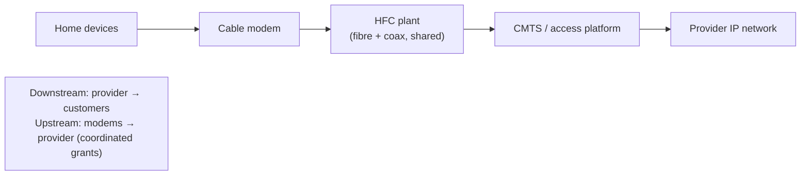

### D. Upstream Access in Principle (Page 7)

> Modems **cannot simply transmit arbitrary upstream bursts at will: simultaneous signals could interfere**. **DOCSIS uses upstream channel coordination.** A modem **requests bandwidth**, and the access platform **grants transmission opportunities through control information**, with **contention-based request opportunities also involved**. The exact channelization and scheduling details **vary across DOCSIS generations; the key link-layer principle is controlled access to a shared upstream**.

**Diagram 14 — DOCSIS upstream request/grant cycle (Added diagram):**

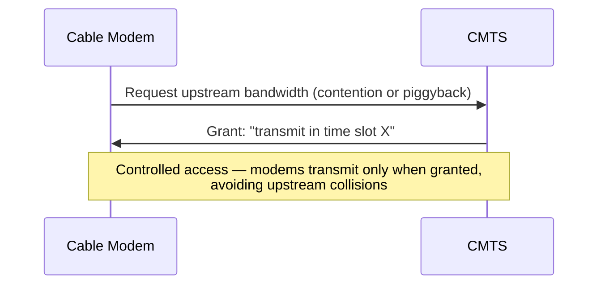

### E. Why a Fast Package May Still Feel Slow (Page 7)

> The **advertised package rate is only one limit**. A **busy shared segment, upstream contention, Wi-Fi interference at home, provider congestion or a remote server** can each reduce experienced throughput or increase delay. The **cable modem link, home Wi-Fi link and Internet route are separate parts of the path and should be diagnosed separately**.

> **Classroom case (from PDF):** Several homes **upload large files at 8 p.m.** If **upstream capacity is shared and requests queue**, **video calls may suffer delay even while downstream download tests look healthy**. *Which measurements would distinguish DOCSIS upstream contention from a weak home Wi-Fi link?*
>
> *(Added hint for answering: test wired vs Wi-Fi throughput at the modem, check CMTS/grant queueing and upstream utilisation vs Wi-Fi RSSI/retry statistics.)*

---

## 11. Link Virtualization

### B. Definition (Page 7)

> **Link virtualization** makes **several logical link environments operate over shared physical infrastructure**, or presents a **collection of links as a logical connection**. It helps **separate traffic and design networks without requiring a dedicated physical cable for every group**. The details depend on the technology.

### C. VLANs (Page 8 — exam topic)

> An **Ethernet VLAN is a logical broadcast domain**. A switch can **assign ports or tagged frames** to different VLANs. **Frames in one VLAN are not simply forwarded into another VLAN by an ordinary layer-2 switch**; **communication between their IP subnets needs a router or layer-3 switch**. **A VLAN tag identifies the logical link context on a trunk; it is not an IP address or an encryption mechanism.**

**VLAN arrangements table (Page 8):**

| Physical arrangement | Logical result |
|---|---|
| **Same switch, ports in VLAN 10 and VLAN 20** | **Two separate layer-2 broadcast domains** |
| **Trunk between switches carries both VLANs** | **One physical link transports multiple logical VLANs** |
| **Router has interfaces for both VLANs** | **IP routing can connect the two subject to policy** |

**Diagram 15 — VLANs and inter-VLAN routing (Added diagram):**

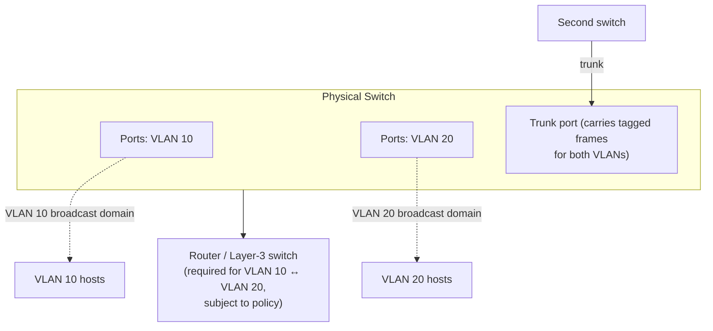

### D. Tunnels and Abstraction (Page 8)

> A **tunnel can carry one protocol inside another across an intervening network**. The **outer network sees the tunnel endpoint addresses; the inner payload is delivered after decapsulation**. **Virtual links and overlays** make geographically separated systems **appear connected for a particular service**, but they **still depend on real underlay links, capacity, MTUs and failure behavior**.

> **Boundary (from PDF):** **Virtualization does not create bandwidth.** A VLAN or tunnel **separates or maps traffic logically; it still shares physical links and may add encapsulation overhead.**

---

## 12. Multiprotocol Label Switching (MPLS)

### B. Exam-Ready Definition (Page 8 — memorise)

> **MPLS forwards packets through an MPLS domain using short, locally significant labels.** At the **ingress**, packets are assigned to a **forwarding equivalence class (FEC)** and **given a label**. **Transit label-switching routers use the incoming label and interface context to choose an outgoing label and next hop**. At **egress**, the **label is removed** and forwarding continues according to the next context. MPLS can support **provider traffic engineering and VPN services**, but **a label alone is neither an end-to-end address nor security encryption**.

### C. Label Operations (Page 8 — memorise)

| Operation | What happens | Where often seen |
|---|---|---|
| **Push** | **Add one or more labels** to a packet | **Ingress or service entry** |
| **Swap** | **Replace the top label** and forward | **Transit within an MPLS path** |
| **Pop** | **Remove top label** | **Egress or penultimate-hop processing** |

### D. Worked Label-Switched Path (Page 8 — trace this in exams)

| Device | Incoming | Action | Outgoing |
|---|---|---|---|
| **Provider ingress** | IP packet for a selected FEC | **Push label 40** | Label 40 |
| **Transit router A** | Label 40 | **Swap 40 → 73** | Label 73 |
| **Transit router B** | Label 73 | **Swap 73 → 91** | Label 91 |
| **Egress router** | Label 91 | **Pop; forward payload** | IP packet or other service payload |

**Diagram 16 — MPLS label-switched path 40 → 73 → 91 (Added diagram, per PDF table):**

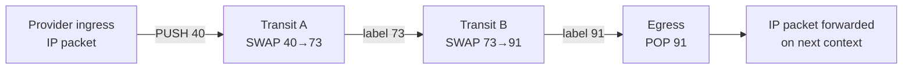

**Key clarifications (from PDF):**
- The numeric labels in this example are **illustrative and can change hop by hop**.
- A **FEC groups traffic treated similarly for forwarding**.
- A router needs its **label forwarding information**; **the label number has meaning in the relevant forwarding context, not as a universal destination identity**.
- **A stack of labels can represent more than one forwarding or service layer.**

### E. MPLS Compared with IP Forwarding (Page 9 — exam table)

| Aspect | Ordinary IP forwarding | MPLS forwarding |
|---|---|---|
| **Lookup key** | **Destination IP prefix**, with routing and policy context | **Incoming label and forwarding context** |
| **Intermediate action** | Choose next hop and **recreate local link frame** | **Swap/pop label**, choose next hop and recreate local link frame |
| **Path formation** | Driven by **IP routing and policy** | **Label bindings and control/management arrangements establish paths** |
| **Packet identity** | **IP address remains crucial** to IP reachability | **Labels are local forwarding identifiers; IP may still be the payload** |

> **Two useful cautions (from PDF):** MPLS is often called **"layer 2.5"** because it sits between familiar link encapsulation and network payloads, **but that nickname is not a formal OSI layer**. MPLS **can steer packets along chosen paths; using it does not automatically guarantee bandwidth, privacy or zero packet loss**.

---

## 13. Integrated Packet Walk

(Page 9 — an end-to-end story tying the unit together.)

> **Scenario:** A student loads a university portal from a **laptop connected through Wi-Fi**:
> 1. The laptop **obtains the first-hop MAC information** and sends an **IP packet inside a Wi-Fi frame** to the **access point**.
> 2. A **switch forwards a new or bridged Ethernet frame toward a gateway**.
> 3. At the **gateway, the link frame is removed** and the **IP packet is routed toward the provider**.
> 4. The provider may transport that traffic **over DOCSIS or another access link** and **may use MPLS in its core**.
> 5. At each hop, **link encapsulation is appropriate to that hop**; the application still uses **HTTP over its chosen transport protocol end to end**.

**Diagram 17 — Integrated packet walk (Added diagram):**

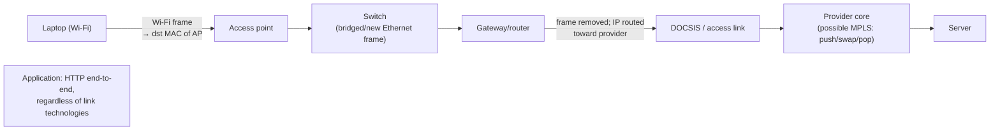

**Symptom-to-layer reasoning table (Page 9 — memorise):**

| Observed problem | Likely layer-specific question |
|---|---|
| **Wi-Fi retries and weak signal** | Are **local radio frames being corrupted or contended**? |
| **Many users on one LAN see delay** | Is **shared link or uplink capacity congested**? |
| **Cable upload slows at busy time** | Is **upstream shared access or provider scheduling** the constraint? |
| **Only one VLAN cannot reach another** | Is **inter-VLAN routing or policy** present? |
| **Provider path cannot reach destination** | Are **IP routes, labels or associated forwarding entries correct**? |

---

## 14. Common Misconceptions

(Page 9 — memorise the corrections.)

| ❌ Incorrect claim | ✅ Better explanation |
|---|---|
| "A MAC address and IP address do the same job." | **MAC identifies local link interfaces; IP supports routed reachability** |
| "The same Ethernet frame travels all the way to the server." | **Routers create new link frames at successive hops** |
| "Parity catches every error." | **Even-numbered flips can preserve simple parity** |
| "A checksum or CRC repairs a corrupted frame." | **They primarily detect; repair needs retransmission or error-correcting codes** |
| "CSMA/CD is active on all modern Ethernet links." | It models **shared half-duplex Ethernet; switched full-duplex links avoid normal collisions** |
| "A VLAN is automatically secure." | **Segmentation helps, but routing policy and other controls determine security** |
| "An MPLS label is the destination IP address." | **Labels are forwarding identifiers local to the relevant MPLS context** |

---

## 15. Exam Revision Sheet

(Page 10 — the PDF's own bullet revision list; memorise verbatim.)

- **Link layer = one-hop frame transfer; network layer = host-to-host** packet forwarding across many links.
- **Frame = link header + payload + often error-check trailer.** A router **changes link encapsulation at each hop**.
- **Even parity:** total 1s even. **Two bit flips can be missed** by a simple parity bit.
- **Ones-complement checksum:** add 16-bit words, **wrap carry, complement**; receiver checks **all-ones sum**.
- **CRC:** **append zeros, XOR-divide by generator, append remainder**; **nonzero receiver remainder signals error**.
- **Random access** = transmit with contention/backoff; **taking turns** = polling or token; **partitioning** = fixed time/frequency shares.
- **CSMA/CD** is associated with **shared half-duplex Ethernet**; **Wi-Fi uses collision avoidance and ACKs**.
- **DOCSIS** provides cable access over **HFC**; **upstream transmissions are coordinated by the access platform**.
- **VLANs separate logical broadcast domains; communication across them needs layer-3 forwarding.**
- **MPLS ingress pushes, transit swaps, egress pops labels; label values can change at each hop.**

---

## 16. Practice Questions and Answer Hints

(Pages 10–11 — the exact 10 questions with the PDF's answer hints, plus worked solutions where numerical.)

**1. Explain link-layer and network-layer roles when a packet crosses three routers. What changes at every hop?**
*Hint (from PDF):* Link frame **addresses and encoding change by hop**; IP addresses generally persist except translation; **TTL/Hop Limit changes**.

**2. Give the even-parity bit for 1100101. Show why two flipped bits may escape simple parity.**
*Added solution:* 1100101 has **four 1s** → even-parity bit = **0** (transmitted: 11001010). If **two** received bits flip, the 1-count changes by 0 or ±2, so **even parity is preserved** and the error escapes detection.

**3. Using 16-bit words 0x1234, 0x5678 and 0x9ABC, calculate the ones-complement checksum.**
*Added solution (matches Section 5):* Sum = **0x10368** → wrap carry → **0x0369** → complement → **0xFC96**. Receiver check: 0x0369 + 0xFC96 = **0xFFFF** ✓.

**4. For data 1101 and generator 1011, append zeros, calculate the CRC remainder and form the codeword.**
*Added solution (matches Section 6):* Append **000** → 1101000; XOR-divide by 1011 → remainder **001**; codeword **1101001**; receiver remainder **000** if unchanged.

**5. Compare pure ALOHA, slotted ALOHA, CSMA and polling in collision risk and coordination.**
*Hint (from PDF):* ALOHA transmits **without carrier sensing**; slots **reduce vulnerable overlap**; CSMA **senses**; polling **assigns turns**.

**6. Why does modern full-duplex switched Ethernet normally not rely on collision detection?**
*Hint (from PDF):* **Each full-duplex switch port has its own link and independent send/receive directions.**

**7. Explain a DOCSIS upstream request/grant cycle and the cause of queueing at busy times.**
*Hint (from PDF):* **Modem requests upstream capacity; access platform grants transmission opportunities; busy shared capacity creates waits.**

**8. What does a VLAN separate? What additional device/function lets two VLANs communicate?**
*Hint (from PDF):* A VLAN **separates layer-2 broadcast domains**; a **router or layer-3 switch** connects them **subject to policy**.

**9. Trace push, swap and pop across the MPLS path with labels 40, 73 and 91.**
*Hint (from PDF):* **Ingress pushes 40; transit swaps 40→73 then 73→91; egress pops 91.**

**10. A frame fails its FCS check. What can the receiver conclude, and who may cause retransmission?**
*Hint (from PDF):* It **detected corruption; the bad frame is normally discarded**. A **local ARQ mechanism or end-to-end transport** may recover.

---

## 17. Short Classroom Case

(Page 11 — practise writing structured answers.)

**Scenario:** A campus has two departments on **VLAN 10 and VLAN 20**. Both use the **same physical switch**. A student on VLAN 10 can reach **another VLAN 10 machine, but not a server on VLAN 20**. At the same time, **Wi-Fi users report intermittent slowness while wired users do not**. The Internet provider uses **MPLS, but its core reports no route failure**.

**Questions (from PDF):**
1. Identify the **likely boundary** preventing VLAN 10 to VLAN 20 communication. What **device or function** is required, and what **policy check** would you make?
   *(Added hint: inter-VLAN routing is missing or blocked — check the router/L3-switch interface and ACLs.)*
2. Explain why the **shared physical switch does not make the two VLANs one broadcast domain**.
   *(Added hint: VLANs are logical broadcast domains; the switch does not forward frames between different VLANs at layer 2.)*
3. Suggest **two Wi-Fi link measurements** before blaming the Internet route: **signal quality, channel contention, retries or frame error counts** are examples.
4. Explain why the **provider MPLS label path is not the first explanation** for a fault seen **only on campus Wi-Fi**.
   *(Added hint: isolate the fault domain — the symptom is local to the Wi-Fi segment, so diagnose the local link first.)*
5. If a **frame fails its link FCS but the application eventually succeeds**, identify **two possible recovery mechanisms at different layers**.
   *(Added hint: local link-layer ARQ (e.g., Wi-Fi retransmission) and end-to-end transport recovery (e.g., TCP retransmission).)*

---

## 18. Key Terms and References

### Key Terms at a Glance (Page 11 — memorise)

| Term | Meaning |
|---|---|
| **Frame** | The link-layer unit that carries a **network-layer payload over one link** |
| **FCS** | A **trailer value used to detect corrupted link frames** |
| **MAC** | The **link access and local addressing functions** of an interface |
| **FEC** | An **MPLS forwarding equivalence class** of traffic treated alike |
| **CMTS** | The **cable access platform coordinating modems** toward the provider |
| **VLAN** | A **logical Ethernet broadcast domain** on shared infrastructure |

### References and Further Reading (Page 11, from PDF)

- Course syllabus: **TE7958 Computer Networks, Unit 5**.
- **Kurose and Ross**, *Computer Networking: A Top-Down Approach*, link-layer chapter; **Tanenbaum and Wetherall**, *Computer Networks*, data-link chapter.
- **CableLabs**, "A 101 on DOCSIS Technology: The Heart of Cable Broadband", cablelabs.com/blog/a-101-on-docsis-technology-the-heart-of-cable-broadband.
- **Rosen et al., RFC 3031**, *Multiprotocol Label Switching Architecture*, rfc-editor.org/rfc/rfc3031.html.
- **IEEE 802.3** working group materials, ieee802.org/3/.

---

## 19. Quick Revision Summary

**Numbers to memorise:**

| Value | Fact |
|---|---|
| **48 bits (6 octets)** | Ethernet MAC address size (e.g., `02:1A:2B:3C:4D:5E`) |
| **d − 1 / ⌊(d−1)/2⌋** | Detect / correct capability of a code with minimum Hamming distance d |
| **18.4% / 36.8%** | Ideal peak efficiency of pure ALOHA / slotted ALOHA (1/2e and 1/e) |
| **0xFC96** | Checksum for words 0x1234 + 0x5678 + 0x9ABC |
| **1101001** | CRC codeword for D = 1101, G = 1011 (remainder 001) |
| **Hamming (7,4)** | Parity at positions 1, 2, 4; data at 3, 5, 6, 7; codeword 0110011 for data 1011 |
| **32-bit CRC** | Ethernet FCS |
| **40 → 73 → 91** | MPLS label path (push → swap → swap → pop) |

**One-line takeaways:**
- Link layer serves **one hop**; network layer serves **many hops**. Frames are rebuilt at every router; the IP packet endures.
- **MAC ≠ IP:** MAC = local delivery; IP = routed reachability. ARP maps next-hop IPv4 → MAC; IPv6 uses Neighbor Discovery.
- **Detection ≠ correction:** parity/checksum/CRC detect; correction needs FEC, 2-D parity intersection, or Hamming codes — otherwise retransmit.
- **CRC:** append r zeros → XOR-divide by G → replace zeros with remainder R; receiver's nonzero remainder = error.
- **ALOHA sends blindly; CSMA senses; CD detects (old Ethernet); CA avoids (Wi-Fi); polling/token take turns; DOCSIS grants.**
- **DOCSIS:** modem → HFC → CMTS; upstream is **request + grant**, so contention queues at busy times.
- **VLAN = logical broadcast domain**; inter-VLAN needs a router/L3 switch. Virtualization does **not** create bandwidth.
- **MPLS:** FEC at ingress; **push / swap / pop**; labels are **locally significant**, not addresses; "layer 2.5" is a nickname, not a formal layer.

---

## 20. Final Coverage Checklist

- [x] Page 1 — Title, prescribed syllabus, central question, five learning outcomes, five-hour teaching sequence ✅
- [x] Page 2 — Link layer placement (layer scope table); one-hop principle; five link-layer services (framing, local addressing, medium access, error detection/correction, optional local reliability); Ethernet FCS vs Wi-Fi ACK note; nodes/adapters/frames; four-point encapsulation table ✅
- [x] Page 3 — 48-bit MAC; Ethernet field table (Dest MAC, Src MAC, Type/Length, Payload, FCS); switch learning/flooding; ARP (next-hop gateway resolution, IPv6 ND); error detection vs correction; five-method error-control table; Hamming distance formulas ✅
- [x] Page 4 — Even/odd parity + worked example table (1011001→0, 1011011→1); two-flip limitation; 2-D parity block (rows 1011/0110/1100 + parities) and intersection correction; Hamming (7,4) positions and syndrome example; ones-complement checksum definition and worked example (0x10368 → 0x0369 → 0xFC96); layer distinction (UDP checksum vs Ethernet FCS) ✅
- [x] Pages 4–5 — Practical note: checksums imperfect, CRCs stronger for bursts ✅
- [x] Page 5 — CRC definition (GF(2), XOR, generator rules, r zeros, remainder replacement); worked CRC example (1101/1011 → 001 → 1101001); CRC detection guarantees and limits; why CRC suits link frames (bursts, hardware efficiency, Ethernet FCS discard) ✅
- [x] Pages 5–6 — Shared medium / MAC protocol definition; four-family trade-off table; collision and propagation; backoff ✅
- [x] Page 6 — Pure vs slotted ALOHA (18.4%/36.8%, feature table); CSMA; CSMA/CD + binary exponential backoff + modern switched full-duplex caveat; CSMA/CA for Wi-Fi (sense, backoff, ACKs, RTS/CTS); hidden terminals box ✅
- [x] Pages 6–7 — Taking turns definition; polling/token/partitioning table; load-based choice guidance ✅
- [x] Page 7 — DOCSIS definition; component table (customer device, cable modem, HFC plant, CMTS); upstream request/grant principle; "fast package may still feel slow"; classroom case (8 p.m. uploads) ✅
- [x] Pages 7–8 — Link virtualization definition; VLAN definition, tag-not-address-or-encryption note, arrangement table; tunnels and overlays; "virtualization does not create bandwidth" ✅
- [x] Pages 8–9 — MPLS definition; FEC; push/swap/pop table; worked label-switched path (40→73→91); label clarifications (illustrative, local significance, label stacks); MPLS vs IP forwarding table; layer-2.5 caution ✅
- [x] Page 9 — Integrated packet walk (Wi-Fi → switch → gateway → DOCSIS/MPLS core); symptom-to-layer table ✅
- [x] Page 9 — Seven common misconceptions with corrections ✅
- [x] Page 10 — Exam revision sheet (10 bullets); 10 practice questions; answer hints 1–9 ✅
- [x] Page 11 — Answer hint 10 (FCS fail → discard; ARQ/transport recovers); short classroom case (5 questions); key terms table (Frame, FCS, MAC, FEC, CMTS, VLAN); references ✅

**Fidelity note:** All definitions, tables, worked examples, values and case material above are taken directly from the PDF. The step-by-step CRC long division (Section 6C), parity Q2 solution and classroom-case hints are marked *"Added"* and are consistent with the PDF's own results (remainder 001, codeword 1101001). Diagrams marked *"Added diagram"* visualise structures/processes described in the PDF. No pages were unreadable; nothing was omitted.

---

### You Now Have the Complete Series

| Unit | Topic | Notes File |
|---|---|---|
| Unit 3 | Transport Layer | `Transport_Layer_Unit3_Notes.md` |
| Unit 4 | The Network Layer | `Network_Layer_Unit4_Notes.md` |
| Unit 5 | Link Layer | `Link_Layer_Unit5_Notes.md` (this document) |

If you'd like, I can next produce: **(a)** a combined **all-units cram sheet**, **(b)** a **mock question paper** spanning Units 3–5 with model answers, or **(c)** notes for **Units 1–2** if you upload those PDFs.