# 🔐 CYBER SECURITY — COMPLETE MASTER NOTES (SIMPLE MODE)
### · All Units · Plain-English Helpers · Diagrams · One File ·

> **How to read this compilation.** All 18 note files in this folder are merged here into one master document, **nothing removed** — every definition, case study, table, section and diagram of the originals is preserved in full. To make it **simple and easy to learn**, this compiled version adds: a plain-words roadmap, a *"In plain words"* summary box under every unit banner, a **Beginner's Dictionary** (Appendix A), **Notes on One Page** (Appendix B) and **30 Flash-Cards** (Appendix C). The originals stay untouched for deep study.

| Part | Sources | What you learn |
|---|---|---|
| **UNIT 1** | `1. Cyber Crime, Botnets.md` · `2. The Modern Cybersecurity Landscape.md` · `athens-cia.md` · `threat-modeling.md` | Cyber crime, botnets, DDoS, threat actors, CIA triad, threat modeling, real-world case studies |
| **UNIT 2** | `3. E-Governance & IT Law in India.md` · `4. Introduction to Cyber Space.md` · `Cyber Provisions.md` · `IPR.md` | Cyber space, IT Act 2000, e-governance, digital signatures, IPR |
| **UNIT 3** | `Cybersecurity Threat Management.md` · `ics-scada-notes.md` · `secure-sdlc-notes.md` · `security-mechanisms.md` · `security-requirements.md` | Threat management, ICS/SCADA security, secure SDLC, security mechanisms, multilateral security & privacy |
| **UNIT 4** | `appdos-nonrepud.md` · `asymmetric-crypto.md` · `ciphers-mechanisms.md` · `dos-comsec.md` · `marklogic-security.md` | DoS & application-layer DoS, symmetric & asymmetric crypto, non-repudiation, access control & authentication |

> 💡 `mermaid` blocks render as real diagrams on GitHub, VS Code, Obsidian, Typora. `text` blocks are ASCII art that render everywhere.

---

## 🟢 READ ME FIRST — Cyber Security in 10 Plain Sentences

1. **Security is protecting data and services from people who shouldn't touch them.**
2. The three golden goals are the **CIA Triad**: keep secrets (**Confidentiality**), keep data correct (**Integrity**), keep services running (**Availability**).
3. A **threat** is what *could* hurt you, a **vulnerability** is the *hole* that lets it, an **exploit** is the *tool* that uses it, and **risk** = likelihood × impact.
4. **Attackers rhyme with business:** cyber crime evolved from lone hackers into **Crime-as-a-Service** marketplaces (botnet rental, ransomware kits) — study them like a supply chain.
5. **A botnet** = thousands of innocent-looking home computers silently obeying a criminal's **Command & Control** channel — that's what makes big **DDoS** floods possible.
6. **Threat modeling** = put on the attacker's hat *before* building: find assets, entry points, and trust boundaries, and enumerate attacks (e.g., STRIDE).
7. **Laws make cyber real:** India's **IT Act 2000** legitimises electronic records and digital signatures (Unit 2), and **default-deny / minimised privilege** principles rule system design (Unit 3–4).
8. **Cryptography is math-as-a-service:** **symmetric** crypto = one shared key (fast, key-distribution hard); **asymmetric** crypto = key pairs (slow, solves distribution); **hash + private key = digital signature** = integrity + **non-repudiation**.
9. **Defense in depth** = lettuce-and-onion security: many independent layers (firewall, IDS, patching, backups, auth) so one failure doesn't sink the system.
10. If you remember only one sentence: **"Assume breach; minimise surface; encrypt data; log everything; fail safe; patch early."**

---

## 🗺️ Master Learning Roadmap

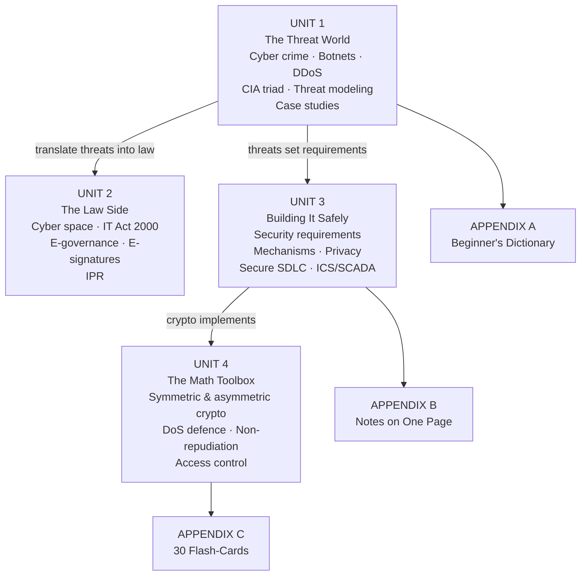

## 📑 Master Table of Contents

### UNIT 1 — Cyber Crime, Threat Landscape & Threat Modeling
1. **Cyber Crime, Botnets & DDoS** — organised crime evolution, Crime-as-a-Service marketplace, botnet lifecycle & C&C, DDoS taxonomy & mitigation, hacktivism/espionage/APTs
2. **Modern Cybersecurity Landscape** — CIA triad & extended goals, threat actors & vectors, threat modeling methodology, risk assessment, emerging vectors (AI/ML abuse), landmark cases (Stuxnet, SolarWinds), national resilience
3. **The Athens Affair & CIA Triad case file** — real Vodafone-Greece wiretap story, Estonia's cyber strategy, terminology cheat sheet
4. **Threat Modeling deep dive** — PDF-based modulo PDF-A/PDF-B breakdown, frameworks, comparative matrix, cheat sheet

### UNIT 2 — Cyber Space, IT Act & E-Governance
5. **E-Governance & IT Law in India** — e-governance architecture, digital vs electronic signatures, IT Act §§ 3–10A, non-applicability schedule, Indian Evidence Act, exam tips
6. **Introduction to Cyber Space** — evolution, regulation imperative, cyber law scope, online contracts, e-taxation, enforcement, case precedents, AI/data-protection frontiers
7. **Cyber Provisions under IT Act 2000** — section-by-section overview, matrix, cheat sheet
8. **IPR in India** — patents vs copyrights vs trademarks, master comparison, key terminology

### UNIT 3 — Security Management, SDLC & Infrastructures
9. **Cybersecurity Threat Management** — application security,防御 mechanisms, comparison matrix (812-line deep file)
10. **ICS/SCADA Security** — extreme cyber scenario planning, fault-tree analysis, PLC/SCADA architecture
11. **Secure SDLC** — building security into every lifecycle phase, critical infrastructure integration
12. **Security Mechanisms & Multilateral Security** — identification/access-control mechanisms, inference control, Chinese-wall style policies
13. **Security Requirements** — multilateral security, online data privacy & Indian data protection law, OS & network security slides

### UNIT 4 — Cryptography, DoS & Access Control
14. **Application-Layer DoS, WebGoat Lab & Non-Repudiation** — lab-driven DoS testing, dotDefender protection, non-repudiation mechanics
15. **Asymmetric Encryption & Crypto Fundamentals** — key pairs, RSA family, key exchange, signature math (11 diagrams!)
16. **Ciphers, Security Mechanisms, Feistel/DES/MAC** — classical ciphers, symmetric block ciphers, MACs, modes
17. **DoS Attacks & COMSEC** — SANS DoS doctrine, end-to-end communications security
18. **MarkLogic Security** — compartment security & user authentication case file

### APPENDICES (the "simple mode" toolkit)
- **Appendix A — Beginner's Dictionary:** 45 jargon terms in plain English
- **Appendix B — Notes on One Page:** each unit in ≤ 10 lines
- **Appendix C — 30 Flash-Cards** with instant answers
- **Final Revision Checklist**

---


# UNIT 1 — Cyber Crime, Threat Landscape & Threat Modeling

> **Source:** `1. Cyber Crime, Botnets.md`, `2. The Modern Cybersecurity Landscape.md`, `athens-cia.md`, `threat-modeling.md`. Complete content preserved below.
>
> 🟢 **In plain words:** Unit 1 is *"know your enemy."* Modern attackers run a **business**: crime marketplaces rent out botnets, and DDoS attacks are just "paying to switch off a website." A **botnet** is an army of everyday computers remotely steered by one criminal via Command & Control servers. Learn the **CIA triad** (Confidentiality = secrets stay secret, Integrity = nobody tampers, Availability = always up), then **threat modeling** = literally sitting down and asking *"if I were a crook, how would I get in?"* before anyone builds the system. The case files (Athens phone-tap, Stuxnet, SolarWinds, Estonia) show these ideas playing out in real life.

**Suggested simple lesson path:** 📄 Landscape (CIA + actors) → 🤖 Cyber Crime & Botnets → 🎯 Threat Modeling → 📜 Athens/Estonia case files.

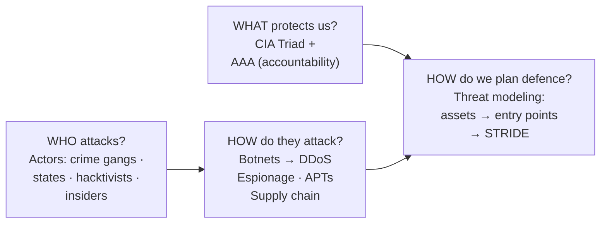


#  Cyber Crime, Botnets, DDoS Attacks & Critical Infrastructure Security

---

## 1. Prerequisites & Foundation

Before diving into advanced threat landscapes, it is essential to understand the core foundational principles of information security:

* **CIA Triad:**
* **Confidentiality:** Preventing unauthorized disclosure of data (e.g., encryption, access controls).
* **Integrity:** Safeguarding the accuracy and completeness of information (e.g., cryptographic hashing, digital signatures).
* **Availability:** Ensuring timely, reliable access to data and systems for authorized users (e.g., load balancing, DDoS mitigation, redundancy).


* **OSI/TCP-IP Network Stack:** A fundamental understanding of Network (Layer 3), Transport (Layer 4), and Application (Layer 7) protocols—specifically IPv4/IPv6, ICMP, TCP (3-way handshake), UDP, DNS, and HTTP/S.
* **Basic Operational Terminology:**
* **Vulnerability:** A flaw or weakness in system security procedures, design, implementation, or internal controls.
* **Threat:** Any circumstance or event with the potential to adversely impact organizational operations via unauthorized access, destruction, disclosure, or modification.
* **Risk:** The measure of potential loss resulting from a threat exploiting a specific vulnerability: 
$$\text{Risk} = \text{Threat} \times \text{Vulnerability} \times \text{Impact}$$


---

## 2. The Evolution of Organized Cyber Crime

Cybercrime has transitioned from isolated, hobbyist hacking aimed at notoriety to a multi-billion-dollar transnational shadow economy characterized by specialization, operational security (OpSec), and corporate-like organizational structures.

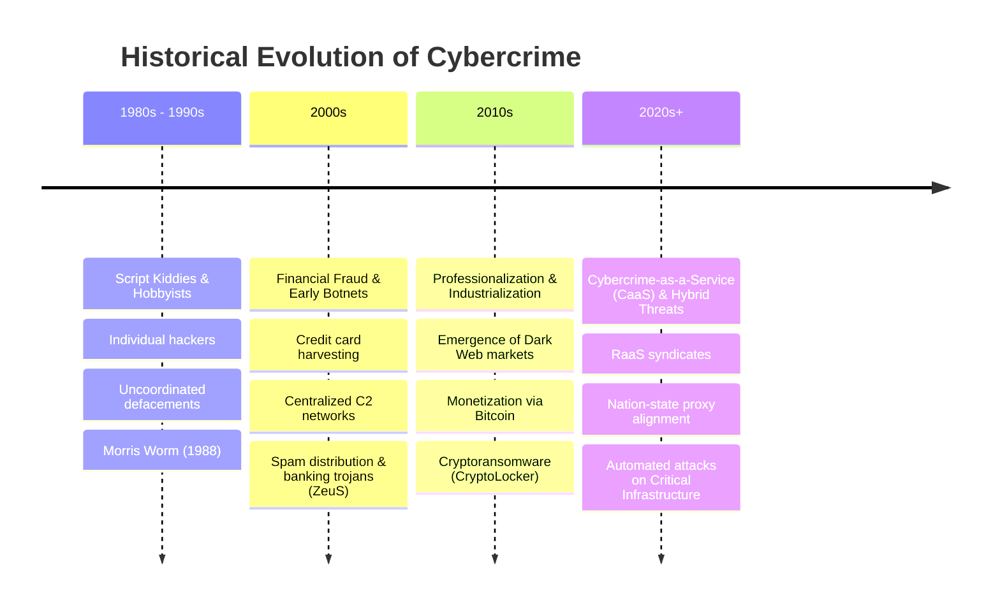

### Key Drivers of Evolution

1. **Anonymization Infrastructure:** Tor, I2P, and bulletproof hosting providers allow criminal operations to obfuscate command-and-control (C2) locations.
2. **Pseudonymous Cryptocurrency FinTech:** Bitcoin, Monero (XMR), and mixing services enable automated, cross-border, irreversible financial settlements.
3. **Specialization & Division of Labor:** Modern threat actors no longer execute entire attack lifecycles independently; they purchase modular components on underground forums.

---

## 3. Cybercrime-as-a-Service (CaaS): The Criminal Marketplace

**Cybercrime-as-a-Service (CaaS)** mirrors the legal Software-as-a-Service (SaaS) business model. It lowers the barrier to entry for novice actors by offering modular, subscription-based, or pay-per-use malicious infrastructure and software.

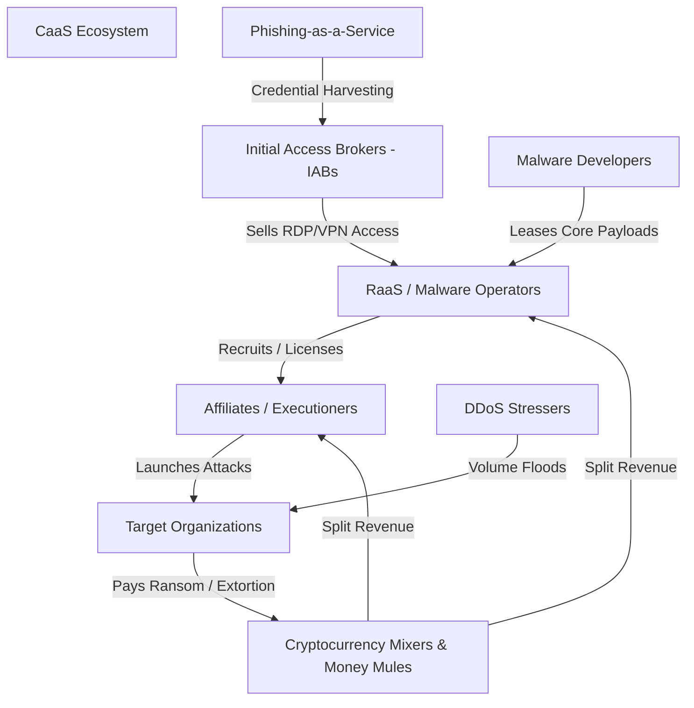

### 3.1 Ransomware-as-a-Service (RaaS)

RaaS operates via a revenue-sharing affiliate model:

* **Operators (Developers):** Maintain the core ransomware code, decryption portals, and negotiation platforms. They retain **10%–30%** of paid ransoms.
* **Affiliates:** Conduct initial network entry, lateral movement, data exfiltration, and execution of the payload. They retain **70%–90%** of the ransom.
* **Triple Extortion Mechanics:**
1. *Primary Extortion:* Encryption of vital operational data.
2. *Secondary Extortion:* Threatening to publish exfiltrated sensitive data on leak sites (e.g., LockBit, BlackCat).
3. *Tertiary Extortion:* Harassing customers/partners or launching concurrent DDoS attacks to force payment.


### 3.2 DDoS-for-Hire (Stresser / Booter Services)

Web platforms that commoditize Distributed Denial of Service attacks. Users purchase subscriptions specifying attack duration, amplification vectors (e.g., NTP, DNS), and target IP addresses, completely hiding the underlying botnet infrastructure.

### 3.3 Phishing Kits & Credential Markets

* **Phishing-as-a-Service (PaaS):** Pre-packaged web frameworks capable of bypassing Multi-Factor Authentication (MFA) via **Adversary-in-the-Middle (AiTM)** reverse-proxies (e.g., Evilginx2).
* **Initial Access Brokers (IABs):** Specialized actors who compromise networks via stolen credentials, unpatched vulnerabilities, or webshells, selling persistent network access to the highest bidder on dark web forums (e.g., Exploit.in, XSS).

---

## 4. Botnet Infrastructure & Lifecycle

A **Botnet** (Robot Network) is a network of compromised internet-connected devices ("bots" or "zombies") controlled remotely by a threat actor known as a **Botmaster** or **Herder**.

### 4.1 Botnet Command and Control (C2) Architectures

| Architecture Type | Description | Advantages for Attacker | Disadvantages for Attacker |
| --- | --- | --- | --- |
| **Centralized (IRC / HTTP / HTTPS)** | All bots connect directly to a single central server or small set of C2 servers. | Low latency, simple real-time command execution. | Single Point of Failure (SPOF); vulnerable to sinkholing and IP/domain blocking. |
| **Peer-to-Peer (P2P)** | Bots act as both clients and servers (servents), propagating commands through an overlay network (e.g., Kademlia DHT). | High resilience; no central server to seize or sinkhole. | High latency in command propagation; protocol reverse-engineering can expose peers. |
| **Hybrid & Fast-Flux** | Uses central control nodes hidden behind rapidly changing DNS records (Fast-Flux) or Tor hidden services. | Highly resistant to IP reputation blocking and domain takedowns. | Complex operational overhead and synchronization logic. |

### 4.2 Technical Mechanism: Fast-Flux DNS

Single-Flux DNS continuously updates `A` or `AAAA` records for a domain with short TTLs (e.g., 60 seconds), mapping a single domain name to hundreds of compromised proxy bots that route traffic back to the hidden C2 backend. Double-Flux updates both the `A` records and the `NS` (Name Server) records, adding another layer of operational obfuscation.

### 4.3 Domain Generation Algorithms (DGA)

To evade domain blacklisting, malware uses a pseudo-random algorithm seeded with a dynamic variable (e.g., current Unix timestamp or financial index) to generate hundreds of domain names daily. The C2 server registers only one or two of these domains; infected bots execute the matching algorithm to query domains sequentially until a active connection is established.

#### DGA Implementation Pseudocode

```python
import hashlib
import datetime

def generate_dga_domains(date_obj, seed_string, count=5):
    """
    Simulates a time-seeded Domain Generation Algorithm (DGA).
    """
    domains = []
    # Convert date to string format YYYY-MM-DD
    date_str = date_obj.strftime("%Y-%m-%d")
    
    for index in range(count):
        # Concatenate date, seed, and iteration index
        raw_input = f"{date_str}-{seed_string}-{index}".encode('utf-8')
        # Compute SHA-256 hash
        hash_digest = hashlib.sha256(raw_input).hexdigest()
        
        # Take first 16 chars of hash to construct domain
        domain_prefix = hash_digest[:16]
        top_level_domain = ".top" # Common dynamic TLD
        
        domains.append(f"{domain_prefix}{top_level_domain}")
        
    return domains

# Example Execution
today = datetime.date(2026, 7, 20)
malware_seed = "APT29_C2_CONFIG"
generated_list = generate_dga_domains(today, malware_seed)

for d in generated_list:
    print(f"[+] DGA Query Candidate: {d}")

```

### 4.4 Botnet Lifecycle

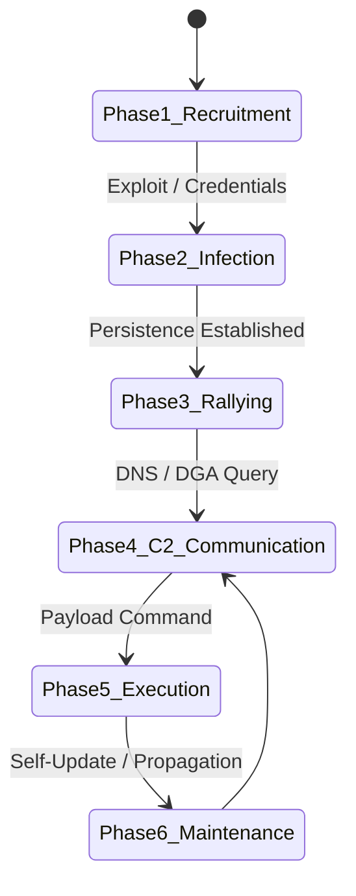

1. **Recruitment / Scanning:** Scanning IPv4 range for vulnerable services (e.g., open SSH, Telnet, unpatched vulnerabilities).
2. **Infection / Exploitation:** Delivering primary payload via remote code execution (RCE) or brute-forcing default credentials.
3. **Rallying:** The bot executes local persistence mechanisms, identifies its host environment, and contacts predefined C2 IP addresses or DGA domains.
4. **Command & Control (C2) Communication:** Authenticating with C2 and awaiting instructions.
5. **Execution:** Carrying out commanded tasks (e.g., launching DDoS, sending spam, executing credential dumping).
6. **Maintenance & Propagation:** Updating local malware code, removing competing malware from the host, and actively scanning for new targets.

### 4.5 Capabilities Enabled by Botnet Infrastructure

* Distributed Denial of Service (DDoS) attacks.
* Large-scale credential stuffing and brute-force campaigns.
* High-volume spam and phishing distribution.
* Proxying malicious traffic (Residential Proxy Networks).
* Distributed cryptocurrency mining (Cryptojacking).

---

## 5. DDoS Attack Taxonomy: Mechanisms & Layers

Distributed Denial of Service (DDoS) attacks aim to exhaust target resources (network bandwidth, system memory, CPU cycles, or application threads), rendering services unavailable to legitimate users.

### 5.1 Comprehensive Attack Classification Table

| Layer / Category | Specific Attack Type | Mechanism | Target Metric / Exhaustion Vector |
| --- | --- | --- | --- |
| **Volumetric (L3/L4)** | **UDP Flood** | Sending massive volumes of UDP packets to random high ports on the target. | Network Interface Card (NIC) capacity; transit link bandwidth (Gbps/Tbps). |
| **Volumetric (L3/L4)** | **ICMP Flood** | Flooding the target with ICMP Echo Request packets without waiting for replies. | Physical bandwidth and router throughput. |
| **Volumetric (L3/L4)** | **NTP / DNS / Memcached Amplification** | **Reflected Attack:** Spoofing the target's IP address as the source and sending queries to open reflectors with large responses. | Massively amplified bandwidth flood (Amplification factor up to 50,000x for Memcached). |
| **Protocol / State (L4)** | **TCP SYN Flood** | Exploiting the TCP 3-Way Handshake by sending SYN packets with spoofed IPs, filling the server's connection queue (**SYN backlog**). | Server Memory / TCP Connection State Tables (Half-Open connections). |
| **Protocol / State (L4)** | **Ping of Death / Smurf** | Sending malformed or oversized ICMP packets (or broadcasting ping with target's source IP). | OS Protocol Stack handling & buffer bounds. |
| **Application (L7)** | **HTTP GET / POST Flood** | Simulating legitimate browser traffic by making computationally expensive requests to application endpoints. | CPU, Database Connection Pools, Web Server Worker Threads. |
| **Application (L7)** | **Slowloris** | Opening hundreds of HTTP connections and sending partial HTTP headers very slowly to keep connections open continuously. | Maximum concurrent web server connection limit (`MaxClients`). |

### 5.2 Amplification Vector Mathematical Formula

Amplification factor ($AF$) measures the efficacy of a reflected DDoS vector:

$$AF = \frac{\text{Size of Reflected Response Payload (Bytes)}}{\text{Size of Attacker Request Payload (Bytes)}}$$

* **DNS Amplification:** $\approx 28 \times \text{ to } 54 \times$
* **NTP Monlist:** $\approx 556 \times$
* **Memcached (UDP 11211):** $\approx 10,000 \times \text{ to } 51,000 \times$

---

## 6. DDoS Attack Lifecycle & Mitigation Framework

Effective mitigation requires a layered defense combining edge scrubbers, rate-limiting, and signature/anomaly detection.

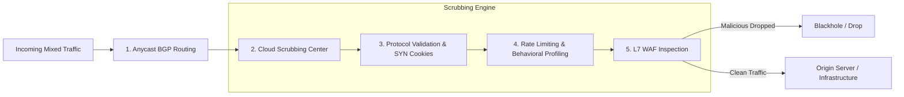

### 6.1 Mitigation Controls & Architecture

* **Anycast BGP Routing:** Distributes massive volumetric flood traffic across a geographically distributed mesh of data centers, preventing a single point of congestion.
* **SYN Cookies:** Mitigates SYN Floods at Layer 4 without allocating memory for connection states. The server encodes initial sequence numbers ($ISN$) cryptographically:

$$\text{ISN} = f(\text{SrcIP}, \text{SrcPort}, \text{DstIP}, \text{DstPort}, \text{SecretKey}) + \text{MSS}$$


Memory is allocated only when the client returns a valid `ACK` containing $\text{ISN} + 1$.
* **Rate Limiting & Leaky Bucket/Token Bucket Algorithms:** Controls burst rates at edge routers and proxies.
* **Web Application Firewalls (WAF):** Evaluates HTTP headers, cookie parameters, JavaScript challenges (e.g., Cloudflare JS Challenge), and CAPTCHAs to stop Layer 7 floods.

---

## 7. Hacktivism, Cyber Espionage & Advanced Persistent Threats (APTs)

Understanding threat actor profiles helps tailor defensive postures based on actor motivation, capability, and persistence.

### 7.1 Threat Actor Profiling

| Factor | Hacktivism | Advanced Persistent Threats (APTs) |
| --- | --- | --- |
| **Primary Motivation** | Political, ideological, or social expression; public humiliation. | Strategic national interest, geopolitics, IP theft, military dominance. |
| **Sponsorship** | Decentralized collectives, independent volunteers, proxy groups. | Nation-States (e.g., MSS, SVR/GRU, IRGC, Unit 61398). |
| **Targeting** | High-profile government sites, public services, media outlets. | Defense industrial base, critical infrastructure, research labs, dissidents. |
| **Operational Style** | Loud, highly visible (website defacements, public DDoS, data dumps). | Stealthy, persistent, low-and-slow execution (**Living off the Land**). |
| **Capabilities** | Off-the-shelf stressers, basic scripts, automated credential dumps. | Zero-day exploits, custom targeted malware, air-gap bridging. |

---

## 8. Case Studies of Cyber Crises & Infrastructure Attacks

Analyzing historical cyber crises provides insight into the real-world operational tactics of major threat actors.

### 8.1 Estonia Cyber Attacks (2007)

* **Context:** Geopolitical dispute between Estonia and Russia regarding the relocation of the Soviet "Bronze Soldier" war memorial in Tallinn.
* **Attack Vectors:** Multi-wave, politically motivated DDoS attacks lasting three weeks. Utilized ping floods, SYN floods, and botnet-driven HTTP request floods.
* **Impact:** Brought down national banking networks (Hansabank), government communication portals, emergency services, and media outlets. Forced Estonia to temporarily sever international internet routing.
* **Historical Significance:** **First recorded national-level cyber crisis.** Led directly to the creation of the **NATO Cooperative Cyber Defence Centre of Excellence (CCDCOE)** in Tallinn and informed the development of the *Tallinn Manual on the International Law Applicable to Cyber Operations*.

### 8.2 The Athens Affair (2004–2005)

* **Context:** Malicious monitoring of high-ranking Greek government officials (including the Prime Minister) around the 2004 Athens Olympic Games.
* **Attack Mechanism:** Rogue code (specifically, an unauthorized software patch) was illegally injected directly into the **AXE telephone exchanges** of Vodafone Greece.
* **Technical Exploitation:** The attackers activated built-in wiretapping software functionality meant for legal law enforcement interception, redirecting audio streams to rogue prepaid mobile phones without triggering system diagnostic logs.
* **Significance:** Highlighted critical risks within telecom core infrastructure and supply chain insider threats.

### 8.3 Mirai Botnet (2016)

* **Target Landscape:** Embedded Internet of Things (IoT) devices (IP cameras, home routers, DVRs).
* **Propagation Vector:** Automated, multi-threaded telnet scanning over ports 23 and 2323 using a dictionary of **61 hardcoded factory default usernames and passwords** (e.g., `admin:admin`, `root:vizion`).
* **Operational Mechanism:**
1. **Scanner Module:** Discovers vulnerable IoT devices running BusyBox.
2. **Loader / Payload Delivery:** Injects a lightweight binary compiled for various CPU architectures (ARM, MIPS, x86).
3. **Memory Execution:** Kills competing services (e.g., SSH, HTTP), erases its own executable file on disk, and runs solely in RAM to resist basic forensic analysis.


* **Impact:** Generated massive DDoS floods exceeding **1.2 Tbps**. Targeted DNS provider **Dyn**, taking down major global services including Twitter, Netflix, Reddit, and Spotify.

---

## 9. Critical Infrastructure Security & Governance

### 9.1 Definition & Scope

**Critical Infrastructure (CI)** encompasses physical and cyber systems, assets, and networks so vital to a nation that their incapacitation or destruction would have a debilitating impact on national security, national economic security, or public health and safety.

#### Core Sectors

* **Energy & Power Grid:** Generation, transmission, and distribution systems (SCADA, Smart Grids).
* **Water & Wastewater Systems:** Treatment plants, distribution pipelines, flow controls.
* **Healthcare & Public Health:** Hospital Information Systems (HIS), medical devices, pharmaceutical supply chains.
* **Financial Services:** Core banking, clearinghouses, payment gateways.
* **Transportation Systems:** Air traffic control, rail signaling, port logistics.
* **Information Technology & Telecom:** Root DNS servers, fiber backbones, cellular core networks.

### 9.2 Operational Technology (OT) vs. IT Environments

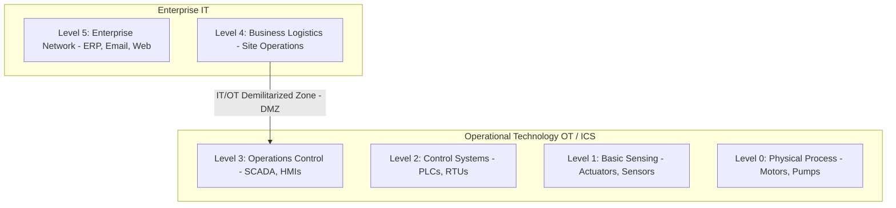

| Characteristic | Information Technology (IT) | Operational Technology (OT / ICS) |
| --- | --- | --- |
| **Primary Priority** | **Confidentiality** > Integrity > Availability | **Availability** > Integrity > Confidentiality |
| **Performance Requirements** | Tolerant of delays, retries, and latency. | Deterministic, real-time response ($\le \text{milliseconds}$). |
| **Lifecycles & Patching** | 3–5 year cycle; frequent automated patching. | 15–30 year operational lifecycle; high risk of downtime during patching. |
| **Protocols Used** | Standard IP (HTTP, TLS, SSH, Modbus/TCP). | Proprietary/Legacy (Modbus RTU, DNP3, PROFINET, BACnet). |

### 9.3 Threat Vectors Targeting Critical Infrastructure

* **Legacy Protocols:** DNP3 and Modbus legacy implementations lack native authentication, encryption, or integrity verification.
* **IT/OT Convergence:** Merging operational networks with enterprise networks to run predictive analytics exposes internal ICS to traditional IT entry vectors (e.g., spear-phishing).
* **Supply Chain Vulnerabilities:** Compromises embedded in third-party software components or hardware firmware (e.g., SolarWinds supply chain breach).

---

## 10. Governance Frameworks & Standards

Organizations managing critical systems adhere to established cybersecurity frameworks to measure and maintain structural resilience.

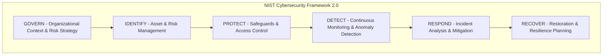

### 11. Core Governance Standards

1. **NIST Cybersecurity Framework (CSF) v2.0:**
Organizes security posture across six core functions: **Govern**, **Identify**, **Protect**, **Detect**, **Respond**, and **Recover**.
2. **NIST SP 800-82 (Rev. 3):**
Dedicated guide to Operational Technology (OT) and Industrial Control Systems (ICS) security.
3. **ISO/IEC 27001:**
International standard specifying requirements for an Information Security Management System (ISMS).
4. **MITRE ATT&CK for Enterprise & ICS:**
A curated knowledge base mapping adversary tactics, techniques, and procedures (TTPs) across industrial control environments.

---

## 12. Exam Tips & High-Yield Review Points

> ### 🧠 Exam Tip 1: SYN Cookies Mechanism
> 
> 
> When asked how SYN Cookies mitigate SYN Flood attacks without storing state:
> * Emphasize that the server **does not allocate memory** in the SYN backlog table upon receiving a SYN packet.
> * Explain that the server encodes state parameters directly into the **Initial Sequence Number (ISN)** of the `SYN-ACK` packet using a secret cryptographic hash key.
> * Note that state allocation occurs **only after** receiving the client's `ACK` packet, provided the sequence number correctly matches the hash validation function.
> 
> 

> ### 🧠 Exam Tip 2: DGA vs. Fast-Flux
> 
> 
> Differentiate between DGA and Fast-Flux clearly:
> * **DGA (Domain Generation Algorithm):** Changes the **Domain Name** queried by the bot to find a C2 server.
> * **Fast-Flux DNS:** Changes the **IP Addresses** associated with a single domain name rapidly using short DNS TTL values.
> 
> 

> ### 🧠 Exam Tip 3: IT vs. OT Priorities
> 
> 
> In critical infrastructure questions, highlight the contrast between security models:
> * **IT:** Confidentiality $\rightarrow$ Integrity $\rightarrow$ Availability (**CIA**)
> * **OT / SCADA:** Availability $\rightarrow$ Integrity $\rightarrow$ Confidentiality (**AIC**)
> 
> 

---

## 13. Common University Exam & Interview Questions

### 1. How does a DNS Reflection/Amplification attack work, and what network misconfigurations enable it?

* **Answer:** A DNS Amplification attack is an indirect, volumetric DDoS vector. The attacker sends DNS requests with a **spoofed source IP address** set to the target's IP address to open DNS resolvers.
* **Key Components:**
* **Open Resolvers:** Misconfigured DNS servers on the public internet that resolve recursive queries for any source IP address without restriction.
* **EDNS0 Extension:** Allows larger DNS payload sizes via UDP (up to 4096 bytes instead of the traditional 512 bytes). Requests for large records (e.g., `ANY` or `TXT`) yield a response significantly larger than the request payload.


* **Mitigation:** Disabling recursive queries on public DNS servers (closing open resolvers), implementing **Response Rate Limiting (RRL)** on DNS servers, and enforcing **Source Address Validation (BCP 38)** at ISP borders to prevent IP spoofing.

### 2. Describe the infection lifecycle of the Mirai malware. Why did IoT devices prove particularly vulnerable?

* **Answer:** Mirai scanned the IPv4 address space over open Telnet ports (23/2323) using dictionary attacks with 61 hardcoded credentials.
* **IoT Vulnerabilities:** IoT devices often lacked software update infrastructure, ran stripped-down Linux environments (BusyBox) with unauthenticated Telnet/SSH access, and relied on consumer-unchanged factory default passwords.
* **In-Memory Operation:** Once executed, Mirai wiped its local executable from disk and ran solely in volatile memory (RAM), making simple rebooting a temporary removal mechanism while leaving the device open to immediate reinfection.

### 3. Explain the operation of a Slowloris attack and why traditional Layer 4 firewalls fail to detect it.

* **Answer:** Slowloris is a Layer 7 application-layer attack that opens multiple HTTP connections to a target web server and holds them open as long as possible. It achieves this by sending partial HTTP headers periodically (e.g., `X-a: b\r\n`) without ever sending the terminating blank line (`\r\n\r\n`).
* **Why L4 Firewalls Fail:** Every connection uses legitimate TCP handshake procedures and valid Layer 4 transport traffic. Because traffic rates remain extremely low and stay well below network bandwidth thresholds, traditional L4 firewalls and network intrusion detection systems (NIDS) pass the packets through without flagging volumetric anomalies. The web server eventually exhausts its worker thread pool (`MaxClients`) waiting for headers to complete, causing denial of service for legitimate users.

---

## 14. Topic Summary

* **Organized Cybercrime:** Has evolved into an industrialized, modular economy driven by **Cybercrime-as-a-Service (CaaS)** models like RaaS, PaaS, and Initial Access Brokers.
* **Botnets:** Form the backbone of distributed cyber attacks. They rely on C2 architectures ranging from centralized IRC/HTTP models to resilient P2P overlay networks, using evasion tactics like **DGA** and **Fast-Flux DNS**.
* **DDoS Attack Spectrum:** Encompasses volumetric floods (UDP, ICMP, DNS Amplification), state-exhaustion protocol attacks (TCP SYN Flood), and resource-draining application attacks (HTTP Floods, Slowloris).
* **Historical Crises:** Events like **Estonia (2007)**, **The Athens Affair (2004)**, and **Mirai (2016)** demonstrate how cyber operations disrupt global services, impact national security, and exploit systemic weaknesses in telecom and IoT ecosystems.
* **Critical Infrastructure Security:** Protecting operational technology (OT/ICS) requires managing distinct operational priorities (**Availability over Confidentiality**) and addressing risks stemming from legacy protocols (Modbus, DNP3) and modern IT/OT convergence. Standard frameworks like **NIST CSF 2.0** and **NIST SP 800-82** provide structured guidelines to ensure resilience.

# Modern Cyber Threat Landscape, Threat Modeling & National Cyber Resilience

---

## 1. Prerequisites & Conceptual Foundation

To analyze modern security architectures and advanced threat vectors, you need a firm grasp of underlying systems concepts:

* **Identity & Access Management (IAM):** Differentiation between **Authentication** (verifying identity via passwords, MFA, tokens), **Authorization** (granting specific permissions via RBAC/ABAC), and **Accounting** (logging actions for non-repudiation).
* **System Boundaries & Attack Surfaces:** An **Attack Surface** comprises the sum total of all vulnerable points (entry vectors) where an unauthorized user can attempt to extract data or execute arbitrary code.
* **Network & Endpoint Telemetry:** Understanding basic security logging artifacts—such as Windows Event Logs (e.g., Event ID 4624 for successful logon), Sysmon, NetFlow/IPFIX, and Web Server Access Logs (Apache/NGINX).

---

## 2. Common Security Goals: The CIA Triad & Extended Objectives

Security architectures are designed to enforce a set of core security objectives. While the **CIA Triad** forms the traditional baseline, modern distributed applications require an extended model.

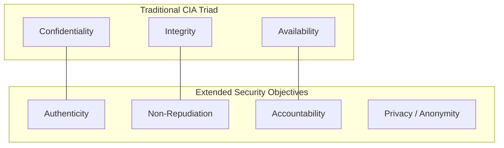

### 2.1 Foundational vs. Extended Security Objectives

| Objective | Operational Definition | Primary Threat / Attack Vector | Defense Mechanism |
| --- | --- | --- | --- |
| **Confidentiality** | Preserving authorized restrictions on information access and disclosure. | Sniffing, Data Exfiltration, Man-in-the-Middle (MitM). | Symmetric/Asymmetric Encryption (AES-256, RSA), TLS 1.3, Access Control Lists (ACLs). |
| **Integrity** | Safeguarding against improper information modification or destruction. | Unauthorized file modification, SQL Injection (SQLi), Tampering. | Cryptographic Hashes (SHA-256), HMACs, Digital Signatures, Immutable Storage. |
| **Availability** | Ensuring timely and reliable access to and use of information. | Volumetric DDoS, Ransomware Encryption, Hardware Failure. | High Availability (HA) Clusters, Load Balancing, Off-site Immutable Backups, Scrubbing Centers. |
| **Authenticity** | Verifying that an input, message, or transaction originates from a genuine entity. | Spoofing, Session Hijacking, Phishing. | Digital Certificates (PKI), Multi-Factor Authentication (MFA), FIDO2/WebAuthn. |
| **Non-Repudiation** | Ensuring a sender/actor cannot deny the validity of a signature or performed action. | Insider Fraud, Unauthorized Transaction Denial. | Asymmetric Cryptography (Private Key Signing), Immutable Append-Only Audit Logs. |
| **Accountability** | Tracing actions uniquely to a specific individual or process. | Shared Accounts, Privilege Escalation. | Individual User Identifiers, Centralized SIEM Logging, Session Recording. |

---

## 3. The Threat Landscape: Actors & Vectors

A **Threat Actor** is an individual or group that conducts malicious operations against digital assets. A **Threat Vector** is the specific path or technique used to exploit a security flaw.

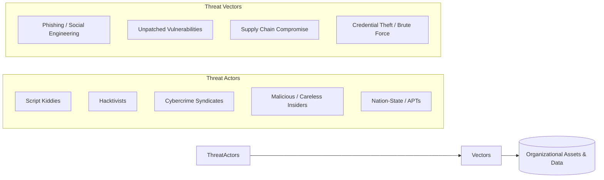

### Threat Actor Profiling

* **Script Kiddies:** Unskilled actors using publicly available exploit scripts (e.g., Metasploit, automated scanners). Driven by curiosity or notoriety.
* **Cybercrime Syndicates:** Highly organized financial cartels operating as businesses. High sophistication, utilizing **CaaS (RaaS, IABs)** models.
* **Advanced Persistent Threats (APTs):** State-sponsored actors characterized by custom zero-day exploits, deep financial backing, stealth (**Living off the Land**), and prolonged, multi-year persistence.
* **Insiders:** Current/former employees or contractors with legitimate system access. Divided into **Malicious** (intentional exfiltration/sabotage) and **Negligent** (falling victim to social engineering).

---

## 4. Threat Modeling: Concept, Methodology & Frameworks

**Threat Modeling** is a structured procedure for identifying, structuralizing, and prioritizing potential system vulnerabilities and threats during the design phase of software or network engineering.

### 4.1 The 4-Question Framework (Adam Shostack)

1. *What are we building?* (System Architecture & Data Flow Diagrams)
2. *What can go wrong?* (Threat Identification via STRIDE)
3. *What are we going to do about it?* (Mitigations & Control Implementation)
4. *Did we do a good enough job?* (Validation, Retrospective & Testing)

---

### 4.2 Threat Modeling Frameworks Compared

| Framework | Primary Focus | Best Use Case | Core Taxonomy / Steps |
| --- | --- | --- | --- |
| **STRIDE** | Developer-centric software threat enumeration. | Application design & software development life cycle (SDLC). | **S**poofing, **T**ampering, **R**epudiation, **I**nformation Disclosure, **D**enial of Service, **E**levation of Privilege. |
| **PASTA** | Risk-centric threat modeling aligning business objectives with technical flaws. | Enterprise-level risk management & compliance integration. | 7-stage process: Objectives, Scope, Decomposition, Analysis, Vulnerability Analysis, Attack Modeling, Risk & Impact. |
| **CVSS v4.0** | Vulnerability scoring and severity measurement. | Vulnerability management and operational patching prioritization. | Base Metrics (Exploitability/Impact), Threat Metrics, Environmental Metrics (Scored 0.0 to 10.0). |
| **ATT&CK (MITRE)** | Real-world adversary behavior and TTP classification. | Post-breach detection, threat hunting, and Red/Blue Team operations. | Matrices (Enterprise, Mobile, ICS) detailing Tactics (goals) and Techniques (methods). |

#### Detailed Mapping of the STRIDE Taxonomy

| Threat Category | Security Goal Violated | Technical Definition | Example Mitigation Control |
| --- | --- | --- | --- |
| **Spoofing** | Authenticity | Impersonating an entity, process, or user. | Mutual TLS (mTLS), FIDO2 MFA, Kerberos. |
| **Tampering** | Integrity | Unauthorized modification of data in transit or at rest. | HMAC validation, Digital Signatures, File Integrity Monitoring (FIM). |
| **Repudiation** | Non-Repudiation | Denying the execution of an action due to lack of proof. | Cryptographically signed audit trails, WORM (Write Once Read Many) storage. |
| **Information Disclosure** | Confidentiality | Exposing sensitive data to unauthorized parties. | Field-level encryption, TLS 1.3, Data Loss Prevention (DLP). |
| **Denial of Service** | Availability | Exhausting system resources to disrupt service. | Rate limiting, Cloud Scrubbing, SYN Cookies, Auto-scaling. |
| **Elevation of Privilege** | Authorization | Gaining unauthorized elevated access levels. | Principle of Least Privilege (PoLP), Sudo policy hardening, RBAC. |

---

## 5. Security Analysis, Risk Assessment & Intelligence

### 5.1 The Risk Assessment Equation & Matrix

Risk is calculated as a function of the likelihood of a threat actor exploiting a vulnerability and the resulting business impact:

$$\text{Risk Score} = \text{Likelihood} \times \text{Impact}$$

#### Qualitative 3x3 Risk Assessment Matrix

| Likelihood $\downarrow$ / Impact $\rightarrow$ | Low (1) | Medium (2) | High (3) |
| --- | --- | --- | --- |
| **High (3)** | Medium (3) | High (6) | **Critical (9)** |
| **Medium (2)** | Low (2) | Medium (4) | High (6) |
| **Low (1)** | Low (1) | Low (2) | Medium (3) |

#### Quantitative Risk Analysis Metrics

* **Single Loss Expectancy (SLE):** Total monetary loss from a single risk event:

$$\text{SLE} = \text{Asset Value (AV)} \times \text{Exposure Factor (EF)}$$


* **Annualized Rate of Occurrence (ARO):** Estimated frequency of the risk event occurring per year.
* **Annualized Loss Expectancy (ALE):** Expected annual cost of a given risk:

$$\text{ALE} = \text{SLE} \times \text{ARO}$$


---

### 5.2 Threat Intelligence: The Cyber Threat Intelligence Cycle

Cyber Threat Intelligence (CTI) translates raw telemetry data into actionable defensive insights.

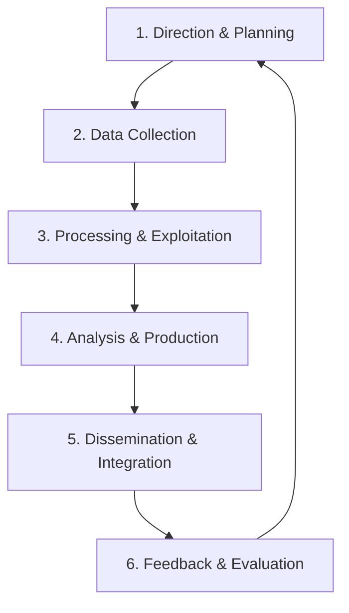

#### Levels of Threat Intelligence

1. **Strategic:** High-level trends, financial impact, and geopolitical motivations designed for C-level executives (e.g., threat actor profiles).
2. **Tactical:** Adversary Tactics, Techniques, and Procedures (TTPs) mapped to the MITRE ATT&CK framework for SOC managers and threat hunters.
3. **Operational:** Details on specific upcoming campaigns or tools used by threat actors.
4. **Technical:** Tactical Indicators of Compromise (IoCs) such as file hashes (SHA-256), malicious IP addresses, and C2 domain names fed directly into SIEM/SOAR platforms via STIX/TAXII protocols.

---

## 6. Emerging Threat Vectors & Advanced Paradigms

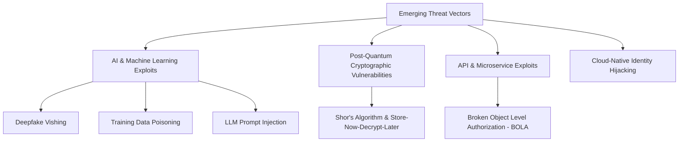

### 6.1 Adversarial Machine Learning & Generative AI Threats

* **Data Poisoning:** Injecting manipulated data into an ML model's training pipeline to introduce deliberate backdoors or bias.
* **Prompt Injection:** Tampering with instructions supplied to Large Language Models (LLMs) to bypass guardrails and access underlying system capabilities.
* **Model Inversion & Exfiltration:** Reconstructing original training data (including sensitive personal data) by observing model outputs.

### 6.2 The Quantum Threat to Modern Cryptography

* **Shor’s Algorithm:** Enables quantum computers running on sufficient qubits to compute discrete logarithms and factor large prime numbers in polynomial time. This breaks current asymmetric cryptography: **RSA**, **ECC (ECDSA/ECDH)**, and **Diffie-Hellman**.
* **Grover’s Algorithm:** Speeds up unstructured database searches, effectively halving the security strength of symmetric keys (e.g., reducing AES-128 security to 64 bits).
* **Defensive Paradigm:** Transitioning toward **Post-Quantum Cryptography (PQC)** standards approved by NIST (e.g., CRYSTALS-Dilithium, ML-KEM/CRYSTALS-Kyber) and adopting asymmetric keys with at least **AES-256**.

---

## 7. Landmark Case Studies in Cyber Warfare & Supply Chain Attacks

### 7.1 SolarWinds Orion Supply Chain Attack (2020)

* **Threat Actor:** APT29 (Cozy Bear / Nobelium), attributed to Russia's Foreign Intelligence Service (SVR).
* **Attack Type:** Software Supply Chain Compromise (**SUNBURST** backdoor).
* **Technical Mechanism:**
1. Attackers compromised the internal build pipeline of SolarWinds Orion network management software.
2. Injected a lightweight malicious backdoor (`SolarWinds.Orion.Core.BusinessLayer.dll`) directly into legitimate, digitally signed software updates.
3. Over 18,000 corporate and government organizations downloaded the trojanized update.
4. The malware remained dormant for 12–14 days before establishing C2 infrastructure using custom domain requests disguised as legitimate Orion protocol traffic.


* **Key Takeaway:** Digital signatures on code alone do not protect against build-pipeline compromises. Secure software development requires continuous source-code auditing and build-system isolation.

---

### 7.2 Stuxnet: The Dawn of Cyber Warfare (2010)

* **Target:** Iran’s Natanz Nuclear Enrichment Facility.
* **Attributed Threat Actors:** US and Israeli State Intelligence (Operation Olympic Games).
* **Operational Characteristics:**
* **Air-Gap Traversal:** Delivered via infected USB flash drives through insider/contractor systems.
* **Zero-Day Arsenal:** Utilized **four unpatched Microsoft Windows zero-day vulnerabilities** (e.g., Print Spooler, LNK shortcut execution) to propagate across local networks.
* **Rootkit Technology:** Leveraged stolen, valid digital code-signing certificates (Realtek and JMicron) to bypass Windows driver signature enforcement.
* **Targeted Payload Execution:** Specifically targeted **Siemens S7-310 and Step 7 Programmable Logic Controllers (PLCs)** linked to frequency drive converters running gas centrifuges.


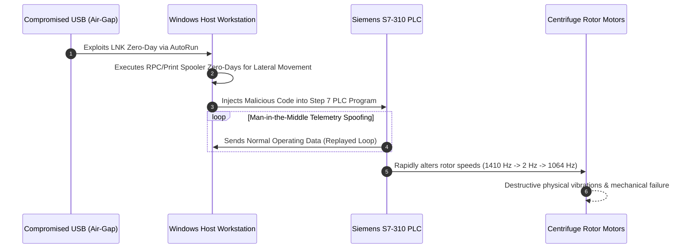

---

### 7.3 WannaCry (2017) & AIIMS New Delhi (2022): Ransomware Impact

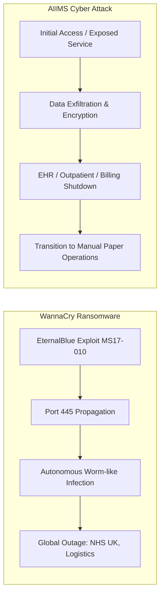

#### Technical Comparison

| Dimension | WannaCry (2017) | AIIMS New Delhi Cyber Attack (2022) |
| --- | --- | --- |
| **Malware Family** | WannaCry (Worm-Ransomware hybrid). | Targeted Human-Operated Ransomware. |
| **Infection Vector** | Exploited **MS17-010** (EternalBlue SMBv1 flaw) leaked from NSA assets. | Unpatched edge routers, exposed remote services, and weak credential policies. |
| **Propagation** | **Autonomous:** Scanned global IPv4 subnets for open SMB port 445; required no human interaction. | **Manual Lateral Movement:** Attackers enumerated Active Directory, exfiltrated data, and disabled backups. |
| **Targeting Scope** | Global, non-discriminatory campaign hitting 200,000+ computers across 150 countries. | Highly targeted attack against healthcare IT infrastructure handling critical patient records. |
| **Impact on Healthcare** | Disrupted UK National Health Service (NHS) facilities, forcing patient diversions. | Encrypted 5+ hospital servers, disrupting Online Health Authority Systems (e-Hospital) for weeks. |

---

### 7.4 Colonial Pipeline Ransomware Attack (2021)

* **Threat Actor:** DarkSide (Eastern European RaaS group).
* **Initial Access Vector:** A single compromised legacy **Virtual Private Network (VPN) password** found on a dark web credential dump. The account lacked Multi-Factor Authentication (MFA).
* **Operational Impact:** The attack targeted Colonial Pipeline's enterprise IT network. Out of caution and an inability to bill customers accurately due to infected accounting systems, the company **proactively shut down the physical operational pipeline** (5,500 miles supplying 45% of the US East Coast's fuel) for six days.
* **Key Takeaway:** Demonstrates how IT system compromises can force operational technology (OT) shutdowns due to billing dependencies and risk management concerns.

---

## 8. Homeland Security, Governance & National Cyber Resilience

Maintaining national resilience requires coordinated defensive operations across government agencies and private sector critical infrastructure operators.

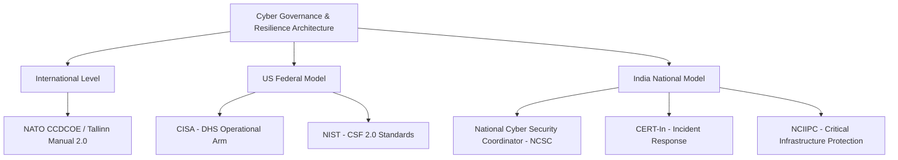

### 8.1 Critical Governance Entities

1. **CISA (Cybersecurity and Infrastructure Security Agency - US):** Coordinates national vulnerability management, emergency communications, and defensive capabilities for physical and cyber critical infrastructure.
2. **CERT-In (Indian Computer Emergency Response Team):** The national nodal agency responsible for handling cybersecurity incidents, issuing advisories, and enforcing mandatory 6-hour incident reporting rules for organizations operating in India.
3. **NCIIPC (National Critical Information Infrastructure Protection Centre - India):** Designated under Section 70A of the Information Technology Act (2000) as the national agency to protect designated Critical Information Infrastructure (CII).
4. **NIST CSF v2.0:** Serves as the global standard framework for cybersecurity risk management across organizations regardless of size or sector.

---

## 9. Exam Tips & High-Yield Review Points

> ### 🧠 Exam Tip 1: STRIDE Threat Mapping
> 
> 
> University exams often ask you to map a system flaw to a specific STRIDE category:
> * **SQL Injection** $\rightarrow$ **Tampering** (Modifying data) OR **Information Disclosure** (Reading data) OR **Elevation of Privilege** (Bypassing auth).
> * **Fake SSL Certificate / ARP Spoofing** $\rightarrow$ **Spoofing**.
> * **Log Wiping / Deletion** $\rightarrow$ **Repudiation**.
> * **SYN Flood** $\rightarrow$ **Denial of Service**.
> 
> 

> ### 🧠 Exam Tip 2: Stuxnet Technical Anatomy
> 
> 
> On cyber warfare questions, emphasize that Stuxnet changed cyber security history by targeting **PLC hardware** directly:
> * It was the first publicly documented malware to alter industrial physical processes while **spoofing diagnostic feedback loop signals**, making operators think system metrics were completely normal.
> 
> 

> ### 🧠 Exam Tip 3: Quantum Cryptography Vulnerability
> 
> 
> Be precise about quantum impacts:
> * Quantum computers **completely break asymmetric encryption** (RSA, ECC, Diffie-Hellman) using **Shor's Algorithm**.
> * They do **not** completely break symmetric encryption (AES). Instead, **Grover's Algorithm** reduces effective key length by half, making **AES-256** resilient against quantum attacks.
> 
> 

---

## 10. Common University Exam & Interview Questions

### 1. Differentiate between STRIDE and PASTA threat modeling methodologies. Which would you choose for a fintech application?

* **Answer:** **STRIDE** is an application- and developer-centric threat classification taxonomy that categorizes system threats into six operational buckets based on Data Flow Diagrams (DFDs). It excels at finding specific technical software defects.
* **PASTA (Process for Attack Simulation and Threat Analysis)** is an enterprise, risk-centric, 7-step threat modeling framework. It explicitly aligns technical threats with financial impacts and compliance goals.
* **Selection for Fintech:** PASTA is typically preferred for fintech applications because financial systems operate under strict regulatory standards (PCI-DSS, GDPR) and require business impact analyses that directly connect technical exploitability to financial exposure.

### 2. How did the SolarWinds attack bypass traditional perimeter security and code-signing validation controls?

* **Answer:** SolarWinds was a software supply chain attack targeting the build pipeline rather than the end customer directly. Threat actors compromised SolarWinds' internal build environment (using malicious code dubbed *SUNSPOT*) and injected the backdoor (*SUNBURST*) into the codebase *before* compilation.
* Consequently, when SolarWinds compiled and digitally signed the update binary using its official, trusted PKI certificate, the malicious payload was included in the valid signature. Enterprise perimeters trusted the update as a legitimate software patch from a verified vendor, bypassing perimeter firewalls and traditional endpoint signature checks.

### 3. Calculate the Annualized Loss Expectancy (ALE) for an enterprise server farm if an asset valued at $500,000 has an Exposure Factor (EF) of 40% against ransomware, and the Annualized Rate of Occurrence (ARO) is estimated at 0.2 (once every 5 years).

* **Answer:**
1. Calculate Single Loss Expectancy (SLE):

$$\text{SLE} = \text{Asset Value (AV)} \times \text{Exposure Factor (EF)}$$


$$\text{SLE} = \$500,000 \times 0.40 = \$200,000$$


2. Calculate Annualized Loss Expectancy (ALE):

$$\text{ALE} = \text{SLE} \times \text{ARO}$$


$$\text{ALE} = \$200,000 \times 0.2 = \$40,000$$


* **Result:** The organization can expect an average financial loss of **$40,000 per year** from this ransomware threat, setting a rational upper budget limit for defensive controls targeting this risk.


---

## 11. Topic Summary

* **Security Objectives:** Expand beyond the foundational **CIA Triad** (Confidentiality, Integrity, Availability) to include **Authenticity**, **Non-Repudiation**, and **Accountability**.
* **Threat Modeling:** Formal frameworks like **STRIDE** and **PASTA** allow teams to systematically identify application weaknesses during design rather than reacting post-breach.
* **Risk & Intelligence:** Quantitative risk metrics ($\text{ALE} = \text{SLE} \times \text{ARO}$) allow organizations to prioritize defensive spending. **Threat Intelligence** converts operational telemetry into actionable defense across strategic, tactical, operational, and technical levels.
* **Modern Threat Vectors:** Range from AI data poisoning and prompt injection to post-quantum cryptographic risks that threaten asymmetric algorithms like RSA and ECC.
* **Real-World Case Studies:**
* **SolarWinds (2020):** Demonstrated the dangers of software supply chain compromises.
* **Stuxnet (2010):** Proved cyber attacks can cause physical destruction to critical infrastructure by targeting PLCs.
* **Colonial Pipeline (2021) & WannaCry/AIIMS:** Highlighted how ransomware affects physical supply chains and critical public services.


* **National Resilience:** National cyber resilience depends on structured governance frameworks (**NIST CSF v2.0**) and coordinated defense entities (**CISA**, **CERT-In**, **NCIIPC**).

# The Athens Affair & The CIA Triad / National Cyber Strategy — Comprehensive Cybersecurity Notes

> **Scope note:** Two documents are combined here: **(1) *The Athens Affair*** — the landmark **IEEE Spectrum article** by **Vassilis Prevelakis & Diomidis Spinellis** (posted 29 Jun 2007) analysing the **Greek telephone tapping case 2004–2005** (Vodafone Greece / Ericsson AXE switches) — 9 pages; and **(2) a CIA-Triad / Estonia-Cyber-Strategy excerpt** (6 pages) — the **three (plus one) security goals**, integrity & availability models, and Estonia's national cyber-defence subgoals. The pairing is ideal: the Athens Affair is the **ultimate applied case study** of the CIA framework — a confidentiality catastrophe enabled by a *lawful-intercept* subsystem, hidden through *integrity* attacks (code patches, checksum tampering), and compounded by *availability-vs-forensics* trade-offs. Enrichment is marked and cross-linked to earlier notes in this series.

---

## 1. Executive Overview & Core Concepts

### 1.1 What the Documents Cover

| Document | Content |
| :--- | :--- |
| **The Athens Affair (9 pp.)** | The most audacious cell-network break-in ever documented: rogue software implanted in **4 of Vodafone Greece's Ericsson AXE switches**, tapping **~100 phones** (incl. the PM), evading detection for ~5 months via **29 code patches**, a **rootkit** on a telephone switch, and forensic discovery through **system dumps** — plus the failed incident response and a full **lessons list** |
| **CIA / Estonia doc (6 pp.)** | The **three security goals** (Confidentiality, Integrity, Availability) + **Non-repudiation** as a management-before-technical objective; the **CIA triad (Figure 2.1)**; Estonia's cyber-strategy subgoals (crime detection, awareness, international cooperation, national/military cyber defence, next-gen professionals); **Integrity Models** (3 goals) and **Availability Models** (3 challenges) |

### 1.2 Fundamental Definitions (Doc 2, Pages 1–6)

| Goal | Definition (per doc) | Character |
| :--- | :--- | :--- |
| **Confidentiality** | *"Protect the confidentiality of data"* — controlling access to files **either in storage or in transit** | Configuration/products = *technical*; defining **who should access what** = *business process* |
| **Integrity** | *"Preserve the integrity of data"* — **version control**: only the right people can change documents; requires an **audit trail of changes** and a **fallback position** | *"Meshes with non-repudiation — the change record must include **who** as well as **what and when**"* |
| **Availability** | *"Promote the availability of data for authorized use"* — *"the **Cinderella** of information security as it is rarely discussed"* | Requires **data back-ups, bandwidth, standby facilities** — often left out of planning |
| **Non-repudiation** | The assurance someone **cannot deny** an action | *"A **management issue before it's a technical one** — they are essentially **business objectives**"* |

* **Figure 2.1 — The CIA triad:** triangle of **Confidentiality** (apex), **Integrity** and **Availability** (base) — *"the basis of all security programs."* Professionals creating policies/procedures (**governance models**) must consider **each** goal.

**Integrity Models — three goals (p. 5):**

1. **Prevent unauthorized users** from making modifications to data or programs.
2. **Prevent authorized users** from making **improper or unauthorized** modifications.
3. **Maintain internal and external consistency** of data and programs.

* *Example of integrity checks:* **balancing a batch of transactions** to make sure all information is present and accurately accounted for.

**Availability Models — three common challenges (pp. 5–6):**

1. **Denial of Service (DoS)** — *"due to intentional attacks or because of undiscovered flaws in implementation"* (e.g., a program that crashes on unexpected input).
2. **Loss of information system capabilities** because of **natural disasters** (fires, floods, storms, earthquakes) or **human actions** (bombs or strikes).
3. **Equipment failures during normal use.**

**Activities preserving C/I/A (p. 6):** granting access **only to authorized personnel** · **applying encryption** to information sent over the Internet or stored on digital media · **periodically testing** computer system security to uncover new vulnerabilities · **building software defensively** · developing a **disaster recovery plan** ensuring the business can continue after a disaster or loss of personnel access.

> **🔑 Key Takeaway (module-level):** The Athens Affair is a **simultaneous three-goal failure**, mapped to Doc 2's framework:
>
> * **Confidentiality** — ~100 senior officials' calls diverted to shadow phones.
> * **Integrity** — switch code patched in **29 blocks**; **checksum-verification commands apparently modified** so altered blocks *"appeared unaltered"*; logs hidden.
> * **Availability vs. forensics** — Vodafone chose network continuity, **destroying the evidence trail** (logs kept **5 days**; visitor books **6 months**; an upgrade **wiped access logs**).
> * **Non-repudiation/audit** — the designed control (**RES–IMS reconciliation audit**) was bypassed; the designed audit *discipline* (retain data, isolate, coordinate) was ignored.

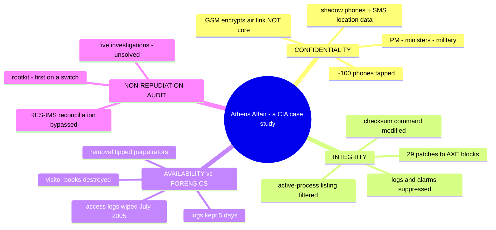

---

## 2. Page-by-Page Detailed Breakdown

## PART A — The Athens Affair (Pages 1–9)

### Page 1 — The Discovery

* **On 9 March 2005**, **Costas Tsalikidis**, a 38-year-old Greek electrical engineer, was found hanged in his Athens loft — *"an apparent suicide"* — *"merely the first public news of a scandal that would roil Greece for months."*
* **The next day**, the **Prime Minister of Greece was told his cellphone was bugged** — as were those of the **mayor of Athens** and **at least 100 other high-ranking dignitaries**, *"including an employee of the U.S. embassy."*
* **The victims** were customers of **Vodafone-Panafon (Vodafone Greece)**, the country's largest cellular provider; **Tsalikidis was in charge of network planning** — *"a connection seemed obvious."* *"We can only imagine the sensitive political and diplomatic discussions, high-stakes business deals, or even marital indiscretions that may have been routinely overheard and, quite possibly, recorded."*
* Even before the death, investigators found **rogue software installed on the Vodafone Greece phone network by parties unknown** — *"some extraordinarily knowledgeable people either **penetrated the network from outside or subverted it from within, aided by an agent or mole**."* The software at the heart of the phone system was *"reprogrammed with a **finesse and sophistication rarely seen before or since**."*
* **Framing:** major network penetrations are *"exceedingly uncommon — hard to pull off, and equally hard to investigate."* The Athens affair *"stands out because it may have involved **state secrets**, and it **targeted individuals**"*
* **Sidebar — "CEOs, MPs & a PM":** the illegally wiretapped phones included the **prime minister, his defense and foreign affairs ministers, top military and law enforcement officials, the Greek EU commissioner, activists, and journalists.**
* **The "Cuckoo's Egg" comparison:** the most notorious prior penetration to compromise state secrets was the **1986 "Cuckoo's Egg"** — named by *"the wily network administrator who successfully pursued a German programmer"* **selling US Strategic Defense Initiative ("Star Wars") secrets to the Soviet KGB**. *"But unlike the Cuckoo's Egg, the Athens affair targeted the **conversations of specific, highly placed government and military officials**."* *(Enrichment: the administrator was **Clifford Stoll**; see page 6.)*
* **Key technical point:** *"the scheme did **not depend on the wireless nature** of the network. Basically, the hackers **broke into a telephone network and subverted its built-in wiretapping features** for their own purposes. That could have been done with **any phone account, not just cellular ones**."*
* **Why unsolved:** *"Vodafone Group bobbled its handling of some key log files. It also **reflexively removed the rogue software**, instead of letting it continue to run, **tipping off the perpetrators**… The company was fined **76 million** this past December."* *(Enrichment: a **€76 million fine** by the Greek regulator EETT, December 2006.)*
* **Method:** *"hundreds of pages of depositions"* from the Greek parliamentary committee (obtained via **freedom-of-information request**), documentation, public information, and expert interviews — *"the technical details, if not the motivation."*

### Page 2 — Timeline Begins; the Tapping Mechanism

* **Sidebar:** On **6 April 2006, Bill Zikou, CEO of Ericsson Hellas**, gave evidence before the parliamentary committee — *"his company provided the telecommunications switching equipment that rogue programmers broke into."* **Sidebar:** Vodafone Greece CEO **Giorgos Koronias ordered removal** of the surveillance program because, *"as he explained in a February 2006 newspaper interview, **'the company had to react immediately.'*** Removing the program is thought to have **tipped off the perpetrators and helped them evade capture**."*
* **The cellphone bugging began** *"sometime during the **fevered run-up to the August 2004 Olympic Games in Athens**. It remained **undetected until 24 January 2005**, when one of Vodafone's telephone **switches generated a sequence of error messages** indicating that **text messages originating from another cellphone operator had gone undelivered**."* *(A switch = the computer-controlled component connecting two lines to complete a call.)* Vodafone contacted the switch maker — **Ericsson (Sweden)**.
* **The mechanism (now known):** the illegally implanted software — **eventually found in a total of FOUR of Vodafone's Greek switches** — *"created **parallel streams of digitized voice** for the tapped phone calls. One stream was the ordinary one, between the two calling parties. **The other stream, an exact copy, was directed to other cellphones**"* — *"shadow handsets"* — *"allowing the tappers to listen in… and probably also to record them. The software also **routed location and other information** about those phone calls to these shadow handsets **via automated text messages**."*
* **The unraveling:** *"**Five weeks** after the first messaging failures, on **4 March 2005, Ericsson alerted Vodafone** that **unauthorized software had been installed in two of Vodafone's central offices**. **Three days later**, Vodafone technicians **isolated the rogue code**. The next day, **8 March**, CEO Koronias ordered technicians to **remove the software**."*

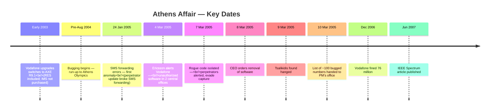

### Page 3 — The Victim List, Investigations & Network Architecture

* *"Then events took a deadly turn. On **9 March**, Tsalikidis, **who was to be married in three months**, was found hanged… No one knows whether his apparent suicide was related to the case, but **many observers have speculated that it was**."* *(Sidebar: as telecom engineer in charge of network planning, he was *"ideally placed to be either an inside accomplice or discoverer of the digital break-in. But his involvement has never been established."* PM **Costas Karamanlis** — *"only the most notable of the 100 or so individuals illegally wiretapped… which included **Karamanlis's wife**.")*
* **The disclosure meeting:** the day after, CEO **Koronias** met **Yiannis Angelou** (director of the PM's political office) and **minister of public order Giorgos Voulgarakis**; handed over a list of bugged numbers: *"rogue software used the **lawful wiretapping mechanisms** of Vodafone's digital switches to tap **about 100 phones**."*
* **The full victim roster:** PM **and his wife** · ministers of **national defense, foreign affairs, and justice** · **mayor of Athens** · **Greek EU commissioner** · members of **civil rights organizations, peace activists, antiglobalization groups** · **senior staff** at ministries of National Defense, Public Order, Merchant Marine, Foreign Affairs · the **New Democracy ruling party** · **Hellenic Navy general staff** · a **Greek-American employee at the US Embassy**.
* **Five investigations** aimed at **three questions**: *Who was responsible? Was Tsalikidis's death related? How did they pull it off?*
* **Infrastructure 101 (needed to understand "how"):**
    1. Handset → **cellular base stations**; nearest station becomes the intermediary; the handset *"converts your words into a **stream of digital data** sent to a **transceiver** at the base station."*
    2. **Base station controller (BSC)** — special-purpose computer: *"allocates radio channels and helps coordinate **handovers**."*
    3. **Mobile switching center (MSC)** — connects calls within the switching center, to other centers, and to **gateway exchanges routing to foreign networks**. *"The MSCs are particularly important because they **hosted the rogue phone-tapping software** — it is there that the eavesdropping originated. They were the **logical choice**, because they are **at the heart of the network**; the intruders needed to take over **only a few of them**."*
    4. Both BSCs and MSCs are built around a large **switch** — *"holdovers from the **1970s**… proprietary hardware and software… the system's basic architecture remains largely unchanged."*
    5. Vodafone Greece uses **Ericsson's AXE line of switches** for both MSCs and BSCs; a **central processor** coordinates operations and sets up speech/data paths…

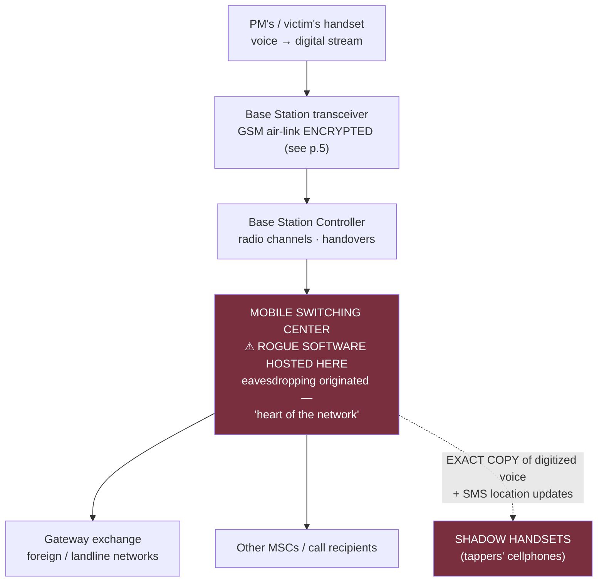

### Page 4 — Lawful Intercept: RES & IMS; the Fatal Upgrade

* …the switch's **management processor** *"stores on disk the **logs of network activity and billing records**."*
* **The key to the hack — how the Ericsson AXE allows lawful intercepts ("wiretaps"):** *"a law enforcement official goes to a court, obtains a **warrant**, presented to the phone company."* All wiretaps carried out **at the central office**. In AXE exchanges, the **remote-control equipment subsystem (RES)** *"carries out the phone tap by **monitoring the speech and data streams of switched calls**… a software subsystem typically used for setting up wiretaps, which **only law officers are supposed to have access to**. When the wiretapped phone makes a call, the **RES copies the conversation into a second data stream** and **diverts that copy to a phone line used by law enforcement officials**."*
* **The control plane — IMS:** *"Ericsson **optionally** provides an **interception management system (IMS)** through which lawful call intercepts are set up and managed. When a court order is presented, operators initiate an intercept by **filling out a dialog box in the IMS software**. The IMS (operator interface) contains **wiretap requests**; the RES (in the exchange) contains **actual taps**. **Only IMS-initiated wiretaps should be active in the RES** — so a wiretap in the RES **without a request in the IMS is a pretty good indicator that an unauthorized tap has occurred**. **An audit procedure can be used to find any discrepancies between them.**"*
* **The odd circumstance that enabled everything:** *"Vodafone had **NOT purchased the lawful intercept option** — the **IMS was not installed**. But in **early 2003**, Vodafone technicians **upgraded the Greek switches to release R9.1** of the AXE software suite. That upgrade **included the RES software** (per an Ericsson letter). So after the upgrade, the system contained **the code necessary to intercept calls using the RES**, even though it lacked the **high-level user interface in the IMS**."* → *"That odd circumstance would turn out to play a role in letting the Athens hackers illegally listen in on calls **and yet escape detection for months and months**."*
* **"It took guile and some serious programming chops":** the intruders had to (1) install and operate wiretapping software **without detection** by Vodafone *or* Ericsson administrators; (2) periodically **update the lists of monitored numbers and shadow phones**; (3) keep those activities **off all logs**; (4) make the software **invisible to administrators conducting routine maintenance**. *"The intruders achieved all these objectives."*
* **The enabler:** *"the AXE allows **new software to be installed WITHOUT rebooting**"* — critical because any interruption would *"disconnect phone calls, lose text messages, and render **emergency services unreachable**."* Ericsson's techniques for failure-handling and no-downtime upgrades *"allow the **direct patching of code loaded in the central processor, in effect altering the operating system on the fly**."*

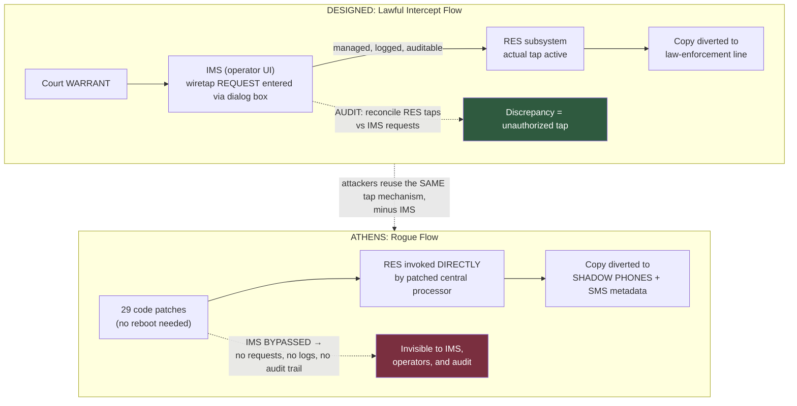

### Page 5 — GSM's Core Gap; Patch Mechanics; the 29 Patches; Hiding

* **Why attack the core switches (the COMSEC lesson):** *"Modern GSM systems secure the **wireless links** with a sophisticated encryption mechanism. A call to another cellphone will be **re-encrypted between the remote cellphone and its closest base station**, but it is **not protected while it transits the provider's core network**. For this reason — and for the **ease of monitoring calls from the comfort of their lair** — the perpetrators attacked the **core switches**. Encrypting communications from the start of the chain to its end — **as banks, for example, do** — makes it very difficult to implement legal wiretaps."*
    > **🔑 Cross-link:** this is precisely the **COMSEC (end-to-end) vs TRANSEC (link) distinction** from the Security Mechanisms notes — GSM's air-interface is **link encryption**; the core is plaintext. The final sentence anticipates the modern **E2EE vs lawful-access debate** (Signal/WhatsApp vs interception mandates).
* **AXE patching rules:** code structured around **independent blocks / program modules** in the central processor's memory — the 2004 release: **~1760 blocks** — each containing a small **"correction area"** used for patches.
  * **Patch mechanics (worked example):** to make the computer do new function **Z** where it did **Y**: the original instruction *"**If X, then do Y**"* becomes, in effect, *"**If X, then go to the correction area location L**"* → the software jumps to **L** and executes **Z** — *"a software patch works by **replacing an instruction** at the code to be fixed with an instruction that **diverts the program** to a memory location in the correction area containing the new code."*
* **The attack:** *"The challenge was to use the **RES's capabilities to duplicate and divert the bits of a call stream WITHOUT using the dialog-box interface to the IMS** — which would create **auditable logs** of their activities. The intruders pulled this off by **installing a series of patches to 29 separate blocks of code**"* (per Ericsson officials testifying before the parliamentary committee). *"This rogue software modified the central processor's software to **directly initiate a wiretap, using the RES's capabilities**. Best of all, for them, the taps were **not visible to the operators, because the IMS and its user interface weren't used**."*
* **Hiding the data:** the full software would have recorded tapped numbers in an **official registry within the exchange** (auditable against IMS warrants). *"But the rogue software **bypassed the IMS**. Instead, it **cleverly stored the bugged numbers in TWO data areas that were part of the rogue software's own memory space** — within the switch's memory but **isolated and not made known to the rest of the switch**."* **[Callout: THE ROGUE SOFTWARE STORED BUGGED PHONE NUMBERS IN ITS OWN MEMORY SPACE.]**
* **Hiding the processes:** technicians could have taken a **listing of all blocks** — showing all active processes (*"similar to the task manager output in Windows or the **ps** output in Unix"*) — and would have seen *"processes active that shouldn't have been. But the rogue software apparently **modified the commands that list the active blocks** in a way that **omitted certain blocks — the ones related to intercepts** — from any such listing."*
* **Hiding from checksums:** the rogue software might have been caught during an upgrade/patch — *"standard practice… to **verify the existing block contents** before performing an upgrade or patch. We don't know why it was not detected in this way, but we **suspect the software also modified the operation of the command used to print the checksums** — codes that create a kind of **signature against which the integrity of the existing blocks can be validated**. One way or another, **the blocks appeared unaltered to the operators**."*

> **⚠️ Warning (CIA-triad synthesis):** the attackers attacked **integrity** (patch code), then **integrity of the integrity check** (checksum command), then **detection itself** (process-list commands). This is why later notes recommend **tamper-evident, externally-verifiable logging** — "we have to be sure that any rogue software cannot modify the information stored in the logs" (p. 8).

### Page 6 — The Rootkit & The Forensic Discovery

* **The back door:** *"the software included a **back door to allow the perpetrators to control it in the future**… A report by the **Hellenic Authority for the Information and Communication Security and Privacy (ADAE)** indicates that the rogue software **modified the exchange's command parser** — the routine accepting commands from a system-administrator-status person — so that **innocuous commands followed by SIX SPACES** would **deactivate the exchange's transaction log and the alarm associated with its deactivation**, and allow execution of commands associated with the **lawful interception subsystem**. In effect, a signal to allow wiretap operations **but leave no trace**. It also **added a new user name and password** to the system."*
* **Rootkit defined (verbatim):** *"Software that not only **alters operating system code** but also **hides its tracks** is called a 'rootkit.'"* Known publicly via the **Sony BMG rootkit (2005)** on music CDs — *"restricted copying of CDs; burrowed into the Windows operating system and hid its existence from the owner"* (abandoned after public outcry). Rootkits also exist for Linux, Windows, Solaris — *"but to our knowledge **this is the first time a rootkit has been observed on a special-purpose system, in this case an Ericsson telephone switch**."*
    > **🔑 Cross-link:** rootkits were previously met as botnet-hardening tools (SANS DoS notes) — *"attackers update the hosts and tighten its security so another attacker does not use the same host."* Athens scales that idea to national telecom infrastructure. *(Enrichment: the Sony rootkit was the XCP DRM software, discovered by Mark Russinovich, on ~20 million CDs.)*
* **The discovery:** *"With all of this sophisticated subterfuge, how was the rogue software finally discovered? On **24 January 2005, the perpetrators UPDATED their planted software. That upgrade interfered with the forwarding of text messages** → undelivered → an **automated failure report**."* At this point *"the hackers' abilities to keep their modifications secret **met their limits** — as it's almost impossible to **hide secrets in somebody else's system**."*
* **Logging doctrine:** *"The AXE, like most large software systems, **logs all manner of network activity**… any events they can't account for as ordinary usage can be investigated. **It's impossible to overstate the importance of logging.**"* Example — the 1986 **Cuckoo's Egg**: *"the wily network administrator, **Clifford Stoll**, was asked to investigate a **75 U.S. cents accounting error**. Stoll spent **10 months** looking for the hacker, who had penetrated deep into the networks of **Lawrence Livermore National Laboratory**, a U.S. nuclear weapons lab. Much of that time he spent **poring over thousands of log report pages**."* *(Enrichment: Stoll's own account places him at the Lawrence Berkeley National Laboratory; the hacker traversed many military/university networks. His book is *The Cuckoo's Egg*, 1989.)*
* **Dumps as forensic gold:** the AXE reports **anomalous activity on its own** (error/failure reports); *"at regular intervals the switching center generates a **snapshot of itself — a copy, or dump, of all its programs and data**."* Dumps are for recovery/diagnostics *"but they can be used in **security investigations**."* So *"when Ericsson's investigators were called in, **the first thing they did was look closely at the periodic dumps**. They found **two areas containing all the phone numbers being monitored** and retrieved a list."*
* **Reverse-engineering:** the rogue programs existed as **executable code** (binary); AXE source is written in the **PLEX language**. *"The investigators **painstakingly reconstructed an approximation of the original PLEX source files**… equivalent of about **6500 lines of code — a surprisingly substantial piece of software**."* They *"ran the modules in **simulated environments**"* → discovered *"the data areas holding the tapped numbers and the **time stamps of recent intercepts**."* With that, earlier dumps yielded *"the **time interval** during which the wiretaps were in effect, the **full list of intercepted numbers and call data** — who called whom, when, and for how long. (**The actual conversations were not stored in the logs.**)"*

### Page 7 — Inside Job?, Destroyed Evidence & The Lessons Begin

* **The taps themselves were straightforward:** when the PM initiated/received a call, *"the exchange would establish the **same kind of connection used in a lawful wiretap** — a connection to a **shadow number** allowing it to listen in."*
* **The expertise question:** staying undetected required *"a lot of expertise in writing AXE code — an **esoteric competency** that isn't readily available in most places. But… for the **past 15 years**, a considerable part of Ericsson's AXE software development has been done **under contract by a Greek company based in Athens, Intracom Telecom** (part of Intracom Holdings). The necessary **know-how was available locally**, spread over a large number of present and past Intracom developers. **So could this have been an inside job?**"*
* *"The early stages would have been much easier with assistance from **someone inside Vodafone**, but **no conclusive evidence** supports that. The infiltration **could have been carried out remotely** — indeed, per a state report, in the failed-text-message case *"the last person to access the exchange had been issued a **visitor's badge**."* Whether Tsalikidis was involved: *"many observers found the **timing of his death highly suggestive**, but **no connection has been uncovered**."* [Sidebar: "An Inside Job?" summarizes the leading speculation — *"we can neither endorse nor refute the theories."]*
* **The evidence trail — destroyed (why we'll never know):**
  * *"In **July 2005**, while the investigation was taking place, Vodafone **upgraded two of the three servers used for accessing the exchange management system**. This upgrade **wiped out the access logs** and, **contrary to company policy, no backups were retained**."*
  * *"A **six-month retention period for visitor sign-in books** lapsed, and Vodafone **destroyed the books** corresponding to the period where the rogue software was modified (triggering the text-message errors)."*
  * *"Traces might have been on the exchange's **transaction logs** — however, due to a **paucity of storage space**, the logs were retained for **only FIVE DAYS**, because Vodafone considers **billing data, which competes for the same space, a lot more important**."*
  * *"**Most crucially**, Vodafone's **deactivation of the rogue software on 7 March 2005 almost certainly alerted the conspirators**, giving them a chance to **switch off the shadow phones**. As a result, investigators **missed the opportunity of triangulating the location of the shadow phones and catching the perpetrators in the act**."*
* **"So what can this affair teach us about how to protect phone networks?"** *"Vodafone had to balance the need for **continued operation** against **discovery and prosecution**. Unfortunately, the responses of Vodafone **and** Greek law enforcement were **both inadequate**. Through Vodafone's actions, **critical data were lost or destroyed**, while the perpetrators not only received **a warning** but had **sufficient time to disappear**."*
* **Best practices (telecom industry):** *"operator policies must include **procedures for responding to an infiltration**, such as a virus attack: **retain all data, isolate the part of the system that's been broken into as much as possible, coordinate activities with law enforcement**."* — *"Greek federal telecom regulations also specify that operators have **security policies detailing measures to ensure the confidentiality of customer communications and the privacy of network users**. However, Vodafone's response indicates that such policies, **if they existed, were ignored**. If not for press conferences and public investigations, law enforcement could have **watched the behavior of the shadow cellphones surreptitiously**."*

> **🔑 Cross-link:** the three best-practice steps are verbatim the **Incident Response lifecycle** from the threat-management notes (Detection → **Containment** & Eradication → Recovery & Lessons): *"retain all data"* = evidence preservation (post-mortems depend on it — cf. AIIMS forensics), *"isolate"* = containment, *"coordinate with law enforcement"* = communication protocols. Vodafone executed the **eradication** step while skipping **containment** — the exact inversion of good IR.

### Page 8 — Institutional Failures & The Defence Roadmap

* **[Callout: PHYSICAL LOGBOOKS OF VISITORS WERE LOST AND DATA LOGS WERE DESTROYED.]**
* *"Neither law enforcement authorities nor the **ADAE**, the independent security and privacy authority, was **contacted directly**. Instead, Vodafone Greece communicated through a **political channel — the prime minister's office**. (The ADAE was fairly new — **formed 2003**.)"*
* **Law enforcement failures:** *"Police **could have secured evidence by impounding** all of Vodafone's telecommunications and computer equipment. Instead… concerns about **disruption to the operation of the mobile network** led to a more light-handed approach — essentially **interviewing employees and collecting information provided by Vodafone** — which ultimately led to the **loss of forensic evidence**. They eventually started **leveling accusations at both the operator (Vodafone) and the vendor (Ericsson), turning the victims into defendants** and losing their goodwill, further hampering the investigation."*
* *"In countries where such high-tech crimes are rare, it is unreasonable to expect a crack team of investigators. Could a **rapid deployment force** be set up? We'd like to see **Interpol create a cyberforensics response team** that countries could call on."*
* **The technical-defence roadmap:**
  * *"Telephone exchanges have **evolved into software-based systems** — analyzing them for vulnerabilities has become very difficult. New features (conferencing, number portability, caller ID) were loaded on; **the old software remains in place. Complex interactions between subsystems and baroque coding styles (remnants of programs written 20–30 years ago) confound developers and auditors alike**."* — *"Yet an effective defense against viruses, worms, and rootkits **depends crucially on in-depth analysis that can penetrate source code in all its baroque heterogeneity**."*
  * **Analytics as a security tool:** *"a **statistical analysis of the call logs might have revealed a correlation between the calls to the shadow numbers and calls to the monitored numbers**. Telephone companies already carry out extensive analysis to spot customer trends — but from the security perspective, this analysis is done for the **wrong reasons and by the wrong people — marketing as opposed to security**. By **training security personnel to use these tools** and allowing them access to these data, customer trend analysis can become an **effective countermeasure against rogue software**."*
  * *"Additional clues could be uncovered by **merging call records generated by the exchange with billing and accounting information** — though this involves **consolidating distinct data sets currently owned by different entities** within the telecom organization."*
  * *"Another defense is **regular auditing** of the type that allowed Ericsson to discover the rogue software by **scrutinizing the off-line dumps**. However… **we have to be sure that any rogue software cannot modify the information stored in the logs or the dumps** — such as by using a **separate monitoring computer running its own software**."*
  * *"Digital systems generate **enormous volumes of information**. Ericsson and Vodafone Greece **had at their fingertips all the information they needed** to discover the penetration **long before an undelivered text message** sent them looking… If one company's technicians and one country's police force cannot meet this challenge, **a response team that can needs to be created**."*
  * *"It is particularly important **not to turn the investigation into a witch hunt**… it is often politically expedient to use the telecom operator as a **convenient scapegoat**. This only encourages operators to **brush incidents under the carpet** and turns them into adversaries of law enforcement…"* → *"Rather than looking for someone to blame (and punish), it is **far better to determine exactly what went wrong and how it can be fixed** — not only for that operator, but **for the industry as a whole**."*

> **🔑 Cross-link:** the **"separate monitoring computer"** prescription is the industrial answer to the problem the attackers exploited (modifying logs/checksums from inside) — the principle later formalized in security engineering as **trust boundaries for audit data** (out-of-band logging, write-once stores — cf. WORM backups from the Data Protection notes). The "witch hunt" warning anticipates modern **blameless post-mortem** culture.

### Page 9 — Proactive Safety, Authors & Further Reading

* *"Merely saying — or even **legislating** — that system vendors and network operators should not allow something like this to occur is **pointless**, because there is little that can be done to these companies after the fact. Instead, **proactive measures** should be taken to ensure such systems are **developed and operated safely**. Perhaps we can borrow pages from **aviation safety**, where both **aircraft manufacturers and airline companies are closely monitored by national and international agencies** to ensure the safety of passengers."*
* **About the authors:** **Vassilis Prevelakis** — IEEE member, assistant professor of computer science, **Drexel University** (Philadelphia); research on automation network security and secure software design; active in standards bodies such as the **IETF**. **Diomidis Spinellis** — IEEE member, associate professor of management science and technology, **Athens University of Economics and Business**; author of *Code Quality: The Open Source Perspective* (Addison-Wesley, 2006); blogs at spinellis.gr.
* **To Probe Further:** the Wikipedia article *"Greek telephone tapping case 2004–2005"* (additional press links and background); **Ericsson's Interception Management System user manual** (marked confidential) available via Google search / cryptome.org.

---

## PART B — CIA Triad & Estonia's Cyber Strategy (Pages 1–6, Doc 2)

### Pages 1–2 — The Three (+1) Security Goals (recap above, §1.2) & Cybercrime Policy

* **Context claims:** *"most people who have gone beyond the mistaken assumption that **anti-virus equals the totality of information security** will have found the market full of niche products offering solutions to specific threats."* SMEs and home users find such tools *"too expensive and complicated"* → *"a very high percentage of computer users remains seriously exposed."* But *"it is amazing what gains in security can be achieved **virtually free of charge by simply tightening up on the way we manage our computer systems**."*
* *"Enhancing the fight against cybercrime: the **economic damage** deriving from cybercrime **reduces trust in digital services** and, in a worst-case scenario, could **lead to loss of life**. Greater **awareness among the general public** about cyber security risks helps to prevent cybercrimes — achieved by addressing cyber-related topics **at all levels of education** and informing people based on **research and analysis of secure behaviours**."*
* **2.1 Enhancing detection of cybercrime:** improve efficiency of detection **and prosecution** — *"the current structure of law enforcement and its organisation of work will be further clarified, the **number of personnel dealing with cybercrime will be increased**, and the **capabilities of bodies conducting proceedings to process digital data carriers will be raised**."* *(continues)* → *"cooperation takes place with **universities and international centres of excellence**."*

### Page 3 — Awareness, International Cooperation & National Cyber Defence

* **2.2 Raising public awareness of cyber risks:** introduce **actions preventing cyber threats**; provide *"the knowledge needed to **identify as well as wisely respond to incidents**."* *"Users of e-services are directed to use the **most secure solutions** and are informed about **new technologies and how to securely use them**."*
* **2.3 Promoting international cooperation against cybercrime:** *"more effective and timely prosecution of cybercrimes with an **international dimension**; **information exchange between countries is improved**; **active participation** in initiatives and projects that are part of the international fight against cybercrime."*
* **Subgoal 3 — Development of national cyber defence capabilities:** *"civil, military, and international cooperation based on the resources at the disposal of the state must also **function adequately in cyberspace** — with regards to **warning, deterrence and active defence**."*
  * **3.1 Synchronising military planning and preparation for civil emergencies** — *"broad-based national defence requires that the **continuous operation plans of vital service providers are coordinated with national defence threat scenarios**."*
  * **3.2 Developing collective cyber defence and international collaboration** — *"information exchange and cooperation enhanced with **NATO, European Union cyber instances and other partners**; efforts concerning the creation and development of **NATO joint cyber security capabilities, standards, training** and training opportunities."*
  * **3.3 Developing military cyber defence capabilities** — cyber defence as part of *"broad-based collective defence, ensured by involving specialists from the **Defence Forces and the Estonian Defence League**, as well as other public and private sector professionals."*

> **🔑 Cross-link (enrichment):** this is Estonia's **Cyber Security Strategy (2008)** — drafted directly in response to the **April–May 2007 DDoS attacks against Estonia** (banks, media, government sites — botnet-driven, politically triggered), the events that made *"cyberwar"* a household term. The strategy's creation led to **NATO's Cooperative Cyber Defence Centre of Excellence (CCDCOE) in Tallinn (2008)** and the *Tallinn Manual* project. The strategy is thus the *policy* twin of the **DoS attacks** studied in the SANS notes — and the **international-cooperation** recommendation mirrors the Athens authors' **Interpol cyberforensics team** proposal (p. 8).

### Page 4 — National Defence Awareness & Subgoal 4 (Managing Evolving Threats)

* **3.4 Ensuring a high level of awareness concerning the role of cyber security in national defence:** raise awareness of cyber risks in national defence, *"link it with other military domains"*; **additional training organised for personnel in the field**.
* **Subgoal 4 — Estonia manages evolving cyber security threats:** *"maintain and improve cyber security capability by adopting **independent cyber security solutions** backed by training, **research and development and entrepreneurship**. To ensure sustainability, the state acts as a **smart contractor**, and supports the **export of cyber security solutions**."*
  * **4.1 Ensuring the next generation of cyber security professionals** — *"opportunities for additional education: **higher education as well as in-service training**; support to raise the number of students completing a **Master's Degree in cyber security** and increase **doctoral theses**; instruction involving more **foreign lecturers and professionals**."*
  * **4.2 Developing smart contracting for cyber security solutions** — the state contributes to **cyber security-related R&D**; *"a **supervisory board** shall be set up to coordinate the corresponding activities and to **consolidate the domains of national defence, security, economic development and academia**."*
  * **4.3 Supporting development of enterprises providing cyber security and national cyber security solutions** — *"the state will contribute to the **export** of cyber security solutions and to **increasing their use at the international level**."*
  * **4.4 Preventing security risks in new solutions** — *"to avoid **large-scale cyber incidents**, the **technological risks pertaining to the development and introduction of new technologies are investigated and assessed in depth**. A high level of knowledge…"*

### Page 5 — Integrity Models & Availability Models (introduced)

* *(…continuation: "and **risk-awareness** facilitate achieving advantages in developing the state, society and economy.")* *(The page then jumps to textbook material.)*
* **Integrity Models:** *"keep data **pure and trustworthy** by protecting system data from **intentional or accidental changes**. Integrity models have **three goals**:"*
    1. **Prevent unauthorized users** from making modifications to data or programs.
    2. **Prevent authorized users** from making **improper or unauthorized** modifications.
    3. **Maintain internal and external consistency** of data and programs.
  * *"An example of integrity checks is **balancing a batch of transactions** to make sure that all the information is present and accurately accounted for."*
* **Availability Models:** *"keep data and resources **available for authorized use**, especially **during emergencies or disasters**. Information security professionals usually address **three common challenges** to availability:"* *(list continues)*

> **💡 Enrichment:** the three integrity goals echo the classical **Biba integrity model** logic (keep untrusted writing out; keep trusted processes behaving) — and goal 2 (*authorized but improper* changes) is exactly the **insider-threat** class (19% of breaches per the Verizon DBIR noted earlier). The **transaction-balancing** example is the accountant's **reconciliation control** — the same *audit* idea as Ericsson's RES-vs-IMS reconciliation in Athens.

### Page 6 — The Three Availability Challenges & Preservation Activities

* **The three challenges to availability:**
    1. **Denial of Service (DoS)** — *"due to intentional attacks or because of **undiscovered flaws in implementation** (for example, a program written by a programmer who is unaware of a flaw that could **crash the program if a certain unexpected input is encountered**)."*
    2. **Loss of information system capabilities** because of **natural disasters** (fires, floods, storms, earthquakes) **or human actions** (bombs or strikes).
    3. **Equipment failures during normal use.**
* **Activities that preserve confidentiality, integrity, and/or availability (five listed):**
    1. **Granting access only to authorized personnel.**
    2. **Applying encryption** to information sent over the Internet **or stored on digital media**.
    3. **Periodically testing computer system security** to uncover new vulnerabilities.
    4. **Building software defensively.**
    5. **Developing a disaster recovery plan** *"to ensure that the business can continue to exist in the event of a disaster or loss of access by personnel."*

> **🔑 Cross-link:** challenge 1 = the entire **DoS corpus** (SANS paper, botnets, WebGoat pool exhaustion) — note it includes *unintentional* DoS from implementation flaws, matching the WebGoat lesson ("expect worst-case scenarios"). Challenge 2 = the **physical security** dimension (COMSEC Element 3; the Security Mechanisms' UPS/fire/rack requirements). The five preservation activities map cleanly: (1) → access control/NAC; (2) → encryption at rest & in transit (Hybrid encryption notes); (3) → **security assessment** (auditing's extension); (4) → **secure SDLC**; (5) → **3-2-1 backups / DR** (AIIMS lesson).

---

## 3. Comparative Summary & Matrix

### 3.1 The Athens Affair — Complete Timeline & Fact Table

| Date | Event |
| :--- | :--- |
| **Early 2003** | Vodafone upgrades switches to **AXE release R9.1** — **RES included**, **IMS never purchased** |
| **Pre-Aug 2004** | Bugging begins (run-up to **Athens Olympics**) |
| **24 Jan 2005** | **SMS forwarding failures** (perpetrators' own software update) → error messages |
| **4 Mar 2005** | **Ericsson alerts Vodafone** — unauthorized software in **two central offices** |
| **7 Mar 2005** | Technicians **isolate rogue code** — *"almost certainly alerted the conspirators"* |
| **8 Mar 2005** | CEO **Koronias orders removal** — *"the company had to react immediately"* |
| **9 Mar 2005** | **Tsalikidis found hanged** (apparent suicide; to be married in 3 months) |
| **10 Mar 2005** | Koronias briefs **Angelou & Voulgarakis**; list of **~100 bugged numbers** handed over |
| **Weeks later** | **Five investigations**; three questions (who? death related? how?) |
| **July 2005** | Vodafone upgrades **2 of 3 management servers** → **access logs wiped**, no backups |
| **Later** | **6-month visitor sign-in books** destroyed (covering the modification period) |
| **Dec 2006** | Vodafone **fined 76 million** |
| **6 Apr 2006** | **Bill Zikou (Ericsson Hellas CEO)** testifies before the parliamentary committee |
| **29 Jun 2007** | IEEE Spectrum article published (Prevelakis & Spinellis) |

### 3.2 The Hack — Attack Chain vs Defenses (Athens mapped to CIA)

| Phase | What the intruders did | CIA goal attacked | The designed control they evaded | Post-Affair defense |
| :--- | :--- | :--- | :--- | :--- |
| 1. Recon/enabler | Exploited **RES present, IMS absent** (R9.1 upgrade, no purchase) | — | License/purchase separation | Inventory what intercept capability exists |
| 2. Implant | **29 patches** to AXE blocks via **no-reboot live patching** | **Integrity** (code) | Change-management / patch review | In-depth **source-code analysis** |
| 3. Tap | Direct **RES** invocation; duplicate voice stream → **shadow phones** + SMS metadata | **Confidentiality** (~100 officials) | IMS dialog-box workflow | Regular **RES↔IMS reconciliation audits** |
| 4. Hide data | Bugged numbers in **rogue software's own isolated memory areas** | **Integrity** (records) | Official tap registry | Out-of-band dumps; **separate monitoring computer** |
| 5. Hide processes | **Modified block-listing commands** (ps/task-manager equivalent) | **Integrity** (detection) | Active-process listings | Statistical **call-log correlation** (shadow↔monitored) |
| 6. Hide changes | **Checksum command modified** → blocks "appeared unaltered" | **Integrity** (of integrity checks) | Pre-upgrade block verification | Tamper-evident, externally-held checksums |
| 7. Persistence | **Rootkit**: command-parser trigger (**6 spaces**), log/alarm deactivation, **new username+password** | Integrity + Accountability | Transaction logs & alarms | Out-of-band logging; rootkit scanning |
| 8. Endgame | Perpetrators **alerted by removal (7–8 Mar)** → switched off shadow phones | — | Stealth surveillance | **Isolate, don't remove**; coordinate with LE; retain data |

### 3.3 Incident-Response Scorecard — Athens vs Best Practice

| Best practice (per article) | What happened |
| :--- | :--- |
| **Retain all data** | ❌ Access logs wiped (July 2005 upgrade); visitor books destroyed; **transaction logs kept only 5 days** (billing data won the storage contest) |
| **Isolate the compromised portion** | ❌ Rogue code **removed** (7–8 Mar) rather than left running under stealth watch |
| **Coordinate with law enforcement** | ❌ Contacted via **political channel** (PM's office), not LE or ADAE directly |
| **Forensic evidence preservation** | ❌ Police chose a light-handed approach; **victims turned into defendants** |
| **Surreptitious monitoring of perpetrators** | ❌ Missed **triangulation of shadow phones** |
| **Blameless improvement** | ⚠ Accusations flew; article warns against **scapegoating the operator** |

### 3.4 Athens vs the Course's Other Case Studies

| Case | Vector | Rootkit/persistence? | Evidence handling | Outcome |
| :--- | :--- | :--- | :--- | :--- |
| **Athens (2004–05)** | Abuse of **lawful-intercept subsystem** on AXE switches | **Yes — first rootkit on a switch** | Logs 5 days; visitor books destroyed; servers wiped | **Unsolved**; €76M fine; ~100 phones tapped |
| **SolarWinds (2020)** | Supply-chain (build pipeline, signed updates) | Dormant backdoor (SUNBURST) | SIEM blind to outbound anomalies | ~18,000 orgs; SLSA/SBOM reforms |
| **Cosmos Bank (2018)** | SWIFT + ATM switch proxy + cloned cards | Malware on payment rails | RBI/CERT-In forensics | ₹94.42 crore; segmentation mandates |
| **AIIMS Delhi (2022)** | Ransomware on flat network | Ransomware staging undetected | NIC/CERT-In restoration (~15 days) | Segmentation, 3-2-1 backups, EDR |
| **Cuckoo's Egg (1986)** | 75-cent accounting error → manual log analysis | No | **Thousands of log pages, 10 months** | Hacker identified (KGB selling Star Wars secrets) |
| **Estonia (2007)** | Politically-triggered **DDoS** (botnets) | Botnet zombies | — | **National Cyber Strategy (2008); NATO CCDCOE** |

### 3.5 The Four Goals — Definitions, Owners, and Athens Mapping

| Goal | Per CIA doc | Technical vs business | Athens manifestation |
| :--- | :--- | :--- | :--- |
| **Confidentiality** | Control access to files in **storage or transit** | Config = technical; **who-gets-what = business** | PM's calls diverted; GSM core unencrypted |
| **Integrity** | Version control + **audit trail** + fallback | Audit record: **who + what + when** | 29 patches; checksum & listing commands altered |
| **Availability** | *"Cinderella"* — needs **backups, bandwidth, standby** | Planning afterthought | SMS outages revealed the hack; continuity vs forensics trade-off |
| **Non-repudiation** | Cannot deny actions; **business objective first** | Management before technical | RES–IMS audit bypassed; logs/alarm suppressed by rootkit |

### 3.6 Integrity & Availability Models (Doc 2, pp. 5–6)

| Integrity Model goals | Availability Model challenges |
| :--- | :--- |
| Prevent **unauthorized** modification | **DoS** — attacks *or undiscovered implementation flaws* (crash on unexpected input) |
| Prevent **authorized but improper** modification | **Natural disasters / human actions** (fire, flood, storm, earthquake; bombs, strikes) |
| Maintain **internal & external consistency** | **Equipment failures during normal use** |
| *Check example: balancing a transaction batch* | *Preservers: authorized-only access · encryption (transit & storage) · periodic security testing · defensive software building · disaster recovery plans* |

### 3.7 Estonia's Strategy Structure (Doc 2, pp. 2–4)

| Subgoal | Items | Essence |
| :--- | :--- | :--- |
| **Fight cybercrime** | 2.1 Detection (clearer LE structure, more personnel, digital-evidence capability, university/centre cooperation) · 2.2 Public awareness (prevention actions, incident-response knowledge, secure-solution guidance) · 2.3 International cooperation (info exchange, participation in initiatives) | **Prosecution + people** |
| **3 — National cyber defence** | 3.1 Military-civil emergency synchronisation (vital-service plans ↔ defence threat scenarios) · 3.2 Collective defence with **NATO/EU** (capabilities, standards, training) · 3.3 Military cyber defence (Defence Forces + **Estonian Defence League**) · 3.4 Defence-awareness training | **Warning, deterrence, active defence** |
| **4 — Manage evolving threats** | 4.1 Next-gen professionals (Master's, PhDs, foreign lecturers) · 4.2 Smart contracting (state R&D, supervisory board consolidating defence/security/economy/academia) · 4.3 Enterprise/export support · 4.4 **Risk-assess new technologies in depth** | **Independence + sustainability** |

---

## 4. Key Terminology & Cheat Sheet

### 4.1 Glossary

| Term | Definition |
| :--- | :--- |
| **ADAE** | Hellenic Authority for Information and Communication Security and Privacy (formed **2003**); never contacted directly by Vodafone |
| **AXE** | Ericsson's switch line used by Vodafone Greece for both MSCs and BSCs; ~**1760 code blocks** in the 2004 release |
| **Base Station Controller (BSC)** | Allocates radio channels; coordinates handovers between transceivers |
| **Cifar of trust — RES↔IMS audit** *(descriptive)* | Only IMS-initiated wiretaps should be active in the RES; discrepancy = unauthorized tap |
| **Command-parser trigger** | Rootkit mechanism: innocuous commands + **six spaces** deactivated the transaction log & alarm and enabled lawful-intercept commands |
| **Correction area** | Small region in each AXE code block where patch code is placed (jump-target redirection) |
| **Cuckoo's Egg** | 1986 intrusion case: **Clifford Stoll**, 75-cent error, 10 months of log analysis, KGB-linked hacker (Star Wars secrets) |
| **Dump (system snapshot)** | Periodic copy of all switch programs & data — recovery aid **and forensic goldmine** (where the tapped-number areas were found) |
| **Ericsson AXE R9.1** | The 2003 software release that delivered **RES** to Vodafone without **IMS** |
| **IMS (Interception Management System)** | Optional Ericsson operator interface for lawful intercepts (dialog box → wiretap *requests*); **not installed** at Vodafone |
| **MSC (Mobile Switching Center)** | Heart of the network; **hosted the rogue software**; only a few needed for the attack |
| **PLE****X** | Ericsson's proprietary switch programming language; investigators reconstructed ~**6500 lines** of it |
| **Rootkit** | Software that **alters OS code AND hides its tracks**; first observed on a special-purpose system (a telephone switch) |
| **RES (Remote-control Equipment Subsystem)** | AXE subsystem that performs the tap: copies the conversation into a **second data stream** diverted to LE lines |
| **Shadow number / shadow handset** | The tap's destination phone — receives the duplicated voice stream + SMS location updates |
| **Smart contractor (Estonia)** | State role ensuring sustainability of cyber solutions via procurement + export support |
| **Tsalikidis, Costas** | Vodafone network-planning engineer; found hanged 9 Mar 2005; involvement never established |
| **Visitor's badge** | The last person to access the exchange at the failed-SMS timestamp had been issued one (remote/insider ambiguity) |

### 4.2 Numbers Cheat Sheet

| Item | Value |
| :--- | :--- |
| Bugged phones | **~100** (incl. PM **and his wife**, mayor, EU commissioner, US-embassy employee, journalists, activists) |
| Compromised switches | **4** of Vodafone Greece's switches |
| Code patches installed | **29 separate AXE blocks** |
| AXE code blocks (2004 release) | **~1760** |
| Reconstructed rogue software | **~6500 lines of PLEX code** |
| Detection delay | Began pre-**Aug 2004** Olympics → undetected until **24 Jan 2005** (~5 months) |
| Alert-to-removal | Ericsson alert **4 Mar** → isolated **7 Mar** → removal ordered **8 Mar** → Tsalikidis **9 Mar** |
| Exchange transaction-log retention | **5 days** (billing data prioritized) |
| Visitor sign-in books retention | **6 months** (then destroyed) |
| Management servers | **3** — 2 upgraded **July 2005**, wiping access logs, **no backups** |
| Parser trigger | Innocuous command + **6 spaces** |
| Fine | **76 million** (Dec 2006) |
| Investigations launched | **5**; guiding questions **3** |
| Intracom contract history | **15 years** of Ericsson AXE development outsourced locally |
| *CIA doc:* goals | **3 + 1** (C, I, A, Non-repudiation — "management issue before technical") |
| *CIA doc:* Integrity model goals | **3**; Availability challenges **3**; preservation activities **5** |
| *CIA doc:* Estonia items | Subgoals 2.1–2.3, 3.1–3.4, 4.1–4.4 (**10 named measures**) |
| *Enrichment:* GSM air-interface crypto | Link-only (A5 family) — **core network plaintext** |
| *Enrichment:* Sony rootkit | 2005, ~20M CDs, XCP DRM; abandoned after outcry |
| *Enrichment:* Stoll | Lawrence **Berkeley** Lab per his account; article cites Livermore |

### 4.3 One-Line Recall Strings

* **Athens:** *"RES without IMS is a tap without a warrant — 29 patches, a 6-space rootkit, checksums that lied, numbers hidden in private memory; found only because a broken SMS update tripped a 5-day-old log; 'retain, isolate, coordinate' came too late."*
* **CIA doc:** *"Three goals plus non-repudiation — a business problem before a technical one; integrity = who+what+when with a fallback; availability = the Cinderella needing backups, bandwidth, standby; Estonia's answer to the 2007 DDoS war: detect, educate, cooperate, defend, and grow professionals."*

---


# Threat Modeling & The Modern Cybersecurity Landscape — Comprehensive Cybersecurity Notes

> **Scope note:** Two PDFs are combined here. **PDF-A** (`bc91f087-0610-4890-8156-8d0db3d83d7a.pdf`) is **"An Introduction to Threat Modeling"** (3 pages — a personal/adversary-centric threat-modeling guide; enrichment attribution: the EFF *Surveillance Self-Defense* project). **PDF-B** (`2b07c36b-e362-4478-a06a-d51380a1dd7c.pdf`) is **"The Modern Cybersecurity Landscape"** (19 pages — goals, CIA triad, threat actors/vectors, threat modeling frameworks, risk matrix, attack trends, threat intelligence, homeland security, five case studies, governance, references). Every section below is **tagged with its source PDF** so you can trace content, and a master source map is provided up front.

---

## 0. 📂 Source File Map *(which part came from which PDF)*

| Label | File Name | Title | Pages | Content Covered |
| :--- | :--- | :--- | :--- | :--- |
| **PDF-A** | `bc91f087-0610-4890-8156-8d0db3d83d7a.pdf` | **An Introduction to Threat Modeling** | 3 (pp. 1–3) | Five assessment questions; assets; adversaries; threats; capability; risk; threat-vs-risk distinction; house worked example |
| **PDF-B** | `2b07c36b-e362-4478-a06a-d51380a1dd7c.pdf` | **The Modern Cybersecurity Landscape** | 19 (pp. 1–19) | Landscape & risk drivers; security goals; CIA triad; extended objectives; actors & vectors; threat modeling methodology & frameworks; security analysis; risk matrix; attack trends; emerging threats; threat intelligence; homeland security; case studies (Colonial, SolarWinds, WannaCry/AIIMS, Stuxnet); governance; references |

**Inline tags used throughout:** `[PDF-A p.1]`, `[PDF-B p.14]`, etc. Sections marked *🔗 Cross-link* connect to earlier notes in this course series; *💡 Enrichment* adds verified external context.

---

## 1. Executive Overview & Core Concepts

### 1.1 How the Two PDFs Fit Together

**PDF-A** teaches threat modeling **from the defender's personal perspective** — a five-question self-assessment that turns vague fear ("am I safe online?") into concrete analysis of *assets, adversaries, threats, capability, and risk*. **PDF-B** presents threat modeling **from the enterprise/national perspective** — the same discipline embedded in frameworks (STRIDE, PASTA, DREAD, Attack Trees, MITRE ATT&CK), risk matrices, intelligence lifecycles, and governance, validated by five landmark case studies. PDF-A is the *mindset*; PDF-B is the *apparatus*.

> **🔑 Key Takeaway:** Both PDFs converge on the same first principle: *"Digital security isn't about which tools you use; rather, it's about understanding the threats you face and how you can counter those threats"* **[PDF-A p.1]** — mirrored in PDF-B as *"threat modeling… operationalizes the principle of security-by-design"* **[PDF-B p.6]**. Tools come **last**; analysis comes first.

### 1.2 Fundamental Definitions (with source tags)

| Term | Definition | Source |
| :--- | :--- | :--- |
| **Asset** | *"Something you value and want to protect"* — in digital security, usually **information** (emails, contact lists, instant messages, files); **devices are also assets** | **[PDF-A p.1]** |
| **Adversary** | *"Any person or entity that poses a threat against an asset or assets"* — e.g., your boss, your government, a hacker on a public network | **[PDF-A p.1]** |
| **Threat** | *"Something bad that can happen to an asset"* — read private comms, delete/corrupt data, disable your own access | **[PDF-A p.2]** |
| **Capability** | What an attacker is actually **able** to do — phone provider can access all records; open-Wi-Fi hacker can read unencrypted traffic; government may have stronger capabilities | **[PDF-A p.2]** |
| **Risk** | *"The **likelihood** that a particular threat against a particular asset will actually occur"* — goes hand-in-hand with capability | **[PDF-A p.2]** |
| **Threat modeling** | *"A structured, proactive process for identifying, categorizing, and prioritizing potential threats to a system before they are exploited"* | **[PDF-B p.6]** |
| **Risk (matrix form)** | Prioritized on two dimensions: **likelihood of occurrence × potential business impact** | **[PDF-B p.9]** |

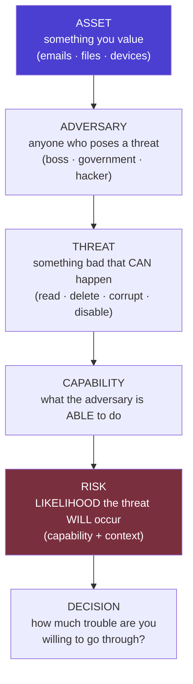

---

## 2. Page-by-Page Detailed Breakdown

## PART A — An Introduction to Threat Modeling (**PDF-A**, 3 pages)

### PDF-A · Page 1 — The Five Questions, Assets & Adversaries

* **Opening principle:** *"There is no single solution for keeping yourself safe online."* Security is about **understanding the threats you face and how you can counter them** — determine **what** you need to protect and **whom** you need to protect it from.
* **Context-dependence:** *"Threats can change depending on **where you're located, what you're doing, and whom you're working with**."* → therefore, conduct a **threat modeling assessment**.
* **The Five Main Questions:**

| # | Question | What it resolves (per PDF-A) |
| :--- | :--- | :--- |
| 1 | **What do you want to protect?** | → **Assets** |
| 2 | **Who do you want to protect it from?** | → **Adversaries** |
| 3 | **How likely is it that you will need to protect it?** | → **Risk** |
| 4 | **How bad are the consequences if you fail?** | → **Impact** |
| 5 | **How much trouble are you willing to go through to prevent those?** | → **Cost/effort trade-off** |

* **Question 1 — Assets:** *"An asset is something you value and want to protect. When we are talking about digital security, the assets in question are usually **information**"* — emails, contact lists, instant messages, files; **"Your devices are also assets."**
* **✍️ Exercise 1 (verbatim):** *"**Write down a list of data that you keep, where it's kept, who has access to it, and what stops others from accessing it.**"*
* **Question 2 — Adversaries:** understand *"who might want to target you or your information — who is your adversary."* Examples of potential adversaries: **your boss, your government, or a hacker on a public network**.

### PDF-A · Page 2 — Threats, Motives, Capability & Risk

* **✍️ Exercise 2 (verbatim):** *"**Make a list of who might want to get ahold of your data or communications. It might be an individual, a government agency, or a corporation.**"*
* **Threat definition & the three harms:** an adversary can (1) **read your private communications** as they pass through the network, (2) **delete or corrupt** your data, (3) **disable your access to your own data**. *(Enrichment: this triad maps exactly onto the CIA goals — Confidentiality, Integrity, Availability.)*
* **Motives differ widely, as do attacks:**
  * A **government trying to prevent the spread of a video showing police violence** may be content to simply **delete or reduce the availability** of that video.
  * A **political opponent** may wish to **gain access to secret content and publish it without you knowing**. *(Same asset, opposite CIA goals attacked: Availability vs Confidentiality.)*
* **✍️ Exercise 3 (verbatim):** *"**Write down what your adversary might want to do with your private data.**"*
* **Capability of your attacker (think about it):** your **mobile phone provider** has access to all of your phone records → capability to use that data against you; a **hacker on an open Wi-Fi network** can access your unencrypted communications; *"your government might have stronger capabilities."*
* **Risk:** *"the likelihood that a particular threat against a particular asset will actually occur, and **goes hand-in-hand with capability**."* Example: the phone provider **has the capability** to access all your data, but the **risk** of them posting your private data online to harm your reputation **is low**.
* **Threat vs Risk — the crucial distinction:** *"While a **threat** is a bad thing that **can** happen, **risk** is the **likelihood** that the threat **will** occur."* Example: *"there is a **threat** that your building might collapse, but the **risk** of this happening is **far greater in San Francisco** (where earthquakes are common) **than in Stockholm** (where they are not)."*
* **Risk analysis is personal and subjective** — *"not everyone has the same priorities or views threats in the same way."* *(continues)*

### PDF-A · Page 3 — Subjective Priorities & the House Example

* **Subjectivity (continued):** *"Many people find certain threats **unacceptable no matter what the risk**, because the **mere presence of the threat at any likelihood is not worth the cost**. In other cases, people **disregard high risks** because they don't view the threat as a problem."*
* **Context-dependent priorities (the CIA trade-off):**
  * *"In a **military context**, it might be preferable for an asset to be **destroyed** than for it to **fall into enemy hands**."* *(Integrity/availability preferred over confidentiality.)*
  * *"Conversely, in many **civilian contexts**, it's more important for an asset such as **email service to be available than confidential**."*
* **Now, Let's Practice Threat Modeling — the house scenario.** *"If you want to keep your house and possessions safe, here are a few questions you might ask:"*

| Question | Answer in scenario |
| :--- | :--- |
| Should I lock my door? | (control decision) |
| What kind of lock or locks should I invest in? | (control selection) |
| Do I need a more advanced security system? | (escalation decision) |
| **What are the assets?** | ① The **privacy of my home** ② The **items inside my home** |
| **What is the threat?** | **Someone could break in** |
| **What is the actual risk of someone breaking in? Is it likely?** | (risk assessment → drives investment) |

* **Decision rule (verbatim):** *"Once you have asked yourself these questions, you are in a position to **assess what measures to take**. If your possessions are **valuable, but the risk of a break-in is low**, then you probably **won't want to invest too much money in a lock**. On the other hand, if the **risk is high**, you'll want to get the **best locks on the market**, and perhaps even **add a security system**."*

```mermaid
flowchart LR
    Q1["1. What protect?<br/>→ Assets: home privacy,<br/>items inside"] --> Q2["2. From whom?<br/>→ Adversary: burglar"]
    Q2 --> Q3["3. How likely?<br/>→ Risk of break-in"]
    Q3 --> Q4["4. How bad if fail?<br/>→ Loss of privacy & property"]
    Q4 --> Q5["5. How much trouble<br/>will I go through?"]
    Q5 --> LOW["LOW risk →<br/>simple lock only"]
    Q5 --> HIGH["HIGH risk →<br/>best locks + security system"]
    style LOW fill:#2f5a3f,color:#fff
    style HIGH fill:#7a2f3f,color:#fff
```

> **💡 Enrichment:** PDF-A is the EFF **Surveillance Self-Defense** ("SSD") *Introduction to Threat Modeling* — written for journalists, activists, and ordinary users. Its five questions map onto **Adam Shostack's** canonical four (What are you building? What can go wrong? What are you doing about it? Did you do a good job?) — and Shostack's *Threat Modeling: Designing for Security* is exactly the reference cited on **PDF-B p.19**, tying the two PDFs to one literature lineage.

---

## PART B — The Modern Cybersecurity Landscape (**PDF-B**, 19 pages)

### PDF-B · Page 1 — The Modern Cybersecurity Landscape

* *"Digital transformation has fundamentally reshaped the security environment. As organizations migrate operations to **cloud platforms, adopt IoT ecosystems, and embrace remote work models**, the **attack surface expands exponentially**. **Nation-states, organized cybercrime syndicates, and insider threats** operate with increasing sophistication, targeting both private enterprises and **critical national infrastructure**."*
* **Key Drivers of Risk (3):**
    1. **Rapid digitization** of government and enterprise systems.
    2. **Proliferation of connected devices and edge computing.**
    3. **Increasing dependence on third-party software and supply chains.**
* **Strategic Implications (3):**
    1. Cybersecurity is now a **national security imperative**.
    2. **Regulatory frameworks are evolving to mandate baseline protections.**
    3. **Threat actors exploit both technical flaws and human vulnerabilities.**

### PDF-B · Page 2 — Common Security Goals

*"Grounded in foundational objectives that guide policy, architecture, and operational decisions… ensuring information systems remain **trustworthy, functional, and accountable** under adversarial conditions."* **Five goals:**

| Goal | Definition (verbatim) |
| :--- | :--- |
| **Confidentiality** | Restricting data access to **authorized entities only**; preventing unauthorized disclosure |
| **Integrity** | Data remains **accurate, consistent, and unaltered** during storage or transit |
| **Availability** | Authorized users can **reliably access systems and data when needed** |
| **Authenticity** | Verifying identity of users, systems, and data sources to **prevent impersonation** |
| **Non-Repudiation** | Actions/transactions **cannot be denied after the fact**; maintaining accountability trails |

> **🔗 Cross-link:** this is the course's five-goal canon (CIA + Authenticity + Non-repudiation) — identical to the *Security Mechanisms* deck's goals matrix and the *Athens/CIA* notes.

### PDF-B · Page 3 — The CIA Triad: Foundational Framework

* *"The CIA Triad forms the **cornerstone of information security strategy**. Each dimension addresses a distinct category of risk and collectively provides a comprehensive framework for evaluating **security controls, policy design, and incident response**."*

| Pillar | Purpose | **Controls listed** |
| :--- | :--- | :--- |
| **1. Confidentiality** — protecting sensitive information from unauthorized access | — | **Encryption · Access controls · Data classification** |
| **2. Integrity** — maintaining data accuracy and trustworthiness | — | **Checksums · Digital signatures · Audit logs** |
| **3. Availability** — ensuring reliable access to systems and data | — | **Redundancy · Disaster recovery · Uptime SLAs** |

* **Balance warning (verbatim):** *"In practice, organizations must **balance all three pillars**. Overemphasis on availability — **common in operational technology** — can **undermine confidentiality**. Security architects must calibrate controls based on **data sensitivity, regulatory requirements, and business criticality**."*

> **🔗 Cross-link:** the availability-vs-confidentiality trade-off is exactly PDF-A p.3's *military (destroy it rather than let it fall into enemy hands)* vs *civilian (email availability > confidentiality)* contrast.

### PDF-B · Page 4 — Extended Security Objectives

*"Beyond the CIA Triad, contemporary frameworks incorporate additional objectives addressing privacy regulations, operational resilience, and identity governance."* **Four objectives:**

| Objective | Detail |
| :--- | :--- |
| **Privacy Protection** | Compliance with data protection regulations such as **GDPR and India's DPDP Act**; **minimizing personal data exposure** and enforcing **purpose limitation** principles |
| **Trust Management** | Establishing **verifiable trust** between systems, users, and partners through **PKI, zero-trust architectures, and certificate lifecycle management** |
| **Resilience & Recoverability** | Designing systems to **maintain partial functionality under attack** and **recover rapidly** through **tested incident response and disaster recovery plans** |
| **Access Control & Business Continuity** | Enforcing **least-privilege access and role-based authorization** alongside **continuity planning** to sustain critical operations during disruptions |

> **🔗 Cross-link:** Privacy Protection = the DPDP/GDPR notes; Trust Management = the PKI chapter (asymmetric deck Ch. 17); Resilience = the IR lifecycle & 3-2-1 backups (AIIMS lesson); least privilege = MarkLogic's `nobody` and the Security Mechanisms AAA framework.

### PDF-B · Page 5 — The Threat Landscape: Actors & Vectors

* *"Cyber threats originate from a **diverse ecosystem of actors** with varying motivations, capabilities, and targets. Understanding this taxonomy is essential for **accurate threat modeling and proportionate security investment**."*
* **Threat Actor Categories (3):**

| Actor | Profile |
| :--- | :--- |
| **Nation-State Actors** | State-sponsored groups conducting **espionage, sabotage, and influence operations** (e.g., **APT28, Lazarus Group**) |
| **Organized Cybercrime** | **Financially motivated syndicates** deploying **ransomware, banking trojans, and fraud-as-a-service infrastructure** |
| **Insider Threats** | **Malicious or negligent employees with privileged access**; *"the **most difficult category to detect and attribute**"* |

* **Threat Vector Taxonomy (4):**

| Vector | Description |
| :--- | :--- |
| **Technical** | Exploiting **software vulnerabilities, misconfigurations, zero-days** |
| **Human** | **Phishing, social engineering, credential theft** |
| **Physical** | **Unauthorized facility access, hardware tampering** |
| **Supply Chain** | **Compromising trusted third-party software or hardware components** |

> **🔗 Cross-link:** these three actors compress the earlier five-actor consolidation (Nation State, Hacktivist→(folded into nation-state/influence ops), Organised Crime, Terrorist→sabotage, **Trusted Insider**). The insider verdict — *"most difficult to detect and attribute"* — echoes the Verizon DBIR 19% figure and the Trusted-Insider-at-the-hub insight.

### PDF-B · Page 6 — Threat Modeling: Concept & Methodology

* **Definition (verbatim):** *"a structured, proactive process for **identifying, categorizing, and prioritizing potential threats** to a system **before they are exploited**. It operationalizes the principle of **security-by-design**, embedding risk thinking into architecture and development workflows."*
* **The four-quadrant methodology:**

| Quadrant | Action |
| :--- | :--- |
| **① Define Assets** | Identify **data, systems, and processes** to protect |
| **② Identify Threats** | Enumerate **attack vectors and threat actors** |
| **③ Assess Vulnerabilities** | **Map weaknesses to threats using attack trees** |
| **④ Prioritize & Mitigate** | **Rank risks** and assign **targeted countermeasures** |

* **Business case (verbatim):** *"Effective threat modeling **reduces remediation costs** by identifying design flaws **early in the software development lifecycle (SDLC)**. Organizations that integrate threat modeling into **DevSecOps pipelines** demonstrate significantly **lower mean-time-to-detect (MTTD)** for critical vulnerabilities."*

```mermaid
flowchart LR
    A["① DEFINE ASSETS<br/>data · systems · processes"] --> B["② IDENTIFY THREATS<br/>attack vectors + actors"]
    B --> C["③ ASSESS VULNERABILITIES<br/>map weaknesses via<br/>attack trees"]
    C --> D["④ PRIORITIZE & MITIGATE<br/>rank risks → targeted<br/>countermeasures"]
    D -.->|"iterate as design evolves"| A
    style A fill:#2a2a6e,color:#fff
    style D fill:#4a3fd0,color:#fff
```

> **🔗 Cross-link:** the four quadrants = the earlier Secure-SDLC **Threat Modeling step** (map information flow, identify critical areas/entry points, create mitigation strategies early and iterate) and the Extreme-Scenario four-stage process (Asset ID → Attack Surface → Threat ID → Prioritize/Mitigate).

### PDF-B · Page 7 — Threat Modeling Frameworks Compared

| Framework | Description (per PDF-B) |
| :--- | :--- |
| **STRIDE** *(Microsoft)* | Categorizes threats as **S**poofing, **T**ampering, **R**epudiation, **I**nformation Disclosure, **D**enial of Service, **E**levation of Privilege |
| **PASTA** | *Process for Attack Simulation and Threat Analysis* — **risk-centric**, **7-stage process** |
| **DREAD** | Rates threats on **D**amage, **R**eproducibility, **E**xploitability, **A**ffected Users, **D**iscoverability |
| **Attack Trees** | **Hierarchical diagrams mapping attacker goals to methods** |
| **MITRE ATT&CK** | *"Globally accessible **knowledge base of adversary tactics and techniques** based on **real-world observations**"* |

* **ATT&CK's status (verbatim):** *"The MITRE ATT&CK framework has become the **industry standard** for mapping adversary behavior to detection and response capabilities. It is **widely adopted by SOC teams** for **threat hunting, red team exercises, and security gap analysis** across enterprise and government environments."*

> **🔗 Cross-link:** STRIDE and DREAD were introduced in the Threat-Scenarios chapter; Attack Trees were the CBA RSA deck's core tool ("How? / And then?"); PASTA's 7 stages *(enrichment: I. Define objectives → II. Technical scope → III. Decompose application → IV. Threat analysis → V. Vulnerability analysis → VI. Attack modeling → VII. Risk & impact analysis)*.

### PDF-B · Page 8 — Security Analysis: Process & Techniques

* **Definition:** *"the **systematic evaluation** of an organization's information systems to **identify weaknesses, assess exposure, and recommend countermeasures**. It is both a **technical discipline and a governance function**, requiring integration across **IT, legal, and operational teams**."*
* **The four-stage process:**

| # | Stage | Techniques (per PDF-B) |
| :--- | :--- | :--- |
| **01** | **Vulnerability Identification** | **Automated scanning (Nessus, OpenVAS)**, manual **penetration testing**, and **code review** to surface exploitable weaknesses |
| **02** | **Risk Assessment** | Quantifying **likelihood and business impact** using frameworks such as **CVSS** and **NIST SP 800-30** |
| **03** | **Security Control Evaluation** | Assessing effectiveness of existing **technical, administrative, and physical controls** against **current threat intelligence** |
| **04** | **Continuous Monitoring** | Deploying **SIEM, IDS/IPS, and behavioral analytics** for real-time threat detection and incident correlation |

> **🔗 Cross-link:** stage 02's **NIST SP 800-30** and stage 03's three-control-classes map to the Secure-SDLC **Benchmark step** (NIST SP 800-30 listed explicitly) and the **Prevent/Detect/Respond control taxonomy**; Nessus/OpenVAS *(enrichment: Tenable's Nessus — industry-standard scanner; OpenVAS — open-source Greenbone scanner)*.

### PDF-B · Page 9 — Risk Assessment Matrix

* *"A risk assessment matrix enables security teams to systematically prioritize threats based on two dimensions: the **likelihood** of occurrence and the **potential business impact**. This visualization drives **resource allocation, mitigation sequencing, and executive reporting**."*
* **The 4×4 matrix (as printed):**

| Likelihood ↓ / Impact → | **Negligible** | **Minor** | **Moderate** | **Critical** |
| :--- | :--- | :--- | :--- | :--- |
| **Very Likely** | Medium | High | 🔴 **Extreme** | 🔴 **Extreme** |
| **Likely** | Low | Medium | 🟠 **High** | 🔴 **Extreme** |
| **Unlikely** | Low | Low | Medium | 🟠 **High** |
| **Rare** | Minimal | Low | Low | Medium |

* **Risk treatment strategies (4):** **Accept** *(low-priority residual risks)* · **Mitigate** *(implement controls)* · **Transfer** *(cyber insurance)* · **Avoid** *(discontinue the risky activity)*.
* **Escalation rule (verbatim):** *"**Extreme and High-rated risks demand immediate escalation and executive accountability**."*

> **🔗 Cross-link:** the four treatments = the Secure-SDLC Risk-Mitigation options (assume / reduce / avoid / transfer — the **4 Ts**) and PDF-A's Question 5 (*how much trouble are you willing to go through?*). The 4×4 heat-map mirrors the CBA 5×5 matrix (all extreme scenarios at Likelihood 1–2 × Impact 4–5).

### PDF-B · Page 10 — Cyber Attack Trends: Current Threat Vectors

*"The threat landscape is evolving at an accelerating pace… equips practitioners to **anticipate adversary behavior, strengthen detection, and allocate defenses proportionately**."* **Four trends:**

| Trend | Detail (verbatim-condensed) |
| :--- | :--- |
| **Ransomware Evolution** | Shift from **spray-and-pray** to **double extortion** models — **exfiltrating data before encryption, then threatening public disclosure**. **RaaS (Ransomware-as-a-Service)** has **lowered the barrier to entry** |
| **Supply Chain Attacks** | Compromise **trusted software vendors or hardware suppliers** to gain access to **thousands of downstream targets simultaneously** (e.g., **SolarWinds, 3CX**) |
| **Cloud Security Attacks** | **Misconfigured S3 buckets, weak IAM policies, and API vulnerabilities** are primary vectors; cloud-native attacks exploit **shared responsibility model gaps** |
| **AI-Enabled Attacks** | Adversaries leverage **LLMs** to generate **convincing phishing lures, automate reconnaissance, and discover code vulnerabilities at scale** — *"dramatically accelerating attack timelines"* |

> **💡 Enrichment:** **3CX** (2023) — a VoIP PBX vendor whose signed desktop app was trojanized via a prior supply-chain intrusion, hitting thousands of downstream corporate customers; a direct SolarWinds-pattern repeat. "Shared responsibility gaps" = cases where the customer assumes the provider secures what is actually the customer's side (S3 configs, IAM).

### PDF-B · Page 11 — Emerging & Evolving Threat Vectors

*"A new generation of threats… exploit **converging technologies and human psychological vulnerabilities** in novel ways."* **Four vectors:**

| Vector | Detail |
| :--- | :--- |
| **🤖 Deepfake-Enabled Attacks** | **Synthetic audio and video** for **CEO fraud, political disinformation, and evidence manipulation**; *"increasingly difficult to detect with conventional media forensics tools"* |
| **📡 IoT Security Vulnerabilities** | *"Billions of poorly secured connected devices serve as **botnet infrastructure (Mirai)** and **lateral movement entry points** into enterprise and critical infrastructure networks"* |
| **₿ Cryptocurrency-Related Threats** | **Cryptojacking, DeFi protocol exploits, and ransomware payment laundering via privacy coins** — *"growing challenges for both enterprises and financial regulators"* |
| **👤 Social Engineering Evolution** | **Spear phishing, vishing via cloned voices, and pretexting** increasingly **personalized using OSINT** — *"making **human-layer defenses the last critical barrier**"* |

> **🔗 Cross-link:** Mirai appeared in the IoT notes (botnet infrastructure); the human-layer verdict echoes the earlier *Security Awareness* governance pillar — annual training, phishing simulations, tabletop exercises.

### PDF-B · Page 12 — Threat Intelligence: From Data to Defense

* *"Threat intelligence transforms **raw security data into actionable knowledge**… enables organizations to **anticipate, detect, and respond** to adversary activity. It operates across **strategic, operational, and tactical dimensions** within a structured lifecycle."*
* **The Intelligence Lifecycle (5 stages):**

```mermaid
flowchart LR
    D["1. DIRECTION<br/>define intelligence requirements<br/>and priorities"] --> C["2. COLLECTION<br/>OSINT · dark web ·<br/>ISACs · honeypots"]
    C --> P["3. PROCESSING<br/>normalize · correlate ·<br/>filter raw data"]
    P --> A["4. ANALYSIS<br/>derive adversary TTPs<br/>and intent"]
    A --> S["5. DISSEMINATION<br/>share with SOC, leadership,<br/>and partners"]
    S -.->|"feedback refines<br/>requirements"| D
```

* **Intelligence Dimensions (2 defined; operational is the implicit middle):**

| Dimension | Content | Consumer |
| :--- | :--- | :--- |
| **Strategic Intelligence** | *"High-level insights on **threat actor motivations and geopolitical context**"* | **Executives and policy makers** |
| **Tactical Intelligence** | *"Technical **indicators of compromise (IoCs)**: malicious IPs, file hashes, domain names"* | **SOC analysts for real-time detection** |

> **🔗 Cross-link:** the lifecycle = the TIP concept from the Emerging-Trends chapter (MISP, Recorded Future, ThreatConnect aggregating IOCs/TTPs); ISACs *(enrichment: Information Sharing and Analysis Centers — sector-specific sharing bodies like FS-ISAC for finance)*.

### PDF-B · Page 13 — Homeland Security & National Cyber Resilience

* *"Cybersecurity has **ascended to the highest tier of national security policy**. Governments recognize that disruption of digital systems can produce **cascading effects equivalent to kinetic attacks** on physical infrastructure, necessitating **coordinated national cyber defense strategies**."*
* **Four pillars:**

| Pillar | Detail |
| :--- | :--- |
| **Critical Infrastructure Protection** | Securing **energy grids, water systems, financial networks, healthcare, and transportation** — *"sectors whose compromise threatens **public safety and national sovereignty**"* |
| **Public-Private Partnerships** | Formal collaboration between **government agencies (CISA, CERT-In)** and private operators to **share threat intelligence and coordinate incident response** |
| **Cyber Incident Response** | **National-level CERTs** coordinate cross-sector responses, **issue advisories**, and facilitate **forensic attribution of state-sponsored attacks** |
| **Strategic Policy** | **National Cybersecurity Strategies** (*India's NCSP, US **Executive Order 14028***) establish **legal frameworks, investment mandates, and international cooperation mechanisms** |

> **🔗 Cross-link:** India's NCSP and CERT-In connect to the earlier **Estonia Cyber Strategy** notes (Subgoals 2.1–2.3 detection/awareness/cooperation, 3.x national defence, 4.x professionals/R&D) and the **IT Act §70/NCIIPC** critical-infrastructure regime. **EO 14028** *(enrichment: "Improving the Nation's Cybersecurity," May 2021 — issued days after Colonial Pipeline)* is the policy trigger behind the **SBOM mandate** on the next page.

### PDF-B · Page 14 — Case Study: Colonial Pipeline Ransomware Attack (2021)

* **The breach:** *"In May 2021, the **DarkSide ransomware group** compromised **Colonial Pipeline — the largest fuel pipeline operator in the United States** — through a **single compromised VPN credential with no multi-factor authentication**. The operational shutdown lasted **six days**, triggering **fuel shortages across the US East Coast** and a **national emergency declaration**."*
* **Impact bullets:** ≈ **5,500 miles of pipeline taken offline** · **$4.4 million ransom paid in Bitcoin** (*partially recovered by FBI*) · *"highlighted **OT/IT network segmentation failures**."*
* **Security Lessons (verbatim, 4):**
    1. **MFA enforcement on all remote access is non-negotiable.**
    2. **IT/OT segmentation prevents ransomware lateral movement to operational systems.**
    3. **Incident response plans must be tested against critical infrastructure scenarios.**
    4. **Ransomware payments do not guarantee data recovery and may violate sanctions.**

> **💡 Enrichment:** the credential came from a **leaked password reused** by an employee from a prior (non-Colonial) breach, found on the dark web — Colonial only used the VPN for legacy remote-desktop access; DarkSide's affiliate exfiltrated ~100 GB before encrypting (double extortion, per PDF-B p.10). The FBI recovered **~63.7 BTC (~$2.3M)** by seizing the ransom wallet's private keys — *"partially recovered"* on the slide. *(Enrichment: the second lesson is the **Purdue Model / IT-OT segmentation** from the ICS notes; the fourth anticipates sanctions-evasion risks (OFAC guidance) for paying flagged ransomware groups.)*

### PDF-B · Page 15 — Case Study: SolarWinds Supply Chain Attack (2020)

* **Attribution & scale:** *"attributed to **Russian SVR-affiliated group APT29 (Cozy Bear)**… one of the most sophisticated supply chain attacks in history. Malicious code was embedded into **legitimate SolarWinds Orion software updates**, distributing the **SUNBURST backdoor** to approximately **18,000 organizations** — including **US government agencies and Fortune 500 companies**."*
* **Timeline (4 stages as printed):**

| # | Date | Event |
| :--- | :--- | :--- |
| 1 | **Oct 2019** | Initial compromise of SolarWinds **build environment**; malicious code inserted into Orion updates |
| 2 | **Mar 2020** | **Trojanized Orion updates distributed to ~18,000 customers worldwide** |
| 3 | **Dec 2020** | **FireEye discovers the breach** during investigation of **their own network compromise** |
| 4 | **Jan 2021+** | Widespread remediation; **US agencies including DHS, Treasury, and DoD confirmed breached** |

* **Key implication (verbatim):** *"Traditional **perimeter defenses are insufficient against trusted software supply chains**. **Software Bill of Materials (SBOM)** and **build pipeline integrity verification** are now **mandatory in US federal procurement**."*

```mermaid
timeline
    title SolarWinds — Attack & Discovery
    Oct 2019 : Build environment compromised —<br/>SUNBURST inserted into Orion updates
    Mar 2020 : ~18,000 customers receive<br/>trojanized updates
    Dec 2020 : FireEye discovers breach<br/>via its own compromise
    Jan 2021+ : Remediation — DHS, Treasury,<br/>DoD confirmed breached
```

> **🔗 Cross-link:** covered in depth in the earlier case-study notes (technical mechanisms: DLL side-loading, DGA C2, traffic mimicry, Azure AD credential harvesting; governance failures: no build-pipeline integrity verification, no segmentation, no outbound-traffic alerting; lesson: **SLSA + SBOM**). The FireEye discovery *(enrichment: the attacker's own MFA-alert text message tipped a FireEye staff member, who reported the "new device" registration — the breach was found from the victim side, not the vendor side)*.

### PDF-B · Page 16 — Case Study: WannaCry & AIIMS New Delhi — Two Dimensions of Ransomware Impact

**WannaCry (2017) — Global Outbreak:**

* Exploited the **EternalBlue vulnerability (MS17-010)** — *"a **leaked NSA exploit** targeting **unpatched Windows SMB** services."*
* *"Within **24 hours**, it infected over **230,000 systems across 150 countries**."*
* *"The UK's **National Health Service** suffered catastrophic disruption — **thousands of appointments cancelled and ambulances diverted**."*
* **Three bullets:** **wormable propagation with no user interaction required** · **kill-switch discovered by security researcher Marcus Hutchins** · **core lesson: "Patch management is a primary security control."**

**AIIMS New Delhi (2022) — Indian Healthcare:**

* *"In November 2022, All India Institute of Medical Sciences (AIIMS) New Delhi suffered a devastating ransomware attack that **paralyzed its hospital management systems for over two weeks**, forcing a **revert to manual paper-based processes** and affecting **millions of patient records**."*
* **Three bullets:** critical patient care services **severely disrupted** · **CERT-In and NIC engaged in forensic recovery** · *"exposed gaps in **public-sector OT/IT security maturity**."*

```mermaid
flowchart TD
    subgraph WC["WannaCry 2017 - GLOBAL - worm"]
        EB["EternalBlue MS17-010<br/>(leaked NSA exploit)"] --> SMB["Unpatched Windows SMB<br/>→ 230,000+ systems · 150 countries<br/>· 24 hours · no user interaction"]
        SMB --> NHS["UK NHS: appointments cancelled,<br/>ambulances diverted"]
        SMB --> KS["Kill-switch domain found by<br/>Marcus Hutchins stops spread"]
    end
    subgraph AIIMS["AIIMS 2022 - TARGETED - healthcare"]
        R["Ransomware Nov 2022"] --> H["Hospital systems down 2+ weeks<br/>→ manual paper processes<br/>→ millions of records affected"]
        H --> RESP["CERT-In + NIC<br/>forensic recovery"]
    end
    WC -.->|"shared lesson: patching &<br/>healthcare criticality"| AIIMS
```

> **🔗 Cross-link:** the AIIMS half is the same case detailed in the threat-management notes (1.3 TB encrypted, ~15-day restoration, flat network + no EDR/NDR + weak backups → **3-2-1 offline immutable backups**). *Enrichment:* the MS17-010 patch was available since **March 2017** — the outbreak (May 2017) hit unpatched systems two months later; WannaCry was attributed to **Lazarus Group (DPRK)**; Hutchins' kill-switch was an unregistered domain embedded in the code, whose registration globally rate-limited the worm.

### PDF-B · Page 17 — Case Study: Stuxnet — The Dawn of Cyber Warfare

* **Definition:** *"Discovered in 2010, Stuxnet represents the **first publicly known nation-state cyberweapon designed to cause physical destruction**. **Jointly developed by the US and Israel**, it targeted **Iran's uranium enrichment facility at Natanz** — specifically, **Siemens S7-315 PLCs controlling centrifuge speeds** — causing **centrifuges to self-destruct while reporting normal operations to monitoring systems**."*
* **Four phases (as printed):**

| # | Phase | Detail |
| :--- | :--- | :--- |
| 1 | **Initial Infection** | Spread via **infected USB drives** into the **air-gapped** Natanz network, exploiting **four zero-day Windows vulnerabilities simultaneously** |
| 2 | **ICS Targeting** | Precisely identified **Siemens STEP 7** software configurations; **modified PLC logic** to cause **centrifuge over-speed while masking sensor data** |
| 3 | **Strategic Impact** | Destroyed **~1,000 centrifuges**; set Iran's nuclear program back an estimated **18–24 months** — *"without conventional military action"* |
| 4 | **Legacy** | *"Established that **cyber operations can constitute acts of war** and **accelerated global investment in ICS/SCADA security and offensive cyber capabilities**"* |

> **🔗 Cross-link:** the ICS/SCADA notes treat Stuxnet as the canonical "cyber weapon causes kinetic damage" proof — this page adds the **sensor-data masking** detail (operators saw normal readings while rotors tore themselves apart), the purest integrity attack in the course. The USB/air-gap crossing killed the assumption that isolation = safety.

### PDF-B · Page 18 — Cybersecurity Governance Framework

* *"Effective cybersecurity governance ensures that security is **embedded into organizational culture, operations, and strategic planning** — **not treated as a purely technical function**. Governance frameworks **establish accountability, define policies, and drive organizational resilience**."*
* **The framework (center + five spokes, as diagrammed):**

| Spoke | Components listed |
| :--- | :--- |
| **Security Policies and Standards** | **ISO 27001, NIST CSF, IT Act 2000 (India)** |
| **Regulatory Compliance** | **GDPR, DPDP Act, PCI-DSS, HIPAA** |
| **Organizational Resilience** | **BCP, DRP, cyber insurance, third-party risk management** |
| **Security Awareness Programs** | **Phishing simulations, role-based training, culture change** |
| **Incident Response Planning** | **CSIRT teams, playbooks, tabletop exercises** |

```mermaid
flowchart TD
    G(("CYBERSECURITY<br/>GOVERNANCE<br/>FRAMEWORK"))
    G --> P["Security Policies & Standards<br/>ISO 27001 · NIST CSF · IT Act 2000"]
    G --> RC["Regulatory Compliance<br/>GDPR · DPDP · PCI-DSS · HIPAA"]
    G --> OR["Organizational Resilience<br/>BCP · DRP · cyber insurance ·<br/>third-party risk mgmt"]
    G --> SA["Security Awareness Programs<br/>phishing simulations · role-based<br/>training · culture change"]
    G --> IR["Incident Response Planning<br/>CSIRT teams · playbooks ·<br/>tabletop exercises"]
```

> **🔗 Cross-link:** the five spokes consolidate the course's governance corpus — Policies (Ch. 8 threat-management deck: InfoSec/Access-Control/IR policies), Compliance (DPDP/IT Act/PCI notes), Resilience (3-2-1 backups, DR/BCP), Awareness (annual training + simulations), and IR Planning (NIST SP 800-61 lifecycle + CERT-In 6-hour reporting). **CSIRT** *(enrichment: Computer Security Incident Response Team — the operational arm a national CERT coordinates with)*.

### PDF-B · Page 19 — References

| Category | Sources |
| :--- | :--- |
| **Standards & Frameworks** | **NIST** — Special Publications **800-30, 800-53**, Cybersecurity Framework (**CSF 2.0**) — csrc.nist.gov · **MITRE** — **ATT&CK® Framework for Enterprise** — attack.mitre.org · **ENISA** — **ENISA Threat Landscape 2023** — enisa.europa.eu |
| **Government & National Agencies** | **CERT-In** — Indian Computer Emergency Response Team Publications & Advisories — cert-in.org.in · **Ministry of Home Affairs, Govt. of India** — **National Cyber Crime Reporting Portal** — cybercrime.gov.in · **CISA** — Cybersecurity and Infrastructure Security Agency Resources — cisa.gov |
| **Academic & Industry Literature** | **Shostack, A. (2014). *Threat Modeling: Designing for Security.* Wiley** · **Kim, D., & Solomon, M. G. (2022). *Fundamentals of Information Systems Security* (4th ed.). Jones & Bartlett** · **Rid, T. (2016). *Rise of the Machines: A Cybernetic History.* W. W. Norton & Company** |

> **💡 Enrichment:** **Shostack (2014)** is the standard threat-modeling textbook — the direct intellectual anchor of both PDFs; **Rid (2016)** argues cyber operations are best understood as *intelligence collection and sabotage* rather than "war" — the scholarly frame for the Stuxnet and SolarWinds cases; the **National Cyber Crime Reporting Portal** is India's citizen-facing cybercrime-filing platform (helpline 1930).

---

## 3. Comparative Summary & Matrix

### 3.1 PDF-A vs PDF-B — The Two Threat-Modeling Perspectives

| Aspect | **PDF-A: Personal Threat Modeling** | **PDF-B: Enterprise Threat Modeling** |
| :--- | :--- | :--- |
| Subject | **You** (individual defender) | **Systems, organizations, nations** |
| Core questions | **5**: what/whom/likelihood/consequences/trouble | **4 quadrants**: assets → threats → vulnerabilities → mitigate |
| Vocabulary | asset, adversary, threat, **capability**, risk | attack vectors, attack trees, STRIDE/PASTA/DREAD, MTTD |
| Risk treatment | "How much trouble will I go through?" (cost–benefit instinct) | **Accept / Mitigate / Transfer / Avoid** + escalation to executives |
| Worked example | **House & locks** | Colonial, SolarWinds, WannaCry, AIIMS, Stuxnet |
| Anchor literature | *(enrichment: EFF SSD)* | **Shostack (2014)** — cited on p.19 |
| Shared principle | *"It's about understanding the threats you face"* (p.1) | *"Security-by-design… before they are exploited"* (p.6) |

### 3.2 The Five Questions (PDF-A) ↔ Four Quadrants (PDF-B) Mapping

| PDF-A Question | PDF-B Quadrant |
| :--- | :--- |
| 1. What do you want to protect? | **① Define Assets** |
| 2. Who do you want to protect it from? | **② Identify Threats** (actors + vectors) |
| 3. How likely is it that you will need to protect it? | **④ Prioritize** (likelihood dimension of risk matrix) |
| 4. How bad are the consequences if you fail? | **④ Prioritize** (impact dimension) |
| 5. How much trouble to prevent? | **④ Mitigate** (Accept/Mitigate/Transfer/Avoid) |
| *(implicit)* understanding weaknesses | **③ Assess Vulnerabilities** |

### 3.3 Threat Actors × Vectors Matrix (PDF-B p.5, with case mapping)

| | **Technical** | **Human** | **Physical** | **Supply Chain** |
| :--- | :--- | :--- | :--- | :--- |
| **Nation-State** | Stuxnet (4 zero-days, PLC logic) | Influence ops | USB into air-gap (Stuxnet) | **SolarWinds** (build pipeline) |
| **Organized Cybercrime** | EternalBlue (WannaCry), cloud misconfig | **Colonial Pipeline** (credential from dark web), phishing lures | Hardware tampering | 3CX trojanized app |
| **Insiders** | Malicious code w/ privileged access | Negligent credential reuse | Facility access | Negligent third-party handling |

### 3.4 Five Case Studies — Master Comparison Table

| Case | Year | Actor | Vector | Primary Failure | Headline Impact | Signature Lesson |
| :--- | :--- | :--- | :--- | :--- | :--- | :--- |
| **Colonial Pipeline** | 2021 | DarkSide (RaaS) | **Human** — one VPN credential, **no MFA** | No MFA; OT/IT segmentation failure; untested IR | 5,500 mi pipeline down **6 days**; East-Coast fuel shortage; **$4.4M** ransom (FBI partial recovery); national emergency | **MFA on remote access is non-negotiable** |
| **SolarWinds** | 2019–21 | APT29 / Cozy Bear (SVR) | **Supply chain** — trojanized Orion updates | Trusted update channel; perimeter-only defense | **~18,000 orgs**; DHS/Treasury/DoD breached | **SBOM + build-pipeline integrity now mandatory** |
| **WannaCry** | 2017 | (Lazarus/DPRK *)* | **Technical** — EternalBlue (MS17-010), wormable | **Unpatched systems** (patch available 2 months) | **230,000+ systems, 150 countries in 24 h**; NHS chaos | **Patch management is a primary security control** |
| **AIIMS Delhi** | 2022 | (unnamed) | Ransomware on hospital network | Flat network; weak backups; low OT/IT maturity | **2+ weeks** manual paper processes; millions of records | **Public-sector OT/IT maturity + offline backups** |
| **Stuxnet** | 2010 | **US + Israel** | **Supply chain + Physical** — USB into air gap; 4 zero-days | Air-gap ≠ safety; sensor data masked | **~1,000 centrifuges destroyed**; program set back **18–24 months** | **Cyber ops can constitute acts of war** |

### 3.5 Threat Modeling Frameworks (PDF-B p.7) — when to use which

| Framework | Nature | Output | Best for |
| :--- | :--- | :--- | :--- |
| **STRIDE** | Threat **categorization** (Microsoft) | One of 6 threat classes per element | Design reviews; mapping threats to components |
| **PASTA** | Risk-centric **7-stage process** | Attack trees + risk findings | Business-risk-aligned application analysis |
| **DREAD** | **Scoring** model (5 dimensions) | Numeric risk rating | Prioritizing among discovered threats |
| **Attack Trees** | **Hierarchical goal diagrams** | Attacker paths (AND/OR gates) | Red/blue reasoning; control placement (CBA method) |
| **MITRE ATT&CK** | Empirical **TTP knowledge base** | Real-world adversary behavior map | SOC threat hunting, red teams, gap analysis — *"the industry standard"* |

### 3.6 Security Analysis (p.8) ↔ Earlier Course Processes

| PDF-B stage | Earlier-notes analogue |
| :--- | :--- |
| 01 Vulnerability Identification (Nessus/OpenVAS, pentest, code review) | Secure-SDLC "Code review" + CIS/account-audit **security assessment** |
| 02 Risk Assessment (CVSS, SP 800-30) | Secure-SDLC "Risk assessment" + Benchmark step (SP 800-30 listed) |
| 03 Control Evaluation (tech/admin/physical) | Control taxonomy: **Preventive/Detective/Corrective/Recovery/Compensating** |
| 04 Continuous Monitoring (SIEM, IDS/IPS, behavioral) | Deck-1 Ch.13 monitoring stack; Athens "logs are gold" doctrine |

### 3.7 Risk Treatment & Escalation (p.9) — consolidated

| Strategy | Meaning | Example from course |
| :--- | :--- | :--- |
| **Accept** | Retain low-priority residual risk | Gary's residual-risk acceptance in threat-modelling prioritization |
| **Mitigate** | Implement controls | MFA, segmentation, patching (Colonial lessons) |
| **Transfer** | Cyber insurance | dotDefender-era vendor warranties; modern cyber policies |
| **Avoid** | Discontinue the risky activity | Vodafone-style: don't deploy intercept-capable code without IMS controls |

---

## 4. Key Terminology & Cheat Sheet

### 4.1 Glossary

| Term | Definition (source-tagged) |
| :--- | :--- |
| **Adversary** | Any person/entity posing a threat against an asset — boss, government, hacker **[PDF-A]** |
| **Asset** | Something you value and want to protect; information and devices **[PDF-A]** |
| **Attack surface** | Expands **exponentially** with cloud, IoT, remote work **[PDF-B p.1]** |
| **Attack Trees** | Hierarchical diagrams mapping attacker goals to methods **[PDF-B p.7]** |
| **Capability** | What an attacker is able to do; pairs with risk **[PDF-A p.2]** |
| **CSIRT** | Computer Security Incident Response Team — IR-planning spoke of governance **[PDF-B p.18]** |
| **DREAD** | Damage, Reproducibility, Exploitability, Affected Users, Discoverability — threat scoring **[PDF-B p.7]** |
| **Double extortion** | Exfiltrate data before encryption, then threaten public disclosure **[PDF-B p.10]** |
| **EternalBlue (MS17-010)** | Leaked NSA SMB exploit — WannaCry's vector **[PDF-B p.16]** |
| **ISACs** | Information Sharing & Analysis Centers — intel-collection source **[PDF-B p.12]** |
| **IoCs** | Indicators of Compromise — malicious IPs, file hashes, domains; tactical intel **[PDF-B p.12]** |
| **Kill-switch** | WannaCry's domain trigger, found by **Marcus Hutchins** **[PDF-B p.16]** |
| **MTTD** | Mean Time to Detect — lowered by DevSecOps-integrated threat modeling **[PDF-B p.6]** |
| **PASTA** | Process for Attack Simulation and Threat Analysis — risk-centric, 7 stages **[PDF-B p.7]** |
| **RaaS** | Ransomware-as-a-Service — lowered the barrier to entry **[PDF-B p.10]** |
| **Risk** | Likelihood a particular threat against a particular asset will occur **[PDF-A p.2]** |
| **SBOM** | Software Bill of Materials — mandatory in US federal procurement post-SolarWinds **[PDF-B p.15]** |
| **SUNBURST** | The SolarWinds Orion backdoor **[PDF-B p.15]** |
| **Threat** | Something bad that can happen to an asset **[PDF-A p.2]** |
| **Threat modeling** | Structured, proactive identification/categorization/prioritization of threats pre-exploitation **[PDF-B p.6]** |
| **TTPs** | Tactics, Techniques, Procedures — the output of intelligence Analysis **[PDF-B p.12]** |

### 4.2 Numbers Cheat Sheet

| Item | Value | Source |
| :--- | :--- | :--- |
| PDF-A assessment questions | **5** | PDF-A p.1 |
| PDF-A write-down exercises | **4** (data list; adversary list; adversary intent; *(implicit)* risk judgment) | PDF-A pp.1–2 |
| PDF-B security goals | **5** (C, I, A, Authenticity, Non-repudiation) | PDF-B p.2 |
| CIA controls listed | **3 per pillar** (encryption/access/classification; checksums/signatures/audit logs; redundancy/DR/SLAs) | PDF-B p.3 |
| Extended objectives | **4** (Privacy, Trust Mgmt, Resilience, Access Control & BC) | PDF-B p.4 |
| Threat actor categories / vector taxonomy | **3 / 4** | PDF-B p.5 |
| Threat modeling quadrants | **4** (Define Assets → Identify Threats → Assess Vulnerabilities → Prioritize & Mitigate) | PDF-B p.6 |
| STRIDE letters / PASTA stages / DREAD dimensions | **6 / 7 / 5** | PDF-B p.7 |
| Security analysis stages | **4** | PDF-B p.8 |
| Risk matrix | **4×4** (likelihood × impact); treatment strategies **4** | PDF-B p.9 |
| Current attack trends / emerging vectors | **4 / 4** | PDF-B pp.10–11 |
| Intelligence lifecycle stages | **5** (Direction→Collection→Processing→Analysis→Dissemination) | PDF-B p.12 |
| Intelligence dimensions defined | **2** (Strategic, Tactical) | PDF-B p.12 |
| Homeland pillars | **4** (CIP, PPPs, CERT response, Strategic Policy) | PDF-B p.13 |
| Colonial Pipeline | **6-day** shutdown · **5,500 mi** offline · **$4.4M** Bitcoin ransom | PDF-B p.14 |
| SolarWinds | **Oct 2019 → Mar 2020 → Dec 2020 → Jan 2021+**; **~18,000 orgs**; DHS/Treasury/DoD | PDF-B p.15 |
| WannaCry | **24 h** · **230,000+ systems** · **150 countries** · EternalBlue **MS17-010** | PDF-B p.16 |
| AIIMS Delhi | **2+ weeks** down; **millions** of records; CERT-In + NIC | PDF-B p.16 |
| Stuxnet | **4 zero-days** · **~1,000 centrifuges** · **18–24 month** setback · Siemens **S7-315** | PDF-B p.17 |
| Governance spokes | **5** (Policies, Compliance, Resilience, Awareness, IR Planning) | PDF-B p.18 |
| References categories | **3** (Standards; Government; Academic) — 9 sources | PDF-B p.19 |
| *Enrichment:* FBI Colonial recovery | ~63.7 BTC (≈$2.3M) of $4.4M | — |
| *Enrichment:* WannaCry patch lag | MS17-010 released Mar 2017; outbreak May 2017 | — |

### 4.3 One-Line Recall Strings

* **PDF-A:** *"Name the asset, name the adversary, write down what they'd do, weigh capability against likelihood — threat ≠ risk (San Francisco ≠ Stockholm) — and spend only as much trouble as the risk demands: low risk, simple lock; high risk, best locks plus a system."*
* **PDF-B:** *"Exponential attack surface demands five goals and balanced CIA; model threats in four quadrants with STRIDE/PASTA/DREAD/ATT&CK, score on a 4×4 likelihood-impact matrix, treat via Accept/Mitigate/Transfer/Avoid — and let five disasters teach the controls: Colonial (MFA+segmentation), SolarWinds (SBOM), WannaCry (patching), AIIMS (backup maturity), Stuxnet (air-gaps aren't armor)."*

---


# UNIT 2 — Cyber Space, the IT Act & E-Governance

> **Source:** `3. E-Governance & IT Law in India.md`, `4. Introduction to Cyber Space.md`, `Cyber Provisions.md`, `IPR.md`. Complete content preserved below.
>
> 🟢 **In plain words:** Unit 2 is *"when do bits become binding?"* Cyber space needed real law: India's **IT Act 2000** is the rulebook. E-governance moves paperwork (certificates, licences, contracts) online — and for that to work, an electronic record and a **digital signature** must be legally as good as paper + stamp. A digital signature is just: *hash the document, encrypt the hash with your private key* — anyone with your public key can prove it was you and unchanged. The unit also covers **IPR**: patents protect inventions, copyright protects expression, trademarks protect brand identity — three different shields for three different things.

**Suggested simple lesson path:** 🌐 Cyber space → ⚖️ IT Act provisions → ✍️ Digital/electronic signatures §§3–10A → 🏛 E-governance → 🧠 IPR.

```mermaid
graph LR
    A["Cyber space:<br/>people, money &<br/>contracts now online"]
    B["Need for law:<br/>is e-record valid?<br/>is e-contract binding?"]
    C["IT Act 2000:<br/>§3–10A digital/electronic<br/>signatures · certifying<br/>authorities · penalties"]
    D["E-governance:<br/>services to citizens<br/>online & lawful"]
    E["IPR:<br/>patents · copyright<br/>trademarks"]
    A --> B --> C --> D
    C --> E
```


#  E-Governance & Information Technology Law in India

---

## 1. Prerequisites & Legal-Technological Foundation

Before analyzing the regulatory frameworks governing electronic governance in India, it is necessary to understand the technical and legal concepts that underpin digital transactions:

* **Public Key Infrastructure (PKI):** An asymmetric cryptographic system utilizing paired keys:
* **Private Key:** Maintained securely by the subscriber; used to generate digital signatures and decrypt incoming data.
* **Public Key:** Made publicly available via a trusted third party; used by recipients to verify digital signatures and encrypt outgoing data.


* **Hash Functions & Cryptographic Integrity:** Fixed-length output strings generated from arbitrary input data via one-way algorithms (e.g., SHA-256). Any modification to the source document fundamentally alters the resulting hash.
* **Non-Repudiation:** The legal and technical guarantee that a party to a contract or transaction cannot deny the authenticity of their signature or the creation of a document.
* **Legislative Origin of IT Act, 2000:** Drafted in response to the **UNCITRAL Model Law on Electronic Commerce (1996)**, which recommended that member states adopt uniform legal frameworks granting electronic records the same legal standing as paper documents.

---

## 2. Conceptual Foundation: E-Governance & Its Architecture

### 2.1 What is E-Governance?

**Electronic Governance (E-Governance)** is the application of Information and Communication Technologies (ICT) by government authorities to deliver public services, exchange information, execute transactions, and integrate existing systems between government bodies, citizens, businesses, and employees.

```mermaid
graph TD
    Gov[E-Governance Ecosystem]
    
    Gov --> G2C[1. Government-to-Citizen - G2C]
    Gov --> G2B[2. Government-to-Business - G2B]
    Gov --> G2G[3. Government-to-Government - G2G]
    Gov --> G2E[4. Government-to-Employee - G2E]

    G2C --> G2C_Ex[e.g., Aadhaar, Digilocker, Passport Seva]
    G2B --> G2B_Ex[e.g., MCA21, GSTN, e-Tendering]
    G2G --> G2G_Ex[e.g., Smart Governance, Inter-Dept Data Exchange]
    G2E --> G2E_Ex[e.g., e-Service Book, Centralized Payroll]

```

### 2.2 Operational Architecture: How E-Governance Works in Practice

Modern Indian E-Governance infrastructure operates on an integrated multi-tiered digital architecture known as the **India Stack**.

```mermaid
graph TB
    subgraph Layer 4: Consent & Access Layer
        DEPA[Data Empowerment & Protection Architecture - Account Aggregators]
    end

    subgraph Layer 3: Payment & Transaction Layer
        UPI[Unified Payments Interface - UPI]
        AePS[Aadhaar Enabled Payment System]
    end

    subgraph Layer 2: Verification & Artifact Layer
        Digilocker[DigiLocker - XML Data & Signed Documents]
        eSign[eSign Services - Remote PKI Signing]
    end

    subgraph Layer 1: Identity & Authentication Layer
        Aadhaar[Aadhaar - Biometric & OTP Authentication]
    end

    Layer 1 --> Layer 2
    Layer 2 --> Layer 3
    Layer 3 --> Layer 4

```

---

## 3. Cryptographic Framework: Digital Signatures vs. Electronic Signatures

The **Information Technology Act, 2000** differentiates between **Digital Signatures** and broader **Electronic Signatures** (introduced via the IT Amendment Act, 2008).

```mermaid
graph TD
    ESig[Electronic Signature - Sec 2 1 ta]
    
    ESig --> DSig[Digital Signature - Sec 2 1 p]
    ESig --> OtherESig[Other Notified Electronic Signatures]

    DSig --> PKI[Uses Asymmetric Cryptosystem & Hash Function]
    OtherESig --> Aadhaar_eSign[e.g., Aadhaar-based OTP eSign]

```

### 3.1 Technical & Legal Comparison

| Attribute | Digital Signature | Electronic Signature |
| --- | --- | --- |
| **Legal Definition** | Authentication of an electronic record using an asymmetric cryptosystem and hash function (**Section 2(1)(p)** & **Section 3**). | Authentication of an electronic record by a technique specified in the Second Schedule (**Section 2(1)(ta)** & **Section 3A**). |
| **Technical Mechanism** | PKI-based cryptographic key pairs (Private/Public) managed via hardware tokens (USB Dongles - e.g., Class 3 DSC). | Technology-neutral framework; includes Aadhaar-based eSign, biometric verification, or security procedure-based validation. |
| **Verification Authority** | Issued by a licensed **Certifying Authority (CA)** under the supervision of the **CCA (Controller of Certifying Authorities)**. | Verified via designated authentication service providers (ASPs) connected to identity databases (e.g., UIDAI). |
| **Security & Cryptography** | Relies directly on mathematical hashing algorithms (SHA-256) and asymmetric key encryption (RSA/ECC). | Depends on the security method notified in the Second Schedule of the IT Act. |
| **Primary Use Case** | E-Tendering, MCA company filings, Income Tax returns submission, Court e-Filings. | Instant citizen document signing, self-attestation via DigiLocker/eSign. |

### 3.2 Asymmetric Cryptographic Signing Process

```mermaid
sequenceDiagram
    autonumber
    actor Signer as Subscriber / Sender
    participant HashAlg as Hashing Algorithm (SHA-256)
    participant PrivKey as Subscriber Private Key
    participant Doc as Electronic Record
    participant PubKey as Subscriber Public Key (Digital Cert)
    actor Verifier as Recipient / Verifier

    Signer->>Doc: Generates Plaintext Electronic Record
    Doc->>HashAlg: Computes Hash Value (Digest H1)
    HashAlg->>PrivKey: Encrypts Hash H1 with Private Key
    PrivKey-->>Signer: Generates Digital Signature
    Signer->>Verifier: Sends Electronic Record + Digital Signature
    
    Verifier->>Doc: Computes Hash Value (Digest H2) on received record
    Verifier->>PubKey: Decrypts Digital Signature using Sender's Public Key to extract Digest H1
    alt H1 equals H2
        PubKey-->>Verifier: Signature Valid (Authenticity & Integrity Verified)
    else H1 does not equal H2
        PubKey-->>Verifier: Signature Invalid (Document Altered or Wrong Key)
    end

```

---

## 4. Legal Framework: Sections 3 to 10A of the IT Act, 2000

Sections 3 through 10A form the core of Chapter III and Chapter IV of the Information Technology Act, 2000. They provide the legal foundation for e-commerce, digital transformation, and e-governance in India.

```mermaid
flowchart TD
    ITAct[IT Act, 2000: Chapter III & IV]
    
    ITAct --> Sec3[Sec 3 & 3A: Authentication & Electronic Signatures]
    ITAct --> Sec4[Sec 4: Legal Recognition of Electronic Records]
    ITAct --> Sec5[Sec 5: Legal Recognition of Electronic Signatures]
    ITAct --> Sec6[Sec 6: Use of Electronic Records in Government]
    ITAct --> Sec6A[Sec 6A: Delivery of Services by Service Provider]
    ITAct --> Sec7[Sec 7: Retention of Electronic Records]
    ITAct --> Sec7A[Sec 7A: Audit of Electronic Documents]
    ITAct --> Sec8[Sec 8: Publication in Electronic Gazette]
    ITAct --> Sec9[Sec 9: No Right to Insist on Electronic Format]
    ITAct --> Sec10[Sec 10: Power of Controller to Make Regulations]
    ITAct --> Sec10A[Sec 10A: Validity of Electronic Contracts]

```

---

### 4.1 Section-by-Section Legal Analysis

#### Section 3: Authentication of Electronic Records

* **Statutory Requirement:** Specifies that an electronic record can be authenticated by affixing a **Digital Signature** generated using an asymmetric cryptosystem and a one-way hash function.
* **Technical Mandate:** Requires that the private key and public key function as a mathematically linked pair, where the public key can verify the signature generated by the private key.

#### Section 3A: Electronic Signature (Inserted via 2008 Amendment)

* **Statutory Requirement:** Provides a technology-neutral avenue for authenticating electronic records using electronic signature techniques listed in the **Second Schedule**.
* **Conditions for Reliability:** An electronic signature is considered reliable if:
1. The signature creation data is linked exclusively to the signatory.
2. The signature creation data was under the signatory's control at the time of signing.
3. Any alteration made to the signature or document after signing is detectable.


#### Section 4: Legal Recognition of Electronic Records

* **Core Rule:** Where any law requires information or data to be in **written, typewritten, or printed form**, that requirement is satisfied if the information is rendered or made available in an **electronic form** accessible for subsequent reference.
* **Impact:** Grants electronic documents equal legal status with physical paper records across Indian law.

#### Section 5: Legal Recognition of Electronic Signatures

* **Core Rule:** Where any law requires a document to be signed by a person, that requirement is satisfied if the person affixes an **electronic signature or digital signature** in the prescribed manner.
* **Condition:** The signature must be verified by a valid Digital Signature Certificate (DSC) or an approved authentication method.

#### Section 6: Use of Electronic Records and Electronic Signatures in Government

* **Statutory Provision:** Enables government departments and public agencies to accept documents in electronic form by establishing mechanisms for:
1. Filing applications, forms, or records electronically.
2. Issuing licenses, permits, sanctions, or approvals online.
3. Processing and approving electronic payments and receipts.


#### Section 6A: Delivery of Services by Service Provider

* **Statutory Provision:** Authorizes the appropriate government to engage private service providers to set up, operate, and maintain digital infrastructure for delivering public services (e.g., Common Service Centres - CSCs, Passport Seva Kendras managed by private partners).
* **Fee Collection:** Service providers can collect and retain user fees as authorized by the government.

#### Section 7: Retention of Electronic Records

* **Statutory Mandate:** Where any law mandates that documents or records be retained for a specific duration, that requirement is satisfied if they are retained in electronic form, provided:
1. The electronic record remains accessible for subsequent reference.
2. The record is retained in its original format, or in a format that accurately reproduces the original information.
3. Details regarding the origin, destination, date, and time of transmission/receipt are preserved.


```mermaid
graph LR
    SubGraph1[Section 7: Three Mandated Criteria for Valid Electronic Record Retention]
    
    SubGraph1 --> C1[1. Accessibility]
    SubGraph1 --> C2[2. Original Format Preservation]
    SubGraph1 --> C3[3. Complete Metadata Preservation]

    C1 --> C1_Detail[Must remain readable and accessible for future reference]
    C2 --> C2_Detail[Must reflect original structure & contents without loss of integrity]
    C3 --> C3_Detail[Must preserve Origin, Destination, Sent Time, and Received Time]

```

#### Section 7A: Audit of Documents Maintained in Electronic Form

* **Statutory Provision:** Provides that where an audit of documents is required by law, the requirement is satisfied by auditing the corresponding electronic records.

#### Section 8: Publication of Rules, Regulations, etc., in Electronic Gazette

* **Statutory Provision:** Where any law requires a notification, rule, or regulation to be published in the Official Gazette, publishing it in the **Electronic Gazette** satisfies the legal requirement.
* **Date of Effect:** If published in both printed and electronic forms, the date of publication is calculated from the format published first.

#### Section 9: No Right to Insist Government to Accept Documents in Electronic Form

* **Statutory Restriction:** Clarifies that Sections 6, 7, and 8 **do not grant any person an absolute right** to force a government department to accept or issue documents in electronic form unless that department explicitly mandates or transitions to electronic formats.

#### Section 10: Power of Controller to Make Regulations

* **Statutory Power:** Grants the **Controller of Certifying Authorities (CCA)** the authority to make regulations governing Digital Signatures, including cryptographic standards, certificate formats, key lengths, and operational procedures for Certifying Authorities.

#### Section 10A: Validity of Contracts Formed Through Electronic Means

* **Statutory Provision:** Affirms that contracts formed electronically (via email exchange, online click-through agreements, or automated API communications) are legally valid and enforceable:
> *"Where in a contract formation, the communication of proposals, the acceptance of proposals, the revocation of proposals and acceptances... are expressed in electronic form or by means of an electronic record, such contract shall not be deemed to be unenforceable solely on the ground that such electronic record or means was used for that purpose."*


---

## 5. Non-Applicability of the IT Act, 2000 (First Schedule)

Under **Section 1(4)** of the IT Act, 2000, the provisions governing electronic records and signatures **do not apply** to certain types of legal instruments listed in the **First Schedule**:

```mermaid
graph TD
    FirstSchedule[Excluded Documents - First Schedule - Section 1 4]
    
    FirstSchedule --> Ex1[1. Negotiable Instruments]
    FirstSchedule --> Ex2[2. Power of Attorney]
    FirstSchedule --> Ex3[3. Trust Instruments]
    FirstSchedule --> Ex4[4. Wills & Testamentary Dispositions]
    FirstSchedule --> Ex5[5. Real Estate Contracts]

    Ex1 --> Ex1_Detail[Cheques, Promissory Notes, Bills of Exchange - except Cheques defined under NI Act]
    Ex2 --> Ex2_Detail[Instruments executing Power of Attorney under Powers-of-Attorney Act, 1882]
    Ex3 --> Ex3_Detail[Trust Deeds created under the Indian Trusts Act, 1882]
    Ex4 --> Ex4_Detail[Wills executed under the Indian Succession Act, 1925]
    Ex5 --> Ex5_Detail[Contracts for sale or transfer of immovable property or interest therein]

```

---

## 6. Evidentiary Value of Electronic Records: The Indian Evidence Act

The legal recognition granted by the IT Act is reinforced by specific provisions in the **Indian Evidence Act, 1872** (now aligned with the **Bharatiya Sakshya Adhiniyam, 2023 - BSA**).

### 6.1 Admissibility Requirements under Section 65B

Under **Section 65B of the Indian Evidence Act** (Section 63 of the BSA), any information contained in an electronic record printed on paper, stored, recorded, or copied in optical/magnetic media is deemed a "document" and is admissible in court proceedings **without further proof or production of the original**, subject to satisfying the requirements of a **65B Certificate**.

```mermaid
flowchart TD
    EHeader[Section 65B Certificate Mandate]
    
    EHeader --> Req1[1. Identifies the Electronic Record & Device Used]
    EHeader --> Req2[2. Describes the Manner of Output Generation]
    EHeader --> Req3[3. Confirms Device Was Operating Properly Without Interference]
    EHeader --> Req4[4. Executed by Person in Authorized Charge of the System]
    
    EHeader --> SupremeCourt[Landmark Precedent: Anvar P.V. v. P.K. Basheer 2014]
    SupremeCourt --> Rule[Electronic Evidence IS INADMISSIBLE without a valid 65B Certificate]

```

---

## 7. Sections at a Glance: Statutory Summary Table

| Section | Statutory Title | Practical Implementation |
| --- | --- | --- |
| **Sec 3** | Authentication of Electronic Records | Mandates PKI, SHA-256 hashing, and asymmetric keys for Digital Signatures. |
| **Sec 3A** | Electronic Signature | Provides legal standing for technology-neutral methods like Aadhaar eSign. |
| **Sec 4** | Legal Recognition of Electronic Records | Equates digital documents with physical paper records. |
| **Sec 5** | Legal Recognition of Electronic Signatures | Grants electronic signatures equal status with handwritten signatures. |
| **Sec 6** | Use of Electronic Records in Government | Enables online application filings, e-licenses, and digital payments. |
| **Sec 6A** | Delivery of Services by Service Provider | Authorizes public-private partnerships (e.g., CSCs, PSKs) to deliver public services. |
| **Sec 7** | Retention of Electronic Records | Establishes rules for storing electronic records (accessibility, integrity, metadata). |
| **Sec 7A** | Audit of Documents in Electronic Form | Equates electronic record audits with traditional paper document audits. |
| **Sec 8** | Publication in Electronic Gazette | Grants official status to notifications published in the Electronic Gazette. |
| **Sec 9** | No Right to Insist on Electronic Format | Clarifies that citizens cannot legally force government bodies to adopt digital options if not notified. |
| **Sec 10** | Power of Controller to Make Regulations | Grants the Controller (CCA) regulatory authority over PKI standards and Certifying Authorities. |
| **Sec 10A** | Validity of Electronic Contracts | Validates contracts formed via electronic means, email exchanges, or APIs. |

---

## 8. Exam Tips & High-Yield Review Points

> ### 🧠 Exam Tip 1: The Landmark Anvar P.V. Rule
> 
> 
> In exam questions on the admissibility of electronic evidence:
> * Emphasize **Section 65B(4) of the Indian Evidence Act**.
> * Cite **Anvar P.V. v. P.K. Basheer (2014) 10 SCC 473**, where the Supreme Court ruled that secondary evidence of electronic records is **completely inadmissible** unless accompanied by a valid Section 65B Certificate executed at the time of producing the evidence.
> 
> 

> ### 🧠 Exam Tip 2: First Schedule Exclusions
> 
> 
> Multiple-choice and short-answer questions often ask which documents **cannot** be executed electronically.
> * Memorize the five exclusions in the First Schedule: **Wills, Power of Attorney, Trust Deeds, Real Estate Transfer Contracts, and Negotiable Instruments** (except cheques).
> 
> 

> ### 🧠 Exam Tip 3: Section 6A vs. Section 9
> 
> 
> Be prepared to explain this contrast:
> * **Section 6A** allows the government to work with private service providers (like CSCs) to deliver public digital services.
> * **Section 9** clarifies that citizens **cannot demand** electronic service delivery from a government department unless that department has formally transitioned to digital systems.
> 
> 

---

## 9. Common University Exam & Interview Questions

### 1. Differentiate clearly between a Digital Signature and an Electronic Signature under the IT Act, 2000. Why was Section 3A introduced in 2008?

* **Answer:** A **Digital Signature** (defined under **Section 2(1)(p)** and **Section 3**) is a specific, PKI-based implementation requiring an asymmetric cryptosystem and a hash function (e.g., SHA-256). It relies on private and public key pairs issued by a Certifying Authority.
* An **Electronic Signature** (defined under **Section 2(1)(ta)** and **Section 3A**) is a broader, technology-neutral concept that includes any digital authentication method listed in the Second Schedule of the IT Act.
* **Why Section 3A was introduced:** The original 2000 Act recognized only PKI-based Digital Signatures, which required physical USB tokens (dongles) and complex key management. The 2008 Amendment introduced Section 3A to establish a technology-neutral framework, paving the way for scalable identity mechanisms such as **Aadhaar-based eSign** and biometric validation.

### 2. Can a contract for the sale of real estate be executed purely through an email exchange in India? Explain with reference to Section 10A and the First Schedule of the IT Act.

* **Answer:** **No**, a real estate sale contract executed solely via email exchange is **not legally enforceable** under the IT Act.
* **Legal Analysis:** While **Section 10A** of the IT Act, 2000 grants general legal validity to contracts formed through electronic communications (such as emails), **Section 1(4)** explicitly subjects Section 10A to the exclusions in the **First Schedule**.
* Item 5 of the First Schedule explicitly excludes *"any contract for the sale or conveyance of immovable property or any interest in such property."* Therefore, real estate transactions require physical execution, stamping, and registration under the Registration Act, 1908.

### 3. Explain the statutory requirements for the retention of electronic records under Section 7 of the IT Act, 2000.

* **Answer:** Under **Section 7** of the IT Act, 2000, where any law requires that documents or records be retained for a specified period, that requirement is fulfilled by storing them in electronic form, provided three mandatory conditions are met:
1. **Accessibility:** The information contained in the electronic record must remain accessible and usable for subsequent reference.
2. **Format Integrity:** The electronic record must be retained in its original format, or in a format that accurately presents the original information.
3. **Metadata Preservation:** Details that identify the **origin, destination, date, and time of dispatch or receipt** of the record must be preserved alongside the core document.


---

## 10. Topic Summary

* **E-Governance Models:** ICT integration across public services spans four primary operational models: **G2C**, **G2B**, **G2G**, and **G2E**, powered by foundational platforms like the **India Stack**.
* **Electronic vs. Digital Signatures:** **Digital Signatures (Section 3)** rely on asymmetric key pairs and PKI technology, whereas **Electronic Signatures (Section 3A)** offer a technology-neutral framework that includes systems like Aadhaar-based eSign.
* **Legal Recognition (Sections 4 & 5):** Equates electronic documents and signatures with paper documents and handwritten signatures across Indian law.
* **Service Delivery & Retention (Sections 6, 6A & 7):** Facilitates e-filings, public-private partnerships for service delivery, and sets rules for storing electronic records alongside required metadata.
* **Contract Validity (Section 10A):** Validates contracts formed electronically (such as email exchanges and API interactions), provided they do not involve instruments excluded under the **First Schedule** (e.g., Wills, Real Estate Contracts, Power of Attorney).
* **Evidentiary Admissibility (Section 65B):** Electronic records are admissible as primary legal evidence in Indian courts when accompanied by a valid Section 65B Certificate confirming device integrity and operational control.

# Cyber Space, Cyber Laws & IT Act Architecture

---

## 1. Introduction to Cyber Space & Evolution

### 1.1 Conceptual Foundations

**Cyberspace** is a complex, non-physical, borderless domain formed by interconnected computer networks, software, data storage devices, and telecommunications infrastructure.

```mermaid
graph TD
    A[Cyberspace Layers] --> B[Physical Infrastructure Layer: Cables, Servers, Routers]
    A --> C[Logical Infrastructure Layer: Protocols TCP/IP, DNS, Routing Tables]
    A --> D[Data / Content Layer: Code, Packets, Files, Digital Assets]
    A --> E[Social / Human Layer: Digital Identities, Users, Online Communities]

```

### 1.2 Technological Evolution Timeline

* **1960s–1970s (ARPANET Era):** Packet-switching networks developed for military and research purposes; absence of built-in security protocols due to high-trust environment.
* **1980s–1990s (Web 1.0 - Read-Only Era):** Public adoption of TCP/IP, launch of World Wide Web (1991). Static content, initial commercialization, creation of the UNCITRAL Model Law on Electronic Commerce (1996).
* **2000s–2010s (Web 2.0 - Read-Write Social Era):** Dynamic web apps, e-commerce boom, social platforms, cloud computing, and rise of platform intermediaries.
* **Present Era (Web 3.0 & Frontier Tech):** Decentralized ledgers (Blockchain), AI/LLMs, Synthetically Generated Information (SGI), cloud-edge infrastructure, and massive IoT networks.

---

## 2. Cyber Space & Digital Society: The Imperative for Regulation

### 2.1 Unique Characteristics Challenging Traditional Jurisprudence

1. **Anonymity & Pseudo-Anonymity:** Encryption and darknets obscure actor identities.
2. **Jurisdictional Boundarylessness:** Actions committed in Jurisdiction A pass through servers in Jurisdiction B to target victims in Jurisdiction C.
3. **Low Entry Cost & Asymmetric Harm:** A single actor with minimal resources can cause catastrophic financial or infrastructure damage (e.g., ransomware on power grids).
4. **Data Volatility:** Digital evidence can be deleted, encrypted, or modified within milliseconds.

### 2.2 National & International Regulatory Architecture

```mermaid
graph LR
    subgraph International Regimes
        Budapest[Budapest Convention on Cybercrime 2001]
        UNCITRAL[UNCITRAL Model Law on E-Commerce 1996]
        UN_Cyber[UN Cybercrime Treaty Framework]
    end

    subgraph National Regime India
        MeitY[MeitY - Policy & IT Act Execution]
        CERT_In[CERT-In - Cyber Emergency Response Sec 70B]
        DPB[Data Protection Board of India - DPDP Act 2023]
        I4C[MHA / I4C - Indian Cyber Crime Coordination Centre]
    end

```

---

## 3. Scope of Cyber Laws & E-Commerce Regulation

Cyber Law spans four fundamental pillars:

1. **E-Commerce & Digital Transactions** (Validity of electronic contracts, e-signatures, taxation).
2. **Cyber Crime & Penalties** (Hacking, identity theft, cyber terrorism, deepfakes).
3. **Data Protection & Privacy** (Handling of personal data, consent, security safeguards).
4. **Intermediary Liability & Governance** (Safe harbor rules, content moderation, due diligence).

---

## 4. Online Contracts: Formation & Enforceability

### 4.1 Validity under the IT Act, 2000

Under **Section 10A of the IT Act**, contracts formed electronically (via email, online forms, or automated interactions) are legally binding and enforceable.

### 4.2 Standard Typologies of E-Contracts

```mermaid
graph TD
    EC[E-Contract Classifications]
    EC --> Clickwrap[Clickwrap Agreements]
    EC --> Shrinkwrap[Shrinkwrap Agreements]
    EC --> Browsewrap[Browsewrap Agreements]

    Clickwrap --> CW_Def[Enforceable: User explicitly clicks I Agree before access]
    Shrinkwrap --> SW_Def[Enforceable: Terms accepted upon opening physical/digital software packaging]
    Browsewrap --> BW_Def[Contested: Terms posted via hyperlink at footer; requires proof of constructive notice]

```

### 4.3 Key Requirements for Legal Validity

To form a binding contract under **Section 10 of the Indian Contract Act, 1872**, alongside Section 10A of the IT Act:

* **Offer & Acceptance:** Clearly communicated via electronic means.
* **Free Consent:** Must not be obtained via dark patterns, coercion, or misrepresentation.
* **Consideration:** Digital payments, data exchanges, or promise of service.
* **Competency of Parties:** Verification mechanisms to ensure users are not minors.

---

## 5. E-Taxation: Digital Tax Administration in India

India has modernized its tax infrastructure to address e-commerce and digital services:

* **Equalisation Levy ("Digital Services Tax"):** Introduced to tax non-resident e-commerce operators generating revenue from Indian users without maintaining a physical presence in the country.
* **Significant Economic Presence (SEP):** Broadened the definition of "business connection" under Section 9(1)(i) of the Income Tax Act, establishing tax jurisdiction based on transaction thresholds and active Indian user numbers.
* **TDS/TCS on E-Commerce Transactions:**
* **Section 194-O (Income Tax):** Mandates e-commerce operators to deduct 1% TDS on gross sale amounts of goods/services facilitated through their platform.
* **Section 52 (CGST Act):** Requires e-commerce operators to collect Tax Collected at Source (TCS) on net taxable supplies.


---

## 6. Enforcement Mechanisms under the IT Act, 2000

The IT Act establishes a dual system of civil adjudications and criminal enforcement:

```mermaid
flowchart TD
    Violation[Violation under IT Act]
    
    Violation --> Civil[Civil Wrongs / Contraventions: Chapter IX - Sec 43 to 45]
    Violation --> Criminal[Criminal Offences: Chapter XI - Sec 65 to 74]

    Civil --> AO[Adjudicating Officer - Appointed under Sec 46]
    AO --> SAT[Appellate Tribunal / TDSAT - Sec 57]
    SAT --> SC[Supreme Court of India - Sec 62]

    Criminal --> Police[Police Officer - Min Rank: Inspector - Sec 78]
    Police --> CyberLab[Cyber Forensics & CERT-In Sec 70B]
    CyberLab --> Crt[Metropolitan / Judicial Magistrate Court]

```

### Key Regulatory & Adjudicatory Bodies

* **Controller of Certifying Authorities (CCA) - Sec 17:** Licenses and regulates Certifying Authorities issuing Digital Signature Certificates.
* **CERT-In (Indian Computer Emergency Response Team) - Sec 70B:** The national nodal agency for responding to cybersecurity incidents, issuing threat advisories, and mandating 6-hour incident reporting.
* **Cyber Appellate Tribunal (merged with TDSAT):** Hears appeals against orders issued by Adjudicating Officers (State IT Secretaries).

---

## 7. Landmark Judicial Precedents

### 7.1 *Shreya Singhal v. Union of India* (2015) 5 SCC 1

```mermaid
graph TD
    SS[Shreya Singhal v. UOI - 2015]
    
    SS --> Issue1[Section 66A IT Act: Criminalized Sending Offensive Messages]
    SS --> Issue2[Section 79 3 b IT Act: Intermediary Liability & Takedowns]
    
    Issue1 --> Ruling1[HELD UNCONSTITUTIONAL: Violated Article 19 1 a Free Speech; Vague & Overbroad]
    Issue2 --> Ruling2[READ DOWN: Intermediaries lose safe harbor ONLY upon actual knowledge via Court Order or Govt Notification]

```

* **Legal Impact:** Protected online speech from arbitrary arrests under Section 66A and established the "Actual Knowledge" rule under Section 79, ensuring intermediaries do not act as private censors.

---

### 7.2 Liability Case Law: Bazee.com & NASSCOM

#### *Avnish Bajaj v. State (NCT of Delhi)* (2005) - "Bazee.com Case"

* **Facts:** An explicit video clip was listed for sale on Bazee.com by a third-party user. CEO Avnish Bajaj was arrested under IPC Section 292 (Obscenity) and IT Act Section 67.
* **Ratio Decidendi:** The Delhi High Court recognized a distinction between corporate liability and strict individual criminal liability of officers without specific vicarious liability statutory clauses.
* **Legislative Consequence:** Directly motivated the **IT Amendment Act of 2008**, which overhauled **Section 79** to establish clear **"Safe Harbor" protection** for intermediaries that act as neutral conduits and fulfill statutory due diligence.

#### *NASSCOM v. Ajay Sood & Ors.* (2005) 119 DLT 596

* **Ratio Decidendi:** The Delhi High Court recognized **Phishing** as an illegal form of data theft, misrepresentation, and trademark infringement, issuing India's first injunction against internet phishing schemes.

---

### 7.3 Privacy Mandate: *Justice K.S. Puttaswamy (Retd.) v. Union of India* (2017) 10 SCC 1

* **Bench:** 9-Judge Constitution Bench (Unanimous).
* **Ratio Decidendi:** Declared the **Right to Privacy** a fundamental right under **Article 21** of the Constitution of India.

```mermaid
graph LR
    Puttaswamy[Puttaswamy 3-Fold Test of Legality]
    
    Puttaswamy --> T1[1. Legality: Must be backed by explicit Law]
    Puttaswamy --> T2[2. Necessity: Must serve a legitimate State Aim]
    Puttaswamy --> T3[3. Proportionality: Means must be proportional to Object]

```

---

## 8. Emerging Regulatory Frontiers: AI, Data Protection & Sovereignty

### 8.1 Digital Personal Data Protection (DPDP) Act, 2023

Replaced the draft personal data framework to establish a clear regime governing digital personal data:

```mermaid
graph TD
    DPDP[DPDP Act, 2023 Principles]
    
    DPDP --> DP[Data Principal: Individual owner of data - Sec 2 t]
    DPDP --> DF[Data Fiduciary: Entity determining purpose of processing - Sec 2 i]
    DPDP --> DPB[Data Protection Board of India: Adjudicatory Body]

    DF --> Rules[Obligations: Notice, Explicit Consent, Data Security, Breach Reporting]
    DPB --> Fines[Penalties: Up to Rs 250 Crore for Security Safeguard Failures]

```

---

### 8.2 AI & Synthetically Generated Information (SGI)

* **Definition:** Digital content (audio, video, text, deepfakes) created or altered using artificial intelligence.
* **Mandatory AI Due Diligence:**
1. **Watermarking & Labelling:** Intermediaries must label AI-generated content and embed permanent metadata for traceability.
2. **Shortened Takedown Windows:** High-risk violations (e.g., non-consensual deepfake nudity, child sexual abuse material) must be taken down within **2 hours**.
3. **Strict Takedowns:** Court or government takedown orders must be complied with within **3 hours**.


---

## 9. Comprehensive Statutory Summary Matrix

| Section / Law | Topic / Core Rule | Practical / Judicial Application |
| --- | --- | --- |
| **Sec 10A IT Act** | Validity of Electronic Contracts | Ensures clickwrap, browsewrap, and e-agreements are legally enforceable. |
| **Sec 43 IT Act** | Penalty for Damage to Computer System | Civil compensation up to ₹1 Crore for unauthorized access, virus injection, or data extraction. |
| **Sec 66 IT Act** | Computer Related Offences | Criminalizes dishonest or fraudulent hacking activities (punishable with up to 3 years imprisonment). |
| **Sec 66A IT Act** | Offensive Messages Regulation | **Struck down** as unconstitutional in *Shreya Singhal (2015)*. |
| **Sec 66E IT Act** | Violation of Privacy | Criminalizes capturing, transmitting, or publishing private images without consent. |
| **Sec 67 IT Act** | Publishing Obscene Material | Criminalizes transmitting obscene content electronically; enhanced penalties for repeat offenders. |
| **Sec 70B IT Act** | CERT-In Nodal Powers | Mandates reporting of cyber incidents to CERT-In within strict statutory timelines. |
| **Sec 79 IT Act** | Intermediary Safe Harbor | Protects platforms from liability for third-party content provided they observe statutory due diligence. |
| **DPDP Act 2023** | Digital Personal Data Protection | Replaces generic rules with a dedicated regime imposing fines up to ₹250 Cr for data breaches. |

---

## 10. University Exam & Professional Practice FAQs

### 1. How did *Shreya Singhal v. Union of India* alter the intermediary liability framework under Section 79?

* **Answer:** Prior to *Shreya Singhal*, Section 79(3)(b) allowed intermediaries to lose safe harbor protection if they failed to take down content upon receiving a user complaint.
* The Supreme Court **read down** Section 79(3)(b), ruling that an intermediary is only required to remove content when it receives **"actual knowledge"** via a **Court Order** or an **authorized Government Notification**. This prevented private platforms from acting as judges of online speech.

### 2. What is the legal distinction between civil contraventions under Chapter IX and criminal offences under Chapter XI of the IT Act?

* **Civil Contraventions (Sec 43):** Adjudicated by an **Adjudicating Officer** (State IT Secretary) under administrative proceedings. Remedies focus on monetary compensation to the victim rather than imprisonment.
* **Criminal Offences (Sec 65-74):** Investigated by police officers (minimum rank of Inspector under Section 78) and tried in Criminal Courts. Penalties include fine and non-bailable/bailable imprisonment.

### 3. What are the key obligations placed on Data Fiduciaries under the DPDP Act, 2023?

* **Notice & Consent:** Must provide clear privacy notices before seeking free, informed, specific, and unambiguous consent.
* **Security Safeguards:** Must implement technical and organizational measures to prevent data breaches.
* **Breach Notification:** Mandatory duty to notify both the **Data Protection Board of India** and affected Data Principals promptly upon detecting a personal data breach.
* **Erasure:** Must delete personal data once the specified purpose for processing has been fulfilled or consent is withdrawn.

---

For a visual breakdown of how these cyber laws apply to real-world social media platforms, check out this video on the [IT Rules Amendment 2026 Takedown Framework](https://www.youtube.com/watch?v=4GXDNT-cL_Q). It explains the compliance requirements and rapid takedown rules that platforms must follow in India.

# Cyber Provisions under the IT Act, 2000 - Comprehensive Cybersecurity Notes

## 1. Executive Overview & Core Concepts

### Module Summary
This module provides a comprehensive analysis of the **Information Technology Act, 2000 (IT Act)**, which serves as India's primary legislation governing cyberspace, digital transactions, and electronic governance. The act provides legal recognition to electronic records and establishes a framework of rights, responsibilities, and penalties for digital activities. 

### Fundamental Legal & Security Principles
- **Civil vs. Criminal Liability:** The IT Act distinguishes between civil wrongs (compensable) and criminal offences (imprisonment/fines). The differentiating factor is often **mens rea** (intent) — such as acting "dishonestly" or "fraudulently."
- **SPDI (Sensitive Personal Data or Information):** A critical concept in Indian cyber law, referring to passwords, financial data, health records, sexual orientation, and biometric data, which require stringent corporate protection.
- **Safe Harbour Protection:** The principle that intermediaries (like ISPs or social media platforms) are not liable for third-party content, provided they act as neutral conduits and comply with takedown notices.
- **Critical Information Infrastructure (CII):** Computer resources whose incapacitation would severely impact national security, economy, or public health. Attacks on CII are treated as acts of terrorism.

---

## 2. Page-by-Page / Slide-by-Slide Detailed Breakdown

### 2.1 Civil Offences & Corporate Liability (Sections 43 & 43A)

#### Core Technical Mechanisms
- **Section 43 (Unauthorized Access):** Penalizes unauthorized access, downloading data, introducing malware, and Denial of Service (DoS) attacks. It protects the **CIA Triad** (Confidentiality, Integrity, and Availability) of computer systems. Remedy is civil compensation up to ₹1 crore.
- **Section 43A (Corporate Negligence):** Holds "body corporates" liable for failing to implement "reasonable security practices" (e.g., IS/ISO/IEC 27001) when handling SPDI. There is **no upper cap** on compensation.

#### Attack Vectors & Vulnerabilities
- **Insider Threats & External Hackers:** Exploiting weak access controls to exfiltrate databases.
- **Negligent Security Architecture:** Failing to patch vulnerabilities, lacking encryption, or poor IAM (Identity and Access Management) leading to data breaches.

#### Defensive Strategies & Controls
- Implement strong Access Control (RBAC) and Multi-Factor Authentication (MFA).
- Comply with ISO/IEC 27001 standards to establish "reasonable security practices" as a legal defense under Sec 43A.
- Deploy IDS/IPS and endpoint protection to detect malware introduction.

#### Visual Diagram: Data Breach & Compensation Flow
```mermaid
flowchart TD
    A[Attacker/Hacker] -->|Unauthorized Access / Malware| B[Corporate Database containing SPDI]
    B -->|Breach due to Poor Security| C{Legal Liability Assessment}
    C -->|Section 43: Direct Attack| D[Civil Compensation up to ₹1 Crore]
    C -->|Section 43A: Corporate Negligence| E[Unlimited Compensation to Victims]
```

---

### 2.2 Tampering & General Cybercrime (Sections 65, 66, 66B)

#### Core Technical Mechanisms
- **Section 65 (Source Code Tampering):** Criminalizes concealing, destroying, or altering code legally required to be maintained. Protects software integrity. 
- **Section 66 (Computer-Related Offences):** The criminal equivalent of Section 43. Any act under Sec 43 committed with "dishonest or fraudulent intent" becomes a criminal offence.
- **Section 66B (Handling Stolen Resources):** Penalizes receiving or retaining stolen digital assets (hardware or data).

#### Attack Vectors & Vulnerabilities
- **Logic Bombs/Insider Code Modification:** Employees modifying billing source code to redirect funds.
- **Stolen Credentials Market:** Purchasing stolen hard drives or proprietary code on the dark web.

#### Defensive Strategies & Controls
- Implement strict Software Configuration Management (SCM) and code signing.
- Monitor privileged developer accounts using PAM (Privileged Access Management) solutions.
- Enforce strict hardware asset management and endpoint encryption to protect stolen devices.

---

### 2.3 Identity & Impersonation Offences (Sections 66C & 66D)

#### Core Technical Mechanisms
- **Section 66C (Identity Theft):** Fraudulent use of electronic signatures, passwords, OTPs, or biometrics.
- **Section 66D (Cheating by Impersonation):** Using computer resources to deceive by pretending to be someone else.

#### Attack Vectors & Vulnerabilities
- **Phishing & Vishing:** Fraudsters mimicking banks or government authorities via email (phishing) or VoIP calls (vishing) to extract OTPs.
- **Credential Stuffing:** Using leaked passwords from one service to access another.

#### Defensive Strategies & Controls
- Implement robust OTP verification mechanisms and transaction alerts.
- Deploy anti-phishing email gateways and DMARC/SPF/DKIM records.
- User education on social engineering tactics.

---

### 2.4 Privacy, Content & Obscenity (Sections 66A, 66E, 67, 67A, 67B)

#### Core Technical Mechanisms
- **Section 66A (Struck Down):** Previously penalized offensive online communication. Struck down in *Shreya Singhal v. Union of India (2015)* for violating Article 19(1)(a) (Freedom of Speech).
- **Section 66E (Privacy Violation):** Criminalizes capturing/publishing images of private areas without consent (revenge porn, voyeurism).
- **Section 67 (Obscenity), 67A (Sexually Explicit), 67B (CSAM):** Graduated penalties for explicit content. 67B specifically targets Child Sexual Abuse Material.

#### Attack Vectors & Vulnerabilities
- Non-consensual sharing of intimate media via messaging apps.
- Hosting of CSAM on dark web peer-to-peer networks.
- Creating fake social media profiles for harassment.

#### Defensive Strategies & Controls
- Automated content moderation tools (AI/ML image hashing, e.g., PhotoDNA for CSAM).
- Strict intermediary reporting guidelines under IT Rules, 2021.

---

### 2.5 Cyber Terrorism & National Security (Section 66F)

#### Core Technical Mechanisms
Section 66F defines **Cyber Terrorism** as acts intended to threaten India's unity, integrity, or security by:
1. Denying authorized access to CII.
2. Introducing contaminants causing death/injury.
3. Damaging CII (power grids, defense networks).

#### Attack Vectors & Vulnerabilities
- **State-Sponsored APTs (Advanced Persistent Threats):** Coordinated attacks on national power grids (e.g., similar to Stuxnet or Ukraine grid attacks).
- **SCADA/ICS Exploitation:** Targeting Industrial Control Systems.

#### Defensive Strategies & Controls
- National Critical Information Infrastructure Protection Centre (NCIIPC) mandates.
- Air-gapping critical networks.
- Threat intelligence sharing between government and private sector.

#### Visual Diagram: Cyber Terrorism Escalation Pathway
```mermaid
flowchart LR
    A[Foreign Entity / APT Group] -->|Gains Unauthorized Access| B[Critical Infrastructure e.g., Power Grid]
    B -->|Deploys Malware/Contaminants| C[System Disruption / Denial of Access]
    C -->|Causes Widespread Blackout/Injury| D[Threat to National Security & Sovereignty]
    D -->|Section 66F Invoked| E[Imprisonment for Life / Non-Bailable]
```

---

### 2.6 Government Powers & Intermediary Liability (Sections 69 & 79)

#### Core Technical Mechanisms
- **Section 69 (Interception/Decryption):** Empowers government to monitor/decrypt data for national security. Non-compliance by ISPs carries up to 7 years imprisonment. (Section 69A: blocking; 69B: monitoring).
- **Section 79 (Safe Harbour):** Protects intermediaries from third-party content liability, *provided* they act as neutral conduits and comply with takedown orders.

#### Attack Vectors & Vulnerabilities
- Intermediaries failing to remove malicious content (CSAM, terror propaganda) after receiving actual knowledge.
- ISPs refusing to provide lawful intercepts for counter-terrorism.

#### Defensive Strategies & Controls
- Intermediaries must appoint Grievance Officers and publish monthly compliance reports.
- Takedown procedures must align with *Shreya Singhal* ruling (requires court order or government notification).

#### Visual Diagram: Section 79 Safe Harbour Takedown Flow
```mermaid
sequenceDiagram
    participant User as User/Complainant
    participant Court_Govt as Court/Government
    participant Intermediary
    User->>Court_Govt: Reports Unlawful Content
    Court_Govt->>Intermediary: Issues Takedown Notification/Order
    Intermediary->>Intermediary: Receives "Actual Knowledge"
    Note over Intermediary: Must act expeditiously
    alt Removes/Disables Content
        Intermediary->>Intermediary: Retains Safe Harbour Immunity
    else Fails to Remove Content
        Intermediary->>Intermediary: Loses Safe Harbour, Liable for Content
    end
```

---

## 3. Comparative Summary & Matrix

| Section | Offence | Nature of Liability | Key Differentiator / Intent | Punishment / Remedy |
| :--- | :--- | :--- | :--- | :--- |
| **43** | Unauthorized access & data damage | Civil | No intent required | Compensation up to ₹1 crore |
| **43A** | Corporate negligence (SPDI breach) | Civil | Failure to implement reasonable security | Unlimited compensation |
| **65** | Tampering with source documents | Criminal | Knowingly concealing/altering code | Up to 3 yrs / ₹2 lakh fine |
| **66** | Computer-related offences | Criminal | Dishonest/fraudulent intent (Sec 43 acts) | Up to 3 yrs / ₹5 lakh fine |
| **66A** | Offensive online messages | *Unconstitutional* | Struck down in 2015 | N/A (No longer in force) |
| **66B** | Receiving stolen computer resources | Criminal | Knowing it is stolen | Up to 3 yrs / ₹1 lakh fine |
| **66C** | Identity theft | Criminal | Fraudulent use of digital identity | Up to 3 yrs + ₹1 lakh fine |
| **66D** | Cheating by impersonation | Criminal | Deception via computer resource | Up to 3 yrs + ₹1 lakh fine |
| **66E** | Violation of privacy | Criminal | Non-consensual capture of private images | Up to 3 yrs / ₹2 lakh fine |
| **66F** | Cyber terrorism | Criminal | Intent to threaten national unity/security | **Life Imprisonment** |
| **67** | Publishing obscene content | Criminal | Lascivious/prurient interest | 3-5 yrs / ₹5-10 lakh fine |
| **67A** | Sexually explicit content | Criminal | Explicit sexual acts | 5-7 yrs / ₹10 lakh fine |
| **67B** | Child Sexual Abuse Material (CSAM) | Criminal | Depicts minors; strict liability | 5-7 yrs / ₹10 lakh fine (+POCSO) |
| **69** | Non-compliance with monitoring | Criminal | Refusing govt interception orders | Up to 7 yrs imprisonment |
| **79** | Intermediary safe harbour | Conditional | Fails to act on takedown orders | Loses immunity, liable for content |

---

## 4. Key Terminology & Cheat Sheet

- **IT Act, 2000:** The primary legislation in India governing cybercrime, electronic commerce, and digital governance.
- **SPDI (Sensitive Personal Data or Information):** Defined under IT Rules, 2011; includes passwords, financial info, health records, biometrics, and sexual orientation.
- **Body Corporate:** A company, firm, or association of persons liable under Section 43A for data protection.
- **CSAM:** Child Sexual Abuse Material. Prosecuted under Sec 67B and the POCSO Act, 2012.
- **Safe Harbour:** Legal immunity (Sec 79) protecting intermediaries from liability for user-generated content.
- **Actual Knowledge:** Under the *Shreya Singhal* ruling, intermediaries lose safe harbour only if notified by a court order or government directive, not merely by a private complaint.
- **Critical Information Infrastructure (CII):** Computer systems essential to national security (e.g., defense, power grids, banking).
- **Shreya Singhal v. Union of India (2015):** Landmark Supreme Court case that struck down Section 66A and clarified Section 79 takedown procedures.
- **POCSO Act, 2012:** Protection of Children from Sexual Offences Act; applies alongside Sec 67B for stricter punishment.
- **IS/ISO/IEC 27001:** International standard for information security management, recognized as a "reasonable security practice" under Sec 43A.

# Intellectual Property Rights in India: Patents, Copyrights & Trademarks — Comprehensive Master's-Level Notes

## 1. Executive Overview & Core Concepts

This module synthesizes three instructional decks covering the **legislative framework, substantive law, and case law** governing the three primary pillars of Intellectual Property (IP) in India: **Patents**, **Copyrights**, and **Trademarks** (with supporting context on Designs and Geographical Indications). The material is drawn from the provided slide decks on IPR & Patent Law, Introduction to Copyright, and Trademark Law in India, enriched with current legislative context.

### 1.1 Fundamental Definitions & Security Principles (Adapted to IP)
*   **Intellectual Property (IP):** Creations of the mind—inventions, literary and artistic works, designs, and symbols, names and images used in commerce.
*   **Intellectual Property Rights (IPR):** Legal rights granted to creators/owners over the use of their creations, typically for a limited period.
*   **Territoriality:** IP rights are jurisdiction-specific; protection in India is granted under Indian statutes and does not automatically extend to other countries.
*   **The Bargain Theory (Patents):** A patent is a **statutory monopoly** granted by the state in exchange for **full public disclosure** of the invention, enriching the technical knowledge base 【turn0search0】.
*   **Idea-Expression Dichotomy (Copyright):** Copyright protects the **original expression** of an idea, **not the idea itself**. Two independent creators can copyright identical expressions of the same concept.
*   **Distinctiveness (Trademarks):** A trademark must function as a **source identifier**, distinguishing the goods/services of one undertaking from those of others.

### 1.2 The Governing Statutes & Administrative split
India’s IP administration is split between two government departments, a key structural fact highlighted in the source material:
*   **Department for Promotion of Industry and Internal Trade (DPIIT, formerly Department of IP&P):** Oversees the **Patents Act, 1970** (as amended in 1999, 2002, 2005), the **Designs Act, 2000**, the **Trade Marks Act, 1999**, and the **Geographical Indications of Goods (Registration & Protection) Act, 1999**.
*   **Department of Education (Ministry of Education):** Oversees the **Copyright Act, 1957**.

The administrative head is the **Controller General of Patents, Designs and Trade Marks (CGPDTM)**, who supervises the Patent Office, the Trade Marks Registry, the GI Registry, and the Design Office, with headquarters and branch offices across major Indian cities 【turn0search0】.

```mermaid
mindmap
  root((IPR Framework in India))
    Administrative Split
      Dept. of IP & P (DPIIT)
        Patents Act 1970 (Amended 1999, 2002, 2005)
        Designs Act 2000
        Trade Marks Act 1999
        GI Act 1999
      Dept. of Education
        Copyright Act 1957
    Administrative Head
      CGPDTM
        Patent Office (HQ: Kolkata)
        TM Registry (HQ: Mumbai)
        GI Registry (Chennai)
        Design Office (Kolkata)
    Core Principles
      Territoriality
      Disclosure for Monopoly (Patents)
      Idea vs Expression (Copyright)
      Distinctiveness (Trademarks)
```

---

## 2. Page-by-Page / Slide-by-Slide Detailed Breakdown

### Part A: The Indian IP Administrative & Legislative Framework (Source Deck 1, Slides 2–4)

**Slide 2: Legislative Framework**
The deck clarifies the jurisdictional split:
*   **Department of IP&P covers:**
    *   **The Patents Act, 1970** (as amended in 2005) and **The Patents Rules, 2003** (as amended in 2006).
    *   **The Designs Act, 2000** and **The Designs Rules, 2001** (as amended in 2008).
    *   **The Trade Marks Act 1999** and **The Trade Marks Rules 2002**.
    *   **The Geographical Indications of Goods (Registration & Protection) Act, 1999** and its Rules, 2002.
*   **Department of Education covers:**
    *   **The Copyrights Act 1957** (amended in 1999, with significant amendments in 2012).

> **💡 Exam Tip:** The administration of Copyright (a creative right) under the Department of Education (vs. Industrial Property under DPIIT) reflects the historical distinction between *literary/artistic* and *industrial/commercial* property.

**Slide 3: CGPDTM Organizational Structure**
The **Controller General of Patents, Designs and Trade Marks (CGPDTM)** is the apex administrative authority. The structure is as follows:

```mermaid
flowchart TD
    CGPDTM[Controller General of Patents,<br/>Designs and Trade Marks<br/>CGPDTM] --> PO[Patent Office]
    CGPDTM --> TMR[Trade Marks Registry]
    CGPDTM --> GIR[Geographical Indications Registry]
    CGPDTM --> IPTI[IPTI, NIIPM, P.I.S. Nagpur]
    
    PO --> PO_HQ[Head Office: KOLKATA]
    PO --> PO_D[Branch: DELHI]
    PO --> PO_C[Branch: CHENNAI]
    PO --> PO_M[Branch: MUMBAI]
    
    TMR --> TMR_HQ[Head Office: MUMBAI]
    TMR --> TMR_D[Delhi]
    TMR --> TMR_K[Kolkata]
    TMR --> TMR_C[Chennai]
    TMR --> TMR_A[Ahmedabad]
    
    GIR --> GIR_C[Chennai]
    
    IPTI --> DO[Design Office: KOLKATA]
```

**Slide 4: Law and Regulations - Amendment Timeline**
The Patents Act, 1970 has been amended in **1999, 2002, and 2005**. The 2005 amendment was pivotal, as it introduced **product patents in all fields of technology**, including pharmaceuticals, chemicals, and food, by deleting the earlier Section 5 bar 【turn0search2】【turn0search3】. The Patents Rules, 2003 were amended in **2005 and 2006**.

---

### Part B: Patent Law in India (Source Deck 1, Slides 5–28)

**Slide 6: What is a Patent?**
A **patent** is an **exclusive statutory right** granted by the Government to the patentee for a limited period (20 years from filing) in exchange for **full disclosure** of the invention. The patentee gains the right to **exclude others** from making, using, selling, offering for sale, or importing the patented product or process 【turn0search0】.

**Slide 7: What Can Be Patented in India?**
To be patentable, an invention must satisfy **four cumulative criteria**:
1.  **Novelty:** It must be new.
2.  **Inventive Step (Non-obviousness):** It must not be obvious to a person skilled in the art.
3.  **Industrial Applicability:** It must be capable of being made or used in any kind of industry.
4.  **Not within Sections 3 & 4:** It must not fall under the statutory exclusions.

**Slide 8: Definition of "Invention" (Sec. 2(1)(J))**
The Act defines invention as a **new product or process involving an inventive step and capable of industrial application**.

**Slide 9: Patentable Subject Matter**
The invention must relate to a **process or product or both**, and meet the criteria outlined in Slide 7.

**Slides 10–12: Core Patentability Criteria Detailed**
*   **"New" (Novelty):** The invention must not be:
    *   Published in India or elsewhere.
    *   In prior public knowledge or use within India.
    *   Claimed before in any specification in India.
*   **Inventive Step:** A feature that involves a **technical advance** compared to existing knowledge, has **economic significance**, or both, and makes the invention **non-obvious** to a person skilled in the art.
*   **Industrial Application:** The invention is capable of being made or used in any industry.

**Slide 13: Term of Patent**
The term of every patent granted under the Patents Act is **20 years from the date of filing** of the application.

**Slides 14–26: Section 3 & Section 4 Exclusions (Non-Patentable Inventions)**
This is the most dense and exam-critical section. Section 3 lists categories that are "not inventions." Below is a consolidated summary:

| Section | Exclusion | Examples from Deck |
| :--- | :--- | :--- |
| **3(a)** | Frivolous inventions or contrary to well-established natural laws. | Perpetual motion machine; Machine giving >100% performance. |
| **3(b)** | Commercial exploitation contrary to public order/morality, or causing serious prejudice to health, human, animal, plant life, or environment. | Gambling devices; Biological warfare agents; Terminator gene technology. |
| **3(c)** | Mere discovery of a scientific principle, abstract theory, or discovery of any living thing or non-living substance occurring in nature. | Newton’s Laws; Discovery of a microorganism or natural gas. |
| **3(d)** | Mere discovery of a new form of a known substance without enhancement of known efficacy, or new use of a known process/machine/apparatus unless it results in a new product or employs a new reactant. | New use of Aspirin for heart ailments; Mere new uses of Neem. |
| **3(e)** | Substance obtained by **mere admixture** resulting only in the aggregation of properties. | Combiflam (Paracetamol+Brufen); Sugar+color in water (soft drink). **However:** Synergistic mixtures (e.g., soaps, lubricants) may be patentable. |
| **3(f)** | Mere arrangement or re-arrangement or duplication of known devices, each functioning independently. | A bucket fitted with a torch; An umbrella with a fan; A clock and radio in a single cabinet. |
| **3(h)** | Method of agriculture or horticulture. | Cultivation of algae; Producing a new form of a known plant. **However:** Agricultural equipment is patentable. |
| **3(i)** | Any process for medicinal, surgical, curative, prophylactic, diagnostic, or therapeutic treatment of human beings or animals. | Surgical processes; Method of vaccination. **However:** Treatment on tissues/fluids removed from body, and surgical/diagnostic apparatus, are patentable. |
| **3(j)** | Plants, animals, seeds, varieties, species, and essentially biological processes for their production. | (Direct exclusion, no examples given in deck). |
| **3(k)** | **Mathematical method, business method, algorithms, or computer programme *per se*.** | Computer program by itself or as a record on a carrier. **However:** A new calculating machine or a combination of hardware and software with technical effect is patentable. |
| **3(p)** | Inventions which are **Traditional Knowledge** or an aggregation/duplication of known properties of traditionally known components. | Wound healing property of Haldi (Turmeric). **However:** Value-addition using TK leading to a novel, inventive product/process (e.g., Extraction of Azadirachtin from Neem) can be patented. |
| **Section 4** | Inventions falling within Section 20(1) of the **Atomic Energy Act, 1962**. | Inventions relating to compounds of Uranium, Thorium, Plutonium, etc. |

**Slide 24 & Current Context on Section 3(k):**
The exclusion of "computer programme *per se*" is a major hurdle for software patents in India. The **Guidelines for Examination of Computer Related Inventions (CRI), 2025** attempt to clarify that software must demonstrate a **technical effect** or **technical contribution** to overcome the Section 3(k) bar 【turn0search5】【turn0search6】. This is a dynamic and contentious area of law, with debates on whether it stifles AI and software innovation 【turn0search7】.

```mermaid
flowchart TD
    A[Proposed Invention] --> B{Is it a Product or Process?}
    B --> C{Novel?}
    C -- No --> X[NOT PATENTABLE]
    C -- Yes --> D{Inventive Step?<br/>Non-obvious to person skilled in art}
    D -- No --> X
    D -- Yes --> E{Capable of Industrial Application?}
    E -- No --> X
    E -- Yes --> F{Falls under Section 3 or 4?}
    F -- Yes --> X
    F -- No --> G[PATENTABLE<br/>Term: 20 Years from Filing]
```

**Slides 27–28: Case Law – Ericsson vs. Xiaomi**
In December 2014, **Ericsson sued Xiaomi** in the Delhi High Court for infringement of **8 Standard-Essential Patents (SEPs)** related to 2G/3G/EDGE technologies. The court granted an **ex-parte injunction** on the sale, manufacture, and import of Xiaomi devices (Mi3, Redmi1S, Redmi Note 4G). Xiaomi challenged it, and the Division Bench allowed sales **subject to conditions**: Xiaomi could only sell devices with Qualcomm chips and had to deposit **₹100 per device** as royalty into a fixed deposit 【turn0search15】【turn0search17】. This case is seminal in Indian **FRAND** (Fair, Reasonable, and Non-Discriminatory) licensing jurisprudence, highlighting the tension between patent rights and competition law in the telecom sector.

---

### Part C: Copyright Law in India (Source Deck 2, Slides 1–34)

**Slide 2: What is Copyright?**
Quoting the Oxford Dictionary: "The exclusive right given by law for a certain term of years to an author, composer etc. (or his assignee) to print, publish and sell copies of his original work."

**Slide 3: Scope of Protection**
The Copyright Act, 1957 protects **original literary, dramatic, musical, and artistic works**, cinematograph films, and sound recordings from unauthorized use. Crucially, copyright protects **expressions, not ideas**.

**Slides 4–6: What Copyright Protects**
*   **Original Literary, Dramatic, Musical and Artistic Works:** Novels, poems, books, computer programmes, databases, song lyrics.
*   **Cinematograph Films**
*   **Sound Recordings**
*   **Computer Software:** Includes programme manuals, punched cards, magnetic tapes/discs, printouts, and the programmes themselves.

**Slide 7: Compulsory Registration?**
**No.** Copyright protection is **automatic** upon creation of the work; no formality is required. Registration is not mandatory but serves as **prima facie evidence** of ownership in court disputes.

**Slide 8: Copyright Act 1957 – Main Features**
*   Valid from **21 January 1958**.
*   Created the **Copyright Office** and **Copyright Board**.
*   Introduced **civil and criminal remedies** against infringement.

**Slides 9–11: Term of Copyright (Detailed Breakdown)**
The term depends on the type of work and publication status:

| Type of Work | Term of Protection | Example from Deck |
| :--- | :--- | :--- |
| **Literary, Dramatic, Musical, Artistic Works** | **Life of the author + 60 years**. | Author dies in 2020 → Copyright until 2080. |
| **Cinematographic Films** | **60 years from year of publication**. | Film released in 2005 → Copyright until 2065. |
| **Sound Recordings** | **60 years from year of publication**. | Song released in 2010 → Copyright until 2070. |
| **Government Works** | **60 years from first publication**. | Govt. report published in 1995 → Until 2055. |
| **Anonymous/Pseudonymous Works** | **60 years from publication** (unless author’s identity is disclosed). | Anonymous book published in 2000 → Until 2060. |
| **Posthumous Works** (published after author’s death) | **60 years from publication**. | Unpublished novel published in 2025 → Until 2085. |

**Slide 12: Idea vs. Expression**
Quoting the **Gregory Committee Report, 1952**: "There is nothing in the notion of copyright to prevent a second person from producing an identical result..." This underscores the **idea-expression dichotomy**.

**Slide 13: Copyright Registration**
*   Registration is **not mandatory** (Berne Convention compliance).
*   India is a member of the **Berne Convention** and the **Universal Copyright Convention**, so works created in member states are protected in India.
*   Registration is advisable as the certificate serves as **prima facie evidence** in court and eases licensing/assignment.

**Slide 14: Where & Who Can File**
*   Since **August 01, 2014**, all copyright applications are filed **online** at **www.copyright.gov.in** or by Speed Post.
*   **Who can file:** The author, rightful owner, assignee, or legal heir.

**Slides 15–16: Rights Under Copyright**
Copyright is a **bundle of rights**, including:
*   **Economic Rights:** To reproduce, issue copies, perform/communicate to the public, translate, adapt, or make a film/sound recording.
*   **Moral Rights (Special Rights):**
    1.  **Right of Publication:** Decide whether to publish.
    2.  **Right of Paternity:** Claim authorship.
    3.  **Right of Integrity:** Prevent alteration/damage to honor or reputation.

**Slides 17–19: Infringement of Copyright**
*   **Section 51** defines infringement: Exercising any of the exclusive rights of the owner without authorization, or making/distributing/exhibiting/importing infringing copies.
*   **Primary (Direct) Infringement:** Unauthorized reproduction, distribution, public performance, or adaptation.
*   **Secondary (Indirect) Infringement:** Facilitating infringement (e.g., selling pirated DVDs, hosting pirated content on a website), importing infringing copies, or providing a platform for unauthorized distribution.

**Slides 20–21: Fair Dealing (Section 52)**
Section 52 provides **exceptions to infringement** (Fair Dealing) for:
1.  **Personal or private use, including research.**
2.  **Criticism or review** (with due acknowledgment).
3.  **Reporting of current events** (news, magazines, TV).
4.  **Educational use:** Reproduction by teachers/educational institutions for classroom instruction. This was the crux of the **DU Photocopy Case (2016)**.
5.  **Parody and Satire** (provided it does not substitute the original).
6.  **Judicial proceedings.**

**Slides 22–26: Remedies for Infringement**

```mermaid
flowchart LR
    A[Remedies for Copyright Infringement] --> B[Civil]
    A --> C[Criminal]
    A --> D[Administrative]
    
    B --> B1[Injunction<br/>Interim & Permanent]
    B --> B2[Damages]
    B --> B3[Accounts of Profits]
    B --> B4[Costs]
    
    C --> C1[Imprisonment<br/>6 months to 3 years]
    C --> C2[Fine<br/>₹50,000 to ₹2,00,000]
    C --> C3[Police Raid & Seizure<br/>without warrant (Sec. 64)]
```

*   **Civil Remedies:** Injunction (most effective), damages, account of profits, delivery up of infringing goods.
*   **Criminal Remedies:** Cognizable offences; imprisonment **6 months to 3 years**; fine **₹50,000 to ₹2,00,000**. Section 64 empowers police (not below sub-inspector rank) to **seize infringing copies without warrant**.

**Slides 27–33: Case Studies**
1.  **Whitmill v. Warner Bros. (The Hangover Part II):** Tattoo artist S. Victor Whitmill sued over the reproduction of Mike Tyson’s facial tattoo on Ed Helms. The court denied a preliminary injunction, and the case was settled. It highlighted that tattoos are copyrightable.
2.  **Saregama India v. Balaji Telefilms Ltd. (The Dirty Picture):** Saregama claimed infringement of the song "Ui Amma Ui Amma" by "Ooh La La Ooh La La." The Calcutta HC allowed the broadcast subject to Balaji depositing **₹2 crores** with the court pending resolution. It showcased the court’s effort to balance IP enforcement with commercial interests.
3.  **The Chancellor, Masters & Scholars of the Univ. of Oxford v. Rameshwari Photocopy Services:** The Delhi HC ruled in 2016 that **photocopying copyrighted material for educational purposes** (creating course packs) falls under **fair dealing (Section 52)**. The court held that the "course of instruction" includes all materials for study, and dissemination to students does not constitute "publication."

---

### Part D: Trademark Law in India (Source Deck 3, Slides 1–19)

**Slide 2: What is a Trademark?**
A **trademark** is a **distinctive sign or indicator** used by an individual or organization to identify the products of one trader from those of another. Simply, it is a "warden of a trader."

**Slide 3: Qualities of a Good Trademark**
A good trademark should be:
*   Easy to pronounce, spell, remember.
*   **Distinctive** and not deceptively similar to existing marks.
*   **Not descriptive** (e.g., "Cold and Ice" for ice cream).
*   Avoid **laudatory words** (e.g., "Best," "Perfect").
*   Examples: Reebok, McDonald’s, Nike, Levi’s.

**Slide 4: Examples of Trademarks** (Visual slide showing global logos).

**Slide 5: Service Marks**
Where a trademark is used in connection with **services** (hotels, airlines, restaurants, tourist agencies, laundries), it may be called a **service mark**.

**Slide 6: Trademark vs. Service Mark (Comparison Table)**

| Feature | Trademark (™) | Service Mark (℠) |
| :--- | :--- | :--- |
| **Definition** | Protects brand names, logos, symbols associated with **goods** (physical products). | Protects brand names, logos, symbols associated with **services** (intangible offerings). |
| **Scope** | Clothing, electronics, packaged goods. | Consulting, legal services, hospitality. |
| **Symbol** | ™ (before registration), ® (after). | ℠ (before registration), ® (after, though less common). |
| **Legal Protection** | Prevents others from using a similar mark on **similar goods**. | Prevents others from using a similar mark on **similar services**. |
| **Example** | Nike’s "Swoosh" logo for shoes. | FedEx’s name/logo for delivery services. |

**Slide 7: Classes of Trademark**
Trademarks are classified into **45 classes** under the **Nice Classification** system: **Classes 1–34** cover goods, and **Classes 35–45** cover services 【turn0search11】【turn0search13】. Registration is sought per class.

**Slides 8–9: Is Registration Mandatory?**
*   **No**, registration is not mandatory in India but is **advisable**.
*   **Benefits of Registration:** Identifies origin, advertises goods/services, guards commercial goodwill, protects the public from second-rate goods.
*   **Designation:** **™** for unregistered marks; **®** for registered marks.

**Slide 10: Term of Trademark**
Unlike patents/copyrights, a registered trademark can be protected **in perpetuity**, subject to:
1.  It is **used** and **renewed** periodically (**every 10 years**).
2.  The registered proprietor takes **prompt action against infringers**.

**Slide 11: Who Can Register?**
Individuals, business entities, proprietorship firms, partnership firms, LLPs, companies (Private/Public Ltd.), Trusts & NGOs, and foreign companies (conducting business in India).

**Slide 12: Legal Remedies – Infringement & Passing Off**
*   Both **civil and criminal remedies** are simultaneously available.
*   **Infringement:** Violation of exclusive rights of the **registered proprietor**. Unauthorized use of an identical/similar/deceptively similar mark.
*   **Passing Off:** A **common law tort** to protect **goodwill** against misrepresentation. It protects the **prior user**’s vested rights, even if unregistered.

**Slide 14: Elements of Passing Off**
Based on the classical trinity from *Reckitt & Colman Ltd v. Borden Inc.*:
1.  **Goodwill:** Plaintiff must have a strong reputation.
2.  **Misrepresentation:** Defendant falsely represents their goods/services as those of the plaintiff.
3.  **Damage:** Plaintiff has suffered or is likely to suffer loss.

**Slide 15: Trademark Infringement vs. Passing Off (Comparison Table)**

| Feature | Passing Off | Trademark Infringement |
| :--- | :--- | :--- |
| **Legal Basis** | **Common law** (no registration required). | **Statutory law** (Trade Marks Act, 1999). |
| **Protection** | Protects **business goodwill**. | Protects **registered trademarks**. |
| **Requirement** | Prove **deception and damage**. | Prove **unauthorized use** of registered mark. |
| **Burden of Proof** | Plaintiff must establish **goodwill & misrepresentation**. | Plaintiff only needs to show **unauthorized use**. |

**Slide 16: Relief Granted by Courts**
Courts may grant **permanent and interim injunctions**, damages or account of profits, delivery of infringing goods for destruction, and costs. Interim reliefs include appointment of a local commissioner for search, seizure, and preservation of evidence, and restraining orders against asset disposal.

**Slide 17: Offences and Penalties**
Criminal action for infringement/passing off is punishable with:
*   **Imprisonment:** 6 months to 3 years.
*   **Fine:** ₹50,000 to ₹2,00,000.

**Slide 18: Case Law References** (External links to compilations of trademark cases in India).

---

## 3. Comparative Summary & Matrix

### 3.1 Master Comparison: Patents vs. Copyrights vs. Trademarks

| Aspect | **Patents** | **Copyrights** | **Trademarks** |
| :--- | :--- | :--- | :--- |
| **Governing Act** | Patents Act, 1970 (Amended 1999, 2002, 2005) | Copyright Act, 1957 (Amended 2012, etc.) | Trade Marks Act, 1999 |
| **Subject Matter** | **Inventions** (new product/process with inventive step & industrial application). | **Original works of authorship** (literary, dramatic, musical, artistic, films, sound recordings). | **Distinctive signs** (words, logos, symbols, names) used in trade. |
| **What is Protected** | **Functional, technical ideas** (the invention itself). | **Expression of ideas** (not the ideas themselves). | **Source identifiers** (brand identity). |
| **Registration Required?** | **Yes.** Must file and be granted. | **No.** Automatic upon creation. | **No.** Can exist unregistered (common law) or registered. |
| **Term of Protection** | **20 years** from filing date. | Life + 60 years (for literary/artistic); 60 years from publication (for films/sound recordings). | **10 years**, renewable **indefinitely** (in perpetuity). |
| **Key Exclusions** | Section 3 & 4 (discoveries, business methods, computer programs per se, traditional knowledge, atomic energy). | Idea-expression dichotomy; facts; official texts. | Descriptive marks, deceptive marks, marks likely to cause confusion. |
| **Primary Right** | To **exclude others** from making, using, selling, importing the invention. | To **reproduce, distribute, perform, display, adapt** the work. | To **use the mark** and to **prevent others** from using confusingly similar marks. |
| **Remedies** | Civil (injunction, damages, account of profits); Criminal (fines, imprisonment). | Civil (injunction, damages, account of profits); Criminal (fines, imprisonment); Administrative (customs). | Civil (injunction, damages, account of profits); Criminal (fines, imprisonment). |

### 3.2 Internal Comparison: Infringement vs. Passing Off (from Trademark Deck)
*(Already detailed in Slide 15 comparison table above.)*

---

## 4. Key Terminology & Cheat Sheet

### 4.1 Glossary of Key Terms
*   **CGPDTM:** Controller General of Patents, Designs and Trade Marks. The administrative head of the Indian Patent Office and Trade Marks Registry 【turn0search0】.
*   **CRI Guidelines:** Guidelines for Examination of Computer Related Inventions (2025) that clarify the patentability of software and AI inventions under Section 3(k) 【turn0search6】.
*   **Fair Dealing:** A set of statutory exceptions under Section 52 of the Copyright Act that permit limited use of copyrighted material without permission (e.g., for education, research, criticism) 【turn0search4】.
*   **FRAND:** Fair, Reasonable, and Non-Discriminatory. Licensing terms required for Standard Essential Patents (SEPs), as seen in the *Ericsson v. Xiaomi* case 【turn0search17】.
*   **Nice Classification:** The international classification system for trademarks, dividing goods and services into **45 classes** (1-34 for goods, 35-45 for services) 【turn0search11】.
*   **Passing Off:** A common law tort action to protect the goodwill of a business from misrepresentation by others, available even for unregistered marks.
*   **Prior Art:** Existing knowledge or publications available before the filing date of a patent application, used to assess novelty and inventive step.
*   **Section 3(d):** A critical provision in Indian patent law that excludes mere new forms of known substances without enhanced efficacy, famously invoked in the *Novartis* case 【turn0search3】.
*   **Standard Essential Patent (SEP):** A patent that is essential to practicing a technical standard (e.g., 4G, Wi-Fi). Owners of SEPs commit to license on FRAND terms 【turn0search19】.
*   **Trade Dress:** The overall appearance and image of a product in the marketplace, which can be protected under trademark law if it is distinctive and non-functional.

### 4.2 Quick Reference Cheat Sheet

| Item | Key Number / Fact |
| :--- | :--- |
| **Patent Term** | **20 years** from filing date. |
| **Copyright Term (General)** | **Life of author + 60 years**. |
| **Copyright Term (Films/Sound Recordings)** | **60 years** from publication. |
| **Trademark Renewal** | **10 years**, renewable indefinitely. |
| **Total Trademark Classes** | **45 classes** (1-34 goods, 35-45 services). |
| **Criminal Penalty (Copyright)** | **6 months to 3 years** imprisonment; Fine **₹50,000 - ₹2,00,000**. |
| **Criminal Penalty (Trademark)** | **6 months to 3 years** imprisonment; Fine **₹50,000 - ₹2,00,000**. |
| **Patent Office Head Office** | **Kolkata**. |
| **Trade Marks Registry Head Office** | **Mumbai**. |
| **GI Registry Location** | **Chennai**. |
| **Key Case: Patent Law** | ***Ericsson v. Xiaomi*** (FRAND, SEPs, interim royalty). |
| **Key Case: Copyright** | ***DU Photocopy Case*** (Educational fair dealing). |
| **Key Case: Trademark** | ***Reckitt & Colman v. Borden*** (Classical trinity for passing off). |

---
**End of Notes.** These notes synthesize the provided instructional material, enriched with current statutory context and case law. For a complete study, refer back to the original slide decks for visual examples and the cited web sources for legislative texts.

# UNIT 3 — Security Management, Secure SDLC & Critical Infrastructures

> **Source:** `Cybersecurity Threat Management.md`, `ics-scada-notes.md`, `secure-sdlc-notes.md`, `security-mechanisms.md`, `security-requirements.md`. Complete content preserved below.
>
> 🟢 **In plain words:** Unit 3 is *"build safety in, don't bolt it on."* Start with **security requirements** (what the system must guarantee: identification, access control, privacy, multilateral security where each *department* protects its own data too). Then **security mechanisms**: passwords/tokens for identification, ACLs/clearances for access control, isolation for confidentiality. **Secure SDLC** = sprinkle security at every software step (requirements → design → code → test → release) instead of patching after release — costs a fraction of fixing bugs post-production. **ICS/SCADA** = computers that run power plants, water and factories: safety and uptime beat everything, so attacks there mean blackouts, not pop-ups. **Threat management** ties it together with monitoring, incident response and hardening checklists.

**Suggested simple lesson path:** 📋 Security requirements → ⚙️ Mechanisms → 🏭 ICS/SCADA + scenario planning → 🔄 Secure SDLC → 🛡 Threat management.

```mermaid
graph LR
    A["Requirements:<br/>what must we guarantee?<br/>(incl. multilateral<br/>& privacy laws)"]
    B["Mechanisms:<br/>identification · access<br/>control · isolation ·<br/>inference control"]
    C["Secure SDLC:<br/>security in every<br/>software phase"]
    D["Critical infra:<br/>ICS / SCADA ·<br/>fault trees · lifeline systems"]
    E["Threat management:<br/>monitor · detect ·<br/>respond · harden"]
    A --> B --> C
    B --> D
    B --> E
    D --> E
```


# Cybersecurity: Threat Management, Application Security, Critical Infrastructure & Defence Mechanisms — Comprehensive Master's-Level Notes

## 1. Executive Overview & Core Concepts

This module synthesizes two instructional slide decks covering modern cybersecurity for MCA/university-level practitioners:

**Deck 1 — "Management of Malicious Intent, Threat Scenarios, Critical Infrastructure & Security Mechanisms"** (13 chapters + 4 case studies) focusing on:
*   Threat landscape evolution, threat actors, the Cyber Kill Chain, and threat modelling
*   Critical infrastructure (with a strong India focus via NCIIPC), security targets (CIA+), policies & governance
*   Core/advanced security mechanisms, defence-in-depth architecture, incident response, and emerging trends
*   Four deep-dive case studies: **SolarWinds (2020)**, **Log4Shell (2021)**, **Cosmos Bank India (2018)**, **AIIMS Delhi (2022)**

**Deck 2 — "Security Requirements Across Application Domains"** (6 chapters + 2 case studies) focusing on:
*   Domain-specific security requirements (Banking, Healthcare, E-Commerce, Government)
*   Defence-in-Depth layered model, security control taxonomy, privacy & data protection
*   Computer misuse legislation (India's **IT Act 2000** and international frameworks)
*   OS hardening, secure network architecture, Zero Trust, and emerging trends (SASE, PQC)

### 1.1 Fundamental Definitions & Security Principles

*   **CIA Triad (extended to CIA+A+N):**
    *   **Confidentiality** — preventing unauthorized disclosure (e.g., via AES-256, TLS, DLP)
    *   **Integrity** — ensuring data is unaltered in transit and at rest (SHA-256 hashing, digital signatures, FIM)
    *   **Availability** — systems accessible when needed (redundancy, DDoS mitigation, DR/SLA failover)
    *   **Authenticity** — confirming identity of users, systems, and data sources (PKI, MFA, biometrics)
    *   **Non-repudiation** — actions cannot be denied after the fact (digital signatures, tamper-evident audit logs)
*   **Threat vs. Vulnerability vs. Risk:**
    *   **Threat** = potential cause of an unwanted incident (e.g., APT28, ransomware)
    *   **Vulnerability** = weakness that can be exploited (e.g., unpatched Apache Struts in Equifax)
    *   **Risk** = Threat × Vulnerability × Impact (managed via likelihood × impact matrices and **DREAD** scoring)
*   **Defence in Depth (DiD):** Multi-layered architecture assuming **any single control will eventually fail**; compensating controls at adjacent layers must be in place.
*   **Least Privilege / Separation of Duties / Secure by Default:** Complementary architectural principles.

```mermaid
mindmap
  root((Cybersecurity Posture))
    Threat Management
      Threat Landscape Evolution
      Threat Actor Taxonomy
      Cyber Kill Chain (Lockheed Martin)
      Threat Modelling (STRIDE, PASTA, DREAD)
    Security Architecture
      Defence in Depth (7 Layers)
      Zero Trust ("Never Trust, Always Verify")
      Security Policies & Governance
    Technical Mechanisms
      Authentication (MFA, FIDO2)
      Encryption (AES-256, TLS 1.3)
      PKI & Digital Certificates
      EDR/SIEM/XDR Monitoring
    Critical Infrastructure
      India NCIIPC 13 Sectors
      ICS/SCADA Vulnerabilities
      Supply Chain Attacks
    Legal & Regulatory
      IT Act 2000 (India)
      GDPR, CFAA (USA)
      DPDP Act 2023
      CERT-In Reporting (6 hours)
```

---

## 2. Page-by-Page / Slide-by-Slide Detailed Breakdown

### PART A — Modern Threat Landscape & Threat Management (Deck 1, Chapters 1–5)

#### Chapter 1: Modern Cyber Threat Landscape

The threat landscape has evolved from **opportunistic script-kiddie attacks** to **state-sponsored, multi-vector, persistent operations**:

| Evolution Era | Dominant Threat Types |
| :--- | :--- |
| **1990s** | Viruses and worms (e.g., Morris Worm, ILOVEYOU) |
| **2000s–2010s** | Botnets, ransomware-as-a-service (RaaS), zero-day exploitation |
| **2020s+** | AI-powered intrusions, deepfakes, quantum-decryption threats, IoT/OT convergence attacks |

*   **Nation-State Operations:** **APT groups** like **Lazarus (DPRK)**, **APT28 (Russia)**, **Volt Typhoon (China)** conduct espionage, sabotage, and financial theft at **geopolitical scale**, targeting critical infrastructure and defence networks.
*   **Emerging Risks:** AI-generated phishing, deepfake social engineering, quantum decryption threats, IoT/OT convergence attacks.

> **💡 Exam Tip:** Know the evolution narrative: *human → technical → supply chain* attack vectors are now exploited **simultaneously** by modern adversaries — multi-vector defence is mandatory.

#### Chapter 2: Management of Malicious Intent — Threat Actor Taxonomy

Effective threat management begins with **accurately classifying adversaries by motivation, capability, and access level**:

| Actor Type | Examples / Behaviours | Primary Motivation |
| :--- | :--- | :--- |
| **Insider Threats** | Disgruntled employees, credential misuse, data exfiltration | Grievance or financial gain |
| **External Attackers** | Opportunistic hackers, vulnerability scanners | Financial |
| **Organised Cybercrime Groups** | RaaS operators, money mules, dark web markets | Profit |
| **Hacktivists** | Anonymous, political agenda, DDoS & defacement | Ideology |
| **Nation-State Attackers** | APT groups, long-dwell-time intrusions, zero-day exploitation | Espionage and sabotage |

> **⚠️ Warning:** **Insider threats are statistically underreported** — the **2023 Verizon DBIR notes 19% of breaches involve internal actors**. Nation-state actors represent the highest sophistication tier, often maintaining **undetected access for months**.

```mermaid
flowchart TD
    A[Threat Actor Classification] --> B{Access Level}
    B -->|Internal| C[Insider Threats<br/>DLP + UBA detection]
    B -->|External| D[Opportunistic Hackers<br/>Vulnerability scanners]
    B -->|Organised| E[Organised Cybercrime<br/>RaaS + Dark web]
    B -->|Political| F[Hacktivists<br/>DDoS / Defacement]
    B -->|State-sponsored| G[Nation-State APTs<br/>Highest sophistication]
    
    C --> H[Defensive Posture:<br/>Least Privilege + Behavioral Monitoring]
    D --> I[Defensive Posture:<br/>Patching + IPS/WAF]
    E --> J[Defensive Posture:<br/>Threat Intel + Ransomware Protection]
    F --> K[Defensive Posture:<br/>DDoS Mitigation + Brand Monitoring]
    G --> L[Defensive Posture:<br/>Zero Trust + Threat Hunting]
```

#### Chapter 3: The Cyber Kill Chain (Lockheed Martin)

Developed by **Lockheed Martin** (Hutchins et al., 2011), the framework maps the **seven stages of a targeted cyber attack**:

1.  **Reconnaissance** — Attacker researches the target (OSINT, port scanning, employee enumeration).
2.  **Weaponisation** — Coupling an exploit with a backdoor into a deliverable payload (e.g., malicious PDF/macro document).
3.  **Delivery** — Transmitting the weapon to the target (phishing email, USB, compromised website).
4.  **Exploitation** — Triggering the exploit to execute code on the victim's system.
5.  **Installation** — Installing malware/backdoor on the target asset.
6.  **Command & Control (C2)** — Compromised host establishes a channel to attacker infrastructure.
7.  **Actions on Objectives** — Achieving the goal: data exfiltration, ransomware deployment, destruction.

> **💡 Exam Tip:** **Early-stage disruption** (particularly at **Delivery** and **Exploitation**) is significantly **cheaper than post-Installation remediation**. Threat intelligence feeds mapped to kill chain stages drive **proactive blocking** at perimeter and endpoint layers.

```mermaid
flowchart LR
    A[1. Reconnaissance] --> B[2. Weaponisation]
    B --> C[3. Delivery]
    C --> D[4. Exploitation]
    D --> E[5. Installation]
    E --> F[6. Command & Control]
    F --> G[7. Actions on Objectives]
    
    C -.->|Cheapest Disruption Point| C2[Perimeter Controls<br/>Email Gateway, Web Filter]
    D -.->|Endpoint Defence| D2[EDR / Next-Gen AV]
    E -.->|Last Effective Point| E2[FIM + Behavioural Detection]
    G -.->|Most Expensive| G2[Incident Response &<br/>Forensic Remediation]
    
    style C fill:#4a90d9
    style D fill:#4a90d9
```

#### Chapter 4: Threat Scenarios (Documented Real-World Attack Patterns)

| Scenario | Description | Primary Detection / Defence Controls |
| :--- | :--- | :--- |
| **Insider Attack** | Privileged IT admin copies sensitive customer data to encrypted USB over weeks | **DLP tools + User Behaviour Analytics (UBA)** |
| **Cloud Compromise** | Misconfigured S3 bucket / over-privileged IAM role; credential-stuffing for lateral movement | CSPM, least-privilege IAM, MFA |
| **Supply Chain Attack** | Malicious code injected into trusted software update (e.g., SolarWinds Orion); signed packages bypass verification | SBOMs, code-signing, third-party risk mgmt |
| **Ransomware Outbreak** | Emotet dropper via spear-phishing deploys **Ryuk**; encrypts ERP systems within hours | EDR, email filtering, offline backups |
| **Advanced Persistent Threat (APT)** | Nation-state covert access for 14 months; exfiltrates IP via **encrypted DNS tunnelling** | Anomalous traffic analysis, NDR |

#### Chapter 5: Threat Modelling

A **structured, proactive process** for identifying, analysing, and prioritising security threats **before they materialise**. Frameworks: **STRIDE, PASTA, DREAD**.

The four-stage process:

1.  **Asset Identification** — Enumerate all systems, data flows, APIs, third-party dependencies. Define **crown jewels**: PII, financial records, ICS/OT systems.
2.  **Attack Surface Analysis** — Identify all entry points: exposed APIs, remote access portals, unpatched endpoints, open cloud storage buckets, third-party integrations.
3.  **Threat Identification** — Map threats using **STRIDE** against each asset and data flow:
    *   **S**poofing — impersonation of user/device
    *   **T**ampering — unauthorized modification
    *   **R**epudiation — denial of action
    *   **I**nformation Disclosure — data leakage
    *   **D**enial of Service — availability attack
    *   **E**levation of Privilege — unauthorized access escalation
4.  **Risk Prioritisation & Mitigation** — Score threats using **likelihood × impact matrices**; prioritise controls using **DREAD** scoring (*Damage, Reproducibility, Exploitability, Affected users, Discoverability*). Assign ownership, timelines, and **residual risk acceptance**.

> **💡 Exam Tip:** STRIDE maps 1:1 to CIA+ attributes — Spoofing↔Authenticity, Tampering↔Integrity, Repudiation↔Non-repudiation, Info Disclosure↔Confidentiality, DoS↔Availability, EoP↔Authorisation.

---

### PART B — Critical Infrastructure (Deck 1, Chapter 6)

#### Critical Infrastructure: Sectors & Stakes

**Critical Infrastructure (CI)** comprises systems whose disruption would have **severe cascading consequences on national security, economic stability, or public safety**. **India designates 13 critical sectors under the NCIIPC (National Critical Information Infrastructure Protection Centre) mandate.**

Six illustrative sectors and their components:

| Sector | Key Systems at Risk |
| :--- | :--- |
| **Power Grids** | SCADA-controlled generation, transmission, smart meters, DER integration |
| **Banking Systems** | SWIFT network, core banking, ATM networks, payment gateways |
| **Healthcare** | EHR platforms, medical IoT devices, laboratory systems, diagnostic equipment |
| **Telecommunications** | 5G core networks, DNS infrastructure, satellite links, ISP backbone |
| **Transportation** | Railway SCADA, ATC systems, port logistics, smart traffic management |
| **Water & Utilities** | Treatment plant controls, pipeline sensors, pumping station PLCs |

> **⚠️ Warning:** The **convergence of IT and OT networks** significantly enlarges the attack surface. **Air-gapped systems are increasingly rare** — most critical infrastructure now has some form of internet-adjacent connectivity.

#### Threats to Critical Infrastructure

**Primary Attack Vectors:**

1.  **ICS/SCADA Attacks** — Malware targeting **PLCs and RTUs** (e.g., **Industroyer/CrashOverride**) can physically disable power grids. **Stuxnet** demonstrated that cyber weapons can cause **kinetic damage** to industrial equipment.
2.  **SCADA Vulnerabilities** — Legacy protocols (**Modbus, DNP3**) were designed **without authentication**. Unpatched HMI software and default credentials remain rampant in OT environments.
3.  **Supply Chain Compromise** — Firmware implants in industrial hardware, malicious OEM software updates, and compromised third-party maintenance tools introduce **persistent backdoors** into air-gapped-adjacent OT networks.

**India-Specific Incidents:**

*   **Kudankulam Nuclear Power Plant (2019):** **DTRACK malware** detected on administrative network; attributed to **Lazarus Group**. Demonstrated that even sensitive facilities face nation-state targeting.
*   **Mumbai Power Grid Outage (2020):** **Recorded Future** attributed the incident to the **RedEcho APT group**, suggesting **pre-positioning of malware in Maharashtra SCADA systems** ahead of geopolitical tensions.

> **🔑 Key Takeaway:** **OT/IT convergence without network segmentation is the single largest risk multiplier in critical infrastructure environments.**

---

### PART C — Security Targets, Policies & Mechanisms (Deck 1, Chapters 7–13)

#### Chapter 7: Security Targets — Beyond the CIA Triad

| Target | Definition | Key Controls | Breached By |
| :--- | :--- | :--- | :--- |
| **Confidentiality** | Prevent unauthorised disclosure | AES-256, TLS, data classification, DLP, RBAC | Eavesdropping, insider leaks, cloud misconfigurations |
| **Integrity** | Data unaltered in transit & at rest | SHA-256, digital signatures, version control, FIM | MITM attacks, SQL injection |
| **Availability** | Systems accessible when needed | Redundancy, DDoS mitigation, DR, SLA-backed failover | Ransomware, DDoS, hardware failure |
| **Authenticity** | Confirm identity of users/systems/sources | PKI, MFA, biometrics, certificate pinning | Credential stuffing, phishing, spoofing |
| **Non-repudiation** | Actions cannot be denied after the fact | Digital signatures, audit logs, PKI transaction signing | (Critical in legal, financial, e-governance contexts) |

#### Chapter 8: Security Policies & Governance

**Core Security Policies:**
1.  **Information Security Policy** — Master policy establishing posture, ownership, scope, and enforcement mechanisms aligned to **ISO/IEC 27001 or NIST CSF**.
2.  **Access Control Policy** — Defines **role-based (RBAC)**, **attribute-based (ABAC)**, and **need-to-know** access rules. Mandates periodic access reviews and privilege de-provisioning.
3.  **Incident Response Policy** — Establishes response SLAs, escalation paths, communication protocols, and **mandatory CERT-In reporting timelines** for Indian organisations.

**Security Governance Framework:**
*   **Standards & Compliance:** ISO 27001 (ISMS), PCI-DSS (payment systems), HIPAA equivalents (healthcare), **RBI cybersecurity guidelines** (Indian banking).
*   **Risk Governance:** Structured risk registers, risk appetite statements, board-level oversight via a **CISO-led security steering committee** with **quarterly reporting cadence**.
*   **Security Awareness:** Mandatory annual training, phishing simulations, tabletop exercises, and role-specific training for privileged users, developers, and executives.

#### Chapter 9: Core Security Mechanisms

Security mechanisms are the **technical controls implementing policy objectives**; they **must be layered** — no single mechanism provides complete protection:

| Mechanism | Details |
| :--- | :--- |
| **Authentication** | Verifies identity before granting access. Password-based (weakest) → certificate-based → biometric (strongest). **FIDO2/WebAuthn** is the modern phishing-resistant standard. |
| **Authorisation** | Controls what authenticated users can do. **RBAC** (Role-Based), **ABAC** (Attribute-Based), **MAC** (Mandatory Access Control) enforce least-privilege. |
| **Encryption** | **AES-256** (data at rest); **TLS 1.3** (in transit); **RSA/ECC** (key exchange). End-to-end encryption in messaging; **homomorphic encryption** emerging for privacy-preserving computation. |
| **Digital Certificates & PKI** | **X.509** certificates from trusted CAs enable mutual authentication, code signing, encrypted communication. **Certificate Transparency logs** and **OCSP stapling** address revocation challenges. |

#### Chapter 10: Advanced Security Mechanisms

Modern enterprises deploy layered controls recognising that **breaches are inevitable** and detection/response capability is as critical as prevention:

| Mechanism | Function | Examples |
| :--- | :--- | :--- |
| **MFA** | Combines *something you know, have, are*. TOTP, hardware tokens (YubiKey), push auth. Blocks **99.9% of automated credential attacks** (Microsoft data) | Google Authenticator, YubiKey |
| **Zero Trust** | *"Never trust, always verify"* — every request authenticated/authorised regardless of network location. Pillars: identity verification, device health, least privilege, micro-segmentation | ZTNA platforms |
| **IAM** | Centralised lifecycle management of digital identities: provisioning, role assignment, access certification, automated de-provisioning | Microsoft Entra ID, Okta, SailPoint |
| **EDR** | Continuous endpoint telemetry, behavioural threat detection, automated response (isolate, kill process, rollback) | CrowdStrike Falcon, SentinelOne, MS Defender for Endpoint |
| **SIEM** | Aggregates logs estate-wide; correlates events (rule-based + ML-based). Threat hunting, compliance reporting, forensics | Splunk, IBM QRadar, Microsoft Sentinel |

#### Chapter 11: Security Architecture — Defence in Depth

DiD assumes **any single control will eventually fail**. Multiple **overlapping layers** ensure a breach of one layer does not result in complete compromise — the **dominant architectural philosophy** in enterprise and government security design.

```mermaid
flowchart TD
    L1[Layer 1 - Physical Security<br/>Biometric access, CCTV, mantraps]
    L2[Layer 2 - Network Perimeter<br/>NGFW, IPS, DDoS protection]
    L3[Layer 3 - Network Segmentation<br/>VLANs, micro-segmentation, DMZ]
    L4[Layer 4 - Endpoint Security<br/>EDR, patch management, device encryption]
    L5[Layer 5 - Application Security<br/>WAF, SAST/DAST, secure SDLC]
    L6[Layer 6 - Data Security<br/>DLP, encryption at rest, data classification]
    L7[Layer 7 - Identity & Access<br/>MFA, Zero Trust, PAM, IAM]
    
    L1 --> L2 --> L3 --> L4 --> L5 --> L6 --> L7
    
    style L1 fill:#1a1a2e,color:#fff
    style L2 fill:#16213e,color:#fff
    style L3 fill:#0f3460,color:#fff
    style L4 fill:#533483,color:#fff
    style L5 fill:#3d2b56,color:#fff
    style L6 fill:#2a1a3d,color:#fff
    style L7 fill:#1a1a3e,color:#fff
```

**Complementary Principles:**
*   **Least Privilege** — Grant minimum necessary access.
*   **Separation of Duties** — No single person controls a complete process.
*   **Secure by Default** — Systems ship in secure configuration requiring explicit opt-in to reduce security.

#### Chapter 12: Incident Response & Recovery

A structured IR lifecycle ensures organisations **detect, contain, and recover** from breaches in a controlled, auditable manner. **NIST SP 800-61** and India's **CERT-In mandate** define the canonical IR process.

**The IR Lifecycle (continuous cycle):**
1.  **Preparation** — Playbooks, tooling, training, tabletop exercises.
2.  **Detection & Analysis** — SIEM alerts, triage, severity classification.
3.  **Containment & Eradication** — Isolate systems, remove malware, close entry points.
4.  **Recovery & Lessons** — Restore from clean backups, monitor, post-mortem, improve controls.

```mermaid
flowchart LR
    A[Preparation] --> B[Detection & Analysis]
    B --> C[Containment & Eradication]
    C --> D[Recovery & Lessons Learned]
    D -->|Continuous Improvement| A
```

**CERT-In Reporting Obligations (India):**
*   Under the **IT Act amended rules (2022)**, Indian organisations must report cybersecurity incidents to CERT-In **within 6 hours of detection** — **one of the strictest timelines globally**. Failure attracts regulatory penalties.

**Key IR Metrics (KPIs):**

| Metric | Definition | Industry Benchmark (IBM Cost of Data Breach Report 2023) |
| :--- | :--- | :--- |
| **MTTD** | Mean Time to Detect | ~**207 days** |
| **MTTR** | Mean Time to Respond/Recover | ~**70 days** |

> **🔑 Key Takeaway:** Organisations with **mature IR plans reduce breach costs by ~35%**.

#### Chapter 13: Emerging Trends in Cyber Defence

| Trend | Description |
| :--- | :--- |
| **AI in Cyber Defence** | ML models detect anomalous behaviour at machine speed — zero-days, lateral movement, exfiltration patterns invisible to signature-based tools. **Adversarial AI is a counter-threat.** |
| **Threat Intelligence Platforms (TIPs)** | Aggregate **IOCs, TTPs, actor profiles** from open/commercial feeds (MISP, Recorded Future, ThreatConnect) enabling proactive blocking and hunt operations. |
| **XDR** | Extended Detection & Response unifies telemetry from **endpoints, network, cloud, and email** into a single platform — reduces alert fatigue, improves correlation accuracy. |
| **SASE** | Secure Access Service Edge converges **SD-WAN** with cloud-native security (CASB, SWG, ZTNA) for distributed workforces. |
| **Quantum-Safe Cryptography** | **NIST PQC standards (CRYSTALS-Kyber, CRYSTALS-Dilithium)** address quantum computers breaking RSA/ECC. Begin **crypto-agility assessment** and migration planning now. |

---

### PART D — Case Studies (Deck 1: Deep Dives; Deck 2: Supplementary)

#### Case Study 1: SolarWinds Supply Chain Attack (2020)

**Attack Anatomy:**
*   Adversary: **Cozy Bear / APT29** (Russian state-linked)
*   Compromised SolarWinds' **build pipeline** and injected the **SUNBURST backdoor** into **Orion IT monitoring software** updates
*   ~**18,000 organisations** downloaded the trojanised update, including **US federal agencies** (Treasury, DHS, DoD) and global Fortune 500 companies
*   Malware lay **dormant for 12–14 days** before activating — successfully evading sandbox analysis

**Technical Mechanisms:**
*   **DLL side-loading** within a trusted, digitally signed software package
*   **Domain-generation algorithm (DGA)** for C2 communication
*   **Mimicry of legitimate Orion network traffic** to evade detection
*   **Stealthy credential harvesting** for lateral movement to cloud (Azure AD)

**Governance Failures & Lessons:**
*   ❌ No integrity verification of build pipeline artefacts (no code-signing separation)
*   ❌ Insufficient third-party risk assessment by customer organisations
*   ❌ Lack of network segmentation allowing lateral movement post-compromise
*   ❌ Absence of anomalous outbound traffic alerting in enterprise SIEMs

> **🔑 Key Takeaway:** Treat **software build pipelines as critical security boundaries**. Implement **SLSA** (Supply-chain Levels for Software Artefacts) framework controls and **mandatory SBOMs**.

```mermaid
sequenceDiagram
    participant A as APT29 (Cozy Bear)
    participant BP as SolarWinds Build Pipeline
    participant SW as SolarWinds Update Server
    participant V as Victim Organisations
    participant C2 as Attacker C2 Infrastructure
    
    A->>BP: Compromise build system
    BP->>SW: Orion update + SUNBURST backdoor<br/>(digitally signed!)
    SW->>V: ~18,000 orgs download update
    Note over V: Dormancy period: 12-14 days<br/>(evades sandbox analysis)
    V->>C2: Beacon via DGA + traffic mimicry
    C2->>V: Deploy TEARDROP second-stage
    V->>C2: Credential harvesting →<br/>Lateral movement to Azure AD
```

#### Case Study 2: Log4Shell Vulnerability (CVE-2021-44228)

**Vulnerability Profile:**
*   Critical **zero-day** in **Apache Log4j 2** — a ubiquitous Java logging library embedded in millions of enterprise applications, cloud services, and IoT firmware
*   A single malformed string in any logged user-controlled input triggered **Remote Code Execution (RCE)** via **JNDI lookup** against an attacker-controlled LDAP server
*   **CVSS Score: 10.0 (Critical)**

**Exploitation Timeline:**

| Date | Event |
| :--- | :--- |
| **Dec 9, 2021** | PoC exploit published on GitHub; mass scanning begins within **hours** |
| **Dec 10, 2021** | CERT-In, CISA, NCSC issue emergency advisories; Patch 2.15.0 released |
| **Dec 13, 2021** | Nation-state actors (**Iran, China, DPRK**) begin targeted exploitation campaigns |

**Patch Management Challenges — The "Dependency Blindness" Problem:**
*   Organisations **did not know which applications contained Log4j** because it was a **transitive dependency** buried inside vendor products
*   Exposed the **absence of Software Bill of Materials (SBOM) practices**

**Secure Software Lifecycle Lessons:**
*   ✅ Maintain **SBOMs** for all applications (rapid dependency-level vulnerability response)
*   ✅ Implement automated **SCA (Software Composition Analysis)** in CI/CD pipelines
*   ✅ Apply **network egress filtering** to block JNDI/LDAP callbacks — a **compensating control** that stopped exploitation even on unpatched systems
*   ✅ Regular third-party library audits against **NVD and OSV** databases

#### Case Study 3 (India): Cosmos Bank Cyber Attack (2018)

**Scale:** **Rs. 94.42 crore** stolen — one of the largest bank heists in Indian history, targeting **Cosmos Co-operative Bank Ltd., Pune**, over **two weekends in August 2018**.

**Attack Architecture (Multi-Channel):**

1.  **SWIFT Compromise** — Malware on the bank's SWIFT infrastructure enabled unauthorised inter-bank fund transfers to a Hong Kong account, **bypassing dual-authorisation controls**.
2.  **ATM Switch Proxy Attack** — Proxy switch intercepted and approved fraudulent **Visa and Rupay** card transactions globally (**28 countries, 12,000+ transactions**) **without reaching the core banking system** for validation.
3.  **Cloned Card Execution** — ~**450 cloned debit cards** used simultaneously across 28 countries — a coordinated ATM cash-out executed within a **3-hour window**.

**Incident Response & Aftermath:**
*   Maharashtra Cyber Police + CERT-In engaged for forensics
*   RBI directed Indian banks to implement enhanced SWIFT security per **SWIFT CSCF framework**
*   Demonstrated **failure of network segmentation** between SWIFT infrastructure and general IT network

**Lessons for Financial Institutions:**
*   Mandatory **SWIFT Customer Security Programme (CSP)** compliance
*   **Air-gap or strict network segregation** for payment rail infrastructure
*   **Real-time velocity checks** and **geo-anomaly detection** for card transactions
*   **Hardware Security Modules (HSMs)** for cryptographic key protection

```mermaid
flowchart TD
    A[Malware on Cosmos Bank Network] --> B[SWIFT Compromise]
    A --> C[ATM Switch Proxy]
    
    B --> B1[Unauthorised inter-bank transfers<br/>to Hong Kong account<br/>Bypasses dual-authorisation]
    
    C --> C1[Proxy switch approves<br/>fraudulent transactions]
    C1 --> C2[450 cloned cards →<br/>28 countries, 12,000+ transactions<br/>3-hour cash-out window]
    
    B1 --> D[Total Loss: Rs. 94.42 Crore]
    C2 --> D
```

#### Case Study 4 (India): AIIMS Delhi Ransomware Attack (2022)

**Incident Overview:**
*   **23 November 2022** — All India Institute of Medical Sciences (AIIMS), New Delhi, India's premier public healthcare institution
*   Ransomware crippled digital operations for **over two weeks**
*   **~1.3 terabytes of data** encrypted — patient records, appointments, billing, lab management serving an estimated **3–4 crore patient records**

**Operational Impact:**
*   All e-hospital services (OPD registrations, lab reports, diagnostics, billing) reverted to **manual paper-based processes**
*   Emergency/critical care operations significantly slowed; surgical scheduling disrupted
*   **NIC and CERT-In** deployed for forensic analysis and restoration
*   Full restoration took **~15 days**

**Root Cause Analysis:**

| Root Cause | Explanation |
| :--- | :--- |
| **No Network Segmentation** | Clinical, administrative, and internet-facing endpoints shared a **flat network** — ransomware propagated laterally without resistance |
| **Inadequate Backup Architecture** | Backups unencrypted, insufficiently isolated, or **also affected by encryption** — recovery significantly delayed |
| **Absence of EDR/NDR** | No endpoint/network detection tools identifying early-stage ransomware staging **before encryption commenced** |

> **🔑 Key Takeaway:** Healthcare systems must implement the **3-2-1 backup rule** (three copies, two media types, one off-site), network segmentation of clinical OT, and **offline immutable backups** as non-negotiable baseline controls.

---

### PART E — Application Security Domains (Deck 2, Chapters 1–2)

#### Chapter 1: Security Requirements by Application Domain

Each domain presents a unique combination of **regulatory mandates, data sensitivity, and uptime requirements** — *a one-size-fits-all approach invariably leaves critical gaps*:

| Domain | Key Security Requirements |
| :--- | :--- |
| 🏦 **Banking & Finance** | End-to-end encryption, **MFA**, real-time fraud detection, **PCI-DSS** compliance, **zero-tolerance for data integrity failures** |
| 🏥 **Healthcare** | Patient record confidentiality, **HIPAA/DISHA** compliance, **role-based access for clinicians**, audit trails, high-availability for critical care |
| 🛒 **E-Commerce** | Secure payment gateways, session management, anti-bot controls, HTTPS enforcement, protection against **injection & XSS attacks** |
| 🏛️ **Government e-Services** | Citizen identity verification, **tamper-evident audit logs**, mandatory **CERT-In** compliance, **data localisation**, DDoS resilience |

#### Application-Specific Requirements: CIA+ Model

The classic CIA triad is extended in practice by **Authentication, Authorisation, and Regulatory Compliance**. Each axis carries different weight depending on domain:

| Requirement | Banking | Healthcare | E-Commerce |
| :--- | :--- | :--- | :--- |
| **Confidentiality** | AES-256, TLS 1.3, HSM | PHI encryption, de-identification | Payment tokenisation |
| **Integrity** | Digital signatures, immutable logs | Record tamper detection | Order/cart integrity checks |
| **Availability** | 99.999% SLA, geo-redundancy | HA clusters for ICU systems | CDN, auto-scaling, DDoS shields |
| **Auth & Authz** | MFA, OTP, biometrics | RBAC, smart card login | OAuth 2.0, session tokens |
| **Compliance** | PCI-DSS, RBI guidelines | HIPAA, DISHA (India) | GDPR, IT Act 2000 |

#### Chapter 2 (Deck 2): Security by Application Type

Application type determines **attack surface, deployment context, and applicable controls**:

| App Type | Core Controls |
| :--- | :--- |
| 📱 **Mobile** | Certificate pinning, secure local storage, obfuscation, biometric auth, **RASP** (Runtime Application Self-Protection), OS-level sandboxing |
| 🕸️ **Web Applications** | **OWASP Top 10** mitigations: input validation, **CSP headers**, **CSRF tokens**, **WAF** deployment, HTTPS-only with **HSTS** |
| ☁️ **Cloud & Enterprise** | IAM policies, workload isolation, secrets management (**Vault/KMS**), **CASB** for SaaS visibility, **shared-responsibility model** adherence |
| 📡 **IoT** | Device authentication, **firmware signing**, OTA update integrity, network segmentation, lightweight crypto (**ChaCha20** for constrained devices) |

#### Security Controls: A Functional Taxonomy

Controls are classified by **when they act** in the incident lifecycle. A mature posture distributes controls across **all five categories**:

| # | Control Category | Purpose | Examples |
| :--- | :--- | :--- | :--- |
| 1 | **Preventive** | Stop threats before they materialise | Firewalls, MFA, encryption, ACLs, application whitelisting |
| 2 | **Detective** | Identify threats in progress or after the fact | IDS, SIEM log analysis, security audits, honeypots, anomaly detection |
| 3 | **Corrective** | Mitigate damage after detection | Patch deployment, account quarantine, malware removal, config rollback |
| 4 | **Recovery** | Restore normal operations post-incident | Backup restoration, DR site failover, business continuity activation |
| 5 | **Compensating** | Alternative controls when primary controls are infeasible | Increased monitoring for an unpatchable legacy system |

> **⚠️ Warning:** Avoid **overreliance on preventive measures alone** — every case study (Equifax, AIIMS, Exchange) reflects failure at multiple layers *simultaneously*.

---

### PART F — Privacy, Data Protection & Legal Frameworks (Deck 2, Chapters 3–4)

#### Chapter 3: Privacy Principles & the Personal Data Lifecycle

> **Privacy is not a feature to be added at deployment — it is a design constraint.**

**The Personal Data Lifecycle (5 phases):**

```mermaid
flowchart LR
    A[1. Collect<br/>Consent and minimisation] --> B[2. Process<br/>Lawful basis and purpose limits]
    B --> C[3. Store<br/>Encryption, access control, retention]
    C --> D[4. Share<br/>Agreements and anonymisation]
    D --> E[5. Destroy<br/>Secure deletion and certificates]
```

**Core Privacy Principles:**
*   **Lawfulness, fairness, transparency** in data processing
*   **Purpose limitation** — data used only for stated intent
*   **Data minimisation** — collect only what is necessary

**Organisational Obligations:**
*   **Consent management** — granular, revocable, documented
*   **Data subject rights** — access, rectification, erasure
*   **Accountability** — DPO appointment, impact assessments

#### Data Protection Techniques: Implementation

| Technique | Implementation Details |
| :--- | :--- |
| **Encryption** | **AES-256 at rest; TLS 1.3 in transit.** HSMs for key management. Mandatory for PHI, PII, financial data under most regulations. |
| **Tokenisation & Data Masking** | Tokenisation replaces sensitive values (card numbers) with non-sensitive tokens. Masking displays partial data (****-****-****-1234). Both reduce exposure without breaking workflows. |
| **Data Backup & Retention** | **3-2-1 backup rule:** three copies, two media types, one off-site. **Immutable backups (WORM storage)** protect against ransomware. Retention schedules align with legal obligations. |
| **Secure Data Destruction** | **DoD 5220.22-M** standard for magnetic media overwriting; **physical shredding for SSDs**. Certificate of destruction required for regulated data. Prevents forensic recovery of decommissioned hardware. |

#### Privacy by Design: Integrating Privacy into Architecture

**Privacy by Design (PbD)** — formalised by **Ann Cavoukian**, embedded in **GDPR Article 25** — mandates that privacy protections be **built into systems from inception, not retrofitted**. This shifts privacy from a legal checkbox to an **engineering discipline**.

Four implementation pillars:

1.  **Privacy Risk Assessment** — Conduct a **Data Protection Impact Assessment (DPIA)** at the design stage. Identify data flows, third-party processors, and residual risks before development begins.
2.  **Default Privacy Settings** — Systems must default to **maximum privacy**. Users must actively choose to share more data — not opt out of sharing. Applies to consent dialogs, API defaults, user profiles.
3.  **Data Governance Framework** — Define data ownership, classification tiers (**Public / Internal / Confidential / Restricted**), and access policies. Appoint a **Data Protection Officer (DPO)** where mandated.
4.  **Accountability & Audit** — Maintain processing records (**Article 30, GDPR**). Automated audit trails for all data access events. Periodic privacy audits and pen tests against PII stores.

#### Chapter 4: Computer Misuse Legislation — India's IT Act, 2000

The **Information Technology Act, 2000 (amended 2008)** is India's primary legislation governing computer-related offences, establishing criminal liability for unauthorised access, data theft, and cyber fraud, plus legal frameworks for digital evidence and e-commerce.

| Section | Provision | Liability/Penalty |
| :--- | :--- | :--- |
| **Section 43** | Unauthorised access & damage to computer systems | **Civil liability** — compensation payable to affected party |
| **Section 66** | Computer-related offences — hacking, data theft, identity fraud | **Criminal:** up to **3 years imprisonment** and/or fine |
| **Section 66C/D** | Identity theft and cheating using computer resources (phishing, credential theft, impersonation) | Criminal prosecution |
| **Section 67 / 67B** | Publishing obscene/offensive material; 67B (2008 amendment) extends to **child exploitation content** | Criminal prosecution |
| **Section 70** | **Critical information infrastructure** protection — designates **NCIIPC** as nodal agency | **Enhanced penalties** for attacks on CII |
| **Section 79** | **Intermediary liability safe harbour** — conditional on due diligence and **CERT-In reporting** obligations | Safe harbour (lost if non-compliant) |

#### International Legal Frameworks on Cybercrime

Cybercrime transcends jurisdictional borders; MCA practitioners must know which frameworks apply to **multi-national deployments**:

| Framework | Scope & Key Provisions | Applicability |
| :--- | :--- | :--- |
| **Budapest Convention (2001)** | First binding cybercrime treaty: unauthorised access, data interference, fraud, CSAM; mutual legal assistance mechanisms | **66 signatories; India is an observer, not a signatory** |
| **GDPR (EU, 2018)** | Comprehensive data protection; **extra-territorial scope**; fines up to **€20M or 4% global turnover** | Mandatory for Indian firms serving EU customers |
| **CFAA (USA, 1986 as amended)** | Computer Fraud and Abuse Act — unauthorised access, exceeding authorisation, cyber espionage targeting US-linked systems | US jurisdiction; extra-territorial reach claimed in several prosecutions |
| **DPDP Act (India, 2023)** | India's Personal Data Protection framework — **Data Fiduciary obligations**, consent management, Data Protection Board | All entities processing Indian citizens' data |

---

### PART G — OS Security & Network Security (Deck 2, Chapters 5–6)

#### Chapter 5: Operating System Security Mechanisms

> **The OS is the foundational layer — a compromise at this level renders all higher-layer controls ineffective.**

| Mechanism | Implementation |
| :--- | :--- |
| **User Authentication** | MFA at login. **PAM** (Pluggable Authentication Modules) on Linux; Windows Hello + Credential Guard on Windows; **Kerberos** for domain authentication |
| **Access Control** | **MAC** via SELinux/AppArmor; **DAC** for file permissions; **RBAC** for enterprise environments |
| **File System Security** | **NTFS ACLs** (Windows), **ext4** permission model (Linux). Encrypted file systems (**BitLocker, LUKS**). Immutable flags on critical system files |
| **Process Isolation & Patching** | **Namespaces and cgroups** for process containment. Patch cycles: Microsoft Patch Tuesday, Linux kernel advisories. **CVE tracking** and prioritised remediation |

#### OS Hardening: CIS Benchmark Approach

Hardening reduces attack surface by **eliminating unnecessary services, enforcing least privilege, and enabling audit**:

1.  **Secure Configuration** — Disable unused services/ports; remove default accounts; apply **CIS Benchmark Level 1/2** profiles; config management tools (Ansible, Chef, Puppet)
2.  **Least Privilege** — No shared privileged accounts; **Sudo/UAC** for elevation; **Privileged Access Workstations (PAWs)** for admin tasks; **JIT (Just-in-Time)** access via PAM tools
3.  **Account Management** — Password complexity + rotation; disable dormant accounts; monitor privileged group membership; **account lockout** after failed attempts
4.  **Auditing & Endpoint Protection** — OS-level audit logging (Windows Event Log, **auditd**); deploy **EDR** (CrowdStrike, MS Defender for Endpoint); centralise logs to **SIEM**

#### Chapter 6: Secure Network Architecture & Core Technologies

Architecture defines **how traffic flows, where controls are placed, and how segments are isolated** — making lateral movement costly and detectable:

**Perimeter Controls:**
*   **Next-Generation Firewalls (NGFW)** — deep packet inspection, application-layer filtering
*   **IDS/IPS** — signature + anomaly-based threat detection, inline blocking
*   **DMZ Architecture** — isolates public-facing servers from internal networks

**Internal & Remote Access Controls:**
*   **Network Segmentation** — VLANs, micro-segmentation for **east-west traffic control**
*   **VPNs** — IPSec/SSL for encrypted remote access; **split-tunnelling** policies
*   **NAC (Network Access Control)** — enforces device posture before granting access
*   **802.1X** — port-based authentication for wired/wireless endpoints

#### Network Security Technologies: Zero Trust & Monitoring

> **Traditional perimeter-based security assumed internal traffic was trustworthy. Zero Trust fundamentally rejects this: every access request is verified regardless of source, device, or location.**

| Technology | Details |
| :--- | :--- |
| **ZTNA** | Verify explicitly — authenticate every user/device. Least-privilege access. **Assume breach** — limit blast radius via micro-segmentation and continuous validation |
| **Secure Protocols** | **TLS 1.3** (application traffic), **SSH v2** (remote admin), **DNSSEC** (DNS integrity). **Deprecate:** SSLv3, TLS 1.0/1.1, weak ciphers (**RC4, DES, 3DES**) |
| **Wireless Security** | **WPA3 Enterprise** with 802.1X/EAP-TLS. Rogue AP detection. Guest network isolation. **WIDS** (Wireless IDS) for deauth attack detection |
| **Monitoring & Logging** | **SIEM platforms** (Splunk, Microsoft Sentinel) for centralised log correlation. **NetFlow** analysis for traffic anomalies. Logs must be **tamper-evident** and retained per compliance mandates |

#### Emerging Trends (Deck 2, Complementary to Deck 1 Ch. 13)

| Trend | Details |
| :--- | :--- |
| **SASE** | Converges SD-WAN + cloud-delivered security (CASB, FWaaS, ZTNA, SWG) into single-vendor framework; eliminates traffic backhauling; Gartner: **dominant enterprise networking paradigm by 2025** |
| **AI-Driven Security** | **UEBA** (User Entity Behaviour Analytics), automated threat hunting, AI-assisted SIEM triage. **Adversarial AI** (generative phishing, AI-crafted malware) is a parallel threat |
| **Post-Quantum Cryptography** | **NIST finalised PQC standards in 2024** (**CRYSTALS-Kyber** for KEM, **CRYSTALS-Dilithium** for signatures). Build **crypto-agile architectures today** before quantum computers threaten RSA/ECC |
| **Cloud-Native Security** | **Shift-left security:** SAST/DAST in CI/CD, container image scanning, **IaC policy enforcement**. Kubernetes RBAC and network policies as security primitives, not afterthoughts |

---

### PART H — Supplementary Case Studies (Deck 2)

#### Equifax Data Breach (2017) — Patch Management Failure

*   Known **Apache Struts vulnerability (CVE-2017-5638)** remained unpatched for **78 days**
*   Attackers exfiltrated PII of **147 million individuals**
*   **Root causes:** inadequate vulnerability scanning, certificate inspection gap, absent network egress monitoring
*   ❌ No effective asset inventory — patching not systematically tracked
*   ❌ Encrypted traffic not inspected — exfiltration undetected for months
*   💰 Settlement: **USD 575 million** (FTC, 2019)

> **🔑 Key Takeaway:** **Patch management is a strategic, not operational, function.**

#### Microsoft Exchange — ProxyLogon (2021)

*   **Four zero-day vulnerabilities (CVE-2021-26855 et al.)** enabled **pre-authentication RCE** on on-premise Exchange servers
*   Attributed to **HAFNIUM** (Chinese state actor); estimated **250,000+ servers compromised globally** before patch release
*   **Attack chain:** SSRF → authentication bypass → RCE → web shell deployment
*   Many organisations had not applied the emergency patch within **48 hours**
*   CERT-In issued advisories to Indian enterprises; many government systems affected

> **🔑 Key Takeaway:** Emergency patching protocols and internet-exposed server audits are **non-negotiable**.

#### Aadhaar — Large-Scale Identity Security

*   **UIDAI** manages biometric identity for **1.3 billion+ individuals**
*   Architecture: biometric locking, **Virtual IDs**, limited-use tokens to reduce direct UID exposure; distributed **AUA/KUA API framework** with **HSM-protected key storage**
*   2018 **Tribune report** exposed API misuse → prompted mandatory Virtual ID adoption
*   **AES-2048** encryption for biometric templates in CIDR; UIDAI regulated under **Section 57, Aadhaar Act, 2016**

> **🔑 Key Takeaway:** **Privacy by design must be continuously enforced at scale, not assumed.**

---

## 3. Comparative Summary & Matrix

### 3.1 Master Comparison: Threat Actors

| Attribute | Insider | External/Hacktivist | Organised Crime | Nation-State APT |
| :--- | :--- | :--- | :--- | :--- |
| **Motivation** | Grievance, financial | Financial / ideology | Profit | Espionage, sabotage |
| **Sophistication** | Low–Medium | Low | Medium–High | **Highest** |
| **Access** | Already internal | External only | Purchased access | Long-dwell (months) |
| **Detection difficulty** | High (trusted) | Low | Medium | **Very High** |
| **Primary defence** | DLP, UBA, least privilege | Patching, IPS/WAF | EDR, backups | Zero Trust, threat hunting |
| **Share of breaches** | **19%** (Verizon DBIR 2023) | — | Largest ransomware source | Longest dwell times |

### 3.2 Master Comparison: Key Case Studies

| Case Study | Year | Attack Type | Scale/Impact | Root Failure | Key Lesson |
| :--- | :--- | :--- | :--- | :--- | :--- |
| **Cosmos Bank** | 2018 | Multi-channel (SWIFT + ATM proxy + cloned cards) | Rs. 94.42 crore, 28 countries | No segmentation between SWIFT & IT network | Payment rails need air-gapping + HSMs |
| **Equifax** | 2017 | Exploitation of unpatched CVE | 147M individuals, $575M settlement | Patch management failure (78 days) | Patch mgmt is strategic |
| **SolarWinds** | 2020 | Supply chain (build pipeline) | ~18,000 orgs incl. US federal agencies | No build pipeline integrity verification | SLSA + SBOMs mandatory |
| **Log4Shell** | 2021 | Zero-day RCE (CVE-2021-44228) | Millions of apps globally, CVSS 10.0 | "Dependency blindness" (no SBOMs) | SCA in CI/CD + egress filtering |
| **ProxyLogon** | 2021 | 4 zero-days, pre-auth RCE | 250,000+ servers, HAFNIUM | Emergency patching delays | Internet-exposed audits non-negotiable |
| **AIIMS Delhi** | 2022 | Ransomware | 1.3TB encrypted, 15 days downtime | Flat network, no EDR/NDR, weak backups | 3-2-1 offline immutable backups |

### 3.3 Master Comparison: Defence-in-Depth Layer Mappings (Both Decks Reconciled)

| Layer | Deck 1 (Ch. 11) | Deck 2 (Ch. 5 DiD) | Representative Controls |
| :--- | :--- | :--- | :--- |
| **1. Physical** | Physical Security | Physical Security | Access control, CCTV, biometric entry, mantraps |
| **2. Network Perimeter** | Network Perimeter | Network Security | NGFW, IDS/IPS, VPN, DDoS protection |
| **3. Segmentation** | Network Segmentation | (merged into L2) | VLANs, micro-segmentation, DMZ |
| **4. Host/Endpoint** | Endpoint Security | Host Security | OS hardening, CIS benchmarks, EDR, patching |
| **5. Application** | Application Security | Application Security | OWASP controls, WAF, secure SDLC |
| **6. Data** | Data Security | Data Security | Encryption, tokenisation, DLP, classification |
| **7. Identity** | Identity & Access | (Layer 5 in Deck 2) | MFA, Zero Trust, PAM, IAM |

### 3.4 Master Comparison: Legal Frameworks

| Framework | Jurisdiction | Type | Key Obligation | Penalty Ceiling |
| :--- | :--- | :--- | :--- | :--- |
| **IT Act 2000** (India) | India | Computer misuse law | §43, §66, §67, §70, §79 | 3 yrs imprisonment + fines |
| **CERT-In Rules 2022** | India | Incident reporting | Report within **6 hours** | Regulatory penalties |
| **DPDP Act 2023** | India | Data protection | Data Fiduciary duties, consent | Penalties by Data Protection Board |
| **GDPR 2018** | EU | Data protection (extra-territorial) | Art. 25 PbD, Art. 30 records | **€20M or 4% global turnover** |
| **CFAA** | USA | Computer fraud | No unauthorised access | Criminal (18 U.S.C. § 1030) |
| **Budapest Convention** | International | Cybercrime treaty | Harmonised offences, MLA | Treaty-based |

---

## 4. Key Terminology & Cheat Sheet

### 4.1 Glossary of Technical Terms & Acronyms

| Term | Definition |
| :--- | :--- |
| **ABAC** | Attribute-Based Access Control — grants access based on user/resource attributes |
| **APT** | Advanced Persistent Threat — long-dwell, state-sponsored intrusion campaign |
| **CASB** | Cloud Access Security Broker — visibility/control over SaaS usage |
| **CIA+A+N** | Confidentiality, Integrity, Availability + Authenticity + Non-repudiation |
| **CII** | Critical Information Infrastructure (protected under IT Act §70; NCIIPC nodal agency) |
| **CIS Benchmarks** | Prescriptive hardening guidance (Level 1 = basic, Level 2 = strict) |
| **CVE / CVSS** | Common Vulnerabilities and Exposures / Common Vulnerability Scoring System (0–10) |
| **DGA** | Domain Generation Algorithm — malware technique to generate rotating C2 domains |
| **DiD** | Defence in Depth — layered security architecture |
| **DLP** | Data Loss Prevention — monitors/blocks sensitive data exfiltration |
| **DREAD** | Damage, Reproducibility, Exploitability, Affected users, Discoverability — risk scoring model |
| **DPIA** | Data Protection Impact Assessment (GDPR-mandated pre-processing assessment) |
| **EDR / NDR** | Endpoint / Network Detection & Response |
| **FIDO2/WebAuthn** | Phishing-resistant authentication standard (hardware-backed credentials) |
| **HSM** | Hardware Security Module — tamper-resistant cryptographic key storage |
| **IOC / TTP** | Indicator of Compromise / Tactics, Techniques & Procedures (threat intel) |
| **JNDI** | Java Naming and Directory Interface — exploit vector in Log4Shell |
| **MAC / DAC / RBAC** | Mandatory / Discretionary / Role-Based Access Control |
| **MFA / TOTP** | Multi-Factor Authentication / Time-based One-Time Password |
| **MITRE ATT&CK** | Adversary TTPs knowledge base for threat modelling & detection engineering |
| **MTTD / MTTR** | Mean Time to Detect / Respond-Recover (benchmarks: ~207 / ~70 days) |
| **NAC** | Network Access Control — posture checks before network admission |
| **NCIIPC** | National Critical Information Infrastructure Protection Centre (India, 13 sectors) |
| **NGFW** | Next-Generation Firewall — DPI + application-layer filtering |
| **OCSP stapling** | Certificate revocation mechanism attached to TLS handshakes |
| **PAM** | Pluggable Authentication Modules (Linux) / Privileged Access Management |
| **PbD** | Privacy by Design (Cavoukian, GDPR Art. 25) |
| **PQC** | Post-Quantum Cryptography (NIST FIPS 203/204/205, 2024) |
| **RASP** | Runtime Application Self-Protection (in-app mobile defence) |
| **SASE** | Secure Access Service Edge (SD-WAN + CASB + FWaaS + ZTNA + SWG) |
| **SBOM** | Software Bill of Materials — machine-readable inventory of software components |
| **SCA / SAST / DAST** | Software Composition Analysis / Static & Dynamic Application Security Testing |
| **SIEM** | Security Information & Event Management |
| **SLSA** | Supply-chain Levels for Software Artefacts — build integrity framework |
| **STRIDE** | Spoofing, Tampering, Repudiation, Info Disclosure, DoS, Elevation of Privilege |
| **UEBA** | User Entity Behaviour Analytics |
| **WAF / WIDS** | Web Application Firewall / Wireless Intrusion Detection System |
| **WORM** | Write Once Read Many — immutable storage (ransomware-resistant backups) |
| **XDR** | Extended Detection & Response — unified multi-domain telemetry |
| **ZTNA** | Zero Trust Network Access |

### 4.2 Quick Reference Cheat Sheet — Numbers to Memorise

| Item | Value |
| :--- | :--- |
| Cyber Kill Chain stages | **7** (Recon → Weaponisation → Delivery → Exploitation → Installation → C2 → Actions) |
| STRIDE categories | **6** |
| Defence-in-Depth layers | **7** (Physical → Perimeter → Segmentation → Endpoint → Application → Data → Identity) |
| Security control categories | **5** (Preventive, Detective, Corrective, Recovery, Compensating) |
| NCIIPC critical sectors (India) | **13** |
| CERT-In incident reporting deadline | **6 hours** (IT Act 2022 Rules) |
| Equifax unpatch window | **78 days** (CVE-2017-5638) |
| Equifax affected individuals | **147 million**; settlement **USD 575M** |
| SolarWinds affected orgs | **~18,000** (incl. Treasury, DHS, DoD) |
| Log4Shell CVSS | **10.0 Critical** (CVE-2021-44228) |
| ProxyLogon servers compromised | **250,000+** (HAFNIUM, CVE-2021-26855) |
| Cosmos Bank theft | **Rs. 94.42 crore**; 28 countries; 3-hour cash-out |
| AIIMS encrypted data | **1.3 TB**; ~15 days restoration; 3–4 crore records |
| AIIMS / MTTD industry benchmark | MTTD **~207 days**, MTTR **~70 days** (IBM 2023) |
| MFA blocks automated credential attacks | **99.9%** (Microsoft) |
| Mature IR plans reduce breach costs | **~35%** |
| GDPR max fine | **€20M or 4% global turnover** |
| NIST PQC standards | **CRYSTALS-Kyber** (KEM), **CRYSTALS-Dilithium** (signatures), FIPS 203/204/205 (2024) |
| 3-2-1 backup rule | 3 copies, 2 media types, 1 off-site |
| Deprecated protocols | SSLv3, TLS 1.0/1.1, RC4, DES, 3DES |

### 4.3 Essential Command-Line & Platform Tools Referenced

| Category | Tools |
| :--- | :--- |
| **Configuration Mgmt** | Ansible, Chef, Puppet |
| **EDR** | CrowdStrike Falcon, SentinelOne, Microsoft Defender for Endpoint |
| **SIEM** | Splunk, IBM QRadar, Microsoft Sentinel |
| **IAM** | Microsoft Entra ID, Okta, SailPoint |
| **Threat Intel** | MISP, Recorded Future, ThreatConnect |
| **Secrets Mgmt** | HashiCorp Vault, KMS |
| **Disk/File Encryption** | BitLocker (Windows), LUKS (Linux) |
| **MAC enforcement** | SELinux, AppArmor |
| **OS Logging** | Windows Event Log, auditd (Linux) |
| **Vulnerability DBs** | NVD (nvd.nist.gov), OSV (osv.dev) |
| **Libraries/Standards** | MITRE ATT&CK, OWASP Top 10 (2021), CIS Controls v8, NIST CSF 2.0, SP 800-61, SP 800-53, SP 800-207 |

---

**End of Notes.** These combined notes reconcile both decks into a single integrated study resource: *threat actors → kill chain → threat modelling → critical infrastructure → mechanisms & architecture → governance & law → case-study validation → emerging trends*. Cross-cutting exam themes: **(1) every breach = multi-layer failure, (2) compliance is a floor not a ceiling, (3) assume breach & design for detection, (4) cryptographic agility must be planned now.**

# Extreme Cyber Scenario Planning, Attack Trees & ICS/SCADA Security — Comprehensive Cybersecurity Notes

> **Scope note:** These notes combine two source documents: **(1) the RSA Conference 2013 deck** *“Extreme Cyber Scenario Planning & Fault Tree Analysis”* by **Ian Green, Manager, Cybercrime & Intelligence, Commonwealth Bank of Australia** (Session ID: GRC-T17, ADVANCED classification, 33 slides), and **(2) the *ICS/SCADA Security Overview* document** (definitions, vulnerabilities, attack lifecycle, landmark incidents, and defensive strategies per **MITRE ATT&CK for ICS**). External enrichment is explicitly marked where added.

---

## 1. Executive Overview & Core Concepts

### 1.1 What This Module Covers

*   **Deck 1 (CBA/RSA 2013):** A practitioner methodology for **extreme cyber scenario planning** — a structured, repeatable process that identifies the **threat actors who matter**, determines **what the organisation truly values**, selects **catastrophic ("extreme") scenarios**, decomposes them into **attack trees**, maps and scores **controls** against every tree branch, and drives **response planning and exercises**. The emphasis is on the *low-likelihood, catastrophic-impact* quadrant that conventional risk management systematically under-weights.
*   **Deck 2 (ICS/SCADA):** A compact primer on **Operational Technology (OT)** security — why Industrial Control Systems are structurally vulnerable, how attacks progress from corporate IT into the control floor, four landmark real-world incidents, and the layered defences (segmentation, access control, OT monitoring, virtual patching) built around the **Purdue Model**.

### 1.2 Fundamental Definitions & Principles

| Concept | Definition |
| :--- | :--- |
| **Extreme Scenario Planning** | Deliberate selection and analysis of scenarios with **catastrophic impact** (Business Impact level 4–5), even at low likelihood — because these events are existential and are missed by routine risk registers |
| **Threat Actor Analysis** | Identifying actors who pose a **significant threat** to the organisation, profiled via a structured attribute schema (Intent, Access, Skill, Resources, Limits, Visibility, Objective, Outcome) |
| **Impact Analysis** | Determining **what your organisation really cares about protecting** — expressed as *Values at Risk* scored on a multi-dimensional Business Impact Matrix |
| **Attack Tree** | A hierarchical decomposition of an attacker's **goal** into sub-goals and leaf actions, joined by **AND gates** (all branches required) and **OR gates** (any branch suffices) |
| **Fault Tree Analysis (FTA)** | The engineering ancestor of attack trees — developed at **Bell Labs (1962)** for the US Air Force Minuteman ICBM program; analyses how combinations of component failures produce a system-level top event. Bruce Schneier adapted it for security as the **attack tree** (1999) |
| **ICS / SCADA** | **Industrial Control Systems** and **Supervisory Control and Data Acquisition** — hardware and software running physical infrastructure (power grids, water treatment, factory lines); manage real-world processes (pressure, temperature, electricity) so incidents cause **physical damage, outages, hazardous conditions** |
| **OT (Operational Technology)** | Hardware/software that monitors/controls physical devices and processes — the industrial counterpart to IT |
| **Air-Gapping (historical)** | ICS networks were historically fully disconnected from the internet and corporate IT; modern connectivity for remote monitoring has eroded this isolation |
| **Defense-in-Depth (OT)** | Layered protection: segmentation (Purdue Model), strict access control, OT-aware monitoring/SIEM, and virtual patching |

### 1.3 Core Principle of the Module

> **🔑 Key Takeaway (Deck 1):** *"How prepared are you?"* — the talk opens with **General Keith Alexander, Director NSA & Commander, US Cyber Command** (Aspen Security Forum 2012). The premise: adversaries at the nation-state tier operate at capabilities most organisations never plan for. CBA's answer is not more controls, but a **structured discovery process**: *who would attack us, what would hurt us most, how would they do it, and are our controls actually effective against each specific path?*

> **🔑 Key Takeaway (Deck 2):** OT systems manage **real-world physical processes** — so a security incident is not just a data breach but potential **physical damage, outages, or hazardous conditions**. Modern connectivity has dissolved the historical air gap, exposing insecure-by-design protocols to the internet-adjacent world.

```mermaid
mindmap
  root((Extreme Scenario Planning and ICS SCADA Security))
    Methodology
      Threat Actor Analysis
        Intel Threat Agent Library - 21 agents
        8 attributes - WHO and HOW
        5 consolidated actors
      Impact Analysis
        Business Impact Matrix - 6 dimensions
        Values at Risk - 8 items
      Scenario Selection
        7 extreme scenarios
        5x5 risk matrix plotting
      Attack Trees
        AND and OR gates
        How - And then questions
      Controls Assessment
        Predict Prevent Detect Respond
        Status - Potential - Cost
        Remediation and Exercises
    ICS SCADA Security
        Insecure-by-design protocols
        Legacy and flat networks
        ATT and CK for ICS lifecycle
        Four landmark incidents
        Purdue model segmentation
        Virtual patching
```

---

## 2. Page-by-Page / Slide-by-Slide Detailed Breakdown

## PART A — Extreme Cyber Scenario Planning & Fault Tree Analysis (CBA/RSA 2013)

### A.1 Opening & Framing (Slides 1–2)

*   **Slide 1 (Title):** *Extreme Cyber Scenario Planning & Fault Tree Analysis* — Ian Green, Manager, Cybercrime & Intelligence, Commonwealth Bank of Australia. Session **GRC-T17**, classified **ADVANCED** (governance/risk/compliance track).
*   **Slide 2 ("How prepared are you?"):** Photo of **General Keith Alexander** — Director, **National Security Agency (NSA)** and Commander, **United States Cyber Command** — speaking at **The Aspen Security Forum 2012** (YouTube source cited on slide).
    *   **Purpose of the slide (enriched interpretation):** opens with the highest-tier attacker perspective to unsettle complacency — the question "how prepared are you?" is answered honestly only after structured analysis, which the rest of the deck provides.

### A.2 The Methodology Overview (Slide 3)

The complete process, executed as a loop. Two inputs feed **Scenario Selection**; then, **for each selected scenario**, two parallel tracks proceed:

```mermaid
flowchart LR
    TA["Threat Actor Analysis<br/>Aim: identify actors posing<br/>a significant threat"] --> SS["Scenario<br/>Selection"]
    IA["Impact Analysis<br/>Aim: determine what the org<br/>really cares about protecting"] --> SS
    SS --> AT["Attack Tree Development<br/>Aim: detailed attack trees<br/>for each extreme scenario"]
    AT --> CA["Controls Assessment<br/>Aim: map controls to attack trees,<br/>assess effectiveness"]
    CA --> REM["Remediation"]
    AT --> RP["Response Planning"]
    RP --> EX["Exercise"]
    REM -.->|"re-assess"| CA
```

*   **Track 1 (Purple/Magenta):** Attack Tree → **Controls Assessment** → **Remediation** (reduce attack feasibility).
*   **Track 2 (Blue/Cyan):** Attack Tree → **Response Planning** → **Exercise** (improve organisational response).
*   The same seven-step diagram is repeated at slides 13, 16, 23, 28 to locate each aim within the process — a deliberate navigation device.

### A.3 Threat Actor Analysis (Slides 4–12)

#### Slide 4 — The Intel Threat Agent Library (TAL)

A rich **21-agent × 8-attribute matrix** from the **Intel IT Threat Assessment Group (2007)** — used as the off-the-shelf starting catalogue (link on slide: `intel.com/it/pdf/threat-agent-library.pdf`).

| Group | Agents (21 total) |
| :--- | :--- |
| **Non-hostile (3)** | Employee Reckless, Employee Untrained, Info Partner |
| **Hostile (18)** | Anarchist, Civil Activist, Competitor, Corrupt Government Official, Data Miner, Employee Disgruntled, Government Cyberwarrior, Government Spy, Internal Spy, Irrational Individual, Legal Adversary, Mobster, Radical Activist, Sensationalist, Terrorist, Thief, Vandal, Vendor |

*   Matrix rows record each agent's rating on Intent, Access, Outcome, Limits, Resources, Skills, Objective, and Visibility — enabling **evidence-based, not intuition-based**, actor selection.

#### Slides 5–6 — Agent Attributes: the WHO/HOW schema

Eight attributes, grouped into two clusters:

| Cluster | Attribute | Scale |
| :--- | :--- | :--- |
| **WHO** | **Intent** | Non-hostile, Hostile |
| **WHO** | **Access** | Internal, External |
| **WHO** | **Skill Level** | None, Minimal, Operational, **Adept** |
| **WHO** | **Resources** | Individual, Club, Contest, Team, **Organisation, Government** |
| **WHO** | **Limits** | Code of conduct, Legal, Extra-legal (minor), **Extra-legal (major)** |
| **HOW** | **Visibility** | Overt, Covert, Clandestine, Don't Care |
| **HOW** | **Objective** | Copy, Destroy, Injure, Take, Don't Care |
| **HOW** | **Outcome** | Acquisition/Theft, Business Advantage, Damage, Embarrassment, Technical Advantage |

> **💡 Exam Tip (Slide 6):** Slide 6 re-renders the same list with the **worst-case filter highlighted in red**: *Hostile* intent, *Adept* skill, *Organisation/Government* resources, *Extra-legal (major)* limits. This is the analytical move that produces the consolidated actors on the next slide — CBA keeps only actors at the top of every capability axis.

#### Slide 7 — Consolidated Threat Actors

Nine Intel agents are consolidated into **five actionable actor classes** (the **Competitor is explicitly crossed out** — excluded from the bank's extreme-scenario set):

| Intel agents | → | Consolidated actor |
| :--- | :--- | :--- |
| Corrupt Government Official, Government Cyber Warrior, Government Spy | → | **Nation State** |
| Civil Activist, Radical Activist | → | **Hacktivist** |
| Mobster | → | **Organised Crime** |
| Terrorist | → | **Terrorists** |
| Internal Spy | → | **Trusted Insider** |
| ~~Competitor~~ | — | *excluded (struck from the list)* |

```mermaid
flowchart TD
    NS["Nation State"] --- TI(("Trusted<br/>Insider"))
    HG["Hacktivist Group"] --- TI
    OC["Organised Crime"] --- TI
    TE["Terrorist"] --- TI
    style TI fill:#000,color:#fff
```

> **🔑 Key Takeaway (Slide 8):** The **Trusted Insider sits at the hub** of the actor wheel. The design insight: every major external actor relies on, recruits, or masquerades as an **insider** — insider access is the connective tissue between all threat classes, which is why insider compromise anchors the extreme scenarios of a bank.

#### Slides 9–12 — Actor Attribute Profiles (verbatim from deck)

| Attribute | **Hacktivist Group** | **Organised Crime** | **Nation State** | **Terrorist** |
| :--- | :--- | :--- | :--- | :--- |
| Intent | Hostile | Hostile | Hostile | Hostile |
| Access | External | External | External | External |
| Skill Level | Adept | Adept | Adept | Adept |
| Resources | Organisation | Organisation | **Government** | Organisation |
| Limits | Extra-legal (major) | Extra-legal (major) | Extra-legal (major) | Extra-legal (major) |
| Visibility | **Overt** | **Covert** | **Clandestine** | **Covert** |
| Objective | **Copy, Injure** | **Take** | **Copy** | **Destroy** |
| Outcome | **Damage, Embarrassment** | **Acquisition/Theft** | **Technical Advantage** | **Damage** |

*   **Differentiators to memorise:** the four actors are identical on Intent/Access/Skill/Limits — they differ on **Resources** (only Nation State = Government), **Visibility** (Overt → Covert → Clandestine escalation of stealth), **Objective**, and **Outcome**.
*   **Analytic consequence:** a bank's *deterrence and detection* strategy must differ per actor — overt actors (hacktivists) are seen coming; clandestine actors (nation states) demand different telemetry than noisy DDoS.

### A.4 Impact Analysis (Slides 13–15)

**Aim (Slide 13):** *Determine what your organisation really cares about protecting.*

#### Slide 14 — Business Impact Matrix (BIM)

Six impact dimensions, scored on a 1–5 scale (Level 5 anchors shown verbatim; levels 4→1 are graded down):

| Impact | Financial | Customer Service & Operations | Reputation / Brand | Legal / Regulatory Compliance | People | Customers |
| :--- | :--- | :--- | :--- | :--- | :--- | :--- |
| **5** | **>$500m** | Significant loss of customers due to **extensive interruption to service capability** | Substantial damage to brands from **extensive negative national publicity** | **Loss of license, loss of public listing** or substantial penalties on Directors | **Death or severe injury** to employees | **Serious financial impact to all customers** |
| 4 | $200m–$500m | … | … | … | … | … |
| 3 | $50m–$200m | … | … | … | … | … |
| 2 | <$50m | … | … | … | … | … |
| 1 | <$50m | … | … | … | … | … |

*   Note the deliberate inclusion of **non-financial dimensions** — People (harm) and Customers (customer-harm) — which pure monetary risk registers omit.

#### Slide 15 — Values at Risk (bank-specific)

1.  Health and safety of employees
2.  Customer funds and stocks
3.  Customer data (private information)
4.  Customer data (intellectual property)
5.  Corporate data (sensitive information)
6.  Corporate data (intellectual property)
7.  Availability of banking channels (**Internet facing**)
8.  Availability of banking channels (**back end**)

> **💡 Exam Tip:** Values at Risk are grouped into three families — **People**, **Data/Funds**, **Availability** (front-end vs back-end channels). Scenario selection later pairs each actor's *Objective* with these values.

### A.5 Scenario Selection (Slides 16–22)

**Aim (Slide 16):** *Select scenarios that could have a catastrophic impact on the organisation.*

#### Slide 17 — The Scenario Selection Matrix

Threat Actor Analysis (left) and Impact Analysis (right) provide the pick-lists that combine into scenario statements:

| Threat Actor Analysis — **Outcome** | Threat Actor Analysis — **Objective** | Impact Analysis — **Value at Risk** | Impact Analysis — **Potential Business Impact** |
| :--- | :--- | :--- | :--- |
| Acquisition / Theft | Copy | Customer Funds | Customer Service / Operational |
| Business Advantage | Destroy | Customer Data | Financial |
| Technical Advantage | Injure | Corporate Data | Reputational / Brand |
| Damage | Take | Employee health and safety | Legal / Regulatory Compliance |
| Embarrassment | *(—)* | Availability of banking systems | Customers |
| *(—)* | *(—)* | *(—)* | People |

#### Slides 18–19 — Two Worked Examples

**Example 1 (Slide 18):** *Organised Crime* (Hostile / External / Adept / Organisation / Extra-legal major / Covert / **Take** / **Acquisition-Theft**) × *Customer Funds* × *Financial + Customers* impact:

> **Scenario:** "Organised crime gang steals customer funds causing significant financial loss."

**Example 2 (Slide 19):** *Hacktivist Group* (Hostile / External / Adept / Organisation / Extra-legal major / **Overt** / **Copy, Injure** / **Damage, Embarrassment**) × *Availability of banking systems* × *Customer Service/Operational + Reputational/Brand* impact:

> **Scenario:** "Socio-political group performs prolonged denial-of-service attack causing sustained outages."

#### Slide 20 — Is It "Extreme"?

The BIM is re-shown with a **red ring around impact levels 4 and 5** — the definition of *extreme*:

> **An extreme scenario is one whose assessed impact reaches Level 4–5** on any dimension — i.e., ≥$200m financial, extensive service interruption, national brand damage, license/listing loss, death or severe injury, or serious customer-wide financial impact.

#### Slide 21 — Scenarios on the Risk Matrix (5×5)

Qualitative likelihood × impact grid with bands **I** (Insignificant), **L** (Low), **M** (Medium), **H** (High), **VH** (Very High):

| Likelihood ↓ / Impact → | 1 | 2 | 3 | 4 | 5 |
| :--- | :--- | :--- | :--- | :--- | :--- |
| 5 | L | M | M | H | VH |
| 4 | L | L | M | H | VH |
| 3 | I | L | M | H | VH |
| 2 | I | L | M | **H** ← S1, S3, S4, S5 | **VH** ← S6 |
| 1 | I | I | L | **M** ← S2 | **H** ← S7 |

> **🔑 Key Takeaway:** All seven extreme scenarios plot in the **Likelihood 1–2 × Impact 4–5 corner** — the region conventional risk processes deprioritise. Extreme scenario planning exists precisely to manage this blind spot.

#### Slide 22 — The Seven Extreme Scenarios (Actor × Motive Table)

| Motive | Organised Crime | Hacktivist Group | Nation State | Terrorist |
| :--- | :--- | :--- | :--- | :--- |
| **Financial Gain** | **S1** — Large scale targeting of bank customers using malware to steal funds | | | |
| | **S2** — High value fraud conducted against backend payment system | | | |
| **Theft / Exposure** | **S5** *(spans two columns)* — Compromise bank IT systems and exfiltrate large sets of customer data | **S4** — Exfiltrate and disclose large sets of corporate data to embarrass or discredit the bank | **S6** — Exfiltrate corporate intellectual property for strategic, commercial or political gain | |
| **Sabotage / Operations Impact** | | **S3** — Targeted, prolonged DDoS against multiple Internet facing systems | | **S7** — Destructive cyber-attack against multiple bank data centres |

*   Slides 27 and 33 re-display the same seven scenarios as "cloud" graphics (1. malware campaign vs customers; 2. backend payment fraud; 3. prolonged DDoS; 4. corporate data exfiltration/disclosure; 5. network access + confidential data exfiltration; 6. IP exfiltration for strategic/political gain; 7. destructive attack on data centres) — bookending the methodology.

### A.6 Attack Tree Development (Slides 23–27)

**Aim (Slide 23):** *Develop detailed attack trees for each extreme scenario.*

#### Slides 24–26 — The Attack Tree, Taught via "Steal Car"

**Slide 24 — Structure:** root goal **"Steal Car"** decomposes through an **AND gate** into two sub-goals, each of which has **OR** alternatives:

*   Steal Car = **(Unlock Door) AND (Start Engine)**
*   Unlock Door = Smash Window **OR** Pick lock
*   Start Engine = Hot wire **OR** Screwdriver in ignition

**Slide 25 — "How?"** (downward reading): given a node, ask *how* would an attacker achieve it → generates children. This is how you **build** the tree top-down from the goal.

**Slide 26 — "And then?"** (upward reading): given a leaf action, ask *what does achieving it lead to* → walks the path toward the root. This is how you **analyse and defend** the tree bottom-up.

```mermaid
graph TD
    D["Smash Window"] -.->|"OR"| B["Unlock Door"]
    E["Pick lock"] -.->|"OR"| B
    F["Hot wire"] -.->|"OR"| C["Start Engine"]
    G["Screwdriver in ignition"] -.->|"OR"| C
    B ==>|"AND"| AND(("AND Gate"))
    C ==>|"AND"| AND
    AND ==> A["🎯 Steal Car — Attack Goal"]
    style A fill:#222,color:#fff
    style AND fill:#e67e22,color:#fff
```

> **⚠️ Warning — the AND gate is the defender's friend:** with an AND node, **blocking any single sub-goal blocks the entire attack**. OR leaves require the attacker to succeed at only one, so OR branches need *each* mitigated — this asymmetry drives cost-optimal control placement (next section). *(Enrichment: Schneier's attack trees add cost/probability annotations to leaves, enabling "cheapest attack path" analysis — exactly the CBA control-scoring below.)*

### A.7 Controls Assessment, Mapping & Remediation (Slides 28–33)

**Aim (Slide 28):** *Map controls to attack trees and assess effectiveness.*

#### Slide 29 — Industry Standard Control Sets

| ✅ Strengths | ❌ Weaknesses |
| :--- | :--- |
| Provides a **consistent set of controls** for assessment and comparison | May **not be relevant** to a particular scenario |
| | May **not be pitched at the right level** to be useful |

**Options available (with slide URLs):**

| Control set | Origin | Enriched context |
| :--- | :--- | :--- |
| **DSD Top 35 Mitigation Strategies** | Defence Signals Directorate, Australia | Predecessor of today's **ASD Essential Eight**; the "Top 4" subset (application whitelisting, patch apps, patch OS, restrict admin privileges) was DSD's 2011+ headline guidance |
| **NIST SP 800-53** | NIST, USA | *Security and Privacy Controls* catalogue (Rev 4 current in 2013; Rev 5 today) |
| **SANS 20 Critical Controls for Effective Cyber Defense** | SANS/community | Now the **CIS Critical Security Controls** (v8.1) |

*   **CBA's verdict (Slide 30 — Hybrid Control Set):** rather than adopt one catalogue wholesale, build a **scenario-relevant hybrid**. Nine controls presented: **Application Whitelisting, Data Encryption, Physical Security Controls, Third Party Governance, Data Loss Prevention, Penetration Testing, Layer 7 DDoS Prevention, Network Segmentation, MiTB Detection**.
    *   *Enrichment:* **MiTB (Man-in-the-Browser) Detection** targets banking-trojan families (Zeus/SpyEye-lineage) that inject into browser sessions to rewrite online-banking transactions — directly relevant to S1 (malware vs customers) and S2 (backend payment fraud). **Layer 7 DDoS Prevention** maps to S3. **Network Segmentation + DLP + Encryption** map to S4–S6. **Application Whitelisting + Physical Security** cover S7-style destructive attack prerequisites.

#### Slide 31 — Controls Assessment Dimensions (four scoring axes)

| Axis | Scale |
| :--- | :--- |
| **Type of control** | **Predict → Prevent → Detect → Respond** (chevron chain) |
| **Status of control** | 🔴 *Control has not been implemented* / 🟠 *Control has known gaps* / 🟢 *Control operating effectively* |
| **Potential to mitigate** | **25% / 50% / 75% / 100%** |
| **Cost of control** | **$** Low / **$$** Moderate / **$$$** High |

*   The **Predict** type (ahead of the classic Prevent/Detect/Respond triad) reflects intelligence-led defence — anticipating actor behaviour before the attack attempt.

#### Slide 32 — Control Mapping onto the Attack Tree

The car tree is re-drawn with controls pinned to the **leaves they mitigate**, each annotated with Type, Cost, Potential, and Status:

| Leaf | Control | Type | Cost | Potential | Status (colour) |
| :--- | :--- | :--- | :--- | :--- | :--- |
| Smash Window | **Bullet-proof glass** | Prevent | $$$ | **100%** | 🔴 Not implemented |
| Pick lock | **Sidewinder Lock** | Prevent | $ | 75% | 🟢 Operating effectively |
| Smash Window (detection) | **Car Alarm** | Detect | $ | 75% | 🟠 Known gaps |
| Start Engine (hot wire branch) | **Engine Immobiliser** | Prevent | $ | 75% | 🔴 Not implemented |

```mermaid
graph TD
    D["Smash Window"] --> B["Unlock Door"]
    E["Pick lock"] --> B
    F["Hot wire"] --> C["Start Engine"]
    G["Screwdriver in ignition"] --> C
    B --> AND(("AND"))
    C --> AND
    AND --> A["Steal Car"]
    C1["Bullet-proof glass<br/>Prevent • $$$ • 100%<br/>Status: NOT implemented"] -.->|"mitigates"| D
    C2["Sidewinder Lock<br/>Prevent • $ • 75%<br/>Status: effective"] -.->|"mitigates"| E
    C3["Car Alarm<br/>Detect • $ • 75%<br/>Status: known gaps"] -.->|"detects"| D
    C4["Engine Immobiliser<br/>Prevent • $ • 75%<br/>Status: NOT implemented"] -.->|"mitigates"| F
    style A fill:#222,color:#fff
    style C1 fill:#c0392b,color:#fff
    style C4 fill:#c0392b,color:#fff
    style C2 fill:#7cb342,color:#000
    style C3 fill:#e67e22,color:#000
```

> **🔑 Key Takeaway — the economics lesson of Slide 32:** bullet-proof glass is the *only* 100%-effective control but costs $$$ and is unimplemented; two **$-level controls** (Sidewinder Lock + Car Alarm) jointly cover both *Unlock Door* leaves, and a **$ Engine Immobiliser** would cover the entire *Start Engine* branch. Sensible portfolios pair cheap prevent + cheap detect on OR-leaves rather than one gold-plated control — then **remediation** (Slide 28's magenta block) funds the flagged gaps, and **Response Planning → Exercise** rehearses what controls miss.

---

## PART B — ICS/SCADA Security Overview

### B.1 Definitions & Why This Matters

*   **ICS** = Industrial Control Systems; **SCADA** = Supervisory Control and Data Acquisition — computer hardware/software that **run physical infrastructure**: power grids, water treatment plants, factory assembly lines.
*   Because they manage **real-world processes** (pressure, temperature, electricity), security incidents here lead to **physical damage, outages, or hazardous conditions** — the cyber-physical stakes (cf. Deck 1's Scenario 7, destructive cyber-attack).

### B.2 Why ICS/SCADA Systems Are Vulnerable

Historically **air-gapped** (fully disconnected from internet and corporate IT). Modern facilities now connect these systems to business networks for **remote monitoring and efficiency**, introducing structural weaknesses:

1.  **Insecure-by-design protocols** — legacy industrial protocols (e.g., **Modbus, DNP3**) lack **encryption or authentication**; *any device on the network can issue commands that equipment will execute without verification*.
2.  **Legacy systems** — equipment is built to last **decades** and often runs outdated, unpatched OSes, since updates risk **costly operational downtime**.
3.  **Flat networks** — lack of segmentation means a breach of an **office computer can allow an intruder to pivot directly into the control floor**.

### B.3 Typical Attack Lifecycle (per MITRE ATT&CK for ICS)

Security researchers and frameworks such as **MITRE ATT&CK for ICS** describe a general progression moving **from the corporate IT network into Operational Technology (OT)**:

```mermaid
flowchart TD
    A["1. Initial Access & Pivoting<br/>IT-side: phishing, exposed VPNs"] --> B["2. Pivot — find a path into the OT network"]
    B --> C["3. Industrial Reconnaissance<br/>identify PLCs controllers and HMIs operator screens"]
    C --> D["4. Weak Credential Exposure<br/>unchanged default manufacturer passwords"]
    D --> E["5. Unauthenticated Protocol Commands<br/>Modbus / DNP3 accept commands with no sender verification"]
    E --> F["💥 Physical Impact — unauthorized state change<br/>equipment damage, outages, hazardous conditions"]
    style F fill:#c0392b,color:#fff
```

*   **Key component vocabulary (enriched):** **PLC** = Programmable Logic Controller (the controller running factory equipment); **HMI** = Human–Machine Interface (operator control screens); **RTU** = Remote Terminal Unit (field telemetry); **SCADA server** = supervisory layer issuing set-points to PLCs/RTUs.
*   **The fatal pairing:** *weak/default credentials* + *unauthenticated protocols* = an attacker who reaches the OT network can **re-issue legitimate-looking commands** — the control system cannot tell attacker from operator.

### B.4 High-Profile Real-World Incidents

| Incident | Target Industry | Impact / Method | Enriched context |
| :--- | :--- | :--- | :--- |
| **Stuxnet (2010)** | Nuclear facility | Sabotaged **Iranian centrifuges by covertly altering PLC logic** so they spun at destructive speeds | Worm crossed the air gap via USB; targeted Siemens S7 PLCs; first publicly known cyber weapon causing **kinetic destruction** — the canonical "cyber weapons cause kinetic damage" proof |
| **BlackEnergy 3 (2015)** | Power grid | Cut power to over **225,000 residents in Ukraine** by **hijacking HMIs and wiping system software** | Spear-phishing entry (BlackEnergy dropper) → attackers manually operated SCADA/HMIs; **KillDisk** wiper erased systems to slow recovery; attributed to the **Sandworm** APT group |
| **Triton/Triconex (2017)** | Petrochemical plant | Targeted **industrial safety systems in Saudi Arabia**, demonstrating the ability to **disable safety overrides** | Malware (TRITON) attacked **Schneider Electric Triconex Safety Instrumented Systems (SIS)** — the last line of defence against catastrophic plant events; attributed to Russia's **TsNIIKhM** research institute |
| **Frosty Goop (2024)** | Municipal heating | Used **unauthenticated Modbus commands to shut off heating for hundreds of apartment buildings in Ukraine during freezing weather** | Recent proof that the "insecure-by-design protocol" weakness is actively exploited (Modbus TCP has no authentication); attributed to the **Sandworm-linked UAC-0135** actor *(enrichment)* |

> **⚠️ Warning:** Notice the pattern across all four incidents — **IT-entry → OT-pivot → protocol-level command abuse → physical impact**, exactly the ATT&CK-for-ICS lifecycle above. Each incident also demonstrates a distinct failure class: air-gap assumptions (Stuxnet), HMI hijack + anti-forensics (BlackEnergy), safety-system compromise (Triton), and unauthenticated protocol abuse (Frosty Goop).

### B.5 Defensive Strategies & Hardening (Defense-in-Depth)

Security teams protect critical infrastructure primarily through **layered, defense-in-depth measures**:

| Defence | What it does |
| :--- | :--- |
| **Network segmentation** | Apply the **Purdue Model** to structurally separate business networks from industrial control networks using firewalls |
| **Strict access control** | Disable or rename **default accounts**, enforce **strong passwords**, and require **MFA for remote connections** |
| **OT monitoring & SIEM** | Deploy monitoring tools that **understand industrial protocols**, so unusual command traffic is **flagged before damage occurs** |
| **Virtual patching** | Use **network-level firewalls to block known exploit patterns** targeting legacy devices **when direct patching isn't operationally feasible** |

#### The Purdue Model (enrichment — the referenced segmentation architecture)

The **Purdue Enterprise Reference Architecture (PERA)** defines the level hierarchy that zone-and-conduit segmentation (per **IEC 62443**) enforces:

```mermaid
flowchart TD
    L5["Level 5 — Enterprise Network<br/>Internet-facing, corporate IT"] --> FW1["🧱 Firewall / DMZ boundary"]
    FW1 --> L4["Level 4 — Business Logistics<br/>ERP, scheduling, remote vendors"]
    L4 --> L35["Level 3.5 — Industrial DMZ<br/>historians, patch servers, brokers"]
    L35 --> L3["Level 3 — Site Operations<br/>MES, domain services"]
    L3 --> L2["Level 2 — Supervisory Control<br/>SCADA servers, HMIs"]
    L2 --> L1["Level 1 — Basic Control<br/>PLCs, RTUs, DCS controllers"]
    L1 --> L0["Level 0 — Physical Process<br/>sensors, actuators, breakers"]
    style L2 fill:#1e5f8a,color:#fff
    style L1 fill:#1e5f8a,color:#fff
    style L0 fill:#c0392b,color:#fff
```

*   **IT zone = Levels 4–5; OT zone = Levels 0–3; the industrial DMZ (3.5) brokers all flows.** Every conduit across the boundary passes through firewalls with allow-listed protocols — this is the structural answer to both *flat networks* and *insecure-by-design protocols*, and the enabling condition for **virtual patching**.
*   *Further enrichment:* **NIST SP 800-82** (*Guide to Industrial Control Systems/OT Security*) and **IEC 62443** are the canonical standards for this control space; **MITRE ATT&CK for ICS** (`attack.mitre.org/matrices/ics/`) is the TTP knowledge base referenced by the source document.

### B.6 Cross-Document Synthesis

The two documents are complementary ends of the same philosophy:

*   Deck 1 gives the **governance methodology** (actors → values → extreme scenarios → attack trees → controls → exercises); Deck 2 gives a concrete **attack-surface domain** (ICS/SCADA) where the same discipline applies — and its four incidents are precisely the kind of *destructive, operations-impacting* events CBA's Scenario 7 ("Destructive cyber-attack against multiple bank data centres") models for a bank.
*   Deck 2's four defences map directly onto Deck 1's **hybrid control set**: segmentation ↔ **Network Segmentation**; monitoring ↔ the **Detect/Respond** control types; virtual patching ↔ a **compensating control** (scored by Status/Potential/Cost); access control ↔ hybrid-set hygiene underpinning every tree branch.

---

## 3. Comparative Summary & Matrix

### 3.1 Consolidated Threat Actors — Full Attribute Matrix (Slides 7–12)

| Attribute | Nation State | Hacktivist Group | Organised Crime | Terrorist | Trusted Insider |
| :--- | :--- | :--- | :--- | :--- | :--- |
| Intel origin agents | Corrupt Gov Official + Cyber Warrior + Spy | Civil + Radical Activist | Mobster | Terrorist | Internal Spy |
| Intent | Hostile | Hostile | Hostile | Hostile | *(internal position)* |
| Access | External | External | External | External | **Internal** |
| Skill Level | Adept | Adept | Adept | Adept | varies |
| Resources | **Government** | Organisation | Organisation | Organisation | privileged access |
| Limits | Extra-legal (major) | Extra-legal (major) | Extra-legal (major) | Extra-legal (major) | — |
| Visibility | **Clandestine** | **Overt** | **Covert** | **Covert** | invisible |
| Objective | **Copy** | **Copy, Injure** | **Take** | **Destroy** | exfiltrate/sabotage |
| Outcome | Technical Advantage | Damage, Embarrassment | Acquisition/Theft | Damage | all classes |
| Signature extreme scenario | S6 (IP exfiltration) | S3 (prolonged DDoS), S4 (data disclosure) | S1 (customer malware), S2 (payment fraud), S5 (customer-data theft) | S7 (destructive attack on data centres) | enables all of S1–S7 |

### 3.2 Control Sets Compared (Slide 29–30)

| Criterion | DSD Top 35 | NIST SP 800-53 | SANS/CIS 20 Critical Controls | CBA Hybrid Set |
| :--- | :--- | :--- | :--- | :--- |
| Nature | Ranked national mitigation strategies | Comprehensive federal control catalogue | Prioritised, action-oriented "vital few" | **Scenario-derived subset** |
| Strength | Country-specific prioritisation (AU) | Depth, mapping to compliance | Actionability, ordering | **Direct relevance to each attack tree** |
| Weakness (per slide) | *may not be relevant to a particular scenario; may not be pitched at the right level* (applies to all three) | | | requires effort to maintain |
| Modern successor | ASD **Essential Eight** | SP 800-53 Rev 5 | CIS Controls v8.1 | methodology, not a product |

### 3.3 Security Control Types (Slide 31) mapped to Hybrid Controls (Slide 30)

| Type | Function | Example hybrid controls |
| :--- | :--- | :--- |
| **Predict** | Anticipate actor behaviour before attempts | Penetration Testing (attacker emulation), Third Party Governance |
| **Prevent** | Stop attempts succeeding | Application Whitelisting, Data Encryption, Network Segmentation, Physical Security Controls, Layer 7 DDoS Prevention |
| **Detect** | Identify in-progress compromise | MiTB Detection, (DLP detection modes), OT/IT monitoring |
| **Respond** | Limit damage after detection | DLP blocking, incident response (exercised via **Response Planning → Exercise**) |

### 3.4 IT Security vs OT/ICS Security

| Dimension | Corporate IT (Deck 1 context) | ICS/SCADA (Deck 2) |
| :--- | :--- | :--- |
| Top priority | Confidentiality of data | **Availability & safety of physical process** |
| Incident consequence | Data loss, financial, reputational | **Physical damage, outages, hazardous conditions** |
| Protocols | TLS/HTTPS (authenticated, encrypted) | Modbus, DNP3 — **no auth or encryption by design** |
| Patching | Regular cycles feasible | Rare — updates risk **costly downtime** → **virtual patching** |
| Network shape | Segmented, zoned | Historically flat/air-gapped; now converging → **Purdue Model + firewalls** |
| Entry path | Direct internet exposure | **IT-side phishing/VPN → pivot to OT** |
| Detection tooling | Generic SIEM | **OT-aware monitoring** (protocol-level command inspection) |

### 3.5 The Four ICS Incidents — Failure & Lesson Matrix

| Incident | Year | Technique signature | Failure exploited | Lesson |
| :--- | :--- | :--- | :--- | :--- |
| Stuxnet | 2010 | PLC logic manipulation | Air gap + removable media | Air gaps alone ≠ safety; code integrity of PLC logic matters |
| BlackEnergy 3 | 2015 | HMI hijack + wiper | IT→OT pivot, manual operation | Segment IT/OT; assume HMI credentials will be stolen |
| Triton | 2017 | Safety-system (SIS) malware | Trusted safety layer | Protect and monitor the **safety** network separately |
| Frosty Goop | 2024 | Unauthenticated Modbus commands | Protocol-level no-auth | Protocol-aware filtering/segmentation is mandatory, not optional |

### 3.6 Attack Tree vs Fault Tree

| Aspect | Fault Tree Analysis | Attack Tree |
| :--- | :--- | :--- |
| Origin | Bell Labs, 1962 (USAF Minuteman) | Schneier, 1999 (adapted from FTA) |
| Top node | System **failure** event | Attacker **goal** (e.g., Steal Car) |
| Branches | Component failures (and/or gates) | Attacker sub-goals and actions (AND/OR gates) |
| Use | Reliability/safety engineering | Threat modelling, control mapping, response planning |
| In this module | Title lineage ("Fault Tree Analysis") | Slides 24–26, 32 — the working method |

---

## 4. Key Terminology & Cheat Sheet

### 4.1 Glossary

| Term | Definition |
| :--- | :--- |
| **Adept** | Highest Intel skill tier — capable of sophisticated, tailored attacks |
| **AND / OR gate** | AND = all child branches required for parent; OR = any one suffices |
| **Attack tree** | Goal-rooted decomposition of attacker paths; read down for "How?", up for "And then?" |
| **Business Impact Matrix (BIM)** | 6 dimensions (Financial, Customer Service & Ops, Reputation/Brand, Legal/Regulatory, People, Customers) × 5 impact levels |
| **Clandestine** | Actor actively hides both identity and the fact an operation occurred (Nation State tier) |
| **Covert** | Actor hides identity but not the operation (Organised Crime, Terrorist) |
| **DSD Top 35** | Australian Defence Signals Directorate's ranked mitigations; ancestor of ASD Essential Eight |
| **Extreme scenario** | Scenario assessed at BIM **Level 4–5** on any dimension — catastrophic impact, typically low likelihood |
| **Fault Tree Analysis (FTA)** | Engineering technique (Bell Labs 1962) analysing combinations of failures producing a top event |
| **HMI** | Human–Machine Interface — operator screens controlling industrial processes |
| **ICS / SCADA** | Industrial Control Systems / Supervisory Control and Data Acquisition |
| **MiTB (Man-in-the-Browser)** | Browser-injecting malware manipulating web transactions; banks deploy **MiTB detection** |
| **Modbus / DNP3** | Legacy industrial protocols lacking authentication/encryption |
| **OT / IT** | Operational Technology (controls physical world) / Information Technology |
| **PLC / RTU** | Programmable Logic Controller / Remote Terminal Unit — field-level control devices |
| **Predict–Prevent–Detect–Respond** | The four control types in CBA's assessment taxonomy |
| **Purdue Model (PERA)** | Level 0–5 architecture used to zone IT from OT (with Level 3.5 DMZ); IEC 62443 zones/conduits |
| **SIS (Triconex)** | Safety Instrumented System — final protection layer against catastrophic plant events (Triton target) |
| **Trusted Insider** | Consolidated actor at the hub of the actor wheel; internal access leveraged by/for all external actors |
| **Values at Risk** | The eight bank-specific assets worth protecting (people, funds, data, channel availability) |
| **Virtual patching** | Network-level blocking of exploit patterns for devices that cannot be patched directly |
| **Visibility (attribute)** | Overt → Covert → Clandestine → Don't Care; how openly an actor operates |

### 4.2 Numbers Cheat Sheet

| Item | Value |
| :--- | :--- |
| Intel Threat Agent Library agents | **21** (3 non-hostile + 18 hostile), Intel IT Threat Assessment Group **2007** |
| Agent attributes | **8** = Intent, Access, Skill, Resources, Limits (**WHO**) + Visibility, Objective, Outcome (**HOW**) |
| Consolidated actors | **5** (Nation State, Hacktivist, Organised Crime, Terrorists, Trusted Insider); **Competitor excluded** |
| Attribute values identical across 4 actors | **4** (Hostile / External / Adept / Extra-legal major) |
| Values at Risk | **8** items |
| Business Impact Matrix | **6 dimensions × 5 levels**; "extreme" = **Level 4–5** (≥$200m financial) |
| Extreme scenarios | **7** (S1–S2 financial gain; S4–S6 theft/exposure; S3, S7 sabotage) |
| Risk matrix | **5×5** likelihood × impact; bands I/L/M/H/VH; all 7 scenarios at **Likelihood 1–2 × Impact 4–5** |
| Control types | **4** — Predict, Prevent, Detect, Respond |
| Control statuses | **3** — not implemented / known gaps / operating effectively |
| Mitigation potential tiers | **25% / 50% / 75% / 100%** |
| Cost tiers | **$ / $$ / $$$** |
| Hybrid control set | **9** controls |
| Standard control sets cited | **3** — DSD Top 35, NIST SP 800-53, SANS 20 Critical Controls |
| Car-tree leaves | **4** OR-leaves under 2 AND-sub-goals; best control **100%** ($$$), typical **75%** ($) |
| Ukraine BlackEnergy 3 outage | **225,000+ residents** (2015) |
| ICS incident years | **2010, 2015, 2017, 2024** (Stuxnet, BlackEnergy 3, Triton, Frosty Goop) |
| ICS structural weaknesses | **3** — insecure protocols, legacy systems, flat networks |
| ICS attack lifecycle stages (ATT&CK for ICS) | **4** — access/pivot, recon (PLC/HMI), weak credentials, unauthenticated commands |
| OT defences | **4** — Purdue segmentation, strict access control, OT monitoring/SIEM, virtual patching |
| Purdue levels | **0–5** (plus 3.5 industrial DMZ) |

### 4.3 One-Line Recall Strings

*   **Deck 1:** *"Profile actors (Intel 21→5), know your values (8), pick extreme scenarios (7, at L1-2×I4-5), grow attack trees (How? / And then?), score controls (type-status-potential-cost), then remediate and rehearse."*
*   **Deck 2:** *"ICS runs physical processes; no-auth protocols + legacy OS + flat networks mean IT phishing becomes physical damage — segment per Purdue, kill defaults, watch OT traffic, patch virtually."*

---


# Critical Infrastructure Security & Secure SDLC Integration — Comprehensive Cybersecurity Notes

> **Scope note:** This response combines the two source documents provided in your upload: **(1) *Basic Security Issues of Critical Infrastructures*** (3 pages) and **(2) *Steps for Integrating Security into Application Development*** (6 pages). Both are covered exhaustively below, enriched with framework context and real-world examples.

---

## 1. Executive Overview & Core Concepts

This module addresses two tightly linked pillars of cybersecurity:

1. **Critical Infrastructure (CI) Protection** — why the electronic management of national infrastructure (power grids, oil pipelines, gas, water, transportation, finance/banking, public administration) creates exposure to cyber criminals, and how **interdependencies** between infrastructures amplify failures into a **domino effect**.
2. **Secure Application Development** — why the **application layer** is the highest-risk attack surface despite perimeter defences, and an **8-step process** for integrating security into the entire **Software Development Life Cycle (SDLC)**.

### 1.1 Fundamental Definitions & Principles

| Concept | Definition |
| :--- | :--- |
| **Critical Infrastructure** | Assets and systems (oil pipelines, electricity grids, gas, water networks, transportation, financial/banking systems, public administration) whose disruption would have severe consequences for society |
| **Interdependency** | A **bidirectional relationship between two infrastructures** through which the state of each influences, or is correlated with, the state of the other |
| **Domino Effect** | Amplification in **speed and size of loss** following the occurrence of failures, propagated through interdependencies |
| **Resilience** | The **time required to restore normal behaviour** of a system after an attack or failure — a core metric of infrastructure protection |
| **Threat Modelling** | Practice of working with developers to map information flow and identify critical areas/entry points dealing with sensitive information |
| **Risk Mitigation** | Prioritising, evaluating, and implementing controls: risk can be **assumed, reduced, avoided, or transferred** |
| **Secure SDLC** | Formalised development process (Requirements → Design → Implementation → Testing → Deployment → Maintenance) with security principles embedded at every stage |

### 1.2 The Central Argument of the Module

> **🔑 Key Takeaway:** Perimeter defences and electronic management have **improved infrastructure performance but also opened the door to cyber criminals**. Attackers target CI to **paralyze operations or purloin (steal) information assets**. Because attacks on CI and warning systems can produce **disastrous consequences for the entire society**, protection must include **threat identification, vulnerability reduction, and attack-source/damage-origin identification** — aimed at **service downtime minimization and damage limitation**.

```mermaid
flowchart LR
    subgraph DOC1[Document 1 - Critical Infrastructure]
        CI[National CII - power, gas, water,<br/>transport, finance, public admin] --> INT[Interdependencies<br/>Physical - Cyber - Geographic - Logical]
        INT --> DOM[Domino effect risk -<br/>amplified speed and size of loss]
    end
    subgraph DOC2[Document 2 - Secure SDLC]
        APP[Application layer -<br/>highest-risk area] --> SEC[8-step security integration<br/>threat model, reviews, risk, benchmark]
    end
    SEC -->|flaw-free control and management<br/>applications protect the CII| CI
    SEC -.->|reduces exploitability of<br/>cyber interdependencies| INT
```

---

## 2. Page-by-Page Detailed Breakdown

### PART A — Basic Security Issues of Critical Infrastructures

#### 2.1 The Evolving Threat Scenario (Page 1)

*   CI is **increasingly electronically managed** through network management, monitoring, and control systems.
*   **Benefit:** improved performance levels. **Cost:** access granted to cyber criminals → cyber attacks → **increased risk of a domino effect**.
*   The scenario has grown **more complex** because advanced technologies add **new sources of potential risk** alongside traditional threats.

**Effective infrastructure protection includes three activities:**

1.  **Threat identification**
2.  **Vulnerability reduction**
3.  **Attack source / damage origin identification**

**Protection objectives:** service **downtime minimization** and **damage limitation**.

**Attack goals:** usually to (a) **paralyze critical infrastructure activities**, or (b) **purloin its information assets** (steal data).

**Evaluation imperative:** assess possible attack targets and their consequences — *including the time required to restore normal behaviour (**resilience**)*.

**Why the cyber threat matters nationally:**
*   It involves the **digital domain**, and
*   Its **transnational nature** — meaning potential effects cross borders.

> **💡 Exam Tip:** When attack targets are **critical infrastructure and warning systems**, the consequences for **entire society could be disastrous** — this is the justification for national-level intervention against cybercrime.

#### 2.2 Definitions and Concepts — Interdependencies (Pages 1–2)

*   The environment is **continuously changing**; urgent national-level (and beyond) intervention is required against **all cybercrime forms** threatening CI, society, business, and citizens.
*   **Interaction and interdependencies** among critical infrastructure are a prominent aspect.
*   Understanding and analysing interdependencies is of **utmost importance** because they:
    *   May be a **source of threat** to systems,
    *   Contribute to **risk uncertainty**, and
    *   Cause an **amplification in speed and size of loss** following failures.

**Formal definition (memorise):**

> **Interdependency** = a **bidirectional relationship between two infrastructures** through which the **state of each infrastructure influences or is correlated to the state of the other**.

#### 2.3 Four Characterisation Dimensions of Interdependencies (Page 2)

Interdependencies can be characterised along **four dimensions** to facilitate identification, understanding, and analysis:

| Dimension | Possible Values / Classes |
| :--- | :--- |
| **a) Couplings** among infrastructures and their effect on response behaviour | **Loose or tight**; **inflexible or adaptive** |
| **b) State of operation** | **Normal, Stressed, Emergency, Repair** |
| **c) Type of failure** affecting the infrastructure | **Common-cause, Cascading, Escalating** |
| **d) Type of interdependency** | **Physical, Cyber, Geographic, Logical** |

**Operational states** (dimension b) visualised:

```mermaid
stateDiagram-v2
    [*] --> Normal
    Normal --> Stressed: demand spike or partial outage
    Stressed --> Normal: conditions recover
    Stressed --> Emergency: critical failure occurs
    Emergency --> Repair: triage and isolation
    Emergency --> Normal: service self-recovers
    Repair --> Normal: service restored
```

**Failure types** (dimension c) explained in depth:

| Failure Type | Mechanism | Illustrative Example |
| :--- | :--- | :--- |
| **Common-cause** | A **single root event** simultaneously disrupts components in multiple infrastructures (shared cause, no propagation chain needed) | One software defect deployed to control systems of both power and water utilities |
| **Cascading** | An initial failure in Infrastructure A **triggers a sequence** of failures in Infrastructure B, then C… | 2003 US–Canada Northeast Blackout: tree contact → line trip → grid cascade; power loss then degraded water pumping, traffic signals, and rail systems for ~50 million people |
| **Escalating** | A failure in Infrastructure A **worsens an independent** failure in Infrastructure B — B's failure would have occurred anyway, but A makes it more severe/longer | Earthquake damages power lines (A) at the same time a water main independently bursts (B) — lack of electric pumps dramatically prolongs the water outage |

> **⚠️ Warning:** Coupling character matters: **tight** coupling (instantaneous, automatic response) propagates failure faster than **loose** coupling; **inflexible** systems cannot adapt to disrupted conditions, while **adaptive** systems re-route or degrade gracefully. This distinction is the origin of the "domino effect" severity.

#### 2.4 The Four Classes of Interdependency (Pages 2–3)

The document's taxonomy (enriched: this is the classic **Rinaldi, Peerenboom & Kelly (2001), IEEE Control Systems Magazine** framework — the standard citation missing from the source's "distinguished in :" reference):

1.  **Physical Interdependencies** — arise from **physical links or connections** among elements of infrastructures. Disruptions and perturbations in one infrastructure can **propagate** to other infrastructure.
    *   *Example:* Electrically driven pumping stations; a coal rail line feeding a power plant; telecom towers powered by the grid.

2.  **Cyber Interdependencies** — occur when the **state of an infrastructure depends on information transmitted through the information infrastructure**. Result from the increased use of **computer-based information systems** supporting **control, monitoring, and management activities**.
    *   *Example:* SCADA control of power grids; smart-meter telemetry; banking settlement systems dependent on telecom networks.

3.  **Geographic Interdependencies** — exist between two infrastructures when a **local environmental event can create state changes in both**. Generally occurs when elements are in **close spatial proximity**.
    *   *Example:* Hurricane Katrina (2005) flooding co-located substations, telecom exchanges, and refineries; a single substation fire taking out power and communications.

4.  **Logical Interdependencies** — capture **all interdependencies that are not physical, cyber, or geographic**, caused for example by **regulatory, legal, or policy constraints**.
    *   *Example:* Market/pricing rules linking electricity and gas sectors; financial regulations linking banking systems; licensing rules linking telecoms to emergency services.

```mermaid
flowchart TD
    A[Disrupting event in<br/>Infrastructure A] --> B{Propagation<br/>channel?}
    B -->|Physical link - power line,<br/>pipeline, rail| C[PHYSICAL<br/>Interdependency]
    B -->|Information and control<br/>systems - SCADA, telemetry| D[CYBER<br/>Interdependency]
    B -->|Co-location - same flood zone,<br/>same substation| E[GEOGRAPHIC<br/>Interdependency]
    B -->|Regulation, legal or<br/>policy constraints| F[LOGICAL<br/>Interdependency]
    C --> G[State change in<br/>Infrastructure B]
    D --> G
    E --> G
    F --> G
    G --> H[Domino effect - amplified<br/>speed and size of loss]
```

> **💡 Exam Tip:** A single real event can instantiate **multiple classes simultaneously**. Stuxnet (2010) was a **cyber** interdependency compromise (information transmitted into the control infrastructure) with **physical** consequences (centrifuge destruction). In India, the **NCIIPC designates 13 critical sectors**, and the **IT Act 2000, Section 70** provides enhanced penalties for attacks on Critical Information Infrastructure — a **logical (legal)** layer of protection.

---

### PART B — Steps for Integrating Security into Application Development

#### 2.5 Why Application Security? (Page 1 — Introduction)

*   Organisations spend tremendous resources, time, and money protecting **network perimeters** from Internet-borne threats — but this **usually falls short** of addressing vulnerabilities **inside the network at the application layer**.
*   Research findings: the **application layer is one of the highest-risk areas** where the **most potential damage** can occur — via **insider targets** or **lack of protection** — exposing confidential company information and harming **the company, its customers, and its reputation**.
*   It is critical that security be **included in the initial Web design and not retrofitted** after development.
*   Integration is **not an all-or-nothing decision** — it is a **process of negotiation within policy, risk, and development requirements**. Engaging security teams (in-house or outsourced) **during the definition stage** determines the security areas necessary to satisfy **policy and risk tolerance** in the organisation's context.

> **🔑 Key Takeaway:** *"No matter how good a defense may be, it usually falls short in addressing the vulnerabilities inside the network at the application layer."* This is the application-layer corollary of **Defence in Depth**: perimeter controls are one layer; applications must be hardened as their own layer.

#### 2.6 The Eight-Step Security Integration Process (Pages 1–4)

```mermaid
flowchart LR
    S1[1. Initial Review<br/>assess initial risks] --> S2[2. Definition Phase<br/>Threat Modeling]
    S2 --> S3[3. Design Phase<br/>Design Review]
    S3 --> S4[4. Development Phase<br/>Code Review]
    S4 --> S5[5. Deployment Phase<br/>Risk Assessment]
    S5 --> S6[6. Risk Mitigation<br/>select controls]
    S6 --> S7[7. Benchmark<br/>security scorecard]
    S7 --> S8[8. Maintenance Phase<br/>periodic security checks]
    S8 -.->|new risks emerge every day| S2
```

**Step 1 — Initial Review**
The security team works with the development team to assess **initial risks**, gaining understanding of:
1.  The **purpose of the application** in the context of its users and its market
2.  Its **technical environment** in terms of application development and deployment
3.  **Policy drivers** (regulatory and risk)
4.  **Processes and procedures**
5.  **Business continuity requirements** for application availability

**Step 2 — Definition Phase: Threat Modeling**
*   Work with developers to **identify critical areas** of applications dealing with **sensitive information**.
*   The model is used to **map information flow** and identify critical areas of the application's infrastructure requiring **added security attention**.
*   Once modeled and critical areas/entry points are identified → create **mitigation strategies** for potential vulnerabilities.
*   Threat modelling should be created **early in the development life cycle** of every project to achieve a **secure foundation while using resources efficiently**, and followed **throughout** the process as the application **evolves in complexity**.

**Step 3 — Design Phase: Design Review**
*   Identifies potential security risks at the **early development stage**.
*   Must be conducted by an **independent and objective moderator separate from the development team** (avoids author-blindness).
*   Involves **reviewing application documents and interviewing developers and application owners** — keeping the **business purpose** in the forefront for analysis and recommendations.
*   Reviews are held at **each stage**: at the **beginning of the design phase before code is written**, at the **end of each software developmental phase** throughout the life cycle, and finally **before the application goes live**.

**Step 4 — Development Phase: Code Review**
*   Development and coding take place; as modules/phases complete and **unit testing finishes**, **security testing against units** is conducted throughout the development process.
*   Includes **testing units and reviewing code for best security practices**.
*   Focus also shifts to the **hardware and network environment**: ensuring **segments and trust relationships** are appropriate, **servers are hardened at the OS level**, and **application software is configured and administered securely**.

**Step 5 — Deployment Phase: Risk Assessment**
*   Although security reviews ran throughout the cycle, a **risk assessment done prior to deployment** is a step toward **benchmarking the live application**.
*   Once risk has been benchmarked for the "go live" application, a **mitigation strategy** can be put in place.

**Step 6 — Risk Mitigation**
*   Involves **prioritising, evaluating, and implementing controls** identified as necessary to mitigate vulnerabilities discovered during the risk-assessment stage.
*   The **least costly approach** to implementing the most appropriate controls is advisable.
*   **Four treatment options** (enrichment: these map to the classical *4 Ts of risk* — Tolerate, Treat, Transfer, Terminate):

```mermaid
flowchart TD
    R[Identified risk from<br/>risk assessment] --> D{Mitigation<br/>decision}
    D -->|Assume / Tolerate| O1[Accept residual risk<br/>within risk tolerance]
    D -->|Reduce / Treat| O2[Implement controls to bring risk<br/>to an acceptable level]
    D -->|Avoid / Terminate| O3[Remove the cause -<br/>drop the feature or process]
    D -->|Transfer| O4[Compensate via other options<br/>such as purchasing insurance]
    O1 --> M[Residual risk documented<br/>and monitored]
    O2 --> M
    O3 --> M
    O4 --> M
```

*   The security team should work **closely with the appropriate teams** in the decision-making process on the most suitable mitigation options for each identified risk.

**Step 7 — Benchmark**
*   Benchmark the resulting application against **industry standards** to deliver a **security scorecard**.
*   This allows **executives to determine** whether security integration efforts are **in line with industry averages** and **where there are gaps** to improve.
*   Benchmark criteria relevant to the organisation include (see §3.3 for full table):
    *   **NIST SP 800-30** guidelines
    *   **OWASP** guidelines
    *   **BS 7799** guidelines
    *   **Gramm-Leach-Bliley Act (GLBA)**
    *   **HIPAA**
    *   **Sarbanes-Oxley Act (SOX)**
    *   **California SB 1386**
*   Benchmarking for **internal improvements** is only one step — benchmarking **against similar programs within the organisation's specific vertical industry** is another measurement to consider.

**Step 8 — Maintenance Phase: Maintain**
*   Employ **periodic security checks of all critical applications and controls** — securing an application is adequate **only for that moment in time**; **new risks are introduced every day**.
*   Network security is only **one layer of defense** — critical systems and sensitive information remain vulnerable to **software application flaws, insider breaches, and inadequate protection**.
*   Real-world testing across large enterprises and multiple industries shows **serious flaws are often found in most software — both custom and popular third-party applications**.
*   Conclusion: it is **critical for companies to integrate security into the application development life cycle** to protect against **external and internal threats**.

#### 2.7 Description of Risk & Recommendations (Page 4)

> **Risk statement:** *"Unsafe coding practices result in costly vulnerabilities in application software that leads to theft of sensitive data."*

**Recommendation:** For applications to be designed and implemented with proper security requirements, **secure coding practices** and a **focus on security risks** must be integrated into **day-to-day operations and development processes**. Application developers must complete secure coding requirements **regardless of the device used for programming**.

#### 2.8 Application Security Training (Pages 4–5)

*   A **critical first step** to develop a secure application is an **effective training plan** letting developers learn important secure coding principles and how to apply them.
*   Compliance with this control is assessed through the **Application Security Testing Program (required by MSSEI 6.2)** — *enrichment: MSSEI = **Minimum Security Standards for Electronic Information** (MIT's campus security framework; control 6.2 = Application Security Testing, which is why the document references "campus" services and "resource proprietor/custodian")*.
*   The program tests for secure coding principles described in the **OWASP Secure Coding Guidelines** — **14 principles**:

| # | Principle | Focus |
| :--- | :--- | :--- |
| 1 | **Input Validation** | Trust no external input; validate type, length, format, range |
| 2 | **Output Encoding** | Encode data on output (defeats XSS) |
| 3 | **Authentication and Password Management** | Includes secure handling of credentials by external services/scripts |
| 4 | **Session Management** | Session ID generation, expiry, fixation resistance |
| 5 | **Access Control** | Deny by default; server-side authorisation |
| 6 | **Cryptographic Practices** | Correct algorithms, key management |
| 7 | **Error Handling and Logging** | No information leakage; secure audit logs |
| 8 | **Data Protection** | Protect PII at rest/in transit |
| 9 | **Communication Security** | TLS for all sensitive channels |
| 10 | **System Configuration** | Harden frameworks, servers, dependencies |
| 11 | **Database Security** | Parameterised queries; least-privilege DB accounts |
| 12 | **File Management** | Safe upload/download handling |
| 13 | **Memory Management** | Buffer safety (C/C++ relevance) |
| 14 | **General Coding Practices** | Reusable secure patterns |

*   While OWASP specifically references **web applications**, these principles should be **applied to non-web applications as well**.
*   OWASP also runs a **Faux Bank demo site** showing the **Top 10 vulnerabilities** with blog posts explaining the intricacies of each.

**Example training courses for proficiency:**

| Provider | Courses |
| :--- | :--- |
| **SANS Software Security Training** | Defending Web Applications Security Essentials (DEV541); Secure Coding in Java/JEE; Secure Coding in .NET; Secure Coding in C & C++ |
| **CERT Secure Coding Training** | Secure Coding in C and C++ |
| **Alternative** | Relevant books and reading material — provided **sufficient time is allocated to staff for self-study** |

#### 2.9 Secure Coding Practices — Minimum Set (Page 6)

Secure coding practices must be incorporated into **all life cycle stages** of an application development process. The **minimum set** when developing and deploying covered applications:

1.  **Formalize and document the SDLC** to incorporate the major components of a development process:
    *   **Requirements → Architecture and Design → Implementation → Testing → Deployment → Maintenance**
    *   There is **no prescriptive SDLC model** — the **resource proprietor** and **resource custodian** must ensure these components are defined for the adopted methodology (traditional **waterfall**, **agile**, or other model).
2.  **Integrate secure coding principles into SDLC components** by providing a general description of how the principles are addressed in **Architecture and Design documents**. If a principle is **not applicable** to the project, this must be **explicitly documented along with a brief explanation** (no silent omissions).
3.  **Perform automated application security testing** as part of the overall application testing process (the campus **ISP** offers an automated application security testing service — *enrichment: this corresponds to SAST/DAST tooling in the SDLC, the "shift-left" principle from modern DevSecOps*).
4.  **Development and testing environments should redact all sensitive data or use de-identified data** — production PII must never be copied into lower-trust environments.

> **💡 Exam Tip:** Point 4 mirrors the privacy principle of **data minimisation/pseudonymisation** (GDPR Art. 25 *Privacy by Design*): if test data cannot leak, test environments cannot become breach vectors.

---

## 3. Comparative Summary & Matrix

### 3.1 Four Classes of Interdependency — Master Table

| Class | Definition (per source) | Propagation Trigger | Canonical Example | Dominant Protection Lever |
| :--- | :--- | :--- | :--- | :--- |
| **Physical** | Physical links/connections among infrastructure elements; disruptions propagate | Cable, pipeline, power feed, transport route | Coal rail → power plant; grid-powered telecom towers | Redundancy, physical segregation, spare capacity |
| **Cyber** | State depends on information transmitted through the information infrastructure (computer-based control, monitoring, management) | Compromised SCADA/ICS, telemetry, management data | Stuxnet; smart-grid control; core banking over telecom | Secure SDLC (Doc 2), network segmentation, ICS/SCADA hardening |
| **Geographic** | Local environmental event creates state changes in both; close spatial proximity | Flood, fire, earthquake, explosion at shared site | Hurricane Katrina (2005); single substation fire | Geographic diversity of assets, zoning, flood defences |
| **Logical** | All other interdependencies — regulatory, legal, or policy constraints | Rules, market coupling, legal mandates | EU electricity–gas market coupling; financial regulation; India's IT Act §70 for CII | Policy, regulation, compliance programmes (NIS2, NCIIPC) |

### 3.2 SDLC Phase → Security Activity — Master Table

| # | SDLC Phase (Doc 2) | Security Activity | Owner(s) | Key Deliverable / Rule |
| :--- | :--- | :--- | :--- | :--- |
| 1 | Initial Review | Assess initial risks (purpose, technical environment, policy drivers, processes, business continuity) | Security + Development teams | Shared risk understanding |
| 2 | Definition | **Threat modelling** — map information flow, identify critical areas/entry points, mitigation strategies; create early, iterate throughout | Developers + Security | Threat model; secure foundation |
| 3 | Design | **Design review** by **independent, objective moderator** (not the dev team); document review + interviews; at each stage incl. pre-code and pre-go-live | Independent moderator | Documented design decisions; business purpose forefront |
| 4 | Development | **Code review + unit-level security testing**; OS-level server hardening; correct segments/trust relationships; secure configuration | Developers + Security | Hardened, tested code |
| 5 | Deployment | **Risk assessment prior to deployment**; benchmark live application | Security team | "Go-live" risk baseline |
| 6 | Post-Assessment | **Risk mitigation** — prioritise/evaluate/implement controls; choose Assume / Reduce / Avoid / Transfer (least-costly appropriate approach) | Security + appropriate teams | Implemented controls; residual risk accepted |
| 7 | Post-Assessment | **Benchmark** against NIST SP 800-30, OWASP, BS 7799, GLBA, HIPAA, SOX, CA SB 1386 → **security scorecard** for executives; compare to vertical industry | Security + Executives | Scorecard; gap list |
| 8 | Maintenance | **Periodic security checks** of critical applications and controls (new risks daily) | Security team | Continuous posture |

### 3.3 Benchmark Standards & Legislation Referenced in Step 7

| Instrument | Jurisdiction/Origin | Domain | What It Governs |
| :--- | :--- | :--- | :--- |
| **NIST SP 800-30** | USA (NIST) | Risk management | *Risk Management Guide for Information Technology Systems* — methodology for conducting risk assessments |
| **OWASP Guidelines** | Community (global) | Web app security | Secure coding guidance + **Top 10** vulnerability categories |
| **BS 7799** | UK (BSI) | ISMS | Precursor of **ISO/IEC 27001/17799** — information security management systems |
| **Gramm-Leach-Bliley Act (GLBA)** | USA (1999) | Financial | Safeguarding consumers' non-public personal financial information (Safeguards Rule) |
| **HIPAA** | USA (1996) | Healthcare | Security Rule for electronic Protected Health Information (ePHI) |
| **Sarbanes-Oxley Act (SOX)** | USA (2002) | Corporate/financial reporting | Internal controls over financial reporting (Section 404) — implies IT controls |
| **California SB 1386** | USA–California (2002) | Breach notification | First US state law requiring notification of individuals whose unencrypted personal data was breached |

### 3.4 Cross-Document Synthesis

| Bridge Concept | From Doc 1 (CI) | From Doc 2 (SDLC) |
| :--- | :--- | :--- |
| Attack surface | Electronically managed CI with network management/monitoring/control systems | The application layer — highest-risk area inside the perimeter |
| Why apps matter | **Cyber interdependencies** mean CI state depends on information systems | Secure coding removes exploitable flaws in exactly those systems |
| Resilience | Time to restore normal behaviour; domino effect limitation | Threat modelling + mitigation strategies prevent single points of compromise |
| Governance | National-level intervention against cybercrime | Policy drivers, risk tolerance, benchmark scorecards for executives |

---

## 4. Key Terminology & Cheat Sheet

### 4.1 Glossary

| Term | Definition |
| :--- | :--- |
| **Cascading Failure** | Failure in one infrastructure sequentially triggering failures in another (e.g., 2003 Northeast Blackout) |
| **Common-Cause Failure** | A single root event simultaneously disrupting multiple infrastructures |
| **Escalating Failure** | A failure in one infrastructure worsening an independent failure in another |
| **Coupling (loose/tight, inflexible/adaptive)** | Characterisation of how strongly and how flexibly infrastructures respond to each other's states |
| **Critical Infrastructure** | Oil pipelines, electricity grids, gas, water, transportation, financial/banking, public administration — increasingly electronically managed |
| **Domino Effect** | Amplification in speed and size of loss propagated via interdependencies |
| **De-identified Data** | Data with PII removed/obscured for safe use in dev/test environments |
| **Design Review** | Early-stage security review by an independent moderator separate from the dev team |
| **GLBA / HIPAA / SOX / SB 1386** | US financial / healthcare / corporate-reporting / breach-notification statutes used as benchmark criteria |
| **Interdependency** | Bidirectional relationship between two infrastructures where each state influences or correlates with the other |
| **Logical Interdependency** | Interdependency caused by regulatory, legal, or policy constraints (residual class after physical, cyber, geographic) |
| **MSSEI 6.2** | Minimum Security Standards for Electronic Information, control 6.2 — Application Security Testing (compliance assessment for secure coding) |
| **Purloin** | To steal (used re: attackers stealing an infrastructure's information assets) |
| **Resilience** | Time required to restore normal behaviour after disruption — a consequence-assessment metric |
| **Resource Proprietor / Custodian** | Accountable owners of the development process who must define SDLC components (waterfall, agile, or other) |
| **Risk Mitigation (4 options)** | **Assume** (accept), **Reduce** (control to acceptable level), **Avoid** (remove cause), **Transfer** (e.g., insurance) |
| **Security Scorecard** | Benchmark output letting executives compare posture to industry averages and find gaps |
| **Threat Modelling** | Mapping information flow and identifying critical areas/entry points handling sensitive information; done early and iteratively |
| **Web application "Faux Bank"** | OWASP demo site showing Top 10 vulnerabilities with explanatory blog posts |

### 4.2 Numbers Cheat Sheet

| Item | Value |
| :--- | :--- |
| Interdependency classes | **4** — Physical, Cyber, Geographic, Logical |
| Interdependency characterisation dimensions | **4** — couplings, state of operation, type of failure, type of interdependency |
| Operational states | **4** — Normal, Stressed, Emergency, Repair |
| Failure types | **3** — Common-cause, Cascading, Escalating |
| CI protection activities | **3** — Threat identification, Vulnerability reduction, Attack-source/damage-origin identification |
| Risk mitigation options | **4** — Assume, Reduce, Avoid, Transfer |
| Secure SDLC integration steps | **8** — Initial review → Threat modelling → Design review → Code review → Risk assessment → Risk mitigation → Benchmark → Maintain |
| OWASP Secure Coding principles | **14** (Input Validation … General Coding Practices) |
| Benchmark criteria listed | **7** — NIST SP 800-30, OWASP, BS 7799, GLBA, HIPAA, SOX, CA SB 1386 |
| SDLC components to formalise | **6** — Requirements, Architecture & Design, Implementation, Testing, Deployment, Maintenance |
| Cyber threat's two dimensions of national impact | **2** — digital domain + transnational nature |
| Cyber attack goals | **2** — paralyze infrastructure activities, purloin information assets |

### 4.3 One-Line Exam Recall Strings

*   **Doc 1:** *"Electronically managed infrastructure + interdependencies ⇒ domino effect; protection = identify threats, reduce vulnerabilities, find attack origins; success = downtime minimized, resilience fast."*
*   **Doc 2:** *"Model threats early, review designs independently, review code continuously, assess risk before go-live, mitigate cheaply (assume/reduce/avoid/transfer), benchmark against NIST-OWASP-BS7799-GLBA-HIPAA-SOX-SB1386, and maintain — because new risks arrive every day."*

---


# Network Security Mechanisms & Multilateral Security (Inference Control) — Comprehensive Cybersecurity Notes

> **Scope note:** These notes combine two source documents: **(1) *Security Mechanisms*** — an excerpt on the "ingredients" of secure network design (from Cisco's *Top-Down Network Design* tradition: physical security, AAA, encryption, packet filters, firewalls, IDS/IPS), and **(2) *Multi-Lateral Security*** — an academic paper on extending security beyond hierarchical ("multilevel") controls to horizontal concerns, centred on the **database inference problem** and three inference-control models (Compartmentation/Lattice, Chinese Wall, BMA). External enrichment is marked throughout.

---

## 1. Executive Overview & Core Concepts

### 1.1 What the Two Documents Cover Together

The documents form a natural pair: **Doc 1 supplies the perimeter/host mechanisms** that protect a network (the "hard shell"), while **Doc 2 exposes the subtler data-level weakness** that survives all of those mechanisms — the **inference problem**, where classified information is derived from several unclassified pieces. Together they illustrate the full span of security design: *from the locked server room to the statistical query on a medical database.*

*   **Doc 1 (Security Mechanisms):** Typical ingredients of secure network designs, selectable when designing solutions for common security challenges (previewing the "Modularizing Security Design" section of the parent chapter): **Physical Security → Authentication → Authorization → Accounting/Auditing → Data Encryption → Public/Private Key Encryption → Packet Filters → Firewalls → IDS/IPS**.
*   **Doc 2 (Multi-Lateral Security):** Security requirements of **all parties involved**, treating every party as a potential attacker; the goal of stopping information leaking not only **"down"** a hierarchy (multilevel) but **"across"** departments; the inference problem (direct vs indirect attacks); four protection-goal losses in medical records; and three inference-control models, concluding that the **BMA model** is the best option for medical-record multilateral security.

### 1.2 Fundamental Definitions & Principles

| Concept | Definition (per sources, enriched where noted) |
| :--- | :--- |
| **Physical Security** | Limiting access to key network resources by keeping them behind a locked door, protected from natural and human-made disasters |
| **Authentication** | Identifies **who** is requesting network services (users, devices, or software processes) |
| **Authorization** | Says **what** authenticated users/processes can do after accessing resources; grants privileges |
| **Accounting (Auditing)** | Establishing procedures for **collecting network activity data** to analyze security and respond to incidents |
| **Security Assessment** | Extension of auditing: the network examined **from within by professionals** trained in vulnerabilities exploited by network invaders; periodic, producing a correction plan |
| **Encryption** | Process that **scrambles data** to protect it from being read by anyone but the intended receiver |
| **Ciphered data** | Encrypted data; unencrypted data = **plain text / clear text** |
| **Secret / Symmetric key** | A key unknown to intruders; when sender and receiver use the **same** secret key |
| **Asymmetric (public/private) keys** | Each station has an openly published **public key**; only its **private key** can decrypt |
| **Digital Signature** | Encrypting a document (or part of it) with **your private key** so the recipient can verify origin with your public key |
| **Packet Filter / ACL** | Accept/deny rules on routers, firewalls, servers based on addresses/services; Cisco's **Access Control List** with an **implicit deny-all** at the end |
| **Firewall** | Device enforcing security policies at the **boundary between two or more networks** |
| **IDS / IPS** | Intrusion **Detection** System (detects, notifies) / Intrusion **Prevention** System (an IDS that can also **prevent** attacks) |
| **Multilateral Security** | Taking into consideration the **security requirements of all parties involved**, considering all involved parties as **potential attackers** |
| **Multilevel Security** | Preventing information flowing **down** a hierarchical classification order (TOP SECRET → OPEN) |
| **Inference Problem** | Pfleeger (2000, p.353): *"drive sensitive data from non-sensitive data"* — classified information derived from several chunks of less-classified information |
| **Accountability** | Fourth protection goal (alongside C-I-A): persons responsible for IT-system processes (diagnoses, therapy, bills) must be identifiable |

> **🔑 Key Takeaway (the module's bridge):** Doc 1's mechanisms defend the **channel and the perimeter**; Doc 2 shows why **confidentiality can still fail** even when every mechanism operates perfectly — a low-classification user can combine permitted queries to infer a high-classification fact. Effective design therefore needs **both** infrastructure mechanisms (Doc 1) and information-flow models (Doc 2).

```mermaid
flowchart TD
    subgraph DOC1["Doc 1 - Network Security Mechanisms"]
        P["Physical Security<br/>locks, guards, UPS, fire abatement"] 
        AAA["AAA Framework"]
        AAA --> AU1["Authentication<br/>who - 3 proofs, 2FA, smartcards"]
        AAA --> AU2["Authorization<br/>what - least privilege, user groups"]
        AAA --> AU3["Accounting / Auditing<br/>timestamped logs, NO passwords"]
        E["Encryption<br/>Symmetric DES | Asymmetric RSA-DH-DSS"]
        ACL["Packet Filters / ACLs<br/>accept-specific + implicit deny-all"]
        FW["Firewalls<br/>stateless | stateful | proxy"]
        IDS["IDS / IPS<br/>host + network, anomaly, reputation"]
    end
    subgraph DOC2["Doc 2 - Multilateral Security"]
        INF["Inference Problem<br/>direct + indirect attacks"]
        MODELS["Inference Control Models<br/>Lattice | Chinese Wall | BMA"]
    end
    E -.->|"cannot fix statistical inference"| INF
    MODELS -->|"DB-layer analog of least privilege<br/>and default-deny"| AAA
```

---

## 2. Page-by-Page Detailed Breakdown

## PART A — Security Mechanisms (Doc 1, Pages 1–8)

### A.1 Physical Security (Page 1)

*   **Definition:** limiting access to key network resources by keeping them **behind a locked door**, protected from natural and human-made disasters.
*   **Threats addressed:**
    *   **Inadvertent misuse** of network equipment by **untrained employees and contractors**
    *   **Hackers, competitors, and terrorists walking in off the street** and changing equipment configurations
    *   At higher protection levels: **terrorist and biohazard events** (bombs, radioactive spills)
    *   **Natural disasters:** floods, fires, storms, earthquakes
*   **Assets to protect:** core routers, **demarcation points**, cabling, modems, servers, hosts, **backup storage**, and so on.
*   **Design-stage requirements (work with the customer early):**
    *   Equipment placed in computer rooms with **card key access and/or security guards**
    *   **Uninterruptible power supplies (UPS)**, **fire alarms**, **fire-abatement mechanisms**, **water-removal systems**
    *   Equipment installed in **racks that attach to the floor or wall** (earthquake and high-wind protection)
*   **Process warning:** because physical security is such an *obvious* requirement, it is **easy to forget to plan for it** — it should **never be overlooked** or considered less important than other mechanisms. Planning must start during the **early phases of the top-down design process**, because there may be **lead times to build or install** security mechanisms.

> **⚠️ Warning:** The document explicitly cross-references "Secure Network Design Topologies" (Ch. 5) — physical security decisions (room locations, cabling runs) must be coordinated with **topology design**, not bolted on afterwards.

### A.2 Authentication (Pages 1–2)

**Purpose:** identifies **who** is requesting network services — usually users, but also **devices or software processes**. Example: **route authentication**, where a routing protocol requires a router to pass criteria before another router accepts its routing updates.

**Policy baseline:** to access a network, a user must enter a **login ID and password authenticated by a security server**.

**One-time (dynamic) passwords & smartcards:**
*   With one-time passwords, **the user's password always changes**.
*   Accomplished with a **security card (Smartcard)** — a physical device about the size of a credit card.
*   The user types a **PIN** into the card; the PIN is an *initial level of security that simply gives permission to use the card*.
*   The card provides a **one-time password** used to access the corporate network **for a limited time**; the password is **synchronized with a central security card server** on the network.
*   Commonly used by **telecommuters and mobile users**; **not usually used for LAN access**.

**The three proofs of authentication:**

| Proof | Description | Examples |
| :--- | :--- | :--- |
| **Something the user knows** | Knowledge of a **unique secret shared by the authenticating parties** | Classic password, **PIN**, private cryptographic key |
| **Something the user has** | **Physical possession** of an item unique to the user | Password token cards, security cards, hardware keys |
| **Something the user is** | Verification of a **unique physical characteristic** | Fingerprint, retina pattern, voice, face |

**Two-factor authentication:**
*   Requires the user to present **two proofs of identity** — e.g., a security card **and** a password.
*   **Key property:** a compromise of **one factor does not compromise the system** — an attacker who learns the password is stuck without the card; a stolen card is useless without the password.

```mermaid
flowchart LR
    U["User"] -->|"Factor 1 - Knows<br/>password / PIN"| S{"Security Server"}
    U -->|"Factor 2 - Has<br/>smartcard / token"| S
    S -->|"both factors valid"| OK["Access granted"]
    S -->|"either factor<br/>missing or stolen"| D["Access denied"]
    style OK fill:#4caf50,color:#000
    style D fill:#c0392b,color:#fff
```

### A.3 Authorization (Pages 2–3)

*   Whereas authentication controls **who can access** network resources, authorization says **what they can do after** accessing them. It **grants privileges to processes and users** and lets the security administrator control parts of a network (e.g., **directories and files on servers**).
*   Authorization **varies from user to user**, partly depending on department or job function — e.g., a policy might state **only Human Resources employees** should see salary records for people they don't manage.
*   **Principle of least privilege:** each user should be given **only the minimal necessary rights to perform a certain task**; an authorization mechanism should give only the **minimum access permissions necessary**.
*   **Scalability technique:** explicitly listing the authorized activities of each user with respect to **every resource is difficult** — so simplification techniques are used, e.g., a network manager can create **user groups for users with the same privileges**.

### A.4 Accounting (Auditing) (Page 3)

*   To effectively **analyze security** and **respond to incidents**, procedures must exist for **collecting network activity data** — this is *accounting* or *auditing*.
*   **For strict-security networks, audit data should include:**
    *   **All attempts** to achieve authentication and authorization **by any person**
    *   Especially important: log **"anonymous" or "guest" access to public servers**
    *   All attempts by users to **change their access rights**
*   **Required data fields:** user- and hostnames for **login and logout attempts**; **previous and new access rights** for access-right changes; **every entry timestamped**.
*   **Critical prohibition — the audit process should NOT collect passwords:**
    *   Collecting passwords creates a **potential security breach** if audit records are improperly accessed.
    *   **Neither correct nor incorrect passwords** should be collected — an incorrect password often differs from the valid one by **a single character or a transposition of characters**, effectively leaking the real password.

> **⚠️ Warning (classic exam trap):** The "don't log failed passwords" rule exists because *failed* attempts are the most informative — a near-miss reveals the true password's structure. Modern equivalent: never log credentials in application logs, even by accident.

*   **Security assessment (extension of auditing):** the network is examined **from within by professionals trained in the vulnerabilities exploited by network invaders**. Part of any security policy/audit procedure should be **periodic vulnerability assessments**; the result should be a **specific plan for correcting deficiencies** — which "might be as simple as retraining staff."

### A.5 Data Encryption (Pages 3–4)

*   **Definition:** scrambles data so it can be read **only by the intended receiver**. An **encryption device** encrypts data before placing it on the network; a **decryption device** decrypts before passing it to an application. A **router, server, end system, or dedicated device** can act as either.
*   **Terminology:** encrypted data = **ciphered data**; unencrypted = **plain text / clear text**.
*   **Value:** provides **data confidentiality** and can also **identify the sender of data** — a good feature to implement **in case the other types of security fail** (defence-in-depth: encryption is the last line, not the first).
*   **When to encrypt (performance tradeoffs):** use encryption when the customer has **analyzed security risks** and identified **severe consequences** if data isn't confidential and sender identity isn't guaranteed.
    *   **Internal networks**, and networks using the Internet merely for **web browsing, email, file transfer**: encryption **usually not necessary**.
    *   Organizations connecting **private sites via the Internet using VPN**: encryption **recommended** to protect organizational confidentiality.

**Two parts of encryption:**

| Part | Definition |
| :--- | :--- |
| **Encryption algorithm** | A **set of instructions** to scramble and unscramble data |
| **Encryption key** | A **code used by the algorithm** to scramble and unscramble data |

**The children's cipher example (monoalphabetic substitution — enrichment label):**

| Plain | A | B | C | D | E | F | G | H | I | J | K | L | M | N | O | P | Q | R | S | T | U | V | W | X | Y | Z |
| :--- | - | - | - | - | - | - | - | - | - | - | - | - | - | - | - | - | - | - | - | - | - | - | - | - | - | - |
| **Key** | I | N | B | Y | G | L | S | P | T | A | R | **W** | Q | H | X | M | D | K | **F** | U | O | C | Z | V | E | J |

*   With this key, **LISA is encrypted as WTFI** (L→W, I→T, S→F, A→I).
*   The key shows only uppercase letters, but many other possibilities exist (lowercase, digits, etc.). Most real algorithms are **more complex** to avoid maintaining a key value for every possible character.

**Secret keys and symmetric encryption:**
*   **Goal of encryption:** even if **the algorithm is known**, without the appropriate key an intruder cannot interpret the message — this type of key is a **secret key**.
*   When **sender and receiver use the same secret key**, it is a **symmetric key** system.
*   **DES (Data Encryption Standard)** is the **best-known example** of a symmetric key system; DES encryption is available for **most routers and many server implementations**. *(Enrichment: DES uses a 56-bit key and has since been superseded by AES — historically significant, deprecated today.)*
*   **The symmetric key-management problem:** reasonably simple between two devices, but **as the number of devices increases, the number of secret keys increases** and becomes hard to manage — a session between Station A and Station B uses a **different key** than A–C or B–C, and so on. *(Enrichment: for *n* stations, symmetric systems need **n(n−1)/2** keys — 10 stations = 45 keys.)*
*   **Asymmetric keys can solve this problem.**

### A.6 Public/Private Key Encryption (Page 5)

*   **The best-known asymmetric key system.** Each secure station has a **public key that is openly published or easily determined**; **all devices** can use a station's public key to **encrypt data to send to that station**.
*   The receiving station decrypts with **its own private key**. Because **no other device has the private key, no other device can decrypt** the data → **data confidentiality maintained**.
*   Mathematicians and computer scientists have written programs that identify **special numbers** for the keys so the **same algorithm** works for sender and receiver **even though different keys are used** (Figure 8-1 in the source).
*   **Dual capability:** public/private systems provide **both confidentiality AND authentication**. Using asymmetric keys, a recipient can **verify that a document really came from** the user or host it appears to have come from.
*   **The IRS tax-return example (digital signatures):**
    *   The IRS needs to know returns came from **you**, not from a hostile third party trying to make it look like you owe more.
    *   **Digital signature** = encrypting your document (or part of it) with **your private key**; the IRS decrypts with **your public key** (Figure 8-2). If decryption succeeds, the document **came from you** — nobody else should have your private key.
    *   **Combining both features:** after encrypting with your private key (signature), **encrypt again with the IRS's public key** (confidentiality). The IRS **decrypts twice**; if the result is plain-text data, the IRS knows the document **came from you** and **was meant for the IRS and no one else**.

```mermaid
sequenceDiagram
    participant T as Taxpayer
    participant I as IRS
    Note over T: Step 1 - SIGN: encrypt doc with<br/>taxpayer's PRIVATE key
    Note over T: Step 2 - SEAL: encrypt result with<br/>IRS's PUBLIC key
    T->>I: Double-encrypted document
    Note over I: Step 3 - UNSEAL: decrypt with<br/>IRS PRIVATE key
    Note over I: Step 4 - VERIFY: decrypt with<br/>taxpayer PUBLIC key
    I->>I: Plain-text result obtained?
    Note over I: YES → document is from the taxpayer<br/>AND was intended for the IRS
```

*   **Examples of asymmetric key systems:** the **Rivest, Shamir, and Adleman (RSA)** standard, the **Diffie-Hellman public key algorithm**, and the **Digital Signature Standard (DSS)**.
*   **Cisco's hybrid deployment pattern (memorise):** Cisco uses **DSS to authenticate peer routers** during setup of an encrypted session; the peer routers use **Diffie-Hellman to send information on a secret key**; the **actual data is then encrypted using the DES algorithm and the secret key**. *(Enrichment: this is the canonical **hybrid cryptosystem** — asymmetric for authentication/key exchange, symmetric for bulk data — identical in principle to modern TLS.)*

### A.7 Packet Filters (Page 6)

*   **Definition:** set up on **routers, firewalls, and servers** to **accept or deny packets** from particular addresses or services. They **augment authentication and authorization** mechanisms and help protect network resources from **unauthorized use, theft, destruction, and DoS attacks**.
*   **Two possible policies (the security policy must state which):**

| Policy | Description | Assessment (per source) |
| :--- | :--- | :--- |
| **1. Deny specific, accept all else** | Blacklist named bad traffic | Requires a **thorough understanding of specific security threats**; **can be hard to implement** |
| **2. Accept specific, deny all else** | Whitelist named good traffic | **Easier to implement and more secure** — the admin does not have to **predict future attacks**; **easier to test** because there is a **finite set of accepted uses**; but requires a **good understanding of network requirements** |

*   **Cisco implements the second policy** via **access control lists (ACLs)**. An ACL on a Cisco IOS router/switch **always has an implicit deny-all statement at the end**; specific accept statements are processed **before** the implicit deny-all. It is *implicit* because the administrator need not enter it — **although it is a good idea to enter it to make the list's behaviour more obvious**.
*   **ACL function:** control whether network traffic is **forwarded or blocked at interfaces**; criteria applied to packets entering or exiting an interface — typically **source address, destination address, or upper-layer protocol**.
*   **Performance-driven ACL design:** Cisco IOS tests a packet **against each criteria statement until a match is found** — so by **studying traffic flow**, design the list so **most packets match the earliest conditions** (fewer checks per packet = better throughput). **Ordering advice:** **most general statements at the top, most specific at the bottom**, with the implicit deny-all last.

```mermaid
flowchart TD
    PKT["Packet enters interface"] --> S1{"General permit<br/>statement 1 - match?"}
    S1 -->|"Yes"| FWD["Apply action - forward"]
    S1 -->|"No"| S2{"Statement 2 - match?"}
    S2 -->|"Yes"| FWD
    S2 -->|"No"| SN["... more specific statements ..."]
    SN --> DD{"Implicit deny-all<br/>final statement"}
    DD --> DROP["Drop packet"]
    style FWD fill:#4caf50,color:#000
    style DROP fill:#c0392b,color:#fff
```

> **💡 Exam Tip:** Whitelist (accept-specific/deny-all) maps directly onto Doc 2's **compartmentation** philosophy: define what is allowed, block everything else by default — the same *default-deny* logic that limits both network access and database inference.

### A.8 Firewalls (Page 7)

*   **Definition:** a device that **enforces security policies at the boundary between two or more networks**. Can be: a **router with ACLs**, a **dedicated hardware appliance**, or **software running on a PC or UNIX system**. Especially important at the **boundary between the enterprise network and the Internet**.
*   A firewall has a **set of rules** specifying which traffic is allowed or denied. **Three types:**

| Type | Mechanism | Strengths (per source) | Notes |
| :--- | :--- | :--- | :--- |
| **Static stateless packet-filter firewall** | Looks at **individual packets** | Optimized for **speed and configuration simplicity** | No session memory |
| **Stateful firewall** | **Tracks communication sessions**; more intelligently allows/denies | Remembers that a protected client initiated a download request and **allows data back in for that connection**; works with protocols like **active (port-mode) FTP**, where the **server also opens a connection to the client** | Session-aware decisions |
| **Proxy firewall** | Acts as an **intermediary between hosts**; intercepts **some or all application traffic** between local clients and outside servers | **Most advanced type but also the least common**; examines packets, supports **stateful tracking of sessions**; can **block malicious traffic and unacceptable content** | Application-layer intermediary |

### A.9 Intrusion Detection and Prevention Systems (Pages 7–8)

*   **IDS:** detects malicious events and **notifies an administrator** via **email, paging, or logging**. Can also perform **statistical and anomaly analysis**. Some IDS devices report to a **central database that correlates information from multiple sensors**, giving the administrator an **overall real-time view** of network security.
*   **IPS:** can **dynamically block traffic** — by **adding rules to a firewall** or by being configured to **inspect (and deny or allow) traffic as it enters a firewall**. **An IPS is an IDS that can detect AND prevent attacks.**
*   **Two types of IDS devices:**

| Type | Placement & Function |
| :--- | :--- |
| **Host IDS** | **Resides on an individual host** and monitors that host |
| **Network IDS** | Monitors **all network traffic it can see**, watching for **predefined signatures of malicious events**; often placed **on a subnet directly connected to a firewall** so it monitors the traffic that **has been allowed** and looks for suspicious activity |

*   **The false-alarm problem:** a **false alarm** occurs when an IDS/IPS reports a network event as a serious problem when it actually isn't. Historically a **major concern** for both device types; now **ameliorated by sophisticated software and services on modern IPS devices**.
*   **Cisco IPS innovations (as listed):**
    *   **Anomaly detection** — learns typical actual network traffic on the customer's network and **alarms only upon deviation** from that traffic.
    *   **Reputation filtering and global correlation services** — keeps the IPS **up-to-date on global security trends** and more accurately **denies traffic from networks known to be currently associated with botnets, spam, and other malware**.

---

## PART B — Multi-Lateral Security (Doc 2, Pages 1–4, following its own Index)

### B.1 Overview (Section 1.0, Page 1)

*   Today's computing world is **drastically different from twenty years ago**: with IT's development and the spread of its applications, the term **"security" has experienced a substantial extension of its meaning**.
*   **Working definition:** Security of IT systems = the fact that **protection goals — confidentiality, integrity, availability, and accountability — are achieved in spite of intelligent attackers**.
*   With **open communication systems**, it is *"particularly unrealistic to assume that all parties involved completely trust one another."* But it is possible, **if designers take advantage of the distribution of communication systems in the right way** — in particular, **if they distribute sensitive information in such a way that abuse becomes unattractive**. *(Pfleeger, C., 2000, p.270 — enrichment: Charles Pfleeger, "Security in Computing.")*

### B.2 Multilateral Security (Section 2.0, Pages 1–2)

*   **Definition:** taking into consideration the **security requirements of all parties involved**; also **considering all involved parties as potential attackers**. Especially important for **open communication systems**, where parties cannot be expected to trust each other. Consequently, requirements are **particularly high for public communications networks intended for universal use**. *(Anderson, R., 2001, p.164 — the document's "Aderson, R." is a typo for **Ross Anderson, "Security Engineering" (2001)**.)*
*   **The core aim:** not only to prevent information flowing **"down" a hierarchical order (Multilevel)** but also to **stop the leak "across" the departments**.
*   **Application domains:** healthcare to national/international intelligence — most applications where **privacy of individual customers, citizens, or patients is at stake**. These account for a **significant proportion of information processing systems**, but their protection is **poorly designed and implemented**, leading to **a number of expensive fiascos**.
*   **Verdict:** *"multilateral security scores more than the multilevel security and should be considered"* (Anderson, 2001, p.161).
*   **The two figures (Anderson, 2001, p.161):**

| Figure 8-1 — Multilevel Security | Figure 8-2 — Multilateral Security |
| :--- | :--- |
| A **vertical hierarchy**: TOP SECRET → SECRET → CONFIDENTIAL → OPEN | **Horizontal compartments** A | B | C | D | E over a layer of **shared data** |

```mermaid
flowchart TD
    subgraph ML["Multilevel security - VERTICAL - control DOWNWARD flow"]
        direction TB
        TS["TOP SECRET"] --> SE["SECRET"] --> CO["CONFIDENTIAL"] --> OP["OPEN"]
    end
    subgraph MLa["Multilateral security - HORIZONTAL - control CROSSWISE leakage"]
        direction LR
        A["Dept A"] --- B["Dept B"] --- C["Dept C"] --- D["Dept D"] --- E["Dept E"]
        A --- SH["SHARED DATA"]
        B --- SH
        C --- SH
        D --- SH
        E --- SH
    end
```

### B.3 Non-Technical Explanation: Inference Control (Section 3.0, Page 2)

*   **When the problem arises:** whenever **classified information is derived from several chunks or pieces of less classified information**.
*   **Pfleeger (2000, p.353):** the Inference Problem = *"drive sensitive data from non-sensitive data"* — it is a **vulnerability in database security**. There are different ways to get access to a database, and one can easily **modify or change all secret records** of any company.
*   **Two attack types:**

| Attack | Description | Technique (per Pfleeger, 2000, p.355) |
| :--- | :--- | :--- |
| **Direct Attack** | Determine values of **sensitive fields by seeking them directly** with queries that yield **few records** | The **most successful technique**: form a query **so specific that it matches exactly one data item** |
| **Indirect Attack** | Sensitive data is released **only as statistics**; individual names, addresses, or other identifying characteristics are **suppressed** | Exploit released **neutral statistics — count, sum, and mean** — to reconstruct individual values |

*   *(Enrichment: indirect attacks are the domain of **statistical database security** — trackers, small-query-set attacks, sum/complement attacks. Modern countermeasures include **query-set-size control**, **n-item/k-percent suppression**, and **k-anonymity**.)*

**Prospective attackers (Section 3.1) — four classes:**
1.  **Outsiders, users and operators of the system**
2.  **Producers, designers of the system**
3.  **Maintenance services**
4.  **Producers and designers of the tools** used for design and production of the system

> **💡 Exam Tip:** This attacker list is broader than Doc 1's user/device view — it includes **insiders of the supply chain** (producers, designers, maintainers), prefiguring the "trusted insider at the hub" insight from threat-actor analysis and modern supply-chain risk thinking.

### B.4 Discussion: The Inference Problem (Section 4.0, Pages 2–3)

*   The inference problem is **very complicated for medical information**: a hallmark of biological systems is their **extreme degree of inter-relatedness**, which makes **normalization of the database impossible to accomplish in any meaningful way** from a knowledgeable user's point of view.
*   Data **can** be normalized in a technical sense (no redundancy in stored tables), but it is **not possible to remove the redundancy imposed by the physiology of the patient** which the data represent.
*   **Consequence:** given this inter-relatedness, a **user with a low classification can obtain information permitting inference of a datum at a higher classification**. It has been shown that information about a **single patient** can be obtained by **properly phrased queries involving only abstracted statistical data** — and this leak **cannot be closed by authorization restrictions**.
*   **Cover stories are impossible:** a medical DBMS cannot provide a convincing cover story by changing a significant piece of data without altering **all other data that rely upon or are influenced by it** — *"you can't simply change the diagnosis from kidney failure to liver failure without altering the history of the presenting illness, the physical exam findings, the laboratory data, any images which show the kidneys and/or liver, and the therapeutic procedures."*

**Multiple inter-related databases (the harder case):**
*   The problem becomes **even more intractable** with multiple inter-related DBMSs — **hospital, outpatient clinic, pharmacy, insurance clearance house**.
*   Each has **sufficient demographic information to identify an individual patient** → it becomes possible to **determine classified facts in one DB by relying on non-classified information contained in another**.

**The "Patient Jones" HIV worked example (David B. Hill, 1999, p.5):**
1.  The hospital classifies that **patient Jones is HIV(+)** and suppresses it by **blacking out individual test results** consistent with HIV.
2.  **Inference path 1 (medications):** inspecting the **medications Jones takes** suffices — there is **one and only one reason** for taking drugs from the class that targets the **HIV protease**.
3.  **Inference path 2 (even with drugs blacked out):** if Jones is placed on a **fairly common drug protocol designed to prevent infection from *Pneumocystis carinii*** — an organism **harmless to people without AIDS** but treated in AIDS patients with the **same antibiotic used for ear, sinus, and bladder infections** — the infection is still deducible. **The difference is the dosage and time of use** in the HIV case vs. the other cases.

```mermaid
flowchart TD
    H["Hospital DB<br/>Jones = HIV+ CLASSIFIED<br/>test results blacked out"] -->|"Path 1"| M1["Medication list visible:<br/>HIV-protease inhibitor drugs"]
    M1 --> D["DEDUCTION: only one reason exists<br/>for that drug class → Jones is HIV+"]
    H -->|"Path 2 - drugs also blacked out"| M2["Drug protocol visible:<br/>Pneumocystis carinii prophylaxis<br/>= same antibiotic as ear/sinus/<br/>bladder infections"]
    M2 --> D2["Distinguish ONLY by dosage<br/>and duration of use"]
    D --> L["CONFIDENTIALITY LOST<br/>despite full authorization restrictions"]
    D2 --> L
    style L fill:#c0392b,color:#fff
```

> **🔑 Key Takeaway:** Authorization restrictions (Doc 1's model) **cannot** close this leak — because the sensitive fact is re-derivable from **permitted, non-sensitive data**. This is precisely why **multilateral security needs dedicated information-flow models**, not just stronger authentication/authorization.

### B.5 Problems: Inference Control in Medical Records (Section 4.1, Page 3)

Four main problem categories — each an unauthorized act mapped to a **protection-goal loss**:

| Unauthorized act | Goal lost | Meaning in the medical context |
| :--- | :--- | :--- |
| **Unauthorized acquisition of information** | **Confidentiality** | Patient data (examinations, diagnoses, etc.) may **not become known to unauthorized persons** |
| **Unauthorized modification of information** | **Integrity** | **Unauthorized and unnoticed** modification of data |
| **Unauthorized impairment of functionality** | **Availability** | A patient's file is **only accessible over a network** — and this network **is not working and is noticed not to be working** |
| **Unauthorized no commitment** | **Accountability** | If **no persons responsible** for IT-system processes (distribution of diagnoses, arrangements for therapy or bills) can be identified → **irresponsible behaviour** |

*   Source cited: *IT Security and Multilateral Security*, Günter Müller, Kai Rannenberg, **Multilateral Security in Communications – Technology, Infrastructure, Economy**, Addison-Wesley-Longman 1999, ISBN 3-8273-1360-0.

> **💡 Exam Tip:** Note the fourth goal — **Accountability** — added to the classic CIA triad; it ties back to Doc 1's **Accounting (Auditing)** mechanism, which exists precisely to establish such attribution (while never logging passwords).

### B.6 Inference Control Models (Section 4.2, Page 4)

Three models for implementing **access control and information-flow control** in multilateral security:

**1. Compartmentation and the Lattice Model**
*   Restricts access to information by the use of **code words as well as classifications**.
*   **Largely used during World War II**; famous among the **intelligence community**.
*   For **medical records this model is not so effective, because of the difference in requirements** (Anderson, 2001, p.162). *(Enrichment: intelligence data are naturally partitionable into compartments; physiological facts about one patient are interconnected, so compartments would need to be re-drawn per fact — impractical.)*

**2. Chinese Wall Model**
*   Scope is **wider than just investment banking**: many firms have clients who **may be in competition with each other**.
*   **Typical rule:** *"a partner who has worked recently for one company in a business sector may not have access to the papers of any other company in that sector."*
*   Features a **mix of free choice and mandatory access control** — the analyst *chooses* which clients to work for, after which access is *mandatorily* barred from that sector's conflicts.
*   Made a **seminal contribution to the theory of access control** (Anderson, 2001, p.165). *(Enrichment: Brewer & Nash, 1989; named after the Great Wall of China — once you touch information on one side, you cannot cross to the conflicting side.)*

**3. BMA Model (British Medical Association)**
*   Protects **medical information AND personal information of clients**; famous in the **health information sciences**.
*   The BMA security policy consists of **nine principles** (Anderson, 2001, p.167) — the source lists **seven** (two of Anderson's original nine are merged in the document's pairs):

| # | BMA Principle (as listed) | Anderson's original nine (enrichment) |
| :--- | :--- | :--- |
| 1 | Access and record Opening Control | **Access Control** + **Record Opening** (a record may be opened only by/for a clinician with a treatment relationship) |
| 2 | Consent and Notification | **Consent** (patient consent to disclosure) + **Notification** (patients notified of significant disclosures) |
| 3 | Persistence | Records persist for the life of the patient and are never destroyed while needed |
| 4 | Attributation *(sic — Attribution)* | Every record entry is **attributable** to its author (accountability!) |
| 5 | Information Flow | Information flows only to those with a **clinical/consented need** |
| 6 | Aggregation Control | Controls that prevent **aggregation attacks** — directly the inference-problem countermeasure |
| 7 | Trusted Computing Base | A trusted computing base enforces the policy |

### B.7 Conclusion (Section 5.0, Page 4)

*   **The BMA model is currently the best option** for multilateral security of medical records — it **matches the requirements of any medical database security needs**.
*   It provides **not only internal security but as well as external security to employees and clients**.
*   **Recommended additions:** features like **password authentication, login name, and access level** make the database **more secure and efficient**. *(Note how these additions are exactly Doc 1's authentication + authorization mechanisms layered onto the model.)*

---

## 3. Comparative Summary & Matrix

### 3.1 Master Table: The Eight Security Mechanisms (Doc 1) vs Protection Goals

| Mechanism | Primary goal served | Secondary goals | Key rules from source |
| :--- | :--- | :--- | :--- |
| **Physical Security** | Availability (protect from disasters) | Confidentiality (access control) | Locked door, card key, guards, UPS, fire abatement, wall/floor racks; plan early (lead times) |
| **Authentication** | Authenticity / Accountability | Confidentiality | 3 proofs (knows / has / is); 2FA = one factor compromised ≠ system compromised |
| **Authorization** | Confidentiality, Integrity | — | **Least privilege**; simplify via **user groups** |
| **Accounting/Auditing** | **Accountability** | Detection | Timestamped logs of logins/logouts/rights changes; **never collect passwords** (correct or incorrect) |
| **Data Encryption** | Confidentiality | Sender identification | Two parts (algorithm + key); encrypt for VPN/private-site links, not ordinary internal traffic |
| **Public/Private Key Encryption** | Confidentiality **+** Authentication | Non-repudiation (digital signature) | RSA, Diffie-Hellman, DSS; Cisco hybrid: DSS auth → DH key → DES data |
| **Packet Filters / ACLs** | Confidentiality, Availability (DoS) | — | **Accept-specific & deny-all** (Cisco's choice); implicit deny-all last; general-first ordering for throughput |
| **Firewalls** | Confidentiality, Availability | — | Stateless (speed) < Stateful (sessions, FTP) < Proxy (most advanced, least common) |
| **IDS / IPS** | Detection & Response (Integrity, Availability) | — | Host IDS vs Network IDS; false alarms ameliorated via anomaly detection + reputation filtering |

### 3.2 Symmetric vs Asymmetric Encryption (Doc 1)

| Aspect | Symmetric (Secret Key) | Asymmetric (Public/Private Key) |
| :--- | :--- | :--- |
| Keys | **Same** secret key at sender & receiver | Public key (published) + private key (held) |
| Best-known example | **DES** | **RSA**, **Diffie-Hellman**, **DSS** |
| Key-count scaling | Keys grow with device count (A–B ≠ A–C ≠ B–C); hard to manage *(n(n−1)/2)* | Solves the key-management problem |
| Capabilities | Confidentiality | Confidentiality **and** authentication (digital signatures) |
| Doc-1 usage pattern | Bulk data encryption (DES + secret key) | Peer-router authentication (DSS), key transport (Diffie-Hellman) |

### 3.3 Direct vs Indirect Inference Attacks (Doc 2)

| Aspect | Direct Attack | Indirect Attack |
| :--- | :--- | :--- |
| Method | Query sensitive fields **directly** | Exploit released **statistics only** |
| Key technique | Query **so specific it matches exactly one data item** | Suppress identifiers; use **count, sum, mean** |
| Visibility | Queries clearly target few records | Queries look harmless/aggregate |
| Countermeasure family | Query-set-size restrictions; authorization | **Aggregation control**; suppression; (modern: k-anonymity) |

### 3.4 The Three Inference-Control Models (Doc 2)

| Aspect | Compartmentation & Lattice | Chinese Wall | BMA Model |
| :--- | :--- | :--- | :--- |
| Mechanism | **Code words + classifications** | Conflict-of-interest: recent work for one company bars access to competitors in that sector | **Nine principles** protecting medical + personal data |
| Origin domain | WWII **intelligence community** | Investment banking (consultancy conflicts) | **Health information sciences** (British Medical Association) |
| Control style | Mandatory (hierarchical + compartments) | **Mix of free choice + mandatory control** | Policy-driven, patient-centred |
| Fit for medical records | **Not so effective** — difference in requirements | Wider scope than banking, but profession-agnostic | **Best option** — internal and external security for employees and clients |

### 3.5 Cross-Document Synthesis: Multilevel vs Multilateral

| Aspect | Multilevel (Anderson Fig. 8-1) | Multilateral (Anderson Fig. 8-2) |
| :--- | :--- | :--- |
| Orientation | **Vertical** — TOP SECRET → OPEN | **Horizontal** — departments A–E over shared data |
| Threat model | Downward leakage across clearance levels | **All parties as potential attackers**; leakage **across** departments |
| Doc-1 analog | Clearance-style authorization | **Least privilege + default-deny ACLs** applied at the data layer |
| Failure mode it addresses | Classification misuse | **The inference problem** — authorized queries combining into unauthorized knowledge |
| Doc-2 verdict | Necessary but insufficient | *"Scores more than multilevel and should be considered"* |

---

## 4. Key Terminology & Cheat Sheet

### 4.1 Glossary

| Term | Definition |
| :--- | :--- |
| **Accountability** | Fourth protection goal: identifiable responsibility for IT-system processes (diagnoses, therapy, bills) |
| **ACL (Access Control List)** | Cisco's packet filter; criteria on source/destination/protocol; **implicit deny-all** at the end |
| **Aggregation Control** | BMA principle controlling statistical aggregation — the inference-problem countermeasure |
| **Anomaly detection** | IPS feature learning typical traffic and alarming **only on deviation** |
| **Chinese Wall Model** | Access-control model: recent work for one company bars access to competing companies' papers; free choice + mandatory control |
| **Ciphered / Clear text** | Encrypted / unencrypted data |
| **Compartmentation & Lattice Model** | Access restriction via code words + classifications; WWII intelligence practice |
| **Demarcation point** | Carrier/customer network boundary — a physical-security-protected asset |
| **DES** | Data Encryption Standard — best-known **symmetric** system (per source) |
| **Diffie-Hellman** | Public-key algorithm Cisco peers use to convey the secret key |
| **Digital Signature** | Encryption of a document with the sender's **private key**, verifiable with the public key |
| **DSS** | Digital Signature Standard; used by Cisco to authenticate peer routers |
| **Inference Problem** | Deriving sensitive data from non-sensitive data (Pfleeger); cannot be closed by authorization restrictions alone |
| **IPS** | IDS that can also **prevent** — blocks traffic by adding firewall rules or inline inspection |
| **Least privilege** | Give each user only the **minimum necessary rights** for the task |
| **Multilateral Security** | Security requirements of **all parties**; all parties treated as potential attackers |
| **One-time password** | Dynamic password that **always changes**; delivered via smartcard, synced to a central security card server |
| **Proxy firewall** | Most advanced, least common; intermediary intercepting application traffic with stateful session tracking |
| **Reputation filtering** | IPS service denying traffic from networks associated with **botnets, spam, malware** |
| **Route authentication** | A router must pass criteria before another router accepts its routing updates |
| **Security assessment** | Periodic internal examination by vulnerability-trained professionals; output = deficiency-correction plan |
| **Smartcard** | Credit-card-sized security device; PIN unlocks it; supplies one-time passwords (telecommuters/mobile users, not LAN) |
| **Stateful firewall** | Tracks communication sessions; supports server-initiated connections (active FTP) |
| **Trusted Computing Base** | BMA principle: the trusted core that enforces the security policy |
| **Two-factor authentication** | Two proofs required; compromise of one factor ≠ system compromise |

### 4.2 Numbers Cheat Sheet

| Item | Value |
| :--- | :--- |
| Authentication proofs | **3** — knows / has / is |
| Two-factor rule | Compromise of **one factor ≠** system compromise |
| Encryption parts | **2** — algorithm + key |
| Asymmetric systems named | **3** — RSA, Diffie-Hellman, DSS |
| Packet-filter policies | **2** — deny-specific vs **accept-specific (Cisco's choice)** |
| ACL structure | Specific permits first → **implicit deny-all last**; general→specific ordering |
| Firewall types | **3** — stateless, stateful, proxy (most advanced, least common) |
| IDS device types | **2** — Host IDS, Network IDS |
| Audit-log rule | Timestamp every entry; **never collect passwords** (correct or incorrect) |
| Children's cipher result | **LISA → WTFI** |
| Doc-2 protection goals | **4** — Confidentiality, Integrity, Availability, **Accountability** |
| Inference attack types | **2** — Direct, Indirect |
| Prospective attacker classes | **4** — outsiders/users/operators; producers/designers; maintenance services; tool producers/designers |
| Inference-loss categories | **4** — Confidentiality, Integrity, Availability, Accountability |
| Inference-control models | **3** — Lattice, Chinese Wall, BMA |
| BMA principles | **9 stated; 7 listed** (Access+Record-Opening merged; Consent+Notification merged) |
| Doc-2 conclusion | **BMA = best option** for medical-record multilateral security |

### 4.3 One-Line Recall Strings

*   **Doc 1:** *"Lock it down, prove who (3 proofs, 2 factors), limit what (least privilege, groups), log everything but passwords, encrypt when risk demands (symmetric DES for data, RSA/DH/DSS for keys), deny-all by default, filter at the boundary (stateless→stateful→proxy), and detect what slips through (host+network IDS, anomaly+reputation)."*
*   **Doc 2:** *"Security must satisfy every party and treat every party as an attacker — stop leaks ACROSS, not just DOWN; inference turns counts, sums, and drug lists into classified facts (Jones/HIV), so use flow models: lattice for spies, Chinese Wall for conflicts, BMA for medicine."*

---

# Security Requirements — Comprehensive Cybersecurity Notes

> **Scope note:** One deck was attached: **“Security Requirements”** (15 slides). It covers four connected topics — **Multilateral Security**, **Privacy of Online Data & Data Protection Law in India (IT Act 2000)**, **Operating Systems**, and **Network Security (how it works + its 8 types)**. Slides 2–3 repeat the *Multi-Lateral Security* paper covered earlier (Anderson's Figures 8.1/8.2) and slides 6–8 extend the earlier *IT Act 2000* deck — cross-references are flagged throughout so you can consolidate. External enrichment is marked where added.

---

## 1. Executive Overview & Core Concepts

### 1.1 Module Roadmap

| Slides | Topic | Theme |
| :--- | :--- | :--- |
| 1 | Title | *Security Requirements* |
| 2–3 | **Multilateral Security** | Security requirements of **all parties**; all parties as potential attackers; multilevel (vertical) vs multilateral (horizontal) models |
| 4–5 | **Privacy of Online Data** | Privacy as a right **between private parties** and **against the state**; how the Internet collects personal data; **Article 21** constitutional basis |
| 6–8 | **Data Protection Laws in India** | IT Act **Sections 43, 65, 66, 69, 72** — government interference powers and penalties |
| 9–10 | **Operating Systems** | What an OS is; desktop, mobile, and server OS families |
| 11–15 | **Network Security** | Layered defence model; benefits; the **eight types** of network security (NAC, antimalware, application, email, segmentation, firewall, web, wireless) |

### 1.2 Fundamental Definitions

*   **Multilateral Security:** taking into consideration the **security requirements of all parties involved** — and **considering all involved parties as potential attackers**. Especially important for **open communication systems**, where parties cannot be expected to trust each other.
*   **Privacy:** analysed along **two legal axes** — rights *inter se* (between) private parties, and the **constitutional right against the state**.
*   **Operating System (OS):** a **powerful, usually large, program that controls and manages the hardware and other software** on a computer; present on *every* computing device (laptop, tablet, desktop, smartphone, smartwatch, router).
*   **Network Security:** combines **multiple layers of defences at the edge and in the network**; each layer implements **policies and controls** — authorized users gain access, malicious actors are blocked from exploits and threats.

> **🔑 Key Takeaway (module-level):** This deck moves outward through the layers of a security programme — *data-flow models* (multilateral), *law* (privacy rights + IT Act), *platform* (OS), and *network defences* (8 types). Each topic answers a different question: **who might attack whom?**, **what does the law require?**, **what runs the defences?**, and **how is the network protected?**

```mermaid
flowchart TD
    M["Multilateral Security<br/>WHO could attack — all parties<br/>vertical vs horizontal leakage"] --> P["Privacy of Online Data<br/>WHAT must be protected —<br/>personal data + legal rights"]
    P --> L["Data Protection Law — IT Act 2000<br/>Sections 43 · 65 · 66 · 69 · 72"]
    L --> O["Operating Systems<br/>the platform running all controls"]
    O --> N["Network Security<br/>8 defensive types at edge + in network"]
    N -.->|"layered defence revisits<br/>multilateral assumption:<br/>every device is potentially hostile"| M
```

---

## 2. Slide-by-Slide Detailed Breakdown

## PART A — Multilateral Security (Slides 2–3)

### Slide 2 — Definition

*   Multilateral Security = taking into consideration the **security requirements of all parties involved**.
*   It also means **considering all involved parties as potential attackers**.
*   Especially important for **open communication systems** — *"one cannot expect the various parties to trust each other."*
*   *Cross-reference:* this is the Anderson (2001) formulation from the earlier *Multi-Lateral Security* paper — requirements are **particularly high for public communications networks intended for universal use**; the aim is to stop leaks **"across"** departments, not only **"down"** a hierarchy.

### Slide 3 — The Two Models (Anderson, 2001)

| **Figure 8.1 — Multilevel Security** | **Figure 8.2 — Multilateral Security** |
| :--- | :--- |
| **Vertical hierarchy** of classifications | **Horizontal compartments** over shared data |
| TOP SECRET → SECRET → CONFIDENTIAL → OPEN | Compartments **A | B | C | D | E** above a layer of **shared data** |
| Controls **downward** information flow | Controls **crosswise** leakage between parties who all touch shared data |

```mermaid
flowchart TD
    subgraph ML["Figure 8.1 — Multilevel (VERTICAL)"]
        direction TB
        TS["TOP SECRET"] --> SE["SECRET"] --> CO["CONFIDENTIAL"] --> OP["OPEN"]
    end
    subgraph MUL["Figure 8.2 — Multilateral (HORIZONTAL)"]
        direction LR
        A["A"] --- B["B"] --- C["C"] --- D["D"] --- E["E"]
        A --- SH["SHARED DATA"]
        B --- SH
        C --- SH
        D --- SH
        E --- SH
    end
```

> **💡 Exam Tip:** Memorise the geometry: **multilevel = vertical stack** (one organisation, clearance levels, leakage downward); **multilateral = horizontal cells over shared data** (many parties, equal standing, leakage sideways). The multilateral model is the harder problem because *every* compartment member is a potential attacker against the shared layer.

---

## PART B — Privacy of Online Data & Data Protection Law in India (Slides 4–8)

### Slide 4 — Privacy of Online Data

*   **Two legal axes of analysis:**
    1.  Rights **inter se private parties** (person-to-person / company-to-consumer disputes),
    2.  The **constitutional right against the state** (government action).
*   **How the Internet gathers personal data (modes listed on slide):**
    *   **Deliberate submission:** registration pages, survey forms, order forms, online contests.
    *   **Non-obvious collection:** *"by software in ways that are not obvious to the online consumer."*
*   **Tracking risk:** website owners may **follow consumers through cookies and tracking software**, observing online activities to **gather information about personal interests and preferences** — building behavioural profiles without explicit awareness.

```mermaid
flowchart TD
    CON["Consumer online activity"] -->|"deliberate submission"| F1["Registration pages<br/>Survey forms<br/>Order forms<br/>Online contests"]
    CON -->|"non-obvious collection<br/>by software"| F2["Cookies<br/>Tracking software"]
    F1 --> PO["Website-owner profile:<br/>personal interests and preferences"]
    F2 --> PO
    PO --> Q{Which legal axis applies?}
    Q -->|"dispute between<br/>private parties"| AX1["Rights inter se private parties<br/>contract / tort remedies"]
    Q -->|"action by the state"| AX2["Constitutional right against the state<br/>Article 21 test"]
```

### Slide 5 — The Constitutional Basis: Article 21

*   Privacy is read as **personal liberty in Article 21** of the Constitution of India.
*   **Article 21 — "Protection of Life and Personal Liberty":** *"No person shall be deprived of his life or personal liberty except according to procedure established by law."*
*   *Enrichment:* this slide reflects the pre-2017 position. In **Justice K.S. Puttaswamy v. Union of India (2017)**, a **unanimous 9-judge bench** of the Supreme Court held that the **right to privacy is a fundamental right** intrinsic to Article 21 (and Part III generally) — with proportionality requirements for any state intrusion. India's **DPDP Act, 2023** is the modern statutory successor to the IT Act's data-protection provisions.

### Slides 6–8 — Data Protection Laws in India (IT Act 2000)

Five operative provisions, combining **state powers** (S.69) and **penalties/offences** (S.43, S.65, S.66, S.72):

| Section | Subject | Provision (per slides) | Penalty / Effect |
| :--- | :--- | :--- | :--- |
| **§69** | **Grounds on which Government can interfere with Data** | The **Controller**, appointed by the Government, can **direct a subscriber to extend facilities to decrypt, intercept and monitor information** — if satisfied it is **necessary or expedient** in the interest of **sovereignty or integrity of India, defence of India**, etc. | Power provision (state-side of the privacy axis) |
| **§43** | **Damage to computer, computer systems, etc.** | Imposes penalty **inter alia** for **downloading data without consent**; same penalty for **introducing or causing to be introduced any computer contaminant or computer virus** into any computer, system, or network | **INR 10 million** (₹1 crore) — *civil compensation liability* |
| **§65** | **Tampering with Computer Source Documents** | Whoever **knowingly or intentionally conceals, destroys, or alters** any **computer source code** used for a computer, programme, system, or network — **when the source code is required to be kept or maintained by law** | Imprisonment up to **3 years**, or fine up to **INR 200,000**, **or both** |
| **§66** | **Computer-related offences** | **Earlier version defined "hacking"** — but the term **"hacking" was deleted by the IT Amendment Act, 2008**. Substituted §66: *"If any person, **dishonestly or fraudulently** does any act referred to in **Section 43**, he shall be punishable…"* | Imprisonment up to **3 years**, or fine up to **₹5 lakh (five lakh rupees)**, **or both** |
| **§72** | **Penalty for Breach of Confidentiality and Privacy** | Any person who, **in pursuance of powers conferred under the IT Act/Rules/Regulations**, has **secured access** to any **electronic record, book, register, correspondence, information, document or other material without the consent of the person concerned**, and **discloses** it to any other person | Imprisonment up to **2 years**, or fine up to **INR 100,000**, **or both** |

```mermaid
flowchart TD
    A21["Article 21 — Life & Personal Liberty<br/>constitutional privacy foundation"] --> S69
    subgraph IT["IT Act 2000 - Five Provisions"]
        S69["§69 STATE POWER<br/>decrypt · intercept · monitor<br/>grounds: sovereignty, integrity, defence"]
        S43["§43 CIVIL PENALTY<br/>unconsented downloading · virus/contaminant<br/>INR 10 million"]
        S65["§65 OFFENCE<br/>conceal / destroy / alter source code<br/>3 yrs or ₹200,000 or both"]
        S66["§66 OFFENCE - post-2008<br/>'hacking' term DELETED<br/>dishonest/fraudulent §43 act<br/>3 yrs or ₹5 lakh or both"]
        S72["§72 OFFENCE<br/>breach of confidentiality & privacy<br/>2 yrs or ₹100,000 or both"]
    end
    S43 -->|"same acts +<br/>dishonest/fraudulent intent"| S66
    S72 -.->|"protects the privacy axis<br/>between the state's own<br/>power-holders and citizens"| A21
    S69 -.->|"state intrusion must stay<br/>within lawful grounds"| A21
```

> **⚠️ Warning (exam traps):**
> *   **§43 vs §66:** the *same underlying acts* (the §43 list) become criminal under §66 when done **"dishonestly or fraudulently"** — §43 alone is civil/compensatory (₹1 crore), §66 adds imprisonment (3 years + ₹5 lakh).
> *   The word **"hacking" no longer exists** in §66 — the IT Amendment Act 2008 replaced it with the §43-act + intent formulation. Quoting the pre-2008 definition in an exam answer is a classic error.
> *   **§65** applies only to source code **required by law to be kept/maintained** — not to all code.
> *   **§72** targets persons who obtained access **under legal powers** (officials, CERT/intermediary staff) — it polices *insiders to lawful access*, complementing §43/§66 which target outsiders.

*   *Cross-reference:* earlier deck coverage of **§43, §66, §67, §70, §79** remains valid; this deck adds **§65, §69, §72** — together they complete the IT Act's privacy/offence map. *(Enrichment: §66A, added in 2008 for offensive messages, was struck down as unconstitutional in **Shreya Singhal v. Union of India (2015)**.)*

---

## PART C — Operating Systems (Slides 9–10)

### Slide 9 — Definition & Desktop OSes

*   **OS definition:** often abbreviated **OS** — *"a powerful, and usually large, program that controls and manages the hardware and other software on a computer."*
*   **Ubiquity:** *all* computers and computer-like devices have OSes — **laptop, tablet, desktop, smartphone, smartwatch, router… "you name it."**
*   **Desktop/laptop OS examples (as listed):**
    *   **Microsoft Windows** — Windows 10, 8, 7, Vista, XP
    *   **Apple's macOS** (formerly **OS X**)
    *   **iOS**
    *   **Chrome OS**
    *   **Linux** — *"flavors of the open source operating system"*

### Slide 10 — Mobile & Server OSes

*   **Smartphones:** run **Apple's iOS** or **Google's Android** — *"household names"* that many users don't realise are operating systems.
*   **Servers** (hosting websites, serving video): typically run **specialized operating systems, designed and optimized** for the special software they must run:
    *   **Windows Server**
    *   **Linux**
    *   **FreeBSD**

| Device class | OS examples (per deck) | Security relevance (enrichment) |
| :--- | :--- | :--- |
| **Desktop / laptop** | Windows (10/8/7/Vista/XP), macOS, iOS, Chrome OS, Linux | Largest patch-surface; OS hardening (CIS benchmarks), file-system ACLs (NTFS/ext4), BitLocker/LUKS |
| **Smartphone / tablet** | iOS, Android | Sandbox-per-app model, app-store vetting, MDM |
| **Watch / embedded / router** | (deck: "you name it") | Firmware signing, constrained-device crypto (ChaCha20) |
| **Server** | Windows Server, Linux, FreeBSD | Long-lived uptime, remote admin surface (SSH/RDP), segmentation hosts |

> **💡 Exam Tip:** Connect to the earlier *OS Security Mechanisms* notes: the OS is the **foundational layer** — *"a compromise at this level renders all higher-layer controls ineffective."* The deck's OS tour explains *why* every network-security type in Part D ultimately depends on the integrity of the OS beneath it (endpoint antimalware, host firewalls, patch cycles like Patch Tuesday).

---

## PART D — Network Security (Slides 11–15)

### Slide 11 — How Does Network Security Work?

*   **Mechanism:** Network security **combines multiple layers of defences at the edge and in the network**; **each layer implements policies and controls**. Authorized users gain access to network resources, but **malicious actors are blocked from carrying out exploits and threats**.
*   **Why it matters ("How do I benefit?"):**
    *   **Digitization has transformed our world** — how we live, work, play, and learn have all changed.
    *   **Every organization that wants to deliver the services customers and employees demand must protect its network.**
    *   Network security protects **proprietary information from attack** — and **ultimately it protects your reputation**.

### Slides 12–15 — The Eight Types of Network Security

**1. Access Control (NAC)** — *"Not every user should have access to your network."*
*   To keep out potential attackers, you must **recognize each user and each device**, then **enforce security policies**.
*   You can **block noncompliant endpoint devices or give them only limited access** — this process is **Network Access Control (NAC)**.

**2. Antivirus and Antimalware Software**
*   **"Malware"** = malicious software: **viruses, worms, Trojans, ransomware, spyware**.
*   Malware may **infect a network but lie dormant for days or even weeks**.
*   The **best antimalware programs** not only **scan for malware upon entry** but also **continuously track files afterward** to **find anomalies, remove malware, and fix damage**.

**3. Application Security**
*   *Any* software the business runs needs protection — **whether IT staff builds it or you buy it**.
*   Any application may contain **holes, or vulnerabilities**, that attackers can use to **infiltrate your network**.
*   Application security encompasses the **hardware, software, and processes you use to close those holes**.

**4. Email Security**
*   **Email gateways are the number one threat vector for a security breach.**
*   Attackers use **personal information and social engineering tactics** to build **sophisticated phishing campaigns** that deceive recipients and send them to **sites serving up malware**.
*   An email security application **blocks incoming attacks** and **controls outbound messages to prevent the loss of sensitive data**.

**5. Network Segmentation**
*   **Software-defined segmentation** puts network traffic into **different classifications**, making enforcing security policies easier.
*   Ideally classifications are based on **endpoint identity, not mere IP addresses**.
*   Access rights assigned **based on role, location, and more** so the right access goes to the right people — and **suspicious devices are contained and remediated**.

**6. Firewalls**
*   A **barrier between your trusted internal network and untrusted outside networks** (such as the Internet); they use a **set of defined rules to allow or block traffic**.
*   Can be **hardware, software, or both**.
*   Cisco offers **Unified Threat Management (UTM)** devices and **threat-focused next-generation firewalls (NGFW)**. *(Cross-reference: stateless/stateful/proxy taxonomy from the Security Mechanisms notes; UTM bundles multiple engines into one appliance.)*

**7. Web Security**
*   A web security solution will **control your staff's web use, block web-based threats, and deny access to malicious websites**.
*   It protects the **web gateway — on site or in the cloud**.
*   *"Web security" also refers to the steps you take to protect your **own website*** (the outward-facing duty).

**8. Wireless Security**
*   **Wireless networks are not as secure as wired ones.**
*   Without stringent security measures, installing a wireless LAN is *"like putting **Ethernet ports everywhere, including the parking lot**"* — the RF boundary extends beyond the building.
*   To prevent an exploit from taking hold, you need **products specifically designed to protect a wireless network**.

```mermaid
flowchart LR
    NET["INTERNET — untrusted"] --> EDGE
    subgraph EDGE["EDGE defences"]
        FW["6. Firewalls<br/>UTM / NGFW — rules allow/block"]
        WS["7. Web Security<br/>control web use · block threats<br/>deny malicious sites"]
        ES["4. Email Security<br/>blocks phishing — the #1 threat vector<br/>controls outbound loss"]
        WL["8. Wireless Security<br/>protects the 'Ethernet ports<br/>in the parking lot'"]
    end
    EDGE --> SEG["5. Network Segmentation<br/>classifications by ENDPOINT IDENTITY<br/>role/location-based rights<br/>contain + remediate suspicious devices"]
    SEG --> LAN
    subgraph LAN["TRUSTED INTERNAL"]
        NAC["1. Access Control / NAC<br/>recognize each user + device<br/>block or limit noncompliant endpoints"]
        AM["2. Antivirus / Antimalware<br/>scan on entry + continuous tracking<br/>anomalies · removal · damage fix"]
        APP["3. Application Security<br/>close holes in built or bought software<br/>hardware + software + processes"]
    end
    NET -.->|"phishing"| ES
    NET -.->|"malicious sites"| WS
    NET -.->|"RF beyond walls"| WL
    AM -.->|"runs on"| OS["Operating Systems<br/>Windows · macOS · iOS · Chrome OS · Linux<br/>Android · Windows Server · FreeBSD"]
    NAC -.->|"checks posture of"| OS
```

> **🔑 Key Takeaway (Slide 11's model):** the eight types are **not alternatives** — they are the *implementation* of "multiple layers of defences at the edge and in the network." Map them: **edge** = firewall, web, email, wireless; **inside** = segmentation, NAC, antimalware, application security. This is Defence-in-Depth restated in product terms, and it inherits the **multilateral assumption** of Part A: every user *and every device* is a potential attacker (NAC's "recognize each user and each device").

---

## 3. Comparative Summary & Matrix

### 3.1 IT Act Privacy/Offence Provisions — Penalty Ladder

| Section | Nature | Who it targets | Max imprisonment | Max fine |
| :--- | :--- | :--- | :--- | :--- |
| **§43** | **Civil** penalty | Anyone damaging systems / unconsented data download / viruses | — | **₹1 crore (INR 10 million)** |
| **§65** | **Criminal** offence | Concealers/destroyers/alterers of legally-maintained source code | **3 years** | **₹200,000** |
| **§66** | **Criminal** offence | Anyone **dishonestly/fraudulently** doing §43 acts (post-2008 wording; "hacking" deleted) | **3 years** | **₹5 lakh** |
| **§72** | **Criminal** offence | Persons who breach confidentiality of material accessed **under lawful powers** | **2 years** | **₹100,000** |
| **§69** | **State power** | Government/Controller acting on subscribers | — (enabling provision) | — |

### 3.2 Multilevel vs Multilateral (Slides 2–3, Anderson 2001)

| Aspect | Multilevel (Fig. 8.1) | Multilateral (Fig. 8.2) |
| :--- | :--- | :--- |
| Geometry | **Vertical** (TOP SECRET→OPEN) | **Horizontal** (A–E over shared data) |
| Flow controlled | **Down** the hierarchy | **Across** parties |
| Trust assumption | Clearances rank trust | **No party trusts another** |
| Typical setting | Single organisation/government | Open networks, healthcare, federated data |

### 3.3 The Eight Network-Security Types — Threat vs Control Matrix

| # | Type | Primary threats addressed | Control action (per deck) | Modern context (enrichment) |
| :--- | :--- | :--- | :--- | :--- |
| 1 | **Access control / NAC** | Unauthorized users & devices | Recognize user+device; block or limit noncompliant endpoints | 802.1X, posture checks, Zero Trust |
| 2 | **Antivirus/antimalware** | Viruses, worms, Trojans, ransomware, spyware (**dormant** malware) | Scan on entry **+ continuous file tracking**; anomalies, removal, repair | Evolved into EDR |
| 3 | **Application security** | Vulnerabilities/holes enabling infiltration | Hardware + software + processes to close holes | OWASP, secure SDLC |
| 4 | **Email security** | **#1 threat vector** — phishing, social engineering, data loss | Block inbound; control outbound | SEG, DMARC/SPF/DKIM |
| 5 | **Network segmentation** | Lateral movement, over-broad access | Classify by **endpoint identity**; role/location rights; contain + remediate | SDN micro-segmentation |
| 6 | **Firewalls** | Unwanted/untrusted traffic | Defined allow/block rules at trusted↔untrusted boundary | UTM, NGFW |
| 7 | **Web security** | Web-based threats, malicious sites, staff web use | Control use; block; deny sites; protect own website too | SWG, DNS filtering |
| 8 | **Wireless security** | The "parking-lot Ethernet port" problem | Wireless-specific protection products | WPA3, rogue-AP detection |

### 3.4 OS Families — Deployment Matrix (Slides 9–10)

| Class | Deck examples | Optimised for | Security implication |
| :--- | :--- | :--- | :--- |
| Personal desktop | Windows 10/8/7/Vista/XP, macOS, Chrome OS | General productivity | Biggest legacy-Windows patch surface |
| Open source | Linux (flavors) | Flexibility, servers too | Transparency vs configuration burden |
| Mobile | iOS, Android | Touch/mobile use | Per-app sandboxing |
| Server | Windows Server, Linux, FreeBSD | Website hosting, video serving | Specialised/optimised = bespoke hardening needed |

---

## 4. Key Terminology & Cheat Sheet

### 4.1 Glossary

| Term | Definition |
| :--- | :--- |
| **Article 21** | Constitution of India — "Protection of Life and Personal Liberty"; privacy read as personal liberty |
| **Computer contaminant** | Set of instructions designed to modify/destroy/data-steal without authorization (§43 penalty trigger) |
| **Controller (§69)** | Government-appointed authority empowered to direct decryption/interception/monitoring |
| **Dormant malware** | Malware that infects but **lies dormant for days or weeks** before acting — why antimalware must track continuously |
| **Inter se** | "Between themselves" — privacy rights *inter se private parties* vs against the state |
| **Multilateral security** | Security requirements of **all parties**; **all parties as potential attackers**; horizontal leak control |
| **Multilevel security** | Vertical classification hierarchy (TOP SECRET→OPEN); controls downward flow |
| **NAC** | Network Access Control — recognize each user/device; block or limit noncompliant endpoints |
| **NGFW** | Next-generation firewall — Cisco's "threat-focused" tier above UTM |
| **Segmentation (software-defined)** | Traffic classification ideally by **endpoint identity, not mere IP**; role/location-based access rights |
| **Source code (§65)** | Code for a computer/programme/system/network; tampering is an offence **only when law requires it to be kept** |
| **UTM** | Unified Threat Management — multi-function security appliance (Cisco offering) |
| **Web security (dual sense)** | (1) controlling staff web use / gateway protection; (2) steps to protect **your own website** |

### 4.2 Numbers Cheat Sheet

| Item | Value |
| :--- | :--- |
| **Article 21** | Protection of Life and Personal Liberty — privacy foundation |
| **§43 penalty** | **INR 10 million (₹1 crore)** — unconsented download; virus/contaminant introduction |
| **§65** | Conceal/destroy/alter source code — **3 years / ₹200,000 / both** |
| **§66** | Post-2008: dishonest/fraudulent §43 act — **3 years / ₹5 lakh / both**; word **"hacking" deleted** by IT Amendment Act **2008** |
| **§69 grounds** | Sovereignty/integrity of India, defence of India, etc. — decrypt/intercept/monitor |
| **§72** | Breach of confidentiality & privacy — **2 years / ₹100,000 / both** |
| **Privacy legal axes** | **2** — private-party rights; constitutional right against the state |
| **Data-collection modes** | Registration pages, survey forms, order forms, contests + **cookies/tracking software** |
| **OS device coverage** | Laptop, tablet, desktop, smartphone, **smartwatch, router** |
| **Server OSes** | Windows Server, Linux, FreeBSD |
| **Network-security layers** | **Edge + in-network** (defence-in-depth) |
| **Types of network security** | **8** — NAC, antimalware, application, email, segmentation, firewall, web, wireless |
| **#1 threat vector** | **Email gateways** (phishing) |
| **Malware family list** | Viruses, worms, Trojans, ransomware, spyware (**5**) |
| **Dormancy window** | Malware may sleep **days or even weeks** |
| *Enrichment:* Puttaswamy (2017) | 9-judge unanimous bench — privacy = fundamental right |
| *Enrichment:* Shreya Singhal (2015) | §66A struck down |
| *Enrichment:* DPDP Act | 2023 — modern Indian data-protection statute |

### 4.3 One-Line Recall Strings

*   **Part A:** *"Multilateral = everyone's requirements, everyone a potential attacker; vertical multilevel stops downflow, horizontal multilateral stops crossflow over shared data."*
*   **Part B:** *"Article 21 grounds the right; §69 is the state's decrypt/intercept power; §43 civil ₹1 crore, §65 source code 3y/2L, §66 fraud-§43 3y/5L (no more 'hacking' post-2008), §72 confidentiality 2y/1L."*
*   **Part C:** *"The OS runs everything — desktop (Windows/macOS/Chrome/Linux), mobile (iOS/Android), server (Windows Server/Linux/FreeBSD)."*
*   **Part D:** *"Layered defences at edge and inside: NAC, antimalware (scan + track), app security, email (#1 vector), segmentation (identity not IP), firewalls (UTM/NGFW), web, wireless — authorized users pass, malicious actors blocked; reputation is the ultimate asset."*

---


# UNIT 4 — Cryptography, DoS Defence & Access Control

> **Source:** `ciphers-mechanisms.md`, `asymmetric-crypto.md`, `appdos-nonrepud.md`, `dos-comsec.md`, `marklogic-security.md`. Complete content preserved below.
>
> 🟢 **In plain words:** Unit 4 is *"the math and the walls."* **Symmetric crypto** = one shared secret key scrambling messages fast (DES/AES families, Feistel networks) — problem: how do two strangers share a key? **Asymmetric crypto** fixes that with paired keys: encrypt with my *public* key, only my *private* key can open it (RSA). **Hash + private key = digital signature** = integrity + **non-repudiation** ("I can't claim I never signed it"). **DoS attacks** simply exhaust CPU/memory/sockets/bandwidth — defences: rate limiting, quotas, SYN cookies, stateless design, distributed scrubbing (**COMSEC** discipline applies the same thinking to all communications). **MarkLogic** shows access control as compartments: users cleared for a compartment see its data, others don't.

**Suggested simple lesson path:** 🔐 Classical + symmetric (Feistel/DES/MAC) → 🔑 Asymmetric/RSA → 🧾 Non-repudiation → 🌊 DoS & COMSEC → 🚪 Authentication & compartments.

```mermaid
graph LR
    S(["Secret message 📄"]) --- S1{One key or two?}
    S1 -->|"one shared key (fast,<br/>distribution nightmare)"| SYM["Symmetric:<br/>classical ciphers ·<br/>Feistel · DES · MAC<br/>block modes"]
    S1 -->|"key pairs (public +<br/>private, solves sharing)"| ASY["Asymmetric:<br/>RSA · key exchange ·<br/>digital signatures"]
    ASY -->|"signature = hash<br/>encrypted with private key"| NR["Non-repudiation:<br/>you cannot deny<br/>your signature"]
    SYM -->|"fyi: both can be<br/>flooded by traffic"| DOS["DoS attacks &<br/>defences: rate-limit ·<br/>SYN cookies · quotas"]
    DOS --> ACC["Access control:<br/>compartments ·<br/>authentication (MarkLogic)"]
```


# Application-Layer DoS, WebGoat Lab & Non-Repudiation — Comprehensive Cybersecurity Notes

> **Scope note:** Two documents are combined here: **(1) *Security Testing — Denial of Service*** (tutorialspoint, 2 pages) — a **hands-on WebGoat lab** demonstrating an application-layer DoS via SQL Injection + database connection-pool exhaustion; and **(2) a two-topic document** — **Non-Repudiation** (1 page) and **Prevent Denial of Service (DoS) Attacks** (the dotDefender WAF whitepaper, 6 pages). These directly **extend the earlier SANS DoS paper and COMSEC notes**: the SANS paper covered *network-level* floods (Smurf, SYN, UDP); this set shows the *application-level* variant (CPU-intensive queries, pool exhaustion) **in a live lab**, plus the attacker's business motives and the **non-repudiation** security goal behind digital signatures. Enrichment is marked and cross-linked to earlier notes in this series.

---

## 1. Executive Overview & Core Concepts

### 1.1 What the Documents Cover

| Document | Topic | Core Contribution |
| :--- | :--- | :--- |
| **Security Testing — DoS** (tutorialspoint) | DoS definition, **6 symptoms**, WebGoat hands-on lab, prevention | The **only practical lab** in this module: obtain valid logins via **SQL Injection**, then exhaust a **DB connection pool** (2 connections) with **3 concurrent logins** |
| **Non-Repudiation** (page 1 of doc 2) | The fourth security goal | Assurance someone **cannot deny** signing/sending — via **digital signatures**, strengthened by **multiple approaches** (biometrics + other data) |
| **Prevent DoS (dotDefender)** (pages 2–6 of doc 2) | Web-application DoS: definition, targets, motives, tactics, defence | WAF-centric prevention: **HTTP traffic inspection**, three engines (**Pattern Recognition, Session Protection, Signature Knowledgebase**), low false-positive doctrine |

### 1.2 Fundamental Definitions

| Term | Definition (per sources) |
| :--- | :--- |
| **Denial of Service (DoS)** | *"An attempt by hackers to make a network resource unavailable… usually temporary or indefinitely interrupt the host which is connected to the internet"* — typically targets **mission-critical web servers such as banks, credit card payment gateways** |
| **Application-level DoS** | Attacks that overload the **software/application** (not just the wire) — e.g., CPU-intensive SQL queries, exception storms, pool exhaustion |
| **DB connection pool** | The fixed set of database connections an application may use — a **finite resource** (here: **2**) that concurrent logins can exhaust |
| **SQL Injection (tautology form)** | Injecting `' or '1'='1` so a WHERE clause always evaluates true — dumping **all valid credentials** |
| **Non-repudiation** | *"The assurance that someone cannot deny something… a party to a contract or a communication cannot deny the authenticity of their signature on a document or the sending of a message that they originated"* |
| **To repudiate** | **To deny** |
| **Digital signature** | On the Internet, used to ensure a document was electronically signed by the purported signer — and, since *"a digital signature can only be created by one person,"* that the signer **cannot later deny** furnishing it |
| **WAF (dotDefender)** | Inspects **HTTP traffic**, checking packets against rules — **allow/deny protocols, ports, or IP addresses** — to stop web applications being exploited |
| **False positive** | A benign request flagged as malicious — in DoS defence it *"will generate the **same end-result as a well coordinated DoS threat**"* (i.e., blocks legitimate users) |
| **Peer-to-peer attack** | Redirecting a P2P network's users to the victim's site — mass connection overflow **without a botnet** |

### 1.3 Module-Level Synthesis

> **🔑 Key Takeaway (three-way bridge):**
>
> 1. **The WebGoat lab operationalises the dotDefender threat list.** The whitepaper's "jamming the application-database connection by crafting CPU-intensive SQL queries" and its "database connection pool" (a listed attackable service) are exactly what the lab performs — injection first to *get* credentials, then concurrency to *exhaust* the pool.
> 2. **DoS is the Availability pillar; non-repudiation is the Accountability pillar** (the fourth goal in the earlier BMA/Müller–Rannenberg taxonomy). Both are guarded by earlier mechanics: DoS by WAFs/segmentation (Security Mechanisms notes), non-repudiation by **digital signatures** (Asymmetric Encryption Ch. 9–10) — *"only the true sender can produce this signature."*
> 3. **Motive economics matured:** the SANS paper traced protest/business rivalry (Yahoo 2000, FARC 2008); dotDefender adds **extortion-for-profit** as the modern criminal model — the hacktivist-to-cybercrime shift.

```mermaid
flowchart TD
    subgraph GOALS["Security Goals Touching These Notes"]
        A["CONFIDENTIALITY<br/>→ encryption notes"] --> B["AVAILABILITY<br/>→ THIS: DoS attacks & prevention"]
        C["AUTHENTICITY / INTEGRITY<br/>→ digital signatures"] --> D["NON-REPUDIATION<br/>→ THIS: cannot deny signature/sending"]
    end
    B --> LAB["WebGoat Lab<br/>SQLi → credential dump →<br/>3 logins vs 2-connection pool"]
    B --> WAF["dotDefender WAF<br/>Pattern Recognition · Session Protection ·<br/>Signature Knowledgebase"]
    D --> DS["Digital Signature<br/>(private key signs, public key verifies)<br/>+ biometrics & other evidence"]
```

---

## 2. Page-by-Page Detailed Breakdown

## PART A — Security Testing: Denial of Service (WebGoat Lab)

### Page 1 — Definition, Symptoms, Lab Setup

**Definition:** *"Denial of Service (DoS) attack is an attempt by hackers to make a network resource unavailable. It is usually temporary or indefinitely interrupts the host which is connected to the Internet. These attacks typically target services hosted on **mission critical web servers such as banks, credit card payment gateways**."*

**Symptoms of DoS (six listed; note "unavailability of a particular web site" appears twice):**

1. **Unusually slow network performance.**
2. **Unavailability of a particular web site.**
3. **Inability to access any web site.**
4. **Dramatic increase in the number of spam emails received.**
5. **Long-term denial of access to the web or any Internet services.**
6. Unavailability of a particular web site. *(repeated)*

> **💡 Enrichment (reading the symptoms operationally):** items 2–3 & 6 are the *customer-visible* outage; item 1 is the *pre-collapse* warning sign an administrator can alert on; item 4 (spam flood) reflects **spam as a volumetric DoS vector on mail infrastructure**. Together they form a monitoring checklist — the "immediate anomaly alerts" that the commercial anti-DoS vendors (VeriSign/Arbor, earlier notes) promise.

**Hands ON — WebGoat lab (steps 1–3 on page 1):**

* **Step 1 — Launch WebGoat** (OWASP's deliberately insecure training application) and navigate to the **'Denial of Service'** section. Scenario statement: *"If the end user cannot conduct business or perform the service offered by the web application, then both time and money is wasted."*
  * **General Goal(s):** *"This site allows a user to login multiple times. This site has a **database connection pool that allows 2 connections**. You must obtain a list of valid users and create a **total of 3 logins**."*
* **Step 2 — Obtain the list of valid logins using SQL Injection** (the username payload shown: `try' or '1'='1`).
* **Step 3 — If the attempt is successful, it displays all valid credentials to the user.**

### Page 2 — The Injection Revealed, Pool Exhaustion, Prevention

**The exposed query (tautology injection):**

```sql
SELECT * FROM user_system_data
WHERE user_name = 'try' or '1'='1'
  and password   = 'try' or '1'='1'
```

Because `'1'='1'` is always true, the WHERE clause matches **every row** — the credential table is dumped:

| USERID | USER_NAME | PASSWORD | COOKIE |
| :--- | :--- | :--- | :--- |
| 101 | jsnow | passwd1 | |
| 102 | jdoe | passwd2 | |
| 103 | plane | passwd3 | |
| 104 | jeff | jeff | |
| 105 | dave | dave | |

*Result banner: **"Login Succeeded: Total login count: 0"** — authentication bypassed; attack counter begins at zero.*

> **💡 Enrichment (why the tautology works & its fix):** user input is concatenated directly into the SQL string, so the attacker's quote closes the literal and appends `or '1'='1'`. The durable fix is **parameterised queries / prepared statements** (the "Database Security" secure-coding principle — never build SQL by string concatenation) plus input validation. Note how weak credentials in the dump (`jeff/jeff`, `dave/dave`) compound the risk.

**Step 4 — Execute the DoS (page 2):** *"Now login with each one of these users in **at least 3 different sessions** in order to make the DoS attack successful. As we know that the DB connection can handle only **2 threads**, by using all logins it will create **3 threads** which makes the attack successful."* → Banner: **"Congratulations! Lesson Completed."**

```mermaid
flowchart TD
    A["1. Launch WebGoat<br/>'Denial of Service' lesson"] --> B["2. SQL Injection:<br/>try' or '1'='1<br/>(tautology — WHERE always true)"]
    B --> C["3. Credentials dumped:<br/>jsnow · jdoe · plane · jeff · dave"]
    C --> D["4. Open 3+ concurrent login sessions"]
    D --> E{"DB connection pool:<br/>capacity = 2"}
    E -->|"login 1"| F["conn 1 ✔"]
    E -->|"login 2"| G["conn 2 ✔"]
    E -->|"login 3"| H["conn 3 ✘ POOL EXHAUSTED"]
    F & G & H --> I["APPLICATION DENIES SERVICE<br/>(time & money wasted) — DoS achieved"]
    style I fill:#7a2f3f,color:#fff
```

**Preventing Mechanisms (verbatim list):**

1. **Perform thorough input validations** — *"it is always better to expect worst case scenarios."*
2. **Avoid highly CPU-consuming operations.**
3. *"It is better to **separate data disks from system disks**."*

> **💡 Enrichment (map to the earlier secure-SDLC checklist):** mechanism 1 = **Input Validation** (OWASP principle #1) and kills the *enabler* (injection); mechanism 2 = **resource governance** — timeouts, query cost limits, pool sizing, rate limiting — kills the *effect*; mechanism 3 = **disk-space isolation** so a log/data flood (disk-space DoS per dotDefender's target list) cannot take down the OS partition. A 4th modern control: **never allow unbounded concurrent sessions per credential** (session management principle #4).

---

## PART B — Non-Repudiation (Doc 2, Page 1)

**Definition:** *"It's the assurance that someone cannot deny something. Typically, non-repudiation refers to the ability to ensure that a party to a contract or a communication cannot deny the authenticity of their signature on a document or the sending of a message that they originated."*

**The word root:** *"To repudiate means to deny."*

**Pre-digital precedents (authorities have "for many years" sought to make repudiation impossible):**

| Precedent | Non-repudiation mechanism |
| :--- | :--- |
| **Registered mail** | The **recipient cannot deny that a letter was delivered** |
| **Legal documents** | Typically require **witnesses to signing** — the signer *"cannot deny having done so"* |

**On the Internet — the digital signature:** used *"not only to ensure that a message or document has been **electronically signed by the person that purported to sign** the document, but also — since a **digital signature can only be created by one person** — to ensure that a person **cannot later deny that they furnished the signature**."*

> **🔑 Cross-link:** this is exactly the Asymmetric Encryption deck's Chapter 9–10 mechanism — **sign with your private key, verify with your public key**; *"only the true sender can produce this signature."* Non-repudiation is the *service*; the private-key signature is the *mechanism*.

**The honest caveat (verbatim):** *"Since no security technology is absolutely fool-proof, some experts warn that a digital signature **alone may not always guarantee non-repudiation**. It is suggested that **multiple approaches** be used, such as capturing **unique biometric information** and other data about the sender or signer that **collectively would be difficult to repudiate**."*

```mermaid
flowchart LR
    M["Message / Document"] --> SIG["DIGITAL SIGNATURE<br/>signer's PRIVATE key<br/>(only one person can create)"]
    SIG --> V["Recipient verifies with<br/>signer's PUBLIC key"]
    V --> R1["✔ Signed by the purported signer"]
    V --> R2["✔ Signer cannot later DENY<br/>furnishing the signature"]
    R2 -.->|"alone may not be fool-proof"| L["DEFENCE-IN-DEPTH EVIDENCE<br/>+ unique biometric information<br/>+ other data about the signer<br/>→ collectively difficult to repudiate"]
    style L fill:#2f5a3f,color:#fff
```

> **💡 Enrichment (why "alone" isn't enough):** digital signatures prove **key possession**, not necessarily **human intent** — a stolen key or malware signing on the signer's machine undermines the guarantee. Hence layered evidence: biometrics, transaction logs, timestamps (**trusted timestamping**), PKI certificate status, and legal frameworks (e.g., **eIDAS**, India's **IT Act Schedule recognition of digital signatures**). This caveat echoes the same doctrine as DoS defence: no single control, layered compensating measures.

---

## PART C — Prevent Denial of Service Attacks (dotDefender, Pages 2–6)

### Page 2 — Definition, Impact, Web-App Examples

* **Definition (web context):** *"DoS attacks against web sites occur when an attacker attempts to make the web server, or servers, **unavailable to serve up the web sites they host to legitimate visitors**."*
* **Shifting victim profile:** *"For some time, it was thought these attacks were generally used against large corporations, government sites, and activist sites as a form of protest to disrupt their web presence. However, **more small and medium businesses** are beginning to see their online presence disrupted."*
* **Business stakes:** *"Application DoS attacks have rapidly become a **commonplace threat for doing business on the Internet** — more proof that **Web application security is more critical now than ever**."* Attacks cause *"significant loss of **service, money and reputation**."*
* **Loss shapes:** inability of a particular network service (e.g., **e-mail**) to be available; **temporary loss of all network connectivity and services**; *"an **HTTP DoS attack can also destroy programming and files** in affected computer systems"*; *"in some cases, HTTP DoS attacks have forced web sites accessed by **millions of people** to temporarily cease operation."*
* **Three example attack patterns against web applications:**
    1. **"Flood" the web application** — preventing legitimate user traffic.
    2. **Disrupt service to a specific system or person** — e.g., **blocking user access by repeated invalid login attempts resulting in the account's suspension** *(a targeted lockout DoS)*.
    3. **Jamming the application–database connection** by crafting **CPU-intensive SQL queries**. *(← the WebGoat lab in the wild)*
* **Risk concept:** *"DoS attacks are centered around the concept that by **overloading a target's resources, the system will ultimately crash**"* — the software is overloaded and *"the application fails to serve web pages properly."* First attackable service: **Network bandwidth** *(continues)*.

### Page 3 — The Six Attackable Services, Motives, WAF Introduction

**Full list of services a DoS threat attacks to crash a web server:**

1. **Network bandwidth** *(from p. 2)*
2. **Server memory**
3. **Application exception handling mechanism**
4. **CPU usage**
5. **Hard disk space**
6. **Database space**
7. **Database connection pool**

> **💡 Cross-link:** **#7 — the database connection pool — is precisely the WebGoat lab's target** (3 logins vs 2 connections). **#3 — the exception-handling mechanism — matches dotDefender's later "malformed data to raise unexpected exceptions."** The list is the syllabus of application-layer DoS.

* **The motive shift:** *"In the past, DoS attacks were thought to be a tool used by **hacktivists as a form of protest**. However, recent attacks have shown that DoS attacks can also be a way for **cyber criminals to profit**."*
* **By not proactively preventing DoS, you leave your site vulnerable to five outcomes:**

| Outcome | Detail (verbatim-condensed) |
| :--- | :--- |
| **Extortion** | *"Attackers threaten to continue disrupting service until **payment is received**."* |
| **Sabotage** | *"Competing businesses attack web sites to **build a stronger market share**."* |
| **Brand damage** | *"Sites that are attacked find that their **reputation is hurt** by lack of uptime or the perception that the site is not secure."* |
| **Financial losses** | *"Sites that are attacked are **prevented from doing business online**. The result is often a loss in **sales revenue or advertising revenue**."* |
| **Other attacks** | *"Information gathered from a successful DoS attack can be used **later to further attack** a web site. Additionally, other vulnerabilities may be used to launch a DoS attack **providing the attacker with access to more than they had originally intended**."* |

> **🔑 Cross-link:** extortion and sabotage complete the motive map from the SANS paper (protest, rivalry, content objection, money, ego) — and "information gathered… used later" frames DoS as **reconnaissance cover**: flooding while probing (cf. kill-chain stage 1).

* **Prevention pivot — dotDefender WAF:** *"you can avoid DoS attacks because dotDefender **inspects your HTTP traffic and checks their packets against rules** such as to **allow or deny protocols, ports, or IP addresses** to stop web applications from being exploited. **Architected as plug & play software**, dotDefender provides optimal **out-of-the-box protection against DoS threats, cross-site scripting, SQL Injection attacks, path traversal and many other web attack techniques**."*

### Page 4 — WAF Selling Points, Launch Methods, Classic Tactics

**Why dotDefender offers a comprehensive solution (five claimed reasons):**

1. **Easy installation on Apache and IIS servers.**
2. **Strong security against known and emerging hacking attacks.**
3. **Best-of-breed predefined security rules for instant protection.**
4. **Interface and API for managing multiple servers with ease.**
5. **Requires no additional hardware, and easily scales with your business.**

**How does an attacker launch a DoS attack?** *"Many different ways — ranging from simply **unplugging a server from the network (if they have physical access)** to coordinating **large armies of zombie computers** to launch a large-scale distributed attack"* using:

1. **Buffer overflows in the application functions**
2. **Malformed data to raise unexpected exceptions** *(→ crashes the exception-handling mechanism)*
3. **Exploited race conditions in multi-threaded systems**
4. **Heavy-duty SQL queries via web forms and "spamming" them with requests** — e.g., **inserting `%` characters within search query fields** *(forcing wildcard scans on the DB)*
5. **SQL Injection attacks executing recursive CPU-intensive queries**
6. **The end users' web browsers to overload the application with parallel requests via persistent / reflected Cross-Site Scripting attacks** *(turning every visitor's browser into an unwitting attacker)*
7. **Overly-complex regular expressions within search queries** *(enrichment: the **ReDoS** pattern — catastrophic regex backtracking)*
8. **Excessively large files uploaded to the server**

> **🔑 Cross-link:** items 4–5 are the WebGoat lab's mechanics (injection → heavy queries); items 2–8 are all **application-level** (matching the SANS paper's "Application level Denial of Service"); item 6 (XSS-driven browser hordes) is a no-botnet variant that prefigures the Peer-to-Peer attack below.

**Most common tactics — Ping Flooding** *(note: the doc headings group several cousins together)*:

> **(Also known as ICMP flood, Smurf attack, Ping of death, or SYN flood)**

* *"Ping flood works by sending the target an **overwhelming number of ping packets**, usually using the 'ping' command. It is **very simple to launch** and by creating traffic that **exceeds the web site's bandwidth availability, the attack is a success**."*
* **SYN flood:** *"sends a flood of TCP/SYN packets using a **forged sender address**. Since the sender address is not correct, the response in the form of a **TCP/SYN-ACK packet never comes, leaving a half-open connection**. As these…"* *(continues on page 5)*

> **⚠️ Warning (terminology precision for exams):** this document **lumps four distinct attacks under one heading**. Per the SANS paper: **Ping flood** = volumetric echo requests; **Smurf** = reflective (broadcast + spoofed victim source); **Ping of Death** = corrupt/oversized packets that *crash*; **SYN flood** = half-open TCP state exhaustion. Treat the dotDefender grouping as a loose vendor heading; keep the distinctions sharp.

### Page 5 — SYN Saturation, P2P Attacks, Application Floods, Motive Categories

**SYN flood (conclusion):** *"…connections begin to accumulate, the number of available connections becomes **saturated, keeping legitimate requests from successfully connecting**."*

```mermaid
sequenceDiagram
    participant A as Attacker (forged source)
    participant S as Web Server
    A->>S: Flood of TCP/SYN packets<br/>(sender address forged)
    S->>A: SYN-ACK (never arrives —<br/>forged address is unreachable)
    Note over S: Half-open connections accumulate…<br/>available connections SATURATED
    Note over L: Legitimate requests<br/>cannot connect
```

**Peer-to-peer attacks:**
**"Launched when the attacker causes users to **disconnect from their peer-to-peer network and to connect to the victim's website instead**. Like a zombie or botnet attack, **several thousand computers may be trying to connect to the victim's site at once**. If enough machines are controlled by the attacker, the **overflow of connection requests can easily bring down a web application**."*
***Key distinction:** *"Unlike zombie attacks, **there is no botnet** so the attacker does **not have to communicate** with the computers he uses to launch his attack."* — *(enrichment: the attacker only needs to **point the swarm** — historically done via poisoned P2P index/cache entries redirecting clients at the victim; command-and-control is replaced by misdirection, making it botnet-free yet botnet-scale.)*

**Application level floods:**
**"While **most DoS attacks exploit bandwidth**, some rely on **software-related exploits such as buffer overflows**. These attacks cause **confusion in the application**, causing it to **fill the disk space or consume all available memory or CPU cycles**."* *(← the disk/memory/CPU triad from the services list)*

**The Need to Avoid DoS Attacks:** *"DoS attacks are often **random** when launched against **small and medium sized web sites**."* When the site is not a high-profile target (large corporation, government, activist site), the reason falls within one or more categories:

| Category | Explanation |
| :--- | :--- |
| **Grudge** | *"An unscrupulous competitor or **disgruntled former business partner or employee** may wish to cripple a business's web site for the purpose of **financial gain or revenge**."* |
| **Name Confusion** | *"The web site's name may **closely resemble** one used by a well-known enterprise or personality."* |
| **Easy Target** | *"Most mega-corporations have already installed **anti-DoS safeguards** — security technologies and **extra server and connectivity power**. Smaller businesses, with fewer resources, are **tempting targets**… especially those looking to **hone their skills**."* |

### Page 6 — Bad Luck, The Three Security Engines

* **Bad Luck:** *"Sometimes there's **no apparent reason** for a DoS attack. An attacker may simply **pick a business's domain at random**, or because they **like the sound of its name or the way it looks**. Attackers, by nature, can be **highly irrational**."*
* **The unfair symmetry:** *"Unfortunately for the victim, attacks that are **unintentional yield many of the same results** as those that are launched against a specific target."* *(cf. the "unintended attacks still hurt" theme — availability loss is motive-agnostic.)*
* **Protect Yourself:** *"dotDefender's unique security approach **eliminates the need to learn the specific threats** that exist on each web application. The software focuses on **analyzing the request and the impact it has on the application**."*
* **Effective web application security is based on THREE powerful engines:**

```mermaid
flowchart LR
    REQ["Incoming HTTP request"] --> ENG{"Three web application<br/>security engines"}
    ENG --> PR["1. PATTERN RECOGNITION<br/>regular-expression-based patterns;<br/>identify wide array of<br/>application-level attacks;<br/>extremely LOW false-positive rate"]
    ENG --> SP["2. SESSION PROTECTION"]
    ENG --> SK["3. SIGNATURE KNOWLEDGEBASE<br/>best-of-breed predefined rules<br/>for instant protection"]
    PR & SP & SK --> OK["Request impact analyzed →<br/>DoS · XSS · SQLi · path traversal blocked"]
    PR -.->|"a false positive generates the SAME<br/>end-result as a coordinated DoS threat"| FP["⚠ LOW FP RATE IS NON-NEGOTIABLE<br/>in DoS defence"]
```

* **Pattern Recognition in depth:** *"effectively protects against malicious behavior such as DoS attacks. The patterns are **regular expression-based** and designed to **efficiently and accurately identify a wide array of application-level attack methods**. As a result, dotDefender is characterized by an **extremely low false positive rate** — which is important when dealing with DoS attacks as **a false positive will generate the same end-result as a well coordinated DoS threat**."*
* **Closing claim:** *"What sets dotDefender apart is that it offers **comprehensive protection against DoS and other attacks while being one of the easiest solutions to use**."*

> **🔑 Key Takeaway (the false-positive paradox):** a WAF that blocks legitimate users **is itself a DoS**. This is why detection quality (precision/recall) is a *security* requirement, not just a UX nicety — and it connects to the IDS "false alarm" discussion in the Security Mechanisms notes, where anomaly detection and reputation filtering were introduced precisely to suppress false alarms.

---

## 3. Comparative Summary & Matrix

### 3.1 Network-Layer (SANS paper) vs Application-Layer (these docs) DoS

| Aspect | Network-level DoS (earlier notes) | Application-level DoS (this set) |
| :--- | :--- | :--- |
| Target resource | Bandwidth, half-open state, RTO timers | CPU, memory, disk, DB space, **connection pool**, exception handler |
| Example attacks | Smurf, Ping flood/Death, UDP flood, shrew | CPU-intensive SQLi, `%`-wildcard queries, ReDoS regex, oversized uploads, XSS browser hordes, pool exhaustion |
| Typical entry | Raw packets / spoofing | **Valid-looking HTTP requests** — often post-injection |
| Detection difficulty | Volume is visible (except shrew) | Traffic often looks **legitimate**; impact is server-side |
| Primary defence | Anti-spoofing, SYN cookies, scrubbing | **Input validation**, parameterised queries, WAF, resource limits, pool sizing |
| Lab demonstrated | (ping/sing commands) | **WebGoat: SQLi → 3 logins vs 2 connections** |

### 3.2 The WebGoat Lab — Attack Chain vs Countermeasures

| Lab step | Technique | Corresponding dotDefender item | Countermeasure (from either doc) |
| :--- | :--- | :--- | :--- |
| 2 | SQL Injection (`' or '1'='1`) dumps credentials | "SQL Injection attacks executing recursive CPU-intensive queries" (enabler) | **Thorough input validation**; parameterised queries |
| 4 | 3 concurrent logins vs 2-connection pool | "Database connection pool" (attackable service); "jamming the application–database connection" | Pool sizing/queuing limits; per-credential session caps; CPU governance |
| (implicit) | Credential table exposure (jeff/jeff, dave/dave) | — | Password policy; never return credentials; least-privilege DB accounts |

### 3.3 DoS Motives — Full Consolidated Map (SANS + dotDefender)

| Motive | Source | Detail |
| :--- | :--- | :--- |
| Protest / hacktivism | SANS; dotDefender ("in the past… form of protest") | Georgian/Iranian sites; WikiLeaks; government targets |
| Business rivalry / **Sabotage** | Both | Competing businesses attack to build market share |
| **Extortion (profit)** | dotDefender | Continue disruption until payment received |
| **Brand damage / Financial loss** (consequences) | dotDefender | Reputation hurt; sales/advertising revenue lost |
| Content objection | SANS | WikiLeaks case |
| Ego / skill practice | SANS; dotDefender ("hone their skills") | Boasting; script kiddies; small sites as practice |
| Grudge (revenge) | dotDefender | Disgruntled ex-partner/employee |
| Name confusion / **Bad luck** | dotDefender | Similar names; random pick; *"attackers can be highly irrational"* |

### 3.4 Attackable Services & Matching Controls (dotDefender list)

| # | Service attacked | Exploit vector (doc) | Control |
| :--- | :--- | :--- | :--- |
| 1 | Network bandwidth | Ping/ICMP floods | WAF rate rules; upstream scrubbing (enrichment) |
| 2 | Server memory | Buffer overflows; app floods | Input validation; memory-safe code |
| 3 | Exception-handling mechanism | **Malformed data → unexpected exceptions** | Robust error handling; never crash on bad input |
| 4 | CPU usage | Heavy SQLi; **over-complex regex (ReDoS)**; recursive queries | CPU limits; avoid CPU-heavy ops; regex analysis |
| 5 | Hard disk space | Oversized uploads; app floods "fill disk space" | **Separate data disks from system disks**; upload quotas |
| 6 | Database space | App floods consuming DB space | Retention/quotas; least-privilege accounts |
| 7 | Database connection pool | Parallel logins/queries (WebGoat) | Pool sizing; session caps; timeouts |

### 3.5 Prevention Approaches Compared (tutorialspoint vs dotDefender)

| Aspect | tutorialspoint mechanisms | dotDefender approach |
| :--- | :--- | :--- |
| Philosophy | *Expect worst-case* developer discipline | Engine-based request analysis ("no need to learn specific threats") |
| Controls | **Input validation** · avoid CPU-heavy ops · **separate data vs system disks** | WAF rules (allow/deny protocols, ports, IPs) · **Pattern Recognition (regex, low FP)** · Session Protection · Signature Knowledgebase |
| Scope | Application code + disk architecture | HTTP layer: DoS, XSS, SQLi, path traversal, "many other web attack techniques" |
| Deployment note | Design-time practices | Plug & play; Apache/IIS; API for multi-server; no extra hardware |
| Key doctrine | "Always better to expect worst case scenarios" | **"A false positive will generate the same end-result as a well coordinated DoS threat"** |

### 3.6 Non-Repudiation — Mechanisms Old & New

| Era | Mechanism | What it prevents denying |
| :--- | :--- | :--- |
| Postal | **Registered mail** | That a letter was **delivered** |
| Legal | **Witnesses to signing** | That the person **signed** |
| Internet | **Digital signature** (private-key sign → public-key verify) | That the purported signer **signed/sent** — *"can only be created by one person"* |
| Strengthening (expert advice) | **Multiple approaches**: biometrics + other signer data | *"Collectively would be difficult to repudiate"* |

---

## 4. Key Terminology & Cheat Sheet

### 4.1 Glossary

| Term | Definition |
| :--- | :--- |
| **Account suspension DoS** | Targeted lockout via **repeated invalid login attempts** |
| **Application exception handling mechanism** | App's crash-management machinery — overloadable by malformed data |
| **Bad Luck** | dotDefender motive: random/whimsical target selection |
| **Connection saturation** | SYN flood end-state: available connections consumed → legitimate requests fail |
| **DNS/`%` wildcard abuse** | Inserting `%` in search fields to force heavy DB scans |
| **Easy Target** | Smaller businesses lacking the anti-DoS safeguards of mega-corporations |
| **False positive (WAF/IPS)** | Benign traffic blocked; *"same end-result as a well coordinated DoS threat"* |
| **Forged sender address** | Spoofed source making SYN-ACKs undeliverable → half-opens |
| **Grudge** | Revenge/financial-gain motive (competitor, ex-partner, ex-employee) |
| **Half-open connection** | TCP state after SYN-ACK with no final ACK (SYN flood currency) |
| **Name Confusion** | Attacked because the site name resembles a famous one |
| **Non-repudiation** | Assurance a party **cannot deny** their signature or message origination |
| **Peer-to-peer attack** | Redirecting P2P users at the victim; **no botnet, no C2 needed** |
| **Pattern Recognition engine** | Regex-based WAF engine identifying application-level attacks with low FP rate |
| **Race condition** | Multi-threaded timing flaw exploited for DoS |
| **ReDoS** *(enrichment)* | DoS via catastrophic regex backtracking ("overly-complex regular expressions") |
| **Repudiate** | To deny |
| **Session Protection / Signature Knowledgebase** | dotDefender's other two engines (behavioural + rule-knowledge) |
| **Tautology injection** | `' or '1'='1` — makes WHERE always true, dumping all rows |
| **WebGoat** | OWASP's deliberately insecure training app hosting this lab |

### 4.2 Numbers Cheat Sheet

| Item | Value |
| :--- | :--- |
| DoS symptoms listed | **6** (one repeated: "unavailability of a particular web site") |
| WebGoat login goal | **3 logins** |
| DB connection pool capacity | **2 connections/threads** → 3rd login exhausts pool |
| Credential rows dumped | **5** (jsnow, jdoe, plane, jeff, dave — IDs 101–105) |
| Injected payload | `try' or '1'='1` |
| Post-lab banner | "Login Succeeded: Total login count: 0" → "Congratulations! Lesson Completed" |
| Preventing mechanisms (tutorialspoint) | **3** (input validation; avoid CPU-heavy ops; separate data/system disks) |
| dotDefender attackable services | **7** (bandwidth, server memory, exception handling, CPU, hard disk, DB space, DB connection pool) |
| Web-app DoS examples | **3** (flood; targeted lockout; app–DB jamming) |
| Post-attack exposures | **5** (extortion, sabotage, brand damage, financial losses, other attacks) |
| DoS launch techniques listed | **8** (buffer overflows → oversized uploads) |
| WAF selling reasons | **5** (Apache/IIS install; known+emerging attacks; predefined rules; multi-server API; no extra hardware) |
| dotDefender engines | **3** (Pattern Recognition, Session Protection, Signature Knowledgebase) |
| Non-profile motive categories | **4** (Grudge, Name Confusion, Easy Target, Bad Luck) |
| Non-repudiation precedents | **2** (registered mail; witnessing) |
| Non-repudiation strengthening | **Biometrics + other signer data — collectively difficult to repudiate** |

### 4.3 One-Line Recall Strings

* **WebGoat lab:** *"Inject `'or '1'='1'` to dump five logins, then open three concurrent sessions against a two-connection pool — validation, CPU limits, and disk separation are the fix."*
* **dotDefender:** *"DoS overloads seven resources until the app crashes — profit replaced protest (extortion, sabotage, brand damage); defend with a WAF whose three engines analyse request impact, because in DoS defence a false positive IS a DoS."*
* **Non-repudiation:** *"To repudiate is to deny — registered mail and witnesses did it on paper; the digital signature (only one person can create it) does it online, but pair it with biometrics because nothing is absolutely fool-proof."*

---


# Asymmetric Encryption & Cryptography Fundamentals — Comprehensive Cybersecurity Notes

> **Scope note:** These notes combine two source documents: **(1) the *Asymmetric Encryption — Public Key Encryption Mechanism* presentation** (17 chapters, Cyber Security academic deck for MBA/MCA/B.Tech), and **(2) the *Cryptography* PDF** (7 pages: definitions, the three technique families, a PGP demo, five encryption algorithms, the future of encryption, and the Caesar cipher). The two documents reinforce each other — the PPTX deep-dives the **asymmetric** pillar while the PDF surveys **all three families** (symmetric, asymmetric, hashing) plus historical and future context. Enrichment points (Honey Encryption, QKD, RSA history, deprecation status) are verified and marked throughout.

---

## 1. Executive Overview & Core Concepts

### 1.1 The Problem Both Documents Solve

Cryptography is *"the science to encrypt and decrypt data that enables the users to store sensitive information or transmit it across insecure networks so that it can be read only by the intended recipient."* The presentation distils the modern answer to its hardest sub-problem: **how do two strangers who have never met exchange secrets over a channel that anyone can eavesdrop on?** — the **public key (asymmetric) encryption mechanism**.

### 1.2 Fundamental Definitions

| Term | Definition (per sources) |
| :--- | :--- |
| **Plaintext** | Data which can be read and understood without any special measures |
| **Encryption** | The method of disguising plaintext to hide its substance |
| **Ciphertext** | Encrypted plain text — *"a jumbled mess of random characters"* |
| **Decryption** | The process of reverting encrypted data back to plain text |
| **Cryptanalysis** | The science of analyzing and breaking secure communication; its practitioners are **attackers** |
| **Cipher strength** | Measured by the **time and resources** required to recover the actual plaintext |
| **Asymmetric (public key) encryption** | Uses **two mathematically related but distinct keys** — public + private — separating encryption and decryption roles entirely |
| **Symmetric (conventional) encryption** | **One key** used both for encryption and decryption |
| **Hashing** | **One-way** "encryption" — a scrambled output that cannot (easily) be reversed; validates **integrity** |
| **Key pair** | Every participant's matched public + private keys; *what one key locks, only the other can unlock* |
| **Digital signature** | The cryptographic equivalent of a handwritten signature — proves identity and non-alteration |
| **Hybrid encryption** | Asymmetric for key exchange + symmetric for bulk data — the real-world standard (HTTPS/TLS) |
| **PKI** | Framework of policies, technologies, procedures governing certificate **creation, distribution, management, revocation** |

### 1.3 The Three Cryptographic Technique Families (PDF, Page 2)

```mermaid
mindmap
  root(("Cryptography Techniques"))
    Symmetric Encryption
      Conventional - one shared key
      DES - Triple DES
      MARS by IBM
      RC2 · RC4 · RC5 · RC6
      Blowfish · Twofish · AES
    Asymmetric Encryption
      Public key encrypts
      Private key decrypts
      RSA · DSA · ElGamal
      Key exchange - signatures - PKI
    Hashing - ONE WAY
      MD5 and successors
      Cannot be reversed easily
      Digital certificates
      Password storage
      Communication verification
```

> **💡 Exam Tip:** The PDF's dependency statement is the exam core: *"the encrypted data is completely dependent on a couple of parameters viz — **the strength of the cryptographic algorithm** and **the secrecy of the key**."* Same plaintext + different keys ⇒ **different ciphertext** (the algorithm works *in combination with a key* — a word, number, or phrase).

---

## 2. Chapter-by-Chapter / Page-by-Page Detailed Breakdown

## PART A — The Asymmetric Encryption Presentation (Chapters 1–17)

### Chapter 1 — What Is Asymmetric Encryption?

Asymmetric encryption is a cryptographic method using **two mathematically related but distinct keys** — a **public key** and a **private key** — to protect information. Unlike symmetric encryption (a single shared secret for both operations), asymmetric encryption **separates these roles entirely**.

| **Asymmetric Encryption** | **Symmetric Encryption** |
| :--- | :--- |
| Uses **two different but linked** keys | Uses a **single shared secret key** |
| **Public key encrypts, private key decrypts** | **Same key** encrypts and decrypts |
| **No shared secret required** between parties | Both parties **must possess the same key** |
| Foundation of **secure Internet communication** | **Key exchange is a significant security risk** |

### Chapter 2 — Why Is Public Key Encryption Needed?

Before public key encryption, parties wishing to communicate securely had to **secretly exchange a shared key** — *"a process fraught with risk."* Over open networks this creates the **fundamental security paradox**: *how do you securely share a secret when the channel itself is insecure?*

Three motivating points:

1. **🔑 The Key Distribution Problem** — Sharing a symmetric secret key over an insecure channel **exposes it to interception by malicious third parties**.
2. **🌐 Secure Internet Communication** — Public key encryption lets **two strangers on the Internet establish a secure channel without any prior contact or shared secret**.
3. **🔒 Private Key Never Shared** — The private key remains **exclusively with its owner**; only the public key is distributed — **eliminating the risk of secret key exposure**.

> **🔑 Enrichment (context for Ch. 2):** This is the problem **Diffie & Hellman solved in 1976** (*"New Directions in Cryptography"*, with Ralph Merkle) — the conceptual breakthrough that made the RSA paper (1977) possible. The modern term for the interception scenario is a **man-in-the-middle** on the key exchange, and the modern fix beyond certificates is **forward secrecy via (EC)DHE** (see Ch. 13 enrichment).

```mermaid
flowchart TD
    subgraph SYM["Before - Symmetric World"]
        A1["Alice holds secret key K"] -->|"❓ How to send K over<br/>the insecure Internet?"| B1["Bob"]
        E1["Attacker intercepts K<br/>→ all traffic readable"] -.->|"THE PARADOX"| A1
    end
    subgraph ASYM["After - Public Key World"]
        A2["Alice obtains Bob's<br/>PUBLIC key - published openly"] -->|"encrypt with public key"| WIRE["Ciphertext crosses the Internet"]
        WIRE --> B2["Bob decrypts with his<br/>PRIVATE key - never transmitted"]
        E2["Attacker has ciphertext + public key<br/>→ CANNOT decrypt"] -.->|"SOLVED"| WIRE
    end
```

### Chapter 3 — Public Key and Private Key

Every participant possesses a **key pair**; the two keys are **mathematically linked**: *what one key locks, only the other can unlock.*

| **Public Key** 🔓 | **Private Key** 🔑 |
| :--- | :--- |
| **Freely distributed** to anyone | **Kept strictly secret** by the owner |
| **Published in directories or certificates** | **Never transmitted over any network** |
| Used by ***senders*** **to encrypt** messages | Used by the ***receiver*** **to decrypt** messages |
| **Cannot decrypt what it encrypts** | **Mathematically paired** with the public key |

> **📌 Key point (slide call-out):** The two keys are **complementary**: a message encrypted with the public key can ***only*** be decrypted with the corresponding private key — **and vice versa**. *(Enrichment: "vice versa" = encrypt with your **private** key and the world verifies with your **public** key — which is exactly the **digital signature** of Chapters 9–10. One key pair thus yields two security services: confidentiality and authentication.)*

### Chapter 4 — Basic Public Key Encryption Mechanism

The encryption/decryption flow follows a clear logical sequence — **the sender always uses the receiver's public key; the receiver uses their own private key. No secret is ever shared over the network.**

```mermaid
sequenceDiagram
    participant S as Sender
    participant N as Insecure Network
    participant R as Receiver
    Note over S: Original Message<br/>sender holds plaintext
    S->>S: ENCRYPT using<br/>receiver's PUBLIC key
    S->>N: Transmit ciphertext<br/>over network
    N->>R: Receiver obtains ciphertext
    Note over N: Attacker sees ciphertext + public key<br/>but CANNOT reverse encryption
    R->>R: DECRYPT using<br/>own PRIVATE key
    Note over R: Plaintext recovered — the private key is<br/>the ONLY key that can reverse the encryption
```

### Chapter 5 — A Simple Example: Alice and Bob

The classic scenario used throughout cryptography education: **Alice sends "HELLO" to Bob** securely over the Internet, **without any prior arrangement of a shared secret**.

1. **Step 1 — Alice Prepares:** obtains **Bob's public key** from a **trusted directory** or directly from Bob.
2. **Step 2 — Alice Encrypts:** encrypts **"HELLO"** using Bob's public key → **unreadable ciphertext** sent over the Internet.
3. **Step 3 — Bob Decrypts:** uses **his own private key** — which only he possesses — to recover **"HELLO."**

> **🔑 The fundamental security guarantee:** *"Even if an attacker intercepts the ciphertext in transit, they cannot decrypt it without Bob's private key."*
>
> **💡 Enrichment:** Alice and Bob were introduced in the original **RSA paper (Rivest, Shamir & Adleman, *Communications of the ACM*, 1978)** and are now universal in security education — later characters include **Eve** (eavesdropper), **Mallory** (malicious active attacker), and **Trent** (trusted arbitrator/CA).

### Chapter 6 — Key Generation

Before any secure communication, each party must **generate a key pair** — a cryptographic algorithm produces **two mathematically linked keys simultaneously**; *the security of the entire system depends on the integrity of this generation process.*

| # | Stage | Detail |
| :--- | :--- | :--- |
| **01** | **Generate Key Pair** | A cryptographic algorithm (e.g., **RSA**) generates a matched public/private pair based on **large prime numbers or other hard mathematical problems** |
| **02** | **Distribute Public Key** | Shared openly — posted to **key servers**, embedded in **digital certificates**, or **sent directly** to communication partners |
| **03** | **Protect Private Key** | Stored securely — **encrypted with a passphrase**, in an **HSM** (hardware security module), or on a **smart card** — **never transmitted** |

> **⚠️ Enrichment (generation pitfalls):** key generation must use a **cryptographically secure random number generator** (RNG); predictable primes/entropy caused real-world failures (e.g., shared-prime RSA keys from weak entropy, Debian OpenSSL RNG flaw 2008). Private key storage standards: **FIPS 140-2/140-3** HSMs, smart cards, TPMs.

### Chapter 7 — Encryption and Decryption: Step by Step

The process is **consistent regardless of the underlying algorithm — only the mathematical details vary.**

**The five-step chain:** `Plaintext → Get Public Key → Encrypt → Transmit → Decrypt`

| Stage | Meaning |
| :--- | :--- |
| **Plaintext Input** | The readable original message **before** encryption is applied |
| **Ciphertext in Transit** | The **scrambled, unreadable form** sent across the network |
| **Plaintext Output** | The original message **fully restored** after decryption by the private key |

### Chapter 8 — RSA: The Most Widely Used Algorithm

**RSA (Rivest–Shamir–Adleman, 1977)** is the most prominent public-key encryption algorithm. Its security is grounded in the **mathematical difficulty of factoring the product of two large prime numbers** — *"a problem for which no efficient solution currently exists for sufficiently large keys."*

**How RSA works — conceptually:**
*   Two large prime numbers are selected and **multiplied together**.
*   This **product forms the basis of both the public and private keys**.
*   **Encryption uses the public key; decryption uses the private key.**
*   **Reversing the process (factoring) is computationally infeasible.**

**Simple conceptual example:** imagine **p × q = N**. The **public key is derived from N**; the **private key uses the original primes p and q**. **Anyone can encrypt using N**, but **only the holder of p and q can decrypt**. Typical RSA keys today use **2048 or 4096 bits** for strong security.

```mermaid
flowchart TD
    P["Select two large primes<br/>p and q - SECRET"] --> N["Multiply: N = p × q<br/>PUBLIC - basis of keys"]
    N --> PK["PUBLIC KEY derived from N<br/>- anyone may encrypt"]
    N --> SK["PRIVATE KEY built from p, q<br/>- only holder may decrypt"]
    PK --> ENC["Encrypt: public key"]
    ENC --> DEC["Decrypt: private key"]
    SK --> DEC
    P -.->|"hard problem: given N,<br/>find p and q"| ATK["Attacker must FACTOR N<br/>computationally infeasible<br/>for 2048-4096 bit N"]
    style P fill:#4a3f7a
    style ATK fill:#7a2f3f
```

> **💡 Enrichment (factoring reality check):** RSA was developed at **MIT (1977)**, published **1978**. Its strength rests on the **General Number Field Sieve** — *sub-exponential* but still astronomically expensive: RSA-155 (512-bit) was factored in **1999** (why 512-bit is dead); **RSA-250 (829-bit) fell only in 2020** after ~2,700 core-years. Hence NIST's guidance (**SP 800-57**): **RSA-2048 ≈ 112-bit security (acceptable through 2030); RSA-3072 ≈ 128-bit.** *Forward threat:* **Shor's algorithm** on a large quantum computer factors N in polynomial time — driving the post-quantum migration (see PDF Part B, "Future of Encryption").

### Chapter 9 — Digital Signatures

A **digital signature** is the **cryptographic equivalent of a handwritten signature**. It provides **proof of identity** and guarantees that a message **has not been altered in transit**. *Unlike encryption (which ensures confidentiality), digital signatures focus on **authentication** and **data integrity**.*

1. **✍️ Sender Signs with Private Key** — applies their **private key** to create a **unique digital signature** attached to the message; **only the true sender can produce this signature**.
2. **✔️ Receiver Verifies with Public Key** — uses the **sender's public key** to verify; a **valid signature confirms the message is genuine and unaltered**.
3. **🛡️ Authentication & Integrity** — simultaneously proves **who sent the message** (authentication) **and** that the content **has not been tampered with** (integrity).

```mermaid
sequenceDiagram
    participant S as Sender
    participant N as Network
    participant R as Receiver
    Note over S: Applies PRIVATE key<br/>→ unique signature<br/>(only true sender can produce)
    S->>N: Message + Digital Signature
    N->>R: Deliver both
    Note over R: Verifies with SENDER'S<br/>PUBLIC key
    R->>R: Valid? → message is GENUINE (authentication)<br/>and UNALTERED (integrity)
```

> **💡 Enrichment (how signatures actually work):** in practice the sender **hashes** the message (e.g., **SHA-256**) and signs the **hash** — faster and size-safe — giving the trio of **authentication, integrity, and non-repudiation** (the signer cannot plausibly deny signing). Signature algorithm families: **RSA (sign mode), DSA, ECDSA, EdDSA**. This directly matches the earlier *Security Mechanisms* notes' IRS tax-return example (sign with private key → verify with public key).

### Chapter 10 — Public Key Encryption vs. Digital Signatures

Although both use the **same public/private key pair**, they serve **opposite purposes** and use the keys in **opposite roles** — understanding this is *critical for applying each correctly in real-world systems.*

| Aspect | **Public Key Encryption** | **Digital Signature** |
| :--- | :--- | :--- |
| **Primary Purpose** | **Confidentiality** — keep message secret | **Authentication** — prove identity and integrity |
| **Key Used by Sender** | **Receiver's Public Key** (to encrypt) | **Sender's own Private Key** (to sign) |
| **Key Used by Receiver** | **Receiver's own Private Key** (to decrypt) | **Sender's Public Key** (to verify) |
| **Main Security Goal** | Prevent **unauthorized reading** of content | Prevent **forgery** and detect **tampering** |

> **💡 Exam Tip — the mirror rule:** Encryption = **lock with the recipient's public, open with the recipient's private**. Signature = **stamp with your private, check with your public**. The "public" key is always the one you *publish*; which of the pair is used first depends entirely on which service you want.

### Chapter 11 — Advantages of Asymmetric Encryption

| Advantage | Explanation |
| :--- | :--- |
| **📭 No Secret Key Exchange** | Parties establish secure communication **without ever meeting or sharing a secret in advance** — eliminating the key distribution problem entirely |
| **🌐 Secure Internet Communication** | Enables **strangers to communicate securely over public networks** — the **backbone of HTTPS, email security, and VPNs** |
| **✍️ Enables Digital Signatures** | The asymmetric structure **naturally supports digital signatures** — providing **authentication, non-repudiation, and message integrity verification** |
| **📡 Scalable for Large Networks** | For **N users, only N key pairs** are needed — versus symmetric encryption's **N×(N−1)/2 shared keys** |

> **💡 Enrichment (scale the numbers):** with **100 users**, symmetric requires **100×99/2 = 4,950** unique shared keys; asymmetric needs **100 pairs** (200 keys, of which 100 are public). At 1,000 users: **499,500 vs 1,000** — the reason PKI scales to the Internet.

### Chapter 12 — Limitations of Asymmetric Encryption

While powerful, these drawbacks explain why asymmetric is **rarely used to encrypt large volumes of data directly** — and **why hybrid systems have become the standard in practice**:

| Limitation | Detail |
| :--- | :--- |
| **⏱️ Significantly Slower Speed** | Asymmetric algorithms are **100–1000× slower** than symmetric counterparts — impractical for **large files or high-speed data streams** |
| **🔑 Requires Larger Key Sizes** | RSA needs **2048 bits or more** for adequate security — far larger than the **128- or 256-bit keys** used in symmetric **AES** |
| **⚙️ High Computational Demand** | Complex mathematical operations place a **heavy processor burden**, particularly in **resource-constrained environments** (embedded systems, mobile devices) |
| **🛡️ Private Key Must Be Protected** | The **entire system's security depends on keeping the private key secret** — **loss, theft, or compromise renders all prior and future communications vulnerable** |

> **💡 Enrichment (why the key-size gap):** security levels compare across math, not bit counts: **AES-128 ≈ RSA-3072 ≈ ECC P-256 ≈ 112–128 bits of work-factor**. Asymmetric keys are long because their underlying problems (factoring/discrete logs) leak structure; symmetric keys face only brute-force search. Modern practice fixes the speed gap with **ECC** (smaller keys, same security) and **hybrid encryption** (next chapter).

### Chapter 13 — Hybrid Encryption: The Best of Both Worlds

Real-world systems such as **HTTPS/TLS do not use asymmetric encryption to protect all data** — they **combine it with symmetric encryption in a hybrid approach**: *asymmetric solves the key exchange problem; symmetric handles high-speed data transfer.*

```mermaid
flowchart LR
    P1(("PHASE 1<br/>Key Exchange")) --> KE["KEY EXCHANGE<br/>Use public-key encryption"]
    KE --> DL["DELIVER SESSION KEY<br/>Safely transmit the key"]
    DL --> P2(("PHASE 2<br/>Data Transfer"))
    P2 --> AC["ACTIVATE SYMMETRIC<br/>Enable shared session cipher"]
    AC --> DF["ENCRYPTED DATA FLOW<br/>Fast, efficient, secure communication"]
    style P1 fill:#4a3f7a
    style P2 fill:#2f4a7a
```

| **Phase 1: Key Exchange** | **Phase 2: Data Transfer** |
| :--- | :--- |
| **Asymmetric encryption securely transfers the symmetric session key** — *slow but necessary, done once* | **Symmetric encryption (e.g., AES) encrypts all actual data** — *fast, efficient, and scalable for large volumes* |

> **🔑 Enrichment (modern nuance):** classic TLS (≤1.2, RSA key transport) matches the deck exactly — encrypt the session key with the server's RSA public key. **TLS 1.3 removed RSA key transport** in favour of **ephemeral Diffie-Hellman ((EC)DHE) + an RSA/ECDSA signature**, adding **forward secrecy**: stealing the server's long-term private key today cannot retroactively decrypt past sessions — partially mitigating Chapter 12's "all prior communications vulnerable" limitation.

### Chapter 14 — Real-World Applications

Public key encryption *"is not merely theoretical — it underpins virtually every secure digital interaction in the modern world"* — **the engine of trusted digital communication**:

| Application | Role of Asymmetric Crypto |
| :--- | :--- |
| **🌐 HTTPS / TLS** | **Every secure website visit** uses TLS — asymmetric encryption **establishes a secure session before data transfer begins** |
| **📜 Digital Certificates** | **X.509 certificates bind a public key to an identity**, verified by **trusted Certificate Authorities** — **enabling trust on the Internet** |
| **✉️ Secure Email (S/MIME, PGP)** | Email encryption standards use public key cryptography so **only the intended recipient can read private correspondence** |
| **🏦 Online Banking & E-Commerce** | Secure financial transactions rely on **TLS and digital signatures** to **authenticate parties and protect sensitive payment data** |

### Chapter 15 — Online Banking: A Practical Example

A customer logs into their bank's website — a sequence showing how public key cryptography establishes a **secure, trusted channel between browser and bank server, transparently and automatically**:

1. **01 — Browser Requests Secure Connection:** the browser connects to the bank's server and requests a **secure HTTPS session**.
2. **02 — Bank Presents Digital Certificate:** the bank sends its **digital certificate — containing its public key** — **issued and signed by a trusted Certificate Authority**.
3. **03 — Browser Verifies & Generates Session Key:** the browser **verifies the certificate**, then **encrypts a symmetric session key using the bank's public key** and sends it.
4. **04 — Bank Decrypts — Secure Channel Established:** the bank **decrypts the session key using its private key**; **both parties now share the session key and all data is encrypted symmetrically**.

```mermaid
sequenceDiagram
    participant B as Customer Browser
    participant S as Bank Server
    B->>S: 01 Request secure HTTPS session
    S->>B: 02 Digital certificate<br/>(public key + CA signature)
    B->>B: Verify certificate chain
    B->>B: Generate symmetric SESSION KEY
    B->>S: 03 Send session key encrypted<br/>with bank's PUBLIC key
    S->>S: 04 Decrypt session key<br/>with PRIVATE key
    Note over B,S: Shared session key established<br/>ALL data now symmetrically encrypted (AES)<br/>= HYBRID ENCRYPTION in action
```

### Chapter 16 — Security Risks in Public Key Cryptography

Asymmetric encryption is robust **in design**, but *"its real-world implementation introduces several critical security risks"* — essential knowledge for professionals **deploying or auditing cryptographic systems**:

| Risk | Explanation |
| :--- | :--- |
| **🕵️ Private Key Theft** | If an attacker obtains the private key — via **malware, physical access, or poor storage** — the **entire security model is compromised**; **all past encrypted messages may be decrypted** |
| **🗄️ Weak Key Protection** | Keys stored **without strong encryption, in unprotected files, or with weak passphrases** are vulnerable to **unauthorized access and extraction** |
| **🧍 Man-in-the-Middle Attacks** | **Without proper certificate verification**, an attacker can **intercept the key exchange by substituting their own public key** — impersonating the intended recipient |
| **🎭 Fake or Invalid Certificates** | **Fraudulent or expired digital certificates** can impersonate legitimate entities; **users who ignore browser certificate warnings are particularly at risk** |

```mermaid
flowchart TD
    A["Alice wants Bob's public key"] --> C{"Channel verified<br/>via CA?"}
    C -->|"No verification"| M["Mallory substitutes<br/>HIS public key"]
    M --> B["Alice encrypts to Mallory,<br/>thinking it is Bob"]
    M --> B2["Mallory decrypts, re-encrypts<br/>to Bob with Bob's real key"]
    B2 --> BOB["Bob reads — unaware"]
    M -.->|"reads everything"| LOST["CONFIDENTIALITY +<br/>AUTHENTICITY DESTROYED"]
    C -->|"Yes — valid CA certificate"| SAFE["MITM blocked:<br/>fake key fails certificate check"]
    style LOST fill:#7a2f3f
    style SAFE fill:#2f5a3f
```

> **💡 Enrichment (real-world instantiations + mitigations):** *Heartbleed* (2014) let attackers read server memory **including private keys**; the **DigiNotar CA breach (2011)** issued fraudulent Google certificates → browser-trust collapse and the CA's bankruptcy. Defences: **HSTS**, **certificate pinning**, **Certificate Transparency logs**, **OCSP/CRL revocation checks**, HSM key custody, and *never* clicking through certificate warnings.

### Chapter 17 — Public Key Infrastructure (PKI)

A **Public Key Infrastructure (PKI)** is *"the framework of policies, technologies, and procedures that governs the creation, distribution, management, and revocation of digital certificates."* PKI solves the critical question: ***"How do I know a public key truly belongs to who it claims to belong to?"***

**Core PKI Components:**

| Component | Role |
| :--- | :--- |
| **Certificate Authority (CA)** | A **trusted third party that digitally signs and issues certificates**, **binding a public key to a verified identity** |
| **Digital Certificates (X.509)** | **Standardized documents containing an entity's public key, identity information, validity period, and the CA's signature** |
| **Certificate Revocation** | **Mechanisms (CRL, OCSP) to invalidate compromised or expired certificates**, preventing their misuse |

**Simple PKI Trust Flow:**
1. **Entity generates** a key pair and **submits** public key + identity to a CA.
2. **CA verifies** the identity and **issues** a signed digital certificate.
3. **Entity presents** its certificate during communication.
4. **Relying party verifies** the CA's signature on the certificate to **confirm the public key is authentic**.

```mermaid
flowchart TD
    E["ENTITY<br/>generates key pair"] -->|"submits public key + identity"| CA["CERTIFICATE AUTHORITY<br/>verifies identity"]
    CA -->|"issues SIGNED X.509 certificate<br/>(public key + identity + validity + CA signature)"| E
    E -->|"presents certificate during communication"| RP["RELYING PARTY<br/>(browser, client)"]
    RP -->|"verifies CA's signature"| OK["Public key confirmed AUTHENTIC<br/>→ trust established"]
    CA -.->|"publishes CRL / OCSP status"| RP
    style CA fill:#4a3f7a
    style OK fill:#2f5a3f
```

> **💡 Enrichment:** **CRL** = Certificate Revocation List (periodic blacklist); **OCSP** = Online Certificate Status Protocol (real-time check; **OCSP stapling** attaches the proof to the TLS handshake). RFC **5280** defines the X.509 profile (per the deck's references). Chain-of-trust: **Root CA → Intermediate CA → end-entity certificate**, anchored in browser/OS **trust stores**.

### References Slide (Academic Foundation)

| # | Source | Why it matters |
| :--- | :--- | :--- |
| 1 | **Stallings, W. — *Cryptography and Network Security: Principles and Practice*** (Pearson) | Comprehensive textbook covering symmetric & asymmetric crypto, PKI, network security protocols; widely adopted worldwide |
| 2 | **Forouzan, B.A. — *Cryptography and Network Security*** (McGraw-Hill) | Accessible coverage of RSA, digital signatures, key management with clear conceptual explanations |
| 3 | **NIST SP 800-57 — *Recommendation for Key Management*** | The definitive federal guideline for key generation, storage, and lifecycle policies |
| 4 | **RFC 5280 — *Internet X.509 PKI Certificate and CRL Profile*** (IETF) | The foundational RFC defining the standard structure for digital certificates used in PKI across the Internet |

---

## PART B — The Cryptography PDF (Pages 1–7)

### Page 1 — What Is Cryptography?

*   **Core definition** and the plaintext/ciphertext/decryption vocabulary (see §1.2).
*   **Cryptanalysis** is the science of analyzing and breaking secure communication — its practitioners are **attackers**.
*   **Strong vs weak:** strength = **time and resources** needed to recover the actual plaintext; an **appropriate decoding tool** is required to decipher strong encrypted messages.
*   **Work-factor illustration:** *"There are some cryptographic techniques with which **even a billion computers doing a billion checks a second** cannot decipher the text."*
*   **The arms race:** *"As power of computing increases day by day, one has to make their encryption algorithm very strong in order to protect it from the attackers."*

> **💡 Enrichment (make the billion-billion concrete):** a billion computers × a billion checks/second = **10¹⁸ keys/sec**. For **AES-128** (2¹²⁸ ≈ 3.4×10³⁸ keys), exhaustive search would take **~1.1×10¹³ years — roughly 800× the age of the universe**. This is why brute force is dismissed for properly keyed strong ciphers, and why the real attacks target **implementation, key management, or humans** instead.

### Page 2 — How Encryption Works & The Three Techniques

*   **Algorithm + key:** a cryptographic algorithm works **in combination with a key** (word, number, or phrase); **the same plaintext encrypts to different ciphertext with different keys**.
*   **Two dependencies of security:** **strength of the algorithm** + **secrecy of the key**.
*   **The three techniques** (detailed in the mindmap at §1.3):

| Technique | Mechanism | Examples (per PDF) | Uses |
| :--- | :--- | :--- | :--- |
| **Symmetric Encryption** | **Conventional** cryptography; **one key** for both encryption and decryption | **DES, Triple DES, MARS (IBM), RC2, RC4, RC5, RC6** (PDF); Blowfish, Twofish, AES (Pages 4–6) | Bulk data, speed |
| **Asymmetric Encryption** | **Public key cryptography** — a **pair of keys**: **public encrypts, private decrypts**; public published, private kept secret | **RSA, DSA (Digital Signature Algorithm), ElGamal** | Key exchange, signatures, PKI |
| **Hashing** | **ONE-way** encryption — output *"cannot be reversed or at least cannot be reversed easily"*; validates **integrity** of information | **MD5** (PDF) | **Digital certificates, digital signatures, password storage, verification of communications** |

> **⚠️ Enrichment (status corrections for modern practice):** the PDF's list is historically accurate but ages need flagging — **DES (56-bit)** was broken by the EFF's *Deep Crack* machine (1998) and withdrawn by NIST (2005); **3DES** is NIST-**disallowed after 2023**; **MD5** is **cryptographically broken for collisions** (Wang et al., 2004; the **Flame malware forged an MD5-signed Microsoft certificate in 2012**) — successors are **SHA-2/SHA-3**; **RC4** is prohibited in TLS. **ElGamal** (1985) builds on Diffie-Hellman discrete logarithms; **DSA** is NIST's FIPS 186 signature standard. The *current* symmetric gold standard is **AES** (below); *current* hashing is **SHA-256**.

### Page 3 — How Encryption Works: The PGP Demo

*   **PGP** (*Pretty Good Privacy* — *"or GPG for you open source people"*) as the email-friendly example tool. *(Enrichment: PGP — Phil Zimmermann, 1991; **GPG/GnuPG** — the free OpenPGP implementation; message formats standardized as **OpenPGP, RFC 4880**.)*
*   **The demonstration:** a private message is encrypted; the output shown is a long blob of random-looking characters (`wUwDPglyJu9LOnkBAf4vxSpQgQ…=PAb3`) — *"once encrypted, the message literally becomes a jumbled mess of random characters."*
*   **With the secret passcode, the recipient decrypts to the original:** **"Come on over for hot dogs and soda!"**
*   **In transit AND at rest:** *"Whether it's in transit like our hot dog party email or resting on your hard drive, encryption works to keep prying eyes out of your business — even if they happen to somehow gain access to your network or system."*
*   **Varieties differ mainly in:** **key size and strength** — *"the biggest differences in one variety from the next."*

```mermaid
flowchart LR
    M["Plaintext<br/>'Come on over for hot dogs and soda!'"] -->|"PGP / GPG + secret passcode"| C["Ciphertext<br/>wUwDPglyJu9LOnkBAf4vxSpQgQ…<br/>=PAb3"]
    C -->|"stored on hard drive<br/>(AT REST)"| S1["Unreadable to anyone<br/>who gains system access"]
    C -->|"emailed across Internet<br/>(IN TRANSIT)"| S2["Unreadable to anyone<br/>who intercepts the wire"]
    S1 -->|"correct passcode"| M
    S2 -->|"correct passcode"| M
```

### Pages 4–6 — The Five Encryption Algorithms (Catalog)

**1. Triple DES (symmetric)**
*   Designed to **replace the original Data Encryption Standard (DES)**, *"which hackers eventually learned to defeat with relative ease."*
*   At one time **the recommended standard and the most widely used symmetric algorithm** in the industry.
*   Uses **three individual keys of 56 bits each → 168 bits total**, *"but experts would argue that **112-bits in key strength is more like it**."* *(Enrichment: the gap is the meet-in-the-middle attack; NIST disallowed 3DES after **2023**.)*
*   *"Despite slowly being phased out, Triple DES still manages to make a **dependable hardware encryption solution for financial services** and other industries."*

**2. RSA (asymmetric)**
*   A **public-key encryption algorithm** and **the standard for encrypting data sent over the Internet** — *"one of the methods used in our PGP and GPG programs."*
*   **Asymmetric due to its use of a pair of keys**: public key to **encrypt** our message, private key to **decrypt** it.
*   *"The result of RSA encryption is a **huge batch of mumbo jumbo** that takes attackers quite a bit of time and processing power to break."* (Cross-reference: Chapters 8–10 for the factoring basis.)

**3. Blowfish (symmetric)**
*   *"Yet another algorithm designed to replace DES."* A **symmetric cipher** that **splits messages into blocks of 64 bits** and encrypts them individually.
*   Known for **tremendous speed and overall effectiveness** — *"many claim that it has **never been defeated**."*
*   **Free availability in the public domain** — vendors took full advantage.
*   Found in **e-commerce platforms for securing payments** and **password management tools** — *"one of the more flexible encryption methods available."* *(Enrichment: variable key length **32–448 bits**; author Bruce Schneier, 1993.)*

**4. Twofish (symmetric)**
*   **Bruce Schneier** is *"the mastermind behind Blowfish **and its successor Twofish**."* *(Enrichment: Twofish was a **finalist in the AES competition**; Schneier led the team.)*
*   Keys **up to 256 bits** in length; as a **symmetric technique, only one key is needed**.
*   *"Regarded as **one of the fastest of its kind**, ideal for use in **both hardware and software** environments."*
*   **Freely available to anyone** — bundled in **PhotoEncrypt, GPG, and the popular open-source TrueCrypt**. *(Enrichment: TrueCrypt was later discontinued; successors VeraCrypt/CipherShed.)*

**5. AES (symmetric — the modern standard)**
*   The **Advanced Encryption Standard** — *"the algorithm **trusted as the standard by the U.S. Government and numerous organizations**."*
*   **Extremely efficient in 128-bit form**; also uses **192 and 256-bit keys for heavy-duty encryption purposes**.
*   *"Largely considered **impervious to all attacks, with the exception of brute force**"* — attempting all possible combinations in the 128/192/256-bit cipher.
*   *"Security experts believe AES will eventually be hailed the **de facto standard for encrypting data in the private sector**."* *(Enrichment: it already is — standardized as **FIPS 197 (2001)** from the Rijndael design (Daemen & Rijmen); **AES-256 is approved for TOP SECRET data** by the NSA.)*

```mermaid
flowchart TD
    ROOT["Encryption Algorithms<br/>(key size & strength = the big differentiators)"]
    ROOT --> SYM["SYMMETRIC - one shared key"]
    ROOT --> ASYM["ASYMMETRIC - key pair"]
    SYM --> DES["DES 56-bit<br/>defeated by hackers<br/>→ replaced"]
    DES --> TDES["Triple DES<br/>3 × 56 = 168 bits<br/>(effective ~112)<br/>financial hardware, phasing out"]
    DES --> BF["Blowfish<br/>64-bit blocks, fast,<br/>public domain, never defeated"]
    BF --> TF["Twofish - Schneier<br/>up to 256-bit keys,<br/>fastest, TrueCrypt / GPG"]
    SYM --> AES["★ AES<br/>US Gov standard<br/>128 / 192 / 256-bit<br/>impervious except brute force"]
    ASYM --> RSA["★ RSA - 1977<br/>factoring two large primes<br/>2048 / 4096-bit keys<br/>PGP, GPG, Internet standard"]
    ASYM --> OTHER["DSA - signatures<br/>ElGamal - discrete logs"]
    style AES fill:#2f5a3f
    style RSA fill:#4a3f7a
```

### Page 6 (cont.) — The Future of Encryption

*"Cyber attacks are constantly evolving, so security specialists must stay busy in the lab concocting new schemes to keep them at bay."* Two emerging methods highlighted:

**🍯 Honey Encryption**
*   Will *"deter hackers by **serving up fake data for every incorrect guess of the key code**."*
*   This unique approach **slows attackers down** and *"potentially **buries the correct key in a haystack of false hopes**."*

> **💡 Enrichment:** Honey Encryption (Juels & Ristenpart, 2014) makes every wrong password decrypt to **plausible-looking decoy plaintext** (fake credit-card numbers, realistic messages) instead of garbage — the attacker cannot even tell they failed, defeating offline password-guessing on stolen ciphertext.

**⚛️ Quantum Key Distribution (QKD)**
*   *"Emerging methods like quantum key distribution, which **shares keys embedded in photons over fiber optic**"* — with *"viability now and many years into the future."*

> **💡 Enrichment:** QKD (e.g., the **BB84 protocol**, Bennett & Brassard 1984) exploits quantum physics: **measuring a photon's state disturbs it**, so eavesdropping is **physically detectable** (no-cloning theorem). Landmark deployments: China's **Micius satellite** (2017, intercontinental QKD-secured video call) and metropolitan **QKD fiber networks**. Note the distinction: QKD distributes **keys**; the data is still encrypted classically (e.g., one-time-pad/AES). The mirror-image future threat is **Shor's algorithm** breaking RSA/ECC — driving **NIST's post-quantum standards (FIPS 203/204/205, 2024: CRYSTALS-Kyber/Dilithium/SPHINCS+)**, i.e., *quantum-safe* crypto for the data itself.

**The bottom line (PDF):**
*   Whether protecting **email communications or stored data**, *some type of encryption should be included in your lineup of security tools.*
*   *"Successful attacks on victims like **Target** show that it's not 100 percent bulletproof — **but without it, you're offering up convenient access to your data.** Find some tools that give you peace of mind and stick with 'em!"* *(Enrichment: the Target breach of 2013–14 — 40M cards — began via HVAC-vendor credentials; encryption of stored card data (and tokenisation) would have blunted it, tying back to the payment-tokenisation notes from the Application Domains deck.)*

### Page 7 — The Caesar Cipher

*   **Definition:** *"one of the earliest known and simplest ciphers"* — a **substitution cipher** in which each plaintext letter is **'shifted' a certain number of places down the alphabet**. With shift 1: **A→B, B→C**, and so on.
*   **Name:** after **Julius Caesar, who apparently used it to communicate with his generals**. *(Enrichment: the historical shift was typically **3**; the worked example below uses shift 1.)*
*   **Family role:** more complex schemes such as the **Vigenère cipher employ the Caesar cipher as one element**; the well-known **ROT13 "encryption" is simply a Caesar cipher with an offset of 13**.
*   **Security verdict:** *"The Caesar cipher offers **essentially no communication security**, and it will be shown that it can be **easily broken even by hand**."* *(Enrichment: only 25 possible shifts → trivial brute force; and as a **monoalphabetic substitution** it falls to **frequency analysis** — E, T, A dominance in English.)*

**Worked example — key = the number of characters to shift (here, shift 1):**

| | Text |
| :--- | :--- |
| **Plaintext** | `defend the east wall of the castle` |
| **Ciphertext (shift +1)** | `efgfoe uif fbtu xbmm pg uif dbtumf` |

**Alphabet mapping (shift 1):**

```
plain:  a b c d e f g h i j k l m n o p q r s t u v w x y z
cipher: b c d e f g h i j k l m n o p q r s t u v w x y z a
```

*   *"It is easy to see how each character in the plaintext is shifted up the alphabet."*
*   **Decryption is just as easy — by using an offset of −1** (each ciphertext letter shifted back one place).
*   *"Obviously, if a different key is used, the cipher alphabet will be shifted a different amount."*

> **💡 Exam Tip (why Caesar matters in an advanced course):** it is the **minimal teaching example** of every core concept — **plaintext/ciphertext, a key (the shift), algorithm+key separation, brute-force keyspace (25), and the key-distribution problem** (sender and receiver must both know the shift — the exact weakness Chapter 2 of the deck solves with public keys). Modern echo: Caesar is a **modular addition** cipher; its descendants include stream ciphers and even the "Caesar-box" intuitions behind block ciphers.

---

## 3. Comparative Summary & Matrix

### 3.1 Symmetric vs Asymmetric vs Hashing (both documents reconciled)

| Aspect | **Symmetric (Conventional)** | **Asymmetric (Public Key)** | **Hashing (One-Way)** |
| :--- | :--- | :--- | :--- |
| Keys | **1 shared secret** | **2 mathematically linked** (public + private) | **No key** (or salt/pepper) |
| Reversible? | Yes (same key) | Yes (paired key) | **No** (computationally one-way) |
| Key distribution | **The core problem** (Ch. 2 paradox) | **Solved** — public key published | Not applicable |
| Speed | Fast | **100–1000× slower** | Very fast |
| Key count, N users | **N×(N−1)/2** | **N pairs** | — |
| Security services | Confidentiality (+integrity via MAC) | Confidentiality **+ authentication + non-repudiation** | **Integrity**, password storage |
| Examples (PDF) | DES, 3DES, MARS, RC2/4/5/6, Blowfish, Twofish, **AES** | **RSA**, DSA, ElGamal | MD5 (→ SHA-2/3 today) |
| Real-world role (Ch. 13) | **Bulk data** (hybrid Phase 2) | **Key exchange, signatures, PKI** (hybrid Phase 1) | Signatures' input, certificates, HSTS pins |

### 3.2 The Five Algorithms + Caesar (PDF catalog, enriched)

| Algorithm | Family | Key size | Block | Invented / By | Status per sources | Typical use |
| :--- | :--- | :--- | :--- | :--- | :--- | :--- |
| **Caesar cipher** | Substitution (shift) | "Key" = shift amount | char | ~50 BC, Julius Caesar | *"essentially no security; broken even by hand"* (25 keys; frequency analysis) | Teaching example; ROT13 |
| **Triple DES** | Symmetric | 3×56 = 168 (effective **~112**) | 64-bit | 1990s (on DES) | Replaced DES; **being phased out**; still dependable **financial hardware** | Financial services (legacy) |
| **RSA** | **Asymmetric** | **2048 / 4096-bit** | — | **1977**, Rivest–Shamir–Adleman | *"standard for encrypting data sent over the Internet"*; in **PGP/GPG** | TLS key exchange/signatures, email, PKI |
| **Blowfish** | Symmetric | up to **448-bit** (variable) | **64-bit** | 1993, **Bruce Schneier** | Fast, effective; *"never been defeated"*; public domain | E-commerce payments, password tools |
| **Twofish** | Symmetric | up to **256-bit** | 128-bit | Schneier team (AES finalist) | *"one of the fastest"*; free; HW+SW | PhotoEncrypt, **GPG**, TrueCrypt |
| **AES** | Symmetric | **128 / 192 / 256-bit** | 128-bit | Rijndael — NIST standard | *"trusted as the standard by the U.S. Government"*; **impervious except brute force** | Government, private sector, TLS bulk data |

### 3.3 Encryption vs Digital Signature (Chapter 10, extended)

| Aspect | Public Key Encryption | Digital Signature |
| :--- | :--- | :--- |
| Question answered | *Who can read it?* | *Who wrote it? Has it changed?* |
| Sender uses | Receiver's **public** key | Sender's own **private** key |
| Receiver uses | Receiver's own **private** key | Sender's **public** key |
| Goal | Prevent unauthorized **reading** | Prevent **forgery**, detect **tampering** |
| Service | Confidentiality | Authentication + integrity (+ non-repudiation) |
| Practical form | RSA-OAEP / ECIES | **Hash-then-sign** (SHA-256 + RSA/ECDSA/EdDSA) |

### 3.4 Advantages vs Limitations (Chapters 11–12)

| ✅ Advantages | ❌ Limitations |
| :--- | :--- |
| **No secret key exchange** — eliminates distribution problem | **100–1000× slower** than symmetric |
| **Secure Internet communication** — strangers, no prior contact (HTTPS, email, VPNs) | **Larger keys** (RSA 2048+ vs AES 128/256) |
| **Enables digital signatures** — auth, non-repudiation, integrity | **High computational demand** — embedded/mobile strain |
| **Scalable** — N key pairs vs N(N−1)/2 symmetric keys | **Single point of failure** — private-key compromise exposes **all prior and future** traffic |
| **Resolution:** *Hybrid encryption* (Ch. 13) — asymmetric once for keys, symmetric for data |

### 3.5 Risks & Mitigations (Chapter 16, extended)

| Risk | Attack path | Real-world case (enrichment) | Mitigation |
| :--- | :--- | :--- | :--- |
| **Private key theft** | Malware / physical access / poor storage | **Heartbleed (2014)** read private keys from memory | HSM/smart card, key separation, rotation, forward secrecy |
| **Weak key protection** | Unencrypted files, weak passphrases | Shared-prime RSA keys from bad RNGs | Passphrase-encrypted keys, FIPS 140-2/3 HSMs, strong RNG |
| **Man-in-the-middle** | Substitutes own public key during exchange | ARP/DNS-spoofed captive portals; evil twins | **CA-validated certificates**, pinning, **HSTS**, VPN |
| **Fake/invalid certificates** | Fraudulent or expired certs; users ignore warnings | **DigiNotar (2011)** fake Google certs | Revocation checks (CRL/OCSP), **Certificate Transparency**, user training |

---

## 4. Key Terminology & Cheat Sheet

### 4.1 Glossary

| Term | Definition |
| :--- | :--- |
| **Alice & Bob** | Universal crypto placeholders (from the 1978 RSA paper); Eve/Mallory = eavesdropper/attacker, Trent = trusted third party |
| **Brute force** | Attempting **all possible key combinations** (the only attack AES is considered vulnerable to) |
| **CA / X.509 / CRL / OCSP** | Certifying Authority / certificate format / revocation list / real-time revocation check |
| **Cipher strength** | Time + resources needed to recover plaintext |
| **Cryptanalysis** | Science of breaking secure communication (attackers' craft) |
| **ElGamal / DSA** | Asymmetric systems on **discrete logarithms** (1985) / NIST's FIPS-186 signature standard |
| **Forward secrecy** | Ephemeral (EC)DHE keys so past sessions stay safe even if the private key leaks (TLS 1.3) |
| **Honey Encryption** | Wrong key guesses yield **plausible fake data** (Juels & Ristenpart, 2014) — *"haystack of false hopes"* |
| **Hybrid encryption** | Asymmetric **Phase 1** key exchange + symmetric **Phase 2** data flow (HTTPS/TLS model) |
| **Key distribution problem** | Sharing a secret over an insecure channel without it being intercepted |
| **Key pair** | Public (published, encrypts) + private (secret, decrypts); complementary both directions |
| **MD5** | 128-bit hash; broken for collisions — replaced by SHA-2/3 |
| **Non-repudiation** | Signer cannot deny authorship (signature guarantee) |
| **PGP / GPG** | Pretty Good Privacy (Zimmermann, 1991) / GNU Privacy Guard — OpenPGP (RFC 4880) email encryption |
| **PKI** | Policies + tech + procedures for certificate creation/distribution/management/revocation |
| **QKD / BB84** | Quantum key distribution via **photons in fiber**; eavesdropping physically detectable (Bennett–Brassard, 1984) |
| **RSA** | Rivest–Shamir–Adleman (1977); security = **factoring p×q = N**; 2048/4096-bit keys |
| **ROT13** | Caesar cipher with offset 13 |
| **Session key** | Short-lived symmetric key exchanged via asymmetric crypto (banking example step 3–4) |
| **Vigenère cipher** | Polyalphabetic scheme using Caesar shifts as elements |
| **Work factor** | "Even a billion computers × a billion checks/second" framing of infeasibility |

### 4.2 Numbers Cheat Sheet

| Item | Value |
| :--- | :--- |
| RSA invented | **1977** (Rivest–Shamir–Adleman); published 1978; Alice & Bob born here |
| RSA key sizes today | **2048 or 4096 bits**; RSA-2048 ≈ 112-bit security (NIST, valid to ~2030) |
| RSA speed penalty | **100–1000×** slower than symmetric |
| Key-count scaling | Asymmetric **N** pairs vs symmetric **N×(N−1)/2** (100 users: **100 vs 4,950**) |
| DES key | **56 bits** — defeated ("relative ease"), replaced by 3DES; withdrawn 2005 |
| Triple DES | **3 × 56 = 168-bit total; effective ~112-bit**; NIST-disallowed after 2023 |
| Blowfish | **64-bit blocks**, up to 448-bit key, public domain, "never defeated" |
| Twofish | Up to **256-bit** key; AES finalist; in TrueCrypt/GPG |
| AES | **128 / 192 / 256-bit**; FIPS 197 (2001); US-Government standard; brute-force-only |
| AES-128 brute force | 2¹²⁸ ≈ 3.4×10³⁸ keys → ~**10¹³ years** at a billion computers × a billion checks/s (~800× the universe's age) |
| Honey Encryption | 2014 (Juels & Ristenpart) |
| QKD | BB84 (1984); Micius satellite QKD (2017) |
| Caesar shift example | **shift 1**: "defend the east wall of the castle" → "efgfoe uif fbtu xbmm pg uif dbtumf"; keyspace **25**; ROT13 = offset **13**; Caesar's own shift ≈ 3 |
| MD5 | 128-bit; collision-broken 2004; Flame forged an MD5 certificate 2012 |
| PGP / GPG | 1991 / OpenPGP RFC 4880 |
| Banking example | 4 steps: request HTTPS → certificate (public key + CA) → verify & send session key → decrypt with private key |

### 4.3 One-Line Recall Strings

*   **PPTX core:** *"Two linked keys, one secret never shared: encrypt to the receiver's public key, decrypt with your private; flip the keys for signatures (confidentiality vs authentication); slow and big ⇒ hybrid — asymmetric once for the session key, AES forever for the data; PKI answers 'is this public key real?'"*
*   **PDF core:** *"Cryptography = algorithm + key (strength + secrecy); three families — symmetric (AES now, DES/3DES/Blowfish/Twofish then), asymmetric (RSA/DSA/ElGamal), hashing one-way (MD5→SHA-2); the future = Honey Encryption's false hopes and quantum keys in photons; Caesar shows how it all began — and why shift-and-substitute dies to a hand attack."*

---


# Security Mechanisms, Classical Ciphers & Symmetric Cryptography (Feistel, DES, MAC) — Comprehensive Cybersecurity Notes

> **Scope note:** Two decks are combined here: **(1) *Security Mechanisms and Algorithms*** (19 pages, 6 chapters — COMSEC/TRANSEC, compartments, privacy, authentication, DoS, non-repudiation, encryption types, classical ciphers, goals matrix, architecture) and **(2) *Symmetric Ciphers*** (18 pages — symmetric encryption, **Feistel structure**, **DES**, and **integrity/authentication via MAC**). The two decks are designed as a pair: Deck 1 surveys *mechanisms and classical ciphers*; Deck 2 goes *deep on the symmetric side* — the Feistel/DES/MAC material is new to this series and is treated with the greatest depth. Everything else is cross-linked to earlier notes (COMSEC overview, DoS paper, non-repudiation, asymmetric encryption). Enrichment is marked throughout.

---

## 1. Executive Overview & Core Concepts

### 1.1 What the Two Decks Cover Together

| Deck | Chapters | Core Content |
| :--- | :--- | :--- |
| **Security Mechanisms and Algorithms** | Ch. 1–6 + References | Meaning/purpose of security mechanisms; **COMSEC (end-to-end) vs TRANSEC (link encryption)**; compartments (need-to-know); privacy; authentication (4 types); DoS/DDoS; **non-repudiation (4-step flow)**; **5 encryption types**; classical ciphers (**Caesar, Monoalphabetic, Playfair**); classical vs modern; **mechanisms × goals matrix**; integrated architecture |
| **Symmetric Ciphers** | Sections: Symmetric Ciphers → Feistel → DES → Integrity & Authentication | Symmetric definition & flow; **Feistel cipher (structure, round math, rationale)**; **DES (parameters, pipeline, worked flow, weaknesses)**; **data integrity**; **authentication**; **Message Authentication Code (MAC)** — full mechanism, attack scenario, banking flow; concept summary |

### 1.2 Fundamental Definitions

| Term | Definition (per decks, enriched) |
| :--- | :--- |
| **Security mechanism** | *"Technical methods, protocols, and tools specifically designed to **detect, prevent, and recover** from security attacks"* — the **operational layer** enforcing abstract policies |
| **COMSEC (this deck's framing)** | Protection of information **as it travels sender → receiver**; encryption **at the source**, decryption **only at the destination**; *"intermediate nodes cannot read the content"* |
| **TRANSEC (this deck's framing)** | Protection of **individual communication links**; data encrypted **between each pair of nodes**; at each intermediate node (router) the message is **decrypted, processed, re-encrypted** |
| **Security compartment** | A **logical boundary** separating classified/sensitive information into distinct categories; access limited to those with a **need to know** |
| **Information privacy** | The right of individuals to **control how personal data is collected, stored, processed, shared** |
| **Authentication** | Verifying that an entity (user, device, or **message**) is *"genuinely who or what it claims to be"* — *"the first line of defense"* |
| **Non-repudiation** | An entity **cannot deny having performed** a specific action; legal + technical accountability via cryptographic proof |
| **Symmetric encryption** | **One secret key** for both lock (encrypt) and unlock (decrypt); sender and receiver **must share it in advance** |
| **Feistel cipher** | A **design framework/blueprint** for symmetric ciphers: split block into halves, iterate rounds of mix-and-swap — *"does not define one specific cipher"* |
| **DES** | **Data Encryption Standard** — symmetric, **Feistel-based (16 rounds), 64-bit block, 56-bit key**, NIST standard 1977 |
| **Data integrity** | Received data is *"exactly the same as the data that was sent"* — nothing added, removed, or changed |
| **MAC** | A short code attached to a message proving it is **authentic and unchanged** — *"a tamper-proof seal created using a secret key"* |

> **🔑 Key Takeaway (series-level):** Deck 1 closes the loop on every goal in the course — its final **matrix** shows that **no single mechanism addresses all five goals**, and its **integrated architecture** restates **defence in depth**: *"the failure of one layer does not compromise the entire system."* Deck 2 then shows how the *symmetric* family delivers two of those goals concretely: **encryption → confidentiality**, **MAC → integrity + authentication**.

### 1.3 ⚠️ Terminology Cross-Reference Warning (COMSEC/TRANSEC)

This deck frames **COMSEC = end-to-end encryption** and **TRANSEC = link encryption**. The earlier official *End-End Security COMSEC Overview* used the **military taxonomy**, where **COMSEC is the umbrella of four elements** (TRANSEC, Cryptographic, Physical, Emissions Security) and **TRANSEC is one element inside it** (protecting transmissions from non-cryptoanalysis interception — frequency changes, call signs, radio silence).

| Framing | COMSEC means | TRANSEC means | Source |
| :--- | :--- | :--- | :--- |
| **Military (4-element)** | The **umbrella** (4 elements) | Link/transmission discipline (a **subset** of COMSEC) | COMSEC Overview doc |
| **This deck (Stallings-style)** | **End-to-end** encryption (source→destination) | **Link-by-link** encryption (per node) | Security Mechanisms deck |

*Both agree on the operational core*: protection is applied **somewhere along the path**, and *where* you apply it determines who can see plaintext. Exams may use either framing — state which one you are using.

```mermaid
flowchart TD
    subgraph E2E["COMSEC — End-to-End (this deck)"]
        A1["Sender composes<br/>plaintext"] -->|"ENCRYPT<br/>at source"| C1["Ciphertext<br/>in transit"]
        C1 --> R1["Router —<br/>CANNOT read content"]
        R1 --> D1["Receiver —<br/>DECRYPT at destination"]
    end
    subgraph L2L["TRANSEC — Link Encryption (this deck)"]
        A2["Device sends"] -->|"Link 1<br/>ENCRYPTED"| RT["Router:<br/>DECRYPT → process →<br/>RE-ENCRYPT"]
        RT -->|"Link 2<br/>ENCRYPTED"| D2["Receiver"]
    end
    E2E -.->|"intermediate nodes: ciphertext only"| L2L
    L2L -.->|"intermediate devices access<br/>plaintext TEMPORARILY"| E2E
```

---

## 2. Page-by-Page Detailed Breakdown

## PART A — Security Mechanisms and Algorithms (Deck 1, 19 pages)

### Page 1 — Title
*"A comprehensive university-level introduction to communication security, encryption paradigms, and classical cryptographic mechanisms — covering COMSEC, TRANSEC, authentication, privacy, and foundational cipher techniques for MCA/BCA students."* Tags: Computer Security · Cryptography · Network Protection.

### Page 2 — Chapter 1: Security Mechanisms — Meaning and Purpose
*   **Definition (verbatim):** mechanisms are technical methods, protocols, tools to **detect, prevent, and recover** from attacks — *"the operational layer through which abstract security policies are enforced in real-world systems."*
*   Three pillars:
    1.  **Protection of Information** — safeguards data from unauthorized **access, modification, or disclosure** during **storage and transmission**.
    2.  **Prevention of Unauthorized Access** — enforces boundaries so **only authenticated and authorized entities** interact with protected resources.
    3.  **Relationship with Security Goals** — each mechanism directly supports one or more of the **five core goals: confidentiality, integrity, availability, authentication, non-repudiation**. *(Enrichment: the classic CIA triad extended with the two attribution goals — exactly the framing used across this course.)*

### Page 3 — Chapter 2: End-to-End Security — COMSEC
*   **COMSEC** = protection of information as it travels **from original sender to intended receiver**. **Encryption applied at the source; only the final recipient performs decryption.** *"Intermediate nodes — such as routers — cannot read the content."*
*   Four bullet guarantees: encryption at sender's device · decryption only at destination · intermediate nodes cannot read plaintext · protects confidentiality **throughout** transmission.
*   **Flow:** Compose Plaintext → Encrypt at Source → Ciphertext in Transit → Decrypt at Destination.
*   **Example (verbatim):** *end-to-end encrypted messaging apps (e.g., **Signal**) — only the sender and recipient can read the message. **Service providers cannot access content.***

> **💡 Enrichment:** Signal's **Double Ratchet** provides end-to-end crypto with forward secrecy + post-compromise security — the modern incarnation of the COMSEC idea; the deck's "service providers cannot access content" is the property that distinguishes E2EE from TLS (where the *server* is an endpoint that *can* read plaintext).

### Page 4 — Chapter 2: Link Encryption — TRANSEC
*   **TRANSEC** protects **individual communication links rather than the entire end-to-end path**. Data is **encrypted between each pair of network nodes**; at each intermediate node (e.g., a router), the message is **decrypted, processed, and then re-encrypted before forwarding**.
*   Three bullets: encryption applied to **each link separately** · intermediate nodes **decrypt, process, re-encrypt** · **intermediate devices can access plaintext temporarily**. *(Enrichment: that last bullet is TRANSEC's structural price — every router becomes a trusted node; total exposure = number of hops.)*

### Page 5 — Chapter 2: COMSEC vs. TRANSEC — A Comparison
*"Both are critical strategies, but they differ fundamentally in where encryption is applied and who can access plaintext during transmission. The choice depends on the **threat model and network architecture**."*

| Feature | **COMSEC (End-to-End)** | **TRANSEC (Link-to-Link)** |
| :--- | :--- | :--- |
| Scope of Protection | Sender to **final receiver** | **One link at a time** |
| Encryption Points | **Source and destination only** | **Every network node** |
| Intermediate Nodes | **Cannot read** the content | **May decrypt and re-encrypt** |
| Primary Focus | **Message confidentiality** | **Transmission security** |
| Typical Use Case | **Messaging apps, email** | **VPNs, leased-line networks** |

> **💡 Enrichment:** the use-cases map to real protocols — E2EE: **Signal, PGP/GPG, S/MIME**; link encryption: **IPsec tunnel mode, MACsec, legacy leased-line crypto**. A VPN is TRANSEC-style because the gateway (not the app) terminates the encryption.

### Page 6 — Chapter 3: Compartments — Need-to-Know Principle
*   **Security compartment** = *"a logical boundary that separates classified or sensitive information into distinct categories. Access is strictly limited to individuals who **require that specific information to perform their duties** — this is the **need-to-know principle**."*
*   Four bullets: information divided into **separate, isolated categories** · access **role-based and strictly limited** · prevents **lateral movement of data across departments** · *"critical in **military, healthcare, and financial sectors**."*
*   **Worked examples:**
    *   **HR Department** — payroll records, employee personal data — **not** product source code.
    *   **Engineering Team** — technical systems, repositories — **not** financial accounts.
    *   **Finance Team** — accounting/budget data — **not** HR or engineering systems.

> **🔑 Cross-link:** this is the conceptual twin of the **MarkLogic compartment security** notes (roles grouped into named compartments; AND-across-compartments access) and Anderson's **multilateral security** (leak "across" departments, not just "down" the hierarchy). "Prevents lateral movement" is the *data-plane* echo of network micro-segmentation.

### Page 7 — Chapter 3: Privacy — Protecting Personal Information
*   **Information privacy** = *"the right of individuals to control how their personal data is collected, stored, processed, and shared."* Digital privacy mechanisms ensure personal information is **not disclosed beyond its intended scope** and users give **informed consent** before their data is used.
*   Three principles:
    1.  **Data Minimization** — only collect data **strictly necessary** for the intended purpose — *"no excess retention."*
    2.  **User Consent** — individuals must **explicitly agree** to collection and **can withdraw consent at any time**.
    3.  **Privacy vs. Security** — *"Privacy protects the **individual's rights**; security protects the **system**. Both are complementary but **distinct** goals."*
*   **Example:** a banking application encrypts account details, restricts access logs to authorized personnel, and **never shares transaction data with third parties without explicit consent**.

> **🔑 Cross-link:** these three principles are verbatim the **DPDP/GDPR privacy principles** covered earlier (purpose limitation/minimisation, consent management, the individual-rights vs system-protection distinction). The bank example also instantiates the earlier *Privacy by Design* banking illustration.

### Page 8 — Chapter 3: Authentication — Verifying Identity
*   **Definition:** verifying that an entity — *a user, device, or **message*** — is genuinely what it claims to be; *"one of the most critical security mechanisms, forming the **first line of defense**."* Note the deck's third object: **message authentication** — bridging into Deck 2's MAC material.
*   Four types:

| Type | Function | Methods (per deck) |
| :--- | :--- | :--- |
| **User Authentication** | Verifies the identity of a **person** accessing a system | Passwords, PINs, **biometrics** |
| **Device Authentication** | Confirms a connecting **device** is trusted and registered | **Certificates**, **MAC address filtering** |
| **Message Authentication** | Ensures a message **originated from a legitimate source** and has **not been tampered with** | **MACs or digital signatures** |
| **Multi-Factor Authentication** | Combines **two or more** verification factors | something you **know** (password), **have** (OTP token), **are** (fingerprint) |

> **🔑 Cross-link:** the MFA triad = the earlier **"knows / has / is"** proofs from the Security Mechanisms notes; message authentication via MAC/digital signature is Deck 2's core subject (Part B) and the asymmetric deck's Ch. 9.

### Page 9 — Chapter 3: Denial of Service (DoS)
*   **Definition:** *"a deliberate attempt to make a system, network, or service **unavailable** to its intended users by **overwhelming it with illegitimate requests**. It directly attacks the **Availability** security goal."*
*   Mechanics: floods with **excessive traffic or malformed packets** · **exhausts resources — CPU, memory, bandwidth** · legitimate users cannot access · **DDoS uses thousands of compromised devices (botnets) simultaneously**.
*   **Example:** *"A **university exam portal** becomes inaccessible **on the day of results** because a malicious actor floods it with **millions of fake requests per second**."*
*   Comparison cards: **DoS** = *single source overwhelms target — easier to block by **filtering one IP address*** · **DDoS** = *distributed sources (botnet) attack simultaneously — **far harder to mitigate***.

> **🔑 Cross-link:** condenses the entire DoS paper (botnets, floods, resource exhaustion) into one slide. The exam-portal example shows why **availability is a high-stakes goal** — timing matters (results day). Mitigation hierarchy from earlier notes: rate limiting → WAF → scrubbing/CDN absorption.

### Page 10 — Chapter 3: Non-Repudiation — Preventing Denial of Actions
*   **Definition:** ensures an entity **cannot deny having performed** a specific action — sending a message, signing a document, initiating a transaction; *"provides **legal and technical accountability** through cryptographic proof."*
*   **The four-step flow:**

| # | Step | Detail |
| :--- | :--- | :--- |
| 1 | **Action Performed** | User sends a message or signs a digital document |
| 2 | **Digital Signature Applied** | A cryptographic signature **uniquely tied to the sender** is attached |
| 3 | **Audit Trail Created** | Transaction records, **timestamps, and logs stored securely** |
| 4 | **Proof of Origin** | The sender **cannot later deny** the action — *"cryptographic evidence is irrefutable"* |

*   **Foundation:** essential in **e-commerce, electronic contracts, legal correspondence**; relies on **digital signatures, public key infrastructure (PKI), and secure audit logging**.

> **🔑 Cross-link:** matches the non-repudiation notes (digital signature = "only one person can create it") and *adds a step the earlier notes implied*: **secure audit logging** — accountability needs both crypto (signature) and **records** (auditing). The signature supplies proof of *authorship*; the audit trail supplies proof of *event context*.

### Page 11 — Chapter 4: Types of Encryption
*"Encryption transforms readable **plaintext** into unreadable **ciphertext** using a mathematical algorithm and a key. Different types offer distinct trade-offs between security, speed, and key-management complexity."*

| Type | Key Usage | Speed | Security | Use Case |
| :--- | :--- | :--- | :--- | :--- |
| **Symmetric** | Same key for encrypt & decrypt | **Very Fast** | High (if key is secret) | File encryption, **AES** |
| **Asymmetric** | **Public key encrypts, private key decrypts** | Slow | Very High | HTTPS, **RSA**, PKI |
| **Hybrid** | Combines both types | Fast | Very High | **TLS/SSL, HTTPS** |
| **Stream** | Key stream **XORed bit-by-bit** | **Fastest** | Moderate | Real-time audio/video |
| **Block** | Processes **fixed-size blocks** | Fast | High | **AES, DES, disk encryption** |

> **💡 Enrichment:** stream ciphers (e.g., RC4, ChaCha20, AES-CTR mode) generate a keystream XORed with plaintext — hence "fastest" but security hinges on **never reusing a keystream**; block ciphers (AES/DES) need **modes of operation** (ECB/CBC/GCM) to handle data longer than one block. Hybrid = the Ch. 13 "best of both worlds" from the asymmetric notes.

### Page 12 — Chapter 5: Classical Encryption — The Caesar Cipher
*   *"One of the oldest and simplest encryption techniques"* — a **substitution cipher** shifting each plaintext letter by a **fixed number of positions**; shift 3 ⇒ **A→D, B→E**, and so on.
*   Bullets: encryption = shift **forward by *n*** · decryption = shift **backward by *n*** · **key = the shift value (e.g., 3)** · strength = *"simple and fast to implement"* · **weakness = only 25 possible keys — trivially broken by brute force**.
*   **Worked example (Shift = 3):**

| | Text |
| :--- | :--- |
| **Encryption** | Plaintext: `H E L L O` → Shift `+3` → **Ciphertext: `K H O O R`** |
| **Decryption** | Ciphertext: `K H O O R` → Shift `−3` → **Plaintext: `H E L L O`** |
| Mapping | A→D, B→E, C→F … Z→C |

> **🔑 Cross-link:** identical cipher to the Cryptography PDF's Caesar section (there with shift 1: "defend the east wall…"); same 25-key brute-force verdict. *(Enrichment: Caesar's historical shift was ~3 — this deck's example is the historically faithful one.)*

### Page 13 — Chapter 5: Classical Encryption — The Monoalphabetic Cipher
*   An **extension of Caesar**: each plaintext letter is substituted with a **fixed but arbitrary** letter from a predefined substitution alphabet; mapping is **one-to-one and constant** throughout the message.
*   Bullets: each letter maps to **exactly one** ciphertext letter · the **substitution alphabet is the key (26! possible keys)** · *"stronger than Caesar — not breakable by simple brute force"* · **weakness: vulnerable to frequency analysis** — *"letter frequency patterns in natural language are preserved."*
*   **Worked example** — partial key:

| Plain | A | B | C | D | E |
| :--- | - | - | - | - | - |
| **Cipher** | Q | W | E | R | T |

*   **Encrypt "CAB":** C→E, A→Q, B→W ⇒ **Ciphertext: `EQW`**. **Decrypt "EQW":** reverse the table ⇒ **C A B**.

> **💡 Enrichment:** 26! ≈ **4.03×10²⁶ keys** — brute-force-proof against human-era computation, yet **broken in practice by frequency analysis** (E/T/A dominance in English). This is the crucial lesson: **keyspace size ≠ security** — structure leakage defeats large keyspaces. (The Cryptography PDF's LISA→WTFI example used exactly such a mixed-alphabet key.)

### Page 14 — Chapter 5: Classical Encryption — The Playfair Cipher
*   Encrypts **pairs of letters (digraphs)** rather than single letters — *"significantly increasing security."* Uses a **5×5 key matrix** built from a keyword, **with I and J sharing one cell**.
*   Bullets: plaintext split into **digraphs** · **repeated letters in a pair are separated by a filler (e.g., X)** · encryption rules depend on **row, column, or rectangle positions** · *"stronger than monoalphabetic — **676 possible digraphs**."*
*   **Key note:** **MONARCHY → fill remaining alphabet letters in order** to complete the 5×5 matrix.
*   **The MONARCHY matrix:**

| M | O | N | A | R |
|---|---|---|---|---|
| **C** | **H** | **Y** | **B** | **D** |
| **E** | **F** | **G** | **I/J** | **K** |
| **L** | **P** | **Q** | **S** | **T** |
| **U** | **V** | **W** | **X** | **Z** |

*   **Example:** encrypt digraph **"AR"** — both in the **same row** ⇒ **shift right: A→R, R→C** ⇒ **Ciphertext: RC**.

> **💡 Enrichment (completing the three rules the deck names):** ① **same row** → replace each letter with the one to its **right** (wrap to row start); ② **same column** → replace with the letter **below** (wrap to column top); ③ **rectangle** → take letters on the **same row as their partner** (horizontal swap). Playfair (invented by **Charles Wheatstone**, promoted by **Lord Playfair**, 1854) was the first practical **digraph** cipher — used tactically in WWI/WWII. 676 = 26×26 ordered digraphs.

### Page 15 — Chapter 5: Comparison of Classical Ciphers
*"Each classical cipher represents an **evolutionary step** in cryptographic complexity — from simple substitution to digraph-based techniques."*

| Feature | **Caesar Cipher** | **Monoalphabetic** | **Playfair Cipher** |
| :--- | :--- | :--- | :--- |
| Encryption Method | Letter shift | Fixed substitution | **Digraph substitution** |
| Unit of Encryption | Single letter | Single letter | **Pair of letters** |
| Key Structure | One number (shift) | Substitution table | **5×5 keyword matrix** |
| Relative Security | **Very Low** | Low to Moderate | **Moderate** |
| Main Weakness | Only 25 keys; brute force | Frequency analysis | **Digraph frequency analysis** |

### Page 16 — Chapter 5: Classical vs. Modern Encryption
*"Classical ciphers laid the theoretical foundation… but their security is **entirely inadequate** for contemporary digital systems. Modern algorithms are **computationally infeasible** to break even with significant computational resources."*

| Feature | **Classical Encryption** | **Modern Encryption** |
| :--- | :--- | :--- |
| Key Size | **Very small (e.g., 1 number)** | **128–256+ bits (AES), 2048+ bits (RSA)** |
| Security Level | **Low — easily broken** | **High — computationally secure** |
| Computational Complexity | Minimal | High — requires significant processing |
| Resistance to Attacks | Vulnerable to **brute force and frequency analysis** | **Resistant to known cryptanalytic attacks** |
| Modern Application | **Educational and historical study only** | **HTTPS, banking, VPNs, digital signatures** |

*   **Info box:** *"Classical ciphers are studied primarily to understand cryptographic **principles**. Modern systems such as **AES (symmetric)** and **RSA (asymmetric)** provide the security standards required for real-world applications."*

### Page 17 — Chapter 6: Security Mechanisms × Security Goals Matrix
*"**No single mechanism addresses all security goals.** The matrix illustrates how each mechanism contributes to one or more of the five core goals — demonstrating the need for a **layered, multi-mechanism approach**."*

| Mechanism | Confidentiality | Integrity | Availability | Authentication | Non-Repudiation |
| :--- | :---: | :---: | :---: | :---: | :---: |
| **Encryption** | ✓ | | | | |
| **Authentication** | | ✓ | | ✓ | |
| **Digital Signature** | | ✓ | | ✓ | ✓ |
| **Access Control** | ✓ | ✓ | ✓ | ✓ | |
| **DoS Protection** | | | ✓ | | |
| **Audit Logging** | | ✓ | | ✓ | ✓ |

> **💡 Reading the matrix (and one enrichment):** Encryption→C only (ciphertext can still be tampered); **Digital Signature and Audit Logging are the only non-repudiation providers**; Access Control is the broadest contributor (4 goals). *(Enrichment: Authentication's ✓ under Integrity reflects **message authentication codes** — verifying sender implicitly verifies non-tampering, per Deck 2's "two questions, one mechanism." Full integrity *of content* usually needs a MAC/signature explicitly.)*

### Page 18 — Chapter 6: Integrated Security Architecture
*"A robust architecture does not rely on any single mechanism. Multiple mechanisms work **in concert**… **the failure of one layer does not compromise the entire system — this is the principle of defense in depth**."*

*   **The five-stage chain:** **Authentication → Access Control → Encryption → Integrity → Monitoring**.

```mermaid
flowchart LR
    A["1. Authentication<br/>verify identity"] --> B["2. Access Control<br/>enforce authorization"]
    B --> C["3. Encryption<br/>protect data in motion"]
    C --> D["4. Integrity Protection<br/>detect tampering"]
    D --> E["5. Monitoring<br/>enable threat detection"]
    E -.->|"Non-Repudiation ensures<br/>accountability across the chain"| F["Complete, layered defense"]
```

*   **Mapping (verbatim):** Authentication + Access Control enforce **identity and authorization**; Encryption + Integrity Protection **protect data in motion**; Monitoring enables **threat detection**; Non-Repudiation ensures **accountability** — *"together, these mechanisms form a complete, layered defense."*

### Page 19 — References
| Source | Role |
| :--- | :--- |
| **Stallings, W. — *Cryptography and Network Security: Principles and Practice* (8th ed., Pearson)** | *"The primary reference"* for symmetric, asymmetric, and classical encryption |
| **Forouzan, B. A. — *Cryptography and Network Security* (McGraw-Hill)** | Network security protocols, authentication, cipher design |
| **NIST** — Cybersecurity Framework, FIPS cryptographic standards (csrc.nist.gov) | Authoritative federal standards |
| **ISO/IEC 27001** (ISMS) & **ISO/IEC 27002** (Security Controls) | International management/controls standards |
| **CERT-In** (cert-in.org.in) | Indian CERT — cybersecurity guidelines and advisories |

---

## PART B — Symmetric Ciphers (Deck 2, 18 pages)

### Page 1 — What is Symmetric Encryption?
*   *"One of the most fundamental ideas in cryptography. It uses a **single secret key** to both **lock (encrypt)** and **unlock (decrypt)** a message. Both sender and receiver must have the **same key** — and **keep it secret from everyone else**."*
*   Three properties: **One Key for Everything** (same key both directions) · **Shared Secret** (both parties must have it **in advance**) · **Keeps Data Private** (without the key, *"an attacker cannot read the message"*).
*   **Simple example 🔑:** Alice sends **"MEET AT 5"** to Bob — shared secret key scrambles it into unreadable text; Bob uses the **same key** to recover **"MEET AT 5"**. *"No one else can read it."*

### Page 2 — How Symmetric Encryption Works
*   *"The encryption process transforms a readable message into unreadable data, and decryption reverses that process — **both steps relying entirely on the secret key**."*
*   **The five-stage chain:** `Plaintext → Encrypt with Key → Ciphertext → Decrypt with Key → Plaintext`

| Term | Definition |
| :--- | :--- |
| **Plaintext** | The original, readable message **before** encryption |
| **Secret Key** | A **shared value used in both** encryption and decryption steps |
| **Ciphertext** | The scrambled, unreadable output produced after encryption |

> **🔑 Cross-link:** the mirror of the asymmetric deck's 5-step chain — the *only* difference is that the same key appears at both ends, which is precisely what creates the **key-distribution problem** (solved by public-key crypto and later by **hybrid encryption**).

### Page 3 — What is a Feistel Cipher?
*   *"A **design framework — a blueprint** — used to build symmetric encryption systems. It **does not define one specific cipher**, but rather a structured approach that **many ciphers (including DES) follow**."*
*   Three design elements:
    1.  **Split the Data** — input block divided into two equal halves: **Left (L)** and **Right (R)**.
    2.  **Multiple Rounds** — encryption happens over **several rounds**, each using a **different round key**.
    3.  **Used in DES** — *"the famous Data Encryption Standard (DES) is built on the Feistel structure."*
*   **Simple example:** block = **ABCDEFGH** → Left (L): **ABCD** · Right (R): **EFGH** — *"these two halves are processed separately in each round, then combined — making the encryption much **harder to reverse** without the key."*

### Page 4 — Feistel Structure: Step by Step
*"Each **round** follows the same repeating pattern. Understanding **one round** helps you understand the whole cipher."*

| Step | Name | Action |
| :--- | :--- | :--- |
| **1** | **Split** | Divide the input into **Left and Right halves of equal size** |
| **2** | **Apply Function** | Run the **Right half through a mixing function F** using the **round key** |
| **3** | **Combine** | **XOR** the function's output with the **Left half** |
| **4** | **Swap** | **Swap the two halves** and repeat for the next round |

```mermaid
flowchart LR
    IN["Input block<br/>(L, R)"] --> SP["1. SPLIT<br/>L | R"]
    SP --> F["2. APPLY F<br/>F(R, round key K)"]
    F --> X["3. COMBINE (XOR)<br/>new R' = L ⊕ F(R, K)"]
    X --> SW["4. SWAP<br/>new L' = R"]
    SW --> OUT["Output → next round<br/>(L' = R, R' = L ⊕ F(R,K))"]
    style SW fill:#7c83e0,color:#000
```

### Page 5 — Feistel Round: A Simple Example
*   **Disclaimer (verbatim):** *"This is a simplified **conceptual example** to illustrate the idea — **not an actual cryptographic calculation**."*
*   **Setup:** Left half (L): **A** · Right half (R): **B** · Round key (K): **K**.
*   **One round:**
    *   Apply function F to B using K → result = **F(B, K)**
    *   Combine result with A → **new Right = A ⊕ F(B, K)**
    *   **New Left = old Right = B**
    *   **Output: Left = B, Right = A ⊕ F(B, K)**
*   **What did we learn?** *"After just one round, the original left half **A is hidden inside a combined value**. The right half **B moved to the left**. After **many rounds**, the original data becomes **extremely difficult to recover without the correct key**. This **'mix and swap' pattern is the core idea** behind the entire Feistel design. **Each round adds another layer of confusion**."*

> **💡 Enrichment (the formal round and its genius):** the standard Feistel round is **Lᵢ = Rᵢ₋₁, Rᵢ = Lᵢ₋₁ ⊕ F(Rᵢ₋₁, Kᵢ)**. Its decisive property: decryption is the **same structure run with round keys in reverse order** — so **F need NOT be invertible**. Designers can make F arbitrarily messy (S-boxes, permutations) with no decryption penalty. Named after **Horst Feistel** (IBM, 1970s); his **Lucifer** cipher was the direct ancestor of DES.

### Page 6 — Why Feistel Structure is Used
*"Not just clever — it solves real problems in cryptographic design."* Five reasons:

| # | Reason | Explanation |
| :--- | :--- | :--- |
| 1 | **Breaks Data into Parts** | Smaller chunks are **easier to process and harder to analyze** |
| 2 | **Multiple Rounds** | Each round adds a **new layer of scrambling**, making the cipher stronger |
| 3 | **Different Keys Per Round** | A **unique sub-key derived for each round** from the master key |
| 4 | **Hard to Reverse** | After many rounds, the original data is very difficult to guess without the key |
| 5 | **Foundation of DES** | *"DES, **one of the most studied ciphers in history**, is built on this exact structure"* |

### Page 7 — What is DES?
*   **DES — Data Encryption Standard** — *"one of the most important encryption algorithms in computing history. Adopted as a federal standard in the **1970s**, it protected sensitive data for **decades**."*
*   Four parameter cards:

| Parameter | Value |
| :--- | :--- |
| **Symmetric Algorithm** | Same secret key for encryption and decryption |
| **Built on Feistel** | *"exactly the Feistel structure we just studied — **16 rounds** of it"* |
| **Block Size** | **64 bits** (8 characters) processed at a time |
| **Key Size** | **56 bits** — *"which turned out to be its **biggest weakness**"* |

*   **Quick Fact 📜:** *"DES was standardized by **NIST** in **1977**. It was the **dominant encryption standard for nearly 20 years** before concerns about its **short key length** led to its replacement by **AES**."*

> **💡 Enrichment:** the 56-bit key is the story of DES — the original IBM **Lucifer** design used a 64-bit key; **NSA involvement reduced it to 56 bits** (the "key-length controversy"). Formally **FIPS 46 (1977)**, reaffirmed as **FIPS 46-3 (1999)** bundled with Triple-DES, then **withdrawn (2005)**. The 8 unused key bits per 64-bit block were **parity bits**.

### Page 8 — How DES Works
*"DES takes a block of plaintext and runs it through a carefully structured series of operations. Each step is designed to increase **confusion** so the output looks nothing like the input."*

```mermaid
flowchart LR
    P["64-bit<br/>Plaintext"] --> IP["1. INITIAL PERMUTATION<br/>bits shuffled per a FIXED pattern"]
    IP --> R2["2. SIXTEEN FEISTEL ROUNDS<br/>each with its own sub-key"]
    R2 --> FP["3. FINAL PERMUTATION<br/>bits rearranged one last time"]
    FP --> C["64-bit<br/>Ciphertext"]
    style R2 fill:#4a3fd0,color:#fff
```

| Stage | Detail |
| :--- | :--- |
| **1. Initial Permutation (IP)** | Bits in the **64-bit input block** are shuffled according to a **fixed pattern** |
| **2. 16 Feistel Rounds** | The block goes through **16 rounds of the Feistel process, each with its own sub-key** |
| **3. Final Permutation (FP)** | Bits rearranged one last time to produce the **final 64-bit ciphertext** |

> **💡 Enrichment:** **FP is the exact inverse of IP** (so they cancel in decryption). Per round: the 32-bit right half is **expanded to 48 bits**, XORed with the **48-bit round sub-key**, passed through **8 S-boxes (substitution — the "confusion" engine)**, then **P-permuted (diffusion)**. The **key schedule** generates 16 sub-keys by rotating and permuting the 56-bit master key.

### Page 9 — DES in Action: A Simple Example
*   **Disclaimer:** *"conceptual illustration — **not an actual DES calculation**. Real DES uses binary operations on 64-bit blocks."*
*   **Encryption side (sender):** Message **"HELLO"** → converted to **binary bits** → DES applies **16 rounds using secret key** → output: **scrambled, unreadable ciphertext** → **sent over the network**.
*   **Decryption side (receiver):** receives the scrambled ciphertext → applies DES with the **same secret key** → **runs 16 rounds in reverse order** → recovers the original bits → **Output: "HELLO" ✅**.
*   **Key sentence:** *"The decryption is simply the **encryption process run backwards** — the **symmetric nature** of DES makes this possible."*

> **💡 Enrichment (the Feistel payoff):** "run backwards" is possible because each round is its own inverse under the swapped-key trick: run the **same F rounds with sub-keys K₁₆ → K₁** and the XORs cancel. This is *the* practical reason Feistel networks dominated: one hardware/software circuit serves both directions.

### Page 10 — Problems with DES
*"Although DES was groundbreaking in its time, advances in computing power eventually exposed serious weaknesses. Today, DES is considered **insecure** for protecting sensitive data."*

| Problem | Detail |
| :--- | :--- |
| **Key is Too Short** | The 56-bit key = about **72 quadrillion possible keys** (2⁵⁶ ≈ 7.2×10¹⁶) — *"a lot, but not enough for modern computers"* |
| **Brute-Force Attacks Work** | *"In 1998, a **specialized machine cracked DES in under 23 hours** by trying keys one by one"* |
| **Modern Hardware is Much Faster** | *"Today's computers and GPUs can try **billions of keys per second**, making DES **trivial to break**"* |
| **Replaced by AES** | *"The **Advanced Encryption Standard (AES)**, adopted in **2001**, uses **128, 192, or 256-bit keys** — far more secure"* |

> **💡 Enrichment (brute-force history, precisely):** the **EFF "Deep Crack"** machine (built for ~$250,000) cracked a DES challenge in **56 hours in July 1998**; in **January 1999**, the joint **EFF + distributed.net** effort cracked one in **22 hours 15 minutes** — the deck's "under 23 hours" corresponds to that 1999 run. Modern cloud GPUs brute-force 2⁵⁶ in hours at trivial cost — hence DES survives only inside **3DES (now NIST-disallowed after 2023)** and legacy financial hardware.

### Page 11 — What is Data Integrity?
*   **Definition:** *"the data you receive is **exactly the same** as the data that was sent — nothing was **added, removed, or changed** during transmission. Protecting integrity is just as important as protecting confidentiality."*
*   Three points:
    1.  **Detects Unauthorized Changes** — *"any modification — **even a single character** — should be detectable."*
    2.  **Critical in High-Stakes Systems** — *"banking transactions, medical records, and legal documents all depend on integrity."*
    3.  **Integrity ≠ Confidentiality** — *"a message can be **readable but still tampered with**. Integrity addresses **tampering, not secrecy**."*
*   **Simple example 🧬:** original message **"Transfer ₹5,000"** → attacker intercepts and changes it to **"Transfer ₹50,000"** → *"a good integrity mechanism would **detect this change** and **alert the receiver** that the message was tampered with **before it reaches the bank**."*

> **🔑 Cross-link:** the "readable but tampered" insight is why the goals **matrix** (Deck 1, page 17) gives Encryption **Confidentiality only** — and why a separate integrity mechanism is mandatory. This mirrors the *transfer-tokenisation/₹ examples* from the Application Domains notes.

### Page 12 — What is Authentication?
*   **Definition:** answers *"**'Who sent this message?'** — it confirms that the message truly came from the **expected sender** — not an impersonator or attacker."*
*   **Simple example 🏦:** a bank receives *"**Please transfer $10,000 from Account A to Account B**."* Authentication helps the bank answer: *"**Did this really come from the account holder — or is someone pretending to be them?**"* — *"**Without authentication, anyone could send fake instructions.**"*
*   Three properties:
    1.  **Confirms the Sender** — verifies the message was created by someone who **holds the correct secret key**.
    2.  **Prevents Impersonation** — stops attackers from **pretending to be a trusted person or system**.
    3.  **Uses Shared Secret Keys** — *"in symmetric systems, **only those who share the key** can generate a valid authentication code."*

### Page 13 — Message Authentication Code (MAC)
*   **Definition:** *"a **short piece of data attached to a message** that proves the message is **authentic and unchanged**. Think of it as a **tamper-proof seal created using a secret key**."*
*   **Three-step flow:**

```mermaid
sequenceDiagram
    participant S as Sender
    participant N as Network
    participant R as Receiver
    Note over S: 1. CREATE MAC<br/>apply algorithm to<br/>message + SECRET KEY<br/>→ short code
    S->>N: 2. SEND Message + MAC (attached)
    N->>R: Deliver both
    Note over R: 3. VERIFY MAC<br/>recompute MAC from received message<br/>MATCH? → message is VALID ✅
```

| Step | Action |
| :--- | :--- |
| **Sender Creates MAC** | Applies an algorithm to the **message and secret key** to produce a short code |
| **Message is Sent** | The original message is sent **together with its MAC attached** |
| **Receiver Verifies** | Receiver **recomputes the MAC** from the received message — **if it matches, the message is valid** |

### Page 14 — MAC in Action: A Simple Example
*   **Normal Flow ✅:**
    *   **Message:** "Pay ₹1,000" · **Secret Key:** ABC123
    *   → MAC is **calculated and attached**
    *   → Receiver **recalculates MAC** from the received message
    *   → **MAC values match → Message accepted**
*   **Attack Scenario ❌:**
    *   Attacker **intercepts** the message
    *   Changes it to: **"Pay ₹10,000"**
    *   Attacker does **NOT have the secret key**
    *   → **Cannot recalculate a valid MAC**
    *   → **MAC values do NOT match → Message rejected**
*   **Conclusion:** *"The receiver **immediately knows something is wrong**. The changed message is **rejected**, protecting the sender from **fraud**."*

```mermaid
flowchart TD
    M["Message: 'Pay ₹1,000'<br/>Key: ABC123"] --> MAC1["MAC computed<br/>→ attached"]
    MAC1 --> WIRE["Message + MAC in transit"]
    WIRE --> ATK{"Attacker intercepts<br/>and edits to 'Pay ₹10,000'"}
    ATK -->|"no secret key →<br/>cannot forge valid MAC"| BAD["Recomputed MAC ≠ attached MAC<br/>→ MESSAGE REJECTED ❌"]
    WIRE -->|"untampered"| OK["Recomputed MAC = attached MAC<br/>→ MESSAGE ACCEPTED ✅"]
    style BAD fill:#7a2f3f,color:#fff
    style OK fill:#2f5a3f,color:#fff
```

### Page 15 — Integrity + Authentication Together
*   *"In practice, integrity and authentication work as a team. A **single MAC mechanism addresses both concerns simultaneously** — making it very powerful in secure communication systems."*
*   **Two Questions, One Mechanism:**
    *   🧬 **Integrity:** *"Was this message **changed in transit**?"*
    *   ✅ **Authentication:** *"Did this come from **someone who knows the secret key**?"*
    *   *"If **both checks pass**, the receiver can **trust the message fully**."*
*   **Online Banking Example 🏦 (payment submission):** payment message **combined with a secret key** → **MAC generated and sent with the message** → bank receives message + MAC → bank verifies: **no changes made ✅** and **came from a known key holder ✅** → **payment is processed securely**.

### Page 16 — Symmetric Security: A Real-Life Flow
*"How a real-world symmetric security system — like online banking — uses a **secret key and MAC** to protect **every payment message from end to end**."*

```mermaid
flowchart LR
    A["1. SUBMIT<br/>PAYMENT"] --> B["2. COMBINE<br/>WITH KEY"]
    B --> C["3. GENERATE<br/>MAC"]
    C --> D["4. SEND<br/>MESSAGE+MAC"]
    D --> E["5. BANK RECOMPUTES<br/>MAC"]
    E --> F{"Match?"}
    F -->|"yes"| G["Process payment securely"]
    F -->|"no"| H["Reject — tampered/forged"]
    style G fill:#2f5a3f,color:#fff
    style H fill:#7a2f3f,color:#fff
```

*   **Two-level protection (verbatim):** *"**confidentiality** (the key keeps data private) and **integrity/authentication** (the MAC detects any changes and confirms the sender)."*

> **🔑 Cross-link:** this is the symmetric twin of the asymmetric deck's **online-banking HTTPS flow** (Ch. 15). Difference: here both parties **already share the key**; in the TLS flow the key is **exchanged via public-key crypto** — which is exactly why **hybrid encryption** exists.

> **⚠️ Enrichment (the MAC's blind spot — exam favourite):** because **both parties hold the same key**, the *receiver* could also forge a valid MAC. Therefore **MAC provides integrity + authentication but NOT non-repudiation** — only a **digital signature** (private-key-only creation) can prove origin to a third party. Modern practice combines both: **HMAC (FIPS 198-1)** / **CMAC (SP 800-38B — the MAC spec cited in this deck's references)**, and **AEAD modes like AES-GCM** which compute encryption + tag in one pass.

### Page 17 — Symmetric Encryption: Key Concepts (Summary)
*"Each concept plays a distinct and essential role in protecting communications."*

| Concept | Role |
| :--- | :--- |
| **Encryption** | Transforms plaintext into ciphertext using a secret key → protects **Confidentiality** |
| **MAC** | A code derived from the message and key → protects **Integrity** by detecting changes |
| **Authentication** | Confirms **who sent** the message → only someone with the key can produce a valid MAC |
| **Secret Key** | The shared secret enabling **all three protections** → **must be exchanged securely in advance** |
| **Feistel / DES** | *"Feistel is the **design pattern**; DES is one famous **implementation** of it using **16 rounds**"* |

### Page 18 — References
| Source | Note |
| :--- | :--- |
| **Stallings — *Cryptography and Network Security*** (Pearson) | *"The leading textbook worldwide — covers Feistel, DES, MACs, and all symmetric fundamentals"* |
| **Forouzan** (McGraw-Hill) | Accessible, well-illustrated; strong on symmetric ciphers and protocols |
| **NIST** — **FIPS 46-3** (DES), **FIPS 197** (AES), **SP 800-38B** (MAC specs), csrc.nist.gov | Official US standards |
| **ISO/IEC 18033** (encryption algorithms), **ISO/IEC 9797-1** (MAC algorithms) | International implementation standards |

---

## 3. Comparative Summary & Matrix

### 3.1 COMSEC vs TRANSEC (Deck 1, p. 5) — with enrichment

| Feature | COMSEC (End-to-End) | TRANSEC (Link-to-Link) |
| :--- | :--- | :--- |
| Scope | Sender → final receiver | One link at a time |
| Encryption points | Source + destination only | Every network node |
| Intermediate nodes | Cannot read content | May decrypt & re-encrypt |
| Plaintext exposure | Zero en route | **Temporary at each hop** |
| Primary focus | Message confidentiality | Transmission security |
| Use case | Messaging apps, email (Signal, PGP) | VPNs, leased lines (IPsec tunnels) |
| Trust surface (enrichment) | 2 endpoints only | Every intermediate node |

### 3.2 Classical Ciphers — Evolution Ladder (Decks' pp. 12–15)

| Feature | Caesar | Monoalphabetic | Playfair |
| :--- | :--- | :--- | :--- |
| Unit | Single letter | Single letter | **Digraph (pair)** |
| Key | Shift number (n) | Substitution table | 5×5 keyword matrix |
| Keyspace | **25** | **26! ≈ 4×10²⁶** | Matrix count (huge), **676 digraphs** |
| Security | Very Low | Low–Moderate | Moderate |
| Killer attack | Brute force (25 tries) | **Frequency analysis** | **Digraph frequency analysis** |
| Worked example | HELLO→KHOOR (shift 3) | CAB→EQW (A→Q,B→W,C→E) | AR→RC (MONARCHY matrix) |
| Extras | ROT13 cousin | One-to-one, constant mapping | I/J share a cell; filler X; 3 position rules |

### 3.3 Classical vs Modern (Deck 1, p. 16)

| Feature | Classical | Modern |
| :--- | :--- | :--- |
| Key size | 1 number | 128–256+ bits (AES); 2048+ bits (RSA) |
| Security | Easily broken | Computationally secure |
| Complexity | Minimal | High processing |
| Attack resistance | Brute force + frequency analysis | Resistant to known cryptanalysis |
| Application | Education/history only | HTTPS, banking, VPNs, signatures |

### 3.4 The Five Encryption Types (Deck 1, p. 11) mapped to course concepts

| Type | Keys | Speed | Security | Use case | Course cross-link |
| :--- | :--- | :--- | :--- | :--- | :--- |
| Symmetric | 1 shared | Very Fast | High | Files, AES | Deck 2 entirety |
| Asymmetric | Public/private pair | Slow | Very High | HTTPS, RSA, PKI | Asymmetric deck Ch. 1–17 |
| Hybrid | Both | Fast | Very High | TLS/SSL | Asymmetric deck Ch. 13 |
| Stream | Keystream XOR | **Fastest** | Moderate | Real-time A/V | ChaCha20 (IoT notes) |
| Block | Fixed-size blocks | Fast | High | AES, DES, disk encryption | Deck 2 (DES) |

### 3.5 Feistel vs DES — Blueprint vs Implementation (Deck 2)

| Aspect | Feistel (blueprint) | DES (implementation) |
| :--- | :--- | :--- |
| Nature | **Design framework** — no single cipher | One famous Feistel cipher |
| Halves | Split into equal L/R | 64-bit block → two 32-bit halves |
| Rounds | "Several" (generic) | **Exactly 16** |
| Round keys | Different key per round | 16 × **48-bit sub-keys** from 56-bit master |
| F function | Arbitrary mixing function | Expand 32→48, XOR sub-key, **8 S-boxes**, P-permutation |
| Permutations | — | **IP** at entry, **FP** (= IP⁻¹) at exit |
| Decryption | Same rounds, keys reversed | *"Encryption run backwards"* |
| Status | Evergreen design idea | **Insecure** (56-bit key); replaced by AES (2001) |

### 3.6 Integrity vs Authentication vs Non-Repudiation (Decks 2 + 1 + earlier notes)

| Property | Question answered | Mechanism | Key needed | Forged by receiver? | Non-repudiation? |
| :--- | :--- | :--- | :--- | :--- | :--- |
| **Integrity** | "Was it changed?" | MAC recomputation | Shared secret | — | — |
| **Authentication** | "Who sent it?" | Valid MAC possible only with key | Shared secret | — | — |
| **Non-repudiation** | "Can they deny it?" | **Digital signature** (private-key sign) | Sender's private key | **No** — only signer holds it | ✅ |
| *MAC verdict (enrichment)* | Both Qs, one mechanism | HMAC/CMAC | Symmetric | **Yes** (shared key) | ❌ |

### 3.7 Mechanisms × Goals Matrix (Deck 1, p. 17 — memorise)

| Mechanism | C | I | A(vail) | Auth | N-R |
| :--- | :-: | :-: | :-: | :-: | :-: |
| Encryption | ✓ | | | | |
| Authentication | | ✓ | | ✓ | |
| Digital Signature | | ✓ | | ✓ | ✓ |
| Access Control | ✓ | ✓ | ✓ | ✓ | |
| DoS Protection | | | ✓ | | |
| Audit Logging | | ✓ | | ✓ | ✓ |

> **Reading tips:** the **only** non-repudiation providers = **Digital Signature + Audit Logging**; **Access Control** touches the most goals (4); **Encryption alone never gives integrity** (matches Deck 2 p. 11's "readable but tampered").

---

## 4. Key Terminology & Cheat Sheet

### 4.1 Glossary

| Term | Definition |
| :--- | :--- |
| **AES** | Advanced Encryption Standard — 128/192/256-bit keys, adopted **2001**, replaced DES |
| **Audit trail** | Securely stored transaction records/timestamps — the non-repudiation **records** leg |
| **Block cipher** | Processes **fixed-size blocks** (AES, DES); needs modes of operation *(enrichment)* |
| **COMSEC (deck framing)** | End-to-end protection: encrypt at source, decrypt at destination only |
| **Deep Crack** *(enrichment)* | EFF's DES brute-force machine (1998, 56 h; 1999 joint run 22 h 15 m) |
| **DES** | Data Encryption Standard — Feistel, 16 rounds, 64-bit block, **56-bit key**, NIST 1977 |
| **Digraph** | Letter pair — Playfair's encryption unit (**676** possibilities) |
| **Feistel cipher** | Blueprint: split → F(right, round key) → XOR → swap; *"each round adds another layer of confusion"* |
| **F function** | Feistel's mixing function on the right half with the round key — need **not** be invertible *(enrichment)* |
| **Filler (X)** | Playfair character inserted to separate repeated letters / pad odd-length text |
| **Frequency analysis** | Exploiting preserved letter-frequency patterns — kills monoalphabetic ciphers |
| **HMAC / CMAC** *(enrichment)* | Standard MAC constructions (FIPS 198-1 / SP 800-38B) |
| **Hybrid encryption** | Asymmetric key exchange + symmetric bulk data (TLS) |
| **Initial/Final Permutation** | DES's fixed bit-shuffles at entry/exit; **FP = IP⁻¹** *(enrichment)* |
| **IP address filtering (device auth)** | MAC-address/certificate trust for connecting devices |
| **MAC address** *(deck context)* | Device-identity filter for network admission (distinct from the crypto **MAC**) |
| **MAC (Message Authentication Code)** | Short secret-key-derived code proving a message is **authentic and unchanged** — a *tamper-proof seal* |
| **Monoalphabetic cipher** | Fixed one-to-one substitution alphabet (**26! keys**); broken by frequency analysis |
| **Need-to-know principle** | Compartment access limited to those whose duties require it |
| **Non-repudiation** | Cannot deny an action — via signature + PKI + secure audit logging |
| **Playfair cipher** | Digraph substitution via 5×5 keyword matrix (I/J merged) |
| **S-boxes** *(enrichment)* | DES's 8 substitution boxes — the confusion core of F |
| **Stream cipher** | Keystream XORed bit-by-bit; fastest; keystream must never repeat *(enrichment)* |
| **Sub-key / round key** | Unique key derived per round from the master key |
| **TRANSEC (deck framing)** | Per-link encryption: decrypt → process → re-encrypt at each node |
| **2⁵⁶** | DES keyspace ≈ **72 quadrillion** keys |

### 4.2 Numbers Cheat Sheet

| Item | Value |
| :--- | :--- |
| Security goals in the matrix | **5** (C, I, A, Authentication, Non-Repudiation) |
| COMSEC/TRANSEC comparison rows | **5** features |
| Compartment examples | **3** (HR, Engineering, Finance) |
| Authentication types | **4** (user, device, message, MFA) |
| MFA factor triad | know / have / are |
| Non-repudiation steps | **4** (action → signature → audit trail → proof of origin) |
| Encryption types table | **5** (symmetric, asymmetric, hybrid, stream, block) |
| Caesar keys | **25** (shift 3: HELLO → KHOOR) |
| Monoalphabetic keys | **26! ≈ 4×10²⁶** (CAB → EQW) |
| Playfair | 5×5 matrix, **676 digraphs**, I/J shared cell, AR→RC (MONARCHY) |
| Feistel round steps | **4** (Split → Apply F → XOR → Swap) |
| Feistel round math | New R = A ⊕ F(B,K); New L = B |
| Why-Feistel reasons | **5** |
| DES parameters | **16 rounds · 64-bit block · 56-bit key**; NIST **1977**; dominant ~**20 years** |
| DES keyspace | 2⁵⁶ ≈ **72 quadrillion** |
| DES brute force | 1998/99 machine — **under 23 hours** (22 h 15 m joint record) |
| AES adoption | **2001** — 128/192/256-bit keys |
| MAC flow steps | **3** (create → send msg+MAC → verify) |
| MAC demo | "Pay ₹1,000" + key ABC123; tamper to ₹10,000 → **rejected** |
| Integrity tamper demo | "Transfer ₹5,000" → "Transfer ₹50,000" |
| Mechanisms in goals matrix | **6** (Encryption, Authentication, Digital Signature, Access Control, DoS Protection, Audit Logging) |
| Architecture chain | **5** stages (Authentication → Access Control → Encryption → Integrity → Monitoring) |
| *Enrichment:* monoalphabetic reality | 26! keys yet broken by **frequency analysis** |
| *Enrichment:* MAC vs signature | MAC = I+Auth **no N-R**; Signature = I+Auth+**N-R** |

### 4.3 One-Line Recall Strings

*   **Deck 1:** *"Mechanisms are the policy enforcers (detect-prevent-recover); COMSEC encrypts end-to-end, TRANSEC per link; compartments = need-to-know; privacy = minimise + consent; 4 authentications; DoS kills availability; non-repudiation = action→signature→audit→proof; ciphers evolve Caesar (25 keys) → monoalphabetic (26! but frequency-analysed) → Playfair (digraphs); no mechanism covers all 5 goals — hence defence in depth."*
*   **Deck 2:** *"One shared key locks and unlocks (MEET AT 5); Feistel = split→F→XOR→swap, one round teaches the cipher, mix-and-swap hides A after one round; DES = 16 Feistel rounds, 64-bit block, 56-bit key, IP→rounds→FP, decrypt = run backwards — but 72 quadrillion keys fell to a 23-hour machine, so AES (2001) took over; integrity ≠ confidentiality; MAC = tamper-proof seal — match accepts, no-key forge rejects; banking flows on key+MAC for confidentiality AND integrity/authentication."*

---

**📄 Suggested filename: `ciphers-mechanisms.md`**

# Denial of Service Attacks & COMSEC (Communications Security) — Comprehensive Cybersecurity Notes

> **Scope note:** Two source documents are combined here: **(1) A SANS Institute Reading Room paper (©2011)** on **Denial of Service** — Chapter 2 *Literature Review* (pp. 4–7 of the paper) and Chapter 3 *Denial of Service in Detail* (pp. 8–9); and **(2) an official *End-End Security COMSEC Overview*** training document (3 pages) covering the **four elements of COMSEC** and **Transmission Security (TRANSEC)**. The pairing is deliberate: DoS attacks the **Availability** pillar of the CIA triad, while COMSEC defends the **Confidentiality/Authenticity** of communications — two halves of securing the transmission domain. Enrichment is marked throughout and cross-linked to earlier notes in this series.

---

## 1. Executive Overview & Core Concepts

### 1.1 What the Documents Cover

| Document | Sections | Core Subject |
| :--- | :--- | :--- |
| **SANS DoS paper** | 2.1–2.6, 3.0–3.1.4 | Security threats; DoS definition & taxonomy; attack mechanisms (DDoS, low-rate TCP "shrew", reflective); commercial anti-DoS industry; attacker motivations; historical incidents (Yahoo 2000, FARC 2008); botnet architecture; the four classic flood/crash attacks |
| **COMSEC Overview** | Intro, 2.1, TRANSEC section | Why communications security training persists; the **four COMSEC elements**; TRANSEC definition + **8 examples**; **modes of transmission** with security verdicts (radio, telephone, cellular, email) |

### 1.2 Fundamental Definitions

| Term | Definition (per sources) |
| :--- | :--- |
| **Denial of Service (DoS)** | *"An attack which makes an information or data unavailable to its intended hosts"* — an attack on **Availability** |
| **Distributed DoS (DDoS)** | *"The cohesive strength of many compromised systems working towards a single cause"* |
| **Botnet** | The attacking network — large numbers of systems attacking a specific victim |
| **Zombies / Slaves** | The thousands of compromised slave systems forming a botnet; owners usually **unaware** of malicious activity |
| **Master** | Intermediate host relaying attacker commands to slaves (Figure 2 architecture) |
| **Application-level DoS** | Attacks disrupting a **specific application** (crash a web browser, email application, media player), hindering normal functioning |
| **Permanent DoS (PDoS) / "Phlashing"** | Worst case — attacks causing **permanent damage**, mostly **firmware-based**, aiming to **completely destroy hardware** |
| **Firmware** | *"The inbuilt code or program embedded on every electronic system for its proper functioning"* |
| **Shrew attacks** | Low-rate DoS attacks that exploit **TCP timers (RTO)** instead of flooding |
| **RTO (Retransmission Time Out)** | TCP's wait timer after packet loss; **doubled** under heavier congestion |
| **Reflective attack** | Attack employing **intermediate hosts (reflectors)** — *"hard to trace back"* |
| **Smurf attack** | Classic reflective attack sending **ICMP ping packets** (to broadcast addresses) with a **spoofed victim source** |
| **Script Kiddies** | *"People who carry out attacks without having actual knowledge about it"* — using posted tools and instruction manuals |
| **COMSEC** | *"The protection afforded classified and sensitive information or operations"* via four applied elements |
| **TRANSEC** | *"All measures (**except physical protection**) designed to protect transmissions from interception and exploitation by means other than crypto analysis"* |
| **Emissions Security** | Limiting/stopping **unintentional emanations** from leaving a controlled space |
| **Modes of transmission** | The means of passing information — **electromagnetic or non-electromagnetic** |

### 1.3 Module-Level Synthesis

> **🔑 Key Takeaway:** The two documents bracket the transmission domain from opposite ends. The DoS paper shows how an adversary **destroys availability** of a service (bandwidth flooding, memory exhaustion, timer exploitation, firmware destruction). The COMSEC document shows how a defender **protects confidentiality and authenticity of everything transmitted** (crypto, transmission discipline, physical and emanations control). A complete transmission-security posture needs **both**: a service that is *available* (DoS-defended) **and** *private/authentic* (COMSEC-protected).

```mermaid
mindmap
  root(("Transmission Domain Security"))
    DoS Attacks - Availability
      Definition and taxonomy
      Application level DoS
      Permanent DoS - Phlashing
      DDoS - low rate shrew - reflective
      Botnet - Master Slave - Zombies
      Arsenal - Smurf - Ping - SYN - UDP
      Motives and past incidents
      Commercial anti DoS industry
    COMSEC - Confidentiality
      Four elements
        TRANSEC
        Cryptographic Security
        Physical Security
        Emissions Security
      TRANSEC eight examples
      Modes of transmission
        Radio - least secure
        Telephone - no security
        Cellular - very high risk
        Email - encryption required
```

---

## 2. Page-by-Page Detailed Breakdown

## PART A — Denial of Service (SANS Paper)

### Page 1 (paper p. 4): §2.1 Threats & Impacts; §2.2 What Is DoS?

**§2.1 Security threats and impacts**
*   Many threats challenge IT-economy progress: **Man-in-the-Middle, Session Hijacking, Cross-Site Scripting, Spamming** — but **"Denial of Service is considered to be the most deadly weapon."**
*   **2009:** several series of **DDoS attacks against US information systems and South Korean IT databases**; attacks **originated from Canada, Japan, Australia and China** — the multi-country origin made the attack powerful. Other attacks brought down government websites, including the **Federal Trade Commission** and **Department of Transport** [1]. *(Enrichment: these are the July 4, 2009 botnet attacks; the 2008 Georgian websites mentioned later correspond to the Russo-Georgian war cyberattacks.)*

**§2.2 What is a Denial of Service?**
*   DoS = attack making **information/data unavailable to its intended hosts**. Underlying aspect: **choke the victim's network** → inaccessible to other clients.
*   Beyond "dumping abundant IP packets," the victim can be attacked **at various loopholes** making it unstable, depending on attack nature. Attack types crafted for [1]:
    *   **Congesting network resources**
    *   **Draining CPU memory**
    *   **Reducing computing power**
    *   **Exploiting timers**
    *   **Poisoning domain name translations** (DNS), etc.
*   **Application-level DoS:** attacks designed to **crash a web browser, email application, or even a media player** — when a specific application is disrupted and normal functioning hindered.
*   **Permanent DoS ("Phlashing") [27]:** worst case — **permanent damage**, mostly **firmware-based**, aiming at **complete hardware destruction**. If an attacker changes firmware and replaces it with a **defective or corrupt one, the hardware could no longer be used**. Targets: **routers, switches, bridges** → *"bringing an entire routing table to collapse."* A single-router fault can cause a **huge outage** without backups/rerouting. *"Devices that try to upgrade their firmware **online without checking the signature of a trusted source** fall prey to this attack."*

> **💡 Enrichment:** "Phlashing" (coined ~2008) is a play on *phishing*; real-world analogues include destructive IoT malware (e.g., **BrickerBot**, 2017, which permanently bricked insecure IoT devices) and router firmware implants. The signature-check rule maps directly to the earlier **firmware signing / OTA integrity** control from the IoT security notes.

### Page 2 (paper p. 5): §2.3 Attack Mechanisms — DDoS, Low-Rate TCP, Reflective

**§2.3.1 Distributed Denial of Service — the four-stage botnet build:**
1.  **Scan:** attacker group *"scans networks to hunt for vulnerable systems that are weak in security features"* — *"millions of host machines are vulnerable without secure patches and proper updates."*
2.  **Exploit:** bring hosts under control via **buffer overflow, dangling pointers, code injection** [25]; **root kits** are installed to incur these software exploitations.
3.  **Backdoor:** create backdoors allowing **special access for future entry**.
4.  **Harden & retain:** attackers **update the hosts and tighten their security so another attacker cannot use the same host** — future entry via the specially crafted back entry.

> **🔑 Key Takeaway:** A botnet operator is also a **defender of their own botnet** — patching zombies against rivals. This mirrors the *Trusted Insider at the hub* logic from threat-actor analysis: control, not just compromise, is the asset.

**§2.3.2 Low-rate TCP targeted DoS ("Shrew attacks")**
*   *"Unlike DDoS, low-rate TCP targeted attacks do **not** employ numerous packets to flood the network. Instead, they **exploit the working mechanism of TCP timers**, bringing the throughput of a system to **almost zero**."*
*   Attack packets are generated **only periodically, in very minimal quantity** → they *"easily disguise with the legitimate packets and escape from the Anti-DoS traffic monitoring systems."*
*   **TCP mechanics (per doc):** during congestion, the **congestion window is gradually reduced** until the network clears → sender's rate reduced → potential throughput drops. TCP waits for the **Retransmission Time Out (RTO)** to expire, then resends data. **When congestion is more, the RTO timer is doubled** before retransmission.
*   **The attack:** when packets are lost, TCP enters RTO. The attacker **calculates the RTO time and sends attacking packets to create packet collision and loss** exactly then — pushing TCP into a waiting state, *"pushing it again into the RTO waiting time."* No flooding needed; the attack *"effortlessly escapes traffic monitors due to its low traffic rate"* — *"a serious challenge for security experts"* [24].

```mermaid
flowchart LR
    L["Packets lost<br/>e.g. attacker-crafted collision"] --> R["TCP enters RTO wait<br/>timer DOUBLED on repeated congestion"]
    R -->|"timer nearly expires"| B["Attacker sends minimal burst<br/>→ new loss at the worst moment"]
    B --> R
    R -.->|"throughput → almost zero,<br/>traffic rate stays low"| M["Anti-DoS monitors see<br/>nothing abnormal"]
    style M fill:#7a2f3f,color:#fff
```

> **💡 Enrichment:** This is the **synchronization/subfluous "shrew" attack** (Kuzmanovic & Knightly, 2003) — pulses matched to TCP's RTO (≈200 ms–1 s floor) collapse flows sharing the bottleneck. Known mitigations: raising/robustifying min-RTO, randomizing drop timers, and router-level packet scheduling — confirming the doc's "serious challenge" verdict.

**§2.3.3 Reflective DoS**
*   Employs **intermediate hosts** for the attack; *"reflectors are **hard to trace back** and thus a powerful weapon in the attacker's community."*

### Page 3 (paper p. 6): Direct vs Reflective (Figure 1), Commercial Importance, Attacker Motives

**Figure 1 — the two geometries [26]:**

| | **(a) Direct attack** | **(b) Reflective attack** |
| :--- | :--- | :--- |
| Attacker sends | TCP SYN, ICMP, UDP… **directly toward victim**, **source IP spoofed as host R** | TCP SYN, ICMP, UDP… **to millions of reflectors**, **source IP spoofed as the victim V** |
| Replies go to | **R** (victim corresponds with R believing it is the source) | **V** — *"all the reflectors reply, flooding the victim's bandwidth"* |
| Mitigation | **Easier** — *"just the attacker's network needs to be blocked"*; proper **trace-back mechanisms** can identify and stop the attacker's network | **Harder** — *"reflectors are spread across various networks"* |

*   **Smurf = the classic reflective attack:** *"sends ICMP ping packets towards the victim… almost similar to the ICMP ping of death — **the only difference is that Smurf uses reflectors in its operation**."*

```mermaid
flowchart LR
    subgraph DA[" (a) DIRECT "]
        A1["Attacker A"] -->|"SYN · ICMP · UDP<br/>source IP = R (spoofed)"| V1["Victim V"]
        V1 -.->|"replies SYN-ACK · RST · ICMP · UDP<br/>to the wrong host"| R1["Host R<br/>innocent"]
    end
    subgraph RA[" (b) REFLECTIVE "]
        A2["Attacker A"] -->|"SYN · ICMP · UDP<br/>source IP = V (spoofed)"| R2["Millions of<br/>reflectors R"]
        R2 ==>|"every host replies:<br/>SYN-ACK · RST · ICMP · UDP"| V2["VICTIM V<br/>bandwidth flooded"]
    end
```

> **💡 Enrichment:** Smurf works because **ICMP echo requests to an IP broadcast (directed broadcast) make every host on the segment reply** — amplifying one request into hundreds of replies. Definitive fixes: **disable IP directed broadcasts (RFC 2644)** on routers/hosts and deploy **ingress/egress filtering (BCP 38 / RFC 2827)** to kill source-IP spoofing at the edge. Modern reflective/amplified cousins: **DNS, NTP, and memcached amplification** (the 2018 memcached attack peaked ~1.7 Tbps), replacing broadcast ping as the amplifier of choice.

**§2.4 Commercial importance**
*   An **unresolved issue for nearly a decade** — researchers and experts *"trying hard to find an end to it."* **Government agencies recruit specialists** to protect national databases; **companies and e-commerce giants maintain special mitigation teams**; smaller agencies sell **anti-DoS business on yearly contracts**.
*   Vendors such as **VeriSign and Arbor Networks** [28][29] help companies host information securely — promising **99% uptime** with **immediate anomaly alerts to the network administrator**; protection from **DNS, HTTP and other web-based attacks that lead to DDoS**; some offer **backup services for critical data** so an **alternate server can be used when the original is compromised**.

> **💡 Enrichment:** this 2011 landscape is today's **scrubbing-centre/CDN market** (Cloudflare, Akamai Prolexic, Netscout/Arbor) — anycast absorption, BGP blackholing, and rate-limited scrubbing deliver the same "uptime promise," with record mitigations now exceeding **3 Tbps**.

**§2.5 What does the attacker want?** (begins)
*   Motives so far: **business isolation** — bring down a webpage/website so the company *"might lose all its online transactions and thus end up failing"*; **rivalry in business** as one main factor; **protestors showing dislike** by targeting government websites.

### Page 4 (paper p. 7): Attacker Motives (cont.) & Past Occurrences

**Motives (continued):**
*   **Political/geographic protest:** attacks against the **Georgian national, finance, and president's websites** [21]; similar attacks on **Iranian websites as part of election protest** [22]. *"Rioters chose these attacks against government and public websites as there are **minimal chances of being caught**."*
*   **Simplicity as an enabler:** *"Any beginner could perform this attack effortlessly without having much technical expertise."* Attackers **post tools and scripts online**; *"websites and forums give out tools along with instruction manuals."* People attacking **without actual knowledge** = **"Script Kiddies."**
*   **Content objections:** groups disliking published content attack it — **WikiLeaks** case study: a non-profit publishing news from **anonymous sources and whistle blowers** (a *whistle blower* = a person exposing illegal/unethical activities in an organization, often governmental). WikiLeaks *"had oppositions all over the country"* — the **Australian government blacklisted** it and stopped access; **Iceland, Germany, China, Thailand, USA** and many others also banned it. **Mass DDoS attacks were carried out against WikiLeaks and organizations that supported it** [23]. *(Enrichment: these are the 2010 "Operation Avenge Assange" attacks by Anonymous, including against MasterCard/PayPal for cutting WikiLeaks' funding.)*
*   **Money and ego:** *"web criminals who conduct attacks for money"*; attackers who perform *"just to show that they are capable and boast about it in their hacker's community."*

**§2.6 A study of past DoS occurrences**
*   *"There is still no effective control for this attack"* after ten years of occurrences.
*   **February 7, 2000 — Yahoo servers crashed:** the famous Internet site unavailable **several hours**, considerably affecting Yahoo's business. **Buy.com, eBay and CNN** attacked *"the very next day after Yahoo."* eBay — *"an online bank that undertakes millions of transactions online"* — was completely inaccessible, incurring huge loss. Downtime: **three hours for Yahoo**; other websites down for several more hours. **ZDnet, Etrade, Excite** bombarded with **more than 1 gigabit per second of data**, isolating servers from legitimate requests [2]. *(Enrichment: these were the "Mafiaboy" attacks — Canadian teenager Michael Calce, later convicted — launched via university-network zombies.)*
*   **July 2, 2008 — FARC case (DoS + MITM as a strategic weapon):** the **Revolutionary Armed Forces of Colombia (FARC)** was attacked using **Denial of Service and Man-in-the-Middle (MITM) attacks**. Attackers: the **Colombian National Forces (CNF)** — a series of DoS + MITM attacks **to bring out hostages**. FARC had to release **fifteen most crucial hostages, including Betancourt Ingrid** (famous social leader), **3 American citizens and 11 other members** — *"one of the most talked-about incidents in the history of the security industry that freed several hostages **without a single arm or ammunition being involved**"* [41].

> **🔑 Key Takeaway:** DoS is not only vandalism or extortion — the FARC incident shows **cyber operations substituting for kinetic force** (degrading guerrilla communications + spoofing MITM to manipulate coordination), foreshadowing the state-actor pre-positioning cases (Mumbai grid, Kudankulam) covered earlier in this series.

### Page 5 (paper p. 8): Chapter 3 — Botnets, Classification, and Attack Methods

*   **Botnet anatomy:** *"DoS is generally carried out with a large number of systems attacking a specific victim. Such an attacking network is called the **Botnet**… formed by thousands of slave systems usually termed as the **Zombies**."* Controlled/manipulated by a **remote attacker**; *"most of the time, the **real owner of a compromised machine is not aware** of the malicious activities."*
*   **Figure 2 — Master–Slave architecture in a Botnet:** **Attacker → Masters → Slaves (Zombies) → Victim**.

```mermaid
flowchart TD
    ATT["ATTACKER<br/>remote control"] --> M1["Master"]
    ATT --> M2["Master"]
    ATT --> M3["Master"]
    M1 --> Z1["Zombie (slave)"]
    M1 --> Z2["Zombie (slave)"]
    M2 --> Z3["Zombie (slave)"]
    M2 --> Z4["Zombie (slave)"]
    M3 --> Z5["Zombie (slave)"]
    M3 --> Z6["Zombie (slave)"]
    Z1 ==>|"flood traffic"| V["🎯 VICTIM"]
    Z2 ==> V
    Z3 ==> V
    Z4 ==> V
    Z5 ==> V
    Z6 ==> V
    style V fill:#7a2f3f,color:#fff
```

*   **Broad classification — two types [16]:** (1) **attack the user** — make him/her unable to use the service; (2) **attack the server itself** — *"the latter is **more dangerous** as it could affect **millions of legitimate clients** that could starve without getting served."*

**§3.1 Types of attacks — two methods (per Erikson Jon [1]; enrichment: this is *Jon Erickson*, author of *Hacking: The Art of Exploitation*):**
1.  **Flooding** — *"flood the network not leaving enough bandwidth for the legitimate packets to get through."*
2.  **Crashing** — *"crash a hardware or software item and make it inoperable"* — **web servers, routing devices, DNS look-up servers** are the common targets.

*   The project investigates both scenarios; the **DDoS paper by Lee Garber** [2] frames the four basic attacking methods that follow.

### Page 6 (paper p. 9): §3.1.1–3.1.4 The Four Classic Attacks

**§3.1.1 Smurf attack**
*   Works on *"the mechanism of **flooding the victim's bandwidth**."* The attacker sends **a large number of ICMP echo requests to a broadcast address**; **all ICMP messages have a spoofed source address = the victim's IP**. Eventually *"all the reply messages target and flood the victim's address."*

**§3.1.2 Ping Flood and Ping of Death**
*   **Ping flood:** similar to Smurf — *"the victim is bombarded with thousands of ping packets."*
*   **Ping of Death:** *"the victim is sent **corrupt packets that could crash the system**"* [3] — a **crash-class** (not flood-class) attack.
*   Both are *"very easy to craft and any novice attacker could do it with ease."* Demo command [17]:

```
Attacker# ./sing -echo -s 1024 -S ddos-1.example.com 192.168.81.255
Singing to 192.168.81.255 (192.168.81.255): 16 data bytes
```

*(Enrichment: `sing` sends crafted ICMP; `-S ddos-1.example.com` spoofs the source, `-s 1024` sets payload size, and the target `192.168.81.255` is a **broadcast address** — exactly the Smurf recipe. "Ping of Death" classically = an **oversized ICMP packet (>65,535 bytes)** that overflows legacy reassembly buffers.)*
*   *"There are enough effective defense mechanisms against Smurf and Ping attacks on the Internet lately. However, these attacks could cause **considerable damage in small Local Area Networks**."*

**§3.1.3 TCP SYN flood**
*   Whereas the above methods **consume bandwidth**, this attack *"aims at **exploiting server CPU memory**."*
*   **Handshake (per doc):** host sends a **SYN** to initiate; server replies with an **Acknowledgement** packet; host must send the final **SYN ACK** to establish the connection. *(Enrichment — precise TCP form: **SYN → SYN-ACK → ACK**; the doc's naming is slightly shuffled but the logic — a final host packet completing the handshake — is correct.)*
*   **The attack:** attackers **leave the handshake half open by not sending the last packet**. The **half-open state is stored in the server's memory** and the server **keeps waiting** for the final packet. *"When **thousands of such half-open connections** are initiated, the server **runs out of memory and crashes**. It will not be able to serve the legitimate clients as its memory is dumped with forged fake packets"* [5].

```mermaid
sequenceDiagram
    participant H as Attacker (host)
    participant S as Server
    Note over H,S: Normal three-way handshake:<br/>SYN → SYN-ACK → ACK
    H->>S: ① SYN (initiate handshake)
    S->>H: ② SYN-ACK
    Note over S: Half-open connection stored<br/>in server memory… waiting…
    Note over H: ③ Final ACK NEVER SENT<br/>(and repeated thousands of times)
    Note over S: Memory exhausted with forged<br/>half-open connections → CRASH<br/>legitimate clients starve
```

> **💡 Enrichment:** canonical defense = **SYN cookies** (stateless handshake; RFC 4987), plus firewall TCP interception/syn-proxy and backlog tuning — the stateful-firewall concepts from the *Security Mechanisms* notes in action.

**§3.1.4 UDP flood**
*   Similar to ping flood, but **UDP packets are bombarded** instead of ping packets. *"UDP could be a lot more effective than ICMP in smaller networks as the size of the UDP packets is **enormous**. The packet size could be set up to **65,000 bytes**, which could easily flood a given Ethernet network when **multiple zombies** are set up."*

---

## PART B — COMSEC Overview (End-End Security Document)

### Page 1: Why COMSEC? & The Four Elements

**The opening problem:** *"Despite all the security training, security warning posters, and other reminders, classified and sensitive information is still being disclosed to unauthorized personnel. Foreign intelligence-gathering activities continue despite our precautions."* → therefore we must **regularly educate all personnel** about security, *"especially in the areas of **communications security (COMSEC)**"* — *"the success of our security program **requires effort from us all**."*

**Scope:** COMSEC here is *"mainly concerned with the means of communication in which transmitting and receiving information requires **wire or radiant energy**."* **National Security is dependent on the security of the systems providing these electronic transfers.** The ideal: *"only the intended or authorized parties receive these transmissions in a usable format, and any unintended or unauthorized receipt of the transmissions is **unusable** by the recipient."* *(Enrichment: "unusable" is the crypto design goal — intercepted ciphertext without keys yields nothing.)*

**§2.1 Elements of COMSEC** — *"COMSEC is the protection afforded classified and sensitive information or operations that is achieved by applying the following four elements:"*

| # | Element | Definition (verbatim) |
| :--- | :--- | :--- |
| 1 | **Transmission Security (TRANSEC)** | The protection of information **when it is passed between parties** |
| 2 | **Cryptographic Security** | The **proper design, implementation, use and protection of Cryptographic (Encryption/Decryption) systems** used for the protection of information |
| 3 | **Physical Security** | The means by which **unauthorized parties are denied access** to information and materials |
| 4 | **Emissions Security** | The means by which **unintentional emanations are limited or stopped** from leaving the security of a controlled space |

*   **Purpose:** these four elements *"deny unauthorized persons/parties information of value, support operational access to systems, and/or **ensure the authenticity** of such telecommunications."*
*   **Why COMSEC:** *"COMSEC prevents unauthorized persons from obtaining information of intelligence value and/or gaining access to sensitive operations resulting from the **interception and analysis of our communications**."* (The document itself jokes: *would "knowledge of" be better?*)

> **💡 Enrichment:** the four elements map to CIA+A — Cryptographic Security → **Confidentiality**; TRANSEC → protection against **traffic analysis/interception**; Physical Security → **access control**; Emissions Security → the **TEMPEST** discipline (shielding, filtering, zoning of RF/EMANATE leaks); "ensure authenticity" → **Authentication**. This mirrors the *Security Mechanisms* AAA framework at national-security grade.

### Page 2: TRANSEC, Its Eight Examples, and Modes of Transmission

**TRANSEC definition:** *"that part of communications security that includes **all measures (except physical protection)** designed to protect transmissions from **interception and exploitation by means other than crypto analysis**."* *"Everyone must use transmission security, because **everyone uses at least the telephone** in the performance of their duties."*

**The eight examples of transmission security:**

1.  **Changing radio frequencies and call signs.**
2.  **Using message format** for classified record communications.
3.  **Using classification guides** to determine whether or not certain information should be sent over unsecure systems.
4.  **Using cryptographically secured telephones**, voice circuits, and air/ground communications systems.
5.  **Canceling or altering communications patterns** to prevent detection of a change from normal traffic flow and volume.
6.  **Using authentication** to ensure validity of receipt of traffic and to counter telecommunications systems intruders.
7.  **Using authorized codes** when unsecure telephone or radiotelephone communications are used.
8.  **Imposing radio or telephone silence.**

> **💡 Enrichment:** items 1, 5, 8 counter **traffic analysis** (who talks to whom, when, how much) — the adversary learns from *patterns* even when content is encrypted. Item 6 maps to the AAA **Accountability/Detection** layer; item 7 is the analog of sending **authorized code words over open channels**.

**Modes of transmission:** *"For official information to be useful, it is normally passed from one person to another. The various means of passing information are called **modes of transmission**… These modes may be **electromagnetic or non-electromagnetic**."* *(Enrichment: the document details only the electromagnetic branch — non-electromagnetic modes would be courier, physical mail, hand delivery.)*

**Electromagnetic transmission:** *"Signs, signals, writing, images, and sounds or information of any type when sent or received by **wire, radio, light, or other electromagnetic systems** are electromagnetic telecommunications."* Modes: **radio, telephone, television, radar, data-link, teletype, and facsimile**.

**Radio communications:** normally thought of as **air-to-air, air-to-ground, or ground-to-ground** — e.g., *"pilots talking to each other or to the control tower, and security police talking on their hand-held radios."*

### Page 3: Security Verdicts — Radio, Telephones, Cellular, Email

**Radio — the least secure:**
*   These forms make up *"only a small percentage of total radio communications"* — *"virtually all electromagnetic telecommunication systems transmit by **radio signals**."* Microwave radio signals **travel well beyond the equipment** (*"easily as you tune in your favorite radio station at home"*).
*   Radio is *"one of the **fastest** modes of communication — available to virtually everyone within an instant. However, because it is **impossible to control the number of listeners, radio is also the LEAST SECURE**."*
*   **Rule:** *"Classified information or information of possible intelligence value must **never be sent by radio** unless **approved secure crypto-equipment or codes** are used."*

**Telephones — no security:**
*   *"One of the fastest, most convenient, and most widely used communication modes."* All government sites/installations and contractor facilities connect to telephone networks; **government (FTS), military (DSN)**, and commercial long-distance networks connect *"virtually any telephone number, governmental, military or civilian, within the United States and overseas."* *(Enrichment: FTS = Federal Telecommunications System; DSN = Defense Switched Network.)*
*   *"These systems have one drawback — **they are not secure**. While the telephone is one of the fastest and most convenient modes of transmission, it offers **no security**."*
*   **Rule:** *"Classified, sensitive, and information of possible intelligence value **must not be discussed over these unprotected systems**. Approved **secure encryption systems** must be used for such communications."* Summary: *"**Never discuss classified or sensitive information on any unsecure electromagnetic transmission device.**"*

**Cellular telephones — very high risk:**
*   *"The use of cellular telephones has been on the rise over the last ten years… We now use our cell phones at home, in the car, at the mall, at work — virtually everywhere, making cell phones a **very high risk to security**."*
*   *"Because cell phones are more like **handheld radios**, their transmissions are **easier to monitor or intercept**."* Convenience *"can have a **devastating effect on security** if they are not used in a safe and security-minded manner."*

**Email — encryption mandatory for anything sensitive:**
*   *"Next to the use of telephones and cellular telephones, email has become one of the most convenient and widely used forms of communication… As email becomes more and more popular, **its risk to security also rises**."*
*   **Rule:** *"Unless an approved form of **encryption** is applied, email should not be used to transmit **sensitive** information, and email can **never** be used to transmit **classified** information."*

> **🔑 Cross-module bridge:** this rule is satisfied precisely by the **S/MIME and PGP/GPG** asymmetric-crypto systems covered in the encryption notes — *"public key cryptography so only the intended recipient can read private correspondence"* — which is the modern, commercial answer to the document's mandate.

```mermaid
flowchart TD
    M["Modes of Transmission"] --> EM["ELECTROMAGNETIC<br/>wire · radio · light"]
    M --> NE["NON-ELECTROMAGNETIC<br/>(enrichment: courier · mail)"]
    EM --> R["Radio — broadcast to all<br/>verdict: LEAST SECURE<br/>rule: never classified without<br/>approved crypto-equipment/codes"]
    EM --> T["Telephone (FTS · DSN · commercial)<br/>verdict: NO SECURITY<br/>rule: no classified/sensitive discussion"]
    EM --> C["Cellular — 'handheld radios'<br/>verdict: VERY HIGH RISK<br/>easy to monitor/intercept"]
    EM --> E["Email — risk rises with popularity<br/>rule: sensitive = approved encryption ONLY;<br/>classified = NEVER"]
    EM --> O["Television · Radar · Data-link<br/>· Teletype · Facsimile"]
```

---

## 3. Comparative Summary & Matrix

### 3.1 DoS Attack Arsenal — Master Table (SANS paper §3.1 + §2.3)

| Attack | Class (Flood/Crash) | Resource attacked | Mechanism | Difficulty | Context/Defense note (per doc + enrichment) |
| :--- | :--- | :--- | :--- | :--- | :--- |
| **Smurf** | Flood | Victim **bandwidth** | ICMP echo requests → **broadcast address**, source spoofed as victim; all replies hit victim | Easy (novice) | Reflective; fixed by disabling directed broadcast + anti-spoofing (enrichment: RFC 2644, BCP 38) |
| **Ping Flood** | Flood | Bandwidth | Thousands of ping packets bombarded | Easy (novice) | Damaging esp. in **small LANs** |
| **Ping of Death** | **Crash** | System stability | **Corrupt packets that crash the system** | Easy (novice) | Crash-class sibling of the flood family (enrichment: oversized ICMP >65,535 B) |
| **TCP SYN flood** | Flood of **state** | **Server CPU memory** | Half-open handshakes — SYN sent, final packet withheld; half-open states exhaust memory → crash | Moderate | Defense: SYN cookies, syn-proxy firewalls (enrichment) |
| **UDP flood** | Flood | Bandwidth (small networks) | UDP packets up to **65,000 bytes**, multiple zombies | Easy | More effective than ICMP on LANs |
| **Low-rate TCP / Shrew** | Timer exploitation | **Throughput** (→ ~zero) | Calculate RTO; pulse packets at timer expiry → endless RTO waits | **Serious challenge for experts** | Escapes Anti-DoS monitors by low rate |
| **DDoS** | Flood (distributed) | Everything at scale | Botnet: scan → exploit (buffer overflow, dangling pointers, code injection) → rootkits → backdoors → harden zombies | Tool-assisted | Multi-country origins amplify (2009 case) |
| **Reflective DoS** | Flood via reflectors | Victim bandwidth | Source spoofed as victim toward millions of reflectors; replies converge on victim | Easy, **hard to trace** | Reflector spread across networks hinders mitigation |
| **Application-level DoS** | Crash/hang | Specific app | Crash a web browser, email app, media player | Easy | Disrupts normal functioning of one service |
| **PDoS / Phlashing** | **Permanent destruction** | **Hardware/firmware** | Replace firmware with defective/corrupt image (unsigned online upgrades) | Targeted | Routers/switches/bridges → routing-table collapse |

### 3.2 Direct vs Reflective (Figure 1)

| Aspect | Direct | Reflective |
| :--- | :--- | :--- |
| Packets aimed at | Victim directly | Millions of intermediate reflectors |
| Spoofed source | Another host **R** (victim replies to R) | The **victim V** (reflectors reply to V) |
| Traceability | Easier — trace-back can identify the attacker's network | **Hard to trace back** — reflectors spread across networks |
| Mitigation | Block the attacker's network | Very hard; needs reflector-side hygiene |
| Example | (generic spoofed direct flood) | **Smurf attack** (only difference from Ping of Death: uses reflectors) |

### 3.3 Botnet Roles & Build Stages

| Stage/Role | Function |
| :--- | :--- |
| 1. Scan | Hunt vulnerable, unpatched hosts (millions exist) |
| 2. Exploit | **Buffer overflow, dangling pointers, code injection**; **rootkits** installed |
| 3. Backdoor | Special access for future entry |
| 4. Harden | Update + tighten zombie security so **rivals cannot steal the host** |
| Attacker | Remote controller of the entire botnet |
| Masters | Intermediate relays (Figure 2) |
| Zombies/Slaves | Thousands of compromised hosts; **owners unaware** |

### 3.4 The Four COMSEC Elements

| Element | Protects against | Maps to |
| :--- | :--- | :--- |
| **TRANSEC** | Interception & exploitation **other than cryptoanalysis** (traffic analysis, direction finding) | Confidentiality of *metadata/patterns* |
| **Cryptographic Security** | Content disclosure — design/implementation/use of encryption systems | Confidentiality (+ integrity) |
| **Physical Security** | Unauthorized access to information & materials | Access control |
| **Emissions Security** | **Unintentional emanations** leaving a controlled space | Side-channel confidentiality (enrichment: TEMPEST) |

### 3.5 Transmission Modes — Security Verdict Matrix (COMSEC doc)

| Mode | Speed/Convenience | Security verdict (per doc) | Standing rule |
| :--- | :--- | :--- | :--- |
| **Radio** | Fastest — *"available to virtually everyone within an instant"* | **Least secure** — impossible to control the number of listeners | Classified/intelligence-value info **never** by radio without approved crypto-equipment or codes |
| **Telephone** (FTS/DSN/commercial) | Fastest, most convenient, most widely used | **No security** | Classified/sensitive **must not** be discussed over unprotected systems; approved encryption required |
| **Cellular** | Used everywhere — home, car, mall, work | **Very high risk** — *"more like handheld radios"*; easy to monitor/intercept | Use in a safe, security-minded manner or risk devastation |
| **Email** | Most convenient after phones | **Risk rises with popularity** | Sensitive → **only with approved encryption**; classified → **never** |
| TV, radar, data-link, teletype, fax | Listed modes of EM transmission | (listed, not individually assessed) | Fall under the general EM rule |

### 3.6 Cross-Document Synthesis

| Bridge | DoS paper | COMSEC doc |
| :--- | :--- | :--- |
| CIA pillar under attack/defense | **Availability** (DoS denies service) | **Confidentiality + Authenticity** (COMSEC denies interception) |
| The transmission channel | The *target* — choke bandwidth, exhaust memory, corrupt timers, brick firmware | The *asset* — discipline every EM mode |
| Human factor | Script kiddies, unpatched owners (unaware zombies) | *"Success of our security program requires effort from us all"* — training despite fatigue |
| Signature/firmware | Phlashing exploits **unsigned online firmware upgrades** | Cryptographic Security = *"proper design, implementation, use and **protection**"* of crypto systems |
| Radio | (implicit: DDoS from many networks) | *"Least secure"* mode; radio silence as TRANSEC |
| Email | (application-level DoS can crash email apps) | Email may **never** carry classified data without approved encryption |

---

## 4. Key Terminology & Cheat Sheet

### 4.1 Glossary

| Term | Definition |
| :--- | :--- |
| **Backdoor (botnet)** | Special access installed for future re-entry; used instead of re-exploiting |
| **Broadcast address** | Network address (e.g., 192.168.81.255) delivered to all hosts — the Smurf amplifier |
| **Code injection / Dangling pointer / Buffer overflow** | Software exploitation classes used to seize hosts (enrichment: memory-corruption family) |
| **COMSEC** | Protection of classified/sensitive info in communications via 4 elements |
| **Congestion window** | TCP's sending window, gradually reduced during congestion |
| **Cryptographic Security** | Proper design/implementation/use/protection of encryption systems |
| **DNS poisoning** | Corrupting domain-name translations (a listed DoS vector) |
| **DSN / FTS** | Defense Switched Network / Federal Telecommunications System |
| **Emissions Security** | Limiting/stopping unintentional emanations (enrichment: TEMPEST) |
| **Half-open connection** | Handshake state (after SYN-ACK) awaiting final ACK — the SYN-flood currency |
| **ICMP echo request** | "Ping" packet — Smurf's raw material, sent to broadcast with spoofed source |
| **IP spoofing** | Forging the source IP address (direct: hide self; reflective: frame victim) |
| **Master / Slave (Zombie)** | Botnet relay tier / compromised foot-soldier host |
| **Phlashing (PDoS)** | Firmware-based permanent hardware destruction |
| **Radio silence** | TRANSEC example #8 — emit nothing, reveal nothing |
| **Reflectors** | Intermediate hosts tricked into replying to the victim |
| **Rootkit** | Stealth software installed to incur/host software exploitations on zombies |
| **RTO** | TCP Retransmission Time Out; **doubled** under heavier congestion; the shrew attack's clock |
| **Script Kiddies** | Attackers without actual knowledge, using posted tools/manuals |
| **Shrew attack** | Low-rate periodic packets timed to TCP's RTO → throughput ~zero |
| **Smurf attack** | Reflective ICMP-to-broadcast flood; = Ping of Death + reflectors |
| **SYN flood** | Thousands of half-open connections exhaust server memory |
| **Traffic-flow alteration** | TRANSEC example #5 — cancel/alter patterns so changes from normal volume go undetected |
| **TRANSEC** | Transmission protection measures **except physical protection**, against non-cryptoanalysis exploitation |
| **Whistle blower** | Person exposing illegal/unethical activities in an organization (WikiLeaks context) |

### 4.2 Numbers Cheat Sheet

| Item | Value |
| :--- | :--- |
| COMSEC elements | **4** (TRANSEC, Cryptographic, Physical, Emissions Security) |
| TRANSEC examples listed | **8** |
| Electromagnetic modes named | **7** (radio, telephone, TV, radar, data-link, teletype, facsimile) |
| EM transmission media | **3** (wire, radio, light) |
| Radio communication geometries | **3** (air-to-air, air-to-ground, ground-to-ground) |
| Security verdicts | Radio = **least secure**; telephone = **no security**; cellular = **very high risk**; email = **never classified** unencrypted |
| Botnet build stages | **4** (scan → exploit → backdoor → harden) |
| Botnet exploitation classes | **3** named (buffer overflow, dangling pointers, code injection) |
| DoS target list | **5** (network congestion, CPU memory drain, computing power, timers, DNS poisoning) |
| Attack methods (Erikson Jon) | **2** (flooding; crashing) |
| Broad attack classification | **2** types (attack the user; attack the server — the latter **more dangerous**) |
| UDP packet size | up to **65,000 bytes** |
| RTO behaviour | **doubled** when congestion is more |
| Shrew traffic profile | Periodic, **minimal quantity** — escapes monitors |
| 2009 DDoS targets | **US systems + South Korean IT databases**; origins: **Canada, Japan, Australia, China** |
| Feb 7, 2000 | **Yahoo crash** — **3 hours** downtime; next-day: **Buy.com, eBay, CNN**; **ZDnet, Etrade, Excite** hit with **>1 Gbps** |
| July 2, 2008 | **FARC attacked (DoS + MITM)** by **CNF** → **15 hostages** freed (Betancourt Ingrid, 3 Americans, 11 others) — *"without a single arm or ammunition"* |
| Anti-DoS vendor promise | **99% uptime** + immediate anomaly alerts (VeriSign, Arbor Networks) |
| sing demo command | `./sing -echo -s 1024 -S ddos-1.example.com 192.168.81.255` (16 data bytes) |
| Banned WikiLeaks countries named | Australia (+ blacklist), Iceland, Germany, China, Thailand, USA, others |

### 4.3 One-Line Recall Strings

*   **DoS paper:** *"DoS kills Availability — flood bandwidth (Smurf/Ping/UDP), exhaust state (SYN half-opens), starve timers (shrew = RTO-locked pulses), or brick firmware (Phlashing); build it as a botnet (scan → exploit → backdoor → harden) with masters and unaware zombies, aim it at users or — worse — servers, and remember motives: rivalry, protest, content, money, ego."*
*   **COMSEC doc:** *"Four elements guard the wire — TRANSEC (8 disciplines, from changing call signs to radio silence), Cryptographic Security, Physical Security, Emissions Security; radio is least secure, phones offer none, cells are handheld radios, and email never carries classified data without approved encryption."*

---


# MarkLogic Security: Compartment Security & User Authentication — Comprehensive Cybersecurity Notes

> **Scope note:** Two unique documents were provided (the *Compartment Security* chapter was attached twice with identical content, so it is combined here once): **(1) MarkLogic 8 — *Understanding and Using Security Guide*, Chapter 4 "Compartment Security"** (pp. 25–28, Feb 2015) and **(2) Chapter 6 "Authenticating Users"** (pp. 32–33). Both are product documentation for **MarkLogic Server** — an enterprise NoSQL document database — showing how a real system implements *multilateral security* (compartmentation) and *authentication*. Enrichment from general security knowledge is marked throughout and cross-linked to earlier notes in this series.

---

## 1. Executive Overview & Core Concepts

### 1.1 What This Module Covers

| Document | Sections | Core Subject |
| :--- | :--- | :--- |
| **Compartment Security** | 4.0 → 4.3.4 | An **extension to the security model** allowing **more complex security rules on documents** — roles grouped into named compartments that add an extra layer of access checks |
| **Authenticating Users** | 6.0 → 6.2.5 | **Users** (the basis of authentication), the **User → Role → Permission** model, and four **authentication schemes** (Basic, Digest, Digest-Basic, Application-Level) |

### 1.2 Fundamental Definitions

| Term | Definition (per sources) |
| :--- | :--- |
| **User** | *"The basis for authenticating requests to a MarkLogic application server"* — configured with a **name, password, set of roles, and set of default permissions** |
| **Role** | Carries **security attributes, such as privileges and default permissions**; *"central to document permissions"*; **users derive authorization from their roles** |
| **Permission** | Assigned to documents; **pairs a role with a capability** (read, update, insert, execute) |
| **Privilege** | A security attribute on roles controlling server-level actions (e.g., ability to execute built-in functions) |
| **Compartment** | ***"A name associated with a role"*** — roles are made part of a compartment by adding the compartment name to each role; the compartment name becomes an **additional check** when determining a user's authority to access or create documents |
| **Capability** | The operation granted by a permission: **read, update, insert, execute** |
| **Basic authentication** | Typical web-app scheme; user prompted for username/password; password **obfuscated but not encrypted** |
| **Digest authentication** | Same prompt flow as Basic, but **encrypts passwords sent over the network** |
| **Digest-Basic** | Uses **digest whenever possible, reverts to basic when needed** (e.g., older browsers); a migration bridge |
| **Application-Level authentication** | **Bypasses all authentication** — all users automatically logged in as a specified **default user** |
| **`admin` / `nobody`** | The two users created at initial installation: an **administrator with the `admin` role**, and **`nobody`** — *"created with no roles assigned and given a password which is randomly generated"* |

### 1.3 Core Principles & Cross-Module Synthesis

> **🔑 Key Takeaway (the big picture):** MarkLogic's model is a working implementation of concepts covered earlier in this course:
> *   **User → Role → Permission** = classic **Role-Based Access Control (RBAC)** *(enrichment: NIST RBAC model)* — authorization derives from roles, never assigned directly to users.
> *   **Compartment security** = the **"Compartmentation and Lattice Model"** from the *Multi-Lateral Security* notes (Anderson, 2001: *"code words as well as classifications... famous among the intelligence community"*) — implemented at the document-database layer.
> *   The worked example (§4.3) is *literally* the **multilateral security geometry**: a **vertical classification dimension** (top-secret/unclassified = multilevel, controls "downward" flow) combined with **horizontal dimensions** (country, job-function = multilateral, controls "across" leakage) — over shared data.
> *   **`nobody`** with no roles = the **principle of least privilege** as a default account. *(Enrichment: named after the Unix `nobody` unprivileged account.)*
> *   **Compartments as an additional AND-gate** = **defence in depth** applied to authorization: even possessing the right role is not enough; the compartment check must also pass.

```mermaid
flowchart TD
    U["USER<br/>name + password + roles +<br/>default permissions"] -->|"assigned to"| R["ROLES<br/>carry privileges +<br/>default permissions"]
    R -->|"paired with"| C["CAPABILITY<br/>read · update · insert · execute"]
    R --> P["PERMISSION on DOCUMENT<br/>(role + capability)"]
    R -.->|"optionally named in"| COMP["COMPARTMENT<br/>country | job-function | classification<br/>= additional AND check"]
    P --> D["DOCUMENT<br/>access decision"]
    COMP --> D
    subgraph SCHEMES["Authentication (Ch. 6) — who are you?"]
        B["Basic"] --- DG["Digest"] --- DB["Digest-Basic"] --- AL["Application-Level"]
    end
    SCHEMES -->|"establishes identity of"| U
    D -->|"authorization — what can you do?"| OK["Access granted / denied"]
```

---

## 2. Page-by-Page Detailed Breakdown

## PART A — Compartment Security (Document 1: §4.0–4.3.4)

### 4.0 Compartment Security — Overview (Page 25)

*   MarkLogic Server includes an extension to the security model called **compartment security**, which *"allows you to specify more complex security rules on documents."*
*   **Licensing gate:** to enable compartment security, **a license key that includes compartment security is required** — contact your MarkLogic sales representative. *(Enrichment: indicates an enterprise-tier feature; the security logic itself is layered on the standard permission model.)*
*   Chapter roadmap: **Understanding** (4.1) → **Configuring** (4.2) → **Example** (4.3).

### 4.1 Understanding Compartment Security (Page 25)

**The mechanism:**
*   A compartment is a **name associated with a role**; a role joins a compartment by **adding the compartment name to each role in the compartment**.
*   When a role is compartmented, the compartment name is used as an **additional check** when determining a user's authority to **access or create** documents in a database.
*   **Compartments have no effect on execute privileges.** *(Enrichment note: "privileges" here are server-level rights distinct from document permissions — compartments reshape document-access checks, not privilege evaluation.)*
*   **Baseline (no compartments):** *"permissions are checked using **OR** semantics."*

**The OR → AND transformation (core rule):**
*   Without compartments: a document with `read` for `role1` **and** `read` for `role2` is readable by anyone holding **either** role1 **or** role2.
*   If `role1` and `role2` carry **different compartments** (`compartment1`, `compartment2`): permissions are checked using **AND semantics for each compartment, as well as OR semantics for each non-compartmented role**. The user must possess **both role1 and role2**, *as well as a non-compartmented role that has a corresponding permission on the document*.

**Two additional rules:**
1.  **Compartment-wide gate:** *"If **any** permission on a document has a compartment, then the user must have that compartment in order to access **any** of the capabilities — even if the capability is not the one with the compartment."*
2.  **Update-permission requirement (integrity safeguard):** access requires **a permission in each compartment for which there is a permission on the document, regardless of the capability** of that permission. So a `read` permission for a role in `compartment1` demands that **some** role in `compartment1` also holds an `update` permission (not necessarily the same role). Violation → adding `read`, `insert`, or `execute` permissions referencing a compartmented role to a document with no corresponding-compartment `update` permission throws the **`XDMP-MUSTHAVEUPDATE`** exception.

```mermaid
flowchart TD
    REQ["User requests capability C on document"] --> NC{"Holds a NON-compartmented<br/>role with permission C?"}
    NC -->|"No"| DENY["DENIED"]
    NC -->|"Yes"| CS{"Document has<br/>compartmented permissions?"}
    CS -->|"No"| ALLOW["ALLOWED<br/>(plain OR semantics)"]
    CS -->|"Yes"| EACH{"For EVERY compartment<br/>on the document: holds a role with<br/>a permission (any capability)<br/>on the document in that compartment?"}
    EACH -->|"No — even one missing"| DENY
    EACH -->|"Yes — all satisfied"| ALLOW
    style ALLOW fill:#2f5a3f,color:#fff
    style DENY fill:#7a2f3f,color:#fff
```

> **💡 Exam Tip:** Read the semantics as two layers: **OR *within* a compartment** (any qualifying role in it), **AND *across* compartments** (every compartment on the document must be satisfied) — plus the **non-compartmented OR layer** on top. The compartment gate is capability-blind: it applies to *every* capability once any compartmented permission exists on the document.

### 4.2 Configuring Compartment Security (Pages 25–26)

*   **Only for new roles:** *"You can only add a compartment for a **new** role."* Path: **Admin Interface > Security > Roles > Create** → enter the compartment name in the **compartment field** while defining each role in the compartment.
*   **No in-place modification:** you **cannot modify an existing role** to use a compartment — you must **delete the role and re-create it** with the compartment.
*   **The role-ID trap:** re-created roles break existing document permissions because *"permissions you have on documents reference the **old role** (because they use the **role ID, not the role name**)."* To carry permissions over, you must **update those documents with new permissions referencing the new role**.

> **⚠️ Warning:** The role-ID-not-name behaviour is an operational footgun — deleting and recreating a role silently *orphans* every permission that referenced it. Audit documents before restructuring compartmented roles.

### 4.3 Example — Compartment Security (Page 26)

*   **Disclaimer:** the scenario *"is not meant to demonstrate the correct way to set up compartment security, as your situation is likely to be unique"* — it demonstrates **how compartment security works** and may give ideas for your own model.
*   **Scenario:** a MarkLogic application for a **government department** where:
    1.  Documents are **classified** with a security classification dictating who may access them;
    2.  Access to some documents is restricted **based on the citizenship of the user**;
    3.  Some documents are only accessible to employees with **certain job functions**.
*   Prerequisites: access to both the **Admin Interface** and **Query Console**. Steps: **Create Roles → Create Users → Create Documents & Add Permissions → Test It Out**.

> **🔑 Cross-module synthesis:** This is the **multilateral security figure (Fig. 8.2) made concrete** — a **shared document store** gated simultaneously by a *vertical* classification axis (multilevel) and two *horizontal* axes (citizenship, job function) that cut across it. Anderson's verdict that compartmentation *"is not so effective for medical records because of the difference in requirements"* is resolved here differently: compartmentation works well for **document-level government data** where dimensions are naturally separable.

### 4.3.1 Create Roles — Three Compartments + One Free Role (Page 26)

Created via **Admin Interface > Security > Roles > Create**:

| # | Roles created | Compartment name | Compartment meaning |
| :--- | :--- | :--- | :--- |
| 1 | **`US`**, **`Canada`** | `country` | Citizenship restriction |
| 2 | **`Executive`**, **`Employee`** | `job-function` | Job-function restriction |
| 3 | **`top-secret`**, **`unclassified`** | `classification` | Security classification |
| 4 | **`can-read`** | **none** | Non-compartmented baseline role |

```mermaid
flowchart TD
    subgraph C1["COMPARTMENT: country (citizenship)"]
        US["US"] 
        CA["Canada"]
    end
    subgraph C2["COMPARTMENT: job-function"]
        EX["Executive"]
        EM["Employee"]
    end
    subgraph C3["COMPARTMENT: classification (vertical / multilevel)"]
        TS["top-secret"]
        UC["unclassified"]
    end
    CR["can-read<br/>NO compartment"]
```

### 4.3.2 Create Users (Page 27)

Via **Admin Interface > Security > Users > Create**:

| User | Roles | Country ✔ | Job-Function ✔ | Classification ✔ | Non-compartmented |
| :--- | :--- | :--- | :--- | :--- | :--- |
| **Don** | Executive, US, top-secret, can-read | US | Executive | top-secret | can-read |
| **Ellen** | Employee, US, unclassified, can-read | US | Employee | unclassified | can-read |
| **Frank** | Executive, Canada, top-secret, can-read | Canada | Executive | top-secret | can-read |
| **Gary** | can-read | — | — | — | can-read |
| **Hannah** | unclassified, can-read | — | — | unclassified | can-read |

> **💡 Exam Tip:** **Don is the only user in all three compartments.** Predicting the access matrix from this observation alone gets you most of the answer.

### 4.3.3 Create the Documents and Add Permissions (Page 27)

Via **MarkLogic Query Console** — one document per permission combination:

| Document | Permissions [Role, Capability] | Users with Access |
| :--- | :--- | :--- |
| **doc1.xml** | (Executive, read), (Executive, update), (US, read), (US, update), (top-secret, read), (top-secret, update), (can-read, read), (can-read, update) | **Don** |
| **doc2.xml** | (US, read), (US, update), (can-read, read), (can-read, update) | **Don and Ellen** |
| **doc3.xml** | (can-read, read), (can-read, update) | **All users** |
| **doc4.xml** | (Canada, read), (US, read), (US, update), (can-read, read), (can-read, update) | **Frank, Don, Ellen** |
| **doc5.xml** | (unclassified, read), (unclassified, update), (can-read, read), (can-read, update) | **Ellen, Hannah** |

### 4.3.4 Test It Out — Verification with XQuery (Page 28)

*   Use **Query Console** to execute queries verifying each user's access against the table above.
*   The sample uses **`xdmp:eval`** and **`xdmp:user`** to execute a query **in the context of each different user** — *"modify the document URI and the user name to verify the permissions until you understand how the compartment security logic works."* Correct setup ⇒ results match the permission table.

**Document insertion (doc1.xml — one `<a>` element + eight permissions):**

```xquery
xquery version "1.0-ml";
declare namespace html = "http://www.w3.org/1999/xhtml";
xdmp:document-insert(
    "/doc1.xml", <a>This is document 1.</a>,
    (xdmp:permission("can-read", "read"),
     xdmp:permission("can-read", "update"),
     xdmp:permission("US", "read"),
     xdmp:permission("US", "update"),
     xdmp:permission("Executive", "read"),
     xdmp:permission("Executive", "update"),
     xdmp:permission("top-secret", "read"),
     xdmp:permission("top-secret", "update")))
```

**User-context verification query:**

```xquery
xquery version "1.0-ml";
declare namespace html = "http://www.w3.org/1999/xhtml";
xdmp:eval('fn:doc("/doc1.xml")', (),
  <options xmlns="xdmp:eval">
    <user-id>{xdmp:user("Don")}</user-id>
  </options>)
```

*   **The doc1 verdict (verbatim logic):** *"The `doc1.xml` document can only be read by **Don** because the permissions designate **all three compartments** and Don is the only user with a role in all three of the necessary compartmented roles **Executive, US, and top-secret**, plus the basic **can-read** role."*
*   Create the remaining documents (`doc2`–`doc5`) by changing the **URI, text, and permissions** per the table.

### Worked Walkthrough — Why Each Access List Is Correct

Applying the decision model (§4.1 rules) user-by-user:

| Doc | Compartments on document | Non-compartmented gate | Reasoning → Result |
| :--- | :--- | :--- | :--- |
| **doc1** | `job-function` (Executive), `country` (US), `classification` (top-secret) — **three distinct compartments → AND across all** | can-read | Need Executive **AND** US **AND** top-secret **AND** can-read. Don ✓. Frank ✗ (has Canada, not **US** — the country permission names US only). Ellen ✗ (no Executive, no top-secret). Gary/Hannah ✗ → **Don only** |
| **doc2** | `country` (US) — **single compartment** | can-read | Need US **AND** can-read. Don ✓, Ellen ✓. Frank ✗ (Canada ≠ US), Hannah ✗ (no country), Gary ✗ → **Don and Ellen** |
| **doc3** | *(none)* | can-read | Pure **OR** semantics — every user holds can-read → **All users** |
| **doc4** | `country` — **but two roles from the same compartment (Canada, US)** | can-read | Within one compartment, roles behave with **OR**: US satisfies it (Don, Ellen), **Canada also satisfies it** (Frank) → **Frank, Don, Ellen**; Gary/Hannah lack any country role ✗ |
| **doc5** | `classification` (unclassified) | can-read | Need unclassified **AND** can-read. Ellen ✓, Hannah ✓. Don ✗ (holds top-secret, not unclassified), Frank ✗ → **Ellen, Hannah** |

> **🔑 Key Takeaway (the two asymmetries to memorise):**
> 1.  **doc1 vs doc4** shows the difference between roles in **different** compartments (AND — need *the named roles*) and roles in the **same** compartment (OR — *any* of them suffices for that compartment).
> 2.  **Hannah reads doc5 but not doc4**, while **Frank reads doc4 but not doc5** — a user's *combination* of compartmented roles, not any single role, determines access. This is precisely why simple role checklists cannot express the policy and compartments are needed.

---

## PART B — Authenticating Users (Document 2: §6.0–6.2.5)

### 6.0 Overview (Page 32)

*   *"MarkLogic Server authenticates users when they access an application."* The chapter covers **Users** (6.1) and **Types of Authentication** (6.2).

### 6.1 Users (Page 32)

*   A **user** is the basis for authenticating requests to an application server. **Users are assigned to roles**; roles carry security attributes (privileges, default permissions); document permissions **pair a role with a capability**; **users derive authorization from their roles** — never directly.
*   **Configuration:** Admin Interface — assign a user a **name, password, set of roles, and set of default permissions**. Inspect a user's attributes via the **`User:username`** link. (Full details: *"Security Administration"* chapter, *Administrator's Guide*.)
*   **Two users created at initial installation:**
    1.  An **authorized administrator** with the **`admin`** role — you are prompted for its username and password during installation.
    2.  **`nobody`** — *"created with **no roles assigned** and given a **password which is randomly generated**."*

> **💡 Enrichment (why `nobody` matters):** an unprivileged, role-less account guarantees that unauthenticated or unconfigured access resolves to **zero authorization** — the least-privilege default. Its randomly generated password prevents someone logging in as `nobody` to probe the system. Analogous to the Unix `nobody` account and to "deny by default" ACL philosophy from the *Security Mechanisms* notes.

### 6.2 Types of Authentication (Page 32)

*   You can control the authentication scheme for **HTTP, WebDAV, ODBC, and XDBC App Servers**. Schemes: **Basic → Digest → Digest-Basic → Limitations → Application Level**.

#### 6.2.1 Basic
*   The **typical authentication scheme for web applications**: the user accessing an application page is **prompted for a username and password**.
*   **Critical property:** *"In basic mode, the password is **obfuscated but not encrypted**."*

> **💡 Enrichment:** HTTP Basic (RFC 7617) merely **Base64-encodes** `username:password` — reversible by anyone who captures the traffic. Hence the doc's careful wording: obfuscation ≠ encryption. In practice Basic must ride inside **HTTPS/TLS**.

#### 6.2.2 Digest
*   Works the same way as Basic (same prompt), but **offers encryption of passwords sent over the network**.

> **⚠️ Operational note (verbatim):** changing an App Server **from basic to digest invalidates all passwords in the security database** — they must be **re-entered** in the Admin Interface. **Migration path:** move to **digest-basic** first, then switch to **digest-only once every user has accessed the server at least once** — on first access after the change, *"the server computes the digest password by extracting the relevant information from the credentials supplied in basic mode."*

#### 6.2.3 Digest-Basic
*   Uses the **more secure digest scheme whenever possible**, **reverting to basic when needed** — e.g., **some older browsers do not support digest authentication**.
*   Doubles as the **migration bridge** from basic to digest (same first-access credential-computation behaviour as above).

#### 6.2.4 Limitations of Digest and Basic Authentication
*   *"The browser does not provide a way to clear a user's authentication information in basic or digest mode"* → **the user remains logged in until the browser is shut down**.
*   **No custom login page** is possible with these schemes.
*   For certain deployments, **application-level authentication may be more appropriate**.

> **💡 Enrichment:** these are the classic HTTP-native-auth limitations — credentials cached by the user agent, no server-controlled logout, no branding/UX control. Modern equivalents solve this with **form-based login + session cookies/tokens**, which is exactly the application-level model below.

#### 6.2.5 Application Level
*   **Bypasses all authentication** and **automatically logs all users in as a specified `default user`** (set in the Admin Interface). Accessing users **inherit the security attributes (roles, privileges, default permissions) of the default user**.
*   **Availability:** HTTP, ODBC, and WebDAV servers. *(Note: XDBC — the intro's fourth server type — is not listed here.)*
*   **Pattern:** the default user *"should have the required privileges to at least read the initial page of the application"*; users are then **given the opportunity to explicitly log in** to the rest of the application from that page. How much is reachable pre-login depends on *"the application and the roles that the default user is part of."* Worked configuration: *"Using Custom Login Pages"* (p. 62).

```mermaid
sequenceDiagram
    participant Br as Browser (Basic vs Digest)
    participant S as App Server
    Note over Br,S: BASIC — prompt user/pass;<br/>password obfuscated (Base64) but NOT encrypted
    Br->>S: Request page
    S->>Br: 401 prompt (scheme: Basic)
    Br->>S: username + obfuscated password
    S->>Br: Page (or reject)
    Note over Br,S: DIGEST — same prompt flow;<br/>password ENCRYPTED over the network
    Br->>S: Request page
    S->>Br: 401 prompt (scheme: Digest)
    Br->>S: username + protected password form
    S->>Br: Page (or reject)
```

```mermaid
flowchart LR
    B["BASIC<br/>typical web scheme<br/>obfuscated, not encrypted"] -->|"upgrade want"| DB["DIGEST-BASIC<br/>digest when possible,<br/>basic fallback (old browsers)<br/>= migration bridge"]
    DB -->|"after ALL users<br/>accessed server ≥ once"| D["DIGEST<br/>passwords encrypted<br/>on the network"]
    B -.->|"switch directly<br/>invalidates ALL passwords<br/>→ re-enter manually"| D
    B & D -.->|"limitations: no logout until<br/>browser close; no custom<br/>login page"| AL["APPLICATION-LEVEL<br/>default user, custom login pages<br/>HTTP · ODBC · WebDAV"]
```

---

## 3. Comparative Summary & Matrix

### 3.1 Authentication Schemes — Master Comparison

| Aspect | **Basic** | **Digest** | **Digest-Basic** | **Application-Level** |
| :--- | :--- | :--- | :--- | :--- |
| Prompt flow | Username + password prompt | Same as Basic | Same as Basic | **No prompt** — auto-login as default user |
| Password protection | **Obfuscated, NOT encrypted** | **Encrypted** over network | Digest when possible; basic otherwise | Depends on app design |
| Security rank | Lowest | Highest (of HTTP-native) | Negotiated middle | *Bypasses auth entirely* (trust shifts to app) |
| Custom login page | ❌ | ❌ | ❌ | ✅ (*"Using Custom Login Pages"*, p. 62) |
| Logout control | ❌ until browser closes | ❌ until browser closes | ❌ | ✅ (application-managed) |
| Migration notes | — | Direct switch **invalidates all passwords** → re-enter | Bridge: basic→digest-basic→digest; digest computed on first login | Default user must at least read the initial page |
| Availability | HTTP, WebDAV, ODBC, XDBC | HTTP, WebDAV, ODBC, XDBC | HTTP, WebDAV, ODBC, XDBC | **HTTP, ODBC, WebDAV** (no XDBC) |
| Typical use | Simple web apps | Stricter credential protection | Mixed browser estates / migration | Public pages + explicit login for the rest |

### 3.2 OR vs AND Permission Semantics

| Situation | Semantics | Example from walkthrough |
| :--- | :--- | :--- |
| Roles with **no compartment** | **OR** — any one suffices | doc3: all users via `can-read` |
| Roles in the **same** compartment on a document | OR *within* that compartment | doc4: Canada **or** US both open it |
| Roles in **different** compartments on a document | **AND across compartments** (+ non-compartmented OR) | doc1: need Executive AND US AND top-secret AND can-read |
| Any compartmented permission exists on document | Compartment gate applies to **every capability** | Capability-blind extra check |
| `read/insert/execute` added for compartmented role without `update` in that compartment | **`XDMP-MUSTHAVEUPDATE` exception** | Integrity safeguard |

### 3.3 The Compartment Example — Full Access Matrix (Verified)

| User | doc1 (3 compartments: AND) | doc2 (country) | doc3 (open) | doc4 (country: CA or US) | doc5 (classification: unclassified) |
| :--- | :--- | :--- | :--- | :--- | :--- |
| **Don** (Ex, US, TS, can-read) | ✅ **only reader** | ✅ | ✅ | ✅ | ❌ |
| **Ellen** (Em, US, Unc, can-read) | ❌ | ✅ | ✅ | ✅ | ✅ |
| **Frank** (Ex, CA, TS, can-read) | ❌ (no US) | ❌ | ✅ | ✅ | ❌ |
| **Gary** (can-read only) | ❌ | ❌ | ✅ | ❌ | ❌ |
| **Hannah** (Unc, can-read) | ❌ | ❌ | ✅ | ❌ | ✅ |

### 3.4 Users, Roles & Default Accounts

| Concept | Detail |
| :--- | :--- |
| Authorization source | **Roles only** — *"users derive authorization to perform actions from their roles"* |
| User configuration | Name, password, roles, default permissions (Admin Interface) |
| Install-time users | **`admin`** (prompted credentials) and **`nobody`** (no roles, random password) |
| Compartment assignment | **New roles only**; delete-and-recreate otherwise; permissions bind to **role ID** |

### 3.5 Cross-Module Synthesis (this course series)

| Concept | Where seen before | MarkLogic realisation |
| :--- | :--- | :--- |
| Compartmentation & lattice model | *Multi-Lateral Security* (Anderson, 2001) | Compartments = named role groups; the government example mirrors "code words + classifications" |
| Multilevel (vertical) vs multilateral (horizontal) | Figures 8.1/8.2 | `classification` = vertical; `country`, `job-function` = horizontal, over shared data |
| Least privilege | *Security Mechanisms* | `nobody` account with zero roles |
| Authentication proofs (knows/has/is) | *Security Mechanisms* | Basic/Digest = "knows"; the schemes authenticate **users**, authorization stays role-based |
| Principle: separate authentication from authorization | AAA framework | Ch. 6 authenticates; compartment security authorizes |
| Default-deny | ACL implicit deny-all | Role-less user ⇒ no permissions ⇒ no access |

---

## 4. Key Terminology & Cheat Sheet

### 4.1 Glossary

| Term | Definition |
| :--- | :--- |
| **Capability** | Operation bound to a role by a document permission: **read, update, insert, execute** |
| **Compartment** | Name associated with roles; adds an **additional access/create check** on documents |
| **Compartment-wide gate** | If *any* permission on a document has a compartment, the user must hold that compartment to use **any** capability |
| **Default user** | Account all users are auto-logged-in-as under application-level authentication |
| **Digest-Basic** | Hybrid scheme: digest when supported, basic fallback; migration bridge |
| **Document permission** | **(role, capability)** pair attached to a document |
| **`nobody`** | Install-time user: no roles, randomly generated password (least-privilege default) |
| **Role-ID binding** | Document permissions reference the **role ID, not name** — recreating a role orphans them |
| **Role** | Security-attribute carrier (privileges + default permissions); users derive authorization from roles |
| **XDMP-MUSTHAVEUPDATE** | Exception thrown when read/insert/execute permissions reference a compartmented role with no corresponding-compartment `update` permission |
| **XDBC / ODBC / WebDAV / HTTP App Servers** | The four MarkLogic server types whose authentication scheme is configurable |
| *Enrichment:* **Base64 obfuscation** | What Basic auth actually does — encoding, not encryption (RFC 7617; Digest = RFC 7616) |

### 4.2 Numbers Cheat Sheet

| Item | Value |
| :--- | :--- |
| Compartments in example | **3** (`country`, `job-function`, `classification`) |
| Roles created | **7** — US, Canada, Executive, Employee, top-secret, unclassified, can-read |
| Compartmented roles | **6** (2 per compartment) + **1** non-compartmented (`can-read`) |
| Users in example | **5** — Don, Ellen, Frank, Gary, Hannah |
| User in all three compartments | **Don only** |
| Sample documents | **5** (doc1–doc5), each with **read + update** per role |
| doc1 permissions | **8** (4 roles × read/update) → readable by **1** user |
| doc4 insight | Canada + US = **same** compartment → OR ⇒ 3 readers |
| Install-time users | **2** (`admin`, `nobody`) |
| Authentication schemes | **4** (Basic, Digest, Digest-Basic, Application-Level) |
| Configurable App Server types | **4** (HTTP, WebDAV, ODBC, XDBC); Application-Level on **3** (no XDBC) |
| Basic-auth protection | Obfuscated but **not encrypted** |
| Digest switch hazard | **Invalidates all passwords** → re-enter, or migrate via digest-basic |
| Pre-login access floor | Default user must **at least read the initial page** |
| License requirement | Compartment security needs a **license key including it** |
| Custom login pages reference | p. 62 (*"Using Custom Login Pages"*) |

### 4.3 One-Line Recall Strings

*   **Compartment Security:** *"A compartment is a name on roles: OR within, AND across, plus a non-compartmented role — any compartment on the document gates every capability, and every compartment needs an update permission or XDMP-MUSTHAVEUPDATE; Don alone spans all three, so doc1 is his alone."*
*   **Authentication:** *"Users→roles→authorization; two install accounts (admin, nobody); Basic obfuscates, Digest encrypts (switch = re-enter all passwords, or bridge via Digest-Basic), both trap you logged-in with no custom login page — so Application-Level gives a default user and real login pages."*

---


---

# APPENDIX A — 🧠 Beginner's Dictionary (Jargon → Plain English)

> One line per term. If exam prose ever confuses you, come here.

| Term | Plain-English meaning |
|---|---|
| **Asset** | Anything worth stealing or breaking (data, money, uptime, reputation). |
| **Threat** | A potential *bad event* (a burglar is a threat even if he never enters). |
| **Vulnerability** | The *open window* a threat can use (a bug, a weak password policy). |
| **Exploit** | The *tool or recipe* that turns a vulnerability into a real attack. |
| **Attack surface** | All the doors and windows an attacker could touch (ports, APIs, staff). |
| **Risk** | Likelihood × impact of a threat exploiting a vulnerability ("a risk register" ranks these). |
| **CIA Triad** | Confidentiality (secrets stay secret) + Integrity (no tampering) + Availability (always works). |
| **AAA** | Authentication (who you are) · Authorisation (what you may do) · Accounting (what you did). |
| **Non-repudiation** | Proof so strong the signer *cannot later deny* sending/signing a document. |
| **Identification vs Authentication** | Identification = "I am Alice." Authentication = "and here's proof." |
| **Authorisation** | Once proven, what you're *allowed* to do (read-only? admin?). |
| **MFA** | Multiple factors (password + phone OTP) — one factor stolen isn't enough. |
| **Principle of Least Privilege** | Give each user only the permissions strictly needed. |
| **Default deny** | If it isn't explicitly allowed, block it. |
| **Defence in depth** | Many independent layers of protection so a single failure doesn't sink you. |
| **Fail safe / fail secure** | On failure the system stays safe (door locks rather than door opens). |
| **Attack vector** | The path an attacker takes (email attachment, unpatched web server). |
| **Kill chain** | APT stages: recon → weaponise → deliver → exploit → install → C&C → act. |
| **Zero-day** | A vulnerability the vendor doesn't know about yet (0 days to patch). |
| **APT** | Advanced Persistent Threat: well-funded, patient (usually state-linked) group that stays hidden for months. |
| **Botnet** | Thousands of compromised ("zombie") computers obeying one criminal via C&C. |
| **C&C (Command & Control)** | The covert channel through which botmasters command their botnet. |
| **CaaS (Crime-as-a-Service)** | The criminal cloud: rent a botnet/RDDoS kit/ransomware-as-service. |
| **DoS / DDoS** | Denial of Service: exhaust a target's CPU/sockets/bandwidth; **Distributed** = from many machines at once (botnet-powered). |
| **Amplification / reflection** | Small request → huge reply bounced from innocent servers at the victim (e.g., DNS, NTP). |
| **SYN flood** | Half-open connections used to exhaust a server's TCP queue (defended by SYN cookies). |
| **Slowloris (app-layer DoS)** | Cram thousands of half-finished HTTP requests to quietly occupy every server slot. |
| **Phishing / smishing / vishing** | Fake email / SMS / voice to trick credentials out of humans. |
| **Spoofing** | Pretending to be someone else (fake ARP/IP/DNS replies). |
| **MITM (Man-in-the-Middle)** | Silently relaying/altering traffic between two honest parties. |
| **Ransomware** | Malware encrypting files, payment demanded for the (alleged) key. |
| **Supply-chain attack** | Compromise a trusted vendor/update (SolarWinds) so victims install malware themselves. |
| **Stuxnet** | Malware that exploded physical centrifuges — first big weapon against industrial controllers (ICS). |
| **Threat model** | A written map of assets, attackers, entry points and attacks for a specific system. |
| **STRIDE** | Mnemonic for threat types: Spoofing, Tampering, Repudiation, Information disclosure, Denial of service, Elevation of privilege. |
| **Attack tree** | A "ways to rob this house" tree — root = goal, branches = attack steps. |
| **Flaw tree / fault tree analysis (FTA)** | Same idea, engineering-safety flavour: trace causes of a failure event. |
| **STRIDE-per-interaction / DFD trust boundaries** | Enumerate threats one data-flow crossing at a time. |
| **ICS / SCADA** | Industrial Control Systems; SCADA supervises wide-area plants via RTUs/PLCs. |
| **PLC / RTU / HMI** | Plant controller / remote field unit / operator screen. |
| **ICS golden rule** | Availability & safety first: patching windows are rare, downtime is fatal. |
| **SDLC / Secure SDLC** | Software Development Life Cycle; secure SDLC adds security gates at every phase (incl. threat modelling + security testing). |
| **Multilateral security** | Each party (department/country) can enforce its own confidentiality even against staff of other parties. |
| **Inference control** | Preventing "sum of harmless answers = one dangerous secret" (statistical DB attacks). |
| **Chinese Wall policy** | Access rule of consulting firms: once you work for client X, you can't see conflicts-of-interest files of X's competitors. |
| **Compartment security (MarkLogic)** | Documents tagged for clearance compartments; only read what you're cleared for. |
| **Motion-sensored:** ACL | Access Control List: per-object list of who may do what. |
| **Capability list** | Per-user list of what the user can do to which objects (the mirror image of an ACL). |
| **Bell–LaPadula (confidentiality model)** | "No read up, no write down" — keeps secrets from leaking downwards. |
| **Biba (integrity model)** | "No read down, no write up" — keeps low-integrity data out of trusted stores. |
| **Hash function** | Fixed-size fingerprint; infeasible to reverse or to collide (change one byte → avalanche). |
| **MAC (Message Authentication Code)** | Cryptographic tag proving a message wasn't altered and came from a key-holder. |
| **Digital certificate / PKI** | A CA-signed ID card binding a public key to an identity. |
| **IT Act 2000 (India)** | The law making e-records, e-signatures and e-services legal + defining cyber offences/penalties. |
| **IPR trio** | Patents (inventions, ~20 yrs) · Copyright (expression, author's life + 60 yrs India) · Trademark (brand marks, renewable forever). |

---

# APPENDIX B — 📄 Notes on One Page (each unit ≤ 10 lines)

```text
 UNIT 1 — THREAT WORLD
 · Attackers = business now: CaaS marketplaces rent botnets & ransomware kits.
 · Botnet lifecycle: recruit (malware mail/exploit) → infect → join C&C → await orders →
   attack (DDoS/spam/proxy) → re-spread. Takedown = burn registrar/C-servers, not PCs.
 · DDoS taxonomy: volumetric (fill pipe) · protocol (starve tables) · application
   (exhaust worker slots with legit-looking requests). Mitigate upstream: filters,
   anycast scrubbing, quotas, autoscaling; keep legitimate users separated early.
 · CIA triad extended with authenticity, accountability, non-repudiation, reliability.
 · Threat modeling = attacker-mindset workshop: assets, entry points, trust boundaries;
   STRIDE per data flow; attack trees for scenario planning; risk = L × I.
 · Cases: Athens (phone wiretap via lawful-intercept backdoor), Estonia (state-level
   web-war + NCFE in doctrine), Stuxnet (physics damage), SolarWinds (supply chain).
```

```text
 UNIT 2 — LAW SIDE (INDIA)
 · Cyber space needs law because contracts, signatures & money went digital.
 · IT Act 2000: validates e-records & e-signatures; defines "digital signature"
   (asymmetric crypto + hash + certifying authority) vs broader "electronic signature".
 · §§3–10A: authentication of e-records; certifying authorities (licensing,
   duties, standards); e-governance legality (S.4–6: filing/electronic gazette).
 · First Schedule: Act doesn't apply to e-wills, negotiable instruments, powers
   of attorney, trusts — physical signature still required (protect sanctions).
 · Indian Evidence Act: e-records admissible with Sec 65B("projected by the computer…"
   certificate); both paper & digital protected under Sec 65B(4) of IT Act context.
 · E-governance G2C/G2B/G2G/G2E architecture: front-end portal → back-end
   databases → secure gateway (PKI, audit trails).
 · IPR: patents protect ideas/inventions; copyright protects expression;
   trademark protects brand identity in commerce; e-commerce complicates both.
```

```text
 UNIT 3 — BUILDING IT SAFELY
 · Security requirements BEFORE design: identification, authentication,
   authorisation, privacy/pseudonymity, multilateral security (Chinese Wall),
   OS / network security checklist (memory safety, patchability, segmentation).
 · Mechanisms palette: tokens/password/biometrics → access control (ACL vs
   capability) → isolation (compartments, enclaves) → inference control for
   aggregated queries → logging & non-repudiation.
 · Secure SDLC weapons: threat model at design, secure-coding standards,
   SAST/DAST gates, dependency hygiene, secure release & monitoring.
 · ICS/SCADA = physics: safety & uptime trump all; zone-and-conduit model,
   unidirectional gateways/diodes, no internet for PLC, USB & insider watch.
 · Fault-tree analysis borrows from safety engineering: cause tree from one
   incident; PRA-style decision guidance for extremely unlikely events.
 · Threat management: inventory → baseline → monitor → detect → respond →
   recover → learn (incident taxonomy & severity ladders in the deep file).
```

```text
 UNIT 4 — MATH TOOLBOX
 · Symmetric = one shared key; Feistel networks power DES; modes (ECB bad,
   CBC/CTR fine) handle block repetition; MAC = integrity w/ shared key.
 · Asymmetric = public encrypt / private decrypt (and vice-versa to sign):
   RSA trust from factoring hardness; key exchange solves distribution;
   hybrid protocols: asymmetric for key exchange, symmetric for bulk.
 · Digital signature = Hash(doc) encrypted with signer's private key;
   anyone verifies with public key → integrity + authentication +
   NON-REPUDIATION (that's why law loves it: IT Act §3).
 · DoS economics: attacker buys cheap amplification; defender needs
   over-provision, rate limits, quotas, SYN cookies, stateless hot-path,
   upstream scrubbing. App-layer DoS hides as valid traffic (WebGoat!).
 · COMSEC: end-end security planning — classification of info, crypto,
   transmission security, emission security, physical/passsecurity baseline.
 · MarkLogic: compartments + auth write the "who sees what" rules in DB layer
   (security as data-local policy engine).
```

---

# APPENDIX C — ⚡ 30 Flash-Cards (cover the right column, quiz yourself)

| # | Question | Instant answer |
|---|---|---|
| 1 | Three goals of CIA? | Confidentiality, Integrity, Availability |
| 2 | Threat vs Vulnerability? | Threat = potential harm; Vulnerability = the hole enabling it |
| 3 | Risk formula? | Likelihood × Impact |
| 4 | What is a botnet? | Zombie-machine army obeying a C&C channel |
| 5 | Three DDoS families? | Volumetric, protocol, application-layer |
| 6 | Amplification attack? | Small request → big reply refleted to victim (DNS/NTP) |
| 7 | APT in one line? | Funded, stealthy, long-dwell attacker (often state-linked) |
| 8 | Kill chain stages? | Recon → weaponise → deliver → exploit → install → C&C → actions |
| 9 | Zero-day meaning? | Vulnerability unknown to vendor — no patch exists yet |
| 10 | STRIDE = ? | Spoofing, Tampering, Repudiation, Info disclosure, DoS, Elevation of privilege |
| 11 | Attack tree root node? | The attacker's ultimate goal |
| 12 | Trust boundary? | Where data crosses between differently-trusted zones — enumerate threats there |
| 13 | Athens Affair lesson? | Lawful-intercept features can be weaponised — design backdoors out |
| 14 | Estonia 2007 lesson? | Cyber attacks can hit national nerves — need doctrine + resilience |
| 15 | Stuxnet lesson? | Malware can cause physical damage to ICS/SCADA equipment |
| 16 | SolarWinds lesson? | Trust the supply chain cautiously — updates can carry payloads |
| 17 | Digital signature recipe? | Hash(document) encrypted with signer's PRIVATE key |
| 18 | What does a signature verify? | Integrity + origin authenticity + non-repudiation |
| 19 | Symmetric vs asymmetric solve? | Symmetric fast but key-distribution problem; asymmetric distributes keys |
| 20 | Name a Feistel cipher? | DES (and 3DES); AES is NOT Feistel (it is a substitution-permutation network) |
| 21 | Why is ECB mode bad? | Identical blocks → identical ciphertext (patterns leak, e.g. penguin) |
| 22 | MAC = ? | Message Authentication Code: tag from shared secret proving integrity |
| 23 | Non-repudiation definition? | Signature holder cannot plausibly deny having signed |
| 24 | SYN flood defence? | SYN cookies / short SYN-RCVD timeout |
| 25 | Slowloris defence? | Request timeouts, connection limits, quotas |
| 26 | COMSEC pillars? | Crypto security · transmission security · emission security · physical |
| 27 | BLP slogan? | No read up, no write down (confidentiality) |
| 28 | Biba slogan? | No write up, no read down inverted for integrity — "no write down" |
| 29 | Chinese Wall policy? | Access denied across conflict-of-interest classes once chosen |
| 30 | ICS golden rule? | Safety & availability first; patch windows rare; segregate zones |


---

# 🎓 FINAL REVISION CHECKLIST

- [ ] Draw the **CIA triad** + extended goals and give one real failure example per goal
- [ ] Explain the botnet **lifecycle with the C&C channel** and how takedowns work
- [ ] Classify any DDoS attack into volumetric / protocol / application and name two defences per class
- [ ] Describe **Crime-as-a-Service** economics in 3 sentences
- [ ] Run **STRIDE per data-flow** on any small system and fill an attack tree
- [ ] Tell the **Athens, Estonia, Stuxnet, SolarWinds** stories in one line each — and the lesson each teaches
- [ ] Explain **threat vs vulnerability vs exploit vs risk** with the burglar analogy
- [ ] List which transaction types the **IT Act §First Schedule** excludes and why
- [ ] Describe the **digital signature generation/verification** flow (§3) and why COPA-style electronic signatures differ
- [ ] Write the G2C/G2B/G2G/G2E **e-governance architecture** with PKI & audit trails
- [ ] Distinguish **patent vs copyright vs trademark** (term + what each protects)
- [ ] Compare **ACL vs capability lists**, and BLP vs Biba mottos
- [ ] Explain **multilateral security** with the Chinese-Wall / inference-control examples
- [ ] Sketch a **secure SDLC** with security gates per phase and say why post-release fixes cost 10–100× more
- [ ] Draw the **ICS/SCADA Purdue-ish zones** + conduits and the golden rules (no direct internet, unidirectional flows, safety-first patch windows)
- [ ] Do the fault-tree / attack-tree reasoning for one extreme scenario
- [ ] Encrypt by hand a toy **Feistel round** and explain CBC vs ECB with the penguin image
- [ ] Explain **RSA trust** (factoring hardness) + the hybrid TLS pattern (asymmetric handshake, symmetric bulk)
- [ ] Generate and verify a **toy digital signature** and connect it to **non-repudiation** in law
- [ ] Propose layered DoS defences: SYN cookies, rate limits, quotas, stateless hot path, upstream scrubbing
- [ ] Explain **COMSEC** pillars and the MarkLogic **compartment + authentication** model

> ✅ Every original file is preserved untouched — use this master file for revision, per-unit files for depth, and Appendix A–C for the "simple mode" refreshers. 💪


