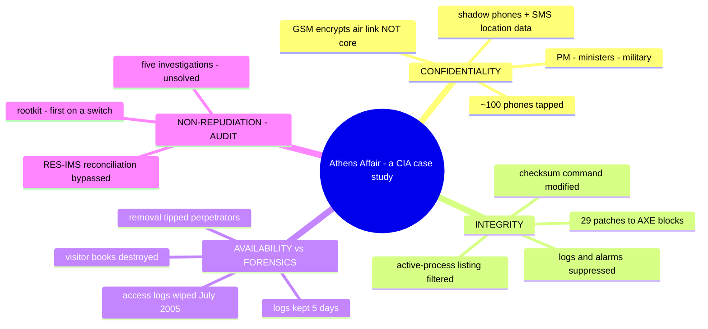
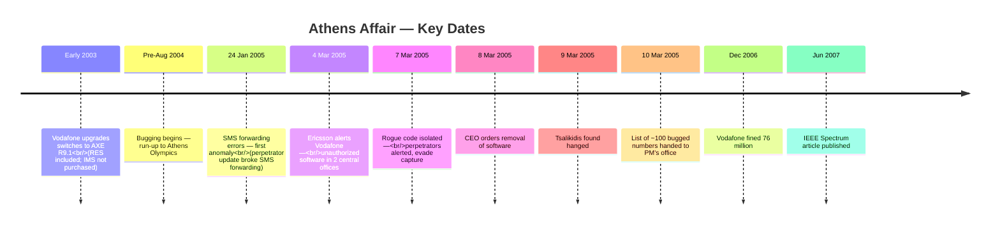
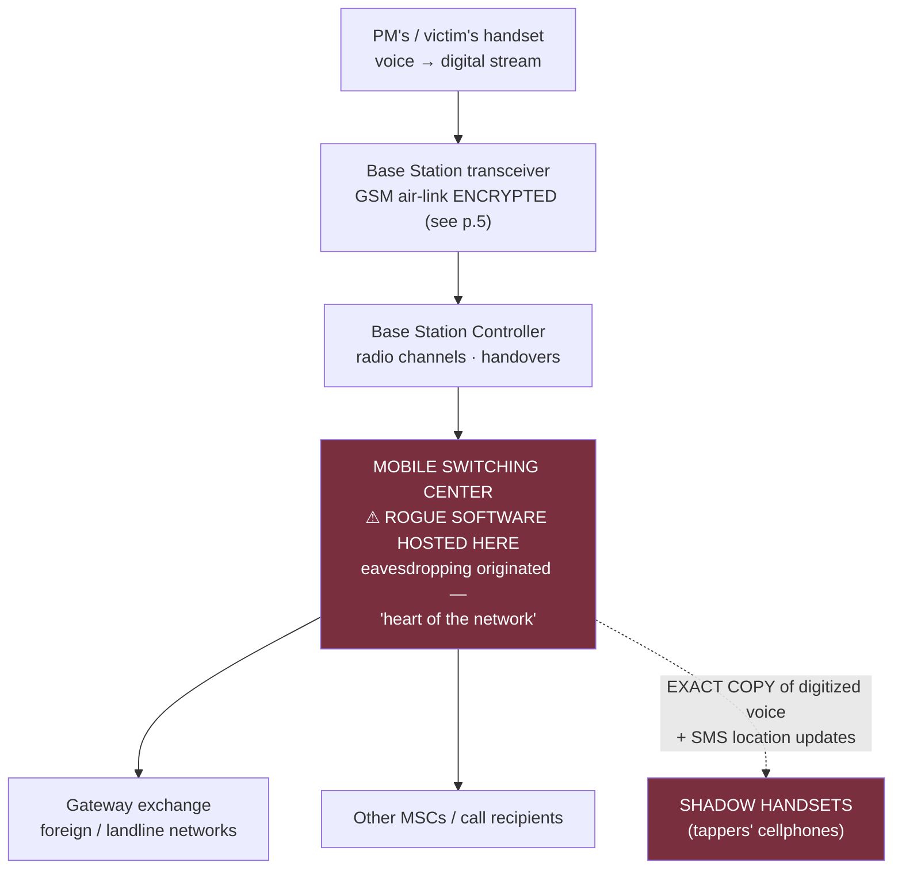
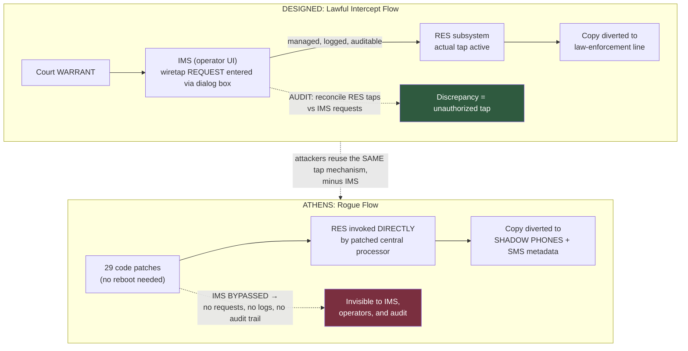

# The Athens Affair & The CIA Triad / National Cyber Strategy — Comprehensive Cybersecurity Notes

> **Scope note:** Two documents are combined here: **(1) *The Athens Affair*** — the landmark **IEEE Spectrum article** by **Vassilis Prevelakis & Diomidis Spinellis** (posted 29 Jun 2007) analysing the **Greek telephone tapping case 2004–2005** (Vodafone Greece / Ericsson AXE switches) — 9 pages; and **(2) a CIA-Triad / Estonia-Cyber-Strategy excerpt** (6 pages) — the **three (plus one) security goals**, integrity & availability models, and Estonia's national cyber-defence subgoals. The pairing is ideal: the Athens Affair is the **ultimate applied case study** of the CIA framework — a confidentiality catastrophe enabled by a *lawful-intercept* subsystem, hidden through *integrity* attacks (code patches, checksum tampering), and compounded by *availability-vs-forensics* trade-offs. Enrichment is marked and cross-linked to earlier notes in this series.

---

## 1. Executive Overview & Core Concepts

### 1.1 What the Documents Cover

| Document | Content |
| :--- | :--- |
| **The Athens Affair (9 pp.)** | The most audacious cell-network break-in ever documented: rogue software implanted in **4 of Vodafone Greece's Ericsson AXE switches**, tapping **~100 phones** (incl. the PM), evading detection for ~5 months via **29 code patches**, a **rootkit** on a telephone switch, and forensic discovery through **system dumps** — plus the failed incident response and a full **lessons list** |
| **CIA / Estonia doc (6 pp.)** | The **three security goals** (Confidentiality, Integrity, Availability) + **Non-repudiation** as a management-before-technical objective; the **CIA triad (Figure 2.1)**; Estonia's cyber-strategy subgoals (crime detection, awareness, international cooperation, national/military cyber defence, next-gen professionals); **Integrity Models** (3 goals) and **Availability Models** (3 challenges) |

### 1.2 Fundamental Definitions (Doc 2, Pages 1–6)

| Goal | Definition (per doc) | Character |
| :--- | :--- | :--- |
| **Confidentiality** | *"Protect the confidentiality of data"* — controlling access to files **either in storage or in transit** | Configuration/products = *technical*; defining **who should access what** = *business process* |
| **Integrity** | *"Preserve the integrity of data"* — **version control**: only the right people can change documents; requires an **audit trail of changes** and a **fallback position** | *"Meshes with non-repudiation — the change record must include **who** as well as **what and when**"* |
| **Availability** | *"Promote the availability of data for authorized use"* — *"the **Cinderella** of information security as it is rarely discussed"* | Requires **data back-ups, bandwidth, standby facilities** — often left out of planning |
| **Non-repudiation** | The assurance someone **cannot deny** an action | *"A **management issue before it's a technical one** — they are essentially **business objectives**"* |

* **Figure 2.1 — The CIA triad:** triangle of **Confidentiality** (apex), **Integrity** and **Availability** (base) — *"the basis of all security programs."* Professionals creating policies/procedures (**governance models**) must consider **each** goal.

**Integrity Models — three goals (p. 5):**

1. **Prevent unauthorized users** from making modifications to data or programs.
2. **Prevent authorized users** from making **improper or unauthorized** modifications.
3. **Maintain internal and external consistency** of data and programs.

* *Example of integrity checks:* **balancing a batch of transactions** to make sure all information is present and accurately accounted for.

**Availability Models — three common challenges (pp. 5–6):**

1. **Denial of Service (DoS)** — *"due to intentional attacks or because of undiscovered flaws in implementation"* (e.g., a program that crashes on unexpected input).
2. **Loss of information system capabilities** because of **natural disasters** (fires, floods, storms, earthquakes) or **human actions** (bombs or strikes).
3. **Equipment failures during normal use.**

**Activities preserving C/I/A (p. 6):** granting access **only to authorized personnel** · **applying encryption** to information sent over the Internet or stored on digital media · **periodically testing** computer system security to uncover new vulnerabilities · **building software defensively** · developing a **disaster recovery plan** ensuring the business can continue after a disaster or loss of personnel access.

> **🔑 Key Takeaway (module-level):** The Athens Affair is a **simultaneous three-goal failure**, mapped to Doc 2's framework:
>
> * **Confidentiality** — ~100 senior officials' calls diverted to shadow phones.
> * **Integrity** — switch code patched in **29 blocks**; **checksum-verification commands apparently modified** so altered blocks *"appeared unaltered"*; logs hidden.
> * **Availability vs. forensics** — Vodafone chose network continuity, **destroying the evidence trail** (logs kept **5 days**; visitor books **6 months**; an upgrade **wiped access logs**).
> * **Non-repudiation/audit** — the designed control (**RES–IMS reconciliation audit**) was bypassed; the designed audit *discipline* (retain data, isolate, coordinate) was ignored.

---

## 2. Page-by-Page Detailed Breakdown

## PART A — The Athens Affair (Pages 1–9)

### Page 1 — The Discovery

* **On 9 March 2005**, **Costas Tsalikidis**, a 38-year-old Greek electrical engineer, was found hanged in his Athens loft — *"an apparent suicide"* — *"merely the first public news of a scandal that would roil Greece for months."*
* **The next day**, the **Prime Minister of Greece was told his cellphone was bugged** — as were those of the **mayor of Athens** and **at least 100 other high-ranking dignitaries**, *"including an employee of the U.S. embassy."*
* **The victims** were customers of **Vodafone-Panafon (Vodafone Greece)**, the country's largest cellular provider; **Tsalikidis was in charge of network planning** — *"a connection seemed obvious."* *"We can only imagine the sensitive political and diplomatic discussions, high-stakes business deals, or even marital indiscretions that may have been routinely overheard and, quite possibly, recorded."*
* Even before the death, investigators found **rogue software installed on the Vodafone Greece phone network by parties unknown** — *"some extraordinarily knowledgeable people either **penetrated the network from outside or subverted it from within, aided by an agent or mole**."* The software at the heart of the phone system was *"reprogrammed with a **finesse and sophistication rarely seen before or since**."*
* **Framing:** major network penetrations are *"exceedingly uncommon — hard to pull off, and equally hard to investigate."* The Athens affair *"stands out because it may have involved **state secrets**, and it **targeted individuals**"*
* **Sidebar — "CEOs, MPs & a PM":** the illegally wiretapped phones included the **prime minister, his defense and foreign affairs ministers, top military and law enforcement officials, the Greek EU commissioner, activists, and journalists.**
* **The "Cuckoo's Egg" comparison:** the most notorious prior penetration to compromise state secrets was the **1986 "Cuckoo's Egg"** — named by *"the wily network administrator who successfully pursued a German programmer"* **selling US Strategic Defense Initiative ("Star Wars") secrets to the Soviet KGB**. *"But unlike the Cuckoo's Egg, the Athens affair targeted the **conversations of specific, highly placed government and military officials**."* *(Enrichment: the administrator was **Clifford Stoll**; see page 6.)*
* **Key technical point:** *"the scheme did **not depend on the wireless nature** of the network. Basically, the hackers **broke into a telephone network and subverted its built-in wiretapping features** for their own purposes. That could have been done with **any phone account, not just cellular ones**."*
* **Why unsolved:** *"Vodafone Group bobbled its handling of some key log files. It also **reflexively removed the rogue software**, instead of letting it continue to run, **tipping off the perpetrators**… The company was fined **76 million** this past December."* *(Enrichment: a **€76 million fine** by the Greek regulator EETT, December 2006.)*
* **Method:** *"hundreds of pages of depositions"* from the Greek parliamentary committee (obtained via **freedom-of-information request**), documentation, public information, and expert interviews — *"the technical details, if not the motivation."*

### Page 2 — Timeline Begins; the Tapping Mechanism

* **Sidebar:** On **6 April 2006, Bill Zikou, CEO of Ericsson Hellas**, gave evidence before the parliamentary committee — *"his company provided the telecommunications switching equipment that rogue programmers broke into."* **Sidebar:** Vodafone Greece CEO **Giorgos Koronias ordered removal** of the surveillance program because, *"as he explained in a February 2006 newspaper interview, **'the company had to react immediately.'*** Removing the program is thought to have **tipped off the perpetrators and helped them evade capture**."*
* **The cellphone bugging began** *"sometime during the **fevered run-up to the August 2004 Olympic Games in Athens**. It remained **undetected until 24 January 2005**, when one of Vodafone's telephone **switches generated a sequence of error messages** indicating that **text messages originating from another cellphone operator had gone undelivered**."* *(A switch = the computer-controlled component connecting two lines to complete a call.)* Vodafone contacted the switch maker — **Ericsson (Sweden)**.
* **The mechanism (now known):** the illegally implanted software — **eventually found in a total of FOUR of Vodafone's Greek switches** — *"created **parallel streams of digitized voice** for the tapped phone calls. One stream was the ordinary one, between the two calling parties. **The other stream, an exact copy, was directed to other cellphones**"* — *"shadow handsets"* — *"allowing the tappers to listen in… and probably also to record them. The software also **routed location and other information** about those phone calls to these shadow handsets **via automated text messages**."*
* **The unraveling:** *"**Five weeks** after the first messaging failures, on **4 March 2005, Ericsson alerted Vodafone** that **unauthorized software had been installed in two of Vodafone's central offices**. **Three days later**, Vodafone technicians **isolated the rogue code**. The next day, **8 March**, CEO Koronias ordered technicians to **remove the software**."*

### Page 3 — The Victim List, Investigations & Network Architecture

* *"Then events took a deadly turn. On **9 March**, Tsalikidis, **who was to be married in three months**, was found hanged… No one knows whether his apparent suicide was related to the case, but **many observers have speculated that it was**."* *(Sidebar: as telecom engineer in charge of network planning, he was *"ideally placed to be either an inside accomplice or discoverer of the digital break-in. But his involvement has never been established."* PM **Costas Karamanlis** — *"only the most notable of the 100 or so individuals illegally wiretapped… which included **Karamanlis's wife**.")*
* **The disclosure meeting:** the day after, CEO **Koronias** met **Yiannis Angelou** (director of the PM's political office) and **minister of public order Giorgos Voulgarakis**; handed over a list of bugged numbers: *"rogue software used the **lawful wiretapping mechanisms** of Vodafone's digital switches to tap **about 100 phones**."*
* **The full victim roster:** PM **and his wife** · ministers of **national defense, foreign affairs, and justice** · **mayor of Athens** · **Greek EU commissioner** · members of **civil rights organizations, peace activists, antiglobalization groups** · **senior staff** at ministries of National Defense, Public Order, Merchant Marine, Foreign Affairs · the **New Democracy ruling party** · **Hellenic Navy general staff** · a **Greek-American employee at the US Embassy**.
* **Five investigations** aimed at **three questions**: *Who was responsible? Was Tsalikidis's death related? How did they pull it off?*
* **Infrastructure 101 (needed to understand "how"):**
    1. Handset → **cellular base stations**; nearest station becomes the intermediary; the handset *"converts your words into a **stream of digital data** sent to a **transceiver** at the base station."*
    2. **Base station controller (BSC)** — special-purpose computer: *"allocates radio channels and helps coordinate **handovers**."*
    3. **Mobile switching center (MSC)** — connects calls within the switching center, to other centers, and to **gateway exchanges routing to foreign networks**. *"The MSCs are particularly important because they **hosted the rogue phone-tapping software** — it is there that the eavesdropping originated. They were the **logical choice**, because they are **at the heart of the network**; the intruders needed to take over **only a few of them**."*
    4. Both BSCs and MSCs are built around a large **switch** — *"holdovers from the **1970s**… proprietary hardware and software… the system's basic architecture remains largely unchanged."*
    5. Vodafone Greece uses **Ericsson's AXE line of switches** for both MSCs and BSCs; a **central processor** coordinates operations and sets up speech/data paths…

### Page 4 — Lawful Intercept: RES & IMS; the Fatal Upgrade

* …the switch's **management processor** *"stores on disk the **logs of network activity and billing records**."*
* **The key to the hack — how the Ericsson AXE allows lawful intercepts ("wiretaps"):** *"a law enforcement official goes to a court, obtains a **warrant**, presented to the phone company."* All wiretaps carried out **at the central office**. In AXE exchanges, the **remote-control equipment subsystem (RES)** *"carries out the phone tap by **monitoring the speech and data streams of switched calls**… a software subsystem typically used for setting up wiretaps, which **only law officers are supposed to have access to**. When the wiretapped phone makes a call, the **RES copies the conversation into a second data stream** and **diverts that copy to a phone line used by law enforcement officials**."*
* **The control plane — IMS:** *"Ericsson **optionally** provides an **interception management system (IMS)** through which lawful call intercepts are set up and managed. When a court order is presented, operators initiate an intercept by **filling out a dialog box in the IMS software**. The IMS (operator interface) contains **wiretap requests**; the RES (in the exchange) contains **actual taps**. **Only IMS-initiated wiretaps should be active in the RES** — so a wiretap in the RES **without a request in the IMS is a pretty good indicator that an unauthorized tap has occurred**. **An audit procedure can be used to find any discrepancies between them.**"*
* **The odd circumstance that enabled everything:** *"Vodafone had **NOT purchased the lawful intercept option** — the **IMS was not installed**. But in **early 2003**, Vodafone technicians **upgraded the Greek switches to release R9.1** of the AXE software suite. That upgrade **included the RES software** (per an Ericsson letter). So after the upgrade, the system contained **the code necessary to intercept calls using the RES**, even though it lacked the **high-level user interface in the IMS**."* → *"That odd circumstance would turn out to play a role in letting the Athens hackers illegally listen in on calls **and yet escape detection for months and months**."*
* **"It took guile and some serious programming chops":** the intruders had to (1) install and operate wiretapping software **without detection** by Vodafone *or* Ericsson administrators; (2) periodically **update the lists of monitored numbers and shadow phones**; (3) keep those activities **off all logs**; (4) make the software **invisible to administrators conducting routine maintenance**. *"The intruders achieved all these objectives."*
* **The enabler:** *"the AXE allows **new software to be installed WITHOUT rebooting**"* — critical because any interruption would *"disconnect phone calls, lose text messages, and render **emergency services unreachable**."* Ericsson's techniques for failure-handling and no-downtime upgrades *"allow the **direct patching of code loaded in the central processor, in effect altering the operating system on the fly**."*

### Page 5 — GSM's Core Gap; Patch Mechanics; the 29 Patches; Hiding

* **Why attack the core switches (the COMSEC lesson):** *"Modern GSM systems secure the **wireless links** with a sophisticated encryption mechanism. A call to another cellphone will be **re-encrypted between the remote cellphone and its closest base station**, but it is **not protected while it transits the provider's core network**. For this reason — and for the **ease of monitoring calls from the comfort of their lair** — the perpetrators attacked the **core switches**. Encrypting communications from the start of the chain to its end — **as banks, for example, do** — makes it very difficult to implement legal wiretaps."*
    > **🔑 Cross-link:** this is precisely the **COMSEC (end-to-end) vs TRANSEC (link) distinction** from the Security Mechanisms notes — GSM's air-interface is **link encryption**; the core is plaintext. The final sentence anticipates the modern **E2EE vs lawful-access debate** (Signal/WhatsApp vs interception mandates).
* **AXE patching rules:** code structured around **independent blocks / program modules** in the central processor's memory — the 2004 release: **~1760 blocks** — each containing a small **"correction area"** used for patches.
  * **Patch mechanics (worked example):** to make the computer do new function **Z** where it did **Y**: the original instruction *"**If X, then do Y**"* becomes, in effect, *"**If X, then go to the correction area location L**"* → the software jumps to **L** and executes **Z** — *"a software patch works by **replacing an instruction** at the code to be fixed with an instruction that **diverts the program** to a memory location in the correction area containing the new code."*
* **The attack:** *"The challenge was to use the **RES's capabilities to duplicate and divert the bits of a call stream WITHOUT using the dialog-box interface to the IMS** — which would create **auditable logs** of their activities. The intruders pulled this off by **installing a series of patches to 29 separate blocks of code**"* (per Ericsson officials testifying before the parliamentary committee). *"This rogue software modified the central processor's software to **directly initiate a wiretap, using the RES's capabilities**. Best of all, for them, the taps were **not visible to the operators, because the IMS and its user interface weren't used**."*
* **Hiding the data:** the full software would have recorded tapped numbers in an **official registry within the exchange** (auditable against IMS warrants). *"But the rogue software **bypassed the IMS**. Instead, it **cleverly stored the bugged numbers in TWO data areas that were part of the rogue software's own memory space** — within the switch's memory but **isolated and not made known to the rest of the switch**."* **[Callout: THE ROGUE SOFTWARE STORED BUGGED PHONE NUMBERS IN ITS OWN MEMORY SPACE.]**
* **Hiding the processes:** technicians could have taken a **listing of all blocks** — showing all active processes (*"similar to the task manager output in Windows or the **ps** output in Unix"*) — and would have seen *"processes active that shouldn't have been. But the rogue software apparently **modified the commands that list the active blocks** in a way that **omitted certain blocks — the ones related to intercepts** — from any such listing."*
* **Hiding from checksums:** the rogue software might have been caught during an upgrade/patch — *"standard practice… to **verify the existing block contents** before performing an upgrade or patch. We don't know why it was not detected in this way, but we **suspect the software also modified the operation of the command used to print the checksums** — codes that create a kind of **signature against which the integrity of the existing blocks can be validated**. One way or another, **the blocks appeared unaltered to the operators**."*

> **⚠️ Warning (CIA-triad synthesis):** the attackers attacked **integrity** (patch code), then **integrity of the integrity check** (checksum command), then **detection itself** (process-list commands). This is why later notes recommend **tamper-evident, externally-verifiable logging** — "we have to be sure that any rogue software cannot modify the information stored in the logs" (p. 8).

### Page 6 — The Rootkit & The Forensic Discovery

* **The back door:** *"the software included a **back door to allow the perpetrators to control it in the future**… A report by the **Hellenic Authority for the Information and Communication Security and Privacy (ADAE)** indicates that the rogue software **modified the exchange's command parser** — the routine accepting commands from a system-administrator-status person — so that **innocuous commands followed by SIX SPACES** would **deactivate the exchange's transaction log and the alarm associated with its deactivation**, and allow execution of commands associated with the **lawful interception subsystem**. In effect, a signal to allow wiretap operations **but leave no trace**. It also **added a new user name and password** to the system."*
* **Rootkit defined (verbatim):** *"Software that not only **alters operating system code** but also **hides its tracks** is called a 'rootkit.'"* Known publicly via the **Sony BMG rootkit (2005)** on music CDs — *"restricted copying of CDs; burrowed into the Windows operating system and hid its existence from the owner"* (abandoned after public outcry). Rootkits also exist for Linux, Windows, Solaris — *"but to our knowledge **this is the first time a rootkit has been observed on a special-purpose system, in this case an Ericsson telephone switch**."*
    > **🔑 Cross-link:** rootkits were previously met as botnet-hardening tools (SANS DoS notes) — *"attackers update the hosts and tighten its security so another attacker does not use the same host."* Athens scales that idea to national telecom infrastructure. *(Enrichment: the Sony rootkit was the XCP DRM software, discovered by Mark Russinovich, on ~20 million CDs.)*
* **The discovery:** *"With all of this sophisticated subterfuge, how was the rogue software finally discovered? On **24 January 2005, the perpetrators UPDATED their planted software. That upgrade interfered with the forwarding of text messages** → undelivered → an **automated failure report**."* At this point *"the hackers' abilities to keep their modifications secret **met their limits** — as it's almost impossible to **hide secrets in somebody else's system**."*
* **Logging doctrine:** *"The AXE, like most large software systems, **logs all manner of network activity**… any events they can't account for as ordinary usage can be investigated. **It's impossible to overstate the importance of logging.**"* Example — the 1986 **Cuckoo's Egg**: *"the wily network administrator, **Clifford Stoll**, was asked to investigate a **75 U.S. cents accounting error**. Stoll spent **10 months** looking for the hacker, who had penetrated deep into the networks of **Lawrence Livermore National Laboratory**, a U.S. nuclear weapons lab. Much of that time he spent **poring over thousands of log report pages**."* *(Enrichment: Stoll's own account places him at the Lawrence Berkeley National Laboratory; the hacker traversed many military/university networks. His book is *The Cuckoo's Egg*, 1989.)*
* **Dumps as forensic gold:** the AXE reports **anomalous activity on its own** (error/failure reports); *"at regular intervals the switching center generates a **snapshot of itself — a copy, or dump, of all its programs and data**."* Dumps are for recovery/diagnostics *"but they can be used in **security investigations**."* So *"when Ericsson's investigators were called in, **the first thing they did was look closely at the periodic dumps**. They found **two areas containing all the phone numbers being monitored** and retrieved a list."*
* **Reverse-engineering:** the rogue programs existed as **executable code** (binary); AXE source is written in the **PLEX language**. *"The investigators **painstakingly reconstructed an approximation of the original PLEX source files**… equivalent of about **6500 lines of code — a surprisingly substantial piece of software**."* They *"ran the modules in **simulated environments**"* → discovered *"the data areas holding the tapped numbers and the **time stamps of recent intercepts**."* With that, earlier dumps yielded *"the **time interval** during which the wiretaps were in effect, the **full list of intercepted numbers and call data** — who called whom, when, and for how long. (**The actual conversations were not stored in the logs.**)"*

### Page 7 — Inside Job?, Destroyed Evidence & The Lessons Begin

* **The taps themselves were straightforward:** when the PM initiated/received a call, *"the exchange would establish the **same kind of connection used in a lawful wiretap** — a connection to a **shadow number** allowing it to listen in."*
* **The expertise question:** staying undetected required *"a lot of expertise in writing AXE code — an **esoteric competency** that isn't readily available in most places. But… for the **past 15 years**, a considerable part of Ericsson's AXE software development has been done **under contract by a Greek company based in Athens, Intracom Telecom** (part of Intracom Holdings). The necessary **know-how was available locally**, spread over a large number of present and past Intracom developers. **So could this have been an inside job?**"*
* *"The early stages would have been much easier with assistance from **someone inside Vodafone**, but **no conclusive evidence** supports that. The infiltration **could have been carried out remotely** — indeed, per a state report, in the failed-text-message case *"the last person to access the exchange had been issued a **visitor's badge**."* Whether Tsalikidis was involved: *"many observers found the **timing of his death highly suggestive**, but **no connection has been uncovered**."* [Sidebar: "An Inside Job?" summarizes the leading speculation — *"we can neither endorse nor refute the theories."]*
* **The evidence trail — destroyed (why we'll never know):**
  * *"In **July 2005**, while the investigation was taking place, Vodafone **upgraded two of the three servers used for accessing the exchange management system**. This upgrade **wiped out the access logs** and, **contrary to company policy, no backups were retained**."*
  * *"A **six-month retention period for visitor sign-in books** lapsed, and Vodafone **destroyed the books** corresponding to the period where the rogue software was modified (triggering the text-message errors)."*
  * *"Traces might have been on the exchange's **transaction logs** — however, due to a **paucity of storage space**, the logs were retained for **only FIVE DAYS**, because Vodafone considers **billing data, which competes for the same space, a lot more important**."*
  * *"**Most crucially**, Vodafone's **deactivation of the rogue software on 7 March 2005 almost certainly alerted the conspirators**, giving them a chance to **switch off the shadow phones**. As a result, investigators **missed the opportunity of triangulating the location of the shadow phones and catching the perpetrators in the act**."*
* **"So what can this affair teach us about how to protect phone networks?"** *"Vodafone had to balance the need for **continued operation** against **discovery and prosecution**. Unfortunately, the responses of Vodafone **and** Greek law enforcement were **both inadequate**. Through Vodafone's actions, **critical data were lost or destroyed**, while the perpetrators not only received **a warning** but had **sufficient time to disappear**."*
* **Best practices (telecom industry):** *"operator policies must include **procedures for responding to an infiltration**, such as a virus attack: **retain all data, isolate the part of the system that's been broken into as much as possible, coordinate activities with law enforcement**."* — *"Greek federal telecom regulations also specify that operators have **security policies detailing measures to ensure the confidentiality of customer communications and the privacy of network users**. However, Vodafone's response indicates that such policies, **if they existed, were ignored**. If not for press conferences and public investigations, law enforcement could have **watched the behavior of the shadow cellphones surreptitiously**."*

> **🔑 Cross-link:** the three best-practice steps are verbatim the **Incident Response lifecycle** from the threat-management notes (Detection → **Containment** & Eradication → Recovery & Lessons): *"retain all data"* = evidence preservation (post-mortems depend on it — cf. AIIMS forensics), *"isolate"* = containment, *"coordinate with law enforcement"* = communication protocols. Vodafone executed the **eradication** step while skipping **containment** — the exact inversion of good IR.

### Page 8 — Institutional Failures & The Defence Roadmap

* **[Callout: PHYSICAL LOGBOOKS OF VISITORS WERE LOST AND DATA LOGS WERE DESTROYED.]**
* *"Neither law enforcement authorities nor the **ADAE**, the independent security and privacy authority, was **contacted directly**. Instead, Vodafone Greece communicated through a **political channel — the prime minister's office**. (The ADAE was fairly new — **formed 2003**.)"*
* **Law enforcement failures:** *"Police **could have secured evidence by impounding** all of Vodafone's telecommunications and computer equipment. Instead… concerns about **disruption to the operation of the mobile network** led to a more light-handed approach — essentially **interviewing employees and collecting information provided by Vodafone** — which ultimately led to the **loss of forensic evidence**. They eventually started **leveling accusations at both the operator (Vodafone) and the vendor (Ericsson), turning the victims into defendants** and losing their goodwill, further hampering the investigation."*
* *"In countries where such high-tech crimes are rare, it is unreasonable to expect a crack team of investigators. Could a **rapid deployment force** be set up? We'd like to see **Interpol create a cyberforensics response team** that countries could call on."*
* **The technical-defence roadmap:**
  * *"Telephone exchanges have **evolved into software-based systems** — analyzing them for vulnerabilities has become very difficult. New features (conferencing, number portability, caller ID) were loaded on; **the old software remains in place. Complex interactions between subsystems and baroque coding styles (remnants of programs written 20–30 years ago) confound developers and auditors alike**."* — *"Yet an effective defense against viruses, worms, and rootkits **depends crucially on in-depth analysis that can penetrate source code in all its baroque heterogeneity**."*
  * **Analytics as a security tool:** *"a **statistical analysis of the call logs might have revealed a correlation between the calls to the shadow numbers and calls to the monitored numbers**. Telephone companies already carry out extensive analysis to spot customer trends — but from the security perspective, this analysis is done for the **wrong reasons and by the wrong people — marketing as opposed to security**. By **training security personnel to use these tools** and allowing them access to these data, customer trend analysis can become an **effective countermeasure against rogue software**."*
  * *"Additional clues could be uncovered by **merging call records generated by the exchange with billing and accounting information** — though this involves **consolidating distinct data sets currently owned by different entities** within the telecom organization."*
  * *"Another defense is **regular auditing** of the type that allowed Ericsson to discover the rogue software by **scrutinizing the off-line dumps**. However… **we have to be sure that any rogue software cannot modify the information stored in the logs or the dumps** — such as by using a **separate monitoring computer running its own software**."*
  * *"Digital systems generate **enormous volumes of information**. Ericsson and Vodafone Greece **had at their fingertips all the information they needed** to discover the penetration **long before an undelivered text message** sent them looking… If one company's technicians and one country's police force cannot meet this challenge, **a response team that can needs to be created**."*
  * *"It is particularly important **not to turn the investigation into a witch hunt**… it is often politically expedient to use the telecom operator as a **convenient scapegoat**. This only encourages operators to **brush incidents under the carpet** and turns them into adversaries of law enforcement…"* → *"Rather than looking for someone to blame (and punish), it is **far better to determine exactly what went wrong and how it can be fixed** — not only for that operator, but **for the industry as a whole**."*

> **🔑 Cross-link:** the **"separate monitoring computer"** prescription is the industrial answer to the problem the attackers exploited (modifying logs/checksums from inside) — the principle later formalized in security engineering as **trust boundaries for audit data** (out-of-band logging, write-once stores — cf. WORM backups from the Data Protection notes). The "witch hunt" warning anticipates modern **blameless post-mortem** culture.

### Page 9 — Proactive Safety, Authors & Further Reading

* *"Merely saying — or even **legislating** — that system vendors and network operators should not allow something like this to occur is **pointless**, because there is little that can be done to these companies after the fact. Instead, **proactive measures** should be taken to ensure such systems are **developed and operated safely**. Perhaps we can borrow pages from **aviation safety**, where both **aircraft manufacturers and airline companies are closely monitored by national and international agencies** to ensure the safety of passengers."*
* **About the authors:** **Vassilis Prevelakis** — IEEE member, assistant professor of computer science, **Drexel University** (Philadelphia); research on automation network security and secure software design; active in standards bodies such as the **IETF**. **Diomidis Spinellis** — IEEE member, associate professor of management science and technology, **Athens University of Economics and Business**; author of *Code Quality: The Open Source Perspective* (Addison-Wesley, 2006); blogs at spinellis.gr.
* **To Probe Further:** the Wikipedia article *"Greek telephone tapping case 2004–2005"* (additional press links and background); **Ericsson's Interception Management System user manual** (marked confidential) available via Google search / cryptome.org.

---

## PART B — CIA Triad & Estonia's Cyber Strategy (Pages 1–6, Doc 2)

### Pages 1–2 — The Three (+1) Security Goals (recap above, §1.2) & Cybercrime Policy

* **Context claims:** *"most people who have gone beyond the mistaken assumption that **anti-virus equals the totality of information security** will have found the market full of niche products offering solutions to specific threats."* SMEs and home users find such tools *"too expensive and complicated"* → *"a very high percentage of computer users remains seriously exposed."* But *"it is amazing what gains in security can be achieved **virtually free of charge by simply tightening up on the way we manage our computer systems**."*
* *"Enhancing the fight against cybercrime: the **economic damage** deriving from cybercrime **reduces trust in digital services** and, in a worst-case scenario, could **lead to loss of life**. Greater **awareness among the general public** about cyber security risks helps to prevent cybercrimes — achieved by addressing cyber-related topics **at all levels of education** and informing people based on **research and analysis of secure behaviours**."*
* **2.1 Enhancing detection of cybercrime:** improve efficiency of detection **and prosecution** — *"the current structure of law enforcement and its organisation of work will be further clarified, the **number of personnel dealing with cybercrime will be increased**, and the **capabilities of bodies conducting proceedings to process digital data carriers will be raised**."* *(continues)* → *"cooperation takes place with **universities and international centres of excellence**."*

### Page 3 — Awareness, International Cooperation & National Cyber Defence

* **2.2 Raising public awareness of cyber risks:** introduce **actions preventing cyber threats**; provide *"the knowledge needed to **identify as well as wisely respond to incidents**."* *"Users of e-services are directed to use the **most secure solutions** and are informed about **new technologies and how to securely use them**."*
* **2.3 Promoting international cooperation against cybercrime:** *"more effective and timely prosecution of cybercrimes with an **international dimension**; **information exchange between countries is improved**; **active participation** in initiatives and projects that are part of the international fight against cybercrime."*
* **Subgoal 3 — Development of national cyber defence capabilities:** *"civil, military, and international cooperation based on the resources at the disposal of the state must also **function adequately in cyberspace** — with regards to **warning, deterrence and active defence**."*
  * **3.1 Synchronising military planning and preparation for civil emergencies** — *"broad-based national defence requires that the **continuous operation plans of vital service providers are coordinated with national defence threat scenarios**."*
  * **3.2 Developing collective cyber defence and international collaboration** — *"information exchange and cooperation enhanced with **NATO, European Union cyber instances and other partners**; efforts concerning the creation and development of **NATO joint cyber security capabilities, standards, training** and training opportunities."*
  * **3.3 Developing military cyber defence capabilities** — cyber defence as part of *"broad-based collective defence, ensured by involving specialists from the **Defence Forces and the Estonian Defence League**, as well as other public and private sector professionals."*

> **🔑 Cross-link (enrichment):** this is Estonia's **Cyber Security Strategy (2008)** — drafted directly in response to the **April–May 2007 DDoS attacks against Estonia** (banks, media, government sites — botnet-driven, politically triggered), the events that made *"cyberwar"* a household term. The strategy's creation led to **NATO's Cooperative Cyber Defence Centre of Excellence (CCDCOE) in Tallinn (2008)** and the *Tallinn Manual* project. The strategy is thus the *policy* twin of the **DoS attacks** studied in the SANS notes — and the **international-cooperation** recommendation mirrors the Athens authors' **Interpol cyberforensics team** proposal (p. 8).

### Page 4 — National Defence Awareness & Subgoal 4 (Managing Evolving Threats)

* **3.4 Ensuring a high level of awareness concerning the role of cyber security in national defence:** raise awareness of cyber risks in national defence, *"link it with other military domains"*; **additional training organised for personnel in the field**.
* **Subgoal 4 — Estonia manages evolving cyber security threats:** *"maintain and improve cyber security capability by adopting **independent cyber security solutions** backed by training, **research and development and entrepreneurship**. To ensure sustainability, the state acts as a **smart contractor**, and supports the **export of cyber security solutions**."*
  * **4.1 Ensuring the next generation of cyber security professionals** — *"opportunities for additional education: **higher education as well as in-service training**; support to raise the number of students completing a **Master's Degree in cyber security** and increase **doctoral theses**; instruction involving more **foreign lecturers and professionals**."*
  * **4.2 Developing smart contracting for cyber security solutions** — the state contributes to **cyber security-related R&D**; *"a **supervisory board** shall be set up to coordinate the corresponding activities and to **consolidate the domains of national defence, security, economic development and academia**."*
  * **4.3 Supporting development of enterprises providing cyber security and national cyber security solutions** — *"the state will contribute to the **export** of cyber security solutions and to **increasing their use at the international level**."*
  * **4.4 Preventing security risks in new solutions** — *"to avoid **large-scale cyber incidents**, the **technological risks pertaining to the development and introduction of new technologies are investigated and assessed in depth**. A high level of knowledge…"*

### Page 5 — Integrity Models & Availability Models (introduced)

* *(…continuation: "and **risk-awareness** facilitate achieving advantages in developing the state, society and economy.")* *(The page then jumps to textbook material.)*
* **Integrity Models:** *"keep data **pure and trustworthy** by protecting system data from **intentional or accidental changes**. Integrity models have **three goals**:"*
    1. **Prevent unauthorized users** from making modifications to data or programs.
    2. **Prevent authorized users** from making **improper or unauthorized** modifications.
    3. **Maintain internal and external consistency** of data and programs.
  * *"An example of integrity checks is **balancing a batch of transactions** to make sure that all the information is present and accurately accounted for."*
* **Availability Models:** *"keep data and resources **available for authorized use**, especially **during emergencies or disasters**. Information security professionals usually address **three common challenges** to availability:"* *(list continues)*

> **💡 Enrichment:** the three integrity goals echo the classical **Biba integrity model** logic (keep untrusted writing out; keep trusted processes behaving) — and goal 2 (*authorized but improper* changes) is exactly the **insider-threat** class (19% of breaches per the Verizon DBIR noted earlier). The **transaction-balancing** example is the accountant's **reconciliation control** — the same *audit* idea as Ericsson's RES-vs-IMS reconciliation in Athens.

### Page 6 — The Three Availability Challenges & Preservation Activities

* **The three challenges to availability:**
    1. **Denial of Service (DoS)** — *"due to intentional attacks or because of **undiscovered flaws in implementation** (for example, a program written by a programmer who is unaware of a flaw that could **crash the program if a certain unexpected input is encountered**)."*
    2. **Loss of information system capabilities** because of **natural disasters** (fires, floods, storms, earthquakes) **or human actions** (bombs or strikes).
    3. **Equipment failures during normal use.**
* **Activities that preserve confidentiality, integrity, and/or availability (five listed):**
    1. **Granting access only to authorized personnel.**
    2. **Applying encryption** to information sent over the Internet **or stored on digital media**.
    3. **Periodically testing computer system security** to uncover new vulnerabilities.
    4. **Building software defensively.**
    5. **Developing a disaster recovery plan** *"to ensure that the business can continue to exist in the event of a disaster or loss of access by personnel."*

> **🔑 Cross-link:** challenge 1 = the entire **DoS corpus** (SANS paper, botnets, WebGoat pool exhaustion) — note it includes *unintentional* DoS from implementation flaws, matching the WebGoat lesson ("expect worst-case scenarios"). Challenge 2 = the **physical security** dimension (COMSEC Element 3; the Security Mechanisms' UPS/fire/rack requirements). The five preservation activities map cleanly: (1) → access control/NAC; (2) → encryption at rest & in transit (Hybrid encryption notes); (3) → **security assessment** (auditing's extension); (4) → **secure SDLC**; (5) → **3-2-1 backups / DR** (AIIMS lesson).

---

## 3. Comparative Summary & Matrix

### 3.1 The Athens Affair — Complete Timeline & Fact Table

| Date | Event |
| :--- | :--- |
| **Early 2003** | Vodafone upgrades switches to **AXE release R9.1** — **RES included**, **IMS never purchased** |
| **Pre-Aug 2004** | Bugging begins (run-up to **Athens Olympics**) |
| **24 Jan 2005** | **SMS forwarding failures** (perpetrators' own software update) → error messages |
| **4 Mar 2005** | **Ericsson alerts Vodafone** — unauthorized software in **two central offices** |
| **7 Mar 2005** | Technicians **isolate rogue code** — *"almost certainly alerted the conspirators"* |
| **8 Mar 2005** | CEO **Koronias orders removal** — *"the company had to react immediately"* |
| **9 Mar 2005** | **Tsalikidis found hanged** (apparent suicide; to be married in 3 months) |
| **10 Mar 2005** | Koronias briefs **Angelou & Voulgarakis**; list of **~100 bugged numbers** handed over |
| **Weeks later** | **Five investigations**; three questions (who? death related? how?) |
| **July 2005** | Vodafone upgrades **2 of 3 management servers** → **access logs wiped**, no backups |
| **Later** | **6-month visitor sign-in books** destroyed (covering the modification period) |
| **Dec 2006** | Vodafone **fined 76 million** |
| **6 Apr 2006** | **Bill Zikou (Ericsson Hellas CEO)** testifies before the parliamentary committee |
| **29 Jun 2007** | IEEE Spectrum article published (Prevelakis & Spinellis) |

### 3.2 The Hack — Attack Chain vs Defenses (Athens mapped to CIA)

| Phase | What the intruders did | CIA goal attacked | The designed control they evaded | Post-Affair defense |
| :--- | :--- | :--- | :--- | :--- |
| 1. Recon/enabler | Exploited **RES present, IMS absent** (R9.1 upgrade, no purchase) | — | License/purchase separation | Inventory what intercept capability exists |
| 2. Implant | **29 patches** to AXE blocks via **no-reboot live patching** | **Integrity** (code) | Change-management / patch review | In-depth **source-code analysis** |
| 3. Tap | Direct **RES** invocation; duplicate voice stream → **shadow phones** + SMS metadata | **Confidentiality** (~100 officials) | IMS dialog-box workflow | Regular **RES↔IMS reconciliation audits** |
| 4. Hide data | Bugged numbers in **rogue software's own isolated memory areas** | **Integrity** (records) | Official tap registry | Out-of-band dumps; **separate monitoring computer** |
| 5. Hide processes | **Modified block-listing commands** (ps/task-manager equivalent) | **Integrity** (detection) | Active-process listings | Statistical **call-log correlation** (shadow↔monitored) |
| 6. Hide changes | **Checksum command modified** → blocks "appeared unaltered" | **Integrity** (of integrity checks) | Pre-upgrade block verification | Tamper-evident, externally-held checksums |
| 7. Persistence | **Rootkit**: command-parser trigger (**6 spaces**), log/alarm deactivation, **new username+password** | Integrity + Accountability | Transaction logs & alarms | Out-of-band logging; rootkit scanning |
| 8. Endgame | Perpetrators **alerted by removal (7–8 Mar)** → switched off shadow phones | — | Stealth surveillance | **Isolate, don't remove**; coordinate with LE; retain data |

### 3.3 Incident-Response Scorecard — Athens vs Best Practice

| Best practice (per article) | What happened |
| :--- | :--- |
| **Retain all data** | ❌ Access logs wiped (July 2005 upgrade); visitor books destroyed; **transaction logs kept only 5 days** (billing data won the storage contest) |
| **Isolate the compromised portion** | ❌ Rogue code **removed** (7–8 Mar) rather than left running under stealth watch |
| **Coordinate with law enforcement** | ❌ Contacted via **political channel** (PM's office), not LE or ADAE directly |
| **Forensic evidence preservation** | ❌ Police chose a light-handed approach; **victims turned into defendants** |
| **Surreptitious monitoring of perpetrators** | ❌ Missed **triangulation of shadow phones** |
| **Blameless improvement** | ⚠ Accusations flew; article warns against **scapegoating the operator** |

### 3.4 Athens vs the Course's Other Case Studies

| Case | Vector | Rootkit/persistence? | Evidence handling | Outcome |
| :--- | :--- | :--- | :--- | :--- |
| **Athens (2004–05)** | Abuse of **lawful-intercept subsystem** on AXE switches | **Yes — first rootkit on a switch** | Logs 5 days; visitor books destroyed; servers wiped | **Unsolved**; €76M fine; ~100 phones tapped |
| **SolarWinds (2020)** | Supply-chain (build pipeline, signed updates) | Dormant backdoor (SUNBURST) | SIEM blind to outbound anomalies | ~18,000 orgs; SLSA/SBOM reforms |
| **Cosmos Bank (2018)** | SWIFT + ATM switch proxy + cloned cards | Malware on payment rails | RBI/CERT-In forensics | ₹94.42 crore; segmentation mandates |
| **AIIMS Delhi (2022)** | Ransomware on flat network | Ransomware staging undetected | NIC/CERT-In restoration (~15 days) | Segmentation, 3-2-1 backups, EDR |
| **Cuckoo's Egg (1986)** | 75-cent accounting error → manual log analysis | No | **Thousands of log pages, 10 months** | Hacker identified (KGB selling Star Wars secrets) |
| **Estonia (2007)** | Politically-triggered **DDoS** (botnets) | Botnet zombies | — | **National Cyber Strategy (2008); NATO CCDCOE** |

### 3.5 The Four Goals — Definitions, Owners, and Athens Mapping

| Goal | Per CIA doc | Technical vs business | Athens manifestation |
| :--- | :--- | :--- | :--- |
| **Confidentiality** | Control access to files in **storage or transit** | Config = technical; **who-gets-what = business** | PM's calls diverted; GSM core unencrypted |
| **Integrity** | Version control + **audit trail** + fallback | Audit record: **who + what + when** | 29 patches; checksum & listing commands altered |
| **Availability** | *"Cinderella"* — needs **backups, bandwidth, standby** | Planning afterthought | SMS outages revealed the hack; continuity vs forensics trade-off |
| **Non-repudiation** | Cannot deny actions; **business objective first** | Management before technical | RES–IMS audit bypassed; logs/alarm suppressed by rootkit |

### 3.6 Integrity & Availability Models (Doc 2, pp. 5–6)

| Integrity Model goals | Availability Model challenges |
| :--- | :--- |
| Prevent **unauthorized** modification | **DoS** — attacks *or undiscovered implementation flaws* (crash on unexpected input) |
| Prevent **authorized but improper** modification | **Natural disasters / human actions** (fire, flood, storm, earthquake; bombs, strikes) |
| Maintain **internal & external consistency** | **Equipment failures during normal use** |
| *Check example: balancing a transaction batch* | *Preservers: authorized-only access · encryption (transit & storage) · periodic security testing · defensive software building · disaster recovery plans* |

### 3.7 Estonia's Strategy Structure (Doc 2, pp. 2–4)

| Subgoal | Items | Essence |
| :--- | :--- | :--- |
| **Fight cybercrime** | 2.1 Detection (clearer LE structure, more personnel, digital-evidence capability, university/centre cooperation) · 2.2 Public awareness (prevention actions, incident-response knowledge, secure-solution guidance) · 2.3 International cooperation (info exchange, participation in initiatives) | **Prosecution + people** |
| **3 — National cyber defence** | 3.1 Military-civil emergency synchronisation (vital-service plans ↔ defence threat scenarios) · 3.2 Collective defence with **NATO/EU** (capabilities, standards, training) · 3.3 Military cyber defence (Defence Forces + **Estonian Defence League**) · 3.4 Defence-awareness training | **Warning, deterrence, active defence** |
| **4 — Manage evolving threats** | 4.1 Next-gen professionals (Master's, PhDs, foreign lecturers) · 4.2 Smart contracting (state R&D, supervisory board consolidating defence/security/economy/academia) · 4.3 Enterprise/export support · 4.4 **Risk-assess new technologies in depth** | **Independence + sustainability** |

---

## 4. Key Terminology & Cheat Sheet

### 4.1 Glossary

| Term | Definition |
| :--- | :--- |
| **ADAE** | Hellenic Authority for Information and Communication Security and Privacy (formed **2003**); never contacted directly by Vodafone |
| **AXE** | Ericsson's switch line used by Vodafone Greece for both MSCs and BSCs; ~**1760 code blocks** in the 2004 release |
| **Base Station Controller (BSC)** | Allocates radio channels; coordinates handovers between transceivers |
| **Cifar of trust — RES↔IMS audit** *(descriptive)* | Only IMS-initiated wiretaps should be active in the RES; discrepancy = unauthorized tap |
| **Command-parser trigger** | Rootkit mechanism: innocuous commands + **six spaces** deactivated the transaction log & alarm and enabled lawful-intercept commands |
| **Correction area** | Small region in each AXE code block where patch code is placed (jump-target redirection) |
| **Cuckoo's Egg** | 1986 intrusion case: **Clifford Stoll**, 75-cent error, 10 months of log analysis, KGB-linked hacker (Star Wars secrets) |
| **Dump (system snapshot)** | Periodic copy of all switch programs & data — recovery aid **and forensic goldmine** (where the tapped-number areas were found) |
| **Ericsson AXE R9.1** | The 2003 software release that delivered **RES** to Vodafone without **IMS** |
| **IMS (Interception Management System)** | Optional Ericsson operator interface for lawful intercepts (dialog box → wiretap *requests*); **not installed** at Vodafone |
| **MSC (Mobile Switching Center)** | Heart of the network; **hosted the rogue software**; only a few needed for the attack |
| **PLE****X** | Ericsson's proprietary switch programming language; investigators reconstructed ~**6500 lines** of it |
| **Rootkit** | Software that **alters OS code AND hides its tracks**; first observed on a special-purpose system (a telephone switch) |
| **RES (Remote-control Equipment Subsystem)** | AXE subsystem that performs the tap: copies the conversation into a **second data stream** diverted to LE lines |
| **Shadow number / shadow handset** | The tap's destination phone — receives the duplicated voice stream + SMS location updates |
| **Smart contractor (Estonia)** | State role ensuring sustainability of cyber solutions via procurement + export support |
| **Tsalikidis, Costas** | Vodafone network-planning engineer; found hanged 9 Mar 2005; involvement never established |
| **Visitor's badge** | The last person to access the exchange at the failed-SMS timestamp had been issued one (remote/insider ambiguity) |

### 4.2 Numbers Cheat Sheet

| Item | Value |
| :--- | :--- |
| Bugged phones | **~100** (incl. PM **and his wife**, mayor, EU commissioner, US-embassy employee, journalists, activists) |
| Compromised switches | **4** of Vodafone Greece's switches |
| Code patches installed | **29 separate AXE blocks** |
| AXE code blocks (2004 release) | **~1760** |
| Reconstructed rogue software | **~6500 lines of PLEX code** |
| Detection delay | Began pre-**Aug 2004** Olympics → undetected until **24 Jan 2005** (~5 months) |
| Alert-to-removal | Ericsson alert **4 Mar** → isolated **7 Mar** → removal ordered **8 Mar** → Tsalikidis **9 Mar** |
| Exchange transaction-log retention | **5 days** (billing data prioritized) |
| Visitor sign-in books retention | **6 months** (then destroyed) |
| Management servers | **3** — 2 upgraded **July 2005**, wiping access logs, **no backups** |
| Parser trigger | Innocuous command + **6 spaces** |
| Fine | **76 million** (Dec 2006) |
| Investigations launched | **5**; guiding questions **3** |
| Intracom contract history | **15 years** of Ericsson AXE development outsourced locally |
| *CIA doc:* goals | **3 + 1** (C, I, A, Non-repudiation — "management issue before technical") |
| *CIA doc:* Integrity model goals | **3**; Availability challenges **3**; preservation activities **5** |
| *CIA doc:* Estonia items | Subgoals 2.1–2.3, 3.1–3.4, 4.1–4.4 (**10 named measures**) |
| *Enrichment:* GSM air-interface crypto | Link-only (A5 family) — **core network plaintext** |
| *Enrichment:* Sony rootkit | 2005, ~20M CDs, XCP DRM; abandoned after outcry |
| *Enrichment:* Stoll | Lawrence **Berkeley** Lab per his account; article cites Livermore |

### 4.3 One-Line Recall Strings

* **Athens:** *"RES without IMS is a tap without a warrant — 29 patches, a 6-space rootkit, checksums that lied, numbers hidden in private memory; found only because a broken SMS update tripped a 5-day-old log; 'retain, isolate, coordinate' came too late."*
* **CIA doc:** *"Three goals plus non-repudiation — a business problem before a technical one; integrity = who+what+when with a fallback; availability = the Cinderella needing backups, bandwidth, standby; Estonia's answer to the 2007 DDoS war: detect, educate, cooperate, defend, and grow professionals."*

---
