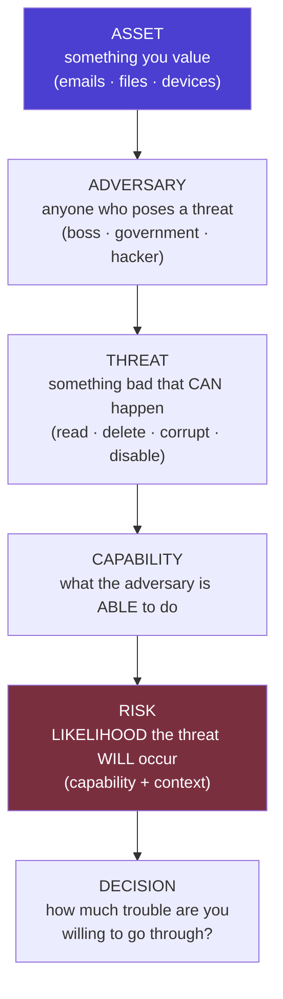
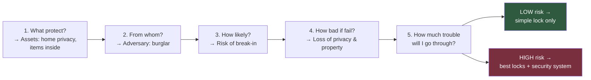
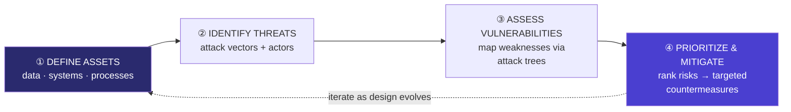
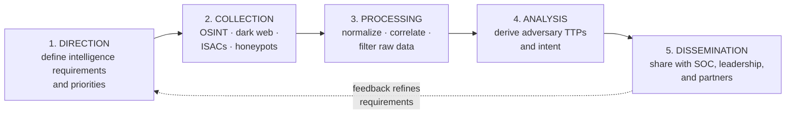
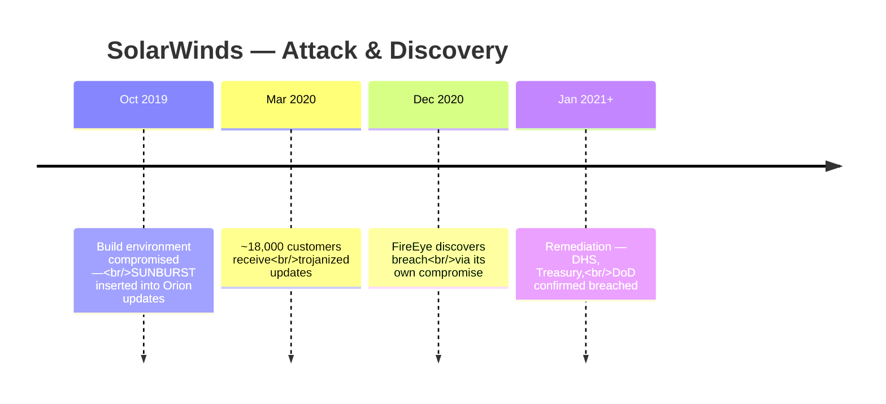
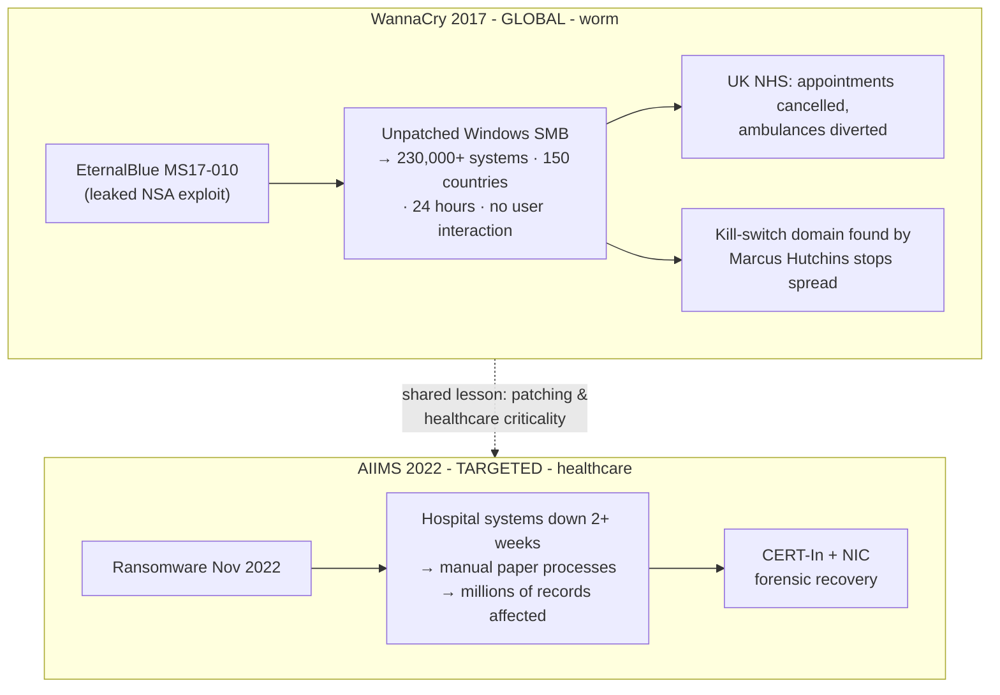
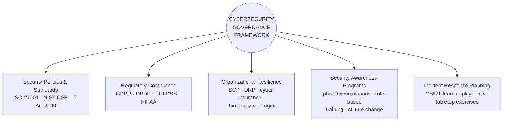

# Threat Modeling & The Modern Cybersecurity Landscape — Comprehensive Cybersecurity Notes

> **Scope note:** Two PDFs are combined here. **PDF-A** (`bc91f087-0610-4890-8156-8d0db3d83d7a.pdf`) is **"An Introduction to Threat Modeling"** (3 pages — a personal/adversary-centric threat-modeling guide; enrichment attribution: the EFF *Surveillance Self-Defense* project). **PDF-B** (`2b07c36b-e362-4478-a06a-d51380a1dd7c.pdf`) is **"The Modern Cybersecurity Landscape"** (19 pages — goals, CIA triad, threat actors/vectors, threat modeling frameworks, risk matrix, attack trends, threat intelligence, homeland security, five case studies, governance, references). Every section below is **tagged with its source PDF** so you can trace content, and a master source map is provided up front.

---

## 0. 📂 Source File Map *(which part came from which PDF)*

| Label | File Name | Title | Pages | Content Covered |
| :--- | :--- | :--- | :--- | :--- |
| **PDF-A** | `bc91f087-0610-4890-8156-8d0db3d83d7a.pdf` | **An Introduction to Threat Modeling** | 3 (pp. 1–3) | Five assessment questions; assets; adversaries; threats; capability; risk; threat-vs-risk distinction; house worked example |
| **PDF-B** | `2b07c36b-e362-4478-a06a-d51380a1dd7c.pdf` | **The Modern Cybersecurity Landscape** | 19 (pp. 1–19) | Landscape & risk drivers; security goals; CIA triad; extended objectives; actors & vectors; threat modeling methodology & frameworks; security analysis; risk matrix; attack trends; emerging threats; threat intelligence; homeland security; case studies (Colonial, SolarWinds, WannaCry/AIIMS, Stuxnet); governance; references |

**Inline tags used throughout:** `[PDF-A p.1]`, `[PDF-B p.14]`, etc. Sections marked *🔗 Cross-link* connect to earlier notes in this course series; *💡 Enrichment* adds verified external context.

---

## 1. Executive Overview & Core Concepts

### 1.1 How the Two PDFs Fit Together

**PDF-A** teaches threat modeling **from the defender's personal perspective** — a five-question self-assessment that turns vague fear ("am I safe online?") into concrete analysis of *assets, adversaries, threats, capability, and risk*. **PDF-B** presents threat modeling **from the enterprise/national perspective** — the same discipline embedded in frameworks (STRIDE, PASTA, DREAD, Attack Trees, MITRE ATT&CK), risk matrices, intelligence lifecycles, and governance, validated by five landmark case studies. PDF-A is the *mindset*; PDF-B is the *apparatus*.

> **🔑 Key Takeaway:** Both PDFs converge on the same first principle: *"Digital security isn't about which tools you use; rather, it's about understanding the threats you face and how you can counter those threats"* **[PDF-A p.1]** — mirrored in PDF-B as *"threat modeling… operationalizes the principle of security-by-design"* **[PDF-B p.6]**. Tools come **last**; analysis comes first.

### 1.2 Fundamental Definitions (with source tags)

| Term | Definition | Source |
| :--- | :--- | :--- |
| **Asset** | *"Something you value and want to protect"* — in digital security, usually **information** (emails, contact lists, instant messages, files); **devices are also assets** | **[PDF-A p.1]** |
| **Adversary** | *"Any person or entity that poses a threat against an asset or assets"* — e.g., your boss, your government, a hacker on a public network | **[PDF-A p.1]** |
| **Threat** | *"Something bad that can happen to an asset"* — read private comms, delete/corrupt data, disable your own access | **[PDF-A p.2]** |
| **Capability** | What an attacker is actually **able** to do — phone provider can access all records; open-Wi-Fi hacker can read unencrypted traffic; government may have stronger capabilities | **[PDF-A p.2]** |
| **Risk** | *"The **likelihood** that a particular threat against a particular asset will actually occur"* — goes hand-in-hand with capability | **[PDF-A p.2]** |
| **Threat modeling** | *"A structured, proactive process for identifying, categorizing, and prioritizing potential threats to a system before they are exploited"* | **[PDF-B p.6]** |
| **Risk (matrix form)** | Prioritized on two dimensions: **likelihood of occurrence × potential business impact** | **[PDF-B p.9]** |

---

## 2. Page-by-Page Detailed Breakdown

## PART A — An Introduction to Threat Modeling (**PDF-A**, 3 pages)

### PDF-A · Page 1 — The Five Questions, Assets & Adversaries

* **Opening principle:** *"There is no single solution for keeping yourself safe online."* Security is about **understanding the threats you face and how you can counter them** — determine **what** you need to protect and **whom** you need to protect it from.
* **Context-dependence:** *"Threats can change depending on **where you're located, what you're doing, and whom you're working with**."* → therefore, conduct a **threat modeling assessment**.
* **The Five Main Questions:**

| # | Question | What it resolves (per PDF-A) |
| :--- | :--- | :--- |
| 1 | **What do you want to protect?** | → **Assets** |
| 2 | **Who do you want to protect it from?** | → **Adversaries** |
| 3 | **How likely is it that you will need to protect it?** | → **Risk** |
| 4 | **How bad are the consequences if you fail?** | → **Impact** |
| 5 | **How much trouble are you willing to go through to prevent those?** | → **Cost/effort trade-off** |

* **Question 1 — Assets:** *"An asset is something you value and want to protect. When we are talking about digital security, the assets in question are usually **information**"* — emails, contact lists, instant messages, files; **"Your devices are also assets."**
* **✍️ Exercise 1 (verbatim):** *"**Write down a list of data that you keep, where it's kept, who has access to it, and what stops others from accessing it.**"*
* **Question 2 — Adversaries:** understand *"who might want to target you or your information — who is your adversary."* Examples of potential adversaries: **your boss, your government, or a hacker on a public network**.

### PDF-A · Page 2 — Threats, Motives, Capability & Risk

* **✍️ Exercise 2 (verbatim):** *"**Make a list of who might want to get ahold of your data or communications. It might be an individual, a government agency, or a corporation.**"*
* **Threat definition & the three harms:** an adversary can (1) **read your private communications** as they pass through the network, (2) **delete or corrupt** your data, (3) **disable your access to your own data**. *(Enrichment: this triad maps exactly onto the CIA goals — Confidentiality, Integrity, Availability.)*
* **Motives differ widely, as do attacks:**
  * A **government trying to prevent the spread of a video showing police violence** may be content to simply **delete or reduce the availability** of that video.
  * A **political opponent** may wish to **gain access to secret content and publish it without you knowing**. *(Same asset, opposite CIA goals attacked: Availability vs Confidentiality.)*
* **✍️ Exercise 3 (verbatim):** *"**Write down what your adversary might want to do with your private data.**"*
* **Capability of your attacker (think about it):** your **mobile phone provider** has access to all of your phone records → capability to use that data against you; a **hacker on an open Wi-Fi network** can access your unencrypted communications; *"your government might have stronger capabilities."*
* **Risk:** *"the likelihood that a particular threat against a particular asset will actually occur, and **goes hand-in-hand with capability**."* Example: the phone provider **has the capability** to access all your data, but the **risk** of them posting your private data online to harm your reputation **is low**.
* **Threat vs Risk — the crucial distinction:** *"While a **threat** is a bad thing that **can** happen, **risk** is the **likelihood** that the threat **will** occur."* Example: *"there is a **threat** that your building might collapse, but the **risk** of this happening is **far greater in San Francisco** (where earthquakes are common) **than in Stockholm** (where they are not)."*
* **Risk analysis is personal and subjective** — *"not everyone has the same priorities or views threats in the same way."* *(continues)*

### PDF-A · Page 3 — Subjective Priorities & the House Example

* **Subjectivity (continued):** *"Many people find certain threats **unacceptable no matter what the risk**, because the **mere presence of the threat at any likelihood is not worth the cost**. In other cases, people **disregard high risks** because they don't view the threat as a problem."*
* **Context-dependent priorities (the CIA trade-off):**
  * *"In a **military context**, it might be preferable for an asset to be **destroyed** than for it to **fall into enemy hands**."* *(Integrity/availability preferred over confidentiality.)*
  * *"Conversely, in many **civilian contexts**, it's more important for an asset such as **email service to be available than confidential**."*
* **Now, Let's Practice Threat Modeling — the house scenario.** *"If you want to keep your house and possessions safe, here are a few questions you might ask:"*

| Question | Answer in scenario |
| :--- | :--- |
| Should I lock my door? | (control decision) |
| What kind of lock or locks should I invest in? | (control selection) |
| Do I need a more advanced security system? | (escalation decision) |
| **What are the assets?** | ① The **privacy of my home** ② The **items inside my home** |
| **What is the threat?** | **Someone could break in** |
| **What is the actual risk of someone breaking in? Is it likely?** | (risk assessment → drives investment) |

* **Decision rule (verbatim):** *"Once you have asked yourself these questions, you are in a position to **assess what measures to take**. If your possessions are **valuable, but the risk of a break-in is low**, then you probably **won't want to invest too much money in a lock**. On the other hand, if the **risk is high**, you'll want to get the **best locks on the market**, and perhaps even **add a security system**."*

> **💡 Enrichment:** PDF-A is the EFF **Surveillance Self-Defense** ("SSD") *Introduction to Threat Modeling* — written for journalists, activists, and ordinary users. Its five questions map onto **Adam Shostack's** canonical four (What are you building? What can go wrong? What are you doing about it? Did you do a good job?) — and Shostack's *Threat Modeling: Designing for Security* is exactly the reference cited on **PDF-B p.19**, tying the two PDFs to one literature lineage.

---

## PART B — The Modern Cybersecurity Landscape (**PDF-B**, 19 pages)

### PDF-B · Page 1 — The Modern Cybersecurity Landscape

* *"Digital transformation has fundamentally reshaped the security environment. As organizations migrate operations to **cloud platforms, adopt IoT ecosystems, and embrace remote work models**, the **attack surface expands exponentially**. **Nation-states, organized cybercrime syndicates, and insider threats** operate with increasing sophistication, targeting both private enterprises and **critical national infrastructure**."*
* **Key Drivers of Risk (3):**
    1. **Rapid digitization** of government and enterprise systems.
    2. **Proliferation of connected devices and edge computing.**
    3. **Increasing dependence on third-party software and supply chains.**
* **Strategic Implications (3):**
    1. Cybersecurity is now a **national security imperative**.
    2. **Regulatory frameworks are evolving to mandate baseline protections.**
    3. **Threat actors exploit both technical flaws and human vulnerabilities.**

### PDF-B · Page 2 — Common Security Goals

*"Grounded in foundational objectives that guide policy, architecture, and operational decisions… ensuring information systems remain **trustworthy, functional, and accountable** under adversarial conditions."* **Five goals:**

| Goal | Definition (verbatim) |
| :--- | :--- |
| **Confidentiality** | Restricting data access to **authorized entities only**; preventing unauthorized disclosure |
| **Integrity** | Data remains **accurate, consistent, and unaltered** during storage or transit |
| **Availability** | Authorized users can **reliably access systems and data when needed** |
| **Authenticity** | Verifying identity of users, systems, and data sources to **prevent impersonation** |
| **Non-Repudiation** | Actions/transactions **cannot be denied after the fact**; maintaining accountability trails |

> **🔗 Cross-link:** this is the course's five-goal canon (CIA + Authenticity + Non-repudiation) — identical to the *Security Mechanisms* deck's goals matrix and the *Athens/CIA* notes.

### PDF-B · Page 3 — The CIA Triad: Foundational Framework

* *"The CIA Triad forms the **cornerstone of information security strategy**. Each dimension addresses a distinct category of risk and collectively provides a comprehensive framework for evaluating **security controls, policy design, and incident response**."*

| Pillar | Purpose | **Controls listed** |
| :--- | :--- | :--- |
| **1. Confidentiality** — protecting sensitive information from unauthorized access | — | **Encryption · Access controls · Data classification** |
| **2. Integrity** — maintaining data accuracy and trustworthiness | — | **Checksums · Digital signatures · Audit logs** |
| **3. Availability** — ensuring reliable access to systems and data | — | **Redundancy · Disaster recovery · Uptime SLAs** |

* **Balance warning (verbatim):** *"In practice, organizations must **balance all three pillars**. Overemphasis on availability — **common in operational technology** — can **undermine confidentiality**. Security architects must calibrate controls based on **data sensitivity, regulatory requirements, and business criticality**."*

> **🔗 Cross-link:** the availability-vs-confidentiality trade-off is exactly PDF-A p.3's *military (destroy it rather than let it fall into enemy hands)* vs *civilian (email availability > confidentiality)* contrast.

### PDF-B · Page 4 — Extended Security Objectives

*"Beyond the CIA Triad, contemporary frameworks incorporate additional objectives addressing privacy regulations, operational resilience, and identity governance."* **Four objectives:**

| Objective | Detail |
| :--- | :--- |
| **Privacy Protection** | Compliance with data protection regulations such as **GDPR and India's DPDP Act**; **minimizing personal data exposure** and enforcing **purpose limitation** principles |
| **Trust Management** | Establishing **verifiable trust** between systems, users, and partners through **PKI, zero-trust architectures, and certificate lifecycle management** |
| **Resilience & Recoverability** | Designing systems to **maintain partial functionality under attack** and **recover rapidly** through **tested incident response and disaster recovery plans** |
| **Access Control & Business Continuity** | Enforcing **least-privilege access and role-based authorization** alongside **continuity planning** to sustain critical operations during disruptions |

> **🔗 Cross-link:** Privacy Protection = the DPDP/GDPR notes; Trust Management = the PKI chapter (asymmetric deck Ch. 17); Resilience = the IR lifecycle & 3-2-1 backups (AIIMS lesson); least privilege = MarkLogic's `nobody` and the Security Mechanisms AAA framework.

### PDF-B · Page 5 — The Threat Landscape: Actors & Vectors

* *"Cyber threats originate from a **diverse ecosystem of actors** with varying motivations, capabilities, and targets. Understanding this taxonomy is essential for **accurate threat modeling and proportionate security investment**."*
* **Threat Actor Categories (3):**

| Actor | Profile |
| :--- | :--- |
| **Nation-State Actors** | State-sponsored groups conducting **espionage, sabotage, and influence operations** (e.g., **APT28, Lazarus Group**) |
| **Organized Cybercrime** | **Financially motivated syndicates** deploying **ransomware, banking trojans, and fraud-as-a-service infrastructure** |
| **Insider Threats** | **Malicious or negligent employees with privileged access**; *"the **most difficult category to detect and attribute**"* |

* **Threat Vector Taxonomy (4):**

| Vector | Description |
| :--- | :--- |
| **Technical** | Exploiting **software vulnerabilities, misconfigurations, zero-days** |
| **Human** | **Phishing, social engineering, credential theft** |
| **Physical** | **Unauthorized facility access, hardware tampering** |
| **Supply Chain** | **Compromising trusted third-party software or hardware components** |

> **🔗 Cross-link:** these three actors compress the earlier five-actor consolidation (Nation State, Hacktivist→(folded into nation-state/influence ops), Organised Crime, Terrorist→sabotage, **Trusted Insider**). The insider verdict — *"most difficult to detect and attribute"* — echoes the Verizon DBIR 19% figure and the Trusted-Insider-at-the-hub insight.

### PDF-B · Page 6 — Threat Modeling: Concept & Methodology

* **Definition (verbatim):** *"a structured, proactive process for **identifying, categorizing, and prioritizing potential threats** to a system **before they are exploited**. It operationalizes the principle of **security-by-design**, embedding risk thinking into architecture and development workflows."*
* **The four-quadrant methodology:**

| Quadrant | Action |
| :--- | :--- |
| **① Define Assets** | Identify **data, systems, and processes** to protect |
| **② Identify Threats** | Enumerate **attack vectors and threat actors** |
| **③ Assess Vulnerabilities** | **Map weaknesses to threats using attack trees** |
| **④ Prioritize & Mitigate** | **Rank risks** and assign **targeted countermeasures** |

* **Business case (verbatim):** *"Effective threat modeling **reduces remediation costs** by identifying design flaws **early in the software development lifecycle (SDLC)**. Organizations that integrate threat modeling into **DevSecOps pipelines** demonstrate significantly **lower mean-time-to-detect (MTTD)** for critical vulnerabilities."*

> **🔗 Cross-link:** the four quadrants = the earlier Secure-SDLC **Threat Modeling step** (map information flow, identify critical areas/entry points, create mitigation strategies early and iterate) and the Extreme-Scenario four-stage process (Asset ID → Attack Surface → Threat ID → Prioritize/Mitigate).

### PDF-B · Page 7 — Threat Modeling Frameworks Compared

| Framework | Description (per PDF-B) |
| :--- | :--- |
| **STRIDE** *(Microsoft)* | Categorizes threats as **S**poofing, **T**ampering, **R**epudiation, **I**nformation Disclosure, **D**enial of Service, **E**levation of Privilege |
| **PASTA** | *Process for Attack Simulation and Threat Analysis* — **risk-centric**, **7-stage process** |
| **DREAD** | Rates threats on **D**amage, **R**eproducibility, **E**xploitability, **A**ffected Users, **D**iscoverability |
| **Attack Trees** | **Hierarchical diagrams mapping attacker goals to methods** |
| **MITRE ATT&CK** | *"Globally accessible **knowledge base of adversary tactics and techniques** based on **real-world observations**"* |

* **ATT&CK's status (verbatim):** *"The MITRE ATT&CK framework has become the **industry standard** for mapping adversary behavior to detection and response capabilities. It is **widely adopted by SOC teams** for **threat hunting, red team exercises, and security gap analysis** across enterprise and government environments."*

> **🔗 Cross-link:** STRIDE and DREAD were introduced in the Threat-Scenarios chapter; Attack Trees were the CBA RSA deck's core tool ("How? / And then?"); PASTA's 7 stages *(enrichment: I. Define objectives → II. Technical scope → III. Decompose application → IV. Threat analysis → V. Vulnerability analysis → VI. Attack modeling → VII. Risk & impact analysis)*.

### PDF-B · Page 8 — Security Analysis: Process & Techniques

* **Definition:** *"the **systematic evaluation** of an organization's information systems to **identify weaknesses, assess exposure, and recommend countermeasures**. It is both a **technical discipline and a governance function**, requiring integration across **IT, legal, and operational teams**."*
* **The four-stage process:**

| # | Stage | Techniques (per PDF-B) |
| :--- | :--- | :--- |
| **01** | **Vulnerability Identification** | **Automated scanning (Nessus, OpenVAS)**, manual **penetration testing**, and **code review** to surface exploitable weaknesses |
| **02** | **Risk Assessment** | Quantifying **likelihood and business impact** using frameworks such as **CVSS** and **NIST SP 800-30** |
| **03** | **Security Control Evaluation** | Assessing effectiveness of existing **technical, administrative, and physical controls** against **current threat intelligence** |
| **04** | **Continuous Monitoring** | Deploying **SIEM, IDS/IPS, and behavioral analytics** for real-time threat detection and incident correlation |

> **🔗 Cross-link:** stage 02's **NIST SP 800-30** and stage 03's three-control-classes map to the Secure-SDLC **Benchmark step** (NIST SP 800-30 listed explicitly) and the **Prevent/Detect/Respond control taxonomy**; Nessus/OpenVAS *(enrichment: Tenable's Nessus — industry-standard scanner; OpenVAS — open-source Greenbone scanner)*.

### PDF-B · Page 9 — Risk Assessment Matrix

* *"A risk assessment matrix enables security teams to systematically prioritize threats based on two dimensions: the **likelihood** of occurrence and the **potential business impact**. This visualization drives **resource allocation, mitigation sequencing, and executive reporting**."*
* **The 4×4 matrix (as printed):**

| Likelihood ↓ / Impact → | **Negligible** | **Minor** | **Moderate** | **Critical** |
| :--- | :--- | :--- | :--- | :--- |
| **Very Likely** | Medium | High | 🔴 **Extreme** | 🔴 **Extreme** |
| **Likely** | Low | Medium | 🟠 **High** | 🔴 **Extreme** |
| **Unlikely** | Low | Low | Medium | 🟠 **High** |
| **Rare** | Minimal | Low | Low | Medium |

* **Risk treatment strategies (4):** **Accept** *(low-priority residual risks)* · **Mitigate** *(implement controls)* · **Transfer** *(cyber insurance)* · **Avoid** *(discontinue the risky activity)*.
* **Escalation rule (verbatim):** *"**Extreme and High-rated risks demand immediate escalation and executive accountability**."*

> **🔗 Cross-link:** the four treatments = the Secure-SDLC Risk-Mitigation options (assume / reduce / avoid / transfer — the **4 Ts**) and PDF-A's Question 5 (*how much trouble are you willing to go through?*). The 4×4 heat-map mirrors the CBA 5×5 matrix (all extreme scenarios at Likelihood 1–2 × Impact 4–5).

### PDF-B · Page 10 — Cyber Attack Trends: Current Threat Vectors

*"The threat landscape is evolving at an accelerating pace… equips practitioners to **anticipate adversary behavior, strengthen detection, and allocate defenses proportionately**."* **Four trends:**

| Trend | Detail (verbatim-condensed) |
| :--- | :--- |
| **Ransomware Evolution** | Shift from **spray-and-pray** to **double extortion** models — **exfiltrating data before encryption, then threatening public disclosure**. **RaaS (Ransomware-as-a-Service)** has **lowered the barrier to entry** |
| **Supply Chain Attacks** | Compromise **trusted software vendors or hardware suppliers** to gain access to **thousands of downstream targets simultaneously** (e.g., **SolarWinds, 3CX**) |
| **Cloud Security Attacks** | **Misconfigured S3 buckets, weak IAM policies, and API vulnerabilities** are primary vectors; cloud-native attacks exploit **shared responsibility model gaps** |
| **AI-Enabled Attacks** | Adversaries leverage **LLMs** to generate **convincing phishing lures, automate reconnaissance, and discover code vulnerabilities at scale** — *"dramatically accelerating attack timelines"* |

> **💡 Enrichment:** **3CX** (2023) — a VoIP PBX vendor whose signed desktop app was trojanized via a prior supply-chain intrusion, hitting thousands of downstream corporate customers; a direct SolarWinds-pattern repeat. "Shared responsibility gaps" = cases where the customer assumes the provider secures what is actually the customer's side (S3 configs, IAM).

### PDF-B · Page 11 — Emerging & Evolving Threat Vectors

*"A new generation of threats… exploit **converging technologies and human psychological vulnerabilities** in novel ways."* **Four vectors:**

| Vector | Detail |
| :--- | :--- |
| **🤖 Deepfake-Enabled Attacks** | **Synthetic audio and video** for **CEO fraud, political disinformation, and evidence manipulation**; *"increasingly difficult to detect with conventional media forensics tools"* |
| **📡 IoT Security Vulnerabilities** | *"Billions of poorly secured connected devices serve as **botnet infrastructure (Mirai)** and **lateral movement entry points** into enterprise and critical infrastructure networks"* |
| **₿ Cryptocurrency-Related Threats** | **Cryptojacking, DeFi protocol exploits, and ransomware payment laundering via privacy coins** — *"growing challenges for both enterprises and financial regulators"* |
| **👤 Social Engineering Evolution** | **Spear phishing, vishing via cloned voices, and pretexting** increasingly **personalized using OSINT** — *"making **human-layer defenses the last critical barrier**"* |

> **🔗 Cross-link:** Mirai appeared in the IoT notes (botnet infrastructure); the human-layer verdict echoes the earlier *Security Awareness* governance pillar — annual training, phishing simulations, tabletop exercises.

### PDF-B · Page 12 — Threat Intelligence: From Data to Defense

* *"Threat intelligence transforms **raw security data into actionable knowledge**… enables organizations to **anticipate, detect, and respond** to adversary activity. It operates across **strategic, operational, and tactical dimensions** within a structured lifecycle."*
* **The Intelligence Lifecycle (5 stages):**

* **Intelligence Dimensions (2 defined; operational is the implicit middle):**

| Dimension | Content | Consumer |
| :--- | :--- | :--- |
| **Strategic Intelligence** | *"High-level insights on **threat actor motivations and geopolitical context**"* | **Executives and policy makers** |
| **Tactical Intelligence** | *"Technical **indicators of compromise (IoCs)**: malicious IPs, file hashes, domain names"* | **SOC analysts for real-time detection** |

> **🔗 Cross-link:** the lifecycle = the TIP concept from the Emerging-Trends chapter (MISP, Recorded Future, ThreatConnect aggregating IOCs/TTPs); ISACs *(enrichment: Information Sharing and Analysis Centers — sector-specific sharing bodies like FS-ISAC for finance)*.

### PDF-B · Page 13 — Homeland Security & National Cyber Resilience

* *"Cybersecurity has **ascended to the highest tier of national security policy**. Governments recognize that disruption of digital systems can produce **cascading effects equivalent to kinetic attacks** on physical infrastructure, necessitating **coordinated national cyber defense strategies**."*
* **Four pillars:**

| Pillar | Detail |
| :--- | :--- |
| **Critical Infrastructure Protection** | Securing **energy grids, water systems, financial networks, healthcare, and transportation** — *"sectors whose compromise threatens **public safety and national sovereignty**"* |
| **Public-Private Partnerships** | Formal collaboration between **government agencies (CISA, CERT-In)** and private operators to **share threat intelligence and coordinate incident response** |
| **Cyber Incident Response** | **National-level CERTs** coordinate cross-sector responses, **issue advisories**, and facilitate **forensic attribution of state-sponsored attacks** |
| **Strategic Policy** | **National Cybersecurity Strategies** (*India's NCSP, US **Executive Order 14028***) establish **legal frameworks, investment mandates, and international cooperation mechanisms** |

> **🔗 Cross-link:** India's NCSP and CERT-In connect to the earlier **Estonia Cyber Strategy** notes (Subgoals 2.1–2.3 detection/awareness/cooperation, 3.x national defence, 4.x professionals/R&D) and the **IT Act §70/NCIIPC** critical-infrastructure regime. **EO 14028** *(enrichment: "Improving the Nation's Cybersecurity," May 2021 — issued days after Colonial Pipeline)* is the policy trigger behind the **SBOM mandate** on the next page.

### PDF-B · Page 14 — Case Study: Colonial Pipeline Ransomware Attack (2021)

* **The breach:** *"In May 2021, the **DarkSide ransomware group** compromised **Colonial Pipeline — the largest fuel pipeline operator in the United States** — through a **single compromised VPN credential with no multi-factor authentication**. The operational shutdown lasted **six days**, triggering **fuel shortages across the US East Coast** and a **national emergency declaration**."*
* **Impact bullets:** ≈ **5,500 miles of pipeline taken offline** · **$4.4 million ransom paid in Bitcoin** (*partially recovered by FBI*) · *"highlighted **OT/IT network segmentation failures**."*
* **Security Lessons (verbatim, 4):**
    1. **MFA enforcement on all remote access is non-negotiable.**
    2. **IT/OT segmentation prevents ransomware lateral movement to operational systems.**
    3. **Incident response plans must be tested against critical infrastructure scenarios.**
    4. **Ransomware payments do not guarantee data recovery and may violate sanctions.**

> **💡 Enrichment:** the credential came from a **leaked password reused** by an employee from a prior (non-Colonial) breach, found on the dark web — Colonial only used the VPN for legacy remote-desktop access; DarkSide's affiliate exfiltrated ~100 GB before encrypting (double extortion, per PDF-B p.10). The FBI recovered **~63.7 BTC (~$2.3M)** by seizing the ransom wallet's private keys — *"partially recovered"* on the slide. *(Enrichment: the second lesson is the **Purdue Model / IT-OT segmentation** from the ICS notes; the fourth anticipates sanctions-evasion risks (OFAC guidance) for paying flagged ransomware groups.)*

### PDF-B · Page 15 — Case Study: SolarWinds Supply Chain Attack (2020)

* **Attribution & scale:** *"attributed to **Russian SVR-affiliated group APT29 (Cozy Bear)**… one of the most sophisticated supply chain attacks in history. Malicious code was embedded into **legitimate SolarWinds Orion software updates**, distributing the **SUNBURST backdoor** to approximately **18,000 organizations** — including **US government agencies and Fortune 500 companies**."*
* **Timeline (4 stages as printed):**

| # | Date | Event |
| :--- | :--- | :--- |
| 1 | **Oct 2019** | Initial compromise of SolarWinds **build environment**; malicious code inserted into Orion updates |
| 2 | **Mar 2020** | **Trojanized Orion updates distributed to ~18,000 customers worldwide** |
| 3 | **Dec 2020** | **FireEye discovers the breach** during investigation of **their own network compromise** |
| 4 | **Jan 2021+** | Widespread remediation; **US agencies including DHS, Treasury, and DoD confirmed breached** |

* **Key implication (verbatim):** *"Traditional **perimeter defenses are insufficient against trusted software supply chains**. **Software Bill of Materials (SBOM)** and **build pipeline integrity verification** are now **mandatory in US federal procurement**."*

> **🔗 Cross-link:** covered in depth in the earlier case-study notes (technical mechanisms: DLL side-loading, DGA C2, traffic mimicry, Azure AD credential harvesting; governance failures: no build-pipeline integrity verification, no segmentation, no outbound-traffic alerting; lesson: **SLSA + SBOM**). The FireEye discovery *(enrichment: the attacker's own MFA-alert text message tipped a FireEye staff member, who reported the "new device" registration — the breach was found from the victim side, not the vendor side)*.

### PDF-B · Page 16 — Case Study: WannaCry & AIIMS New Delhi — Two Dimensions of Ransomware Impact

**WannaCry (2017) — Global Outbreak:**

* Exploited the **EternalBlue vulnerability (MS17-010)** — *"a **leaked NSA exploit** targeting **unpatched Windows SMB** services."*
* *"Within **24 hours**, it infected over **230,000 systems across 150 countries**."*
* *"The UK's **National Health Service** suffered catastrophic disruption — **thousands of appointments cancelled and ambulances diverted**."*
* **Three bullets:** **wormable propagation with no user interaction required** · **kill-switch discovered by security researcher Marcus Hutchins** · **core lesson: "Patch management is a primary security control."**

**AIIMS New Delhi (2022) — Indian Healthcare:**

* *"In November 2022, All India Institute of Medical Sciences (AIIMS) New Delhi suffered a devastating ransomware attack that **paralyzed its hospital management systems for over two weeks**, forcing a **revert to manual paper-based processes** and affecting **millions of patient records**."*
* **Three bullets:** critical patient care services **severely disrupted** · **CERT-In and NIC engaged in forensic recovery** · *"exposed gaps in **public-sector OT/IT security maturity**."*

> **🔗 Cross-link:** the AIIMS half is the same case detailed in the threat-management notes (1.3 TB encrypted, ~15-day restoration, flat network + no EDR/NDR + weak backups → **3-2-1 offline immutable backups**). *Enrichment:* the MS17-010 patch was available since **March 2017** — the outbreak (May 2017) hit unpatched systems two months later; WannaCry was attributed to **Lazarus Group (DPRK)**; Hutchins' kill-switch was an unregistered domain embedded in the code, whose registration globally rate-limited the worm.

### PDF-B · Page 17 — Case Study: Stuxnet — The Dawn of Cyber Warfare

* **Definition:** *"Discovered in 2010, Stuxnet represents the **first publicly known nation-state cyberweapon designed to cause physical destruction**. **Jointly developed by the US and Israel**, it targeted **Iran's uranium enrichment facility at Natanz** — specifically, **Siemens S7-315 PLCs controlling centrifuge speeds** — causing **centrifuges to self-destruct while reporting normal operations to monitoring systems**."*
* **Four phases (as printed):**

| # | Phase | Detail |
| :--- | :--- | :--- |
| 1 | **Initial Infection** | Spread via **infected USB drives** into the **air-gapped** Natanz network, exploiting **four zero-day Windows vulnerabilities simultaneously** |
| 2 | **ICS Targeting** | Precisely identified **Siemens STEP 7** software configurations; **modified PLC logic** to cause **centrifuge over-speed while masking sensor data** |
| 3 | **Strategic Impact** | Destroyed **~1,000 centrifuges**; set Iran's nuclear program back an estimated **18–24 months** — *"without conventional military action"* |
| 4 | **Legacy** | *"Established that **cyber operations can constitute acts of war** and **accelerated global investment in ICS/SCADA security and offensive cyber capabilities**"* |

> **🔗 Cross-link:** the ICS/SCADA notes treat Stuxnet as the canonical "cyber weapon causes kinetic damage" proof — this page adds the **sensor-data masking** detail (operators saw normal readings while rotors tore themselves apart), the purest integrity attack in the course. The USB/air-gap crossing killed the assumption that isolation = safety.

### PDF-B · Page 18 — Cybersecurity Governance Framework

* *"Effective cybersecurity governance ensures that security is **embedded into organizational culture, operations, and strategic planning** — **not treated as a purely technical function**. Governance frameworks **establish accountability, define policies, and drive organizational resilience**."*
* **The framework (center + five spokes, as diagrammed):**

| Spoke | Components listed |
| :--- | :--- |
| **Security Policies and Standards** | **ISO 27001, NIST CSF, IT Act 2000 (India)** |
| **Regulatory Compliance** | **GDPR, DPDP Act, PCI-DSS, HIPAA** |
| **Organizational Resilience** | **BCP, DRP, cyber insurance, third-party risk management** |
| **Security Awareness Programs** | **Phishing simulations, role-based training, culture change** |
| **Incident Response Planning** | **CSIRT teams, playbooks, tabletop exercises** |

> **🔗 Cross-link:** the five spokes consolidate the course's governance corpus — Policies (Ch. 8 threat-management deck: InfoSec/Access-Control/IR policies), Compliance (DPDP/IT Act/PCI notes), Resilience (3-2-1 backups, DR/BCP), Awareness (annual training + simulations), and IR Planning (NIST SP 800-61 lifecycle + CERT-In 6-hour reporting). **CSIRT** *(enrichment: Computer Security Incident Response Team — the operational arm a national CERT coordinates with)*.

### PDF-B · Page 19 — References

| Category | Sources |
| :--- | :--- |
| **Standards & Frameworks** | **NIST** — Special Publications **800-30, 800-53**, Cybersecurity Framework (**CSF 2.0**) — csrc.nist.gov · **MITRE** — **ATT&CK® Framework for Enterprise** — attack.mitre.org · **ENISA** — **ENISA Threat Landscape 2023** — enisa.europa.eu |
| **Government & National Agencies** | **CERT-In** — Indian Computer Emergency Response Team Publications & Advisories — cert-in.org.in · **Ministry of Home Affairs, Govt. of India** — **National Cyber Crime Reporting Portal** — cybercrime.gov.in · **CISA** — Cybersecurity and Infrastructure Security Agency Resources — cisa.gov |
| **Academic & Industry Literature** | **Shostack, A. (2014). *Threat Modeling: Designing for Security.* Wiley** · **Kim, D., & Solomon, M. G. (2022). *Fundamentals of Information Systems Security* (4th ed.). Jones & Bartlett** · **Rid, T. (2016). *Rise of the Machines: A Cybernetic History.* W. W. Norton & Company** |

> **💡 Enrichment:** **Shostack (2014)** is the standard threat-modeling textbook — the direct intellectual anchor of both PDFs; **Rid (2016)** argues cyber operations are best understood as *intelligence collection and sabotage* rather than "war" — the scholarly frame for the Stuxnet and SolarWinds cases; the **National Cyber Crime Reporting Portal** is India's citizen-facing cybercrime-filing platform (helpline 1930).

---

## 3. Comparative Summary & Matrix

### 3.1 PDF-A vs PDF-B — The Two Threat-Modeling Perspectives

| Aspect | **PDF-A: Personal Threat Modeling** | **PDF-B: Enterprise Threat Modeling** |
| :--- | :--- | :--- |
| Subject | **You** (individual defender) | **Systems, organizations, nations** |
| Core questions | **5**: what/whom/likelihood/consequences/trouble | **4 quadrants**: assets → threats → vulnerabilities → mitigate |
| Vocabulary | asset, adversary, threat, **capability**, risk | attack vectors, attack trees, STRIDE/PASTA/DREAD, MTTD |
| Risk treatment | "How much trouble will I go through?" (cost–benefit instinct) | **Accept / Mitigate / Transfer / Avoid** + escalation to executives |
| Worked example | **House & locks** | Colonial, SolarWinds, WannaCry, AIIMS, Stuxnet |
| Anchor literature | *(enrichment: EFF SSD)* | **Shostack (2014)** — cited on p.19 |
| Shared principle | *"It's about understanding the threats you face"* (p.1) | *"Security-by-design… before they are exploited"* (p.6) |

### 3.2 The Five Questions (PDF-A) ↔ Four Quadrants (PDF-B) Mapping

| PDF-A Question | PDF-B Quadrant |
| :--- | :--- |
| 1. What do you want to protect? | **① Define Assets** |
| 2. Who do you want to protect it from? | **② Identify Threats** (actors + vectors) |
| 3. How likely is it that you will need to protect it? | **④ Prioritize** (likelihood dimension of risk matrix) |
| 4. How bad are the consequences if you fail? | **④ Prioritize** (impact dimension) |
| 5. How much trouble to prevent? | **④ Mitigate** (Accept/Mitigate/Transfer/Avoid) |
| *(implicit)* understanding weaknesses | **③ Assess Vulnerabilities** |

### 3.3 Threat Actors × Vectors Matrix (PDF-B p.5, with case mapping)

| | **Technical** | **Human** | **Physical** | **Supply Chain** |
| :--- | :--- | :--- | :--- | :--- |
| **Nation-State** | Stuxnet (4 zero-days, PLC logic) | Influence ops | USB into air-gap (Stuxnet) | **SolarWinds** (build pipeline) |
| **Organized Cybercrime** | EternalBlue (WannaCry), cloud misconfig | **Colonial Pipeline** (credential from dark web), phishing lures | Hardware tampering | 3CX trojanized app |
| **Insiders** | Malicious code w/ privileged access | Negligent credential reuse | Facility access | Negligent third-party handling |

### 3.4 Five Case Studies — Master Comparison Table

| Case | Year | Actor | Vector | Primary Failure | Headline Impact | Signature Lesson |
| :--- | :--- | :--- | :--- | :--- | :--- | :--- |
| **Colonial Pipeline** | 2021 | DarkSide (RaaS) | **Human** — one VPN credential, **no MFA** | No MFA; OT/IT segmentation failure; untested IR | 5,500 mi pipeline down **6 days**; East-Coast fuel shortage; **$4.4M** ransom (FBI partial recovery); national emergency | **MFA on remote access is non-negotiable** |
| **SolarWinds** | 2019–21 | APT29 / Cozy Bear (SVR) | **Supply chain** — trojanized Orion updates | Trusted update channel; perimeter-only defense | **~18,000 orgs**; DHS/Treasury/DoD breached | **SBOM + build-pipeline integrity now mandatory** |
| **WannaCry** | 2017 | (Lazarus/DPRK *)* | **Technical** — EternalBlue (MS17-010), wormable | **Unpatched systems** (patch available 2 months) | **230,000+ systems, 150 countries in 24 h**; NHS chaos | **Patch management is a primary security control** |
| **AIIMS Delhi** | 2022 | (unnamed) | Ransomware on hospital network | Flat network; weak backups; low OT/IT maturity | **2+ weeks** manual paper processes; millions of records | **Public-sector OT/IT maturity + offline backups** |
| **Stuxnet** | 2010 | **US + Israel** | **Supply chain + Physical** — USB into air gap; 4 zero-days | Air-gap ≠ safety; sensor data masked | **~1,000 centrifuges destroyed**; program set back **18–24 months** | **Cyber ops can constitute acts of war** |

### 3.5 Threat Modeling Frameworks (PDF-B p.7) — when to use which

| Framework | Nature | Output | Best for |
| :--- | :--- | :--- | :--- |
| **STRIDE** | Threat **categorization** (Microsoft) | One of 6 threat classes per element | Design reviews; mapping threats to components |
| **PASTA** | Risk-centric **7-stage process** | Attack trees + risk findings | Business-risk-aligned application analysis |
| **DREAD** | **Scoring** model (5 dimensions) | Numeric risk rating | Prioritizing among discovered threats |
| **Attack Trees** | **Hierarchical goal diagrams** | Attacker paths (AND/OR gates) | Red/blue reasoning; control placement (CBA method) |
| **MITRE ATT&CK** | Empirical **TTP knowledge base** | Real-world adversary behavior map | SOC threat hunting, red teams, gap analysis — *"the industry standard"* |

### 3.6 Security Analysis (p.8) ↔ Earlier Course Processes

| PDF-B stage | Earlier-notes analogue |
| :--- | :--- |
| 01 Vulnerability Identification (Nessus/OpenVAS, pentest, code review) | Secure-SDLC "Code review" + CIS/account-audit **security assessment** |
| 02 Risk Assessment (CVSS, SP 800-30) | Secure-SDLC "Risk assessment" + Benchmark step (SP 800-30 listed) |
| 03 Control Evaluation (tech/admin/physical) | Control taxonomy: **Preventive/Detective/Corrective/Recovery/Compensating** |
| 04 Continuous Monitoring (SIEM, IDS/IPS, behavioral) | Deck-1 Ch.13 monitoring stack; Athens "logs are gold" doctrine |

### 3.7 Risk Treatment & Escalation (p.9) — consolidated

| Strategy | Meaning | Example from course |
| :--- | :--- | :--- |
| **Accept** | Retain low-priority residual risk | Gary's residual-risk acceptance in threat-modelling prioritization |
| **Mitigate** | Implement controls | MFA, segmentation, patching (Colonial lessons) |
| **Transfer** | Cyber insurance | dotDefender-era vendor warranties; modern cyber policies |
| **Avoid** | Discontinue the risky activity | Vodafone-style: don't deploy intercept-capable code without IMS controls |

---

## 4. Key Terminology & Cheat Sheet

### 4.1 Glossary

| Term | Definition (source-tagged) |
| :--- | :--- |
| **Adversary** | Any person/entity posing a threat against an asset — boss, government, hacker **[PDF-A]** |
| **Asset** | Something you value and want to protect; information and devices **[PDF-A]** |
| **Attack surface** | Expands **exponentially** with cloud, IoT, remote work **[PDF-B p.1]** |
| **Attack Trees** | Hierarchical diagrams mapping attacker goals to methods **[PDF-B p.7]** |
| **Capability** | What an attacker is able to do; pairs with risk **[PDF-A p.2]** |
| **CSIRT** | Computer Security Incident Response Team — IR-planning spoke of governance **[PDF-B p.18]** |
| **DREAD** | Damage, Reproducibility, Exploitability, Affected Users, Discoverability — threat scoring **[PDF-B p.7]** |
| **Double extortion** | Exfiltrate data before encryption, then threaten public disclosure **[PDF-B p.10]** |
| **EternalBlue (MS17-010)** | Leaked NSA SMB exploit — WannaCry's vector **[PDF-B p.16]** |
| **ISACs** | Information Sharing & Analysis Centers — intel-collection source **[PDF-B p.12]** |
| **IoCs** | Indicators of Compromise — malicious IPs, file hashes, domains; tactical intel **[PDF-B p.12]** |
| **Kill-switch** | WannaCry's domain trigger, found by **Marcus Hutchins** **[PDF-B p.16]** |
| **MTTD** | Mean Time to Detect — lowered by DevSecOps-integrated threat modeling **[PDF-B p.6]** |
| **PASTA** | Process for Attack Simulation and Threat Analysis — risk-centric, 7 stages **[PDF-B p.7]** |
| **RaaS** | Ransomware-as-a-Service — lowered the barrier to entry **[PDF-B p.10]** |
| **Risk** | Likelihood a particular threat against a particular asset will occur **[PDF-A p.2]** |
| **SBOM** | Software Bill of Materials — mandatory in US federal procurement post-SolarWinds **[PDF-B p.15]** |
| **SUNBURST** | The SolarWinds Orion backdoor **[PDF-B p.15]** |
| **Threat** | Something bad that can happen to an asset **[PDF-A p.2]** |
| **Threat modeling** | Structured, proactive identification/categorization/prioritization of threats pre-exploitation **[PDF-B p.6]** |
| **TTPs** | Tactics, Techniques, Procedures — the output of intelligence Analysis **[PDF-B p.12]** |

### 4.2 Numbers Cheat Sheet

| Item | Value | Source |
| :--- | :--- | :--- |
| PDF-A assessment questions | **5** | PDF-A p.1 |
| PDF-A write-down exercises | **4** (data list; adversary list; adversary intent; *(implicit)* risk judgment) | PDF-A pp.1–2 |
| PDF-B security goals | **5** (C, I, A, Authenticity, Non-repudiation) | PDF-B p.2 |
| CIA controls listed | **3 per pillar** (encryption/access/classification; checksums/signatures/audit logs; redundancy/DR/SLAs) | PDF-B p.3 |
| Extended objectives | **4** (Privacy, Trust Mgmt, Resilience, Access Control & BC) | PDF-B p.4 |
| Threat actor categories / vector taxonomy | **3 / 4** | PDF-B p.5 |
| Threat modeling quadrants | **4** (Define Assets → Identify Threats → Assess Vulnerabilities → Prioritize & Mitigate) | PDF-B p.6 |
| STRIDE letters / PASTA stages / DREAD dimensions | **6 / 7 / 5** | PDF-B p.7 |
| Security analysis stages | **4** | PDF-B p.8 |
| Risk matrix | **4×4** (likelihood × impact); treatment strategies **4** | PDF-B p.9 |
| Current attack trends / emerging vectors | **4 / 4** | PDF-B pp.10–11 |
| Intelligence lifecycle stages | **5** (Direction→Collection→Processing→Analysis→Dissemination) | PDF-B p.12 |
| Intelligence dimensions defined | **2** (Strategic, Tactical) | PDF-B p.12 |
| Homeland pillars | **4** (CIP, PPPs, CERT response, Strategic Policy) | PDF-B p.13 |
| Colonial Pipeline | **6-day** shutdown · **5,500 mi** offline · **$4.4M** Bitcoin ransom | PDF-B p.14 |
| SolarWinds | **Oct 2019 → Mar 2020 → Dec 2020 → Jan 2021+**; **~18,000 orgs**; DHS/Treasury/DoD | PDF-B p.15 |
| WannaCry | **24 h** · **230,000+ systems** · **150 countries** · EternalBlue **MS17-010** | PDF-B p.16 |
| AIIMS Delhi | **2+ weeks** down; **millions** of records; CERT-In + NIC | PDF-B p.16 |
| Stuxnet | **4 zero-days** · **~1,000 centrifuges** · **18–24 month** setback · Siemens **S7-315** | PDF-B p.17 |
| Governance spokes | **5** (Policies, Compliance, Resilience, Awareness, IR Planning) | PDF-B p.18 |
| References categories | **3** (Standards; Government; Academic) — 9 sources | PDF-B p.19 |
| *Enrichment:* FBI Colonial recovery | ~63.7 BTC (≈$2.3M) of $4.4M | — |
| *Enrichment:* WannaCry patch lag | MS17-010 released Mar 2017; outbreak May 2017 | — |

### 4.3 One-Line Recall Strings

* **PDF-A:** *"Name the asset, name the adversary, write down what they'd do, weigh capability against likelihood — threat ≠ risk (San Francisco ≠ Stockholm) — and spend only as much trouble as the risk demands: low risk, simple lock; high risk, best locks plus a system."*
* **PDF-B:** *"Exponential attack surface demands five goals and balanced CIA; model threats in four quadrants with STRIDE/PASTA/DREAD/ATT&CK, score on a 4×4 likelihood-impact matrix, treat via Accept/Mitigate/Transfer/Avoid — and let five disasters teach the controls: Colonial (MFA+segmentation), SolarWinds (SBOM), WannaCry (patching), AIIMS (backup maturity), Stuxnet (air-gaps aren't armor)."*

---
