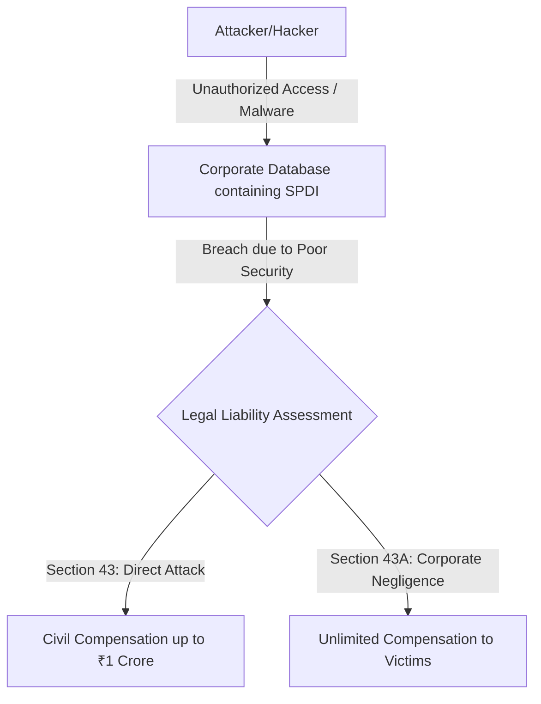
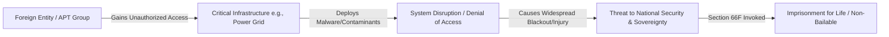
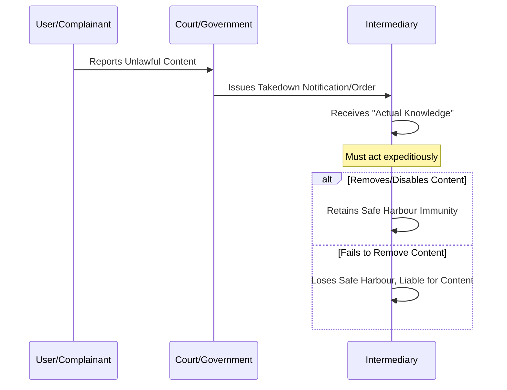

# Cyber Provisions under the IT Act, 2000 - Comprehensive Cybersecurity Notes

## 1. Executive Overview & Core Concepts

### Module Summary
This module provides a comprehensive analysis of the **Information Technology Act, 2000 (IT Act)**, which serves as India's primary legislation governing cyberspace, digital transactions, and electronic governance. The act provides legal recognition to electronic records and establishes a framework of rights, responsibilities, and penalties for digital activities. 

### Fundamental Legal & Security Principles
- **Civil vs. Criminal Liability:** The IT Act distinguishes between civil wrongs (compensable) and criminal offences (imprisonment/fines). The differentiating factor is often **mens rea** (intent) — such as acting "dishonestly" or "fraudulently."
- **SPDI (Sensitive Personal Data or Information):** A critical concept in Indian cyber law, referring to passwords, financial data, health records, sexual orientation, and biometric data, which require stringent corporate protection.
- **Safe Harbour Protection:** The principle that intermediaries (like ISPs or social media platforms) are not liable for third-party content, provided they act as neutral conduits and comply with takedown notices.
- **Critical Information Infrastructure (CII):** Computer resources whose incapacitation would severely impact national security, economy, or public health. Attacks on CII are treated as acts of terrorism.

---

## 2. Page-by-Page / Slide-by-Slide Detailed Breakdown

### 2.1 Civil Offences & Corporate Liability (Sections 43 & 43A)

#### Core Technical Mechanisms
- **Section 43 (Unauthorized Access):** Penalizes unauthorized access, downloading data, introducing malware, and Denial of Service (DoS) attacks. It protects the **CIA Triad** (Confidentiality, Integrity, and Availability) of computer systems. Remedy is civil compensation up to ₹1 crore.
- **Section 43A (Corporate Negligence):** Holds "body corporates" liable for failing to implement "reasonable security practices" (e.g., IS/ISO/IEC 27001) when handling SPDI. There is **no upper cap** on compensation.

#### Attack Vectors & Vulnerabilities
- **Insider Threats & External Hackers:** Exploiting weak access controls to exfiltrate databases.
- **Negligent Security Architecture:** Failing to patch vulnerabilities, lacking encryption, or poor IAM (Identity and Access Management) leading to data breaches.

#### Defensive Strategies & Controls
- Implement strong Access Control (RBAC) and Multi-Factor Authentication (MFA).
- Comply with ISO/IEC 27001 standards to establish "reasonable security practices" as a legal defense under Sec 43A.
- Deploy IDS/IPS and endpoint protection to detect malware introduction.

#### Visual Diagram: Data Breach & Compensation Flow

---

### 2.2 Tampering & General Cybercrime (Sections 65, 66, 66B)

#### Core Technical Mechanisms
- **Section 65 (Source Code Tampering):** Criminalizes concealing, destroying, or altering code legally required to be maintained. Protects software integrity. 
- **Section 66 (Computer-Related Offences):** The criminal equivalent of Section 43. Any act under Sec 43 committed with "dishonest or fraudulent intent" becomes a criminal offence.
- **Section 66B (Handling Stolen Resources):** Penalizes receiving or retaining stolen digital assets (hardware or data).

#### Attack Vectors & Vulnerabilities
- **Logic Bombs/Insider Code Modification:** Employees modifying billing source code to redirect funds.
- **Stolen Credentials Market:** Purchasing stolen hard drives or proprietary code on the dark web.

#### Defensive Strategies & Controls
- Implement strict Software Configuration Management (SCM) and code signing.
- Monitor privileged developer accounts using PAM (Privileged Access Management) solutions.
- Enforce strict hardware asset management and endpoint encryption to protect stolen devices.

---

### 2.3 Identity & Impersonation Offences (Sections 66C & 66D)

#### Core Technical Mechanisms
- **Section 66C (Identity Theft):** Fraudulent use of electronic signatures, passwords, OTPs, or biometrics.
- **Section 66D (Cheating by Impersonation):** Using computer resources to deceive by pretending to be someone else.

#### Attack Vectors & Vulnerabilities
- **Phishing & Vishing:** Fraudsters mimicking banks or government authorities via email (phishing) or VoIP calls (vishing) to extract OTPs.
- **Credential Stuffing:** Using leaked passwords from one service to access another.

#### Defensive Strategies & Controls
- Implement robust OTP verification mechanisms and transaction alerts.
- Deploy anti-phishing email gateways and DMARC/SPF/DKIM records.
- User education on social engineering tactics.

---

### 2.4 Privacy, Content & Obscenity (Sections 66A, 66E, 67, 67A, 67B)

#### Core Technical Mechanisms
- **Section 66A (Struck Down):** Previously penalized offensive online communication. Struck down in *Shreya Singhal v. Union of India (2015)* for violating Article 19(1)(a) (Freedom of Speech).
- **Section 66E (Privacy Violation):** Criminalizes capturing/publishing images of private areas without consent (revenge porn, voyeurism).
- **Section 67 (Obscenity), 67A (Sexually Explicit), 67B (CSAM):** Graduated penalties for explicit content. 67B specifically targets Child Sexual Abuse Material.

#### Attack Vectors & Vulnerabilities
- Non-consensual sharing of intimate media via messaging apps.
- Hosting of CSAM on dark web peer-to-peer networks.
- Creating fake social media profiles for harassment.

#### Defensive Strategies & Controls
- Automated content moderation tools (AI/ML image hashing, e.g., PhotoDNA for CSAM).
- Strict intermediary reporting guidelines under IT Rules, 2021.

---

### 2.5 Cyber Terrorism & National Security (Section 66F)

#### Core Technical Mechanisms
Section 66F defines **Cyber Terrorism** as acts intended to threaten India's unity, integrity, or security by:
1. Denying authorized access to CII.
2. Introducing contaminants causing death/injury.
3. Damaging CII (power grids, defense networks).

#### Attack Vectors & Vulnerabilities
- **State-Sponsored APTs (Advanced Persistent Threats):** Coordinated attacks on national power grids (e.g., similar to Stuxnet or Ukraine grid attacks).
- **SCADA/ICS Exploitation:** Targeting Industrial Control Systems.

#### Defensive Strategies & Controls
- National Critical Information Infrastructure Protection Centre (NCIIPC) mandates.
- Air-gapping critical networks.
- Threat intelligence sharing between government and private sector.

#### Visual Diagram: Cyber Terrorism Escalation Pathway

---

### 2.6 Government Powers & Intermediary Liability (Sections 69 & 79)

#### Core Technical Mechanisms
- **Section 69 (Interception/Decryption):** Empowers government to monitor/decrypt data for national security. Non-compliance by ISPs carries up to 7 years imprisonment. (Section 69A: blocking; 69B: monitoring).
- **Section 79 (Safe Harbour):** Protects intermediaries from third-party content liability, *provided* they act as neutral conduits and comply with takedown orders.

#### Attack Vectors & Vulnerabilities
- Intermediaries failing to remove malicious content (CSAM, terror propaganda) after receiving actual knowledge.
- ISPs refusing to provide lawful intercepts for counter-terrorism.

#### Defensive Strategies & Controls
- Intermediaries must appoint Grievance Officers and publish monthly compliance reports.
- Takedown procedures must align with *Shreya Singhal* ruling (requires court order or government notification).

#### Visual Diagram: Section 79 Safe Harbour Takedown Flow

---

## 3. Comparative Summary & Matrix

| Section | Offence | Nature of Liability | Key Differentiator / Intent | Punishment / Remedy |
| :--- | :--- | :--- | :--- | :--- |
| **43** | Unauthorized access & data damage | Civil | No intent required | Compensation up to ₹1 crore |
| **43A** | Corporate negligence (SPDI breach) | Civil | Failure to implement reasonable security | Unlimited compensation |
| **65** | Tampering with source documents | Criminal | Knowingly concealing/altering code | Up to 3 yrs / ₹2 lakh fine |
| **66** | Computer-related offences | Criminal | Dishonest/fraudulent intent (Sec 43 acts) | Up to 3 yrs / ₹5 lakh fine |
| **66A** | Offensive online messages | *Unconstitutional* | Struck down in 2015 | N/A (No longer in force) |
| **66B** | Receiving stolen computer resources | Criminal | Knowing it is stolen | Up to 3 yrs / ₹1 lakh fine |
| **66C** | Identity theft | Criminal | Fraudulent use of digital identity | Up to 3 yrs + ₹1 lakh fine |
| **66D** | Cheating by impersonation | Criminal | Deception via computer resource | Up to 3 yrs + ₹1 lakh fine |
| **66E** | Violation of privacy | Criminal | Non-consensual capture of private images | Up to 3 yrs / ₹2 lakh fine |
| **66F** | Cyber terrorism | Criminal | Intent to threaten national unity/security | **Life Imprisonment** |
| **67** | Publishing obscene content | Criminal | Lascivious/prurient interest | 3-5 yrs / ₹5-10 lakh fine |
| **67A** | Sexually explicit content | Criminal | Explicit sexual acts | 5-7 yrs / ₹10 lakh fine |
| **67B** | Child Sexual Abuse Material (CSAM) | Criminal | Depicts minors; strict liability | 5-7 yrs / ₹10 lakh fine (+POCSO) |
| **69** | Non-compliance with monitoring | Criminal | Refusing govt interception orders | Up to 7 yrs imprisonment |
| **79** | Intermediary safe harbour | Conditional | Fails to act on takedown orders | Loses immunity, liable for content |

---

## 4. Key Terminology & Cheat Sheet

- **IT Act, 2000:** The primary legislation in India governing cybercrime, electronic commerce, and digital governance.
- **SPDI (Sensitive Personal Data or Information):** Defined under IT Rules, 2011; includes passwords, financial info, health records, biometrics, and sexual orientation.
- **Body Corporate:** A company, firm, or association of persons liable under Section 43A for data protection.
- **CSAM:** Child Sexual Abuse Material. Prosecuted under Sec 67B and the POCSO Act, 2012.
- **Safe Harbour:** Legal immunity (Sec 79) protecting intermediaries from liability for user-generated content.
- **Actual Knowledge:** Under the *Shreya Singhal* ruling, intermediaries lose safe harbour only if notified by a court order or government directive, not merely by a private complaint.
- **Critical Information Infrastructure (CII):** Computer systems essential to national security (e.g., defense, power grids, banking).
- **Shreya Singhal v. Union of India (2015):** Landmark Supreme Court case that struck down Section 66A and clarified Section 79 takedown procedures.
- **POCSO Act, 2012:** Protection of Children from Sexual Offences Act; applies alongside Sec 67B for stricter punishment.
- **IS/ISO/IEC 27001:** International standard for information security management, recognized as a "reasonable security practice" under Sec 43A.