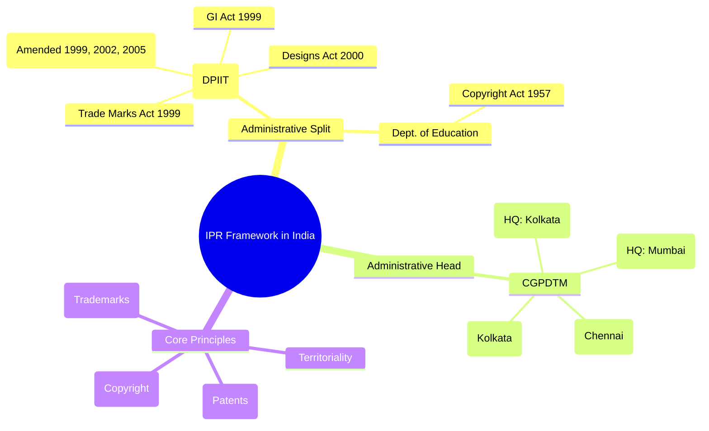
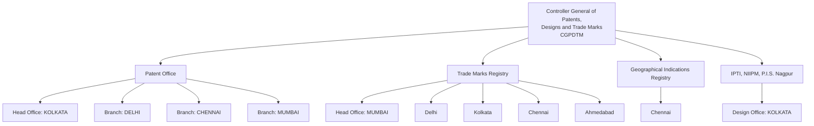
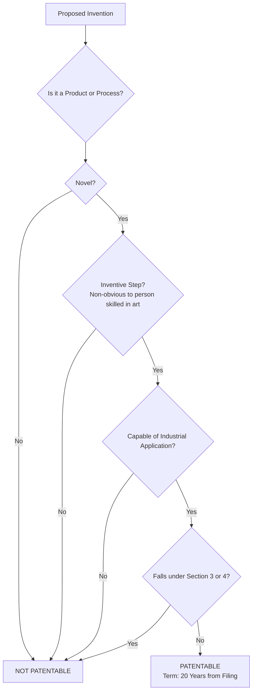

# Intellectual Property Rights in India: Patents, Copyrights & Trademarks — Comprehensive Master's-Level Notes

## 1. Executive Overview & Core Concepts

This module synthesizes three instructional decks covering the **legislative framework, substantive law, and case law** governing the three primary pillars of Intellectual Property (IP) in India: **Patents**, **Copyrights**, and **Trademarks** (with supporting context on Designs and Geographical Indications). The material is drawn from the provided slide decks on IPR & Patent Law, Introduction to Copyright, and Trademark Law in India, enriched with current legislative context.

### 1.1 Fundamental Definitions & Security Principles (Adapted to IP)
*   **Intellectual Property (IP):** Creations of the mind—inventions, literary and artistic works, designs, and symbols, names and images used in commerce.
*   **Intellectual Property Rights (IPR):** Legal rights granted to creators/owners over the use of their creations, typically for a limited period.
*   **Territoriality:** IP rights are jurisdiction-specific; protection in India is granted under Indian statutes and does not automatically extend to other countries.
*   **The Bargain Theory (Patents):** A patent is a **statutory monopoly** granted by the state in exchange for **full public disclosure** of the invention, enriching the technical knowledge base 【turn0search0】.
*   **Idea-Expression Dichotomy (Copyright):** Copyright protects the **original expression** of an idea, **not the idea itself**. Two independent creators can copyright identical expressions of the same concept.
*   **Distinctiveness (Trademarks):** A trademark must function as a **source identifier**, distinguishing the goods/services of one undertaking from those of others.

### 1.2 The Governing Statutes & Administrative split
India’s IP administration is split between two government departments, a key structural fact highlighted in the source material:
*   **Department for Promotion of Industry and Internal Trade (DPIIT, formerly Department of IP&P):** Oversees the **Patents Act, 1970** (as amended in 1999, 2002, 2005), the **Designs Act, 2000**, the **Trade Marks Act, 1999**, and the **Geographical Indications of Goods (Registration & Protection) Act, 1999**.
*   **Department of Education (Ministry of Education):** Oversees the **Copyright Act, 1957**.

The administrative head is the **Controller General of Patents, Designs and Trade Marks (CGPDTM)**, who supervises the Patent Office, the Trade Marks Registry, the GI Registry, and the Design Office, with headquarters and branch offices across major Indian cities 【turn0search0】.



---

## 2. Page-by-Page / Slide-by-Slide Detailed Breakdown

### Part A: The Indian IP Administrative & Legislative Framework (Source Deck 1, Slides 2–4)

**Slide 2: Legislative Framework**
The deck clarifies the jurisdictional split:
*   **Department of IP&P covers:**
    *   **The Patents Act, 1970** (as amended in 2005) and **The Patents Rules, 2003** (as amended in 2006).
    *   **The Designs Act, 2000** and **The Designs Rules, 2001** (as amended in 2008).
    *   **The Trade Marks Act 1999** and **The Trade Marks Rules 2002**.
    *   **The Geographical Indications of Goods (Registration & Protection) Act, 1999** and its Rules, 2002.
*   **Department of Education covers:**
    *   **The Copyrights Act 1957** (amended in 1999, with significant amendments in 2012).

> **💡 Exam Tip:** The administration of Copyright (a creative right) under the Department of Education (vs. Industrial Property under DPIIT) reflects the historical distinction between *literary/artistic* and *industrial/commercial* property.

**Slide 3: CGPDTM Organizational Structure**
The **Controller General of Patents, Designs and Trade Marks (CGPDTM)** is the apex administrative authority. The structure is as follows:



**Slide 4: Law and Regulations - Amendment Timeline**
The Patents Act, 1970 has been amended in **1999, 2002, and 2005**. The 2005 amendment was pivotal, as it introduced **product patents in all fields of technology**, including pharmaceuticals, chemicals, and food, by deleting the earlier Section 5 bar 【turn0search2】【turn0search3】. The Patents Rules, 2003 were amended in **2005 and 2006**.

---

### Part B: Patent Law in India (Source Deck 1, Slides 5–28)

**Slide 6: What is a Patent?**
A **patent** is an **exclusive statutory right** granted by the Government to the patentee for a limited period (20 years from filing) in exchange for **full disclosure** of the invention. The patentee gains the right to **exclude others** from making, using, selling, offering for sale, or importing the patented product or process 【turn0search0】.

**Slide 7: What Can Be Patented in India?**
To be patentable, an invention must satisfy **four cumulative criteria**:
1.  **Novelty:** It must be new.
2.  **Inventive Step (Non-obviousness):** It must not be obvious to a person skilled in the art.
3.  **Industrial Applicability:** It must be capable of being made or used in any kind of industry.
4.  **Not within Sections 3 & 4:** It must not fall under the statutory exclusions.

**Slide 8: Definition of "Invention" (Sec. 2(1)(J))**
The Act defines invention as a **new product or process involving an inventive step and capable of industrial application**.

**Slide 9: Patentable Subject Matter**
The invention must relate to a **process or product or both**, and meet the criteria outlined in Slide 7.

**Slides 10–12: Core Patentability Criteria Detailed**
*   **"New" (Novelty):** The invention must not be:
    *   Published in India or elsewhere.
    *   In prior public knowledge or use within India.
    *   Claimed before in any specification in India.
*   **Inventive Step:** A feature that involves a **technical advance** compared to existing knowledge, has **economic significance**, or both, and makes the invention **non-obvious** to a person skilled in the art.
*   **Industrial Application:** The invention is capable of being made or used in any industry.

**Slide 13: Term of Patent**
The term of every patent granted under the Patents Act is **20 years from the date of filing** of the application.

**Slides 14–26: Section 3 & Section 4 Exclusions (Non-Patentable Inventions)**
This is the most dense and exam-critical section. Section 3 lists categories that are "not inventions." Below is a consolidated summary:

| Section | Exclusion | Examples from Deck |
| :--- | :--- | :--- |
| **3(a)** | Frivolous inventions or contrary to well-established natural laws. | Perpetual motion machine; Machine giving >100% performance. |
| **3(b)** | Commercial exploitation contrary to public order/morality, or causing serious prejudice to health, human, animal, plant life, or environment. | Gambling devices; Biological warfare agents; Terminator gene technology. |
| **3(c)** | Mere discovery of a scientific principle, abstract theory, or discovery of any living thing or non-living substance occurring in nature. | Newton’s Laws; Discovery of a microorganism or natural gas. |
| **3(d)** | Mere discovery of a new form of a known substance without enhancement of known efficacy, or new use of a known process/machine/apparatus unless it results in a new product or employs a new reactant. | New use of Aspirin for heart ailments; Mere new uses of Neem. |
| **3(e)** | Substance obtained by **mere admixture** resulting only in the aggregation of properties. | Combiflam (Paracetamol+Brufen); Sugar+color in water (soft drink). **However:** Synergistic mixtures (e.g., soaps, lubricants) may be patentable. |
| **3(f)** | Mere arrangement or re-arrangement or duplication of known devices, each functioning independently. | A bucket fitted with a torch; An umbrella with a fan; A clock and radio in a single cabinet. |
| **3(h)** | Method of agriculture or horticulture. | Cultivation of algae; Producing a new form of a known plant. **However:** Agricultural equipment is patentable. |
| **3(i)** | Any process for medicinal, surgical, curative, prophylactic, diagnostic, or therapeutic treatment of human beings or animals. | Surgical processes; Method of vaccination. **However:** Treatment on tissues/fluids removed from body, and surgical/diagnostic apparatus, are patentable. |
| **3(j)** | Plants, animals, seeds, varieties, species, and essentially biological processes for their production. | (Direct exclusion, no examples given in deck). |
| **3(k)** | **Mathematical method, business method, algorithms, or computer programme *per se*.** | Computer program by itself or as a record on a carrier. **However:** A new calculating machine or a combination of hardware and software with technical effect is patentable. |
| **3(p)** | Inventions which are **Traditional Knowledge** or an aggregation/duplication of known properties of traditionally known components. | Wound healing property of Haldi (Turmeric). **However:** Value-addition using TK leading to a novel, inventive product/process (e.g., Extraction of Azadirachtin from Neem) can be patented. |
| **Section 4** | Inventions falling within Section 20(1) of the **Atomic Energy Act, 1962**. | Inventions relating to compounds of Uranium, Thorium, Plutonium, etc. |

**Slide 24 & Current Context on Section 3(k):**
The exclusion of "computer programme *per se*" is a major hurdle for software patents in India. The **Guidelines for Examination of Computer Related Inventions (CRI), 2025** attempt to clarify that software must demonstrate a **technical effect** or **technical contribution** to overcome the Section 3(k) bar 【turn0search5】【turn0search6】. This is a dynamic and contentious area of law, with debates on whether it stifles AI and software innovation 【turn0search7】.



**Slides 27–28: Case Law – Ericsson vs. Xiaomi**
In December 2014, **Ericsson sued Xiaomi** in the Delhi High Court for infringement of **8 Standard-Essential Patents (SEPs)** related to 2G/3G/EDGE technologies. The court granted an **ex-parte injunction** on the sale, manufacture, and import of Xiaomi devices (Mi3, Redmi1S, Redmi Note 4G). Xiaomi challenged it, and the Division Bench allowed sales **subject to conditions**: Xiaomi could only sell devices with Qualcomm chips and had to deposit **₹100 per device** as royalty into a fixed deposit 【turn0search15】【turn0search17】. This case is seminal in Indian **FRAND** (Fair, Reasonable, and Non-Discriminatory) licensing jurisprudence, highlighting the tension between patent rights and competition law in the telecom sector.

---

### Part C: Copyright Law in India (Source Deck 2, Slides 1–34)

**Slide 2: What is Copyright?**
Quoting the Oxford Dictionary: "The exclusive right given by law for a certain term of years to an author, composer etc. (or his assignee) to print, publish and sell copies of his original work."

**Slide 3: Scope of Protection**
The Copyright Act, 1957 protects **original literary, dramatic, musical, and artistic works**, cinematograph films, and sound recordings from unauthorized use. Crucially, copyright protects **expressions, not ideas**.

**Slides 4–6: What Copyright Protects**
*   **Original Literary, Dramatic, Musical and Artistic Works:** Novels, poems, books, computer programmes, databases, song lyrics.
*   **Cinematograph Films**
*   **Sound Recordings**
*   **Computer Software:** Includes programme manuals, punched cards, magnetic tapes/discs, printouts, and the programmes themselves.

**Slide 7: Compulsory Registration?**
**No.** Copyright protection is **automatic** upon creation of the work; no formality is required. Registration is not mandatory but serves as **prima facie evidence** of ownership in court disputes.

**Slide 8: Copyright Act 1957 – Main Features**
*   Valid from **21 January 1958**.
*   Created the **Copyright Office** and **Copyright Board**.
*   Introduced **civil and criminal remedies** against infringement.

**Slides 9–11: Term of Copyright (Detailed Breakdown)**
The term depends on the type of work and publication status:

| Type of Work | Term of Protection | Example from Deck |
| :--- | :--- | :--- |
| **Literary, Dramatic, Musical, Artistic Works** | **Life of the author + 60 years**. | Author dies in 2020 → Copyright until 2080. |
| **Cinematographic Films** | **60 years from year of publication**. | Film released in 2005 → Copyright until 2065. |
| **Sound Recordings** | **60 years from year of publication**. | Song released in 2010 → Copyright until 2070. |
| **Government Works** | **60 years from first publication**. | Govt. report published in 1995 → Until 2055. |
| **Anonymous/Pseudonymous Works** | **60 years from publication** (unless author’s identity is disclosed). | Anonymous book published in 2000 → Until 2060. |
| **Posthumous Works** (published after author’s death) | **60 years from publication**. | Unpublished novel published in 2025 → Until 2085. |

**Slide 12: Idea vs. Expression**
Quoting the **Gregory Committee Report, 1952**: "There is nothing in the notion of copyright to prevent a second person from producing an identical result..." This underscores the **idea-expression dichotomy**.

**Slide 13: Copyright Registration**
*   Registration is **not mandatory** (Berne Convention compliance).
*   India is a member of the **Berne Convention** and the **Universal Copyright Convention**, so works created in member states are protected in India.
*   Registration is advisable as the certificate serves as **prima facie evidence** in court and eases licensing/assignment.

**Slide 14: Where & Who Can File**
*   Since **August 01, 2014**, all copyright applications are filed **online** at **www.copyright.gov.in** or by Speed Post.
*   **Who can file:** The author, rightful owner, assignee, or legal heir.

**Slides 15–16: Rights Under Copyright**
Copyright is a **bundle of rights**, including:
*   **Economic Rights:** To reproduce, issue copies, perform/communicate to the public, translate, adapt, or make a film/sound recording.
*   **Moral Rights (Special Rights):**
    1.  **Right of Publication:** Decide whether to publish.
    2.  **Right of Paternity:** Claim authorship.
    3.  **Right of Integrity:** Prevent alteration/damage to honor or reputation.

**Slides 17–19: Infringement of Copyright**
*   **Section 51** defines infringement: Exercising any of the exclusive rights of the owner without authorization, or making/distributing/exhibiting/importing infringing copies.
*   **Primary (Direct) Infringement:** Unauthorized reproduction, distribution, public performance, or adaptation.
*   **Secondary (Indirect) Infringement:** Facilitating infringement (e.g., selling pirated DVDs, hosting pirated content on a website), importing infringing copies, or providing a platform for unauthorized distribution.

**Slides 20–21: Fair Dealing (Section 52)**
Section 52 provides **exceptions to infringement** (Fair Dealing) for:
1.  **Personal or private use, including research.**
2.  **Criticism or review** (with due acknowledgment).
3.  **Reporting of current events** (news, magazines, TV).
4.  **Educational use:** Reproduction by teachers/educational institutions for classroom instruction. This was the crux of the **DU Photocopy Case (2016)**.
5.  **Parody and Satire** (provided it does not substitute the original).
6.  **Judicial proceedings.**

**Slides 22–26: Remedies for Infringement**

```mermaid
flowchart LR
    A[Remedies for Copyright Infringement] --> B[Civil]
    A --> C[Criminal]
    A --> D[Administrative]
    
    B --> B1[Injunction<br/>Interim & Permanent]
    B --> B2[Damages]
    B --> B3[Accounts of Profits]
    B --> B4[Costs]
    
    C --> C1[Imprisonment<br/>6 months to 3 years]
    C --> C2[Fine<br/>₹50,000 to ₹2,00,000]
    C --> C3[Police Raid & Seizure<br/>without warrant (Sec. 64)]
```

*   **Civil Remedies:** Injunction (most effective), damages, account of profits, delivery up of infringing goods.
*   **Criminal Remedies:** Cognizable offences; imprisonment **6 months to 3 years**; fine **₹50,000 to ₹2,00,000**. Section 64 empowers police (not below sub-inspector rank) to **seize infringing copies without warrant**.

**Slides 27–33: Case Studies**
1.  **Whitmill v. Warner Bros. (The Hangover Part II):** Tattoo artist S. Victor Whitmill sued over the reproduction of Mike Tyson’s facial tattoo on Ed Helms. The court denied a preliminary injunction, and the case was settled. It highlighted that tattoos are copyrightable.
2.  **Saregama India v. Balaji Telefilms Ltd. (The Dirty Picture):** Saregama claimed infringement of the song "Ui Amma Ui Amma" by "Ooh La La Ooh La La." The Calcutta HC allowed the broadcast subject to Balaji depositing **₹2 crores** with the court pending resolution. It showcased the court’s effort to balance IP enforcement with commercial interests.
3.  **The Chancellor, Masters & Scholars of the Univ. of Oxford v. Rameshwari Photocopy Services:** The Delhi HC ruled in 2016 that **photocopying copyrighted material for educational purposes** (creating course packs) falls under **fair dealing (Section 52)**. The court held that the "course of instruction" includes all materials for study, and dissemination to students does not constitute "publication."

---

### Part D: Trademark Law in India (Source Deck 3, Slides 1–19)

**Slide 2: What is a Trademark?**
A **trademark** is a **distinctive sign or indicator** used by an individual or organization to identify the products of one trader from those of another. Simply, it is a "warden of a trader."

**Slide 3: Qualities of a Good Trademark**
A good trademark should be:
*   Easy to pronounce, spell, remember.
*   **Distinctive** and not deceptively similar to existing marks.
*   **Not descriptive** (e.g., "Cold and Ice" for ice cream).
*   Avoid **laudatory words** (e.g., "Best," "Perfect").
*   Examples: Reebok, McDonald’s, Nike, Levi’s.

**Slide 4: Examples of Trademarks** (Visual slide showing global logos).

**Slide 5: Service Marks**
Where a trademark is used in connection with **services** (hotels, airlines, restaurants, tourist agencies, laundries), it may be called a **service mark**.

**Slide 6: Trademark vs. Service Mark (Comparison Table)**

| Feature | Trademark (™) | Service Mark (℠) |
| :--- | :--- | :--- |
| **Definition** | Protects brand names, logos, symbols associated with **goods** (physical products). | Protects brand names, logos, symbols associated with **services** (intangible offerings). |
| **Scope** | Clothing, electronics, packaged goods. | Consulting, legal services, hospitality. |
| **Symbol** | ™ (before registration), ® (after). | ℠ (before registration), ® (after, though less common). |
| **Legal Protection** | Prevents others from using a similar mark on **similar goods**. | Prevents others from using a similar mark on **similar services**. |
| **Example** | Nike’s "Swoosh" logo for shoes. | FedEx’s name/logo for delivery services. |

**Slide 7: Classes of Trademark**
Trademarks are classified into **45 classes** under the **Nice Classification** system: **Classes 1–34** cover goods, and **Classes 35–45** cover services 【turn0search11】【turn0search13】. Registration is sought per class.

**Slides 8–9: Is Registration Mandatory?**
*   **No**, registration is not mandatory in India but is **advisable**.
*   **Benefits of Registration:** Identifies origin, advertises goods/services, guards commercial goodwill, protects the public from second-rate goods.
*   **Designation:** **™** for unregistered marks; **®** for registered marks.

**Slide 10: Term of Trademark**
Unlike patents/copyrights, a registered trademark can be protected **in perpetuity**, subject to:
1.  It is **used** and **renewed** periodically (**every 10 years**).
2.  The registered proprietor takes **prompt action against infringers**.

**Slide 11: Who Can Register?**
Individuals, business entities, proprietorship firms, partnership firms, LLPs, companies (Private/Public Ltd.), Trusts & NGOs, and foreign companies (conducting business in India).

**Slide 12: Legal Remedies – Infringement & Passing Off**
*   Both **civil and criminal remedies** are simultaneously available.
*   **Infringement:** Violation of exclusive rights of the **registered proprietor**. Unauthorized use of an identical/similar/deceptively similar mark.
*   **Passing Off:** A **common law tort** to protect **goodwill** against misrepresentation. It protects the **prior user**’s vested rights, even if unregistered.

**Slide 14: Elements of Passing Off**
Based on the classical trinity from *Reckitt & Colman Ltd v. Borden Inc.*:
1.  **Goodwill:** Plaintiff must have a strong reputation.
2.  **Misrepresentation:** Defendant falsely represents their goods/services as those of the plaintiff.
3.  **Damage:** Plaintiff has suffered or is likely to suffer loss.

**Slide 15: Trademark Infringement vs. Passing Off (Comparison Table)**

| Feature | Passing Off | Trademark Infringement |
| :--- | :--- | :--- |
| **Legal Basis** | **Common law** (no registration required). | **Statutory law** (Trade Marks Act, 1999). |
| **Protection** | Protects **business goodwill**. | Protects **registered trademarks**. |
| **Requirement** | Prove **deception and damage**. | Prove **unauthorized use** of registered mark. |
| **Burden of Proof** | Plaintiff must establish **goodwill & misrepresentation**. | Plaintiff only needs to show **unauthorized use**. |

**Slide 16: Relief Granted by Courts**
Courts may grant **permanent and interim injunctions**, damages or account of profits, delivery of infringing goods for destruction, and costs. Interim reliefs include appointment of a local commissioner for search, seizure, and preservation of evidence, and restraining orders against asset disposal.

**Slide 17: Offences and Penalties**
Criminal action for infringement/passing off is punishable with:
*   **Imprisonment:** 6 months to 3 years.
*   **Fine:** ₹50,000 to ₹2,00,000.

**Slide 18: Case Law References** (External links to compilations of trademark cases in India).

---

## 3. Comparative Summary & Matrix

### 3.1 Master Comparison: Patents vs. Copyrights vs. Trademarks

| Aspect | **Patents** | **Copyrights** | **Trademarks** |
| :--- | :--- | :--- | :--- |
| **Governing Act** | Patents Act, 1970 (Amended 1999, 2002, 2005) | Copyright Act, 1957 (Amended 2012, etc.) | Trade Marks Act, 1999 |
| **Subject Matter** | **Inventions** (new product/process with inventive step & industrial application). | **Original works of authorship** (literary, dramatic, musical, artistic, films, sound recordings). | **Distinctive signs** (words, logos, symbols, names) used in trade. |
| **What is Protected** | **Functional, technical ideas** (the invention itself). | **Expression of ideas** (not the ideas themselves). | **Source identifiers** (brand identity). |
| **Registration Required?** | **Yes.** Must file and be granted. | **No.** Automatic upon creation. | **No.** Can exist unregistered (common law) or registered. |
| **Term of Protection** | **20 years** from filing date. | Life + 60 years (for literary/artistic); 60 years from publication (for films/sound recordings). | **10 years**, renewable **indefinitely** (in perpetuity). |
| **Key Exclusions** | Section 3 & 4 (discoveries, business methods, computer programs per se, traditional knowledge, atomic energy). | Idea-expression dichotomy; facts; official texts. | Descriptive marks, deceptive marks, marks likely to cause confusion. |
| **Primary Right** | To **exclude others** from making, using, selling, importing the invention. | To **reproduce, distribute, perform, display, adapt** the work. | To **use the mark** and to **prevent others** from using confusingly similar marks. |
| **Remedies** | Civil (injunction, damages, account of profits); Criminal (fines, imprisonment). | Civil (injunction, damages, account of profits); Criminal (fines, imprisonment); Administrative (customs). | Civil (injunction, damages, account of profits); Criminal (fines, imprisonment). |

### 3.2 Internal Comparison: Infringement vs. Passing Off (from Trademark Deck)
*(Already detailed in Slide 15 comparison table above.)*

---

## 4. Key Terminology & Cheat Sheet

### 4.1 Glossary of Key Terms
*   **CGPDTM:** Controller General of Patents, Designs and Trade Marks. The administrative head of the Indian Patent Office and Trade Marks Registry 【turn0search0】.
*   **CRI Guidelines:** Guidelines for Examination of Computer Related Inventions (2025) that clarify the patentability of software and AI inventions under Section 3(k) 【turn0search6】.
*   **Fair Dealing:** A set of statutory exceptions under Section 52 of the Copyright Act that permit limited use of copyrighted material without permission (e.g., for education, research, criticism) 【turn0search4】.
*   **FRAND:** Fair, Reasonable, and Non-Discriminatory. Licensing terms required for Standard Essential Patents (SEPs), as seen in the *Ericsson v. Xiaomi* case 【turn0search17】.
*   **Nice Classification:** The international classification system for trademarks, dividing goods and services into **45 classes** (1-34 for goods, 35-45 for services) 【turn0search11】.
*   **Passing Off:** A common law tort action to protect the goodwill of a business from misrepresentation by others, available even for unregistered marks.
*   **Prior Art:** Existing knowledge or publications available before the filing date of a patent application, used to assess novelty and inventive step.
*   **Section 3(d):** A critical provision in Indian patent law that excludes mere new forms of known substances without enhanced efficacy, famously invoked in the *Novartis* case 【turn0search3】.
*   **Standard Essential Patent (SEP):** A patent that is essential to practicing a technical standard (e.g., 4G, Wi-Fi). Owners of SEPs commit to license on FRAND terms 【turn0search19】.
*   **Trade Dress:** The overall appearance and image of a product in the marketplace, which can be protected under trademark law if it is distinctive and non-functional.

### 4.2 Quick Reference Cheat Sheet

| Item | Key Number / Fact |
| :--- | :--- |
| **Patent Term** | **20 years** from filing date. |
| **Copyright Term (General)** | **Life of author + 60 years**. |
| **Copyright Term (Films/Sound Recordings)** | **60 years** from publication. |
| **Trademark Renewal** | **10 years**, renewable indefinitely. |
| **Total Trademark Classes** | **45 classes** (1-34 goods, 35-45 services). |
| **Criminal Penalty (Copyright)** | **6 months to 3 years** imprisonment; Fine **₹50,000 - ₹2,00,000**. |
| **Criminal Penalty (Trademark)** | **6 months to 3 years** imprisonment; Fine **₹50,000 - ₹2,00,000**. |
| **Patent Office Head Office** | **Kolkata**. |
| **Trade Marks Registry Head Office** | **Mumbai**. |
| **GI Registry Location** | **Chennai**. |
| **Key Case: Patent Law** | ***Ericsson v. Xiaomi*** (FRAND, SEPs, interim royalty). |
| **Key Case: Copyright** | ***DU Photocopy Case*** (Educational fair dealing). |
| **Key Case: Trademark** | ***Reckitt & Colman v. Borden*** (Classical trinity for passing off). |

---
**End of Notes.** These notes synthesize the provided instructional material, enriched with current statutory context and case law. For a complete study, refer back to the original slide decks for visual examples and the cited web sources for legislative texts.