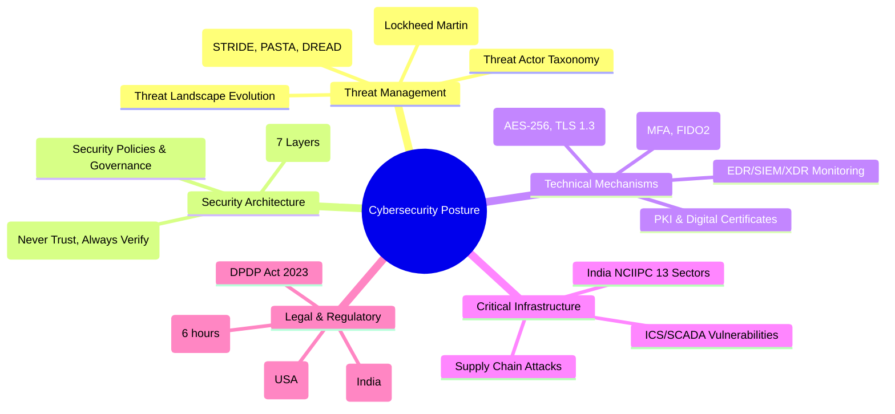
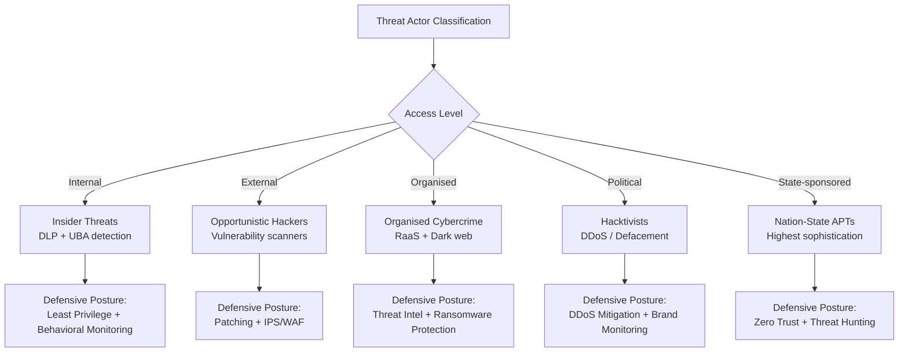
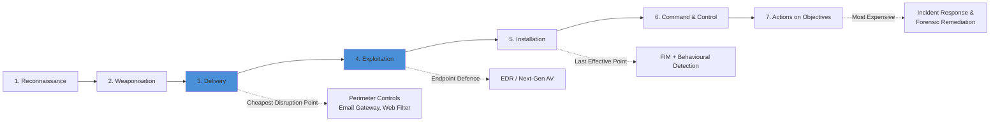
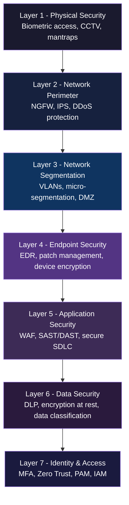
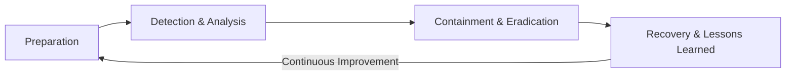
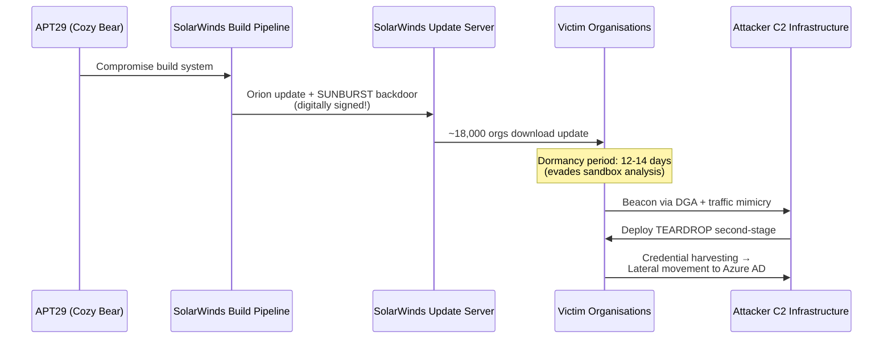
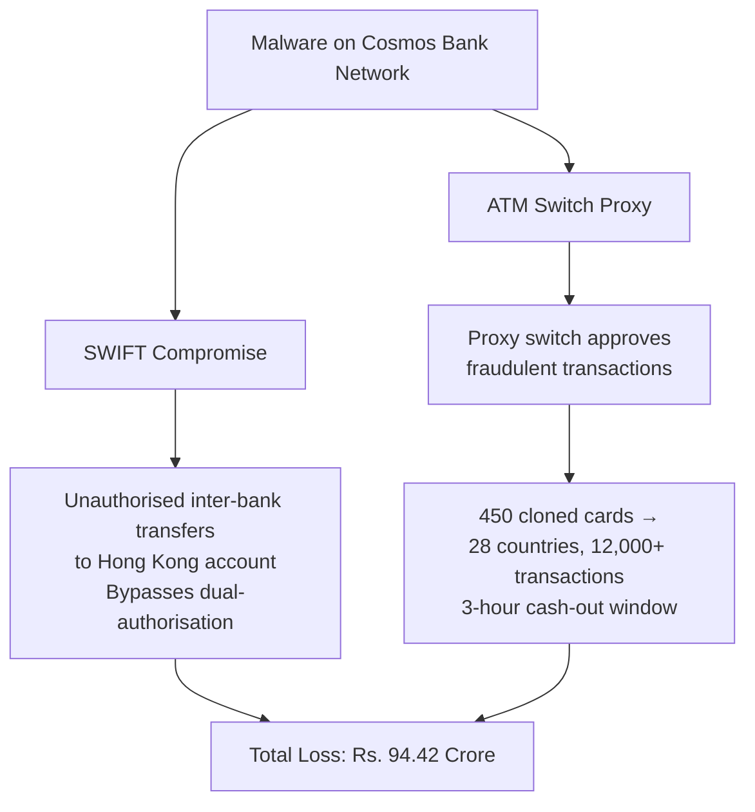
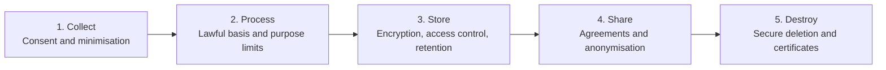

# Cybersecurity: Threat Management, Application Security, Critical Infrastructure & Defence Mechanisms — Comprehensive Master's-Level Notes

## 1. Executive Overview & Core Concepts

This module synthesizes two instructional slide decks covering modern cybersecurity for MCA/university-level practitioners:

**Deck 1 — "Management of Malicious Intent, Threat Scenarios, Critical Infrastructure & Security Mechanisms"** (13 chapters + 4 case studies) focusing on:
*   Threat landscape evolution, threat actors, the Cyber Kill Chain, and threat modelling
*   Critical infrastructure (with a strong India focus via NCIIPC), security targets (CIA+), policies & governance
*   Core/advanced security mechanisms, defence-in-depth architecture, incident response, and emerging trends
*   Four deep-dive case studies: **SolarWinds (2020)**, **Log4Shell (2021)**, **Cosmos Bank India (2018)**, **AIIMS Delhi (2022)**

**Deck 2 — "Security Requirements Across Application Domains"** (6 chapters + 2 case studies) focusing on:
*   Domain-specific security requirements (Banking, Healthcare, E-Commerce, Government)
*   Defence-in-Depth layered model, security control taxonomy, privacy & data protection
*   Computer misuse legislation (India's **IT Act 2000** and international frameworks)
*   OS hardening, secure network architecture, Zero Trust, and emerging trends (SASE, PQC)

### 1.1 Fundamental Definitions & Security Principles

*   **CIA Triad (extended to CIA+A+N):**
    *   **Confidentiality** — preventing unauthorized disclosure (e.g., via AES-256, TLS, DLP)
    *   **Integrity** — ensuring data is unaltered in transit and at rest (SHA-256 hashing, digital signatures, FIM)
    *   **Availability** — systems accessible when needed (redundancy, DDoS mitigation, DR/SLA failover)
    *   **Authenticity** — confirming identity of users, systems, and data sources (PKI, MFA, biometrics)
    *   **Non-repudiation** — actions cannot be denied after the fact (digital signatures, tamper-evident audit logs)
*   **Threat vs. Vulnerability vs. Risk:**
    *   **Threat** = potential cause of an unwanted incident (e.g., APT28, ransomware)
    *   **Vulnerability** = weakness that can be exploited (e.g., unpatched Apache Struts in Equifax)
    *   **Risk** = Threat × Vulnerability × Impact (managed via likelihood × impact matrices and **DREAD** scoring)
*   **Defence in Depth (DiD):** Multi-layered architecture assuming **any single control will eventually fail**; compensating controls at adjacent layers must be in place.
*   **Least Privilege / Separation of Duties / Secure by Default:** Complementary architectural principles.

---

## 2. Page-by-Page / Slide-by-Slide Detailed Breakdown

### PART A — Modern Threat Landscape & Threat Management (Deck 1, Chapters 1–5)

#### Chapter 1: Modern Cyber Threat Landscape

The threat landscape has evolved from **opportunistic script-kiddie attacks** to **state-sponsored, multi-vector, persistent operations**:

| Evolution Era | Dominant Threat Types |
| :--- | :--- |
| **1990s** | Viruses and worms (e.g., Morris Worm, ILOVEYOU) |
| **2000s–2010s** | Botnets, ransomware-as-a-service (RaaS), zero-day exploitation |
| **2020s+** | AI-powered intrusions, deepfakes, quantum-decryption threats, IoT/OT convergence attacks |

*   **Nation-State Operations:** **APT groups** like **Lazarus (DPRK)**, **APT28 (Russia)**, **Volt Typhoon (China)** conduct espionage, sabotage, and financial theft at **geopolitical scale**, targeting critical infrastructure and defence networks.
*   **Emerging Risks:** AI-generated phishing, deepfake social engineering, quantum decryption threats, IoT/OT convergence attacks.

> **💡 Exam Tip:** Know the evolution narrative: *human → technical → supply chain* attack vectors are now exploited **simultaneously** by modern adversaries — multi-vector defence is mandatory.

#### Chapter 2: Management of Malicious Intent — Threat Actor Taxonomy

Effective threat management begins with **accurately classifying adversaries by motivation, capability, and access level**:

| Actor Type | Examples / Behaviours | Primary Motivation |
| :--- | :--- | :--- |
| **Insider Threats** | Disgruntled employees, credential misuse, data exfiltration | Grievance or financial gain |
| **External Attackers** | Opportunistic hackers, vulnerability scanners | Financial |
| **Organised Cybercrime Groups** | RaaS operators, money mules, dark web markets | Profit |
| **Hacktivists** | Anonymous, political agenda, DDoS & defacement | Ideology |
| **Nation-State Attackers** | APT groups, long-dwell-time intrusions, zero-day exploitation | Espionage and sabotage |

> **⚠️ Warning:** **Insider threats are statistically underreported** — the **2023 Verizon DBIR notes 19% of breaches involve internal actors**. Nation-state actors represent the highest sophistication tier, often maintaining **undetected access for months**.

#### Chapter 3: The Cyber Kill Chain (Lockheed Martin)

Developed by **Lockheed Martin** (Hutchins et al., 2011), the framework maps the **seven stages of a targeted cyber attack**:

1.  **Reconnaissance** — Attacker researches the target (OSINT, port scanning, employee enumeration).
2.  **Weaponisation** — Coupling an exploit with a backdoor into a deliverable payload (e.g., malicious PDF/macro document).
3.  **Delivery** — Transmitting the weapon to the target (phishing email, USB, compromised website).
4.  **Exploitation** — Triggering the exploit to execute code on the victim's system.
5.  **Installation** — Installing malware/backdoor on the target asset.
6.  **Command & Control (C2)** — Compromised host establishes a channel to attacker infrastructure.
7.  **Actions on Objectives** — Achieving the goal: data exfiltration, ransomware deployment, destruction.

> **💡 Exam Tip:** **Early-stage disruption** (particularly at **Delivery** and **Exploitation**) is significantly **cheaper than post-Installation remediation**. Threat intelligence feeds mapped to kill chain stages drive **proactive blocking** at perimeter and endpoint layers.

#### Chapter 4: Threat Scenarios (Documented Real-World Attack Patterns)

| Scenario | Description | Primary Detection / Defence Controls |
| :--- | :--- | :--- |
| **Insider Attack** | Privileged IT admin copies sensitive customer data to encrypted USB over weeks | **DLP tools + User Behaviour Analytics (UBA)** |
| **Cloud Compromise** | Misconfigured S3 bucket / over-privileged IAM role; credential-stuffing for lateral movement | CSPM, least-privilege IAM, MFA |
| **Supply Chain Attack** | Malicious code injected into trusted software update (e.g., SolarWinds Orion); signed packages bypass verification | SBOMs, code-signing, third-party risk mgmt |
| **Ransomware Outbreak** | Emotet dropper via spear-phishing deploys **Ryuk**; encrypts ERP systems within hours | EDR, email filtering, offline backups |
| **Advanced Persistent Threat (APT)** | Nation-state covert access for 14 months; exfiltrates IP via **encrypted DNS tunnelling** | Anomalous traffic analysis, NDR |

#### Chapter 5: Threat Modelling

A **structured, proactive process** for identifying, analysing, and prioritising security threats **before they materialise**. Frameworks: **STRIDE, PASTA, DREAD**.

The four-stage process:

1.  **Asset Identification** — Enumerate all systems, data flows, APIs, third-party dependencies. Define **crown jewels**: PII, financial records, ICS/OT systems.
2.  **Attack Surface Analysis** — Identify all entry points: exposed APIs, remote access portals, unpatched endpoints, open cloud storage buckets, third-party integrations.
3.  **Threat Identification** — Map threats using **STRIDE** against each asset and data flow:
    *   **S**poofing — impersonation of user/device
    *   **T**ampering — unauthorized modification
    *   **R**epudiation — denial of action
    *   **I**nformation Disclosure — data leakage
    *   **D**enial of Service — availability attack
    *   **E**levation of Privilege — unauthorized access escalation
4.  **Risk Prioritisation & Mitigation** — Score threats using **likelihood × impact matrices**; prioritise controls using **DREAD** scoring (*Damage, Reproducibility, Exploitability, Affected users, Discoverability*). Assign ownership, timelines, and **residual risk acceptance**.

> **💡 Exam Tip:** STRIDE maps 1:1 to CIA+ attributes — Spoofing↔Authenticity, Tampering↔Integrity, Repudiation↔Non-repudiation, Info Disclosure↔Confidentiality, DoS↔Availability, EoP↔Authorisation.

---

### PART B — Critical Infrastructure (Deck 1, Chapter 6)

#### Critical Infrastructure: Sectors & Stakes

**Critical Infrastructure (CI)** comprises systems whose disruption would have **severe cascading consequences on national security, economic stability, or public safety**. **India designates 13 critical sectors under the NCIIPC (National Critical Information Infrastructure Protection Centre) mandate.**

Six illustrative sectors and their components:

| Sector | Key Systems at Risk |
| :--- | :--- |
| **Power Grids** | SCADA-controlled generation, transmission, smart meters, DER integration |
| **Banking Systems** | SWIFT network, core banking, ATM networks, payment gateways |
| **Healthcare** | EHR platforms, medical IoT devices, laboratory systems, diagnostic equipment |
| **Telecommunications** | 5G core networks, DNS infrastructure, satellite links, ISP backbone |
| **Transportation** | Railway SCADA, ATC systems, port logistics, smart traffic management |
| **Water & Utilities** | Treatment plant controls, pipeline sensors, pumping station PLCs |

> **⚠️ Warning:** The **convergence of IT and OT networks** significantly enlarges the attack surface. **Air-gapped systems are increasingly rare** — most critical infrastructure now has some form of internet-adjacent connectivity.

#### Threats to Critical Infrastructure

**Primary Attack Vectors:**

1.  **ICS/SCADA Attacks** — Malware targeting **PLCs and RTUs** (e.g., **Industroyer/CrashOverride**) can physically disable power grids. **Stuxnet** demonstrated that cyber weapons can cause **kinetic damage** to industrial equipment.
2.  **SCADA Vulnerabilities** — Legacy protocols (**Modbus, DNP3**) were designed **without authentication**. Unpatched HMI software and default credentials remain rampant in OT environments.
3.  **Supply Chain Compromise** — Firmware implants in industrial hardware, malicious OEM software updates, and compromised third-party maintenance tools introduce **persistent backdoors** into air-gapped-adjacent OT networks.

**India-Specific Incidents:**

*   **Kudankulam Nuclear Power Plant (2019):** **DTRACK malware** detected on administrative network; attributed to **Lazarus Group**. Demonstrated that even sensitive facilities face nation-state targeting.
*   **Mumbai Power Grid Outage (2020):** **Recorded Future** attributed the incident to the **RedEcho APT group**, suggesting **pre-positioning of malware in Maharashtra SCADA systems** ahead of geopolitical tensions.

> **🔑 Key Takeaway:** **OT/IT convergence without network segmentation is the single largest risk multiplier in critical infrastructure environments.**

---

### PART C — Security Targets, Policies & Mechanisms (Deck 1, Chapters 7–13)

#### Chapter 7: Security Targets — Beyond the CIA Triad

| Target | Definition | Key Controls | Breached By |
| :--- | :--- | :--- | :--- |
| **Confidentiality** | Prevent unauthorised disclosure | AES-256, TLS, data classification, DLP, RBAC | Eavesdropping, insider leaks, cloud misconfigurations |
| **Integrity** | Data unaltered in transit & at rest | SHA-256, digital signatures, version control, FIM | MITM attacks, SQL injection |
| **Availability** | Systems accessible when needed | Redundancy, DDoS mitigation, DR, SLA-backed failover | Ransomware, DDoS, hardware failure |
| **Authenticity** | Confirm identity of users/systems/sources | PKI, MFA, biometrics, certificate pinning | Credential stuffing, phishing, spoofing |
| **Non-repudiation** | Actions cannot be denied after the fact | Digital signatures, audit logs, PKI transaction signing | (Critical in legal, financial, e-governance contexts) |

#### Chapter 8: Security Policies & Governance

**Core Security Policies:**
1.  **Information Security Policy** — Master policy establishing posture, ownership, scope, and enforcement mechanisms aligned to **ISO/IEC 27001 or NIST CSF**.
2.  **Access Control Policy** — Defines **role-based (RBAC)**, **attribute-based (ABAC)**, and **need-to-know** access rules. Mandates periodic access reviews and privilege de-provisioning.
3.  **Incident Response Policy** — Establishes response SLAs, escalation paths, communication protocols, and **mandatory CERT-In reporting timelines** for Indian organisations.

**Security Governance Framework:**
*   **Standards & Compliance:** ISO 27001 (ISMS), PCI-DSS (payment systems), HIPAA equivalents (healthcare), **RBI cybersecurity guidelines** (Indian banking).
*   **Risk Governance:** Structured risk registers, risk appetite statements, board-level oversight via a **CISO-led security steering committee** with **quarterly reporting cadence**.
*   **Security Awareness:** Mandatory annual training, phishing simulations, tabletop exercises, and role-specific training for privileged users, developers, and executives.

#### Chapter 9: Core Security Mechanisms

Security mechanisms are the **technical controls implementing policy objectives**; they **must be layered** — no single mechanism provides complete protection:

| Mechanism | Details |
| :--- | :--- |
| **Authentication** | Verifies identity before granting access. Password-based (weakest) → certificate-based → biometric (strongest). **FIDO2/WebAuthn** is the modern phishing-resistant standard. |
| **Authorisation** | Controls what authenticated users can do. **RBAC** (Role-Based), **ABAC** (Attribute-Based), **MAC** (Mandatory Access Control) enforce least-privilege. |
| **Encryption** | **AES-256** (data at rest); **TLS 1.3** (in transit); **RSA/ECC** (key exchange). End-to-end encryption in messaging; **homomorphic encryption** emerging for privacy-preserving computation. |
| **Digital Certificates & PKI** | **X.509** certificates from trusted CAs enable mutual authentication, code signing, encrypted communication. **Certificate Transparency logs** and **OCSP stapling** address revocation challenges. |

#### Chapter 10: Advanced Security Mechanisms

Modern enterprises deploy layered controls recognising that **breaches are inevitable** and detection/response capability is as critical as prevention:

| Mechanism | Function | Examples |
| :--- | :--- | :--- |
| **MFA** | Combines *something you know, have, are*. TOTP, hardware tokens (YubiKey), push auth. Blocks **99.9% of automated credential attacks** (Microsoft data) | Google Authenticator, YubiKey |
| **Zero Trust** | *"Never trust, always verify"* — every request authenticated/authorised regardless of network location. Pillars: identity verification, device health, least privilege, micro-segmentation | ZTNA platforms |
| **IAM** | Centralised lifecycle management of digital identities: provisioning, role assignment, access certification, automated de-provisioning | Microsoft Entra ID, Okta, SailPoint |
| **EDR** | Continuous endpoint telemetry, behavioural threat detection, automated response (isolate, kill process, rollback) | CrowdStrike Falcon, SentinelOne, MS Defender for Endpoint |
| **SIEM** | Aggregates logs estate-wide; correlates events (rule-based + ML-based). Threat hunting, compliance reporting, forensics | Splunk, IBM QRadar, Microsoft Sentinel |

#### Chapter 11: Security Architecture — Defence in Depth

DiD assumes **any single control will eventually fail**. Multiple **overlapping layers** ensure a breach of one layer does not result in complete compromise — the **dominant architectural philosophy** in enterprise and government security design.

**Complementary Principles:**
*   **Least Privilege** — Grant minimum necessary access.
*   **Separation of Duties** — No single person controls a complete process.
*   **Secure by Default** — Systems ship in secure configuration requiring explicit opt-in to reduce security.

#### Chapter 12: Incident Response & Recovery

A structured IR lifecycle ensures organisations **detect, contain, and recover** from breaches in a controlled, auditable manner. **NIST SP 800-61** and India's **CERT-In mandate** define the canonical IR process.

**The IR Lifecycle (continuous cycle):**
1.  **Preparation** — Playbooks, tooling, training, tabletop exercises.
2.  **Detection & Analysis** — SIEM alerts, triage, severity classification.
3.  **Containment & Eradication** — Isolate systems, remove malware, close entry points.
4.  **Recovery & Lessons** — Restore from clean backups, monitor, post-mortem, improve controls.

**CERT-In Reporting Obligations (India):**
*   Under the **IT Act amended rules (2022)**, Indian organisations must report cybersecurity incidents to CERT-In **within 6 hours of detection** — **one of the strictest timelines globally**. Failure attracts regulatory penalties.

**Key IR Metrics (KPIs):**

| Metric | Definition | Industry Benchmark (IBM Cost of Data Breach Report 2023) |
| :--- | :--- | :--- |
| **MTTD** | Mean Time to Detect | ~**207 days** |
| **MTTR** | Mean Time to Respond/Recover | ~**70 days** |

> **🔑 Key Takeaway:** Organisations with **mature IR plans reduce breach costs by ~35%**.

#### Chapter 13: Emerging Trends in Cyber Defence

| Trend | Description |
| :--- | :--- |
| **AI in Cyber Defence** | ML models detect anomalous behaviour at machine speed — zero-days, lateral movement, exfiltration patterns invisible to signature-based tools. **Adversarial AI is a counter-threat.** |
| **Threat Intelligence Platforms (TIPs)** | Aggregate **IOCs, TTPs, actor profiles** from open/commercial feeds (MISP, Recorded Future, ThreatConnect) enabling proactive blocking and hunt operations. |
| **XDR** | Extended Detection & Response unifies telemetry from **endpoints, network, cloud, and email** into a single platform — reduces alert fatigue, improves correlation accuracy. |
| **SASE** | Secure Access Service Edge converges **SD-WAN** with cloud-native security (CASB, SWG, ZTNA) for distributed workforces. |
| **Quantum-Safe Cryptography** | **NIST PQC standards (CRYSTALS-Kyber, CRYSTALS-Dilithium)** address quantum computers breaking RSA/ECC. Begin **crypto-agility assessment** and migration planning now. |

---

### PART D — Case Studies (Deck 1: Deep Dives; Deck 2: Supplementary)

#### Case Study 1: SolarWinds Supply Chain Attack (2020)

**Attack Anatomy:**
*   Adversary: **Cozy Bear / APT29** (Russian state-linked)
*   Compromised SolarWinds' **build pipeline** and injected the **SUNBURST backdoor** into **Orion IT monitoring software** updates
*   ~**18,000 organisations** downloaded the trojanised update, including **US federal agencies** (Treasury, DHS, DoD) and global Fortune 500 companies
*   Malware lay **dormant for 12–14 days** before activating — successfully evading sandbox analysis

**Technical Mechanisms:**
*   **DLL side-loading** within a trusted, digitally signed software package
*   **Domain-generation algorithm (DGA)** for C2 communication
*   **Mimicry of legitimate Orion network traffic** to evade detection
*   **Stealthy credential harvesting** for lateral movement to cloud (Azure AD)

**Governance Failures & Lessons:**
*   ❌ No integrity verification of build pipeline artefacts (no code-signing separation)
*   ❌ Insufficient third-party risk assessment by customer organisations
*   ❌ Lack of network segmentation allowing lateral movement post-compromise
*   ❌ Absence of anomalous outbound traffic alerting in enterprise SIEMs

> **🔑 Key Takeaway:** Treat **software build pipelines as critical security boundaries**. Implement **SLSA** (Supply-chain Levels for Software Artefacts) framework controls and **mandatory SBOMs**.

#### Case Study 2: Log4Shell Vulnerability (CVE-2021-44228)

**Vulnerability Profile:**
*   Critical **zero-day** in **Apache Log4j 2** — a ubiquitous Java logging library embedded in millions of enterprise applications, cloud services, and IoT firmware
*   A single malformed string in any logged user-controlled input triggered **Remote Code Execution (RCE)** via **JNDI lookup** against an attacker-controlled LDAP server
*   **CVSS Score: 10.0 (Critical)**

**Exploitation Timeline:**

| Date | Event |
| :--- | :--- |
| **Dec 9, 2021** | PoC exploit published on GitHub; mass scanning begins within **hours** |
| **Dec 10, 2021** | CERT-In, CISA, NCSC issue emergency advisories; Patch 2.15.0 released |
| **Dec 13, 2021** | Nation-state actors (**Iran, China, DPRK**) begin targeted exploitation campaigns |

**Patch Management Challenges — The "Dependency Blindness" Problem:**
*   Organisations **did not know which applications contained Log4j** because it was a **transitive dependency** buried inside vendor products
*   Exposed the **absence of Software Bill of Materials (SBOM) practices**

**Secure Software Lifecycle Lessons:**
*   ✅ Maintain **SBOMs** for all applications (rapid dependency-level vulnerability response)
*   ✅ Implement automated **SCA (Software Composition Analysis)** in CI/CD pipelines
*   ✅ Apply **network egress filtering** to block JNDI/LDAP callbacks — a **compensating control** that stopped exploitation even on unpatched systems
*   ✅ Regular third-party library audits against **NVD and OSV** databases

#### Case Study 3 (India): Cosmos Bank Cyber Attack (2018)

**Scale:** **Rs. 94.42 crore** stolen — one of the largest bank heists in Indian history, targeting **Cosmos Co-operative Bank Ltd., Pune**, over **two weekends in August 2018**.

**Attack Architecture (Multi-Channel):**

1.  **SWIFT Compromise** — Malware on the bank's SWIFT infrastructure enabled unauthorised inter-bank fund transfers to a Hong Kong account, **bypassing dual-authorisation controls**.
2.  **ATM Switch Proxy Attack** — Proxy switch intercepted and approved fraudulent **Visa and Rupay** card transactions globally (**28 countries, 12,000+ transactions**) **without reaching the core banking system** for validation.
3.  **Cloned Card Execution** — ~**450 cloned debit cards** used simultaneously across 28 countries — a coordinated ATM cash-out executed within a **3-hour window**.

**Incident Response & Aftermath:**
*   Maharashtra Cyber Police + CERT-In engaged for forensics
*   RBI directed Indian banks to implement enhanced SWIFT security per **SWIFT CSCF framework**
*   Demonstrated **failure of network segmentation** between SWIFT infrastructure and general IT network

**Lessons for Financial Institutions:**
*   Mandatory **SWIFT Customer Security Programme (CSP)** compliance
*   **Air-gap or strict network segregation** for payment rail infrastructure
*   **Real-time velocity checks** and **geo-anomaly detection** for card transactions
*   **Hardware Security Modules (HSMs)** for cryptographic key protection

#### Case Study 4 (India): AIIMS Delhi Ransomware Attack (2022)

**Incident Overview:**
*   **23 November 2022** — All India Institute of Medical Sciences (AIIMS), New Delhi, India's premier public healthcare institution
*   Ransomware crippled digital operations for **over two weeks**
*   **~1.3 terabytes of data** encrypted — patient records, appointments, billing, lab management serving an estimated **3–4 crore patient records**

**Operational Impact:**
*   All e-hospital services (OPD registrations, lab reports, diagnostics, billing) reverted to **manual paper-based processes**
*   Emergency/critical care operations significantly slowed; surgical scheduling disrupted
*   **NIC and CERT-In** deployed for forensic analysis and restoration
*   Full restoration took **~15 days**

**Root Cause Analysis:**

| Root Cause | Explanation |
| :--- | :--- |
| **No Network Segmentation** | Clinical, administrative, and internet-facing endpoints shared a **flat network** — ransomware propagated laterally without resistance |
| **Inadequate Backup Architecture** | Backups unencrypted, insufficiently isolated, or **also affected by encryption** — recovery significantly delayed |
| **Absence of EDR/NDR** | No endpoint/network detection tools identifying early-stage ransomware staging **before encryption commenced** |

> **🔑 Key Takeaway:** Healthcare systems must implement the **3-2-1 backup rule** (three copies, two media types, one off-site), network segmentation of clinical OT, and **offline immutable backups** as non-negotiable baseline controls.

---

### PART E — Application Security Domains (Deck 2, Chapters 1–2)

#### Chapter 1: Security Requirements by Application Domain

Each domain presents a unique combination of **regulatory mandates, data sensitivity, and uptime requirements** — *a one-size-fits-all approach invariably leaves critical gaps*:

| Domain | Key Security Requirements |
| :--- | :--- |
| 🏦 **Banking & Finance** | End-to-end encryption, **MFA**, real-time fraud detection, **PCI-DSS** compliance, **zero-tolerance for data integrity failures** |
| 🏥 **Healthcare** | Patient record confidentiality, **HIPAA/DISHA** compliance, **role-based access for clinicians**, audit trails, high-availability for critical care |
| 🛒 **E-Commerce** | Secure payment gateways, session management, anti-bot controls, HTTPS enforcement, protection against **injection & XSS attacks** |
| 🏛️ **Government e-Services** | Citizen identity verification, **tamper-evident audit logs**, mandatory **CERT-In** compliance, **data localisation**, DDoS resilience |

#### Application-Specific Requirements: CIA+ Model

The classic CIA triad is extended in practice by **Authentication, Authorisation, and Regulatory Compliance**. Each axis carries different weight depending on domain:

| Requirement | Banking | Healthcare | E-Commerce |
| :--- | :--- | :--- | :--- |
| **Confidentiality** | AES-256, TLS 1.3, HSM | PHI encryption, de-identification | Payment tokenisation |
| **Integrity** | Digital signatures, immutable logs | Record tamper detection | Order/cart integrity checks |
| **Availability** | 99.999% SLA, geo-redundancy | HA clusters for ICU systems | CDN, auto-scaling, DDoS shields |
| **Auth & Authz** | MFA, OTP, biometrics | RBAC, smart card login | OAuth 2.0, session tokens |
| **Compliance** | PCI-DSS, RBI guidelines | HIPAA, DISHA (India) | GDPR, IT Act 2000 |

#### Chapter 2 (Deck 2): Security by Application Type

Application type determines **attack surface, deployment context, and applicable controls**:

| App Type | Core Controls |
| :--- | :--- |
| 📱 **Mobile** | Certificate pinning, secure local storage, obfuscation, biometric auth, **RASP** (Runtime Application Self-Protection), OS-level sandboxing |
| 🕸️ **Web Applications** | **OWASP Top 10** mitigations: input validation, **CSP headers**, **CSRF tokens**, **WAF** deployment, HTTPS-only with **HSTS** |
| ☁️ **Cloud & Enterprise** | IAM policies, workload isolation, secrets management (**Vault/KMS**), **CASB** for SaaS visibility, **shared-responsibility model** adherence |
| 📡 **IoT** | Device authentication, **firmware signing**, OTA update integrity, network segmentation, lightweight crypto (**ChaCha20** for constrained devices) |

#### Security Controls: A Functional Taxonomy

Controls are classified by **when they act** in the incident lifecycle. A mature posture distributes controls across **all five categories**:

| # | Control Category | Purpose | Examples |
| :--- | :--- | :--- | :--- |
| 1 | **Preventive** | Stop threats before they materialise | Firewalls, MFA, encryption, ACLs, application whitelisting |
| 2 | **Detective** | Identify threats in progress or after the fact | IDS, SIEM log analysis, security audits, honeypots, anomaly detection |
| 3 | **Corrective** | Mitigate damage after detection | Patch deployment, account quarantine, malware removal, config rollback |
| 4 | **Recovery** | Restore normal operations post-incident | Backup restoration, DR site failover, business continuity activation |
| 5 | **Compensating** | Alternative controls when primary controls are infeasible | Increased monitoring for an unpatchable legacy system |

> **⚠️ Warning:** Avoid **overreliance on preventive measures alone** — every case study (Equifax, AIIMS, Exchange) reflects failure at multiple layers *simultaneously*.

---

### PART F — Privacy, Data Protection & Legal Frameworks (Deck 2, Chapters 3–4)

#### Chapter 3: Privacy Principles & the Personal Data Lifecycle

> **Privacy is not a feature to be added at deployment — it is a design constraint.**

**The Personal Data Lifecycle (5 phases):**

**Core Privacy Principles:**
*   **Lawfulness, fairness, transparency** in data processing
*   **Purpose limitation** — data used only for stated intent
*   **Data minimisation** — collect only what is necessary

**Organisational Obligations:**
*   **Consent management** — granular, revocable, documented
*   **Data subject rights** — access, rectification, erasure
*   **Accountability** — DPO appointment, impact assessments

#### Data Protection Techniques: Implementation

| Technique | Implementation Details |
| :--- | :--- |
| **Encryption** | **AES-256 at rest; TLS 1.3 in transit.** HSMs for key management. Mandatory for PHI, PII, financial data under most regulations. |
| **Tokenisation & Data Masking** | Tokenisation replaces sensitive values (card numbers) with non-sensitive tokens. Masking displays partial data (****-****-****-1234). Both reduce exposure without breaking workflows. |
| **Data Backup & Retention** | **3-2-1 backup rule:** three copies, two media types, one off-site. **Immutable backups (WORM storage)** protect against ransomware. Retention schedules align with legal obligations. |
| **Secure Data Destruction** | **DoD 5220.22-M** standard for magnetic media overwriting; **physical shredding for SSDs**. Certificate of destruction required for regulated data. Prevents forensic recovery of decommissioned hardware. |

#### Privacy by Design: Integrating Privacy into Architecture

**Privacy by Design (PbD)** — formalised by **Ann Cavoukian**, embedded in **GDPR Article 25** — mandates that privacy protections be **built into systems from inception, not retrofitted**. This shifts privacy from a legal checkbox to an **engineering discipline**.

Four implementation pillars:

1.  **Privacy Risk Assessment** — Conduct a **Data Protection Impact Assessment (DPIA)** at the design stage. Identify data flows, third-party processors, and residual risks before development begins.
2.  **Default Privacy Settings** — Systems must default to **maximum privacy**. Users must actively choose to share more data — not opt out of sharing. Applies to consent dialogs, API defaults, user profiles.
3.  **Data Governance Framework** — Define data ownership, classification tiers (**Public / Internal / Confidential / Restricted**), and access policies. Appoint a **Data Protection Officer (DPO)** where mandated.
4.  **Accountability & Audit** — Maintain processing records (**Article 30, GDPR**). Automated audit trails for all data access events. Periodic privacy audits and pen tests against PII stores.

#### Chapter 4: Computer Misuse Legislation — India's IT Act, 2000

The **Information Technology Act, 2000 (amended 2008)** is India's primary legislation governing computer-related offences, establishing criminal liability for unauthorised access, data theft, and cyber fraud, plus legal frameworks for digital evidence and e-commerce.

| Section | Provision | Liability/Penalty |
| :--- | :--- | :--- |
| **Section 43** | Unauthorised access & damage to computer systems | **Civil liability** — compensation payable to affected party |
| **Section 66** | Computer-related offences — hacking, data theft, identity fraud | **Criminal:** up to **3 years imprisonment** and/or fine |
| **Section 66C/D** | Identity theft and cheating using computer resources (phishing, credential theft, impersonation) | Criminal prosecution |
| **Section 67 / 67B** | Publishing obscene/offensive material; 67B (2008 amendment) extends to **child exploitation content** | Criminal prosecution |
| **Section 70** | **Critical information infrastructure** protection — designates **NCIIPC** as nodal agency | **Enhanced penalties** for attacks on CII |
| **Section 79** | **Intermediary liability safe harbour** — conditional on due diligence and **CERT-In reporting** obligations | Safe harbour (lost if non-compliant) |

#### International Legal Frameworks on Cybercrime

Cybercrime transcends jurisdictional borders; MCA practitioners must know which frameworks apply to **multi-national deployments**:

| Framework | Scope & Key Provisions | Applicability |
| :--- | :--- | :--- |
| **Budapest Convention (2001)** | First binding cybercrime treaty: unauthorised access, data interference, fraud, CSAM; mutual legal assistance mechanisms | **66 signatories; India is an observer, not a signatory** |
| **GDPR (EU, 2018)** | Comprehensive data protection; **extra-territorial scope**; fines up to **€20M or 4% global turnover** | Mandatory for Indian firms serving EU customers |
| **CFAA (USA, 1986 as amended)** | Computer Fraud and Abuse Act — unauthorised access, exceeding authorisation, cyber espionage targeting US-linked systems | US jurisdiction; extra-territorial reach claimed in several prosecutions |
| **DPDP Act (India, 2023)** | India's Personal Data Protection framework — **Data Fiduciary obligations**, consent management, Data Protection Board | All entities processing Indian citizens' data |

---

### PART G — OS Security & Network Security (Deck 2, Chapters 5–6)

#### Chapter 5: Operating System Security Mechanisms

> **The OS is the foundational layer — a compromise at this level renders all higher-layer controls ineffective.**

| Mechanism | Implementation |
| :--- | :--- |
| **User Authentication** | MFA at login. **PAM** (Pluggable Authentication Modules) on Linux; Windows Hello + Credential Guard on Windows; **Kerberos** for domain authentication |
| **Access Control** | **MAC** via SELinux/AppArmor; **DAC** for file permissions; **RBAC** for enterprise environments |
| **File System Security** | **NTFS ACLs** (Windows), **ext4** permission model (Linux). Encrypted file systems (**BitLocker, LUKS**). Immutable flags on critical system files |
| **Process Isolation & Patching** | **Namespaces and cgroups** for process containment. Patch cycles: Microsoft Patch Tuesday, Linux kernel advisories. **CVE tracking** and prioritised remediation |

#### OS Hardening: CIS Benchmark Approach

Hardening reduces attack surface by **eliminating unnecessary services, enforcing least privilege, and enabling audit**:

1.  **Secure Configuration** — Disable unused services/ports; remove default accounts; apply **CIS Benchmark Level 1/2** profiles; config management tools (Ansible, Chef, Puppet)
2.  **Least Privilege** — No shared privileged accounts; **Sudo/UAC** for elevation; **Privileged Access Workstations (PAWs)** for admin tasks; **JIT (Just-in-Time)** access via PAM tools
3.  **Account Management** — Password complexity + rotation; disable dormant accounts; monitor privileged group membership; **account lockout** after failed attempts
4.  **Auditing & Endpoint Protection** — OS-level audit logging (Windows Event Log, **auditd**); deploy **EDR** (CrowdStrike, MS Defender for Endpoint); centralise logs to **SIEM**

#### Chapter 6: Secure Network Architecture & Core Technologies

Architecture defines **how traffic flows, where controls are placed, and how segments are isolated** — making lateral movement costly and detectable:

**Perimeter Controls:**
*   **Next-Generation Firewalls (NGFW)** — deep packet inspection, application-layer filtering
*   **IDS/IPS** — signature + anomaly-based threat detection, inline blocking
*   **DMZ Architecture** — isolates public-facing servers from internal networks

**Internal & Remote Access Controls:**
*   **Network Segmentation** — VLANs, micro-segmentation for **east-west traffic control**
*   **VPNs** — IPSec/SSL for encrypted remote access; **split-tunnelling** policies
*   **NAC (Network Access Control)** — enforces device posture before granting access
*   **802.1X** — port-based authentication for wired/wireless endpoints

#### Network Security Technologies: Zero Trust & Monitoring

> **Traditional perimeter-based security assumed internal traffic was trustworthy. Zero Trust fundamentally rejects this: every access request is verified regardless of source, device, or location.**

| Technology | Details |
| :--- | :--- |
| **ZTNA** | Verify explicitly — authenticate every user/device. Least-privilege access. **Assume breach** — limit blast radius via micro-segmentation and continuous validation |
| **Secure Protocols** | **TLS 1.3** (application traffic), **SSH v2** (remote admin), **DNSSEC** (DNS integrity). **Deprecate:** SSLv3, TLS 1.0/1.1, weak ciphers (**RC4, DES, 3DES**) |
| **Wireless Security** | **WPA3 Enterprise** with 802.1X/EAP-TLS. Rogue AP detection. Guest network isolation. **WIDS** (Wireless IDS) for deauth attack detection |
| **Monitoring & Logging** | **SIEM platforms** (Splunk, Microsoft Sentinel) for centralised log correlation. **NetFlow** analysis for traffic anomalies. Logs must be **tamper-evident** and retained per compliance mandates |

#### Emerging Trends (Deck 2, Complementary to Deck 1 Ch. 13)

| Trend | Details |
| :--- | :--- |
| **SASE** | Converges SD-WAN + cloud-delivered security (CASB, FWaaS, ZTNA, SWG) into single-vendor framework; eliminates traffic backhauling; Gartner: **dominant enterprise networking paradigm by 2025** |
| **AI-Driven Security** | **UEBA** (User Entity Behaviour Analytics), automated threat hunting, AI-assisted SIEM triage. **Adversarial AI** (generative phishing, AI-crafted malware) is a parallel threat |
| **Post-Quantum Cryptography** | **NIST finalised PQC standards in 2024** (**CRYSTALS-Kyber** for KEM, **CRYSTALS-Dilithium** for signatures). Build **crypto-agile architectures today** before quantum computers threaten RSA/ECC |
| **Cloud-Native Security** | **Shift-left security:** SAST/DAST in CI/CD, container image scanning, **IaC policy enforcement**. Kubernetes RBAC and network policies as security primitives, not afterthoughts |

---

### PART H — Supplementary Case Studies (Deck 2)

#### Equifax Data Breach (2017) — Patch Management Failure

*   Known **Apache Struts vulnerability (CVE-2017-5638)** remained unpatched for **78 days**
*   Attackers exfiltrated PII of **147 million individuals**
*   **Root causes:** inadequate vulnerability scanning, certificate inspection gap, absent network egress monitoring
*   ❌ No effective asset inventory — patching not systematically tracked
*   ❌ Encrypted traffic not inspected — exfiltration undetected for months
*   💰 Settlement: **USD 575 million** (FTC, 2019)

> **🔑 Key Takeaway:** **Patch management is a strategic, not operational, function.**

#### Microsoft Exchange — ProxyLogon (2021)

*   **Four zero-day vulnerabilities (CVE-2021-26855 et al.)** enabled **pre-authentication RCE** on on-premise Exchange servers
*   Attributed to **HAFNIUM** (Chinese state actor); estimated **250,000+ servers compromised globally** before patch release
*   **Attack chain:** SSRF → authentication bypass → RCE → web shell deployment
*   Many organisations had not applied the emergency patch within **48 hours**
*   CERT-In issued advisories to Indian enterprises; many government systems affected

> **🔑 Key Takeaway:** Emergency patching protocols and internet-exposed server audits are **non-negotiable**.

#### Aadhaar — Large-Scale Identity Security

*   **UIDAI** manages biometric identity for **1.3 billion+ individuals**
*   Architecture: biometric locking, **Virtual IDs**, limited-use tokens to reduce direct UID exposure; distributed **AUA/KUA API framework** with **HSM-protected key storage**
*   2018 **Tribune report** exposed API misuse → prompted mandatory Virtual ID adoption
*   **AES-2048** encryption for biometric templates in CIDR; UIDAI regulated under **Section 57, Aadhaar Act, 2016**

> **🔑 Key Takeaway:** **Privacy by design must be continuously enforced at scale, not assumed.**

---

## 3. Comparative Summary & Matrix

### 3.1 Master Comparison: Threat Actors

| Attribute | Insider | External/Hacktivist | Organised Crime | Nation-State APT |
| :--- | :--- | :--- | :--- | :--- |
| **Motivation** | Grievance, financial | Financial / ideology | Profit | Espionage, sabotage |
| **Sophistication** | Low–Medium | Low | Medium–High | **Highest** |
| **Access** | Already internal | External only | Purchased access | Long-dwell (months) |
| **Detection difficulty** | High (trusted) | Low | Medium | **Very High** |
| **Primary defence** | DLP, UBA, least privilege | Patching, IPS/WAF | EDR, backups | Zero Trust, threat hunting |
| **Share of breaches** | **19%** (Verizon DBIR 2023) | — | Largest ransomware source | Longest dwell times |

### 3.2 Master Comparison: Key Case Studies

| Case Study | Year | Attack Type | Scale/Impact | Root Failure | Key Lesson |
| :--- | :--- | :--- | :--- | :--- | :--- |
| **Cosmos Bank** | 2018 | Multi-channel (SWIFT + ATM proxy + cloned cards) | Rs. 94.42 crore, 28 countries | No segmentation between SWIFT & IT network | Payment rails need air-gapping + HSMs |
| **Equifax** | 2017 | Exploitation of unpatched CVE | 147M individuals, $575M settlement | Patch management failure (78 days) | Patch mgmt is strategic |
| **SolarWinds** | 2020 | Supply chain (build pipeline) | ~18,000 orgs incl. US federal agencies | No build pipeline integrity verification | SLSA + SBOMs mandatory |
| **Log4Shell** | 2021 | Zero-day RCE (CVE-2021-44228) | Millions of apps globally, CVSS 10.0 | "Dependency blindness" (no SBOMs) | SCA in CI/CD + egress filtering |
| **ProxyLogon** | 2021 | 4 zero-days, pre-auth RCE | 250,000+ servers, HAFNIUM | Emergency patching delays | Internet-exposed audits non-negotiable |
| **AIIMS Delhi** | 2022 | Ransomware | 1.3TB encrypted, 15 days downtime | Flat network, no EDR/NDR, weak backups | 3-2-1 offline immutable backups |

### 3.3 Master Comparison: Defence-in-Depth Layer Mappings (Both Decks Reconciled)

| Layer | Deck 1 (Ch. 11) | Deck 2 (Ch. 5 DiD) | Representative Controls |
| :--- | :--- | :--- | :--- |
| **1. Physical** | Physical Security | Physical Security | Access control, CCTV, biometric entry, mantraps |
| **2. Network Perimeter** | Network Perimeter | Network Security | NGFW, IDS/IPS, VPN, DDoS protection |
| **3. Segmentation** | Network Segmentation | (merged into L2) | VLANs, micro-segmentation, DMZ |
| **4. Host/Endpoint** | Endpoint Security | Host Security | OS hardening, CIS benchmarks, EDR, patching |
| **5. Application** | Application Security | Application Security | OWASP controls, WAF, secure SDLC |
| **6. Data** | Data Security | Data Security | Encryption, tokenisation, DLP, classification |
| **7. Identity** | Identity & Access | (Layer 5 in Deck 2) | MFA, Zero Trust, PAM, IAM |

### 3.4 Master Comparison: Legal Frameworks

| Framework | Jurisdiction | Type | Key Obligation | Penalty Ceiling |
| :--- | :--- | :--- | :--- | :--- |
| **IT Act 2000** (India) | India | Computer misuse law | §43, §66, §67, §70, §79 | 3 yrs imprisonment + fines |
| **CERT-In Rules 2022** | India | Incident reporting | Report within **6 hours** | Regulatory penalties |
| **DPDP Act 2023** | India | Data protection | Data Fiduciary duties, consent | Penalties by Data Protection Board |
| **GDPR 2018** | EU | Data protection (extra-territorial) | Art. 25 PbD, Art. 30 records | **€20M or 4% global turnover** |
| **CFAA** | USA | Computer fraud | No unauthorised access | Criminal (18 U.S.C. § 1030) |
| **Budapest Convention** | International | Cybercrime treaty | Harmonised offences, MLA | Treaty-based |

---

## 4. Key Terminology & Cheat Sheet

### 4.1 Glossary of Technical Terms & Acronyms

| Term | Definition |
| :--- | :--- |
| **ABAC** | Attribute-Based Access Control — grants access based on user/resource attributes |
| **APT** | Advanced Persistent Threat — long-dwell, state-sponsored intrusion campaign |
| **CASB** | Cloud Access Security Broker — visibility/control over SaaS usage |
| **CIA+A+N** | Confidentiality, Integrity, Availability + Authenticity + Non-repudiation |
| **CII** | Critical Information Infrastructure (protected under IT Act §70; NCIIPC nodal agency) |
| **CIS Benchmarks** | Prescriptive hardening guidance (Level 1 = basic, Level 2 = strict) |
| **CVE / CVSS** | Common Vulnerabilities and Exposures / Common Vulnerability Scoring System (0–10) |
| **DGA** | Domain Generation Algorithm — malware technique to generate rotating C2 domains |
| **DiD** | Defence in Depth — layered security architecture |
| **DLP** | Data Loss Prevention — monitors/blocks sensitive data exfiltration |
| **DREAD** | Damage, Reproducibility, Exploitability, Affected users, Discoverability — risk scoring model |
| **DPIA** | Data Protection Impact Assessment (GDPR-mandated pre-processing assessment) |
| **EDR / NDR** | Endpoint / Network Detection & Response |
| **FIDO2/WebAuthn** | Phishing-resistant authentication standard (hardware-backed credentials) |
| **HSM** | Hardware Security Module — tamper-resistant cryptographic key storage |
| **IOC / TTP** | Indicator of Compromise / Tactics, Techniques & Procedures (threat intel) |
| **JNDI** | Java Naming and Directory Interface — exploit vector in Log4Shell |
| **MAC / DAC / RBAC** | Mandatory / Discretionary / Role-Based Access Control |
| **MFA / TOTP** | Multi-Factor Authentication / Time-based One-Time Password |
| **MITRE ATT&CK** | Adversary TTPs knowledge base for threat modelling & detection engineering |
| **MTTD / MTTR** | Mean Time to Detect / Respond-Recover (benchmarks: ~207 / ~70 days) |
| **NAC** | Network Access Control — posture checks before network admission |
| **NCIIPC** | National Critical Information Infrastructure Protection Centre (India, 13 sectors) |
| **NGFW** | Next-Generation Firewall — DPI + application-layer filtering |
| **OCSP stapling** | Certificate revocation mechanism attached to TLS handshakes |
| **PAM** | Pluggable Authentication Modules (Linux) / Privileged Access Management |
| **PbD** | Privacy by Design (Cavoukian, GDPR Art. 25) |
| **PQC** | Post-Quantum Cryptography (NIST FIPS 203/204/205, 2024) |
| **RASP** | Runtime Application Self-Protection (in-app mobile defence) |
| **SASE** | Secure Access Service Edge (SD-WAN + CASB + FWaaS + ZTNA + SWG) |
| **SBOM** | Software Bill of Materials — machine-readable inventory of software components |
| **SCA / SAST / DAST** | Software Composition Analysis / Static & Dynamic Application Security Testing |
| **SIEM** | Security Information & Event Management |
| **SLSA** | Supply-chain Levels for Software Artefacts — build integrity framework |
| **STRIDE** | Spoofing, Tampering, Repudiation, Info Disclosure, DoS, Elevation of Privilege |
| **UEBA** | User Entity Behaviour Analytics |
| **WAF / WIDS** | Web Application Firewall / Wireless Intrusion Detection System |
| **WORM** | Write Once Read Many — immutable storage (ransomware-resistant backups) |
| **XDR** | Extended Detection & Response — unified multi-domain telemetry |
| **ZTNA** | Zero Trust Network Access |

### 4.2 Quick Reference Cheat Sheet — Numbers to Memorise

| Item | Value |
| :--- | :--- |
| Cyber Kill Chain stages | **7** (Recon → Weaponisation → Delivery → Exploitation → Installation → C2 → Actions) |
| STRIDE categories | **6** |
| Defence-in-Depth layers | **7** (Physical → Perimeter → Segmentation → Endpoint → Application → Data → Identity) |
| Security control categories | **5** (Preventive, Detective, Corrective, Recovery, Compensating) |
| NCIIPC critical sectors (India) | **13** |
| CERT-In incident reporting deadline | **6 hours** (IT Act 2022 Rules) |
| Equifax unpatch window | **78 days** (CVE-2017-5638) |
| Equifax affected individuals | **147 million**; settlement **USD 575M** |
| SolarWinds affected orgs | **~18,000** (incl. Treasury, DHS, DoD) |
| Log4Shell CVSS | **10.0 Critical** (CVE-2021-44228) |
| ProxyLogon servers compromised | **250,000+** (HAFNIUM, CVE-2021-26855) |
| Cosmos Bank theft | **Rs. 94.42 crore**; 28 countries; 3-hour cash-out |
| AIIMS encrypted data | **1.3 TB**; ~15 days restoration; 3–4 crore records |
| AIIMS / MTTD industry benchmark | MTTD **~207 days**, MTTR **~70 days** (IBM 2023) |
| MFA blocks automated credential attacks | **99.9%** (Microsoft) |
| Mature IR plans reduce breach costs | **~35%** |
| GDPR max fine | **€20M or 4% global turnover** |
| NIST PQC standards | **CRYSTALS-Kyber** (KEM), **CRYSTALS-Dilithium** (signatures), FIPS 203/204/205 (2024) |
| 3-2-1 backup rule | 3 copies, 2 media types, 1 off-site |
| Deprecated protocols | SSLv3, TLS 1.0/1.1, RC4, DES, 3DES |

### 4.3 Essential Command-Line & Platform Tools Referenced

| Category | Tools |
| :--- | :--- |
| **Configuration Mgmt** | Ansible, Chef, Puppet |
| **EDR** | CrowdStrike Falcon, SentinelOne, Microsoft Defender for Endpoint |
| **SIEM** | Splunk, IBM QRadar, Microsoft Sentinel |
| **IAM** | Microsoft Entra ID, Okta, SailPoint |
| **Threat Intel** | MISP, Recorded Future, ThreatConnect |
| **Secrets Mgmt** | HashiCorp Vault, KMS |
| **Disk/File Encryption** | BitLocker (Windows), LUKS (Linux) |
| **MAC enforcement** | SELinux, AppArmor |
| **OS Logging** | Windows Event Log, auditd (Linux) |
| **Vulnerability DBs** | NVD (nvd.nist.gov), OSV (osv.dev) |
| **Libraries/Standards** | MITRE ATT&CK, OWASP Top 10 (2021), CIS Controls v8, NIST CSF 2.0, SP 800-61, SP 800-53, SP 800-207 |

---

**End of Notes.** These combined notes reconcile both decks into a single integrated study resource: *threat actors → kill chain → threat modelling → critical infrastructure → mechanisms & architecture → governance & law → case-study validation → emerging trends*. Cross-cutting exam themes: **(1) every breach = multi-layer failure, (2) compliance is a floor not a ceiling, (3) assume breach & design for detection, (4) cryptographic agility must be planned now.**