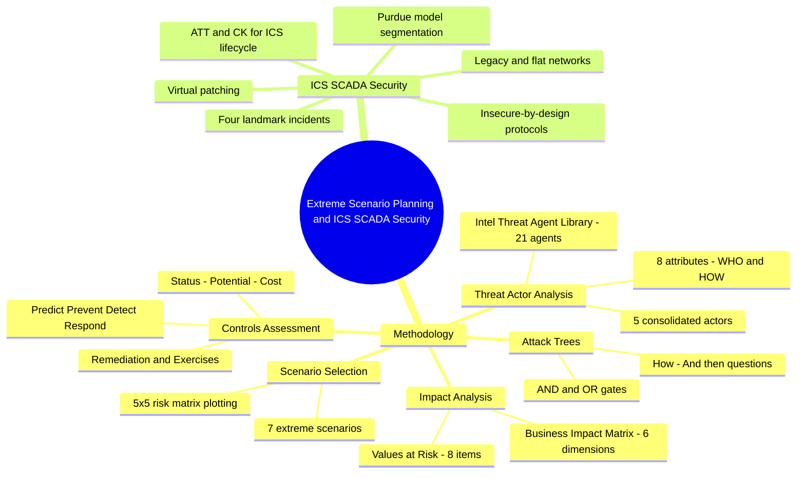
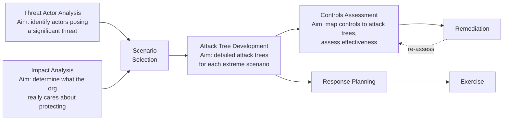
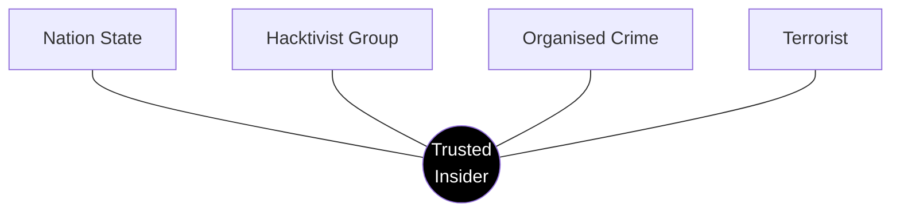
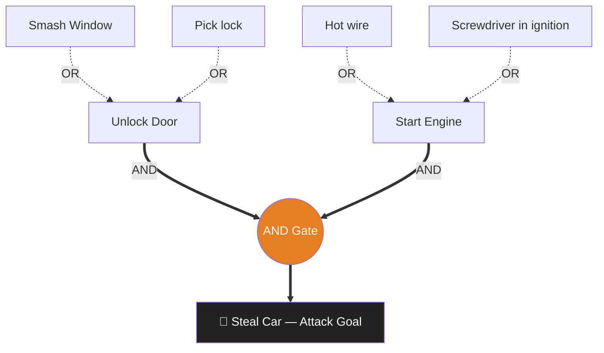
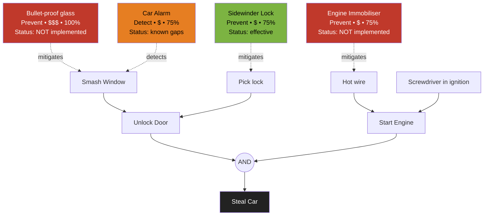
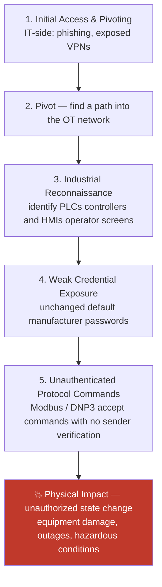
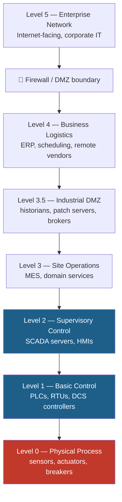

# Extreme Cyber Scenario Planning, Attack Trees & ICS/SCADA Security — Comprehensive Cybersecurity Notes

> **Scope note:** These notes combine two source documents: **(1) the RSA Conference 2013 deck** *“Extreme Cyber Scenario Planning & Fault Tree Analysis”* by **Ian Green, Manager, Cybercrime & Intelligence, Commonwealth Bank of Australia** (Session ID: GRC-T17, ADVANCED classification, 33 slides), and **(2) the *ICS/SCADA Security Overview* document** (definitions, vulnerabilities, attack lifecycle, landmark incidents, and defensive strategies per **MITRE ATT&CK for ICS**). External enrichment is explicitly marked where added.

---

## 1. Executive Overview & Core Concepts

### 1.1 What This Module Covers

*   **Deck 1 (CBA/RSA 2013):** A practitioner methodology for **extreme cyber scenario planning** — a structured, repeatable process that identifies the **threat actors who matter**, determines **what the organisation truly values**, selects **catastrophic ("extreme") scenarios**, decomposes them into **attack trees**, maps and scores **controls** against every tree branch, and drives **response planning and exercises**. The emphasis is on the *low-likelihood, catastrophic-impact* quadrant that conventional risk management systematically under-weights.
*   **Deck 2 (ICS/SCADA):** A compact primer on **Operational Technology (OT)** security — why Industrial Control Systems are structurally vulnerable, how attacks progress from corporate IT into the control floor, four landmark real-world incidents, and the layered defences (segmentation, access control, OT monitoring, virtual patching) built around the **Purdue Model**.

### 1.2 Fundamental Definitions & Principles

| Concept | Definition |
| :--- | :--- |
| **Extreme Scenario Planning** | Deliberate selection and analysis of scenarios with **catastrophic impact** (Business Impact level 4–5), even at low likelihood — because these events are existential and are missed by routine risk registers |
| **Threat Actor Analysis** | Identifying actors who pose a **significant threat** to the organisation, profiled via a structured attribute schema (Intent, Access, Skill, Resources, Limits, Visibility, Objective, Outcome) |
| **Impact Analysis** | Determining **what your organisation really cares about protecting** — expressed as *Values at Risk* scored on a multi-dimensional Business Impact Matrix |
| **Attack Tree** | A hierarchical decomposition of an attacker's **goal** into sub-goals and leaf actions, joined by **AND gates** (all branches required) and **OR gates** (any branch suffices) |
| **Fault Tree Analysis (FTA)** | The engineering ancestor of attack trees — developed at **Bell Labs (1962)** for the US Air Force Minuteman ICBM program; analyses how combinations of component failures produce a system-level top event. Bruce Schneier adapted it for security as the **attack tree** (1999) |
| **ICS / SCADA** | **Industrial Control Systems** and **Supervisory Control and Data Acquisition** — hardware and software running physical infrastructure (power grids, water treatment, factory lines); manage real-world processes (pressure, temperature, electricity) so incidents cause **physical damage, outages, hazardous conditions** |
| **OT (Operational Technology)** | Hardware/software that monitors/controls physical devices and processes — the industrial counterpart to IT |
| **Air-Gapping (historical)** | ICS networks were historically fully disconnected from the internet and corporate IT; modern connectivity for remote monitoring has eroded this isolation |
| **Defense-in-Depth (OT)** | Layered protection: segmentation (Purdue Model), strict access control, OT-aware monitoring/SIEM, and virtual patching |

### 1.3 Core Principle of the Module

> **🔑 Key Takeaway (Deck 1):** *"How prepared are you?"* — the talk opens with **General Keith Alexander, Director NSA & Commander, US Cyber Command** (Aspen Security Forum 2012). The premise: adversaries at the nation-state tier operate at capabilities most organisations never plan for. CBA's answer is not more controls, but a **structured discovery process**: *who would attack us, what would hurt us most, how would they do it, and are our controls actually effective against each specific path?*

> **🔑 Key Takeaway (Deck 2):** OT systems manage **real-world physical processes** — so a security incident is not just a data breach but potential **physical damage, outages, or hazardous conditions**. Modern connectivity has dissolved the historical air gap, exposing insecure-by-design protocols to the internet-adjacent world.

---

## 2. Page-by-Page / Slide-by-Slide Detailed Breakdown

## PART A — Extreme Cyber Scenario Planning & Fault Tree Analysis (CBA/RSA 2013)

### A.1 Opening & Framing (Slides 1–2)

*   **Slide 1 (Title):** *Extreme Cyber Scenario Planning & Fault Tree Analysis* — Ian Green, Manager, Cybercrime & Intelligence, Commonwealth Bank of Australia. Session **GRC-T17**, classified **ADVANCED** (governance/risk/compliance track).
*   **Slide 2 ("How prepared are you?"):** Photo of **General Keith Alexander** — Director, **National Security Agency (NSA)** and Commander, **United States Cyber Command** — speaking at **The Aspen Security Forum 2012** (YouTube source cited on slide).
    *   **Purpose of the slide (enriched interpretation):** opens with the highest-tier attacker perspective to unsettle complacency — the question "how prepared are you?" is answered honestly only after structured analysis, which the rest of the deck provides.

### A.2 The Methodology Overview (Slide 3)

The complete process, executed as a loop. Two inputs feed **Scenario Selection**; then, **for each selected scenario**, two parallel tracks proceed:

*   **Track 1 (Purple/Magenta):** Attack Tree → **Controls Assessment** → **Remediation** (reduce attack feasibility).
*   **Track 2 (Blue/Cyan):** Attack Tree → **Response Planning** → **Exercise** (improve organisational response).
*   The same seven-step diagram is repeated at slides 13, 16, 23, 28 to locate each aim within the process — a deliberate navigation device.

### A.3 Threat Actor Analysis (Slides 4–12)

#### Slide 4 — The Intel Threat Agent Library (TAL)

A rich **21-agent × 8-attribute matrix** from the **Intel IT Threat Assessment Group (2007)** — used as the off-the-shelf starting catalogue (link on slide: `intel.com/it/pdf/threat-agent-library.pdf`).

| Group | Agents (21 total) |
| :--- | :--- |
| **Non-hostile (3)** | Employee Reckless, Employee Untrained, Info Partner |
| **Hostile (18)** | Anarchist, Civil Activist, Competitor, Corrupt Government Official, Data Miner, Employee Disgruntled, Government Cyberwarrior, Government Spy, Internal Spy, Irrational Individual, Legal Adversary, Mobster, Radical Activist, Sensationalist, Terrorist, Thief, Vandal, Vendor |

*   Matrix rows record each agent's rating on Intent, Access, Outcome, Limits, Resources, Skills, Objective, and Visibility — enabling **evidence-based, not intuition-based**, actor selection.

#### Slides 5–6 — Agent Attributes: the WHO/HOW schema

Eight attributes, grouped into two clusters:

| Cluster | Attribute | Scale |
| :--- | :--- | :--- |
| **WHO** | **Intent** | Non-hostile, Hostile |
| **WHO** | **Access** | Internal, External |
| **WHO** | **Skill Level** | None, Minimal, Operational, **Adept** |
| **WHO** | **Resources** | Individual, Club, Contest, Team, **Organisation, Government** |
| **WHO** | **Limits** | Code of conduct, Legal, Extra-legal (minor), **Extra-legal (major)** |
| **HOW** | **Visibility** | Overt, Covert, Clandestine, Don't Care |
| **HOW** | **Objective** | Copy, Destroy, Injure, Take, Don't Care |
| **HOW** | **Outcome** | Acquisition/Theft, Business Advantage, Damage, Embarrassment, Technical Advantage |

> **💡 Exam Tip (Slide 6):** Slide 6 re-renders the same list with the **worst-case filter highlighted in red**: *Hostile* intent, *Adept* skill, *Organisation/Government* resources, *Extra-legal (major)* limits. This is the analytical move that produces the consolidated actors on the next slide — CBA keeps only actors at the top of every capability axis.

#### Slide 7 — Consolidated Threat Actors

Nine Intel agents are consolidated into **five actionable actor classes** (the **Competitor is explicitly crossed out** — excluded from the bank's extreme-scenario set):

| Intel agents | → | Consolidated actor |
| :--- | :--- | :--- |
| Corrupt Government Official, Government Cyber Warrior, Government Spy | → | **Nation State** |
| Civil Activist, Radical Activist | → | **Hacktivist** |
| Mobster | → | **Organised Crime** |
| Terrorist | → | **Terrorists** |
| Internal Spy | → | **Trusted Insider** |
| ~~Competitor~~ | — | *excluded (struck from the list)* |

> **🔑 Key Takeaway (Slide 8):** The **Trusted Insider sits at the hub** of the actor wheel. The design insight: every major external actor relies on, recruits, or masquerades as an **insider** — insider access is the connective tissue between all threat classes, which is why insider compromise anchors the extreme scenarios of a bank.

#### Slides 9–12 — Actor Attribute Profiles (verbatim from deck)

| Attribute | **Hacktivist Group** | **Organised Crime** | **Nation State** | **Terrorist** |
| :--- | :--- | :--- | :--- | :--- |
| Intent | Hostile | Hostile | Hostile | Hostile |
| Access | External | External | External | External |
| Skill Level | Adept | Adept | Adept | Adept |
| Resources | Organisation | Organisation | **Government** | Organisation |
| Limits | Extra-legal (major) | Extra-legal (major) | Extra-legal (major) | Extra-legal (major) |
| Visibility | **Overt** | **Covert** | **Clandestine** | **Covert** |
| Objective | **Copy, Injure** | **Take** | **Copy** | **Destroy** |
| Outcome | **Damage, Embarrassment** | **Acquisition/Theft** | **Technical Advantage** | **Damage** |

*   **Differentiators to memorise:** the four actors are identical on Intent/Access/Skill/Limits — they differ on **Resources** (only Nation State = Government), **Visibility** (Overt → Covert → Clandestine escalation of stealth), **Objective**, and **Outcome**.
*   **Analytic consequence:** a bank's *deterrence and detection* strategy must differ per actor — overt actors (hacktivists) are seen coming; clandestine actors (nation states) demand different telemetry than noisy DDoS.

### A.4 Impact Analysis (Slides 13–15)

**Aim (Slide 13):** *Determine what your organisation really cares about protecting.*

#### Slide 14 — Business Impact Matrix (BIM)

Six impact dimensions, scored on a 1–5 scale (Level 5 anchors shown verbatim; levels 4→1 are graded down):

| Impact | Financial | Customer Service & Operations | Reputation / Brand | Legal / Regulatory Compliance | People | Customers |
| :--- | :--- | :--- | :--- | :--- | :--- | :--- |
| **5** | **>$500m** | Significant loss of customers due to **extensive interruption to service capability** | Substantial damage to brands from **extensive negative national publicity** | **Loss of license, loss of public listing** or substantial penalties on Directors | **Death or severe injury** to employees | **Serious financial impact to all customers** |
| 4 | $200m–$500m | … | … | … | … | … |
| 3 | $50m–$200m | … | … | … | … | … |
| 2 | <$50m | … | … | … | … | … |
| 1 | <$50m | … | … | … | … | … |

*   Note the deliberate inclusion of **non-financial dimensions** — People (harm) and Customers (customer-harm) — which pure monetary risk registers omit.

#### Slide 15 — Values at Risk (bank-specific)

1.  Health and safety of employees
2.  Customer funds and stocks
3.  Customer data (private information)
4.  Customer data (intellectual property)
5.  Corporate data (sensitive information)
6.  Corporate data (intellectual property)
7.  Availability of banking channels (**Internet facing**)
8.  Availability of banking channels (**back end**)

> **💡 Exam Tip:** Values at Risk are grouped into three families — **People**, **Data/Funds**, **Availability** (front-end vs back-end channels). Scenario selection later pairs each actor's *Objective* with these values.

### A.5 Scenario Selection (Slides 16–22)

**Aim (Slide 16):** *Select scenarios that could have a catastrophic impact on the organisation.*

#### Slide 17 — The Scenario Selection Matrix

Threat Actor Analysis (left) and Impact Analysis (right) provide the pick-lists that combine into scenario statements:

| Threat Actor Analysis — **Outcome** | Threat Actor Analysis — **Objective** | Impact Analysis — **Value at Risk** | Impact Analysis — **Potential Business Impact** |
| :--- | :--- | :--- | :--- |
| Acquisition / Theft | Copy | Customer Funds | Customer Service / Operational |
| Business Advantage | Destroy | Customer Data | Financial |
| Technical Advantage | Injure | Corporate Data | Reputational / Brand |
| Damage | Take | Employee health and safety | Legal / Regulatory Compliance |
| Embarrassment | *(—)* | Availability of banking systems | Customers |
| *(—)* | *(—)* | *(—)* | People |

#### Slides 18–19 — Two Worked Examples

**Example 1 (Slide 18):** *Organised Crime* (Hostile / External / Adept / Organisation / Extra-legal major / Covert / **Take** / **Acquisition-Theft**) × *Customer Funds* × *Financial + Customers* impact:

> **Scenario:** "Organised crime gang steals customer funds causing significant financial loss."

**Example 2 (Slide 19):** *Hacktivist Group* (Hostile / External / Adept / Organisation / Extra-legal major / **Overt** / **Copy, Injure** / **Damage, Embarrassment**) × *Availability of banking systems* × *Customer Service/Operational + Reputational/Brand* impact:

> **Scenario:** "Socio-political group performs prolonged denial-of-service attack causing sustained outages."

#### Slide 20 — Is It "Extreme"?

The BIM is re-shown with a **red ring around impact levels 4 and 5** — the definition of *extreme*:

> **An extreme scenario is one whose assessed impact reaches Level 4–5** on any dimension — i.e., ≥$200m financial, extensive service interruption, national brand damage, license/listing loss, death or severe injury, or serious customer-wide financial impact.

#### Slide 21 — Scenarios on the Risk Matrix (5×5)

Qualitative likelihood × impact grid with bands **I** (Insignificant), **L** (Low), **M** (Medium), **H** (High), **VH** (Very High):

| Likelihood ↓ / Impact → | 1 | 2 | 3 | 4 | 5 |
| :--- | :--- | :--- | :--- | :--- | :--- |
| 5 | L | M | M | H | VH |
| 4 | L | L | M | H | VH |
| 3 | I | L | M | H | VH |
| 2 | I | L | M | **H** ← S1, S3, S4, S5 | **VH** ← S6 |
| 1 | I | I | L | **M** ← S2 | **H** ← S7 |

> **🔑 Key Takeaway:** All seven extreme scenarios plot in the **Likelihood 1–2 × Impact 4–5 corner** — the region conventional risk processes deprioritise. Extreme scenario planning exists precisely to manage this blind spot.

#### Slide 22 — The Seven Extreme Scenarios (Actor × Motive Table)

| Motive | Organised Crime | Hacktivist Group | Nation State | Terrorist |
| :--- | :--- | :--- | :--- | :--- |
| **Financial Gain** | **S1** — Large scale targeting of bank customers using malware to steal funds | | | |
| | **S2** — High value fraud conducted against backend payment system | | | |
| **Theft / Exposure** | **S5** *(spans two columns)* — Compromise bank IT systems and exfiltrate large sets of customer data | **S4** — Exfiltrate and disclose large sets of corporate data to embarrass or discredit the bank | **S6** — Exfiltrate corporate intellectual property for strategic, commercial or political gain | |
| **Sabotage / Operations Impact** | | **S3** — Targeted, prolonged DDoS against multiple Internet facing systems | | **S7** — Destructive cyber-attack against multiple bank data centres |

*   Slides 27 and 33 re-display the same seven scenarios as "cloud" graphics (1. malware campaign vs customers; 2. backend payment fraud; 3. prolonged DDoS; 4. corporate data exfiltration/disclosure; 5. network access + confidential data exfiltration; 6. IP exfiltration for strategic/political gain; 7. destructive attack on data centres) — bookending the methodology.

### A.6 Attack Tree Development (Slides 23–27)

**Aim (Slide 23):** *Develop detailed attack trees for each extreme scenario.*

#### Slides 24–26 — The Attack Tree, Taught via "Steal Car"

**Slide 24 — Structure:** root goal **"Steal Car"** decomposes through an **AND gate** into two sub-goals, each of which has **OR** alternatives:

*   Steal Car = **(Unlock Door) AND (Start Engine)**
*   Unlock Door = Smash Window **OR** Pick lock
*   Start Engine = Hot wire **OR** Screwdriver in ignition

**Slide 25 — "How?"** (downward reading): given a node, ask *how* would an attacker achieve it → generates children. This is how you **build** the tree top-down from the goal.

**Slide 26 — "And then?"** (upward reading): given a leaf action, ask *what does achieving it lead to* → walks the path toward the root. This is how you **analyse and defend** the tree bottom-up.

> **⚠️ Warning — the AND gate is the defender's friend:** with an AND node, **blocking any single sub-goal blocks the entire attack**. OR leaves require the attacker to succeed at only one, so OR branches need *each* mitigated — this asymmetry drives cost-optimal control placement (next section). *(Enrichment: Schneier's attack trees add cost/probability annotations to leaves, enabling "cheapest attack path" analysis — exactly the CBA control-scoring below.)*

### A.7 Controls Assessment, Mapping & Remediation (Slides 28–33)

**Aim (Slide 28):** *Map controls to attack trees and assess effectiveness.*

#### Slide 29 — Industry Standard Control Sets

| ✅ Strengths | ❌ Weaknesses |
| :--- | :--- |
| Provides a **consistent set of controls** for assessment and comparison | May **not be relevant** to a particular scenario |
| | May **not be pitched at the right level** to be useful |

**Options available (with slide URLs):**

| Control set | Origin | Enriched context |
| :--- | :--- | :--- |
| **DSD Top 35 Mitigation Strategies** | Defence Signals Directorate, Australia | Predecessor of today's **ASD Essential Eight**; the "Top 4" subset (application whitelisting, patch apps, patch OS, restrict admin privileges) was DSD's 2011+ headline guidance |
| **NIST SP 800-53** | NIST, USA | *Security and Privacy Controls* catalogue (Rev 4 current in 2013; Rev 5 today) |
| **SANS 20 Critical Controls for Effective Cyber Defense** | SANS/community | Now the **CIS Critical Security Controls** (v8.1) |

*   **CBA's verdict (Slide 30 — Hybrid Control Set):** rather than adopt one catalogue wholesale, build a **scenario-relevant hybrid**. Nine controls presented: **Application Whitelisting, Data Encryption, Physical Security Controls, Third Party Governance, Data Loss Prevention, Penetration Testing, Layer 7 DDoS Prevention, Network Segmentation, MiTB Detection**.
    *   *Enrichment:* **MiTB (Man-in-the-Browser) Detection** targets banking-trojan families (Zeus/SpyEye-lineage) that inject into browser sessions to rewrite online-banking transactions — directly relevant to S1 (malware vs customers) and S2 (backend payment fraud). **Layer 7 DDoS Prevention** maps to S3. **Network Segmentation + DLP + Encryption** map to S4–S6. **Application Whitelisting + Physical Security** cover S7-style destructive attack prerequisites.

#### Slide 31 — Controls Assessment Dimensions (four scoring axes)

| Axis | Scale |
| :--- | :--- |
| **Type of control** | **Predict → Prevent → Detect → Respond** (chevron chain) |
| **Status of control** | 🔴 *Control has not been implemented* / 🟠 *Control has known gaps* / 🟢 *Control operating effectively* |
| **Potential to mitigate** | **25% / 50% / 75% / 100%** |
| **Cost of control** | **$** Low / **$$** Moderate / **$$$** High |

*   The **Predict** type (ahead of the classic Prevent/Detect/Respond triad) reflects intelligence-led defence — anticipating actor behaviour before the attack attempt.

#### Slide 32 — Control Mapping onto the Attack Tree

The car tree is re-drawn with controls pinned to the **leaves they mitigate**, each annotated with Type, Cost, Potential, and Status:

| Leaf | Control | Type | Cost | Potential | Status (colour) |
| :--- | :--- | :--- | :--- | :--- | :--- |
| Smash Window | **Bullet-proof glass** | Prevent | $$$ | **100%** | 🔴 Not implemented |
| Pick lock | **Sidewinder Lock** | Prevent | $ | 75% | 🟢 Operating effectively |
| Smash Window (detection) | **Car Alarm** | Detect | $ | 75% | 🟠 Known gaps |
| Start Engine (hot wire branch) | **Engine Immobiliser** | Prevent | $ | 75% | 🔴 Not implemented |

> **🔑 Key Takeaway — the economics lesson of Slide 32:** bullet-proof glass is the *only* 100%-effective control but costs $$$ and is unimplemented; two **$-level controls** (Sidewinder Lock + Car Alarm) jointly cover both *Unlock Door* leaves, and a **$ Engine Immobiliser** would cover the entire *Start Engine* branch. Sensible portfolios pair cheap prevent + cheap detect on OR-leaves rather than one gold-plated control — then **remediation** (Slide 28's magenta block) funds the flagged gaps, and **Response Planning → Exercise** rehearses what controls miss.

---

## PART B — ICS/SCADA Security Overview

### B.1 Definitions & Why This Matters

*   **ICS** = Industrial Control Systems; **SCADA** = Supervisory Control and Data Acquisition — computer hardware/software that **run physical infrastructure**: power grids, water treatment plants, factory assembly lines.
*   Because they manage **real-world processes** (pressure, temperature, electricity), security incidents here lead to **physical damage, outages, or hazardous conditions** — the cyber-physical stakes (cf. Deck 1's Scenario 7, destructive cyber-attack).

### B.2 Why ICS/SCADA Systems Are Vulnerable

Historically **air-gapped** (fully disconnected from internet and corporate IT). Modern facilities now connect these systems to business networks for **remote monitoring and efficiency**, introducing structural weaknesses:

1.  **Insecure-by-design protocols** — legacy industrial protocols (e.g., **Modbus, DNP3**) lack **encryption or authentication**; *any device on the network can issue commands that equipment will execute without verification*.
2.  **Legacy systems** — equipment is built to last **decades** and often runs outdated, unpatched OSes, since updates risk **costly operational downtime**.
3.  **Flat networks** — lack of segmentation means a breach of an **office computer can allow an intruder to pivot directly into the control floor**.

### B.3 Typical Attack Lifecycle (per MITRE ATT&CK for ICS)

Security researchers and frameworks such as **MITRE ATT&CK for ICS** describe a general progression moving **from the corporate IT network into Operational Technology (OT)**:

*   **Key component vocabulary (enriched):** **PLC** = Programmable Logic Controller (the controller running factory equipment); **HMI** = Human–Machine Interface (operator control screens); **RTU** = Remote Terminal Unit (field telemetry); **SCADA server** = supervisory layer issuing set-points to PLCs/RTUs.
*   **The fatal pairing:** *weak/default credentials* + *unauthenticated protocols* = an attacker who reaches the OT network can **re-issue legitimate-looking commands** — the control system cannot tell attacker from operator.

### B.4 High-Profile Real-World Incidents

| Incident | Target Industry | Impact / Method | Enriched context |
| :--- | :--- | :--- | :--- |
| **Stuxnet (2010)** | Nuclear facility | Sabotaged **Iranian centrifuges by covertly altering PLC logic** so they spun at destructive speeds | Worm crossed the air gap via USB; targeted Siemens S7 PLCs; first publicly known cyber weapon causing **kinetic destruction** — the canonical "cyber weapons cause kinetic damage" proof |
| **BlackEnergy 3 (2015)** | Power grid | Cut power to over **225,000 residents in Ukraine** by **hijacking HMIs and wiping system software** | Spear-phishing entry (BlackEnergy dropper) → attackers manually operated SCADA/HMIs; **KillDisk** wiper erased systems to slow recovery; attributed to the **Sandworm** APT group |
| **Triton/Triconex (2017)** | Petrochemical plant | Targeted **industrial safety systems in Saudi Arabia**, demonstrating the ability to **disable safety overrides** | Malware (TRITON) attacked **Schneider Electric Triconex Safety Instrumented Systems (SIS)** — the last line of defence against catastrophic plant events; attributed to Russia's **TsNIIKhM** research institute |
| **Frosty Goop (2024)** | Municipal heating | Used **unauthenticated Modbus commands to shut off heating for hundreds of apartment buildings in Ukraine during freezing weather** | Recent proof that the "insecure-by-design protocol" weakness is actively exploited (Modbus TCP has no authentication); attributed to the **Sandworm-linked UAC-0135** actor *(enrichment)* |

> **⚠️ Warning:** Notice the pattern across all four incidents — **IT-entry → OT-pivot → protocol-level command abuse → physical impact**, exactly the ATT&CK-for-ICS lifecycle above. Each incident also demonstrates a distinct failure class: air-gap assumptions (Stuxnet), HMI hijack + anti-forensics (BlackEnergy), safety-system compromise (Triton), and unauthenticated protocol abuse (Frosty Goop).

### B.5 Defensive Strategies & Hardening (Defense-in-Depth)

Security teams protect critical infrastructure primarily through **layered, defense-in-depth measures**:

| Defence | What it does |
| :--- | :--- |
| **Network segmentation** | Apply the **Purdue Model** to structurally separate business networks from industrial control networks using firewalls |
| **Strict access control** | Disable or rename **default accounts**, enforce **strong passwords**, and require **MFA for remote connections** |
| **OT monitoring & SIEM** | Deploy monitoring tools that **understand industrial protocols**, so unusual command traffic is **flagged before damage occurs** |
| **Virtual patching** | Use **network-level firewalls to block known exploit patterns** targeting legacy devices **when direct patching isn't operationally feasible** |

#### The Purdue Model (enrichment — the referenced segmentation architecture)

The **Purdue Enterprise Reference Architecture (PERA)** defines the level hierarchy that zone-and-conduit segmentation (per **IEC 62443**) enforces:

*   **IT zone = Levels 4–5; OT zone = Levels 0–3; the industrial DMZ (3.5) brokers all flows.** Every conduit across the boundary passes through firewalls with allow-listed protocols — this is the structural answer to both *flat networks* and *insecure-by-design protocols*, and the enabling condition for **virtual patching**.
*   *Further enrichment:* **NIST SP 800-82** (*Guide to Industrial Control Systems/OT Security*) and **IEC 62443** are the canonical standards for this control space; **MITRE ATT&CK for ICS** (`attack.mitre.org/matrices/ics/`) is the TTP knowledge base referenced by the source document.

### B.6 Cross-Document Synthesis

The two documents are complementary ends of the same philosophy:

*   Deck 1 gives the **governance methodology** (actors → values → extreme scenarios → attack trees → controls → exercises); Deck 2 gives a concrete **attack-surface domain** (ICS/SCADA) where the same discipline applies — and its four incidents are precisely the kind of *destructive, operations-impacting* events CBA's Scenario 7 ("Destructive cyber-attack against multiple bank data centres") models for a bank.
*   Deck 2's four defences map directly onto Deck 1's **hybrid control set**: segmentation ↔ **Network Segmentation**; monitoring ↔ the **Detect/Respond** control types; virtual patching ↔ a **compensating control** (scored by Status/Potential/Cost); access control ↔ hybrid-set hygiene underpinning every tree branch.

---

## 3. Comparative Summary & Matrix

### 3.1 Consolidated Threat Actors — Full Attribute Matrix (Slides 7–12)

| Attribute | Nation State | Hacktivist Group | Organised Crime | Terrorist | Trusted Insider |
| :--- | :--- | :--- | :--- | :--- | :--- |
| Intel origin agents | Corrupt Gov Official + Cyber Warrior + Spy | Civil + Radical Activist | Mobster | Terrorist | Internal Spy |
| Intent | Hostile | Hostile | Hostile | Hostile | *(internal position)* |
| Access | External | External | External | External | **Internal** |
| Skill Level | Adept | Adept | Adept | Adept | varies |
| Resources | **Government** | Organisation | Organisation | Organisation | privileged access |
| Limits | Extra-legal (major) | Extra-legal (major) | Extra-legal (major) | Extra-legal (major) | — |
| Visibility | **Clandestine** | **Overt** | **Covert** | **Covert** | invisible |
| Objective | **Copy** | **Copy, Injure** | **Take** | **Destroy** | exfiltrate/sabotage |
| Outcome | Technical Advantage | Damage, Embarrassment | Acquisition/Theft | Damage | all classes |
| Signature extreme scenario | S6 (IP exfiltration) | S3 (prolonged DDoS), S4 (data disclosure) | S1 (customer malware), S2 (payment fraud), S5 (customer-data theft) | S7 (destructive attack on data centres) | enables all of S1–S7 |

### 3.2 Control Sets Compared (Slide 29–30)

| Criterion | DSD Top 35 | NIST SP 800-53 | SANS/CIS 20 Critical Controls | CBA Hybrid Set |
| :--- | :--- | :--- | :--- | :--- |
| Nature | Ranked national mitigation strategies | Comprehensive federal control catalogue | Prioritised, action-oriented "vital few" | **Scenario-derived subset** |
| Strength | Country-specific prioritisation (AU) | Depth, mapping to compliance | Actionability, ordering | **Direct relevance to each attack tree** |
| Weakness (per slide) | *may not be relevant to a particular scenario; may not be pitched at the right level* (applies to all three) | | | requires effort to maintain |
| Modern successor | ASD **Essential Eight** | SP 800-53 Rev 5 | CIS Controls v8.1 | methodology, not a product |

### 3.3 Security Control Types (Slide 31) mapped to Hybrid Controls (Slide 30)

| Type | Function | Example hybrid controls |
| :--- | :--- | :--- |
| **Predict** | Anticipate actor behaviour before attempts | Penetration Testing (attacker emulation), Third Party Governance |
| **Prevent** | Stop attempts succeeding | Application Whitelisting, Data Encryption, Network Segmentation, Physical Security Controls, Layer 7 DDoS Prevention |
| **Detect** | Identify in-progress compromise | MiTB Detection, (DLP detection modes), OT/IT monitoring |
| **Respond** | Limit damage after detection | DLP blocking, incident response (exercised via **Response Planning → Exercise**) |

### 3.4 IT Security vs OT/ICS Security

| Dimension | Corporate IT (Deck 1 context) | ICS/SCADA (Deck 2) |
| :--- | :--- | :--- |
| Top priority | Confidentiality of data | **Availability & safety of physical process** |
| Incident consequence | Data loss, financial, reputational | **Physical damage, outages, hazardous conditions** |
| Protocols | TLS/HTTPS (authenticated, encrypted) | Modbus, DNP3 — **no auth or encryption by design** |
| Patching | Regular cycles feasible | Rare — updates risk **costly downtime** → **virtual patching** |
| Network shape | Segmented, zoned | Historically flat/air-gapped; now converging → **Purdue Model + firewalls** |
| Entry path | Direct internet exposure | **IT-side phishing/VPN → pivot to OT** |
| Detection tooling | Generic SIEM | **OT-aware monitoring** (protocol-level command inspection) |

### 3.5 The Four ICS Incidents — Failure & Lesson Matrix

| Incident | Year | Technique signature | Failure exploited | Lesson |
| :--- | :--- | :--- | :--- | :--- |
| Stuxnet | 2010 | PLC logic manipulation | Air gap + removable media | Air gaps alone ≠ safety; code integrity of PLC logic matters |
| BlackEnergy 3 | 2015 | HMI hijack + wiper | IT→OT pivot, manual operation | Segment IT/OT; assume HMI credentials will be stolen |
| Triton | 2017 | Safety-system (SIS) malware | Trusted safety layer | Protect and monitor the **safety** network separately |
| Frosty Goop | 2024 | Unauthenticated Modbus commands | Protocol-level no-auth | Protocol-aware filtering/segmentation is mandatory, not optional |

### 3.6 Attack Tree vs Fault Tree

| Aspect | Fault Tree Analysis | Attack Tree |
| :--- | :--- | :--- |
| Origin | Bell Labs, 1962 (USAF Minuteman) | Schneier, 1999 (adapted from FTA) |
| Top node | System **failure** event | Attacker **goal** (e.g., Steal Car) |
| Branches | Component failures (and/or gates) | Attacker sub-goals and actions (AND/OR gates) |
| Use | Reliability/safety engineering | Threat modelling, control mapping, response planning |
| In this module | Title lineage ("Fault Tree Analysis") | Slides 24–26, 32 — the working method |

---

## 4. Key Terminology & Cheat Sheet

### 4.1 Glossary

| Term | Definition |
| :--- | :--- |
| **Adept** | Highest Intel skill tier — capable of sophisticated, tailored attacks |
| **AND / OR gate** | AND = all child branches required for parent; OR = any one suffices |
| **Attack tree** | Goal-rooted decomposition of attacker paths; read down for "How?", up for "And then?" |
| **Business Impact Matrix (BIM)** | 6 dimensions (Financial, Customer Service & Ops, Reputation/Brand, Legal/Regulatory, People, Customers) × 5 impact levels |
| **Clandestine** | Actor actively hides both identity and the fact an operation occurred (Nation State tier) |
| **Covert** | Actor hides identity but not the operation (Organised Crime, Terrorist) |
| **DSD Top 35** | Australian Defence Signals Directorate's ranked mitigations; ancestor of ASD Essential Eight |
| **Extreme scenario** | Scenario assessed at BIM **Level 4–5** on any dimension — catastrophic impact, typically low likelihood |
| **Fault Tree Analysis (FTA)** | Engineering technique (Bell Labs 1962) analysing combinations of failures producing a top event |
| **HMI** | Human–Machine Interface — operator screens controlling industrial processes |
| **ICS / SCADA** | Industrial Control Systems / Supervisory Control and Data Acquisition |
| **MiTB (Man-in-the-Browser)** | Browser-injecting malware manipulating web transactions; banks deploy **MiTB detection** |
| **Modbus / DNP3** | Legacy industrial protocols lacking authentication/encryption |
| **OT / IT** | Operational Technology (controls physical world) / Information Technology |
| **PLC / RTU** | Programmable Logic Controller / Remote Terminal Unit — field-level control devices |
| **Predict–Prevent–Detect–Respond** | The four control types in CBA's assessment taxonomy |
| **Purdue Model (PERA)** | Level 0–5 architecture used to zone IT from OT (with Level 3.5 DMZ); IEC 62443 zones/conduits |
| **SIS (Triconex)** | Safety Instrumented System — final protection layer against catastrophic plant events (Triton target) |
| **Trusted Insider** | Consolidated actor at the hub of the actor wheel; internal access leveraged by/for all external actors |
| **Values at Risk** | The eight bank-specific assets worth protecting (people, funds, data, channel availability) |
| **Virtual patching** | Network-level blocking of exploit patterns for devices that cannot be patched directly |
| **Visibility (attribute)** | Overt → Covert → Clandestine → Don't Care; how openly an actor operates |

### 4.2 Numbers Cheat Sheet

| Item | Value |
| :--- | :--- |
| Intel Threat Agent Library agents | **21** (3 non-hostile + 18 hostile), Intel IT Threat Assessment Group **2007** |
| Agent attributes | **8** = Intent, Access, Skill, Resources, Limits (**WHO**) + Visibility, Objective, Outcome (**HOW**) |
| Consolidated actors | **5** (Nation State, Hacktivist, Organised Crime, Terrorists, Trusted Insider); **Competitor excluded** |
| Attribute values identical across 4 actors | **4** (Hostile / External / Adept / Extra-legal major) |
| Values at Risk | **8** items |
| Business Impact Matrix | **6 dimensions × 5 levels**; "extreme" = **Level 4–5** (≥$200m financial) |
| Extreme scenarios | **7** (S1–S2 financial gain; S4–S6 theft/exposure; S3, S7 sabotage) |
| Risk matrix | **5×5** likelihood × impact; bands I/L/M/H/VH; all 7 scenarios at **Likelihood 1–2 × Impact 4–5** |
| Control types | **4** — Predict, Prevent, Detect, Respond |
| Control statuses | **3** — not implemented / known gaps / operating effectively |
| Mitigation potential tiers | **25% / 50% / 75% / 100%** |
| Cost tiers | **$ / $$ / $$$** |
| Hybrid control set | **9** controls |
| Standard control sets cited | **3** — DSD Top 35, NIST SP 800-53, SANS 20 Critical Controls |
| Car-tree leaves | **4** OR-leaves under 2 AND-sub-goals; best control **100%** ($$$), typical **75%** ($) |
| Ukraine BlackEnergy 3 outage | **225,000+ residents** (2015) |
| ICS incident years | **2010, 2015, 2017, 2024** (Stuxnet, BlackEnergy 3, Triton, Frosty Goop) |
| ICS structural weaknesses | **3** — insecure protocols, legacy systems, flat networks |
| ICS attack lifecycle stages (ATT&CK for ICS) | **4** — access/pivot, recon (PLC/HMI), weak credentials, unauthenticated commands |
| OT defences | **4** — Purdue segmentation, strict access control, OT monitoring/SIEM, virtual patching |
| Purdue levels | **0–5** (plus 3.5 industrial DMZ) |

### 4.3 One-Line Recall Strings

*   **Deck 1:** *"Profile actors (Intel 21→5), know your values (8), pick extreme scenarios (7, at L1-2×I4-5), grow attack trees (How? / And then?), score controls (type-status-potential-cost), then remediate and rehearse."*
*   **Deck 2:** *"ICS runs physical processes; no-auth protocols + legacy OS + flat networks mean IT phishing becomes physical damage — segment per Purdue, kill defaults, watch OT traffic, patch virtually."*

---
