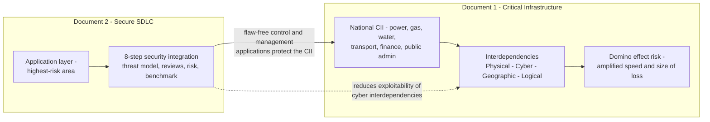
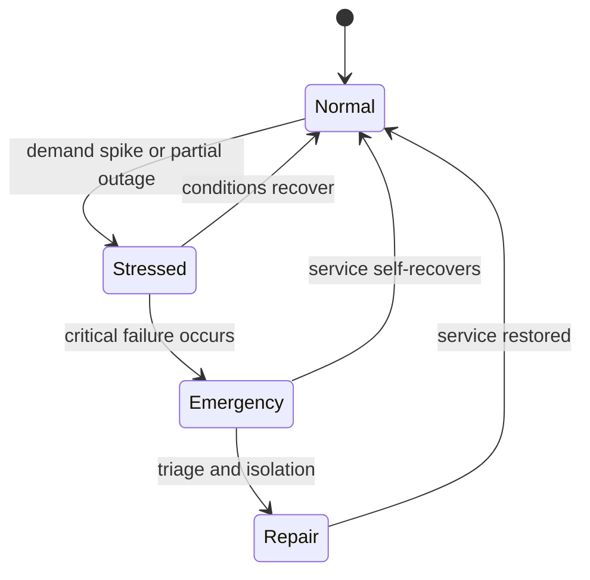
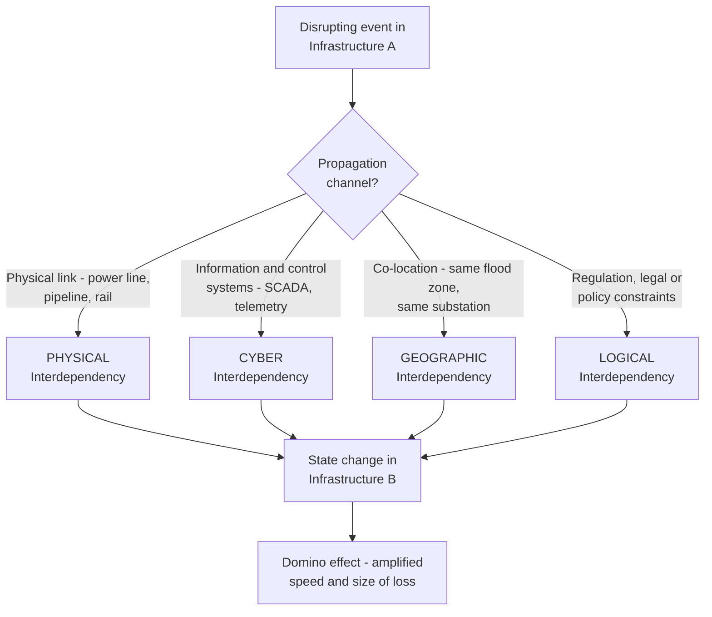
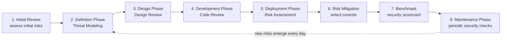
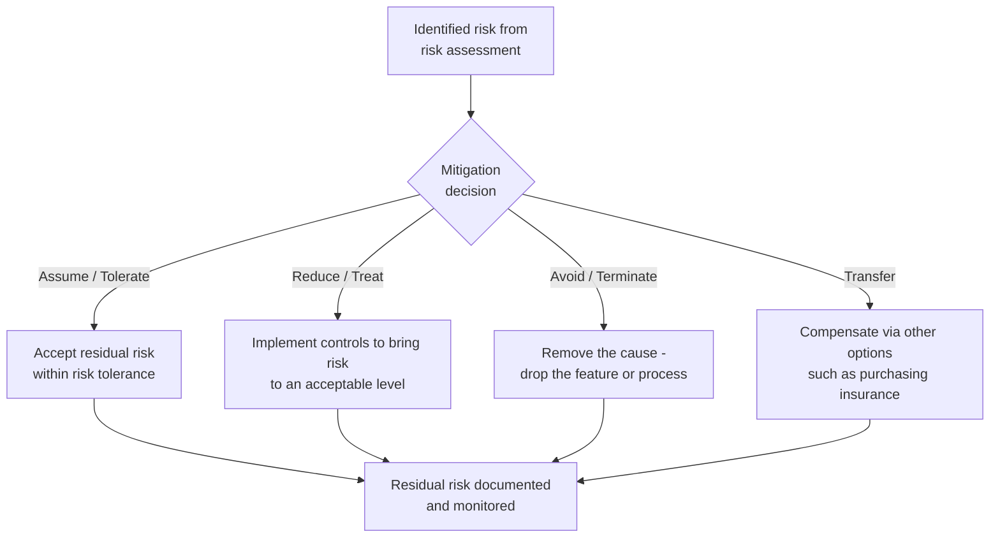

# Critical Infrastructure Security & Secure SDLC Integration — Comprehensive Cybersecurity Notes

> **Scope note:** This response combines the two source documents provided in your upload: **(1) *Basic Security Issues of Critical Infrastructures*** (3 pages) and **(2) *Steps for Integrating Security into Application Development*** (6 pages). Both are covered exhaustively below, enriched with framework context and real-world examples.

---

## 1. Executive Overview & Core Concepts

This module addresses two tightly linked pillars of cybersecurity:

1. **Critical Infrastructure (CI) Protection** — why the electronic management of national infrastructure (power grids, oil pipelines, gas, water, transportation, finance/banking, public administration) creates exposure to cyber criminals, and how **interdependencies** between infrastructures amplify failures into a **domino effect**.
2. **Secure Application Development** — why the **application layer** is the highest-risk attack surface despite perimeter defences, and an **8-step process** for integrating security into the entire **Software Development Life Cycle (SDLC)**.

### 1.1 Fundamental Definitions & Principles

| Concept | Definition |
| :--- | :--- |
| **Critical Infrastructure** | Assets and systems (oil pipelines, electricity grids, gas, water networks, transportation, financial/banking systems, public administration) whose disruption would have severe consequences for society |
| **Interdependency** | A **bidirectional relationship between two infrastructures** through which the state of each influences, or is correlated with, the state of the other |
| **Domino Effect** | Amplification in **speed and size of loss** following the occurrence of failures, propagated through interdependencies |
| **Resilience** | The **time required to restore normal behaviour** of a system after an attack or failure — a core metric of infrastructure protection |
| **Threat Modelling** | Practice of working with developers to map information flow and identify critical areas/entry points dealing with sensitive information |
| **Risk Mitigation** | Prioritising, evaluating, and implementing controls: risk can be **assumed, reduced, avoided, or transferred** |
| **Secure SDLC** | Formalised development process (Requirements → Design → Implementation → Testing → Deployment → Maintenance) with security principles embedded at every stage |

### 1.2 The Central Argument of the Module

> **🔑 Key Takeaway:** Perimeter defences and electronic management have **improved infrastructure performance but also opened the door to cyber criminals**. Attackers target CI to **paralyze operations or purloin (steal) information assets**. Because attacks on CI and warning systems can produce **disastrous consequences for the entire society**, protection must include **threat identification, vulnerability reduction, and attack-source/damage-origin identification** — aimed at **service downtime minimization and damage limitation**.

---

## 2. Page-by-Page Detailed Breakdown

### PART A — Basic Security Issues of Critical Infrastructures

#### 2.1 The Evolving Threat Scenario (Page 1)

*   CI is **increasingly electronically managed** through network management, monitoring, and control systems.
*   **Benefit:** improved performance levels. **Cost:** access granted to cyber criminals → cyber attacks → **increased risk of a domino effect**.
*   The scenario has grown **more complex** because advanced technologies add **new sources of potential risk** alongside traditional threats.

**Effective infrastructure protection includes three activities:**

1.  **Threat identification**
2.  **Vulnerability reduction**
3.  **Attack source / damage origin identification**

**Protection objectives:** service **downtime minimization** and **damage limitation**.

**Attack goals:** usually to (a) **paralyze critical infrastructure activities**, or (b) **purloin its information assets** (steal data).

**Evaluation imperative:** assess possible attack targets and their consequences — *including the time required to restore normal behaviour (**resilience**)*.

**Why the cyber threat matters nationally:**
*   It involves the **digital domain**, and
*   Its **transnational nature** — meaning potential effects cross borders.

> **💡 Exam Tip:** When attack targets are **critical infrastructure and warning systems**, the consequences for **entire society could be disastrous** — this is the justification for national-level intervention against cybercrime.

#### 2.2 Definitions and Concepts — Interdependencies (Pages 1–2)

*   The environment is **continuously changing**; urgent national-level (and beyond) intervention is required against **all cybercrime forms** threatening CI, society, business, and citizens.
*   **Interaction and interdependencies** among critical infrastructure are a prominent aspect.
*   Understanding and analysing interdependencies is of **utmost importance** because they:
    *   May be a **source of threat** to systems,
    *   Contribute to **risk uncertainty**, and
    *   Cause an **amplification in speed and size of loss** following failures.

**Formal definition (memorise):**

> **Interdependency** = a **bidirectional relationship between two infrastructures** through which the **state of each infrastructure influences or is correlated to the state of the other**.

#### 2.3 Four Characterisation Dimensions of Interdependencies (Page 2)

Interdependencies can be characterised along **four dimensions** to facilitate identification, understanding, and analysis:

| Dimension | Possible Values / Classes |
| :--- | :--- |
| **a) Couplings** among infrastructures and their effect on response behaviour | **Loose or tight**; **inflexible or adaptive** |
| **b) State of operation** | **Normal, Stressed, Emergency, Repair** |
| **c) Type of failure** affecting the infrastructure | **Common-cause, Cascading, Escalating** |
| **d) Type of interdependency** | **Physical, Cyber, Geographic, Logical** |

**Operational states** (dimension b) visualised:

**Failure types** (dimension c) explained in depth:

| Failure Type | Mechanism | Illustrative Example |
| :--- | :--- | :--- |
| **Common-cause** | A **single root event** simultaneously disrupts components in multiple infrastructures (shared cause, no propagation chain needed) | One software defect deployed to control systems of both power and water utilities |
| **Cascading** | An initial failure in Infrastructure A **triggers a sequence** of failures in Infrastructure B, then C… | 2003 US–Canada Northeast Blackout: tree contact → line trip → grid cascade; power loss then degraded water pumping, traffic signals, and rail systems for ~50 million people |
| **Escalating** | A failure in Infrastructure A **worsens an independent** failure in Infrastructure B — B's failure would have occurred anyway, but A makes it more severe/longer | Earthquake damages power lines (A) at the same time a water main independently bursts (B) — lack of electric pumps dramatically prolongs the water outage |

> **⚠️ Warning:** Coupling character matters: **tight** coupling (instantaneous, automatic response) propagates failure faster than **loose** coupling; **inflexible** systems cannot adapt to disrupted conditions, while **adaptive** systems re-route or degrade gracefully. This distinction is the origin of the "domino effect" severity.

#### 2.4 The Four Classes of Interdependency (Pages 2–3)

The document's taxonomy (enriched: this is the classic **Rinaldi, Peerenboom & Kelly (2001), IEEE Control Systems Magazine** framework — the standard citation missing from the source's "distinguished in :" reference):

1.  **Physical Interdependencies** — arise from **physical links or connections** among elements of infrastructures. Disruptions and perturbations in one infrastructure can **propagate** to other infrastructure.
    *   *Example:* Electrically driven pumping stations; a coal rail line feeding a power plant; telecom towers powered by the grid.

2.  **Cyber Interdependencies** — occur when the **state of an infrastructure depends on information transmitted through the information infrastructure**. Result from the increased use of **computer-based information systems** supporting **control, monitoring, and management activities**.
    *   *Example:* SCADA control of power grids; smart-meter telemetry; banking settlement systems dependent on telecom networks.

3.  **Geographic Interdependencies** — exist between two infrastructures when a **local environmental event can create state changes in both**. Generally occurs when elements are in **close spatial proximity**.
    *   *Example:* Hurricane Katrina (2005) flooding co-located substations, telecom exchanges, and refineries; a single substation fire taking out power and communications.

4.  **Logical Interdependencies** — capture **all interdependencies that are not physical, cyber, or geographic**, caused for example by **regulatory, legal, or policy constraints**.
    *   *Example:* Market/pricing rules linking electricity and gas sectors; financial regulations linking banking systems; licensing rules linking telecoms to emergency services.

> **💡 Exam Tip:** A single real event can instantiate **multiple classes simultaneously**. Stuxnet (2010) was a **cyber** interdependency compromise (information transmitted into the control infrastructure) with **physical** consequences (centrifuge destruction). In India, the **NCIIPC designates 13 critical sectors**, and the **IT Act 2000, Section 70** provides enhanced penalties for attacks on Critical Information Infrastructure — a **logical (legal)** layer of protection.

---

### PART B — Steps for Integrating Security into Application Development

#### 2.5 Why Application Security? (Page 1 — Introduction)

*   Organisations spend tremendous resources, time, and money protecting **network perimeters** from Internet-borne threats — but this **usually falls short** of addressing vulnerabilities **inside the network at the application layer**.
*   Research findings: the **application layer is one of the highest-risk areas** where the **most potential damage** can occur — via **insider targets** or **lack of protection** — exposing confidential company information and harming **the company, its customers, and its reputation**.
*   It is critical that security be **included in the initial Web design and not retrofitted** after development.
*   Integration is **not an all-or-nothing decision** — it is a **process of negotiation within policy, risk, and development requirements**. Engaging security teams (in-house or outsourced) **during the definition stage** determines the security areas necessary to satisfy **policy and risk tolerance** in the organisation's context.

> **🔑 Key Takeaway:** *"No matter how good a defense may be, it usually falls short in addressing the vulnerabilities inside the network at the application layer."* This is the application-layer corollary of **Defence in Depth**: perimeter controls are one layer; applications must be hardened as their own layer.

#### 2.6 The Eight-Step Security Integration Process (Pages 1–4)

**Step 1 — Initial Review**
The security team works with the development team to assess **initial risks**, gaining understanding of:
1.  The **purpose of the application** in the context of its users and its market
2.  Its **technical environment** in terms of application development and deployment
3.  **Policy drivers** (regulatory and risk)
4.  **Processes and procedures**
5.  **Business continuity requirements** for application availability

**Step 2 — Definition Phase: Threat Modeling**
*   Work with developers to **identify critical areas** of applications dealing with **sensitive information**.
*   The model is used to **map information flow** and identify critical areas of the application's infrastructure requiring **added security attention**.
*   Once modeled and critical areas/entry points are identified → create **mitigation strategies** for potential vulnerabilities.
*   Threat modelling should be created **early in the development life cycle** of every project to achieve a **secure foundation while using resources efficiently**, and followed **throughout** the process as the application **evolves in complexity**.

**Step 3 — Design Phase: Design Review**
*   Identifies potential security risks at the **early development stage**.
*   Must be conducted by an **independent and objective moderator separate from the development team** (avoids author-blindness).
*   Involves **reviewing application documents and interviewing developers and application owners** — keeping the **business purpose** in the forefront for analysis and recommendations.
*   Reviews are held at **each stage**: at the **beginning of the design phase before code is written**, at the **end of each software developmental phase** throughout the life cycle, and finally **before the application goes live**.

**Step 4 — Development Phase: Code Review**
*   Development and coding take place; as modules/phases complete and **unit testing finishes**, **security testing against units** is conducted throughout the development process.
*   Includes **testing units and reviewing code for best security practices**.
*   Focus also shifts to the **hardware and network environment**: ensuring **segments and trust relationships** are appropriate, **servers are hardened at the OS level**, and **application software is configured and administered securely**.

**Step 5 — Deployment Phase: Risk Assessment**
*   Although security reviews ran throughout the cycle, a **risk assessment done prior to deployment** is a step toward **benchmarking the live application**.
*   Once risk has been benchmarked for the "go live" application, a **mitigation strategy** can be put in place.

**Step 6 — Risk Mitigation**
*   Involves **prioritising, evaluating, and implementing controls** identified as necessary to mitigate vulnerabilities discovered during the risk-assessment stage.
*   The **least costly approach** to implementing the most appropriate controls is advisable.
*   **Four treatment options** (enrichment: these map to the classical *4 Ts of risk* — Tolerate, Treat, Transfer, Terminate):

*   The security team should work **closely with the appropriate teams** in the decision-making process on the most suitable mitigation options for each identified risk.

**Step 7 — Benchmark**
*   Benchmark the resulting application against **industry standards** to deliver a **security scorecard**.
*   This allows **executives to determine** whether security integration efforts are **in line with industry averages** and **where there are gaps** to improve.
*   Benchmark criteria relevant to the organisation include (see §3.3 for full table):
    *   **NIST SP 800-30** guidelines
    *   **OWASP** guidelines
    *   **BS 7799** guidelines
    *   **Gramm-Leach-Bliley Act (GLBA)**
    *   **HIPAA**
    *   **Sarbanes-Oxley Act (SOX)**
    *   **California SB 1386**
*   Benchmarking for **internal improvements** is only one step — benchmarking **against similar programs within the organisation's specific vertical industry** is another measurement to consider.

**Step 8 — Maintenance Phase: Maintain**
*   Employ **periodic security checks of all critical applications and controls** — securing an application is adequate **only for that moment in time**; **new risks are introduced every day**.
*   Network security is only **one layer of defense** — critical systems and sensitive information remain vulnerable to **software application flaws, insider breaches, and inadequate protection**.
*   Real-world testing across large enterprises and multiple industries shows **serious flaws are often found in most software — both custom and popular third-party applications**.
*   Conclusion: it is **critical for companies to integrate security into the application development life cycle** to protect against **external and internal threats**.

#### 2.7 Description of Risk & Recommendations (Page 4)

> **Risk statement:** *"Unsafe coding practices result in costly vulnerabilities in application software that leads to theft of sensitive data."*

**Recommendation:** For applications to be designed and implemented with proper security requirements, **secure coding practices** and a **focus on security risks** must be integrated into **day-to-day operations and development processes**. Application developers must complete secure coding requirements **regardless of the device used for programming**.

#### 2.8 Application Security Training (Pages 4–5)

*   A **critical first step** to develop a secure application is an **effective training plan** letting developers learn important secure coding principles and how to apply them.
*   Compliance with this control is assessed through the **Application Security Testing Program (required by MSSEI 6.2)** — *enrichment: MSSEI = **Minimum Security Standards for Electronic Information** (MIT's campus security framework; control 6.2 = Application Security Testing, which is why the document references "campus" services and "resource proprietor/custodian")*.
*   The program tests for secure coding principles described in the **OWASP Secure Coding Guidelines** — **14 principles**:

| # | Principle | Focus |
| :--- | :--- | :--- |
| 1 | **Input Validation** | Trust no external input; validate type, length, format, range |
| 2 | **Output Encoding** | Encode data on output (defeats XSS) |
| 3 | **Authentication and Password Management** | Includes secure handling of credentials by external services/scripts |
| 4 | **Session Management** | Session ID generation, expiry, fixation resistance |
| 5 | **Access Control** | Deny by default; server-side authorisation |
| 6 | **Cryptographic Practices** | Correct algorithms, key management |
| 7 | **Error Handling and Logging** | No information leakage; secure audit logs |
| 8 | **Data Protection** | Protect PII at rest/in transit |
| 9 | **Communication Security** | TLS for all sensitive channels |
| 10 | **System Configuration** | Harden frameworks, servers, dependencies |
| 11 | **Database Security** | Parameterised queries; least-privilege DB accounts |
| 12 | **File Management** | Safe upload/download handling |
| 13 | **Memory Management** | Buffer safety (C/C++ relevance) |
| 14 | **General Coding Practices** | Reusable secure patterns |

*   While OWASP specifically references **web applications**, these principles should be **applied to non-web applications as well**.
*   OWASP also runs a **Faux Bank demo site** showing the **Top 10 vulnerabilities** with blog posts explaining the intricacies of each.

**Example training courses for proficiency:**

| Provider | Courses |
| :--- | :--- |
| **SANS Software Security Training** | Defending Web Applications Security Essentials (DEV541); Secure Coding in Java/JEE; Secure Coding in .NET; Secure Coding in C & C++ |
| **CERT Secure Coding Training** | Secure Coding in C and C++ |
| **Alternative** | Relevant books and reading material — provided **sufficient time is allocated to staff for self-study** |

#### 2.9 Secure Coding Practices — Minimum Set (Page 6)

Secure coding practices must be incorporated into **all life cycle stages** of an application development process. The **minimum set** when developing and deploying covered applications:

1.  **Formalize and document the SDLC** to incorporate the major components of a development process:
    *   **Requirements → Architecture and Design → Implementation → Testing → Deployment → Maintenance**
    *   There is **no prescriptive SDLC model** — the **resource proprietor** and **resource custodian** must ensure these components are defined for the adopted methodology (traditional **waterfall**, **agile**, or other model).
2.  **Integrate secure coding principles into SDLC components** by providing a general description of how the principles are addressed in **Architecture and Design documents**. If a principle is **not applicable** to the project, this must be **explicitly documented along with a brief explanation** (no silent omissions).
3.  **Perform automated application security testing** as part of the overall application testing process (the campus **ISP** offers an automated application security testing service — *enrichment: this corresponds to SAST/DAST tooling in the SDLC, the "shift-left" principle from modern DevSecOps*).
4.  **Development and testing environments should redact all sensitive data or use de-identified data** — production PII must never be copied into lower-trust environments.

> **💡 Exam Tip:** Point 4 mirrors the privacy principle of **data minimisation/pseudonymisation** (GDPR Art. 25 *Privacy by Design*): if test data cannot leak, test environments cannot become breach vectors.

---

## 3. Comparative Summary & Matrix

### 3.1 Four Classes of Interdependency — Master Table

| Class | Definition (per source) | Propagation Trigger | Canonical Example | Dominant Protection Lever |
| :--- | :--- | :--- | :--- | :--- |
| **Physical** | Physical links/connections among infrastructure elements; disruptions propagate | Cable, pipeline, power feed, transport route | Coal rail → power plant; grid-powered telecom towers | Redundancy, physical segregation, spare capacity |
| **Cyber** | State depends on information transmitted through the information infrastructure (computer-based control, monitoring, management) | Compromised SCADA/ICS, telemetry, management data | Stuxnet; smart-grid control; core banking over telecom | Secure SDLC (Doc 2), network segmentation, ICS/SCADA hardening |
| **Geographic** | Local environmental event creates state changes in both; close spatial proximity | Flood, fire, earthquake, explosion at shared site | Hurricane Katrina (2005); single substation fire | Geographic diversity of assets, zoning, flood defences |
| **Logical** | All other interdependencies — regulatory, legal, or policy constraints | Rules, market coupling, legal mandates | EU electricity–gas market coupling; financial regulation; India's IT Act §70 for CII | Policy, regulation, compliance programmes (NIS2, NCIIPC) |

### 3.2 SDLC Phase → Security Activity — Master Table

| # | SDLC Phase (Doc 2) | Security Activity | Owner(s) | Key Deliverable / Rule |
| :--- | :--- | :--- | :--- | :--- |
| 1 | Initial Review | Assess initial risks (purpose, technical environment, policy drivers, processes, business continuity) | Security + Development teams | Shared risk understanding |
| 2 | Definition | **Threat modelling** — map information flow, identify critical areas/entry points, mitigation strategies; create early, iterate throughout | Developers + Security | Threat model; secure foundation |
| 3 | Design | **Design review** by **independent, objective moderator** (not the dev team); document review + interviews; at each stage incl. pre-code and pre-go-live | Independent moderator | Documented design decisions; business purpose forefront |
| 4 | Development | **Code review + unit-level security testing**; OS-level server hardening; correct segments/trust relationships; secure configuration | Developers + Security | Hardened, tested code |
| 5 | Deployment | **Risk assessment prior to deployment**; benchmark live application | Security team | "Go-live" risk baseline |
| 6 | Post-Assessment | **Risk mitigation** — prioritise/evaluate/implement controls; choose Assume / Reduce / Avoid / Transfer (least-costly appropriate approach) | Security + appropriate teams | Implemented controls; residual risk accepted |
| 7 | Post-Assessment | **Benchmark** against NIST SP 800-30, OWASP, BS 7799, GLBA, HIPAA, SOX, CA SB 1386 → **security scorecard** for executives; compare to vertical industry | Security + Executives | Scorecard; gap list |
| 8 | Maintenance | **Periodic security checks** of critical applications and controls (new risks daily) | Security team | Continuous posture |

### 3.3 Benchmark Standards & Legislation Referenced in Step 7

| Instrument | Jurisdiction/Origin | Domain | What It Governs |
| :--- | :--- | :--- | :--- |
| **NIST SP 800-30** | USA (NIST) | Risk management | *Risk Management Guide for Information Technology Systems* — methodology for conducting risk assessments |
| **OWASP Guidelines** | Community (global) | Web app security | Secure coding guidance + **Top 10** vulnerability categories |
| **BS 7799** | UK (BSI) | ISMS | Precursor of **ISO/IEC 27001/17799** — information security management systems |
| **Gramm-Leach-Bliley Act (GLBA)** | USA (1999) | Financial | Safeguarding consumers' non-public personal financial information (Safeguards Rule) |
| **HIPAA** | USA (1996) | Healthcare | Security Rule for electronic Protected Health Information (ePHI) |
| **Sarbanes-Oxley Act (SOX)** | USA (2002) | Corporate/financial reporting | Internal controls over financial reporting (Section 404) — implies IT controls |
| **California SB 1386** | USA–California (2002) | Breach notification | First US state law requiring notification of individuals whose unencrypted personal data was breached |

### 3.4 Cross-Document Synthesis

| Bridge Concept | From Doc 1 (CI) | From Doc 2 (SDLC) |
| :--- | :--- | :--- |
| Attack surface | Electronically managed CI with network management/monitoring/control systems | The application layer — highest-risk area inside the perimeter |
| Why apps matter | **Cyber interdependencies** mean CI state depends on information systems | Secure coding removes exploitable flaws in exactly those systems |
| Resilience | Time to restore normal behaviour; domino effect limitation | Threat modelling + mitigation strategies prevent single points of compromise |
| Governance | National-level intervention against cybercrime | Policy drivers, risk tolerance, benchmark scorecards for executives |

---

## 4. Key Terminology & Cheat Sheet

### 4.1 Glossary

| Term | Definition |
| :--- | :--- |
| **Cascading Failure** | Failure in one infrastructure sequentially triggering failures in another (e.g., 2003 Northeast Blackout) |
| **Common-Cause Failure** | A single root event simultaneously disrupting multiple infrastructures |
| **Escalating Failure** | A failure in one infrastructure worsening an independent failure in another |
| **Coupling (loose/tight, inflexible/adaptive)** | Characterisation of how strongly and how flexibly infrastructures respond to each other's states |
| **Critical Infrastructure** | Oil pipelines, electricity grids, gas, water, transportation, financial/banking, public administration — increasingly electronically managed |
| **Domino Effect** | Amplification in speed and size of loss propagated via interdependencies |
| **De-identified Data** | Data with PII removed/obscured for safe use in dev/test environments |
| **Design Review** | Early-stage security review by an independent moderator separate from the dev team |
| **GLBA / HIPAA / SOX / SB 1386** | US financial / healthcare / corporate-reporting / breach-notification statutes used as benchmark criteria |
| **Interdependency** | Bidirectional relationship between two infrastructures where each state influences or correlates with the other |
| **Logical Interdependency** | Interdependency caused by regulatory, legal, or policy constraints (residual class after physical, cyber, geographic) |
| **MSSEI 6.2** | Minimum Security Standards for Electronic Information, control 6.2 — Application Security Testing (compliance assessment for secure coding) |
| **Purloin** | To steal (used re: attackers stealing an infrastructure's information assets) |
| **Resilience** | Time required to restore normal behaviour after disruption — a consequence-assessment metric |
| **Resource Proprietor / Custodian** | Accountable owners of the development process who must define SDLC components (waterfall, agile, or other) |
| **Risk Mitigation (4 options)** | **Assume** (accept), **Reduce** (control to acceptable level), **Avoid** (remove cause), **Transfer** (e.g., insurance) |
| **Security Scorecard** | Benchmark output letting executives compare posture to industry averages and find gaps |
| **Threat Modelling** | Mapping information flow and identifying critical areas/entry points handling sensitive information; done early and iteratively |
| **Web application "Faux Bank"** | OWASP demo site showing Top 10 vulnerabilities with explanatory blog posts |

### 4.2 Numbers Cheat Sheet

| Item | Value |
| :--- | :--- |
| Interdependency classes | **4** — Physical, Cyber, Geographic, Logical |
| Interdependency characterisation dimensions | **4** — couplings, state of operation, type of failure, type of interdependency |
| Operational states | **4** — Normal, Stressed, Emergency, Repair |
| Failure types | **3** — Common-cause, Cascading, Escalating |
| CI protection activities | **3** — Threat identification, Vulnerability reduction, Attack-source/damage-origin identification |
| Risk mitigation options | **4** — Assume, Reduce, Avoid, Transfer |
| Secure SDLC integration steps | **8** — Initial review → Threat modelling → Design review → Code review → Risk assessment → Risk mitigation → Benchmark → Maintain |
| OWASP Secure Coding principles | **14** (Input Validation … General Coding Practices) |
| Benchmark criteria listed | **7** — NIST SP 800-30, OWASP, BS 7799, GLBA, HIPAA, SOX, CA SB 1386 |
| SDLC components to formalise | **6** — Requirements, Architecture & Design, Implementation, Testing, Deployment, Maintenance |
| Cyber threat's two dimensions of national impact | **2** — digital domain + transnational nature |
| Cyber attack goals | **2** — paralyze infrastructure activities, purloin information assets |

### 4.3 One-Line Exam Recall Strings

*   **Doc 1:** *"Electronically managed infrastructure + interdependencies ⇒ domino effect; protection = identify threats, reduce vulnerabilities, find attack origins; success = downtime minimized, resilience fast."*
*   **Doc 2:** *"Model threats early, review designs independently, review code continuously, assess risk before go-live, mitigate cheaply (assume/reduce/avoid/transfer), benchmark against NIST-OWASP-BS7799-GLBA-HIPAA-SOX-SB1386, and maintain — because new risks arrive every day."*

---
