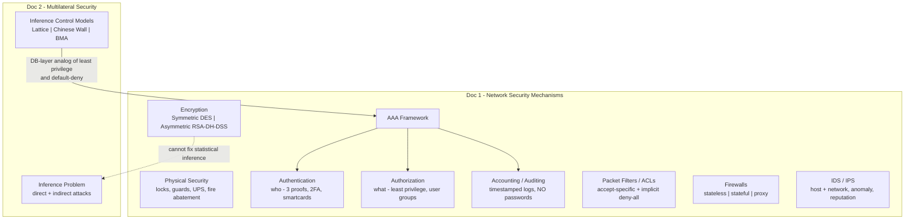
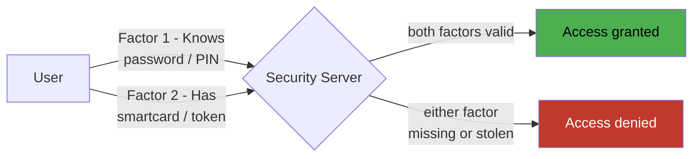
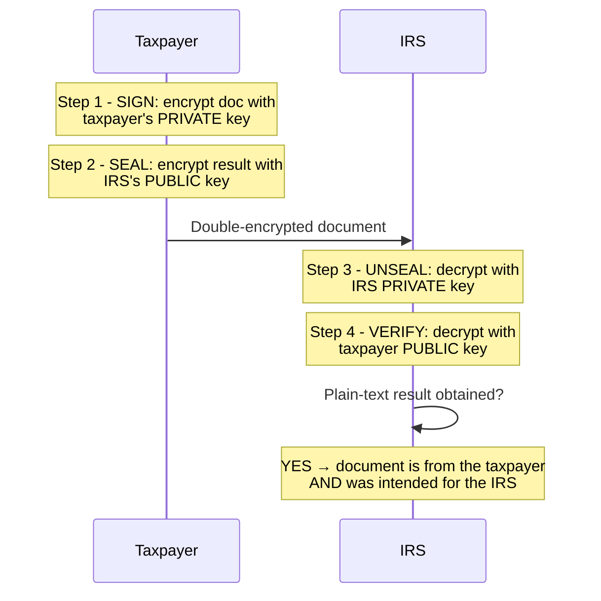
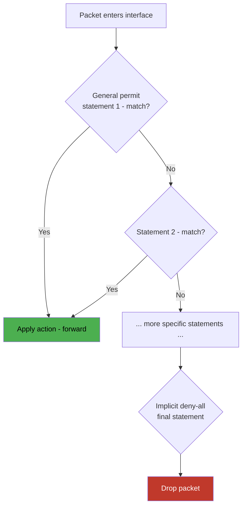
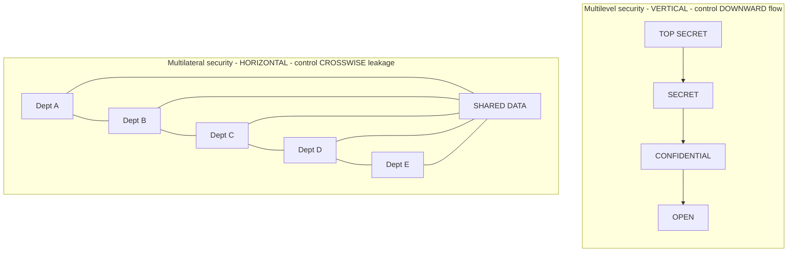
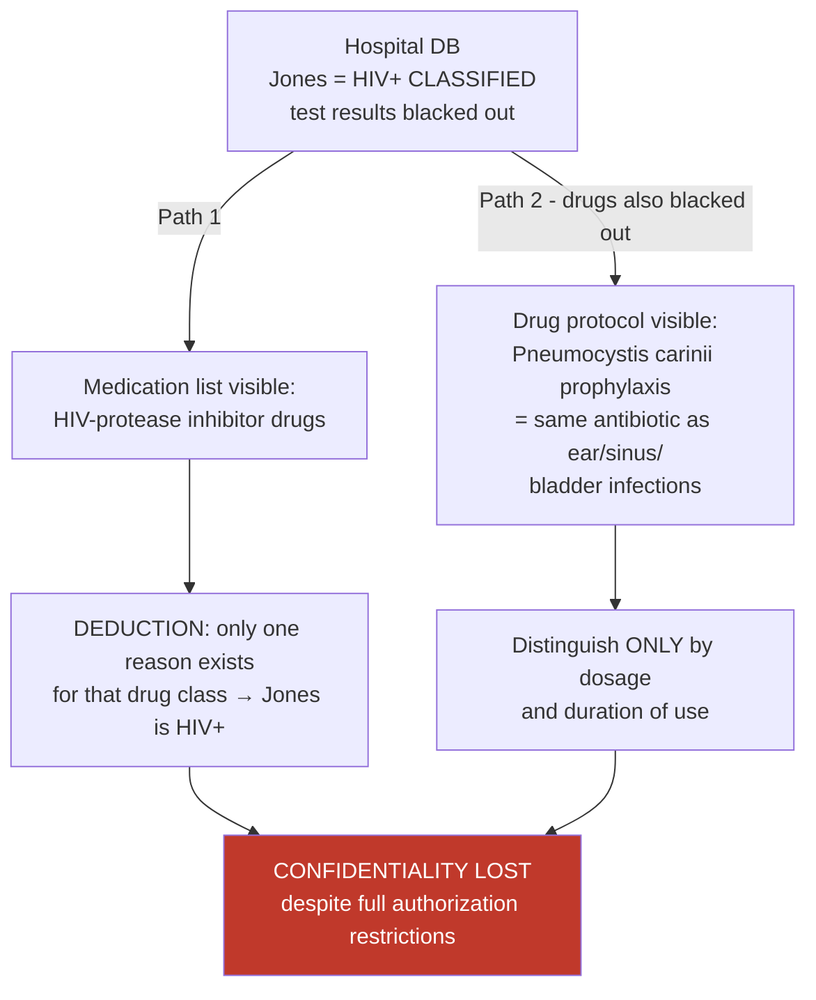

# Network Security Mechanisms & Multilateral Security (Inference Control) — Comprehensive Cybersecurity Notes

> **Scope note:** These notes combine two source documents: **(1) *Security Mechanisms*** — an excerpt on the "ingredients" of secure network design (from Cisco's *Top-Down Network Design* tradition: physical security, AAA, encryption, packet filters, firewalls, IDS/IPS), and **(2) *Multi-Lateral Security*** — an academic paper on extending security beyond hierarchical ("multilevel") controls to horizontal concerns, centred on the **database inference problem** and three inference-control models (Compartmentation/Lattice, Chinese Wall, BMA). External enrichment is marked throughout.

---

## 1. Executive Overview & Core Concepts

### 1.1 What the Two Documents Cover Together

The documents form a natural pair: **Doc 1 supplies the perimeter/host mechanisms** that protect a network (the "hard shell"), while **Doc 2 exposes the subtler data-level weakness** that survives all of those mechanisms — the **inference problem**, where classified information is derived from several unclassified pieces. Together they illustrate the full span of security design: *from the locked server room to the statistical query on a medical database.*

*   **Doc 1 (Security Mechanisms):** Typical ingredients of secure network designs, selectable when designing solutions for common security challenges (previewing the "Modularizing Security Design" section of the parent chapter): **Physical Security → Authentication → Authorization → Accounting/Auditing → Data Encryption → Public/Private Key Encryption → Packet Filters → Firewalls → IDS/IPS**.
*   **Doc 2 (Multi-Lateral Security):** Security requirements of **all parties involved**, treating every party as a potential attacker; the goal of stopping information leaking not only **"down"** a hierarchy (multilevel) but **"across"** departments; the inference problem (direct vs indirect attacks); four protection-goal losses in medical records; and three inference-control models, concluding that the **BMA model** is the best option for medical-record multilateral security.

### 1.2 Fundamental Definitions & Principles

| Concept | Definition (per sources, enriched where noted) |
| :--- | :--- |
| **Physical Security** | Limiting access to key network resources by keeping them behind a locked door, protected from natural and human-made disasters |
| **Authentication** | Identifies **who** is requesting network services (users, devices, or software processes) |
| **Authorization** | Says **what** authenticated users/processes can do after accessing resources; grants privileges |
| **Accounting (Auditing)** | Establishing procedures for **collecting network activity data** to analyze security and respond to incidents |
| **Security Assessment** | Extension of auditing: the network examined **from within by professionals** trained in vulnerabilities exploited by network invaders; periodic, producing a correction plan |
| **Encryption** | Process that **scrambles data** to protect it from being read by anyone but the intended receiver |
| **Ciphered data** | Encrypted data; unencrypted data = **plain text / clear text** |
| **Secret / Symmetric key** | A key unknown to intruders; when sender and receiver use the **same** secret key |
| **Asymmetric (public/private) keys** | Each station has an openly published **public key**; only its **private key** can decrypt |
| **Digital Signature** | Encrypting a document (or part of it) with **your private key** so the recipient can verify origin with your public key |
| **Packet Filter / ACL** | Accept/deny rules on routers, firewalls, servers based on addresses/services; Cisco's **Access Control List** with an **implicit deny-all** at the end |
| **Firewall** | Device enforcing security policies at the **boundary between two or more networks** |
| **IDS / IPS** | Intrusion **Detection** System (detects, notifies) / Intrusion **Prevention** System (an IDS that can also **prevent** attacks) |
| **Multilateral Security** | Taking into consideration the **security requirements of all parties involved**, considering all involved parties as **potential attackers** |
| **Multilevel Security** | Preventing information flowing **down** a hierarchical classification order (TOP SECRET → OPEN) |
| **Inference Problem** | Pfleeger (2000, p.353): *"drive sensitive data from non-sensitive data"* — classified information derived from several chunks of less-classified information |
| **Accountability** | Fourth protection goal (alongside C-I-A): persons responsible for IT-system processes (diagnoses, therapy, bills) must be identifiable |

> **🔑 Key Takeaway (the module's bridge):** Doc 1's mechanisms defend the **channel and the perimeter**; Doc 2 shows why **confidentiality can still fail** even when every mechanism operates perfectly — a low-classification user can combine permitted queries to infer a high-classification fact. Effective design therefore needs **both** infrastructure mechanisms (Doc 1) and information-flow models (Doc 2).

---

## 2. Page-by-Page Detailed Breakdown

## PART A — Security Mechanisms (Doc 1, Pages 1–8)

### A.1 Physical Security (Page 1)

*   **Definition:** limiting access to key network resources by keeping them **behind a locked door**, protected from natural and human-made disasters.
*   **Threats addressed:**
    *   **Inadvertent misuse** of network equipment by **untrained employees and contractors**
    *   **Hackers, competitors, and terrorists walking in off the street** and changing equipment configurations
    *   At higher protection levels: **terrorist and biohazard events** (bombs, radioactive spills)
    *   **Natural disasters:** floods, fires, storms, earthquakes
*   **Assets to protect:** core routers, **demarcation points**, cabling, modems, servers, hosts, **backup storage**, and so on.
*   **Design-stage requirements (work with the customer early):**
    *   Equipment placed in computer rooms with **card key access and/or security guards**
    *   **Uninterruptible power supplies (UPS)**, **fire alarms**, **fire-abatement mechanisms**, **water-removal systems**
    *   Equipment installed in **racks that attach to the floor or wall** (earthquake and high-wind protection)
*   **Process warning:** because physical security is such an *obvious* requirement, it is **easy to forget to plan for it** — it should **never be overlooked** or considered less important than other mechanisms. Planning must start during the **early phases of the top-down design process**, because there may be **lead times to build or install** security mechanisms.

> **⚠️ Warning:** The document explicitly cross-references "Secure Network Design Topologies" (Ch. 5) — physical security decisions (room locations, cabling runs) must be coordinated with **topology design**, not bolted on afterwards.

### A.2 Authentication (Pages 1–2)

**Purpose:** identifies **who** is requesting network services — usually users, but also **devices or software processes**. Example: **route authentication**, where a routing protocol requires a router to pass criteria before another router accepts its routing updates.

**Policy baseline:** to access a network, a user must enter a **login ID and password authenticated by a security server**.

**One-time (dynamic) passwords & smartcards:**
*   With one-time passwords, **the user's password always changes**.
*   Accomplished with a **security card (Smartcard)** — a physical device about the size of a credit card.
*   The user types a **PIN** into the card; the PIN is an *initial level of security that simply gives permission to use the card*.
*   The card provides a **one-time password** used to access the corporate network **for a limited time**; the password is **synchronized with a central security card server** on the network.
*   Commonly used by **telecommuters and mobile users**; **not usually used for LAN access**.

**The three proofs of authentication:**

| Proof | Description | Examples |
| :--- | :--- | :--- |
| **Something the user knows** | Knowledge of a **unique secret shared by the authenticating parties** | Classic password, **PIN**, private cryptographic key |
| **Something the user has** | **Physical possession** of an item unique to the user | Password token cards, security cards, hardware keys |
| **Something the user is** | Verification of a **unique physical characteristic** | Fingerprint, retina pattern, voice, face |

**Two-factor authentication:**
*   Requires the user to present **two proofs of identity** — e.g., a security card **and** a password.
*   **Key property:** a compromise of **one factor does not compromise the system** — an attacker who learns the password is stuck without the card; a stolen card is useless without the password.

### A.3 Authorization (Pages 2–3)

*   Whereas authentication controls **who can access** network resources, authorization says **what they can do after** accessing them. It **grants privileges to processes and users** and lets the security administrator control parts of a network (e.g., **directories and files on servers**).
*   Authorization **varies from user to user**, partly depending on department or job function — e.g., a policy might state **only Human Resources employees** should see salary records for people they don't manage.
*   **Principle of least privilege:** each user should be given **only the minimal necessary rights to perform a certain task**; an authorization mechanism should give only the **minimum access permissions necessary**.
*   **Scalability technique:** explicitly listing the authorized activities of each user with respect to **every resource is difficult** — so simplification techniques are used, e.g., a network manager can create **user groups for users with the same privileges**.

### A.4 Accounting (Auditing) (Page 3)

*   To effectively **analyze security** and **respond to incidents**, procedures must exist for **collecting network activity data** — this is *accounting* or *auditing*.
*   **For strict-security networks, audit data should include:**
    *   **All attempts** to achieve authentication and authorization **by any person**
    *   Especially important: log **"anonymous" or "guest" access to public servers**
    *   All attempts by users to **change their access rights**
*   **Required data fields:** user- and hostnames for **login and logout attempts**; **previous and new access rights** for access-right changes; **every entry timestamped**.
*   **Critical prohibition — the audit process should NOT collect passwords:**
    *   Collecting passwords creates a **potential security breach** if audit records are improperly accessed.
    *   **Neither correct nor incorrect passwords** should be collected — an incorrect password often differs from the valid one by **a single character or a transposition of characters**, effectively leaking the real password.

> **⚠️ Warning (classic exam trap):** The "don't log failed passwords" rule exists because *failed* attempts are the most informative — a near-miss reveals the true password's structure. Modern equivalent: never log credentials in application logs, even by accident.

*   **Security assessment (extension of auditing):** the network is examined **from within by professionals trained in the vulnerabilities exploited by network invaders**. Part of any security policy/audit procedure should be **periodic vulnerability assessments**; the result should be a **specific plan for correcting deficiencies** — which "might be as simple as retraining staff."

### A.5 Data Encryption (Pages 3–4)

*   **Definition:** scrambles data so it can be read **only by the intended receiver**. An **encryption device** encrypts data before placing it on the network; a **decryption device** decrypts before passing it to an application. A **router, server, end system, or dedicated device** can act as either.
*   **Terminology:** encrypted data = **ciphered data**; unencrypted = **plain text / clear text**.
*   **Value:** provides **data confidentiality** and can also **identify the sender of data** — a good feature to implement **in case the other types of security fail** (defence-in-depth: encryption is the last line, not the first).
*   **When to encrypt (performance tradeoffs):** use encryption when the customer has **analyzed security risks** and identified **severe consequences** if data isn't confidential and sender identity isn't guaranteed.
    *   **Internal networks**, and networks using the Internet merely for **web browsing, email, file transfer**: encryption **usually not necessary**.
    *   Organizations connecting **private sites via the Internet using VPN**: encryption **recommended** to protect organizational confidentiality.

**Two parts of encryption:**

| Part | Definition |
| :--- | :--- |
| **Encryption algorithm** | A **set of instructions** to scramble and unscramble data |
| **Encryption key** | A **code used by the algorithm** to scramble and unscramble data |

**The children's cipher example (monoalphabetic substitution — enrichment label):**

| Plain | A | B | C | D | E | F | G | H | I | J | K | L | M | N | O | P | Q | R | S | T | U | V | W | X | Y | Z |
| :--- | - | - | - | - | - | - | - | - | - | - | - | - | - | - | - | - | - | - | - | - | - | - | - | - | - | - |
| **Key** | I | N | B | Y | G | L | S | P | T | A | R | **W** | Q | H | X | M | D | K | **F** | U | O | C | Z | V | E | J |

*   With this key, **LISA is encrypted as WTFI** (L→W, I→T, S→F, A→I).
*   The key shows only uppercase letters, but many other possibilities exist (lowercase, digits, etc.). Most real algorithms are **more complex** to avoid maintaining a key value for every possible character.

**Secret keys and symmetric encryption:**
*   **Goal of encryption:** even if **the algorithm is known**, without the appropriate key an intruder cannot interpret the message — this type of key is a **secret key**.
*   When **sender and receiver use the same secret key**, it is a **symmetric key** system.
*   **DES (Data Encryption Standard)** is the **best-known example** of a symmetric key system; DES encryption is available for **most routers and many server implementations**. *(Enrichment: DES uses a 56-bit key and has since been superseded by AES — historically significant, deprecated today.)*
*   **The symmetric key-management problem:** reasonably simple between two devices, but **as the number of devices increases, the number of secret keys increases** and becomes hard to manage — a session between Station A and Station B uses a **different key** than A–C or B–C, and so on. *(Enrichment: for *n* stations, symmetric systems need **n(n−1)/2** keys — 10 stations = 45 keys.)*
*   **Asymmetric keys can solve this problem.**

### A.6 Public/Private Key Encryption (Page 5)

*   **The best-known asymmetric key system.** Each secure station has a **public key that is openly published or easily determined**; **all devices** can use a station's public key to **encrypt data to send to that station**.
*   The receiving station decrypts with **its own private key**. Because **no other device has the private key, no other device can decrypt** the data → **data confidentiality maintained**.
*   Mathematicians and computer scientists have written programs that identify **special numbers** for the keys so the **same algorithm** works for sender and receiver **even though different keys are used** (Figure 8-1 in the source).
*   **Dual capability:** public/private systems provide **both confidentiality AND authentication**. Using asymmetric keys, a recipient can **verify that a document really came from** the user or host it appears to have come from.
*   **The IRS tax-return example (digital signatures):**
    *   The IRS needs to know returns came from **you**, not from a hostile third party trying to make it look like you owe more.
    *   **Digital signature** = encrypting your document (or part of it) with **your private key**; the IRS decrypts with **your public key** (Figure 8-2). If decryption succeeds, the document **came from you** — nobody else should have your private key.
    *   **Combining both features:** after encrypting with your private key (signature), **encrypt again with the IRS's public key** (confidentiality). The IRS **decrypts twice**; if the result is plain-text data, the IRS knows the document **came from you** and **was meant for the IRS and no one else**.

*   **Examples of asymmetric key systems:** the **Rivest, Shamir, and Adleman (RSA)** standard, the **Diffie-Hellman public key algorithm**, and the **Digital Signature Standard (DSS)**.
*   **Cisco's hybrid deployment pattern (memorise):** Cisco uses **DSS to authenticate peer routers** during setup of an encrypted session; the peer routers use **Diffie-Hellman to send information on a secret key**; the **actual data is then encrypted using the DES algorithm and the secret key**. *(Enrichment: this is the canonical **hybrid cryptosystem** — asymmetric for authentication/key exchange, symmetric for bulk data — identical in principle to modern TLS.)*

### A.7 Packet Filters (Page 6)

*   **Definition:** set up on **routers, firewalls, and servers** to **accept or deny packets** from particular addresses or services. They **augment authentication and authorization** mechanisms and help protect network resources from **unauthorized use, theft, destruction, and DoS attacks**.
*   **Two possible policies (the security policy must state which):**

| Policy | Description | Assessment (per source) |
| :--- | :--- | :--- |
| **1. Deny specific, accept all else** | Blacklist named bad traffic | Requires a **thorough understanding of specific security threats**; **can be hard to implement** |
| **2. Accept specific, deny all else** | Whitelist named good traffic | **Easier to implement and more secure** — the admin does not have to **predict future attacks**; **easier to test** because there is a **finite set of accepted uses**; but requires a **good understanding of network requirements** |

*   **Cisco implements the second policy** via **access control lists (ACLs)**. An ACL on a Cisco IOS router/switch **always has an implicit deny-all statement at the end**; specific accept statements are processed **before** the implicit deny-all. It is *implicit* because the administrator need not enter it — **although it is a good idea to enter it to make the list's behaviour more obvious**.
*   **ACL function:** control whether network traffic is **forwarded or blocked at interfaces**; criteria applied to packets entering or exiting an interface — typically **source address, destination address, or upper-layer protocol**.
*   **Performance-driven ACL design:** Cisco IOS tests a packet **against each criteria statement until a match is found** — so by **studying traffic flow**, design the list so **most packets match the earliest conditions** (fewer checks per packet = better throughput). **Ordering advice:** **most general statements at the top, most specific at the bottom**, with the implicit deny-all last.

> **💡 Exam Tip:** Whitelist (accept-specific/deny-all) maps directly onto Doc 2's **compartmentation** philosophy: define what is allowed, block everything else by default — the same *default-deny* logic that limits both network access and database inference.

### A.8 Firewalls (Page 7)

*   **Definition:** a device that **enforces security policies at the boundary between two or more networks**. Can be: a **router with ACLs**, a **dedicated hardware appliance**, or **software running on a PC or UNIX system**. Especially important at the **boundary between the enterprise network and the Internet**.
*   A firewall has a **set of rules** specifying which traffic is allowed or denied. **Three types:**

| Type | Mechanism | Strengths (per source) | Notes |
| :--- | :--- | :--- | :--- |
| **Static stateless packet-filter firewall** | Looks at **individual packets** | Optimized for **speed and configuration simplicity** | No session memory |
| **Stateful firewall** | **Tracks communication sessions**; more intelligently allows/denies | Remembers that a protected client initiated a download request and **allows data back in for that connection**; works with protocols like **active (port-mode) FTP**, where the **server also opens a connection to the client** | Session-aware decisions |
| **Proxy firewall** | Acts as an **intermediary between hosts**; intercepts **some or all application traffic** between local clients and outside servers | **Most advanced type but also the least common**; examines packets, supports **stateful tracking of sessions**; can **block malicious traffic and unacceptable content** | Application-layer intermediary |

### A.9 Intrusion Detection and Prevention Systems (Pages 7–8)

*   **IDS:** detects malicious events and **notifies an administrator** via **email, paging, or logging**. Can also perform **statistical and anomaly analysis**. Some IDS devices report to a **central database that correlates information from multiple sensors**, giving the administrator an **overall real-time view** of network security.
*   **IPS:** can **dynamically block traffic** — by **adding rules to a firewall** or by being configured to **inspect (and deny or allow) traffic as it enters a firewall**. **An IPS is an IDS that can detect AND prevent attacks.**
*   **Two types of IDS devices:**

| Type | Placement & Function |
| :--- | :--- |
| **Host IDS** | **Resides on an individual host** and monitors that host |
| **Network IDS** | Monitors **all network traffic it can see**, watching for **predefined signatures of malicious events**; often placed **on a subnet directly connected to a firewall** so it monitors the traffic that **has been allowed** and looks for suspicious activity |

*   **The false-alarm problem:** a **false alarm** occurs when an IDS/IPS reports a network event as a serious problem when it actually isn't. Historically a **major concern** for both device types; now **ameliorated by sophisticated software and services on modern IPS devices**.
*   **Cisco IPS innovations (as listed):**
    *   **Anomaly detection** — learns typical actual network traffic on the customer's network and **alarms only upon deviation** from that traffic.
    *   **Reputation filtering and global correlation services** — keeps the IPS **up-to-date on global security trends** and more accurately **denies traffic from networks known to be currently associated with botnets, spam, and other malware**.

---

## PART B — Multi-Lateral Security (Doc 2, Pages 1–4, following its own Index)

### B.1 Overview (Section 1.0, Page 1)

*   Today's computing world is **drastically different from twenty years ago**: with IT's development and the spread of its applications, the term **"security" has experienced a substantial extension of its meaning**.
*   **Working definition:** Security of IT systems = the fact that **protection goals — confidentiality, integrity, availability, and accountability — are achieved in spite of intelligent attackers**.
*   With **open communication systems**, it is *"particularly unrealistic to assume that all parties involved completely trust one another."* But it is possible, **if designers take advantage of the distribution of communication systems in the right way** — in particular, **if they distribute sensitive information in such a way that abuse becomes unattractive**. *(Pfleeger, C., 2000, p.270 — enrichment: Charles Pfleeger, "Security in Computing.")*

### B.2 Multilateral Security (Section 2.0, Pages 1–2)

*   **Definition:** taking into consideration the **security requirements of all parties involved**; also **considering all involved parties as potential attackers**. Especially important for **open communication systems**, where parties cannot be expected to trust each other. Consequently, requirements are **particularly high for public communications networks intended for universal use**. *(Anderson, R., 2001, p.164 — the document's "Aderson, R." is a typo for **Ross Anderson, "Security Engineering" (2001)**.)*
*   **The core aim:** not only to prevent information flowing **"down" a hierarchical order (Multilevel)** but also to **stop the leak "across" the departments**.
*   **Application domains:** healthcare to national/international intelligence — most applications where **privacy of individual customers, citizens, or patients is at stake**. These account for a **significant proportion of information processing systems**, but their protection is **poorly designed and implemented**, leading to **a number of expensive fiascos**.
*   **Verdict:** *"multilateral security scores more than the multilevel security and should be considered"* (Anderson, 2001, p.161).
*   **The two figures (Anderson, 2001, p.161):**

| Figure 8-1 — Multilevel Security | Figure 8-2 — Multilateral Security |
| :--- | :--- |
| A **vertical hierarchy**: TOP SECRET → SECRET → CONFIDENTIAL → OPEN | **Horizontal compartments** A | B | C | D | E over a layer of **shared data** |

### B.3 Non-Technical Explanation: Inference Control (Section 3.0, Page 2)

*   **When the problem arises:** whenever **classified information is derived from several chunks or pieces of less classified information**.
*   **Pfleeger (2000, p.353):** the Inference Problem = *"drive sensitive data from non-sensitive data"* — it is a **vulnerability in database security**. There are different ways to get access to a database, and one can easily **modify or change all secret records** of any company.
*   **Two attack types:**

| Attack | Description | Technique (per Pfleeger, 2000, p.355) |
| :--- | :--- | :--- |
| **Direct Attack** | Determine values of **sensitive fields by seeking them directly** with queries that yield **few records** | The **most successful technique**: form a query **so specific that it matches exactly one data item** |
| **Indirect Attack** | Sensitive data is released **only as statistics**; individual names, addresses, or other identifying characteristics are **suppressed** | Exploit released **neutral statistics — count, sum, and mean** — to reconstruct individual values |

*   *(Enrichment: indirect attacks are the domain of **statistical database security** — trackers, small-query-set attacks, sum/complement attacks. Modern countermeasures include **query-set-size control**, **n-item/k-percent suppression**, and **k-anonymity**.)*

**Prospective attackers (Section 3.1) — four classes:**
1.  **Outsiders, users and operators of the system**
2.  **Producers, designers of the system**
3.  **Maintenance services**
4.  **Producers and designers of the tools** used for design and production of the system

> **💡 Exam Tip:** This attacker list is broader than Doc 1's user/device view — it includes **insiders of the supply chain** (producers, designers, maintainers), prefiguring the "trusted insider at the hub" insight from threat-actor analysis and modern supply-chain risk thinking.

### B.4 Discussion: The Inference Problem (Section 4.0, Pages 2–3)

*   The inference problem is **very complicated for medical information**: a hallmark of biological systems is their **extreme degree of inter-relatedness**, which makes **normalization of the database impossible to accomplish in any meaningful way** from a knowledgeable user's point of view.
*   Data **can** be normalized in a technical sense (no redundancy in stored tables), but it is **not possible to remove the redundancy imposed by the physiology of the patient** which the data represent.
*   **Consequence:** given this inter-relatedness, a **user with a low classification can obtain information permitting inference of a datum at a higher classification**. It has been shown that information about a **single patient** can be obtained by **properly phrased queries involving only abstracted statistical data** — and this leak **cannot be closed by authorization restrictions**.
*   **Cover stories are impossible:** a medical DBMS cannot provide a convincing cover story by changing a significant piece of data without altering **all other data that rely upon or are influenced by it** — *"you can't simply change the diagnosis from kidney failure to liver failure without altering the history of the presenting illness, the physical exam findings, the laboratory data, any images which show the kidneys and/or liver, and the therapeutic procedures."*

**Multiple inter-related databases (the harder case):**
*   The problem becomes **even more intractable** with multiple inter-related DBMSs — **hospital, outpatient clinic, pharmacy, insurance clearance house**.
*   Each has **sufficient demographic information to identify an individual patient** → it becomes possible to **determine classified facts in one DB by relying on non-classified information contained in another**.

**The "Patient Jones" HIV worked example (David B. Hill, 1999, p.5):**
1.  The hospital classifies that **patient Jones is HIV(+)** and suppresses it by **blacking out individual test results** consistent with HIV.
2.  **Inference path 1 (medications):** inspecting the **medications Jones takes** suffices — there is **one and only one reason** for taking drugs from the class that targets the **HIV protease**.
3.  **Inference path 2 (even with drugs blacked out):** if Jones is placed on a **fairly common drug protocol designed to prevent infection from *Pneumocystis carinii*** — an organism **harmless to people without AIDS** but treated in AIDS patients with the **same antibiotic used for ear, sinus, and bladder infections** — the infection is still deducible. **The difference is the dosage and time of use** in the HIV case vs. the other cases.

> **🔑 Key Takeaway:** Authorization restrictions (Doc 1's model) **cannot** close this leak — because the sensitive fact is re-derivable from **permitted, non-sensitive data**. This is precisely why **multilateral security needs dedicated information-flow models**, not just stronger authentication/authorization.

### B.5 Problems: Inference Control in Medical Records (Section 4.1, Page 3)

Four main problem categories — each an unauthorized act mapped to a **protection-goal loss**:

| Unauthorized act | Goal lost | Meaning in the medical context |
| :--- | :--- | :--- |
| **Unauthorized acquisition of information** | **Confidentiality** | Patient data (examinations, diagnoses, etc.) may **not become known to unauthorized persons** |
| **Unauthorized modification of information** | **Integrity** | **Unauthorized and unnoticed** modification of data |
| **Unauthorized impairment of functionality** | **Availability** | A patient's file is **only accessible over a network** — and this network **is not working and is noticed not to be working** |
| **Unauthorized no commitment** | **Accountability** | If **no persons responsible** for IT-system processes (distribution of diagnoses, arrangements for therapy or bills) can be identified → **irresponsible behaviour** |

*   Source cited: *IT Security and Multilateral Security*, Günter Müller, Kai Rannenberg, **Multilateral Security in Communications – Technology, Infrastructure, Economy**, Addison-Wesley-Longman 1999, ISBN 3-8273-1360-0.

> **💡 Exam Tip:** Note the fourth goal — **Accountability** — added to the classic CIA triad; it ties back to Doc 1's **Accounting (Auditing)** mechanism, which exists precisely to establish such attribution (while never logging passwords).

### B.6 Inference Control Models (Section 4.2, Page 4)

Three models for implementing **access control and information-flow control** in multilateral security:

**1. Compartmentation and the Lattice Model**
*   Restricts access to information by the use of **code words as well as classifications**.
*   **Largely used during World War II**; famous among the **intelligence community**.
*   For **medical records this model is not so effective, because of the difference in requirements** (Anderson, 2001, p.162). *(Enrichment: intelligence data are naturally partitionable into compartments; physiological facts about one patient are interconnected, so compartments would need to be re-drawn per fact — impractical.)*

**2. Chinese Wall Model**
*   Scope is **wider than just investment banking**: many firms have clients who **may be in competition with each other**.
*   **Typical rule:** *"a partner who has worked recently for one company in a business sector may not have access to the papers of any other company in that sector."*
*   Features a **mix of free choice and mandatory access control** — the analyst *chooses* which clients to work for, after which access is *mandatorily* barred from that sector's conflicts.
*   Made a **seminal contribution to the theory of access control** (Anderson, 2001, p.165). *(Enrichment: Brewer & Nash, 1989; named after the Great Wall of China — once you touch information on one side, you cannot cross to the conflicting side.)*

**3. BMA Model (British Medical Association)**
*   Protects **medical information AND personal information of clients**; famous in the **health information sciences**.
*   The BMA security policy consists of **nine principles** (Anderson, 2001, p.167) — the source lists **seven** (two of Anderson's original nine are merged in the document's pairs):

| # | BMA Principle (as listed) | Anderson's original nine (enrichment) |
| :--- | :--- | :--- |
| 1 | Access and record Opening Control | **Access Control** + **Record Opening** (a record may be opened only by/for a clinician with a treatment relationship) |
| 2 | Consent and Notification | **Consent** (patient consent to disclosure) + **Notification** (patients notified of significant disclosures) |
| 3 | Persistence | Records persist for the life of the patient and are never destroyed while needed |
| 4 | Attributation *(sic — Attribution)* | Every record entry is **attributable** to its author (accountability!) |
| 5 | Information Flow | Information flows only to those with a **clinical/consented need** |
| 6 | Aggregation Control | Controls that prevent **aggregation attacks** — directly the inference-problem countermeasure |
| 7 | Trusted Computing Base | A trusted computing base enforces the policy |

### B.7 Conclusion (Section 5.0, Page 4)

*   **The BMA model is currently the best option** for multilateral security of medical records — it **matches the requirements of any medical database security needs**.
*   It provides **not only internal security but as well as external security to employees and clients**.
*   **Recommended additions:** features like **password authentication, login name, and access level** make the database **more secure and efficient**. *(Note how these additions are exactly Doc 1's authentication + authorization mechanisms layered onto the model.)*

---

## 3. Comparative Summary & Matrix

### 3.1 Master Table: The Eight Security Mechanisms (Doc 1) vs Protection Goals

| Mechanism | Primary goal served | Secondary goals | Key rules from source |
| :--- | :--- | :--- | :--- |
| **Physical Security** | Availability (protect from disasters) | Confidentiality (access control) | Locked door, card key, guards, UPS, fire abatement, wall/floor racks; plan early (lead times) |
| **Authentication** | Authenticity / Accountability | Confidentiality | 3 proofs (knows / has / is); 2FA = one factor compromised ≠ system compromised |
| **Authorization** | Confidentiality, Integrity | — | **Least privilege**; simplify via **user groups** |
| **Accounting/Auditing** | **Accountability** | Detection | Timestamped logs of logins/logouts/rights changes; **never collect passwords** (correct or incorrect) |
| **Data Encryption** | Confidentiality | Sender identification | Two parts (algorithm + key); encrypt for VPN/private-site links, not ordinary internal traffic |
| **Public/Private Key Encryption** | Confidentiality **+** Authentication | Non-repudiation (digital signature) | RSA, Diffie-Hellman, DSS; Cisco hybrid: DSS auth → DH key → DES data |
| **Packet Filters / ACLs** | Confidentiality, Availability (DoS) | — | **Accept-specific & deny-all** (Cisco's choice); implicit deny-all last; general-first ordering for throughput |
| **Firewalls** | Confidentiality, Availability | — | Stateless (speed) < Stateful (sessions, FTP) < Proxy (most advanced, least common) |
| **IDS / IPS** | Detection & Response (Integrity, Availability) | — | Host IDS vs Network IDS; false alarms ameliorated via anomaly detection + reputation filtering |

### 3.2 Symmetric vs Asymmetric Encryption (Doc 1)

| Aspect | Symmetric (Secret Key) | Asymmetric (Public/Private Key) |
| :--- | :--- | :--- |
| Keys | **Same** secret key at sender & receiver | Public key (published) + private key (held) |
| Best-known example | **DES** | **RSA**, **Diffie-Hellman**, **DSS** |
| Key-count scaling | Keys grow with device count (A–B ≠ A–C ≠ B–C); hard to manage *(n(n−1)/2)* | Solves the key-management problem |
| Capabilities | Confidentiality | Confidentiality **and** authentication (digital signatures) |
| Doc-1 usage pattern | Bulk data encryption (DES + secret key) | Peer-router authentication (DSS), key transport (Diffie-Hellman) |

### 3.3 Direct vs Indirect Inference Attacks (Doc 2)

| Aspect | Direct Attack | Indirect Attack |
| :--- | :--- | :--- |
| Method | Query sensitive fields **directly** | Exploit released **statistics only** |
| Key technique | Query **so specific it matches exactly one data item** | Suppress identifiers; use **count, sum, mean** |
| Visibility | Queries clearly target few records | Queries look harmless/aggregate |
| Countermeasure family | Query-set-size restrictions; authorization | **Aggregation control**; suppression; (modern: k-anonymity) |

### 3.4 The Three Inference-Control Models (Doc 2)

| Aspect | Compartmentation & Lattice | Chinese Wall | BMA Model |
| :--- | :--- | :--- | :--- |
| Mechanism | **Code words + classifications** | Conflict-of-interest: recent work for one company bars access to competitors in that sector | **Nine principles** protecting medical + personal data |
| Origin domain | WWII **intelligence community** | Investment banking (consultancy conflicts) | **Health information sciences** (British Medical Association) |
| Control style | Mandatory (hierarchical + compartments) | **Mix of free choice + mandatory control** | Policy-driven, patient-centred |
| Fit for medical records | **Not so effective** — difference in requirements | Wider scope than banking, but profession-agnostic | **Best option** — internal and external security for employees and clients |

### 3.5 Cross-Document Synthesis: Multilevel vs Multilateral

| Aspect | Multilevel (Anderson Fig. 8-1) | Multilateral (Anderson Fig. 8-2) |
| :--- | :--- | :--- |
| Orientation | **Vertical** — TOP SECRET → OPEN | **Horizontal** — departments A–E over shared data |
| Threat model | Downward leakage across clearance levels | **All parties as potential attackers**; leakage **across** departments |
| Doc-1 analog | Clearance-style authorization | **Least privilege + default-deny ACLs** applied at the data layer |
| Failure mode it addresses | Classification misuse | **The inference problem** — authorized queries combining into unauthorized knowledge |
| Doc-2 verdict | Necessary but insufficient | *"Scores more than multilevel and should be considered"* |

---

## 4. Key Terminology & Cheat Sheet

### 4.1 Glossary

| Term | Definition |
| :--- | :--- |
| **Accountability** | Fourth protection goal: identifiable responsibility for IT-system processes (diagnoses, therapy, bills) |
| **ACL (Access Control List)** | Cisco's packet filter; criteria on source/destination/protocol; **implicit deny-all** at the end |
| **Aggregation Control** | BMA principle controlling statistical aggregation — the inference-problem countermeasure |
| **Anomaly detection** | IPS feature learning typical traffic and alarming **only on deviation** |
| **Chinese Wall Model** | Access-control model: recent work for one company bars access to competing companies' papers; free choice + mandatory control |
| **Ciphered / Clear text** | Encrypted / unencrypted data |
| **Compartmentation & Lattice Model** | Access restriction via code words + classifications; WWII intelligence practice |
| **Demarcation point** | Carrier/customer network boundary — a physical-security-protected asset |
| **DES** | Data Encryption Standard — best-known **symmetric** system (per source) |
| **Diffie-Hellman** | Public-key algorithm Cisco peers use to convey the secret key |
| **Digital Signature** | Encryption of a document with the sender's **private key**, verifiable with the public key |
| **DSS** | Digital Signature Standard; used by Cisco to authenticate peer routers |
| **Inference Problem** | Deriving sensitive data from non-sensitive data (Pfleeger); cannot be closed by authorization restrictions alone |
| **IPS** | IDS that can also **prevent** — blocks traffic by adding firewall rules or inline inspection |
| **Least privilege** | Give each user only the **minimum necessary rights** for the task |
| **Multilateral Security** | Security requirements of **all parties**; all parties treated as potential attackers |
| **One-time password** | Dynamic password that **always changes**; delivered via smartcard, synced to a central security card server |
| **Proxy firewall** | Most advanced, least common; intermediary intercepting application traffic with stateful session tracking |
| **Reputation filtering** | IPS service denying traffic from networks associated with **botnets, spam, malware** |
| **Route authentication** | A router must pass criteria before another router accepts its routing updates |
| **Security assessment** | Periodic internal examination by vulnerability-trained professionals; output = deficiency-correction plan |
| **Smartcard** | Credit-card-sized security device; PIN unlocks it; supplies one-time passwords (telecommuters/mobile users, not LAN) |
| **Stateful firewall** | Tracks communication sessions; supports server-initiated connections (active FTP) |
| **Trusted Computing Base** | BMA principle: the trusted core that enforces the security policy |
| **Two-factor authentication** | Two proofs required; compromise of one factor ≠ system compromise |

### 4.2 Numbers Cheat Sheet

| Item | Value |
| :--- | :--- |
| Authentication proofs | **3** — knows / has / is |
| Two-factor rule | Compromise of **one factor ≠** system compromise |
| Encryption parts | **2** — algorithm + key |
| Asymmetric systems named | **3** — RSA, Diffie-Hellman, DSS |
| Packet-filter policies | **2** — deny-specific vs **accept-specific (Cisco's choice)** |
| ACL structure | Specific permits first → **implicit deny-all last**; general→specific ordering |
| Firewall types | **3** — stateless, stateful, proxy (most advanced, least common) |
| IDS device types | **2** — Host IDS, Network IDS |
| Audit-log rule | Timestamp every entry; **never collect passwords** (correct or incorrect) |
| Children's cipher result | **LISA → WTFI** |
| Doc-2 protection goals | **4** — Confidentiality, Integrity, Availability, **Accountability** |
| Inference attack types | **2** — Direct, Indirect |
| Prospective attacker classes | **4** — outsiders/users/operators; producers/designers; maintenance services; tool producers/designers |
| Inference-loss categories | **4** — Confidentiality, Integrity, Availability, Accountability |
| Inference-control models | **3** — Lattice, Chinese Wall, BMA |
| BMA principles | **9 stated; 7 listed** (Access+Record-Opening merged; Consent+Notification merged) |
| Doc-2 conclusion | **BMA = best option** for medical-record multilateral security |

### 4.3 One-Line Recall Strings

*   **Doc 1:** *"Lock it down, prove who (3 proofs, 2 factors), limit what (least privilege, groups), log everything but passwords, encrypt when risk demands (symmetric DES for data, RSA/DH/DSS for keys), deny-all by default, filter at the boundary (stateless→stateful→proxy), and detect what slips through (host+network IDS, anomaly+reputation)."*
*   **Doc 2:** *"Security must satisfy every party and treat every party as an attacker — stop leaks ACROSS, not just DOWN; inference turns counts, sums, and drug lists into classified facts (Jones/HIV), so use flow models: lattice for spies, Chinese Wall for conflicts, BMA for medicine."*

---