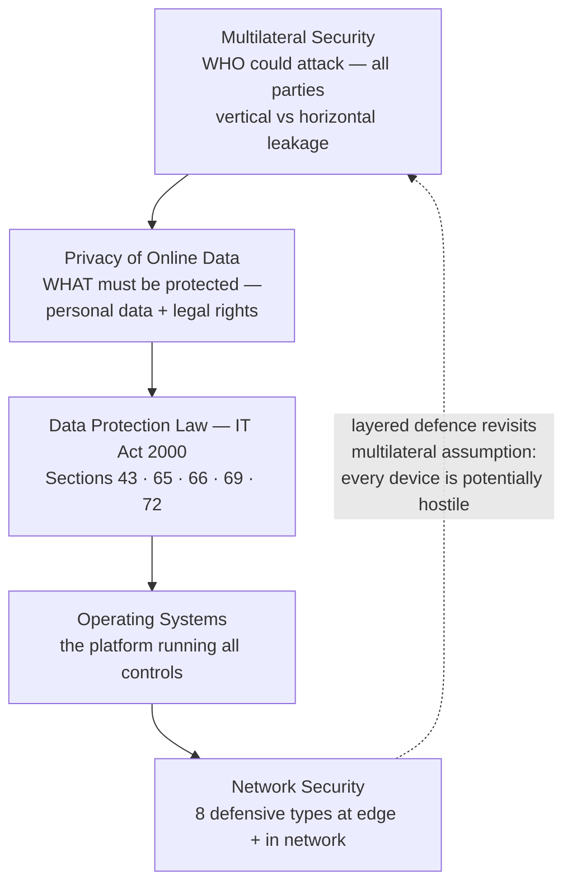
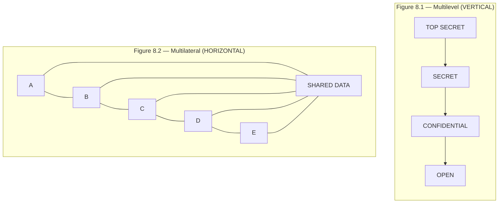
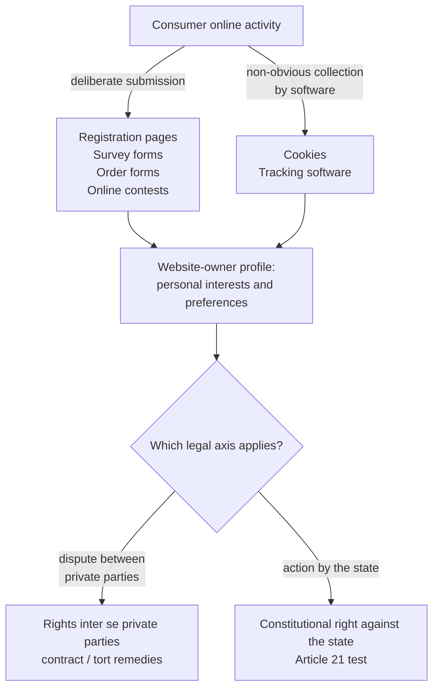
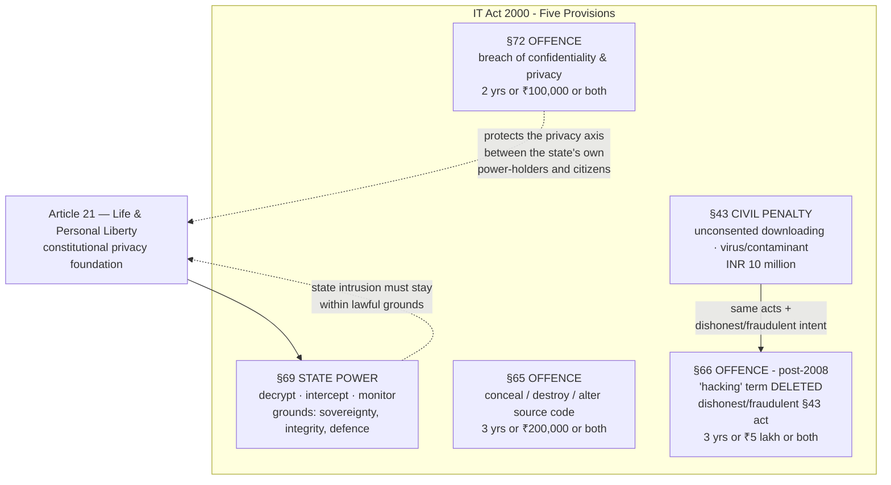
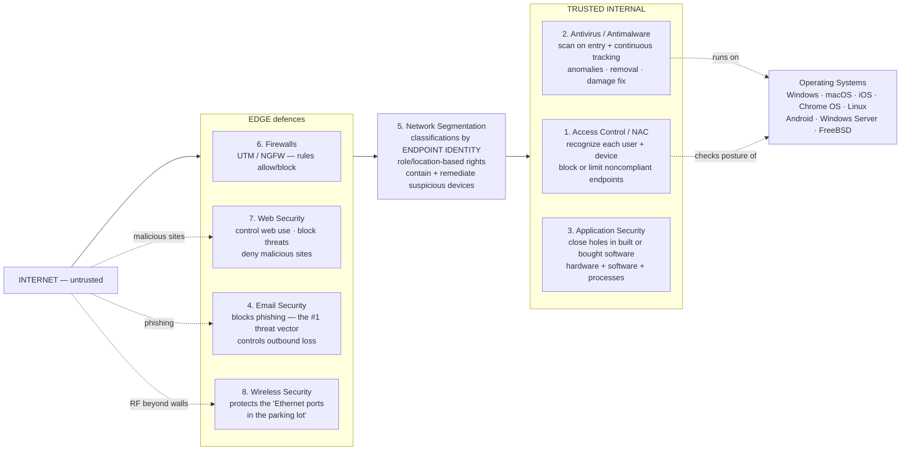

# Security Requirements — Comprehensive Cybersecurity Notes

> **Scope note:** One deck was attached: **“Security Requirements”** (15 slides). It covers four connected topics — **Multilateral Security**, **Privacy of Online Data & Data Protection Law in India (IT Act 2000)**, **Operating Systems**, and **Network Security (how it works + its 8 types)**. Slides 2–3 repeat the *Multi-Lateral Security* paper covered earlier (Anderson's Figures 8.1/8.2) and slides 6–8 extend the earlier *IT Act 2000* deck — cross-references are flagged throughout so you can consolidate. External enrichment is marked where added.

---

## 1. Executive Overview & Core Concepts

### 1.1 Module Roadmap

| Slides | Topic | Theme |
| :--- | :--- | :--- |
| 1 | Title | *Security Requirements* |
| 2–3 | **Multilateral Security** | Security requirements of **all parties**; all parties as potential attackers; multilevel (vertical) vs multilateral (horizontal) models |
| 4–5 | **Privacy of Online Data** | Privacy as a right **between private parties** and **against the state**; how the Internet collects personal data; **Article 21** constitutional basis |
| 6–8 | **Data Protection Laws in India** | IT Act **Sections 43, 65, 66, 69, 72** — government interference powers and penalties |
| 9–10 | **Operating Systems** | What an OS is; desktop, mobile, and server OS families |
| 11–15 | **Network Security** | Layered defence model; benefits; the **eight types** of network security (NAC, antimalware, application, email, segmentation, firewall, web, wireless) |

### 1.2 Fundamental Definitions

*   **Multilateral Security:** taking into consideration the **security requirements of all parties involved** — and **considering all involved parties as potential attackers**. Especially important for **open communication systems**, where parties cannot be expected to trust each other.
*   **Privacy:** analysed along **two legal axes** — rights *inter se* (between) private parties, and the **constitutional right against the state**.
*   **Operating System (OS):** a **powerful, usually large, program that controls and manages the hardware and other software** on a computer; present on *every* computing device (laptop, tablet, desktop, smartphone, smartwatch, router).
*   **Network Security:** combines **multiple layers of defences at the edge and in the network**; each layer implements **policies and controls** — authorized users gain access, malicious actors are blocked from exploits and threats.

> **🔑 Key Takeaway (module-level):** This deck moves outward through the layers of a security programme — *data-flow models* (multilateral), *law* (privacy rights + IT Act), *platform* (OS), and *network defences* (8 types). Each topic answers a different question: **who might attack whom?**, **what does the law require?**, **what runs the defences?**, and **how is the network protected?**

---

## 2. Slide-by-Slide Detailed Breakdown

## PART A — Multilateral Security (Slides 2–3)

### Slide 2 — Definition

*   Multilateral Security = taking into consideration the **security requirements of all parties involved**.
*   It also means **considering all involved parties as potential attackers**.
*   Especially important for **open communication systems** — *"one cannot expect the various parties to trust each other."*
*   *Cross-reference:* this is the Anderson (2001) formulation from the earlier *Multi-Lateral Security* paper — requirements are **particularly high for public communications networks intended for universal use**; the aim is to stop leaks **"across"** departments, not only **"down"** a hierarchy.

### Slide 3 — The Two Models (Anderson, 2001)

| **Figure 8.1 — Multilevel Security** | **Figure 8.2 — Multilateral Security** |
| :--- | :--- |
| **Vertical hierarchy** of classifications | **Horizontal compartments** over shared data |
| TOP SECRET → SECRET → CONFIDENTIAL → OPEN | Compartments **A | B | C | D | E** above a layer of **shared data** |
| Controls **downward** information flow | Controls **crosswise** leakage between parties who all touch shared data |

> **💡 Exam Tip:** Memorise the geometry: **multilevel = vertical stack** (one organisation, clearance levels, leakage downward); **multilateral = horizontal cells over shared data** (many parties, equal standing, leakage sideways). The multilateral model is the harder problem because *every* compartment member is a potential attacker against the shared layer.

---

## PART B — Privacy of Online Data & Data Protection Law in India (Slides 4–8)

### Slide 4 — Privacy of Online Data

*   **Two legal axes of analysis:**
    1.  Rights **inter se private parties** (person-to-person / company-to-consumer disputes),
    2.  The **constitutional right against the state** (government action).
*   **How the Internet gathers personal data (modes listed on slide):**
    *   **Deliberate submission:** registration pages, survey forms, order forms, online contests.
    *   **Non-obvious collection:** *"by software in ways that are not obvious to the online consumer."*
*   **Tracking risk:** website owners may **follow consumers through cookies and tracking software**, observing online activities to **gather information about personal interests and preferences** — building behavioural profiles without explicit awareness.

### Slide 5 — The Constitutional Basis: Article 21

*   Privacy is read as **personal liberty in Article 21** of the Constitution of India.
*   **Article 21 — "Protection of Life and Personal Liberty":** *"No person shall be deprived of his life or personal liberty except according to procedure established by law."*
*   *Enrichment:* this slide reflects the pre-2017 position. In **Justice K.S. Puttaswamy v. Union of India (2017)**, a **unanimous 9-judge bench** of the Supreme Court held that the **right to privacy is a fundamental right** intrinsic to Article 21 (and Part III generally) — with proportionality requirements for any state intrusion. India's **DPDP Act, 2023** is the modern statutory successor to the IT Act's data-protection provisions.

### Slides 6–8 — Data Protection Laws in India (IT Act 2000)

Five operative provisions, combining **state powers** (S.69) and **penalties/offences** (S.43, S.65, S.66, S.72):

| Section | Subject | Provision (per slides) | Penalty / Effect |
| :--- | :--- | :--- | :--- |
| **§69** | **Grounds on which Government can interfere with Data** | The **Controller**, appointed by the Government, can **direct a subscriber to extend facilities to decrypt, intercept and monitor information** — if satisfied it is **necessary or expedient** in the interest of **sovereignty or integrity of India, defence of India**, etc. | Power provision (state-side of the privacy axis) |
| **§43** | **Damage to computer, computer systems, etc.** | Imposes penalty **inter alia** for **downloading data without consent**; same penalty for **introducing or causing to be introduced any computer contaminant or computer virus** into any computer, system, or network | **INR 10 million** (₹1 crore) — *civil compensation liability* |
| **§65** | **Tampering with Computer Source Documents** | Whoever **knowingly or intentionally conceals, destroys, or alters** any **computer source code** used for a computer, programme, system, or network — **when the source code is required to be kept or maintained by law** | Imprisonment up to **3 years**, or fine up to **INR 200,000**, **or both** |
| **§66** | **Computer-related offences** | **Earlier version defined "hacking"** — but the term **"hacking" was deleted by the IT Amendment Act, 2008**. Substituted §66: *"If any person, **dishonestly or fraudulently** does any act referred to in **Section 43**, he shall be punishable…"* | Imprisonment up to **3 years**, or fine up to **₹5 lakh (five lakh rupees)**, **or both** |
| **§72** | **Penalty for Breach of Confidentiality and Privacy** | Any person who, **in pursuance of powers conferred under the IT Act/Rules/Regulations**, has **secured access** to any **electronic record, book, register, correspondence, information, document or other material without the consent of the person concerned**, and **discloses** it to any other person | Imprisonment up to **2 years**, or fine up to **INR 100,000**, **or both** |

> **⚠️ Warning (exam traps):**
> *   **§43 vs §66:** the *same underlying acts* (the §43 list) become criminal under §66 when done **"dishonestly or fraudulently"** — §43 alone is civil/compensatory (₹1 crore), §66 adds imprisonment (3 years + ₹5 lakh).
> *   The word **"hacking" no longer exists** in §66 — the IT Amendment Act 2008 replaced it with the §43-act + intent formulation. Quoting the pre-2008 definition in an exam answer is a classic error.
> *   **§65** applies only to source code **required by law to be kept/maintained** — not to all code.
> *   **§72** targets persons who obtained access **under legal powers** (officials, CERT/intermediary staff) — it polices *insiders to lawful access*, complementing §43/§66 which target outsiders.

*   *Cross-reference:* earlier deck coverage of **§43, §66, §67, §70, §79** remains valid; this deck adds **§65, §69, §72** — together they complete the IT Act's privacy/offence map. *(Enrichment: §66A, added in 2008 for offensive messages, was struck down as unconstitutional in **Shreya Singhal v. Union of India (2015)**.)*

---

## PART C — Operating Systems (Slides 9–10)

### Slide 9 — Definition & Desktop OSes

*   **OS definition:** often abbreviated **OS** — *"a powerful, and usually large, program that controls and manages the hardware and other software on a computer."*
*   **Ubiquity:** *all* computers and computer-like devices have OSes — **laptop, tablet, desktop, smartphone, smartwatch, router… "you name it."**
*   **Desktop/laptop OS examples (as listed):**
    *   **Microsoft Windows** — Windows 10, 8, 7, Vista, XP
    *   **Apple's macOS** (formerly **OS X**)
    *   **iOS**
    *   **Chrome OS**
    *   **Linux** — *"flavors of the open source operating system"*

### Slide 10 — Mobile & Server OSes

*   **Smartphones:** run **Apple's iOS** or **Google's Android** — *"household names"* that many users don't realise are operating systems.
*   **Servers** (hosting websites, serving video): typically run **specialized operating systems, designed and optimized** for the special software they must run:
    *   **Windows Server**
    *   **Linux**
    *   **FreeBSD**

| Device class | OS examples (per deck) | Security relevance (enrichment) |
| :--- | :--- | :--- |
| **Desktop / laptop** | Windows (10/8/7/Vista/XP), macOS, iOS, Chrome OS, Linux | Largest patch-surface; OS hardening (CIS benchmarks), file-system ACLs (NTFS/ext4), BitLocker/LUKS |
| **Smartphone / tablet** | iOS, Android | Sandbox-per-app model, app-store vetting, MDM |
| **Watch / embedded / router** | (deck: "you name it") | Firmware signing, constrained-device crypto (ChaCha20) |
| **Server** | Windows Server, Linux, FreeBSD | Long-lived uptime, remote admin surface (SSH/RDP), segmentation hosts |

> **💡 Exam Tip:** Connect to the earlier *OS Security Mechanisms* notes: the OS is the **foundational layer** — *"a compromise at this level renders all higher-layer controls ineffective."* The deck's OS tour explains *why* every network-security type in Part D ultimately depends on the integrity of the OS beneath it (endpoint antimalware, host firewalls, patch cycles like Patch Tuesday).

---

## PART D — Network Security (Slides 11–15)

### Slide 11 — How Does Network Security Work?

*   **Mechanism:** Network security **combines multiple layers of defences at the edge and in the network**; **each layer implements policies and controls**. Authorized users gain access to network resources, but **malicious actors are blocked from carrying out exploits and threats**.
*   **Why it matters ("How do I benefit?"):**
    *   **Digitization has transformed our world** — how we live, work, play, and learn have all changed.
    *   **Every organization that wants to deliver the services customers and employees demand must protect its network.**
    *   Network security protects **proprietary information from attack** — and **ultimately it protects your reputation**.

### Slides 12–15 — The Eight Types of Network Security

**1. Access Control (NAC)** — *"Not every user should have access to your network."*
*   To keep out potential attackers, you must **recognize each user and each device**, then **enforce security policies**.
*   You can **block noncompliant endpoint devices or give them only limited access** — this process is **Network Access Control (NAC)**.

**2. Antivirus and Antimalware Software**
*   **"Malware"** = malicious software: **viruses, worms, Trojans, ransomware, spyware**.
*   Malware may **infect a network but lie dormant for days or even weeks**.
*   The **best antimalware programs** not only **scan for malware upon entry** but also **continuously track files afterward** to **find anomalies, remove malware, and fix damage**.

**3. Application Security**
*   *Any* software the business runs needs protection — **whether IT staff builds it or you buy it**.
*   Any application may contain **holes, or vulnerabilities**, that attackers can use to **infiltrate your network**.
*   Application security encompasses the **hardware, software, and processes you use to close those holes**.

**4. Email Security**
*   **Email gateways are the number one threat vector for a security breach.**
*   Attackers use **personal information and social engineering tactics** to build **sophisticated phishing campaigns** that deceive recipients and send them to **sites serving up malware**.
*   An email security application **blocks incoming attacks** and **controls outbound messages to prevent the loss of sensitive data**.

**5. Network Segmentation**
*   **Software-defined segmentation** puts network traffic into **different classifications**, making enforcing security policies easier.
*   Ideally classifications are based on **endpoint identity, not mere IP addresses**.
*   Access rights assigned **based on role, location, and more** so the right access goes to the right people — and **suspicious devices are contained and remediated**.

**6. Firewalls**
*   A **barrier between your trusted internal network and untrusted outside networks** (such as the Internet); they use a **set of defined rules to allow or block traffic**.
*   Can be **hardware, software, or both**.
*   Cisco offers **Unified Threat Management (UTM)** devices and **threat-focused next-generation firewalls (NGFW)**. *(Cross-reference: stateless/stateful/proxy taxonomy from the Security Mechanisms notes; UTM bundles multiple engines into one appliance.)*

**7. Web Security**
*   A web security solution will **control your staff's web use, block web-based threats, and deny access to malicious websites**.
*   It protects the **web gateway — on site or in the cloud**.
*   *"Web security" also refers to the steps you take to protect your **own website*** (the outward-facing duty).

**8. Wireless Security**
*   **Wireless networks are not as secure as wired ones.**
*   Without stringent security measures, installing a wireless LAN is *"like putting **Ethernet ports everywhere, including the parking lot**"* — the RF boundary extends beyond the building.
*   To prevent an exploit from taking hold, you need **products specifically designed to protect a wireless network**.

> **🔑 Key Takeaway (Slide 11's model):** the eight types are **not alternatives** — they are the *implementation* of "multiple layers of defences at the edge and in the network." Map them: **edge** = firewall, web, email, wireless; **inside** = segmentation, NAC, antimalware, application security. This is Defence-in-Depth restated in product terms, and it inherits the **multilateral assumption** of Part A: every user *and every device* is a potential attacker (NAC's "recognize each user and each device").

---

## 3. Comparative Summary & Matrix

### 3.1 IT Act Privacy/Offence Provisions — Penalty Ladder

| Section | Nature | Who it targets | Max imprisonment | Max fine |
| :--- | :--- | :--- | :--- | :--- |
| **§43** | **Civil** penalty | Anyone damaging systems / unconsented data download / viruses | — | **₹1 crore (INR 10 million)** |
| **§65** | **Criminal** offence | Concealers/destroyers/alterers of legally-maintained source code | **3 years** | **₹200,000** |
| **§66** | **Criminal** offence | Anyone **dishonestly/fraudulently** doing §43 acts (post-2008 wording; "hacking" deleted) | **3 years** | **₹5 lakh** |
| **§72** | **Criminal** offence | Persons who breach confidentiality of material accessed **under lawful powers** | **2 years** | **₹100,000** |
| **§69** | **State power** | Government/Controller acting on subscribers | — (enabling provision) | — |

### 3.2 Multilevel vs Multilateral (Slides 2–3, Anderson 2001)

| Aspect | Multilevel (Fig. 8.1) | Multilateral (Fig. 8.2) |
| :--- | :--- | :--- |
| Geometry | **Vertical** (TOP SECRET→OPEN) | **Horizontal** (A–E over shared data) |
| Flow controlled | **Down** the hierarchy | **Across** parties |
| Trust assumption | Clearances rank trust | **No party trusts another** |
| Typical setting | Single organisation/government | Open networks, healthcare, federated data |

### 3.3 The Eight Network-Security Types — Threat vs Control Matrix

| # | Type | Primary threats addressed | Control action (per deck) | Modern context (enrichment) |
| :--- | :--- | :--- | :--- | :--- |
| 1 | **Access control / NAC** | Unauthorized users & devices | Recognize user+device; block or limit noncompliant endpoints | 802.1X, posture checks, Zero Trust |
| 2 | **Antivirus/antimalware** | Viruses, worms, Trojans, ransomware, spyware (**dormant** malware) | Scan on entry **+ continuous file tracking**; anomalies, removal, repair | Evolved into EDR |
| 3 | **Application security** | Vulnerabilities/holes enabling infiltration | Hardware + software + processes to close holes | OWASP, secure SDLC |
| 4 | **Email security** | **#1 threat vector** — phishing, social engineering, data loss | Block inbound; control outbound | SEG, DMARC/SPF/DKIM |
| 5 | **Network segmentation** | Lateral movement, over-broad access | Classify by **endpoint identity**; role/location rights; contain + remediate | SDN micro-segmentation |
| 6 | **Firewalls** | Unwanted/untrusted traffic | Defined allow/block rules at trusted↔untrusted boundary | UTM, NGFW |
| 7 | **Web security** | Web-based threats, malicious sites, staff web use | Control use; block; deny sites; protect own website too | SWG, DNS filtering |
| 8 | **Wireless security** | The "parking-lot Ethernet port" problem | Wireless-specific protection products | WPA3, rogue-AP detection |

### 3.4 OS Families — Deployment Matrix (Slides 9–10)

| Class | Deck examples | Optimised for | Security implication |
| :--- | :--- | :--- | :--- |
| Personal desktop | Windows 10/8/7/Vista/XP, macOS, Chrome OS | General productivity | Biggest legacy-Windows patch surface |
| Open source | Linux (flavors) | Flexibility, servers too | Transparency vs configuration burden |
| Mobile | iOS, Android | Touch/mobile use | Per-app sandboxing |
| Server | Windows Server, Linux, FreeBSD | Website hosting, video serving | Specialised/optimised = bespoke hardening needed |

---

## 4. Key Terminology & Cheat Sheet

### 4.1 Glossary

| Term | Definition |
| :--- | :--- |
| **Article 21** | Constitution of India — "Protection of Life and Personal Liberty"; privacy read as personal liberty |
| **Computer contaminant** | Set of instructions designed to modify/destroy/data-steal without authorization (§43 penalty trigger) |
| **Controller (§69)** | Government-appointed authority empowered to direct decryption/interception/monitoring |
| **Dormant malware** | Malware that infects but **lies dormant for days or weeks** before acting — why antimalware must track continuously |
| **Inter se** | "Between themselves" — privacy rights *inter se private parties* vs against the state |
| **Multilateral security** | Security requirements of **all parties**; **all parties as potential attackers**; horizontal leak control |
| **Multilevel security** | Vertical classification hierarchy (TOP SECRET→OPEN); controls downward flow |
| **NAC** | Network Access Control — recognize each user/device; block or limit noncompliant endpoints |
| **NGFW** | Next-generation firewall — Cisco's "threat-focused" tier above UTM |
| **Segmentation (software-defined)** | Traffic classification ideally by **endpoint identity, not mere IP**; role/location-based access rights |
| **Source code (§65)** | Code for a computer/programme/system/network; tampering is an offence **only when law requires it to be kept** |
| **UTM** | Unified Threat Management — multi-function security appliance (Cisco offering) |
| **Web security (dual sense)** | (1) controlling staff web use / gateway protection; (2) steps to protect **your own website** |

### 4.2 Numbers Cheat Sheet

| Item | Value |
| :--- | :--- |
| **Article 21** | Protection of Life and Personal Liberty — privacy foundation |
| **§43 penalty** | **INR 10 million (₹1 crore)** — unconsented download; virus/contaminant introduction |
| **§65** | Conceal/destroy/alter source code — **3 years / ₹200,000 / both** |
| **§66** | Post-2008: dishonest/fraudulent §43 act — **3 years / ₹5 lakh / both**; word **"hacking" deleted** by IT Amendment Act **2008** |
| **§69 grounds** | Sovereignty/integrity of India, defence of India, etc. — decrypt/intercept/monitor |
| **§72** | Breach of confidentiality & privacy — **2 years / ₹100,000 / both** |
| **Privacy legal axes** | **2** — private-party rights; constitutional right against the state |
| **Data-collection modes** | Registration pages, survey forms, order forms, contests + **cookies/tracking software** |
| **OS device coverage** | Laptop, tablet, desktop, smartphone, **smartwatch, router** |
| **Server OSes** | Windows Server, Linux, FreeBSD |
| **Network-security layers** | **Edge + in-network** (defence-in-depth) |
| **Types of network security** | **8** — NAC, antimalware, application, email, segmentation, firewall, web, wireless |
| **#1 threat vector** | **Email gateways** (phishing) |
| **Malware family list** | Viruses, worms, Trojans, ransomware, spyware (**5**) |
| **Dormancy window** | Malware may sleep **days or even weeks** |
| *Enrichment:* Puttaswamy (2017) | 9-judge unanimous bench — privacy = fundamental right |
| *Enrichment:* Shreya Singhal (2015) | §66A struck down |
| *Enrichment:* DPDP Act | 2023 — modern Indian data-protection statute |

### 4.3 One-Line Recall Strings

*   **Part A:** *"Multilateral = everyone's requirements, everyone a potential attacker; vertical multilevel stops downflow, horizontal multilateral stops crossflow over shared data."*
*   **Part B:** *"Article 21 grounds the right; §69 is the state's decrypt/intercept power; §43 civil ₹1 crore, §65 source code 3y/2L, §66 fraud-§43 3y/5L (no more 'hacking' post-2008), §72 confidentiality 2y/1L."*
*   **Part C:** *"The OS runs everything — desktop (Windows/macOS/Chrome/Linux), mobile (iOS/Android), server (Windows Server/Linux/FreeBSD)."*
*   **Part D:** *"Layered defences at edge and inside: NAC, antimalware (scan + track), app security, email (#1 vector), segmentation (identity not IP), firewalls (UTM/NGFW), web, wireless — authorized users pass, malicious actors blocked; reputation is the ultimate asset."*

---
