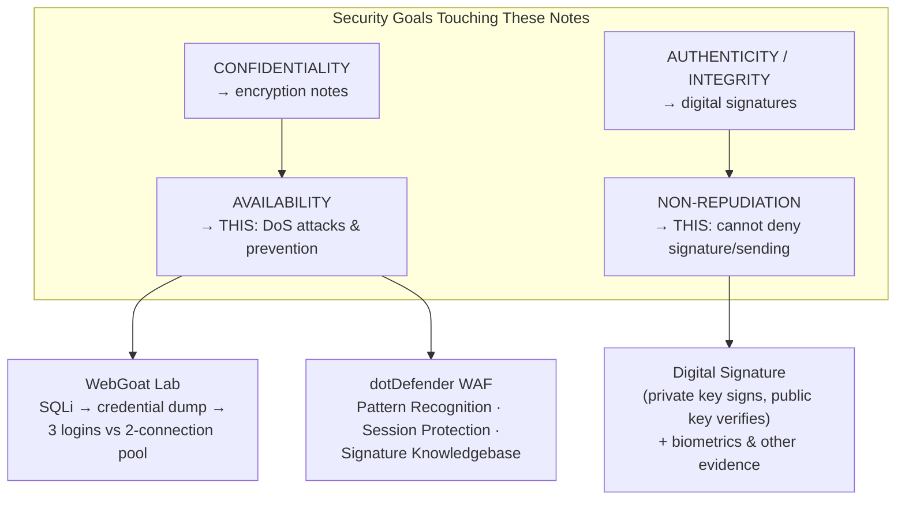
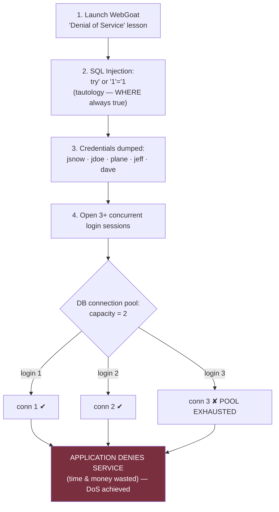
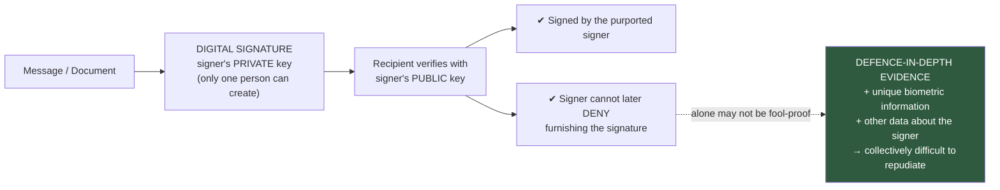
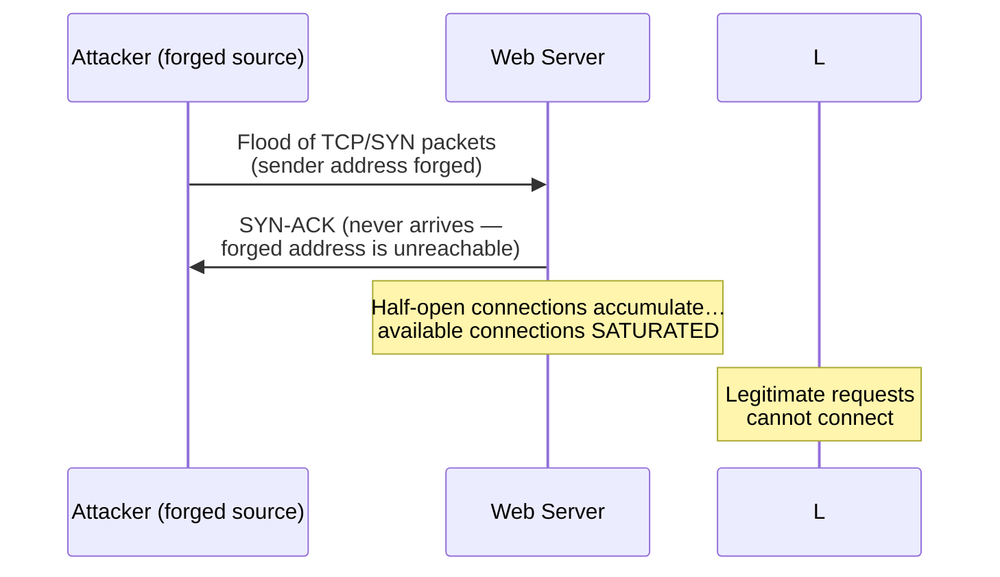
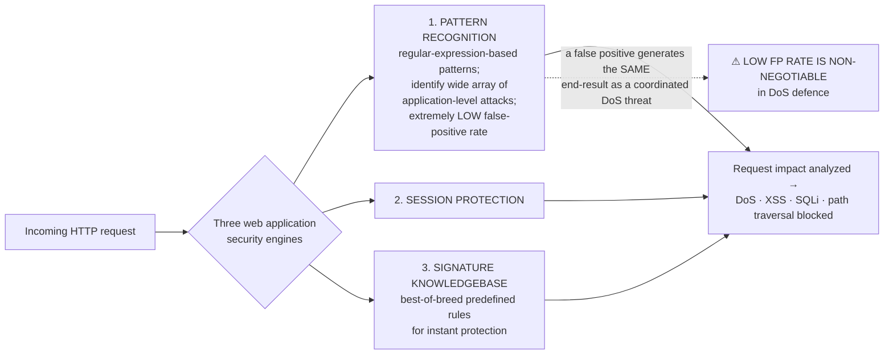

# Application-Layer DoS, WebGoat Lab & Non-Repudiation — Comprehensive Cybersecurity Notes

> **Scope note:** Two documents are combined here: **(1) *Security Testing — Denial of Service*** (tutorialspoint, 2 pages) — a **hands-on WebGoat lab** demonstrating an application-layer DoS via SQL Injection + database connection-pool exhaustion; and **(2) a two-topic document** — **Non-Repudiation** (1 page) and **Prevent Denial of Service (DoS) Attacks** (the dotDefender WAF whitepaper, 6 pages). These directly **extend the earlier SANS DoS paper and COMSEC notes**: the SANS paper covered *network-level* floods (Smurf, SYN, UDP); this set shows the *application-level* variant (CPU-intensive queries, pool exhaustion) **in a live lab**, plus the attacker's business motives and the **non-repudiation** security goal behind digital signatures. Enrichment is marked and cross-linked to earlier notes in this series.

---

## 1. Executive Overview & Core Concepts

### 1.1 What the Documents Cover

| Document | Topic | Core Contribution |
| :--- | :--- | :--- |
| **Security Testing — DoS** (tutorialspoint) | DoS definition, **6 symptoms**, WebGoat hands-on lab, prevention | The **only practical lab** in this module: obtain valid logins via **SQL Injection**, then exhaust a **DB connection pool** (2 connections) with **3 concurrent logins** |
| **Non-Repudiation** (page 1 of doc 2) | The fourth security goal | Assurance someone **cannot deny** signing/sending — via **digital signatures**, strengthened by **multiple approaches** (biometrics + other data) |
| **Prevent DoS (dotDefender)** (pages 2–6 of doc 2) | Web-application DoS: definition, targets, motives, tactics, defence | WAF-centric prevention: **HTTP traffic inspection**, three engines (**Pattern Recognition, Session Protection, Signature Knowledgebase**), low false-positive doctrine |

### 1.2 Fundamental Definitions

| Term | Definition (per sources) |
| :--- | :--- |
| **Denial of Service (DoS)** | *"An attempt by hackers to make a network resource unavailable… usually temporary or indefinitely interrupt the host which is connected to the internet"* — typically targets **mission-critical web servers such as banks, credit card payment gateways** |
| **Application-level DoS** | Attacks that overload the **software/application** (not just the wire) — e.g., CPU-intensive SQL queries, exception storms, pool exhaustion |
| **DB connection pool** | The fixed set of database connections an application may use — a **finite resource** (here: **2**) that concurrent logins can exhaust |
| **SQL Injection (tautology form)** | Injecting `' or '1'='1` so a WHERE clause always evaluates true — dumping **all valid credentials** |
| **Non-repudiation** | *"The assurance that someone cannot deny something… a party to a contract or a communication cannot deny the authenticity of their signature on a document or the sending of a message that they originated"* |
| **To repudiate** | **To deny** |
| **Digital signature** | On the Internet, used to ensure a document was electronically signed by the purported signer — and, since *"a digital signature can only be created by one person,"* that the signer **cannot later deny** furnishing it |
| **WAF (dotDefender)** | Inspects **HTTP traffic**, checking packets against rules — **allow/deny protocols, ports, or IP addresses** — to stop web applications being exploited |
| **False positive** | A benign request flagged as malicious — in DoS defence it *"will generate the **same end-result as a well coordinated DoS threat**"* (i.e., blocks legitimate users) |
| **Peer-to-peer attack** | Redirecting a P2P network's users to the victim's site — mass connection overflow **without a botnet** |

### 1.3 Module-Level Synthesis

> **🔑 Key Takeaway (three-way bridge):**
> 1.  **The WebGoat lab operationalises the dotDefender threat list.** The whitepaper's "jamming the application-database connection by crafting CPU-intensive SQL queries" and its "database connection pool" (a listed attackable service) are exactly what the lab performs — injection first to *get* credentials, then concurrency to *exhaust* the pool.
> 2.  **DoS is the Availability pillar; non-repudiation is the Accountability pillar** (the fourth goal in the earlier BMA/Müller–Rannenberg taxonomy). Both are guarded by earlier mechanics: DoS by WAFs/segmentation (Security Mechanisms notes), non-repudiation by **digital signatures** (Asymmetric Encryption Ch. 9–10) — *"only the true sender can produce this signature."*
> 3.  **Motive economics matured:** the SANS paper traced protest/business rivalry (Yahoo 2000, FARC 2008); dotDefender adds **extortion-for-profit** as the modern criminal model — the hacktivist-to-cybercrime shift.



---

## 2. Page-by-Page Detailed Breakdown

## PART A — Security Testing: Denial of Service (WebGoat Lab)

### Page 1 — Definition, Symptoms, Lab Setup

**Definition:** *"Denial of Service (DoS) attack is an attempt by hackers to make a network resource unavailable. It is usually temporary or indefinitely interrupts the host which is connected to the Internet. These attacks typically target services hosted on **mission critical web servers such as banks, credit card payment gateways**."*

**Symptoms of DoS (six listed; note "unavailability of a particular web site" appears twice):**

1.  **Unusually slow network performance.**
2.  **Unavailability of a particular web site.**
3.  **Inability to access any web site.**
4.  **Dramatic increase in the number of spam emails received.**
5.  **Long-term denial of access to the web or any Internet services.**
6.  Unavailability of a particular web site. *(repeated)*

> **💡 Enrichment (reading the symptoms operationally):** items 2–3 & 6 are the *customer-visible* outage; item 1 is the *pre-collapse* warning sign an administrator can alert on; item 4 (spam flood) reflects **spam as a volumetric DoS vector on mail infrastructure**. Together they form a monitoring checklist — the "immediate anomaly alerts" that the commercial anti-DoS vendors (VeriSign/Arbor, earlier notes) promise.

**Hands ON — WebGoat lab (steps 1–3 on page 1):**

*   **Step 1 — Launch WebGoat** (OWASP's deliberately insecure training application) and navigate to the **'Denial of Service'** section. Scenario statement: *"If the end user cannot conduct business or perform the service offered by the web application, then both time and money is wasted."*
    *   **General Goal(s):** *"This site allows a user to login multiple times. This site has a **database connection pool that allows 2 connections**. You must obtain a list of valid users and create a **total of 3 logins**."*
*   **Step 2 — Obtain the list of valid logins using SQL Injection** (the username payload shown: `try' or '1'='1`).
*   **Step 3 — If the attempt is successful, it displays all valid credentials to the user.**

### Page 2 — The Injection Revealed, Pool Exhaustion, Prevention

**The exposed query (tautology injection):**

```sql
SELECT * FROM user_system_data
WHERE user_name = 'try' or '1'='1'
  and password   = 'try' or '1'='1'
```

Because `'1'='1'` is always true, the WHERE clause matches **every row** — the credential table is dumped:

| USERID | USER_NAME | PASSWORD | COOKIE |
| :--- | :--- | :--- | :--- |
| 101 | jsnow | passwd1 | |
| 102 | jdoe | passwd2 | |
| 103 | plane | passwd3 | |
| 104 | jeff | jeff | |
| 105 | dave | dave | |

*Result banner: **"Login Succeeded: Total login count: 0"** — authentication bypassed; attack counter begins at zero.*

> **💡 Enrichment (why the tautology works & its fix):** user input is concatenated directly into the SQL string, so the attacker's quote closes the literal and appends `or '1'='1'`. The durable fix is **parameterised queries / prepared statements** (the "Database Security" secure-coding principle — never build SQL by string concatenation) plus input validation. Note how weak credentials in the dump (`jeff/jeff`, `dave/dave`) compound the risk.

**Step 4 — Execute the DoS (page 2):** *"Now login with each one of these users in **at least 3 different sessions** in order to make the DoS attack successful. As we know that the DB connection can handle only **2 threads**, by using all logins it will create **3 threads** which makes the attack successful."* → Banner: **"Congratulations! Lesson Completed."**



**Preventing Mechanisms (verbatim list):**

1.  **Perform thorough input validations** — *"it is always better to expect worst case scenarios."*
2.  **Avoid highly CPU-consuming operations.**
3.  *"It is better to **separate data disks from system disks**."*

> **💡 Enrichment (map to the earlier secure-SDLC checklist):** mechanism 1 = **Input Validation** (OWASP principle #1) and kills the *enabler* (injection); mechanism 2 = **resource governance** — timeouts, query cost limits, pool sizing, rate limiting — kills the *effect*; mechanism 3 = **disk-space isolation** so a log/data flood (disk-space DoS per dotDefender's target list) cannot take down the OS partition. A 4th modern control: **never allow unbounded concurrent sessions per credential** (session management principle #4).

---

## PART B — Non-Repudiation (Doc 2, Page 1)

**Definition:** *"It's the assurance that someone cannot deny something. Typically, non-repudiation refers to the ability to ensure that a party to a contract or a communication cannot deny the authenticity of their signature on a document or the sending of a message that they originated."*

**The word root:** *"To repudiate means to deny."*

**Pre-digital precedents (authorities have "for many years" sought to make repudiation impossible):**

| Precedent | Non-repudiation mechanism |
| :--- | :--- |
| **Registered mail** | The **recipient cannot deny that a letter was delivered** |
| **Legal documents** | Typically require **witnesses to signing** — the signer *"cannot deny having done so"* |

**On the Internet — the digital signature:** used *"not only to ensure that a message or document has been **electronically signed by the person that purported to sign** the document, but also — since a **digital signature can only be created by one person** — to ensure that a person **cannot later deny that they furnished the signature**."*

> **🔑 Cross-link:** this is exactly the Asymmetric Encryption deck's Chapter 9–10 mechanism — **sign with your private key, verify with your public key**; *"only the true sender can produce this signature."* Non-repudiation is the *service*; the private-key signature is the *mechanism*.

**The honest caveat (verbatim):** *"Since no security technology is absolutely fool-proof, some experts warn that a digital signature **alone may not always guarantee non-repudiation**. It is suggested that **multiple approaches** be used, such as capturing **unique biometric information** and other data about the sender or signer that **collectively would be difficult to repudiate**."*



> **💡 Enrichment (why "alone" isn't enough):** digital signatures prove **key possession**, not necessarily **human intent** — a stolen key or malware signing on the signer's machine undermines the guarantee. Hence layered evidence: biometrics, transaction logs, timestamps (**trusted timestamping**), PKI certificate status, and legal frameworks (e.g., **eIDAS**, India's **IT Act Schedule recognition of digital signatures**). This caveat echoes the same doctrine as DoS defence: no single control, layered compensating measures.

---

## PART C — Prevent Denial of Service Attacks (dotDefender, Pages 2–6)

### Page 2 — Definition, Impact, Web-App Examples

*   **Definition (web context):** *"DoS attacks against web sites occur when an attacker attempts to make the web server, or servers, **unavailable to serve up the web sites they host to legitimate visitors**."*
*   **Shifting victim profile:** *"For some time, it was thought these attacks were generally used against large corporations, government sites, and activist sites as a form of protest to disrupt their web presence. However, **more small and medium businesses** are beginning to see their online presence disrupted."*
*   **Business stakes:** *"Application DoS attacks have rapidly become a **commonplace threat for doing business on the Internet** — more proof that **Web application security is more critical now than ever**."* Attacks cause *"significant loss of **service, money and reputation**."*
*   **Loss shapes:** inability of a particular network service (e.g., **e-mail**) to be available; **temporary loss of all network connectivity and services**; *"an **HTTP DoS attack can also destroy programming and files** in affected computer systems"*; *"in some cases, HTTP DoS attacks have forced web sites accessed by **millions of people** to temporarily cease operation."*
*   **Three example attack patterns against web applications:**
    1.  **"Flood" the web application** — preventing legitimate user traffic.
    2.  **Disrupt service to a specific system or person** — e.g., **blocking user access by repeated invalid login attempts resulting in the account's suspension** *(a targeted lockout DoS)*.
    3.  **Jamming the application–database connection** by crafting **CPU-intensive SQL queries**. *(← the WebGoat lab in the wild)*
*   **Risk concept:** *"DoS attacks are centered around the concept that by **overloading a target's resources, the system will ultimately crash**"* — the software is overloaded and *"the application fails to serve web pages properly."* First attackable service: **Network bandwidth** *(continues)*.

### Page 3 — The Six Attackable Services, Motives, WAF Introduction

**Full list of services a DoS threat attacks to crash a web server:**

1.  **Network bandwidth** *(from p. 2)*
2.  **Server memory**
3.  **Application exception handling mechanism**
4.  **CPU usage**
5.  **Hard disk space**
6.  **Database space**
7.  **Database connection pool**

> **💡 Cross-link:** **#7 — the database connection pool — is precisely the WebGoat lab's target** (3 logins vs 2 connections). **#3 — the exception-handling mechanism — matches dotDefender's later "malformed data to raise unexpected exceptions."** The list is the syllabus of application-layer DoS.

*   **The motive shift:** *"In the past, DoS attacks were thought to be a tool used by **hacktivists as a form of protest**. However, recent attacks have shown that DoS attacks can also be a way for **cyber criminals to profit**."*
*   **By not proactively preventing DoS, you leave your site vulnerable to five outcomes:**

| Outcome | Detail (verbatim-condensed) |
| :--- | :--- |
| **Extortion** | *"Attackers threaten to continue disrupting service until **payment is received**."* |
| **Sabotage** | *"Competing businesses attack web sites to **build a stronger market share**."* |
| **Brand damage** | *"Sites that are attacked find that their **reputation is hurt** by lack of uptime or the perception that the site is not secure."* |
| **Financial losses** | *"Sites that are attacked are **prevented from doing business online**. The result is often a loss in **sales revenue or advertising revenue**."* |
| **Other attacks** | *"Information gathered from a successful DoS attack can be used **later to further attack** a web site. Additionally, other vulnerabilities may be used to launch a DoS attack **providing the attacker with access to more than they had originally intended**."* |

> **🔑 Cross-link:** extortion and sabotage complete the motive map from the SANS paper (protest, rivalry, content objection, money, ego) — and "information gathered… used later" frames DoS as **reconnaissance cover**: flooding while probing (cf. kill-chain stage 1).

*   **Prevention pivot — dotDefender WAF:** *"you can avoid DoS attacks because dotDefender **inspects your HTTP traffic and checks their packets against rules** such as to **allow or deny protocols, ports, or IP addresses** to stop web applications from being exploited. **Architected as plug & play software**, dotDefender provides optimal **out-of-the-box protection against DoS threats, cross-site scripting, SQL Injection attacks, path traversal and many other web attack techniques**."*

### Page 4 — WAF Selling Points, Launch Methods, Classic Tactics

**Why dotDefender offers a comprehensive solution (five claimed reasons):**

1.  **Easy installation on Apache and IIS servers.**
2.  **Strong security against known and emerging hacking attacks.**
3.  **Best-of-breed predefined security rules for instant protection.**
4.  **Interface and API for managing multiple servers with ease.**
5.  **Requires no additional hardware, and easily scales with your business.**

**How does an attacker launch a DoS attack?** *"Many different ways — ranging from simply **unplugging a server from the network (if they have physical access)** to coordinating **large armies of zombie computers** to launch a large-scale distributed attack"* using:

1.  **Buffer overflows in the application functions**
2.  **Malformed data to raise unexpected exceptions** *(→ crashes the exception-handling mechanism)*
3.  **Exploited race conditions in multi-threaded systems**
4.  **Heavy-duty SQL queries via web forms and "spamming" them with requests** — e.g., **inserting `%` characters within search query fields** *(forcing wildcard scans on the DB)*
5.  **SQL Injection attacks executing recursive CPU-intensive queries**
6.  **The end users' web browsers to overload the application with parallel requests via persistent / reflected Cross-Site Scripting attacks** *(turning every visitor's browser into an unwitting attacker)*
7.  **Overly-complex regular expressions within search queries** *(enrichment: the **ReDoS** pattern — catastrophic regex backtracking)*
8.  **Excessively large files uploaded to the server**

> **🔑 Cross-link:** items 4–5 are the WebGoat lab's mechanics (injection → heavy queries); items 2–8 are all **application-level** (matching the SANS paper's "Application level Denial of Service"); item 6 (XSS-driven browser hordes) is a no-botnet variant that prefigures the Peer-to-Peer attack below.

**Most common tactics — Ping Flooding** *(note: the doc headings group several cousins together)*:

> **(Also known as ICMP flood, Smurf attack, Ping of death, or SYN flood)**

*   *"Ping flood works by sending the target an **overwhelming number of ping packets**, usually using the 'ping' command. It is **very simple to launch** and by creating traffic that **exceeds the web site's bandwidth availability, the attack is a success**."*
*   **SYN flood:** *"sends a flood of TCP/SYN packets using a **forged sender address**. Since the sender address is not correct, the response in the form of a **TCP/SYN-ACK packet never comes, leaving a half-open connection**. As these…"* *(continues on page 5)*

> **⚠️ Warning (terminology precision for exams):** this document **lumps four distinct attacks under one heading**. Per the SANS paper: **Ping flood** = volumetric echo requests; **Smurf** = reflective (broadcast + spoofed victim source); **Ping of Death** = corrupt/oversized packets that *crash*; **SYN flood** = half-open TCP state exhaustion. Treat the dotDefender grouping as a loose vendor heading; keep the distinctions sharp.

### Page 5 — SYN Saturation, P2P Attacks, Application Floods, Motive Categories

**SYN flood (conclusion):** *"…connections begin to accumulate, the number of available connections becomes **saturated, keeping legitimate requests from successfully connecting**."*



**Peer-to-peer attacks:**
*   *"Launched when the attacker causes users to **disconnect from their peer-to-peer network and to connect to the victim's website instead**. Like a zombie or botnet attack, **several thousand computers may be trying to connect to the victim's site at once**. If enough machines are controlled by the attacker, the **overflow of connection requests can easily bring down a web application**."*
*   **Key distinction:** *"Unlike zombie attacks, **there is no botnet** so the attacker does **not have to communicate** with the computers he uses to launch his attack."* — *(enrichment: the attacker only needs to **point the swarm** — historically done via poisoned P2P index/cache entries redirecting clients at the victim; command-and-control is replaced by misdirection, making it botnet-free yet botnet-scale.)*

**Application level floods:**
*   *"While **most DoS attacks exploit bandwidth**, some rely on **software-related exploits such as buffer overflows**. These attacks cause **confusion in the application**, causing it to **fill the disk space or consume all available memory or CPU cycles**."* *(← the disk/memory/CPU triad from the services list)*

**The Need to Avoid DoS Attacks:** *"DoS attacks are often **random** when launched against **small and medium sized web sites**."* When the site is not a high-profile target (large corporation, government, activist site), the reason falls within one or more categories:

| Category | Explanation |
| :--- | :--- |
| **Grudge** | *"An unscrupulous competitor or **disgruntled former business partner or employee** may wish to cripple a business's web site for the purpose of **financial gain or revenge**."* |
| **Name Confusion** | *"The web site's name may **closely resemble** one used by a well-known enterprise or personality."* |
| **Easy Target** | *"Most mega-corporations have already installed **anti-DoS safeguards** — security technologies and **extra server and connectivity power**. Smaller businesses, with fewer resources, are **tempting targets**… especially those looking to **hone their skills**."* |

### Page 6 — Bad Luck, The Three Security Engines

*   **Bad Luck:** *"Sometimes there's **no apparent reason** for a DoS attack. An attacker may simply **pick a business's domain at random**, or because they **like the sound of its name or the way it looks**. Attackers, by nature, can be **highly irrational**."*
*   **The unfair symmetry:** *"Unfortunately for the victim, attacks that are **unintentional yield many of the same results** as those that are launched against a specific target."* *(cf. the "unintended attacks still hurt" theme — availability loss is motive-agnostic.)*
*   **Protect Yourself:** *"dotDefender's unique security approach **eliminates the need to learn the specific threats** that exist on each web application. The software focuses on **analyzing the request and the impact it has on the application**."*
*   **Effective web application security is based on THREE powerful engines:**



*   **Pattern Recognition in depth:** *"effectively protects against malicious behavior such as DoS attacks. The patterns are **regular expression-based** and designed to **efficiently and accurately identify a wide array of application-level attack methods**. As a result, dotDefender is characterized by an **extremely low false positive rate** — which is important when dealing with DoS attacks as **a false positive will generate the same end-result as a well coordinated DoS threat**."*
*   **Closing claim:** *"What sets dotDefender apart is that it offers **comprehensive protection against DoS and other attacks while being one of the easiest solutions to use**."*

> **🔑 Key Takeaway (the false-positive paradox):** a WAF that blocks legitimate users **is itself a DoS**. This is why detection quality (precision/recall) is a *security* requirement, not just a UX nicety — and it connects to the IDS "false alarm" discussion in the Security Mechanisms notes, where anomaly detection and reputation filtering were introduced precisely to suppress false alarms.

---

## 3. Comparative Summary & Matrix

### 3.1 Network-Layer (SANS paper) vs Application-Layer (these docs) DoS

| Aspect | Network-level DoS (earlier notes) | Application-level DoS (this set) |
| :--- | :--- | :--- |
| Target resource | Bandwidth, half-open state, RTO timers | CPU, memory, disk, DB space, **connection pool**, exception handler |
| Example attacks | Smurf, Ping flood/Death, UDP flood, shrew | CPU-intensive SQLi, `%`-wildcard queries, ReDoS regex, oversized uploads, XSS browser hordes, pool exhaustion |
| Typical entry | Raw packets / spoofing | **Valid-looking HTTP requests** — often post-injection |
| Detection difficulty | Volume is visible (except shrew) | Traffic often looks **legitimate**; impact is server-side |
| Primary defence | Anti-spoofing, SYN cookies, scrubbing | **Input validation**, parameterised queries, WAF, resource limits, pool sizing |
| Lab demonstrated | (ping/sing commands) | **WebGoat: SQLi → 3 logins vs 2 connections** |

### 3.2 The WebGoat Lab — Attack Chain vs Countermeasures

| Lab step | Technique | Corresponding dotDefender item | Countermeasure (from either doc) |
| :--- | :--- | :--- | :--- |
| 2 | SQL Injection (`' or '1'='1`) dumps credentials | "SQL Injection attacks executing recursive CPU-intensive queries" (enabler) | **Thorough input validation**; parameterised queries |
| 4 | 3 concurrent logins vs 2-connection pool | "Database connection pool" (attackable service); "jamming the application–database connection" | Pool sizing/queuing limits; per-credential session caps; CPU governance |
| (implicit) | Credential table exposure (jeff/jeff, dave/dave) | — | Password policy; never return credentials; least-privilege DB accounts |

### 3.3 DoS Motives — Full Consolidated Map (SANS + dotDefender)

| Motive | Source | Detail |
| :--- | :--- | :--- |
| Protest / hacktivism | SANS; dotDefender ("in the past… form of protest") | Georgian/Iranian sites; WikiLeaks; government targets |
| Business rivalry / **Sabotage** | Both | Competing businesses attack to build market share |
| **Extortion (profit)** | dotDefender | Continue disruption until payment received |
| **Brand damage / Financial loss** (consequences) | dotDefender | Reputation hurt; sales/advertising revenue lost |
| Content objection | SANS | WikiLeaks case |
| Ego / skill practice | SANS; dotDefender ("hone their skills") | Boasting; script kiddies; small sites as practice |
| Grudge (revenge) | dotDefender | Disgruntled ex-partner/employee |
| Name confusion / **Bad luck** | dotDefender | Similar names; random pick; *"attackers can be highly irrational"* |

### 3.4 Attackable Services & Matching Controls (dotDefender list)

| # | Service attacked | Exploit vector (doc) | Control |
| :--- | :--- | :--- | :--- |
| 1 | Network bandwidth | Ping/ICMP floods | WAF rate rules; upstream scrubbing (enrichment) |
| 2 | Server memory | Buffer overflows; app floods | Input validation; memory-safe code |
| 3 | Exception-handling mechanism | **Malformed data → unexpected exceptions** | Robust error handling; never crash on bad input |
| 4 | CPU usage | Heavy SQLi; **over-complex regex (ReDoS)**; recursive queries | CPU limits; avoid CPU-heavy ops; regex analysis |
| 5 | Hard disk space | Oversized uploads; app floods "fill disk space" | **Separate data disks from system disks**; upload quotas |
| 6 | Database space | App floods consuming DB space | Retention/quotas; least-privilege accounts |
| 7 | Database connection pool | Parallel logins/queries (WebGoat) | Pool sizing; session caps; timeouts |

### 3.5 Prevention Approaches Compared (tutorialspoint vs dotDefender)

| Aspect | tutorialspoint mechanisms | dotDefender approach |
| :--- | :--- | :--- |
| Philosophy | *Expect worst-case* developer discipline | Engine-based request analysis ("no need to learn specific threats") |
| Controls | **Input validation** · avoid CPU-heavy ops · **separate data vs system disks** | WAF rules (allow/deny protocols, ports, IPs) · **Pattern Recognition (regex, low FP)** · Session Protection · Signature Knowledgebase |
| Scope | Application code + disk architecture | HTTP layer: DoS, XSS, SQLi, path traversal, "many other web attack techniques" |
| Deployment note | Design-time practices | Plug & play; Apache/IIS; API for multi-server; no extra hardware |
| Key doctrine | "Always better to expect worst case scenarios" | **"A false positive will generate the same end-result as a well coordinated DoS threat"** |

### 3.6 Non-Repudiation — Mechanisms Old & New

| Era | Mechanism | What it prevents denying |
| :--- | :--- | :--- |
| Postal | **Registered mail** | That a letter was **delivered** |
| Legal | **Witnesses to signing** | That the person **signed** |
| Internet | **Digital signature** (private-key sign → public-key verify) | That the purported signer **signed/sent** — *"can only be created by one person"* |
| Strengthening (expert advice) | **Multiple approaches**: biometrics + other signer data | *"Collectively would be difficult to repudiate"* |

---

## 4. Key Terminology & Cheat Sheet

### 4.1 Glossary

| Term | Definition |
| :--- | :--- |
| **Account suspension DoS** | Targeted lockout via **repeated invalid login attempts** |
| **Application exception handling mechanism** | App's crash-management machinery — overloadable by malformed data |
| **Bad Luck** | dotDefender motive: random/whimsical target selection |
| **Connection saturation** | SYN flood end-state: available connections consumed → legitimate requests fail |
| **DNS/`%` wildcard abuse** | Inserting `%` in search fields to force heavy DB scans |
| **Easy Target** | Smaller businesses lacking the anti-DoS safeguards of mega-corporations |
| **False positive (WAF/IPS)** | Benign traffic blocked; *"same end-result as a well coordinated DoS threat"* |
| **Forged sender address** | Spoofed source making SYN-ACKs undeliverable → half-opens |
| **Grudge** | Revenge/financial-gain motive (competitor, ex-partner, ex-employee) |
| **Half-open connection** | TCP state after SYN-ACK with no final ACK (SYN flood currency) |
| **Name Confusion** | Attacked because the site name resembles a famous one |
| **Non-repudiation** | Assurance a party **cannot deny** their signature or message origination |
| **Peer-to-peer attack** | Redirecting P2P users at the victim; **no botnet, no C2 needed** |
| **Pattern Recognition engine** | Regex-based WAF engine identifying application-level attacks with low FP rate |
| **Race condition** | Multi-threaded timing flaw exploited for DoS |
| **ReDoS** *(enrichment)* | DoS via catastrophic regex backtracking ("overly-complex regular expressions") |
| **Repudiate** | To deny |
| **Session Protection / Signature Knowledgebase** | dotDefender's other two engines (behavioural + rule-knowledge) |
| **Tautology injection** | `' or '1'='1` — makes WHERE always true, dumping all rows |
| **WebGoat** | OWASP's deliberately insecure training app hosting this lab |

### 4.2 Numbers Cheat Sheet

| Item | Value |
| :--- | :--- |
| DoS symptoms listed | **6** (one repeated: "unavailability of a particular web site") |
| WebGoat login goal | **3 logins** |
| DB connection pool capacity | **2 connections/threads** → 3rd login exhausts pool |
| Credential rows dumped | **5** (jsnow, jdoe, plane, jeff, dave — IDs 101–105) |
| Injected payload | `try' or '1'='1` |
| Post-lab banner | "Login Succeeded: Total login count: 0" → "Congratulations! Lesson Completed" |
| Preventing mechanisms (tutorialspoint) | **3** (input validation; avoid CPU-heavy ops; separate data/system disks) |
| dotDefender attackable services | **7** (bandwidth, server memory, exception handling, CPU, hard disk, DB space, DB connection pool) |
| Web-app DoS examples | **3** (flood; targeted lockout; app–DB jamming) |
| Post-attack exposures | **5** (extortion, sabotage, brand damage, financial losses, other attacks) |
| DoS launch techniques listed | **8** (buffer overflows → oversized uploads) |
| WAF selling reasons | **5** (Apache/IIS install; known+emerging attacks; predefined rules; multi-server API; no extra hardware) |
| dotDefender engines | **3** (Pattern Recognition, Session Protection, Signature Knowledgebase) |
| Non-profile motive categories | **4** (Grudge, Name Confusion, Easy Target, Bad Luck) |
| Non-repudiation precedents | **2** (registered mail; witnessing) |
| Non-repudiation strengthening | **Biometrics + other signer data — collectively difficult to repudiate** |

### 4.3 One-Line Recall Strings

*   **WebGoat lab:** *"Inject `'or '1'='1'` to dump five logins, then open three concurrent sessions against a two-connection pool — validation, CPU limits, and disk separation are the fix."*
*   **dotDefender:** *"DoS overloads seven resources until the app crashes — profit replaced protest (extortion, sabotage, brand damage); defend with a WAF whose three engines analyse request impact, because in DoS defence a false positive IS a DoS."*
*   **Non-repudiation:** *"To repudiate is to deny — registered mail and witnesses did it on paper; the digital signature (only one person can create it) does it online, but pair it with biometrics because nothing is absolutely fool-proof."*

---