# Asymmetric Encryption & Cryptography Fundamentals — Comprehensive Cybersecurity Notes

> **Scope note:** These notes combine two source documents: **(1) the *Asymmetric Encryption — Public Key Encryption Mechanism* presentation** (17 chapters, Cyber Security academic deck for MBA/MCA/B.Tech), and **(2) the *Cryptography* PDF** (7 pages: definitions, the three technique families, a PGP demo, five encryption algorithms, the future of encryption, and the Caesar cipher). The two documents reinforce each other — the PPTX deep-dives the **asymmetric** pillar while the PDF surveys **all three families** (symmetric, asymmetric, hashing) plus historical and future context. Enrichment points (Honey Encryption, QKD, RSA history, deprecation status) are verified and marked throughout.

---

## 1. Executive Overview & Core Concepts

### 1.1 The Problem Both Documents Solve

Cryptography is *"the science to encrypt and decrypt data that enables the users to store sensitive information or transmit it across insecure networks so that it can be read only by the intended recipient."* The presentation distils the modern answer to its hardest sub-problem: **how do two strangers who have never met exchange secrets over a channel that anyone can eavesdrop on?** — the **public key (asymmetric) encryption mechanism**.

### 1.2 Fundamental Definitions

| Term | Definition (per sources) |
| :--- | :--- |
| **Plaintext** | Data which can be read and understood without any special measures |
| **Encryption** | The method of disguising plaintext to hide its substance |
| **Ciphertext** | Encrypted plain text — *"a jumbled mess of random characters"* |
| **Decryption** | The process of reverting encrypted data back to plain text |
| **Cryptanalysis** | The science of analyzing and breaking secure communication; its practitioners are **attackers** |
| **Cipher strength** | Measured by the **time and resources** required to recover the actual plaintext |
| **Asymmetric (public key) encryption** | Uses **two mathematically related but distinct keys** — public + private — separating encryption and decryption roles entirely |
| **Symmetric (conventional) encryption** | **One key** used both for encryption and decryption |
| **Hashing** | **One-way** "encryption" — a scrambled output that cannot (easily) be reversed; validates **integrity** |
| **Key pair** | Every participant's matched public + private keys; *what one key locks, only the other can unlock* |
| **Digital signature** | The cryptographic equivalent of a handwritten signature — proves identity and non-alteration |
| **Hybrid encryption** | Asymmetric for key exchange + symmetric for bulk data — the real-world standard (HTTPS/TLS) |
| **PKI** | Framework of policies, technologies, procedures governing certificate **creation, distribution, management, revocation** |

### 1.3 The Three Cryptographic Technique Families (PDF, Page 2)

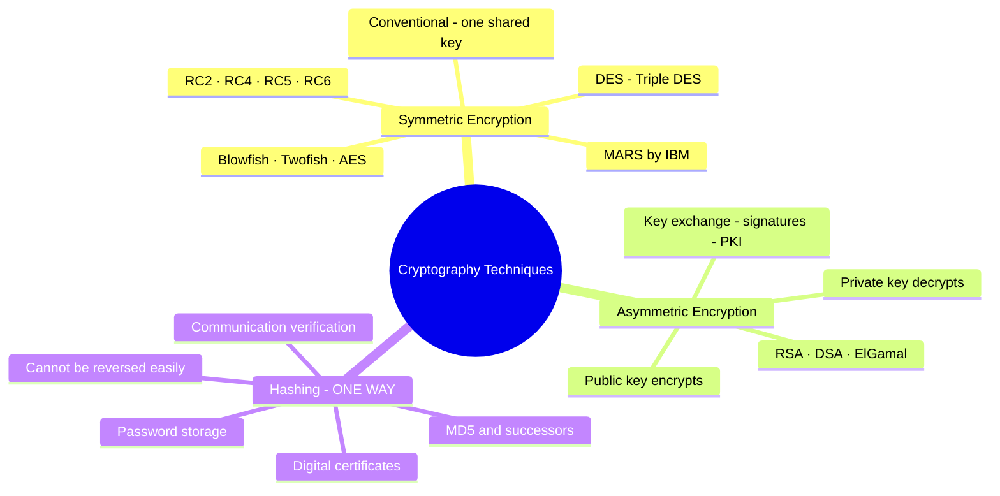

> **💡 Exam Tip:** The PDF's dependency statement is the exam core: *"the encrypted data is completely dependent on a couple of parameters viz — **the strength of the cryptographic algorithm** and **the secrecy of the key**."* Same plaintext + different keys ⇒ **different ciphertext** (the algorithm works *in combination with a key* — a word, number, or phrase).

---

## 2. Chapter-by-Chapter / Page-by-Page Detailed Breakdown

## PART A — The Asymmetric Encryption Presentation (Chapters 1–17)

### Chapter 1 — What Is Asymmetric Encryption?

Asymmetric encryption is a cryptographic method using **two mathematically related but distinct keys** — a **public key** and a **private key** — to protect information. Unlike symmetric encryption (a single shared secret for both operations), asymmetric encryption **separates these roles entirely**.

| **Asymmetric Encryption** | **Symmetric Encryption** |
| :--- | :--- |
| Uses **two different but linked** keys | Uses a **single shared secret key** |
| **Public key encrypts, private key decrypts** | **Same key** encrypts and decrypts |
| **No shared secret required** between parties | Both parties **must possess the same key** |
| Foundation of **secure Internet communication** | **Key exchange is a significant security risk** |

### Chapter 2 — Why Is Public Key Encryption Needed?

Before public key encryption, parties wishing to communicate securely had to **secretly exchange a shared key** — *"a process fraught with risk."* Over open networks this creates the **fundamental security paradox**: *how do you securely share a secret when the channel itself is insecure?*

Three motivating points:

1. **🔑 The Key Distribution Problem** — Sharing a symmetric secret key over an insecure channel **exposes it to interception by malicious third parties**.
2. **🌐 Secure Internet Communication** — Public key encryption lets **two strangers on the Internet establish a secure channel without any prior contact or shared secret**.
3. **🔒 Private Key Never Shared** — The private key remains **exclusively with its owner**; only the public key is distributed — **eliminating the risk of secret key exposure**.

> **🔑 Enrichment (context for Ch. 2):** This is the problem **Diffie & Hellman solved in 1976** (*"New Directions in Cryptography"*, with Ralph Merkle) — the conceptual breakthrough that made the RSA paper (1977) possible. The modern term for the interception scenario is a **man-in-the-middle** on the key exchange, and the modern fix beyond certificates is **forward secrecy via (EC)DHE** (see Ch. 13 enrichment).

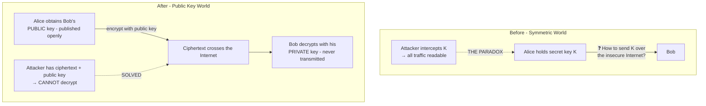

### Chapter 3 — Public Key and Private Key

Every participant possesses a **key pair**; the two keys are **mathematically linked**: *what one key locks, only the other can unlock.*

| **Public Key** 🔓 | **Private Key** 🔑 |
| :--- | :--- |
| **Freely distributed** to anyone | **Kept strictly secret** by the owner |
| **Published in directories or certificates** | **Never transmitted over any network** |
| Used by ***senders*** **to encrypt** messages | Used by the ***receiver*** **to decrypt** messages |
| **Cannot decrypt what it encrypts** | **Mathematically paired** with the public key |

> **📌 Key point (slide call-out):** The two keys are **complementary**: a message encrypted with the public key can ***only*** be decrypted with the corresponding private key — **and vice versa**. *(Enrichment: "vice versa" = encrypt with your **private** key and the world verifies with your **public** key — which is exactly the **digital signature** of Chapters 9–10. One key pair thus yields two security services: confidentiality and authentication.)*

### Chapter 4 — Basic Public Key Encryption Mechanism

The encryption/decryption flow follows a clear logical sequence — **the sender always uses the receiver's public key; the receiver uses their own private key. No secret is ever shared over the network.**

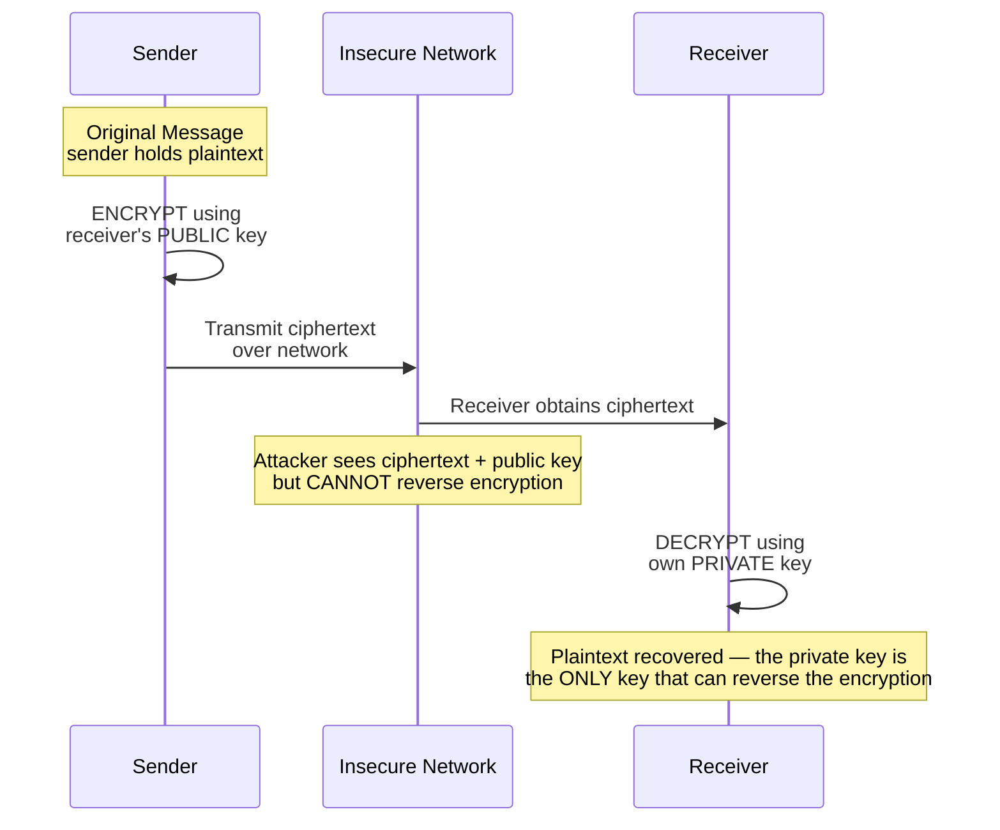

### Chapter 5 — A Simple Example: Alice and Bob

The classic scenario used throughout cryptography education: **Alice sends "HELLO" to Bob** securely over the Internet, **without any prior arrangement of a shared secret**.

1. **Step 1 — Alice Prepares:** obtains **Bob's public key** from a **trusted directory** or directly from Bob.
2. **Step 2 — Alice Encrypts:** encrypts **"HELLO"** using Bob's public key → **unreadable ciphertext** sent over the Internet.
3. **Step 3 — Bob Decrypts:** uses **his own private key** — which only he possesses — to recover **"HELLO."**

> **🔑 The fundamental security guarantee:** *"Even if an attacker intercepts the ciphertext in transit, they cannot decrypt it without Bob's private key."*
>
> **💡 Enrichment:** Alice and Bob were introduced in the original **RSA paper (Rivest, Shamir & Adleman, *Communications of the ACM*, 1978)** and are now universal in security education — later characters include **Eve** (eavesdropper), **Mallory** (malicious active attacker), and **Trent** (trusted arbitrator/CA).

### Chapter 6 — Key Generation

Before any secure communication, each party must **generate a key pair** — a cryptographic algorithm produces **two mathematically linked keys simultaneously**; *the security of the entire system depends on the integrity of this generation process.*

| # | Stage | Detail |
| :--- | :--- | :--- |
| **01** | **Generate Key Pair** | A cryptographic algorithm (e.g., **RSA**) generates a matched public/private pair based on **large prime numbers or other hard mathematical problems** |
| **02** | **Distribute Public Key** | Shared openly — posted to **key servers**, embedded in **digital certificates**, or **sent directly** to communication partners |
| **03** | **Protect Private Key** | Stored securely — **encrypted with a passphrase**, in an **HSM** (hardware security module), or on a **smart card** — **never transmitted** |

> **⚠️ Enrichment (generation pitfalls):** key generation must use a **cryptographically secure random number generator** (RNG); predictable primes/entropy caused real-world failures (e.g., shared-prime RSA keys from weak entropy, Debian OpenSSL RNG flaw 2008). Private key storage standards: **FIPS 140-2/140-3** HSMs, smart cards, TPMs.

### Chapter 7 — Encryption and Decryption: Step by Step

The process is **consistent regardless of the underlying algorithm — only the mathematical details vary.**

**The five-step chain:** `Plaintext → Get Public Key → Encrypt → Transmit → Decrypt`

| Stage | Meaning |
| :--- | :--- |
| **Plaintext Input** | The readable original message **before** encryption is applied |
| **Ciphertext in Transit** | The **scrambled, unreadable form** sent across the network |
| **Plaintext Output** | The original message **fully restored** after decryption by the private key |

### Chapter 8 — RSA: The Most Widely Used Algorithm

**RSA (Rivest–Shamir–Adleman, 1977)** is the most prominent public-key encryption algorithm. Its security is grounded in the **mathematical difficulty of factoring the product of two large prime numbers** — *"a problem for which no efficient solution currently exists for sufficiently large keys."*

**How RSA works — conceptually:**
*   Two large prime numbers are selected and **multiplied together**.
*   This **product forms the basis of both the public and private keys**.
*   **Encryption uses the public key; decryption uses the private key.**
*   **Reversing the process (factoring) is computationally infeasible.**

**Simple conceptual example:** imagine **p × q = N**. The **public key is derived from N**; the **private key uses the original primes p and q**. **Anyone can encrypt using N**, but **only the holder of p and q can decrypt**. Typical RSA keys today use **2048 or 4096 bits** for strong security.

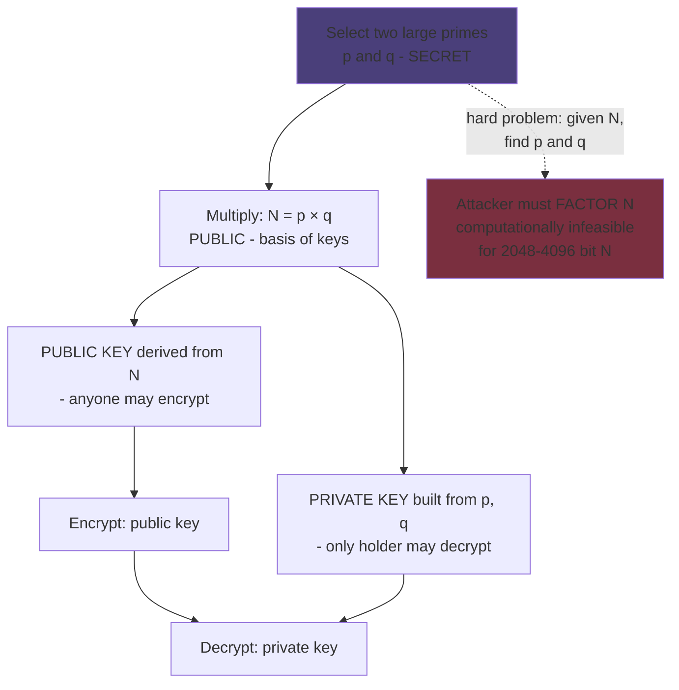

> **💡 Enrichment (factoring reality check):** RSA was developed at **MIT (1977)**, published **1978**. Its strength rests on the **General Number Field Sieve** — *sub-exponential* but still astronomically expensive: RSA-155 (512-bit) was factored in **1999** (why 512-bit is dead); **RSA-250 (829-bit) fell only in 2020** after ~2,700 core-years. Hence NIST's guidance (**SP 800-57**): **RSA-2048 ≈ 112-bit security (acceptable through 2030); RSA-3072 ≈ 128-bit.** *Forward threat:* **Shor's algorithm** on a large quantum computer factors N in polynomial time — driving the post-quantum migration (see PDF Part B, "Future of Encryption").

### Chapter 9 — Digital Signatures

A **digital signature** is the **cryptographic equivalent of a handwritten signature**. It provides **proof of identity** and guarantees that a message **has not been altered in transit**. *Unlike encryption (which ensures confidentiality), digital signatures focus on **authentication** and **data integrity**.*

1. **✍️ Sender Signs with Private Key** — applies their **private key** to create a **unique digital signature** attached to the message; **only the true sender can produce this signature**.
2. **✔️ Receiver Verifies with Public Key** — uses the **sender's public key** to verify; a **valid signature confirms the message is genuine and unaltered**.
3. **🛡️ Authentication & Integrity** — simultaneously proves **who sent the message** (authentication) **and** that the content **has not been tampered with** (integrity).

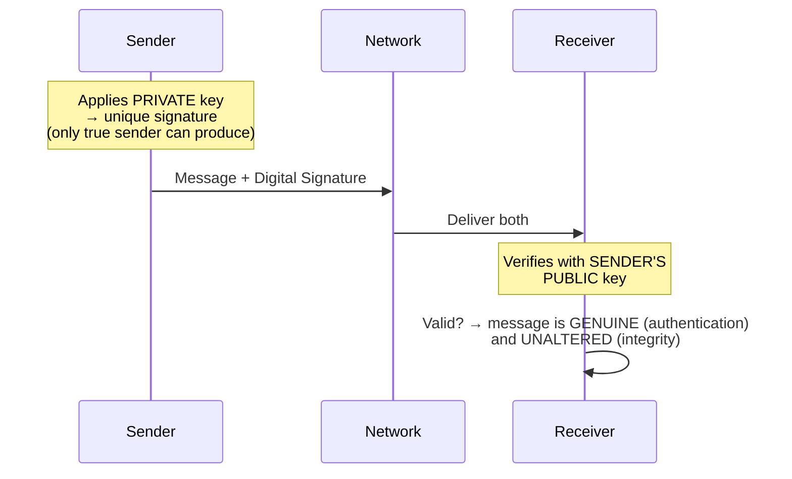

> **💡 Enrichment (how signatures actually work):** in practice the sender **hashes** the message (e.g., **SHA-256**) and signs the **hash** — faster and size-safe — giving the trio of **authentication, integrity, and non-repudiation** (the signer cannot plausibly deny signing). Signature algorithm families: **RSA (sign mode), DSA, ECDSA, EdDSA**. This directly matches the earlier *Security Mechanisms* notes' IRS tax-return example (sign with private key → verify with public key).

### Chapter 10 — Public Key Encryption vs. Digital Signatures

Although both use the **same public/private key pair**, they serve **opposite purposes** and use the keys in **opposite roles** — understanding this is *critical for applying each correctly in real-world systems.*

| Aspect | **Public Key Encryption** | **Digital Signature** |
| :--- | :--- | :--- |
| **Primary Purpose** | **Confidentiality** — keep message secret | **Authentication** — prove identity and integrity |
| **Key Used by Sender** | **Receiver's Public Key** (to encrypt) | **Sender's own Private Key** (to sign) |
| **Key Used by Receiver** | **Receiver's own Private Key** (to decrypt) | **Sender's Public Key** (to verify) |
| **Main Security Goal** | Prevent **unauthorized reading** of content | Prevent **forgery** and detect **tampering** |

> **💡 Exam Tip — the mirror rule:** Encryption = **lock with the recipient's public, open with the recipient's private**. Signature = **stamp with your private, check with your public**. The "public" key is always the one you *publish*; which of the pair is used first depends entirely on which service you want.

### Chapter 11 — Advantages of Asymmetric Encryption

| Advantage | Explanation |
| :--- | :--- |
| **📭 No Secret Key Exchange** | Parties establish secure communication **without ever meeting or sharing a secret in advance** — eliminating the key distribution problem entirely |
| **🌐 Secure Internet Communication** | Enables **strangers to communicate securely over public networks** — the **backbone of HTTPS, email security, and VPNs** |
| **✍️ Enables Digital Signatures** | The asymmetric structure **naturally supports digital signatures** — providing **authentication, non-repudiation, and message integrity verification** |
| **📡 Scalable for Large Networks** | For **N users, only N key pairs** are needed — versus symmetric encryption's **N×(N−1)/2 shared keys** |

> **💡 Enrichment (scale the numbers):** with **100 users**, symmetric requires **100×99/2 = 4,950** unique shared keys; asymmetric needs **100 pairs** (200 keys, of which 100 are public). At 1,000 users: **499,500 vs 1,000** — the reason PKI scales to the Internet.

### Chapter 12 — Limitations of Asymmetric Encryption

While powerful, these drawbacks explain why asymmetric is **rarely used to encrypt large volumes of data directly** — and **why hybrid systems have become the standard in practice**:

| Limitation | Detail |
| :--- | :--- |
| **⏱️ Significantly Slower Speed** | Asymmetric algorithms are **100–1000× slower** than symmetric counterparts — impractical for **large files or high-speed data streams** |
| **🔑 Requires Larger Key Sizes** | RSA needs **2048 bits or more** for adequate security — far larger than the **128- or 256-bit keys** used in symmetric **AES** |
| **⚙️ High Computational Demand** | Complex mathematical operations place a **heavy processor burden**, particularly in **resource-constrained environments** (embedded systems, mobile devices) |
| **🛡️ Private Key Must Be Protected** | The **entire system's security depends on keeping the private key secret** — **loss, theft, or compromise renders all prior and future communications vulnerable** |

> **💡 Enrichment (why the key-size gap):** security levels compare across math, not bit counts: **AES-128 ≈ RSA-3072 ≈ ECC P-256 ≈ 112–128 bits of work-factor**. Asymmetric keys are long because their underlying problems (factoring/discrete logs) leak structure; symmetric keys face only brute-force search. Modern practice fixes the speed gap with **ECC** (smaller keys, same security) and **hybrid encryption** (next chapter).

### Chapter 13 — Hybrid Encryption: The Best of Both Worlds

Real-world systems such as **HTTPS/TLS do not use asymmetric encryption to protect all data** — they **combine it with symmetric encryption in a hybrid approach**: *asymmetric solves the key exchange problem; symmetric handles high-speed data transfer.*

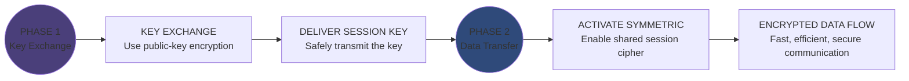

| **Phase 1: Key Exchange** | **Phase 2: Data Transfer** |
| :--- | :--- |
| **Asymmetric encryption securely transfers the symmetric session key** — *slow but necessary, done once* | **Symmetric encryption (e.g., AES) encrypts all actual data** — *fast, efficient, and scalable for large volumes* |

> **🔑 Enrichment (modern nuance):** classic TLS (≤1.2, RSA key transport) matches the deck exactly — encrypt the session key with the server's RSA public key. **TLS 1.3 removed RSA key transport** in favour of **ephemeral Diffie-Hellman ((EC)DHE) + an RSA/ECDSA signature**, adding **forward secrecy**: stealing the server's long-term private key today cannot retroactively decrypt past sessions — partially mitigating Chapter 12's "all prior communications vulnerable" limitation.

### Chapter 14 — Real-World Applications

Public key encryption *"is not merely theoretical — it underpins virtually every secure digital interaction in the modern world"* — **the engine of trusted digital communication**:

| Application | Role of Asymmetric Crypto |
| :--- | :--- |
| **🌐 HTTPS / TLS** | **Every secure website visit** uses TLS — asymmetric encryption **establishes a secure session before data transfer begins** |
| **📜 Digital Certificates** | **X.509 certificates bind a public key to an identity**, verified by **trusted Certificate Authorities** — **enabling trust on the Internet** |
| **✉️ Secure Email (S/MIME, PGP)** | Email encryption standards use public key cryptography so **only the intended recipient can read private correspondence** |
| **🏦 Online Banking & E-Commerce** | Secure financial transactions rely on **TLS and digital signatures** to **authenticate parties and protect sensitive payment data** |

### Chapter 15 — Online Banking: A Practical Example

A customer logs into their bank's website — a sequence showing how public key cryptography establishes a **secure, trusted channel between browser and bank server, transparently and automatically**:

1. **01 — Browser Requests Secure Connection:** the browser connects to the bank's server and requests a **secure HTTPS session**.
2. **02 — Bank Presents Digital Certificate:** the bank sends its **digital certificate — containing its public key** — **issued and signed by a trusted Certificate Authority**.
3. **03 — Browser Verifies & Generates Session Key:** the browser **verifies the certificate**, then **encrypts a symmetric session key using the bank's public key** and sends it.
4. **04 — Bank Decrypts — Secure Channel Established:** the bank **decrypts the session key using its private key**; **both parties now share the session key and all data is encrypted symmetrically**.

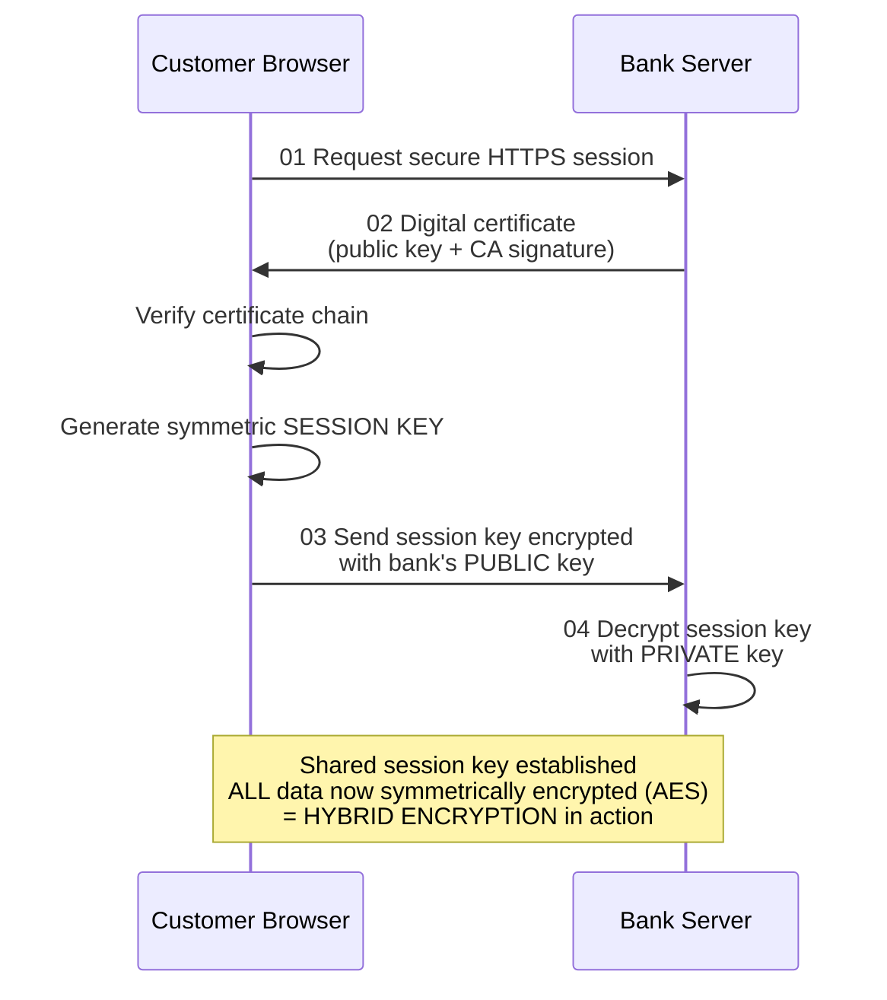

### Chapter 16 — Security Risks in Public Key Cryptography

Asymmetric encryption is robust **in design**, but *"its real-world implementation introduces several critical security risks"* — essential knowledge for professionals **deploying or auditing cryptographic systems**:

| Risk | Explanation |
| :--- | :--- |
| **🕵️ Private Key Theft** | If an attacker obtains the private key — via **malware, physical access, or poor storage** — the **entire security model is compromised**; **all past encrypted messages may be decrypted** |
| **🗄️ Weak Key Protection** | Keys stored **without strong encryption, in unprotected files, or with weak passphrases** are vulnerable to **unauthorized access and extraction** |
| **🧍 Man-in-the-Middle Attacks** | **Without proper certificate verification**, an attacker can **intercept the key exchange by substituting their own public key** — impersonating the intended recipient |
| **🎭 Fake or Invalid Certificates** | **Fraudulent or expired digital certificates** can impersonate legitimate entities; **users who ignore browser certificate warnings are particularly at risk** |

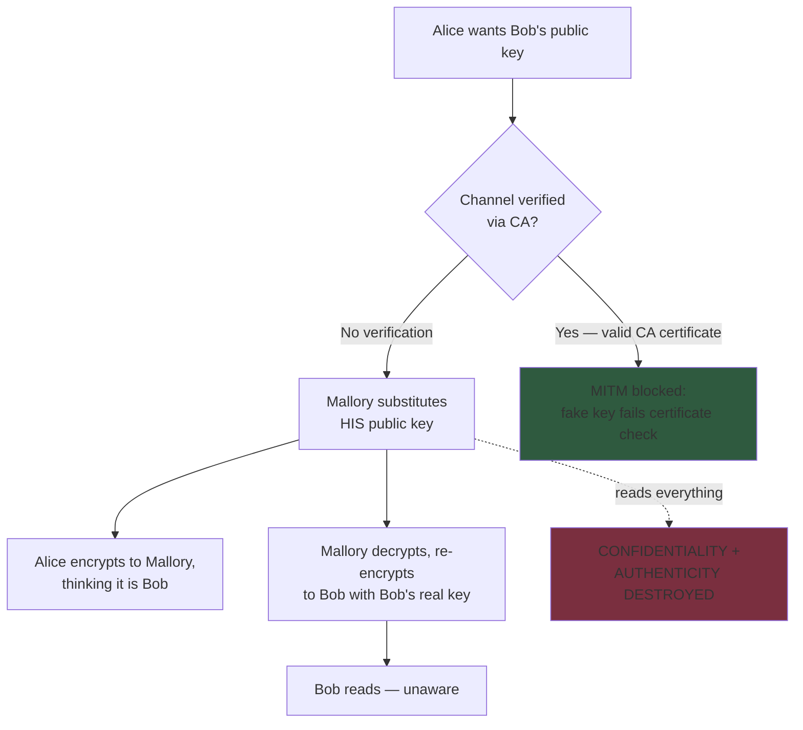

> **💡 Enrichment (real-world instantiations + mitigations):** *Heartbleed* (2014) let attackers read server memory **including private keys**; the **DigiNotar CA breach (2011)** issued fraudulent Google certificates → browser-trust collapse and the CA's bankruptcy. Defences: **HSTS**, **certificate pinning**, **Certificate Transparency logs**, **OCSP/CRL revocation checks**, HSM key custody, and *never* clicking through certificate warnings.

### Chapter 17 — Public Key Infrastructure (PKI)

A **Public Key Infrastructure (PKI)** is *"the framework of policies, technologies, and procedures that governs the creation, distribution, management, and revocation of digital certificates."* PKI solves the critical question: ***"How do I know a public key truly belongs to who it claims to belong to?"***

**Core PKI Components:**

| Component | Role |
| :--- | :--- |
| **Certificate Authority (CA)** | A **trusted third party that digitally signs and issues certificates**, **binding a public key to a verified identity** |
| **Digital Certificates (X.509)** | **Standardized documents containing an entity's public key, identity information, validity period, and the CA's signature** |
| **Certificate Revocation** | **Mechanisms (CRL, OCSP) to invalidate compromised or expired certificates**, preventing their misuse |

**Simple PKI Trust Flow:**
1. **Entity generates** a key pair and **submits** public key + identity to a CA.
2. **CA verifies** the identity and **issues** a signed digital certificate.
3. **Entity presents** its certificate during communication.
4. **Relying party verifies** the CA's signature on the certificate to **confirm the public key is authentic**.

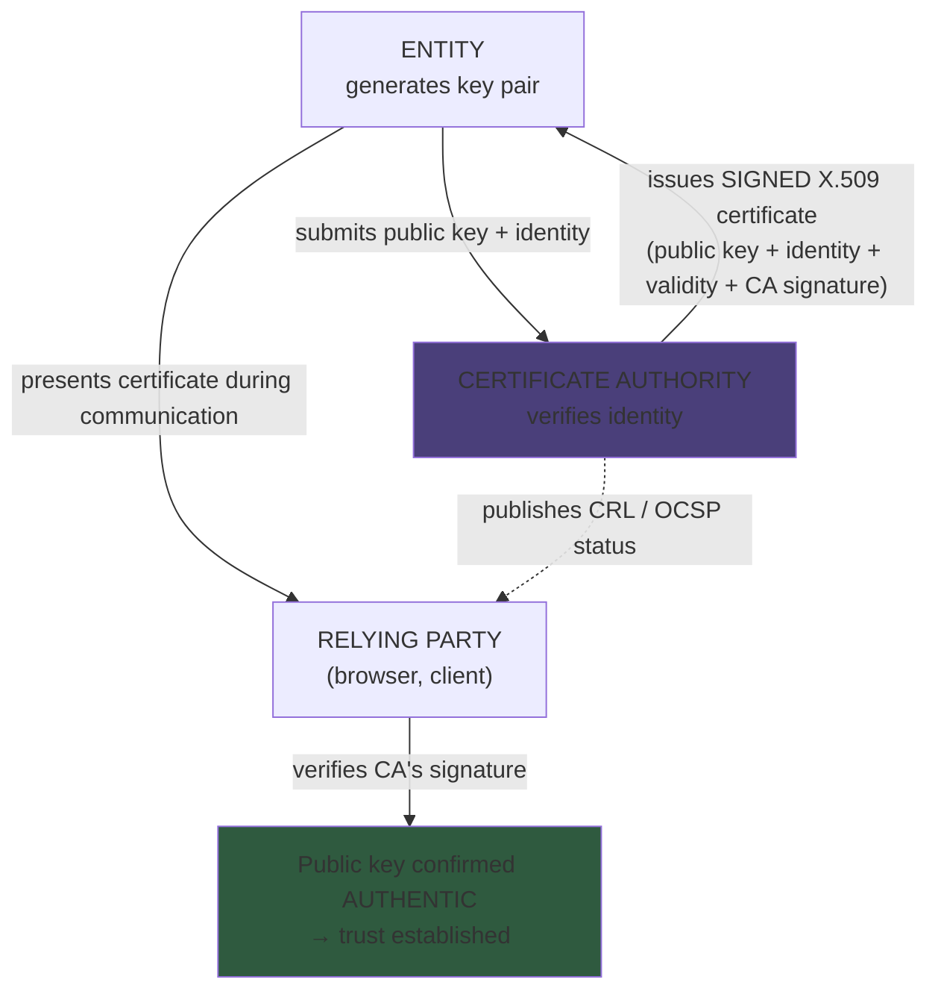

> **💡 Enrichment:** **CRL** = Certificate Revocation List (periodic blacklist); **OCSP** = Online Certificate Status Protocol (real-time check; **OCSP stapling** attaches the proof to the TLS handshake). RFC **5280** defines the X.509 profile (per the deck's references). Chain-of-trust: **Root CA → Intermediate CA → end-entity certificate**, anchored in browser/OS **trust stores**.

### References Slide (Academic Foundation)

| # | Source | Why it matters |
| :--- | :--- | :--- |
| 1 | **Stallings, W. — *Cryptography and Network Security: Principles and Practice*** (Pearson) | Comprehensive textbook covering symmetric & asymmetric crypto, PKI, network security protocols; widely adopted worldwide |
| 2 | **Forouzan, B.A. — *Cryptography and Network Security*** (McGraw-Hill) | Accessible coverage of RSA, digital signatures, key management with clear conceptual explanations |
| 3 | **NIST SP 800-57 — *Recommendation for Key Management*** | The definitive federal guideline for key generation, storage, and lifecycle policies |
| 4 | **RFC 5280 — *Internet X.509 PKI Certificate and CRL Profile*** (IETF) | The foundational RFC defining the standard structure for digital certificates used in PKI across the Internet |

---

## PART B — The Cryptography PDF (Pages 1–7)

### Page 1 — What Is Cryptography?

*   **Core definition** and the plaintext/ciphertext/decryption vocabulary (see §1.2).
*   **Cryptanalysis** is the science of analyzing and breaking secure communication — its practitioners are **attackers**.
*   **Strong vs weak:** strength = **time and resources** needed to recover the actual plaintext; an **appropriate decoding tool** is required to decipher strong encrypted messages.
*   **Work-factor illustration:** *"There are some cryptographic techniques with which **even a billion computers doing a billion checks a second** cannot decipher the text."*
*   **The arms race:** *"As power of computing increases day by day, one has to make their encryption algorithm very strong in order to protect it from the attackers."*

> **💡 Enrichment (make the billion-billion concrete):** a billion computers × a billion checks/second = **10¹⁸ keys/sec**. For **AES-128** (2¹²⁸ ≈ 3.4×10³⁸ keys), exhaustive search would take **~1.1×10¹³ years — roughly 800× the age of the universe**. This is why brute force is dismissed for properly keyed strong ciphers, and why the real attacks target **implementation, key management, or humans** instead.

### Page 2 — How Encryption Works & The Three Techniques

*   **Algorithm + key:** a cryptographic algorithm works **in combination with a key** (word, number, or phrase); **the same plaintext encrypts to different ciphertext with different keys**.
*   **Two dependencies of security:** **strength of the algorithm** + **secrecy of the key**.
*   **The three techniques** (detailed in the mindmap at §1.3):

| Technique | Mechanism | Examples (per PDF) | Uses |
| :--- | :--- | :--- | :--- |
| **Symmetric Encryption** | **Conventional** cryptography; **one key** for both encryption and decryption | **DES, Triple DES, MARS (IBM), RC2, RC4, RC5, RC6** (PDF); Blowfish, Twofish, AES (Pages 4–6) | Bulk data, speed |
| **Asymmetric Encryption** | **Public key cryptography** — a **pair of keys**: **public encrypts, private decrypts**; public published, private kept secret | **RSA, DSA (Digital Signature Algorithm), ElGamal** | Key exchange, signatures, PKI |
| **Hashing** | **ONE-way** encryption — output *"cannot be reversed or at least cannot be reversed easily"*; validates **integrity** of information | **MD5** (PDF) | **Digital certificates, digital signatures, password storage, verification of communications** |

> **⚠️ Enrichment (status corrections for modern practice):** the PDF's list is historically accurate but ages need flagging — **DES (56-bit)** was broken by the EFF's *Deep Crack* machine (1998) and withdrawn by NIST (2005); **3DES** is NIST-**disallowed after 2023**; **MD5** is **cryptographically broken for collisions** (Wang et al., 2004; the **Flame malware forged an MD5-signed Microsoft certificate in 2012**) — successors are **SHA-2/SHA-3**; **RC4** is prohibited in TLS. **ElGamal** (1985) builds on Diffie-Hellman discrete logarithms; **DSA** is NIST's FIPS 186 signature standard. The *current* symmetric gold standard is **AES** (below); *current* hashing is **SHA-256**.

### Page 3 — How Encryption Works: The PGP Demo

*   **PGP** (*Pretty Good Privacy* — *"or GPG for you open source people"*) as the email-friendly example tool. *(Enrichment: PGP — Phil Zimmermann, 1991; **GPG/GnuPG** — the free OpenPGP implementation; message formats standardized as **OpenPGP, RFC 4880**.)*
*   **The demonstration:** a private message is encrypted; the output shown is a long blob of random-looking characters (`wUwDPglyJu9LOnkBAf4vxSpQgQ…=PAb3`) — *"once encrypted, the message literally becomes a jumbled mess of random characters."*
*   **With the secret passcode, the recipient decrypts to the original:** **"Come on over for hot dogs and soda!"**
*   **In transit AND at rest:** *"Whether it's in transit like our hot dog party email or resting on your hard drive, encryption works to keep prying eyes out of your business — even if they happen to somehow gain access to your network or system."*
*   **Varieties differ mainly in:** **key size and strength** — *"the biggest differences in one variety from the next."*

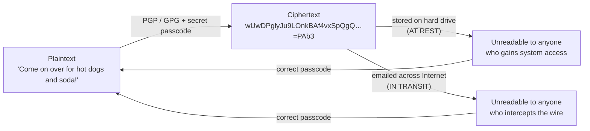

### Pages 4–6 — The Five Encryption Algorithms (Catalog)

**1. Triple DES (symmetric)**
*   Designed to **replace the original Data Encryption Standard (DES)**, *"which hackers eventually learned to defeat with relative ease."*
*   At one time **the recommended standard and the most widely used symmetric algorithm** in the industry.
*   Uses **three individual keys of 56 bits each → 168 bits total**, *"but experts would argue that **112-bits in key strength is more like it**."* *(Enrichment: the gap is the meet-in-the-middle attack; NIST disallowed 3DES after **2023**.)*
*   *"Despite slowly being phased out, Triple DES still manages to make a **dependable hardware encryption solution for financial services** and other industries."*

**2. RSA (asymmetric)**
*   A **public-key encryption algorithm** and **the standard for encrypting data sent over the Internet** — *"one of the methods used in our PGP and GPG programs."*
*   **Asymmetric due to its use of a pair of keys**: public key to **encrypt** our message, private key to **decrypt** it.
*   *"The result of RSA encryption is a **huge batch of mumbo jumbo** that takes attackers quite a bit of time and processing power to break."* (Cross-reference: Chapters 8–10 for the factoring basis.)

**3. Blowfish (symmetric)**
*   *"Yet another algorithm designed to replace DES."* A **symmetric cipher** that **splits messages into blocks of 64 bits** and encrypts them individually.
*   Known for **tremendous speed and overall effectiveness** — *"many claim that it has **never been defeated**."*
*   **Free availability in the public domain** — vendors took full advantage.
*   Found in **e-commerce platforms for securing payments** and **password management tools** — *"one of the more flexible encryption methods available."* *(Enrichment: variable key length **32–448 bits**; author Bruce Schneier, 1993.)*

**4. Twofish (symmetric)**
*   **Bruce Schneier** is *"the mastermind behind Blowfish **and its successor Twofish**."* *(Enrichment: Twofish was a **finalist in the AES competition**; Schneier led the team.)*
*   Keys **up to 256 bits** in length; as a **symmetric technique, only one key is needed**.
*   *"Regarded as **one of the fastest of its kind**, ideal for use in **both hardware and software** environments."*
*   **Freely available to anyone** — bundled in **PhotoEncrypt, GPG, and the popular open-source TrueCrypt**. *(Enrichment: TrueCrypt was later discontinued; successors VeraCrypt/CipherShed.)*

**5. AES (symmetric — the modern standard)**
*   The **Advanced Encryption Standard** — *"the algorithm **trusted as the standard by the U.S. Government and numerous organizations**."*
*   **Extremely efficient in 128-bit form**; also uses **192 and 256-bit keys for heavy-duty encryption purposes**.
*   *"Largely considered **impervious to all attacks, with the exception of brute force**"* — attempting all possible combinations in the 128/192/256-bit cipher.
*   *"Security experts believe AES will eventually be hailed the **de facto standard for encrypting data in the private sector**."* *(Enrichment: it already is — standardized as **FIPS 197 (2001)** from the Rijndael design (Daemen & Rijmen); **AES-256 is approved for TOP SECRET data** by the NSA.)*

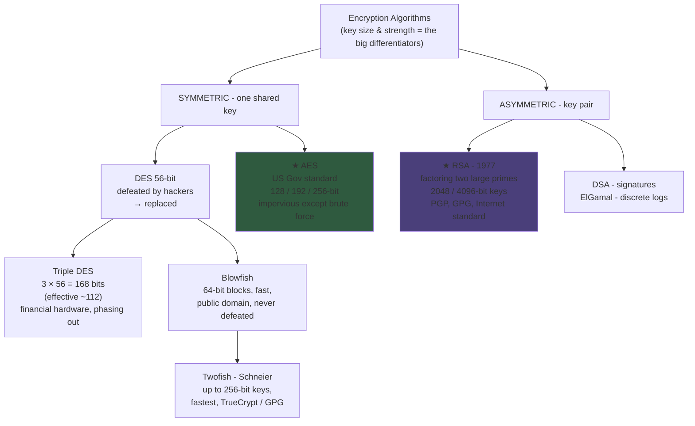

### Page 6 (cont.) — The Future of Encryption

*"Cyber attacks are constantly evolving, so security specialists must stay busy in the lab concocting new schemes to keep them at bay."* Two emerging methods highlighted:

**🍯 Honey Encryption**
*   Will *"deter hackers by **serving up fake data for every incorrect guess of the key code**."*
*   This unique approach **slows attackers down** and *"potentially **buries the correct key in a haystack of false hopes**."*

> **💡 Enrichment:** Honey Encryption (Juels & Ristenpart, 2014) makes every wrong password decrypt to **plausible-looking decoy plaintext** (fake credit-card numbers, realistic messages) instead of garbage — the attacker cannot even tell they failed, defeating offline password-guessing on stolen ciphertext.

**⚛️ Quantum Key Distribution (QKD)**
*   *"Emerging methods like quantum key distribution, which **shares keys embedded in photons over fiber optic**"* — with *"viability now and many years into the future."*

> **💡 Enrichment:** QKD (e.g., the **BB84 protocol**, Bennett & Brassard 1984) exploits quantum physics: **measuring a photon's state disturbs it**, so eavesdropping is **physically detectable** (no-cloning theorem). Landmark deployments: China's **Micius satellite** (2017, intercontinental QKD-secured video call) and metropolitan **QKD fiber networks**. Note the distinction: QKD distributes **keys**; the data is still encrypted classically (e.g., one-time-pad/AES). The mirror-image future threat is **Shor's algorithm** breaking RSA/ECC — driving **NIST's post-quantum standards (FIPS 203/204/205, 2024: CRYSTALS-Kyber/Dilithium/SPHINCS+)**, i.e., *quantum-safe* crypto for the data itself.

**The bottom line (PDF):**
*   Whether protecting **email communications or stored data**, *some type of encryption should be included in your lineup of security tools.*
*   *"Successful attacks on victims like **Target** show that it's not 100 percent bulletproof — **but without it, you're offering up convenient access to your data.** Find some tools that give you peace of mind and stick with 'em!"* *(Enrichment: the Target breach of 2013–14 — 40M cards — began via HVAC-vendor credentials; encryption of stored card data (and tokenisation) would have blunted it, tying back to the payment-tokenisation notes from the Application Domains deck.)*

### Page 7 — The Caesar Cipher

*   **Definition:** *"one of the earliest known and simplest ciphers"* — a **substitution cipher** in which each plaintext letter is **'shifted' a certain number of places down the alphabet**. With shift 1: **A→B, B→C**, and so on.
*   **Name:** after **Julius Caesar, who apparently used it to communicate with his generals**. *(Enrichment: the historical shift was typically **3**; the worked example below uses shift 1.)*
*   **Family role:** more complex schemes such as the **Vigenère cipher employ the Caesar cipher as one element**; the well-known **ROT13 "encryption" is simply a Caesar cipher with an offset of 13**.
*   **Security verdict:** *"The Caesar cipher offers **essentially no communication security**, and it will be shown that it can be **easily broken even by hand**."* *(Enrichment: only 25 possible shifts → trivial brute force; and as a **monoalphabetic substitution** it falls to **frequency analysis** — E, T, A dominance in English.)*

**Worked example — key = the number of characters to shift (here, shift 1):**

| | Text |
| :--- | :--- |
| **Plaintext** | `defend the east wall of the castle` |
| **Ciphertext (shift +1)** | `efgfoe uif fbtu xbmm pg uif dbtumf` |

**Alphabet mapping (shift 1):**

```
plain:  a b c d e f g h i j k l m n o p q r s t u v w x y z
cipher: b c d e f g h i j k l m n o p q r s t u v w x y z a
```

*   *"It is easy to see how each character in the plaintext is shifted up the alphabet."*
*   **Decryption is just as easy — by using an offset of −1** (each ciphertext letter shifted back one place).
*   *"Obviously, if a different key is used, the cipher alphabet will be shifted a different amount."*

> **💡 Exam Tip (why Caesar matters in an advanced course):** it is the **minimal teaching example** of every core concept — **plaintext/ciphertext, a key (the shift), algorithm+key separation, brute-force keyspace (25), and the key-distribution problem** (sender and receiver must both know the shift — the exact weakness Chapter 2 of the deck solves with public keys). Modern echo: Caesar is a **modular addition** cipher; its descendants include stream ciphers and even the "Caesar-box" intuitions behind block ciphers.

---

## 3. Comparative Summary & Matrix

### 3.1 Symmetric vs Asymmetric vs Hashing (both documents reconciled)

| Aspect | **Symmetric (Conventional)** | **Asymmetric (Public Key)** | **Hashing (One-Way)** |
| :--- | :--- | :--- | :--- |
| Keys | **1 shared secret** | **2 mathematically linked** (public + private) | **No key** (or salt/pepper) |
| Reversible? | Yes (same key) | Yes (paired key) | **No** (computationally one-way) |
| Key distribution | **The core problem** (Ch. 2 paradox) | **Solved** — public key published | Not applicable |
| Speed | Fast | **100–1000× slower** | Very fast |
| Key count, N users | **N×(N−1)/2** | **N pairs** | — |
| Security services | Confidentiality (+integrity via MAC) | Confidentiality **+ authentication + non-repudiation** | **Integrity**, password storage |
| Examples (PDF) | DES, 3DES, MARS, RC2/4/5/6, Blowfish, Twofish, **AES** | **RSA**, DSA, ElGamal | MD5 (→ SHA-2/3 today) |
| Real-world role (Ch. 13) | **Bulk data** (hybrid Phase 2) | **Key exchange, signatures, PKI** (hybrid Phase 1) | Signatures' input, certificates, HSTS pins |

### 3.2 The Five Algorithms + Caesar (PDF catalog, enriched)

| Algorithm | Family | Key size | Block | Invented / By | Status per sources | Typical use |
| :--- | :--- | :--- | :--- | :--- | :--- | :--- |
| **Caesar cipher** | Substitution (shift) | "Key" = shift amount | char | ~50 BC, Julius Caesar | *"essentially no security; broken even by hand"* (25 keys; frequency analysis) | Teaching example; ROT13 |
| **Triple DES** | Symmetric | 3×56 = 168 (effective **~112**) | 64-bit | 1990s (on DES) | Replaced DES; **being phased out**; still dependable **financial hardware** | Financial services (legacy) |
| **RSA** | **Asymmetric** | **2048 / 4096-bit** | — | **1977**, Rivest–Shamir–Adleman | *"standard for encrypting data sent over the Internet"*; in **PGP/GPG** | TLS key exchange/signatures, email, PKI |
| **Blowfish** | Symmetric | up to **448-bit** (variable) | **64-bit** | 1993, **Bruce Schneier** | Fast, effective; *"never been defeated"*; public domain | E-commerce payments, password tools |
| **Twofish** | Symmetric | up to **256-bit** | 128-bit | Schneier team (AES finalist) | *"one of the fastest"*; free; HW+SW | PhotoEncrypt, **GPG**, TrueCrypt |
| **AES** | Symmetric | **128 / 192 / 256-bit** | 128-bit | Rijndael — NIST standard | *"trusted as the standard by the U.S. Government"*; **impervious except brute force** | Government, private sector, TLS bulk data |

### 3.3 Encryption vs Digital Signature (Chapter 10, extended)

| Aspect | Public Key Encryption | Digital Signature |
| :--- | :--- | :--- |
| Question answered | *Who can read it?* | *Who wrote it? Has it changed?* |
| Sender uses | Receiver's **public** key | Sender's own **private** key |
| Receiver uses | Receiver's own **private** key | Sender's **public** key |
| Goal | Prevent unauthorized **reading** | Prevent **forgery**, detect **tampering** |
| Service | Confidentiality | Authentication + integrity (+ non-repudiation) |
| Practical form | RSA-OAEP / ECIES | **Hash-then-sign** (SHA-256 + RSA/ECDSA/EdDSA) |

### 3.4 Advantages vs Limitations (Chapters 11–12)

| ✅ Advantages | ❌ Limitations |
| :--- | :--- |
| **No secret key exchange** — eliminates distribution problem | **100–1000× slower** than symmetric |
| **Secure Internet communication** — strangers, no prior contact (HTTPS, email, VPNs) | **Larger keys** (RSA 2048+ vs AES 128/256) |
| **Enables digital signatures** — auth, non-repudiation, integrity | **High computational demand** — embedded/mobile strain |
| **Scalable** — N key pairs vs N(N−1)/2 symmetric keys | **Single point of failure** — private-key compromise exposes **all prior and future** traffic |
| **Resolution:** *Hybrid encryption* (Ch. 13) — asymmetric once for keys, symmetric for data |

### 3.5 Risks & Mitigations (Chapter 16, extended)

| Risk | Attack path | Real-world case (enrichment) | Mitigation |
| :--- | :--- | :--- | :--- |
| **Private key theft** | Malware / physical access / poor storage | **Heartbleed (2014)** read private keys from memory | HSM/smart card, key separation, rotation, forward secrecy |
| **Weak key protection** | Unencrypted files, weak passphrases | Shared-prime RSA keys from bad RNGs | Passphrase-encrypted keys, FIPS 140-2/3 HSMs, strong RNG |
| **Man-in-the-middle** | Substitutes own public key during exchange | ARP/DNS-spoofed captive portals; evil twins | **CA-validated certificates**, pinning, **HSTS**, VPN |
| **Fake/invalid certificates** | Fraudulent or expired certs; users ignore warnings | **DigiNotar (2011)** fake Google certs | Revocation checks (CRL/OCSP), **Certificate Transparency**, user training |

---

## 4. Key Terminology & Cheat Sheet

### 4.1 Glossary

| Term | Definition |
| :--- | :--- |
| **Alice & Bob** | Universal crypto placeholders (from the 1978 RSA paper); Eve/Mallory = eavesdropper/attacker, Trent = trusted third party |
| **Brute force** | Attempting **all possible key combinations** (the only attack AES is considered vulnerable to) |
| **CA / X.509 / CRL / OCSP** | Certifying Authority / certificate format / revocation list / real-time revocation check |
| **Cipher strength** | Time + resources needed to recover plaintext |
| **Cryptanalysis** | Science of breaking secure communication (attackers' craft) |
| **ElGamal / DSA** | Asymmetric systems on **discrete logarithms** (1985) / NIST's FIPS-186 signature standard |
| **Forward secrecy** | Ephemeral (EC)DHE keys so past sessions stay safe even if the private key leaks (TLS 1.3) |
| **Honey Encryption** | Wrong key guesses yield **plausible fake data** (Juels & Ristenpart, 2014) — *"haystack of false hopes"* |
| **Hybrid encryption** | Asymmetric **Phase 1** key exchange + symmetric **Phase 2** data flow (HTTPS/TLS model) |
| **Key distribution problem** | Sharing a secret over an insecure channel without it being intercepted |
| **Key pair** | Public (published, encrypts) + private (secret, decrypts); complementary both directions |
| **MD5** | 128-bit hash; broken for collisions — replaced by SHA-2/3 |
| **Non-repudiation** | Signer cannot deny authorship (signature guarantee) |
| **PGP / GPG** | Pretty Good Privacy (Zimmermann, 1991) / GNU Privacy Guard — OpenPGP (RFC 4880) email encryption |
| **PKI** | Policies + tech + procedures for certificate creation/distribution/management/revocation |
| **QKD / BB84** | Quantum key distribution via **photons in fiber**; eavesdropping physically detectable (Bennett–Brassard, 1984) |
| **RSA** | Rivest–Shamir–Adleman (1977); security = **factoring p×q = N**; 2048/4096-bit keys |
| **ROT13** | Caesar cipher with offset 13 |
| **Session key** | Short-lived symmetric key exchanged via asymmetric crypto (banking example step 3–4) |
| **Vigenère cipher** | Polyalphabetic scheme using Caesar shifts as elements |
| **Work factor** | "Even a billion computers × a billion checks/second" framing of infeasibility |

### 4.2 Numbers Cheat Sheet

| Item | Value |
| :--- | :--- |
| RSA invented | **1977** (Rivest–Shamir–Adleman); published 1978; Alice & Bob born here |
| RSA key sizes today | **2048 or 4096 bits**; RSA-2048 ≈ 112-bit security (NIST, valid to ~2030) |
| RSA speed penalty | **100–1000×** slower than symmetric |
| Key-count scaling | Asymmetric **N** pairs vs symmetric **N×(N−1)/2** (100 users: **100 vs 4,950**) |
| DES key | **56 bits** — defeated ("relative ease"), replaced by 3DES; withdrawn 2005 |
| Triple DES | **3 × 56 = 168-bit total; effective ~112-bit**; NIST-disallowed after 2023 |
| Blowfish | **64-bit blocks**, up to 448-bit key, public domain, "never defeated" |
| Twofish | Up to **256-bit** key; AES finalist; in TrueCrypt/GPG |
| AES | **128 / 192 / 256-bit**; FIPS 197 (2001); US-Government standard; brute-force-only |
| AES-128 brute force | 2¹²⁸ ≈ 3.4×10³⁸ keys → ~**10¹³ years** at a billion computers × a billion checks/s (~800× the universe's age) |
| Honey Encryption | 2014 (Juels & Ristenpart) |
| QKD | BB84 (1984); Micius satellite QKD (2017) |
| Caesar shift example | **shift 1**: "defend the east wall of the castle" → "efgfoe uif fbtu xbmm pg uif dbtumf"; keyspace **25**; ROT13 = offset **13**; Caesar's own shift ≈ 3 |
| MD5 | 128-bit; collision-broken 2004; Flame forged an MD5 certificate 2012 |
| PGP / GPG | 1991 / OpenPGP RFC 4880 |
| Banking example | 4 steps: request HTTPS → certificate (public key + CA) → verify & send session key → decrypt with private key |

### 4.3 One-Line Recall Strings

*   **PPTX core:** *"Two linked keys, one secret never shared: encrypt to the receiver's public key, decrypt with your private; flip the keys for signatures (confidentiality vs authentication); slow and big ⇒ hybrid — asymmetric once for the session key, AES forever for the data; PKI answers 'is this public key real?'"*
*   **PDF core:** *"Cryptography = algorithm + key (strength + secrecy); three families — symmetric (AES now, DES/3DES/Blowfish/Twofish then), asymmetric (RSA/DSA/ElGamal), hashing one-way (MD5→SHA-2); the future = Honey Encryption's false hopes and quantum keys in photons; Caesar shows how it all began — and why shift-and-substitute dies to a hand attack."*

---
