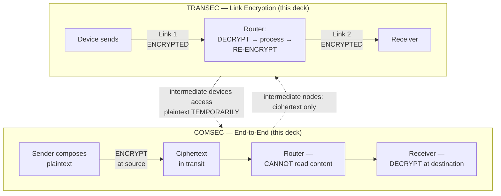
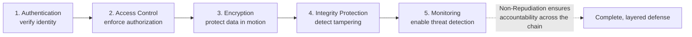
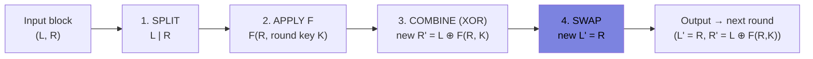
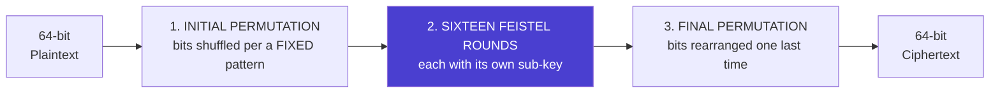
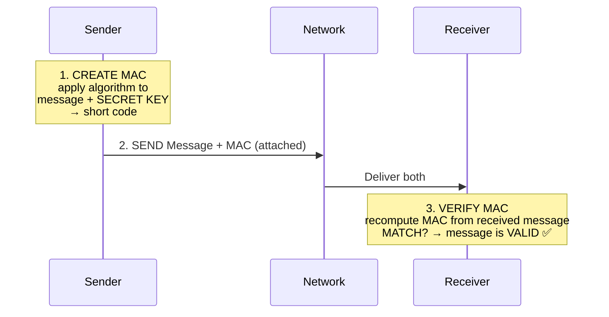
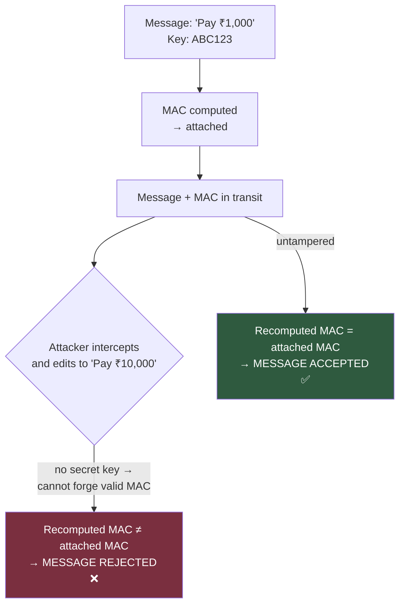
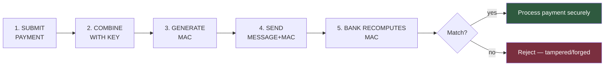

# Security Mechanisms, Classical Ciphers & Symmetric Cryptography (Feistel, DES, MAC) — Comprehensive Cybersecurity Notes

> **Scope note:** Two decks are combined here: **(1) *Security Mechanisms and Algorithms*** (19 pages, 6 chapters — COMSEC/TRANSEC, compartments, privacy, authentication, DoS, non-repudiation, encryption types, classical ciphers, goals matrix, architecture) and **(2) *Symmetric Ciphers*** (18 pages — symmetric encryption, **Feistel structure**, **DES**, and **integrity/authentication via MAC**). The two decks are designed as a pair: Deck 1 surveys *mechanisms and classical ciphers*; Deck 2 goes *deep on the symmetric side* — the Feistel/DES/MAC material is new to this series and is treated with the greatest depth. Everything else is cross-linked to earlier notes (COMSEC overview, DoS paper, non-repudiation, asymmetric encryption). Enrichment is marked throughout.

---

## 1. Executive Overview & Core Concepts

### 1.1 What the Two Decks Cover Together

| Deck | Chapters | Core Content |
| :--- | :--- | :--- |
| **Security Mechanisms and Algorithms** | Ch. 1–6 + References | Meaning/purpose of security mechanisms; **COMSEC (end-to-end) vs TRANSEC (link encryption)**; compartments (need-to-know); privacy; authentication (4 types); DoS/DDoS; **non-repudiation (4-step flow)**; **5 encryption types**; classical ciphers (**Caesar, Monoalphabetic, Playfair**); classical vs modern; **mechanisms × goals matrix**; integrated architecture |
| **Symmetric Ciphers** | Sections: Symmetric Ciphers → Feistel → DES → Integrity & Authentication | Symmetric definition & flow; **Feistel cipher (structure, round math, rationale)**; **DES (parameters, pipeline, worked flow, weaknesses)**; **data integrity**; **authentication**; **Message Authentication Code (MAC)** — full mechanism, attack scenario, banking flow; concept summary |

### 1.2 Fundamental Definitions

| Term | Definition (per decks, enriched) |
| :--- | :--- |
| **Security mechanism** | *"Technical methods, protocols, and tools specifically designed to **detect, prevent, and recover** from security attacks"* — the **operational layer** enforcing abstract policies |
| **COMSEC (this deck's framing)** | Protection of information **as it travels sender → receiver**; encryption **at the source**, decryption **only at the destination**; *"intermediate nodes cannot read the content"* |
| **TRANSEC (this deck's framing)** | Protection of **individual communication links**; data encrypted **between each pair of nodes**; at each intermediate node (router) the message is **decrypted, processed, re-encrypted** |
| **Security compartment** | A **logical boundary** separating classified/sensitive information into distinct categories; access limited to those with a **need to know** |
| **Information privacy** | The right of individuals to **control how personal data is collected, stored, processed, shared** |
| **Authentication** | Verifying that an entity (user, device, or **message**) is *"genuinely who or what it claims to be"* — *"the first line of defense"* |
| **Non-repudiation** | An entity **cannot deny having performed** a specific action; legal + technical accountability via cryptographic proof |
| **Symmetric encryption** | **One secret key** for both lock (encrypt) and unlock (decrypt); sender and receiver **must share it in advance** |
| **Feistel cipher** | A **design framework/blueprint** for symmetric ciphers: split block into halves, iterate rounds of mix-and-swap — *"does not define one specific cipher"* |
| **DES** | **Data Encryption Standard** — symmetric, **Feistel-based (16 rounds), 64-bit block, 56-bit key**, NIST standard 1977 |
| **Data integrity** | Received data is *"exactly the same as the data that was sent"* — nothing added, removed, or changed |
| **MAC** | A short code attached to a message proving it is **authentic and unchanged** — *"a tamper-proof seal created using a secret key"* |

> **🔑 Key Takeaway (series-level):** Deck 1 closes the loop on every goal in the course — its final **matrix** shows that **no single mechanism addresses all five goals**, and its **integrated architecture** restates **defence in depth**: *"the failure of one layer does not compromise the entire system."* Deck 2 then shows how the *symmetric* family delivers two of those goals concretely: **encryption → confidentiality**, **MAC → integrity + authentication**.

### 1.3 ⚠️ Terminology Cross-Reference Warning (COMSEC/TRANSEC)

This deck frames **COMSEC = end-to-end encryption** and **TRANSEC = link encryption**. The earlier official *End-End Security COMSEC Overview* used the **military taxonomy**, where **COMSEC is the umbrella of four elements** (TRANSEC, Cryptographic, Physical, Emissions Security) and **TRANSEC is one element inside it** (protecting transmissions from non-cryptoanalysis interception — frequency changes, call signs, radio silence).

| Framing | COMSEC means | TRANSEC means | Source |
| :--- | :--- | :--- | :--- |
| **Military (4-element)** | The **umbrella** (4 elements) | Link/transmission discipline (a **subset** of COMSEC) | COMSEC Overview doc |
| **This deck (Stallings-style)** | **End-to-end** encryption (source→destination) | **Link-by-link** encryption (per node) | Security Mechanisms deck |

*Both agree on the operational core*: protection is applied **somewhere along the path**, and *where* you apply it determines who can see plaintext. Exams may use either framing — state which one you are using.

---

## 2. Page-by-Page Detailed Breakdown

## PART A — Security Mechanisms and Algorithms (Deck 1, 19 pages)

### Page 1 — Title
*"A comprehensive university-level introduction to communication security, encryption paradigms, and classical cryptographic mechanisms — covering COMSEC, TRANSEC, authentication, privacy, and foundational cipher techniques for MCA/BCA students."* Tags: Computer Security · Cryptography · Network Protection.

### Page 2 — Chapter 1: Security Mechanisms — Meaning and Purpose
*   **Definition (verbatim):** mechanisms are technical methods, protocols, tools to **detect, prevent, and recover** from attacks — *"the operational layer through which abstract security policies are enforced in real-world systems."*
*   Three pillars:
    1.  **Protection of Information** — safeguards data from unauthorized **access, modification, or disclosure** during **storage and transmission**.
    2.  **Prevention of Unauthorized Access** — enforces boundaries so **only authenticated and authorized entities** interact with protected resources.
    3.  **Relationship with Security Goals** — each mechanism directly supports one or more of the **five core goals: confidentiality, integrity, availability, authentication, non-repudiation**. *(Enrichment: the classic CIA triad extended with the two attribution goals — exactly the framing used across this course.)*

### Page 3 — Chapter 2: End-to-End Security — COMSEC
*   **COMSEC** = protection of information as it travels **from original sender to intended receiver**. **Encryption applied at the source; only the final recipient performs decryption.** *"Intermediate nodes — such as routers — cannot read the content."*
*   Four bullet guarantees: encryption at sender's device · decryption only at destination · intermediate nodes cannot read plaintext · protects confidentiality **throughout** transmission.
*   **Flow:** Compose Plaintext → Encrypt at Source → Ciphertext in Transit → Decrypt at Destination.
*   **Example (verbatim):** *end-to-end encrypted messaging apps (e.g., **Signal**) — only the sender and recipient can read the message. **Service providers cannot access content.***

> **💡 Enrichment:** Signal's **Double Ratchet** provides end-to-end crypto with forward secrecy + post-compromise security — the modern incarnation of the COMSEC idea; the deck's "service providers cannot access content" is the property that distinguishes E2EE from TLS (where the *server* is an endpoint that *can* read plaintext).

### Page 4 — Chapter 2: Link Encryption — TRANSEC
*   **TRANSEC** protects **individual communication links rather than the entire end-to-end path**. Data is **encrypted between each pair of network nodes**; at each intermediate node (e.g., a router), the message is **decrypted, processed, and then re-encrypted before forwarding**.
*   Three bullets: encryption applied to **each link separately** · intermediate nodes **decrypt, process, re-encrypt** · **intermediate devices can access plaintext temporarily**. *(Enrichment: that last bullet is TRANSEC's structural price — every router becomes a trusted node; total exposure = number of hops.)*

### Page 5 — Chapter 2: COMSEC vs. TRANSEC — A Comparison
*"Both are critical strategies, but they differ fundamentally in where encryption is applied and who can access plaintext during transmission. The choice depends on the **threat model and network architecture**."*

| Feature | **COMSEC (End-to-End)** | **TRANSEC (Link-to-Link)** |
| :--- | :--- | :--- |
| Scope of Protection | Sender to **final receiver** | **One link at a time** |
| Encryption Points | **Source and destination only** | **Every network node** |
| Intermediate Nodes | **Cannot read** the content | **May decrypt and re-encrypt** |
| Primary Focus | **Message confidentiality** | **Transmission security** |
| Typical Use Case | **Messaging apps, email** | **VPNs, leased-line networks** |

> **💡 Enrichment:** the use-cases map to real protocols — E2EE: **Signal, PGP/GPG, S/MIME**; link encryption: **IPsec tunnel mode, MACsec, legacy leased-line crypto**. A VPN is TRANSEC-style because the gateway (not the app) terminates the encryption.

### Page 6 — Chapter 3: Compartments — Need-to-Know Principle
*   **Security compartment** = *"a logical boundary that separates classified or sensitive information into distinct categories. Access is strictly limited to individuals who **require that specific information to perform their duties** — this is the **need-to-know principle**."*
*   Four bullets: information divided into **separate, isolated categories** · access **role-based and strictly limited** · prevents **lateral movement of data across departments** · *"critical in **military, healthcare, and financial sectors**."*
*   **Worked examples:**
    *   **HR Department** — payroll records, employee personal data — **not** product source code.
    *   **Engineering Team** — technical systems, repositories — **not** financial accounts.
    *   **Finance Team** — accounting/budget data — **not** HR or engineering systems.

> **🔑 Cross-link:** this is the conceptual twin of the **MarkLogic compartment security** notes (roles grouped into named compartments; AND-across-compartments access) and Anderson's **multilateral security** (leak "across" departments, not just "down" the hierarchy). "Prevents lateral movement" is the *data-plane* echo of network micro-segmentation.

### Page 7 — Chapter 3: Privacy — Protecting Personal Information
*   **Information privacy** = *"the right of individuals to control how their personal data is collected, stored, processed, and shared."* Digital privacy mechanisms ensure personal information is **not disclosed beyond its intended scope** and users give **informed consent** before their data is used.
*   Three principles:
    1.  **Data Minimization** — only collect data **strictly necessary** for the intended purpose — *"no excess retention."*
    2.  **User Consent** — individuals must **explicitly agree** to collection and **can withdraw consent at any time**.
    3.  **Privacy vs. Security** — *"Privacy protects the **individual's rights**; security protects the **system**. Both are complementary but **distinct** goals."*
*   **Example:** a banking application encrypts account details, restricts access logs to authorized personnel, and **never shares transaction data with third parties without explicit consent**.

> **🔑 Cross-link:** these three principles are verbatim the **DPDP/GDPR privacy principles** covered earlier (purpose limitation/minimisation, consent management, the individual-rights vs system-protection distinction). The bank example also instantiates the earlier *Privacy by Design* banking illustration.

### Page 8 — Chapter 3: Authentication — Verifying Identity
*   **Definition:** verifying that an entity — *a user, device, or **message*** — is genuinely what it claims to be; *"one of the most critical security mechanisms, forming the **first line of defense**."* Note the deck's third object: **message authentication** — bridging into Deck 2's MAC material.
*   Four types:

| Type | Function | Methods (per deck) |
| :--- | :--- | :--- |
| **User Authentication** | Verifies the identity of a **person** accessing a system | Passwords, PINs, **biometrics** |
| **Device Authentication** | Confirms a connecting **device** is trusted and registered | **Certificates**, **MAC address filtering** |
| **Message Authentication** | Ensures a message **originated from a legitimate source** and has **not been tampered with** | **MACs or digital signatures** |
| **Multi-Factor Authentication** | Combines **two or more** verification factors | something you **know** (password), **have** (OTP token), **are** (fingerprint) |

> **🔑 Cross-link:** the MFA triad = the earlier **"knows / has / is"** proofs from the Security Mechanisms notes; message authentication via MAC/digital signature is Deck 2's core subject (Part B) and the asymmetric deck's Ch. 9.

### Page 9 — Chapter 3: Denial of Service (DoS)
*   **Definition:** *"a deliberate attempt to make a system, network, or service **unavailable** to its intended users by **overwhelming it with illegitimate requests**. It directly attacks the **Availability** security goal."*
*   Mechanics: floods with **excessive traffic or malformed packets** · **exhausts resources — CPU, memory, bandwidth** · legitimate users cannot access · **DDoS uses thousands of compromised devices (botnets) simultaneously**.
*   **Example:** *"A **university exam portal** becomes inaccessible **on the day of results** because a malicious actor floods it with **millions of fake requests per second**."*
*   Comparison cards: **DoS** = *single source overwhelms target — easier to block by **filtering one IP address*** · **DDoS** = *distributed sources (botnet) attack simultaneously — **far harder to mitigate***.

> **🔑 Cross-link:** condenses the entire DoS paper (botnets, floods, resource exhaustion) into one slide. The exam-portal example shows why **availability is a high-stakes goal** — timing matters (results day). Mitigation hierarchy from earlier notes: rate limiting → WAF → scrubbing/CDN absorption.

### Page 10 — Chapter 3: Non-Repudiation — Preventing Denial of Actions
*   **Definition:** ensures an entity **cannot deny having performed** a specific action — sending a message, signing a document, initiating a transaction; *"provides **legal and technical accountability** through cryptographic proof."*
*   **The four-step flow:**

| # | Step | Detail |
| :--- | :--- | :--- |
| 1 | **Action Performed** | User sends a message or signs a digital document |
| 2 | **Digital Signature Applied** | A cryptographic signature **uniquely tied to the sender** is attached |
| 3 | **Audit Trail Created** | Transaction records, **timestamps, and logs stored securely** |
| 4 | **Proof of Origin** | The sender **cannot later deny** the action — *"cryptographic evidence is irrefutable"* |

*   **Foundation:** essential in **e-commerce, electronic contracts, legal correspondence**; relies on **digital signatures, public key infrastructure (PKI), and secure audit logging**.

> **🔑 Cross-link:** matches the non-repudiation notes (digital signature = "only one person can create it") and *adds a step the earlier notes implied*: **secure audit logging** — accountability needs both crypto (signature) and **records** (auditing). The signature supplies proof of *authorship*; the audit trail supplies proof of *event context*.

### Page 11 — Chapter 4: Types of Encryption
*"Encryption transforms readable **plaintext** into unreadable **ciphertext** using a mathematical algorithm and a key. Different types offer distinct trade-offs between security, speed, and key-management complexity."*

| Type | Key Usage | Speed | Security | Use Case |
| :--- | :--- | :--- | :--- | :--- |
| **Symmetric** | Same key for encrypt & decrypt | **Very Fast** | High (if key is secret) | File encryption, **AES** |
| **Asymmetric** | **Public key encrypts, private key decrypts** | Slow | Very High | HTTPS, **RSA**, PKI |
| **Hybrid** | Combines both types | Fast | Very High | **TLS/SSL, HTTPS** |
| **Stream** | Key stream **XORed bit-by-bit** | **Fastest** | Moderate | Real-time audio/video |
| **Block** | Processes **fixed-size blocks** | Fast | High | **AES, DES, disk encryption** |

> **💡 Enrichment:** stream ciphers (e.g., RC4, ChaCha20, AES-CTR mode) generate a keystream XORed with plaintext — hence "fastest" but security hinges on **never reusing a keystream**; block ciphers (AES/DES) need **modes of operation** (ECB/CBC/GCM) to handle data longer than one block. Hybrid = the Ch. 13 "best of both worlds" from the asymmetric notes.

### Page 12 — Chapter 5: Classical Encryption — The Caesar Cipher
*   *"One of the oldest and simplest encryption techniques"* — a **substitution cipher** shifting each plaintext letter by a **fixed number of positions**; shift 3 ⇒ **A→D, B→E**, and so on.
*   Bullets: encryption = shift **forward by *n*** · decryption = shift **backward by *n*** · **key = the shift value (e.g., 3)** · strength = *"simple and fast to implement"* · **weakness = only 25 possible keys — trivially broken by brute force**.
*   **Worked example (Shift = 3):**

| | Text |
| :--- | :--- |
| **Encryption** | Plaintext: `H E L L O` → Shift `+3` → **Ciphertext: `K H O O R`** |
| **Decryption** | Ciphertext: `K H O O R` → Shift `−3` → **Plaintext: `H E L L O`** |
| Mapping | A→D, B→E, C→F … Z→C |

> **🔑 Cross-link:** identical cipher to the Cryptography PDF's Caesar section (there with shift 1: "defend the east wall…"); same 25-key brute-force verdict. *(Enrichment: Caesar's historical shift was ~3 — this deck's example is the historically faithful one.)*

### Page 13 — Chapter 5: Classical Encryption — The Monoalphabetic Cipher
*   An **extension of Caesar**: each plaintext letter is substituted with a **fixed but arbitrary** letter from a predefined substitution alphabet; mapping is **one-to-one and constant** throughout the message.
*   Bullets: each letter maps to **exactly one** ciphertext letter · the **substitution alphabet is the key (26! possible keys)** · *"stronger than Caesar — not breakable by simple brute force"* · **weakness: vulnerable to frequency analysis** — *"letter frequency patterns in natural language are preserved."*
*   **Worked example** — partial key:

| Plain | A | B | C | D | E |
| :--- | - | - | - | - | - |
| **Cipher** | Q | W | E | R | T |

*   **Encrypt "CAB":** C→E, A→Q, B→W ⇒ **Ciphertext: `EQW`**. **Decrypt "EQW":** reverse the table ⇒ **C A B**.

> **💡 Enrichment:** 26! ≈ **4.03×10²⁶ keys** — brute-force-proof against human-era computation, yet **broken in practice by frequency analysis** (E/T/A dominance in English). This is the crucial lesson: **keyspace size ≠ security** — structure leakage defeats large keyspaces. (The Cryptography PDF's LISA→WTFI example used exactly such a mixed-alphabet key.)

### Page 14 — Chapter 5: Classical Encryption — The Playfair Cipher
*   Encrypts **pairs of letters (digraphs)** rather than single letters — *"significantly increasing security."* Uses a **5×5 key matrix** built from a keyword, **with I and J sharing one cell**.
*   Bullets: plaintext split into **digraphs** · **repeated letters in a pair are separated by a filler (e.g., X)** · encryption rules depend on **row, column, or rectangle positions** · *"stronger than monoalphabetic — **676 possible digraphs**."*
*   **Key note:** **MONARCHY → fill remaining alphabet letters in order** to complete the 5×5 matrix.
*   **The MONARCHY matrix:**

| M | O | N | A | R |
|---|---|---|---|---|
| **C** | **H** | **Y** | **B** | **D** |
| **E** | **F** | **G** | **I/J** | **K** |
| **L** | **P** | **Q** | **S** | **T** |
| **U** | **V** | **W** | **X** | **Z** |

*   **Example:** encrypt digraph **"AR"** — both in the **same row** ⇒ **shift right: A→R, R→C** ⇒ **Ciphertext: RC**.

> **💡 Enrichment (completing the three rules the deck names):** ① **same row** → replace each letter with the one to its **right** (wrap to row start); ② **same column** → replace with the letter **below** (wrap to column top); ③ **rectangle** → take letters on the **same row as their partner** (horizontal swap). Playfair (invented by **Charles Wheatstone**, promoted by **Lord Playfair**, 1854) was the first practical **digraph** cipher — used tactically in WWI/WWII. 676 = 26×26 ordered digraphs.

### Page 15 — Chapter 5: Comparison of Classical Ciphers
*"Each classical cipher represents an **evolutionary step** in cryptographic complexity — from simple substitution to digraph-based techniques."*

| Feature | **Caesar Cipher** | **Monoalphabetic** | **Playfair Cipher** |
| :--- | :--- | :--- | :--- |
| Encryption Method | Letter shift | Fixed substitution | **Digraph substitution** |
| Unit of Encryption | Single letter | Single letter | **Pair of letters** |
| Key Structure | One number (shift) | Substitution table | **5×5 keyword matrix** |
| Relative Security | **Very Low** | Low to Moderate | **Moderate** |
| Main Weakness | Only 25 keys; brute force | Frequency analysis | **Digraph frequency analysis** |

### Page 16 — Chapter 5: Classical vs. Modern Encryption
*"Classical ciphers laid the theoretical foundation… but their security is **entirely inadequate** for contemporary digital systems. Modern algorithms are **computationally infeasible** to break even with significant computational resources."*

| Feature | **Classical Encryption** | **Modern Encryption** |
| :--- | :--- | :--- |
| Key Size | **Very small (e.g., 1 number)** | **128–256+ bits (AES), 2048+ bits (RSA)** |
| Security Level | **Low — easily broken** | **High — computationally secure** |
| Computational Complexity | Minimal | High — requires significant processing |
| Resistance to Attacks | Vulnerable to **brute force and frequency analysis** | **Resistant to known cryptanalytic attacks** |
| Modern Application | **Educational and historical study only** | **HTTPS, banking, VPNs, digital signatures** |

*   **Info box:** *"Classical ciphers are studied primarily to understand cryptographic **principles**. Modern systems such as **AES (symmetric)** and **RSA (asymmetric)** provide the security standards required for real-world applications."*

### Page 17 — Chapter 6: Security Mechanisms × Security Goals Matrix
*"**No single mechanism addresses all security goals.** The matrix illustrates how each mechanism contributes to one or more of the five core goals — demonstrating the need for a **layered, multi-mechanism approach**."*

| Mechanism | Confidentiality | Integrity | Availability | Authentication | Non-Repudiation |
| :--- | :---: | :---: | :---: | :---: | :---: |
| **Encryption** | ✓ | | | | |
| **Authentication** | | ✓ | | ✓ | |
| **Digital Signature** | | ✓ | | ✓ | ✓ |
| **Access Control** | ✓ | ✓ | ✓ | ✓ | |
| **DoS Protection** | | | ✓ | | |
| **Audit Logging** | | ✓ | | ✓ | ✓ |

> **💡 Reading the matrix (and one enrichment):** Encryption→C only (ciphertext can still be tampered); **Digital Signature and Audit Logging are the only non-repudiation providers**; Access Control is the broadest contributor (4 goals). *(Enrichment: Authentication's ✓ under Integrity reflects **message authentication codes** — verifying sender implicitly verifies non-tampering, per Deck 2's "two questions, one mechanism." Full integrity *of content* usually needs a MAC/signature explicitly.)*

### Page 18 — Chapter 6: Integrated Security Architecture
*"A robust architecture does not rely on any single mechanism. Multiple mechanisms work **in concert**… **the failure of one layer does not compromise the entire system — this is the principle of defense in depth**."*

*   **The five-stage chain:** **Authentication → Access Control → Encryption → Integrity → Monitoring**.

*   **Mapping (verbatim):** Authentication + Access Control enforce **identity and authorization**; Encryption + Integrity Protection **protect data in motion**; Monitoring enables **threat detection**; Non-Repudiation ensures **accountability** — *"together, these mechanisms form a complete, layered defense."*

### Page 19 — References
| Source | Role |
| :--- | :--- |
| **Stallings, W. — *Cryptography and Network Security: Principles and Practice* (8th ed., Pearson)** | *"The primary reference"* for symmetric, asymmetric, and classical encryption |
| **Forouzan, B. A. — *Cryptography and Network Security* (McGraw-Hill)** | Network security protocols, authentication, cipher design |
| **NIST** — Cybersecurity Framework, FIPS cryptographic standards (csrc.nist.gov) | Authoritative federal standards |
| **ISO/IEC 27001** (ISMS) & **ISO/IEC 27002** (Security Controls) | International management/controls standards |
| **CERT-In** (cert-in.org.in) | Indian CERT — cybersecurity guidelines and advisories |

---

## PART B — Symmetric Ciphers (Deck 2, 18 pages)

### Page 1 — What is Symmetric Encryption?
*   *"One of the most fundamental ideas in cryptography. It uses a **single secret key** to both **lock (encrypt)** and **unlock (decrypt)** a message. Both sender and receiver must have the **same key** — and **keep it secret from everyone else**."*
*   Three properties: **One Key for Everything** (same key both directions) · **Shared Secret** (both parties must have it **in advance**) · **Keeps Data Private** (without the key, *"an attacker cannot read the message"*).
*   **Simple example 🔑:** Alice sends **"MEET AT 5"** to Bob — shared secret key scrambles it into unreadable text; Bob uses the **same key** to recover **"MEET AT 5"**. *"No one else can read it."*

### Page 2 — How Symmetric Encryption Works
*   *"The encryption process transforms a readable message into unreadable data, and decryption reverses that process — **both steps relying entirely on the secret key**."*
*   **The five-stage chain:** `Plaintext → Encrypt with Key → Ciphertext → Decrypt with Key → Plaintext`

| Term | Definition |
| :--- | :--- |
| **Plaintext** | The original, readable message **before** encryption |
| **Secret Key** | A **shared value used in both** encryption and decryption steps |
| **Ciphertext** | The scrambled, unreadable output produced after encryption |

> **🔑 Cross-link:** the mirror of the asymmetric deck's 5-step chain — the *only* difference is that the same key appears at both ends, which is precisely what creates the **key-distribution problem** (solved by public-key crypto and later by **hybrid encryption**).

### Page 3 — What is a Feistel Cipher?
*   *"A **design framework — a blueprint** — used to build symmetric encryption systems. It **does not define one specific cipher**, but rather a structured approach that **many ciphers (including DES) follow**."*
*   Three design elements:
    1.  **Split the Data** — input block divided into two equal halves: **Left (L)** and **Right (R)**.
    2.  **Multiple Rounds** — encryption happens over **several rounds**, each using a **different round key**.
    3.  **Used in DES** — *"the famous Data Encryption Standard (DES) is built on the Feistel structure."*
*   **Simple example:** block = **ABCDEFGH** → Left (L): **ABCD** · Right (R): **EFGH** — *"these two halves are processed separately in each round, then combined — making the encryption much **harder to reverse** without the key."*

### Page 4 — Feistel Structure: Step by Step
*"Each **round** follows the same repeating pattern. Understanding **one round** helps you understand the whole cipher."*

| Step | Name | Action |
| :--- | :--- | :--- |
| **1** | **Split** | Divide the input into **Left and Right halves of equal size** |
| **2** | **Apply Function** | Run the **Right half through a mixing function F** using the **round key** |
| **3** | **Combine** | **XOR** the function's output with the **Left half** |
| **4** | **Swap** | **Swap the two halves** and repeat for the next round |

### Page 5 — Feistel Round: A Simple Example
*   **Disclaimer (verbatim):** *"This is a simplified **conceptual example** to illustrate the idea — **not an actual cryptographic calculation**."*
*   **Setup:** Left half (L): **A** · Right half (R): **B** · Round key (K): **K**.
*   **One round:**
    *   Apply function F to B using K → result = **F(B, K)**
    *   Combine result with A → **new Right = A ⊕ F(B, K)**
    *   **New Left = old Right = B**
    *   **Output: Left = B, Right = A ⊕ F(B, K)**
*   **What did we learn?** *"After just one round, the original left half **A is hidden inside a combined value**. The right half **B moved to the left**. After **many rounds**, the original data becomes **extremely difficult to recover without the correct key**. This **'mix and swap' pattern is the core idea** behind the entire Feistel design. **Each round adds another layer of confusion**."*

> **💡 Enrichment (the formal round and its genius):** the standard Feistel round is **Lᵢ = Rᵢ₋₁, Rᵢ = Lᵢ₋₁ ⊕ F(Rᵢ₋₁, Kᵢ)**. Its decisive property: decryption is the **same structure run with round keys in reverse order** — so **F need NOT be invertible**. Designers can make F arbitrarily messy (S-boxes, permutations) with no decryption penalty. Named after **Horst Feistel** (IBM, 1970s); his **Lucifer** cipher was the direct ancestor of DES.

### Page 6 — Why Feistel Structure is Used
*"Not just clever — it solves real problems in cryptographic design."* Five reasons:

| # | Reason | Explanation |
| :--- | :--- | :--- |
| 1 | **Breaks Data into Parts** | Smaller chunks are **easier to process and harder to analyze** |
| 2 | **Multiple Rounds** | Each round adds a **new layer of scrambling**, making the cipher stronger |
| 3 | **Different Keys Per Round** | A **unique sub-key derived for each round** from the master key |
| 4 | **Hard to Reverse** | After many rounds, the original data is very difficult to guess without the key |
| 5 | **Foundation of DES** | *"DES, **one of the most studied ciphers in history**, is built on this exact structure"* |

### Page 7 — What is DES?
*   **DES — Data Encryption Standard** — *"one of the most important encryption algorithms in computing history. Adopted as a federal standard in the **1970s**, it protected sensitive data for **decades**."*
*   Four parameter cards:

| Parameter | Value |
| :--- | :--- |
| **Symmetric Algorithm** | Same secret key for encryption and decryption |
| **Built on Feistel** | *"exactly the Feistel structure we just studied — **16 rounds** of it"* |
| **Block Size** | **64 bits** (8 characters) processed at a time |
| **Key Size** | **56 bits** — *"which turned out to be its **biggest weakness**"* |

*   **Quick Fact 📜:** *"DES was standardized by **NIST** in **1977**. It was the **dominant encryption standard for nearly 20 years** before concerns about its **short key length** led to its replacement by **AES**."*

> **💡 Enrichment:** the 56-bit key is the story of DES — the original IBM **Lucifer** design used a 64-bit key; **NSA involvement reduced it to 56 bits** (the "key-length controversy"). Formally **FIPS 46 (1977)**, reaffirmed as **FIPS 46-3 (1999)** bundled with Triple-DES, then **withdrawn (2005)**. The 8 unused key bits per 64-bit block were **parity bits**.

### Page 8 — How DES Works
*"DES takes a block of plaintext and runs it through a carefully structured series of operations. Each step is designed to increase **confusion** so the output looks nothing like the input."*

| Stage | Detail |
| :--- | :--- |
| **1. Initial Permutation (IP)** | Bits in the **64-bit input block** are shuffled according to a **fixed pattern** |
| **2. 16 Feistel Rounds** | The block goes through **16 rounds of the Feistel process, each with its own sub-key** |
| **3. Final Permutation (FP)** | Bits rearranged one last time to produce the **final 64-bit ciphertext** |

> **💡 Enrichment:** **FP is the exact inverse of IP** (so they cancel in decryption). Per round: the 32-bit right half is **expanded to 48 bits**, XORed with the **48-bit round sub-key**, passed through **8 S-boxes (substitution — the "confusion" engine)**, then **P-permuted (diffusion)**. The **key schedule** generates 16 sub-keys by rotating and permuting the 56-bit master key.

### Page 9 — DES in Action: A Simple Example
*   **Disclaimer:** *"conceptual illustration — **not an actual DES calculation**. Real DES uses binary operations on 64-bit blocks."*
*   **Encryption side (sender):** Message **"HELLO"** → converted to **binary bits** → DES applies **16 rounds using secret key** → output: **scrambled, unreadable ciphertext** → **sent over the network**.
*   **Decryption side (receiver):** receives the scrambled ciphertext → applies DES with the **same secret key** → **runs 16 rounds in reverse order** → recovers the original bits → **Output: "HELLO" ✅**.
*   **Key sentence:** *"The decryption is simply the **encryption process run backwards** — the **symmetric nature** of DES makes this possible."*

> **💡 Enrichment (the Feistel payoff):** "run backwards" is possible because each round is its own inverse under the swapped-key trick: run the **same F rounds with sub-keys K₁₆ → K₁** and the XORs cancel. This is *the* practical reason Feistel networks dominated: one hardware/software circuit serves both directions.

### Page 10 — Problems with DES
*"Although DES was groundbreaking in its time, advances in computing power eventually exposed serious weaknesses. Today, DES is considered **insecure** for protecting sensitive data."*

| Problem | Detail |
| :--- | :--- |
| **Key is Too Short** | The 56-bit key = about **72 quadrillion possible keys** (2⁵⁶ ≈ 7.2×10¹⁶) — *"a lot, but not enough for modern computers"* |
| **Brute-Force Attacks Work** | *"In 1998, a **specialized machine cracked DES in under 23 hours** by trying keys one by one"* |
| **Modern Hardware is Much Faster** | *"Today's computers and GPUs can try **billions of keys per second**, making DES **trivial to break**"* |
| **Replaced by AES** | *"The **Advanced Encryption Standard (AES)**, adopted in **2001**, uses **128, 192, or 256-bit keys** — far more secure"* |

> **💡 Enrichment (brute-force history, precisely):** the **EFF "Deep Crack"** machine (built for ~$250,000) cracked a DES challenge in **56 hours in July 1998**; in **January 1999**, the joint **EFF + distributed.net** effort cracked one in **22 hours 15 minutes** — the deck's "under 23 hours" corresponds to that 1999 run. Modern cloud GPUs brute-force 2⁵⁶ in hours at trivial cost — hence DES survives only inside **3DES (now NIST-disallowed after 2023)** and legacy financial hardware.

### Page 11 — What is Data Integrity?
*   **Definition:** *"the data you receive is **exactly the same** as the data that was sent — nothing was **added, removed, or changed** during transmission. Protecting integrity is just as important as protecting confidentiality."*
*   Three points:
    1.  **Detects Unauthorized Changes** — *"any modification — **even a single character** — should be detectable."*
    2.  **Critical in High-Stakes Systems** — *"banking transactions, medical records, and legal documents all depend on integrity."*
    3.  **Integrity ≠ Confidentiality** — *"a message can be **readable but still tampered with**. Integrity addresses **tampering, not secrecy**."*
*   **Simple example 🧬:** original message **"Transfer ₹5,000"** → attacker intercepts and changes it to **"Transfer ₹50,000"** → *"a good integrity mechanism would **detect this change** and **alert the receiver** that the message was tampered with **before it reaches the bank**."*

> **🔑 Cross-link:** the "readable but tampered" insight is why the goals **matrix** (Deck 1, page 17) gives Encryption **Confidentiality only** — and why a separate integrity mechanism is mandatory. This mirrors the *transfer-tokenisation/₹ examples* from the Application Domains notes.

### Page 12 — What is Authentication?
*   **Definition:** answers *"**'Who sent this message?'** — it confirms that the message truly came from the **expected sender** — not an impersonator or attacker."*
*   **Simple example 🏦:** a bank receives *"**Please transfer $10,000 from Account A to Account B**."* Authentication helps the bank answer: *"**Did this really come from the account holder — or is someone pretending to be them?**"* — *"**Without authentication, anyone could send fake instructions.**"*
*   Three properties:
    1.  **Confirms the Sender** — verifies the message was created by someone who **holds the correct secret key**.
    2.  **Prevents Impersonation** — stops attackers from **pretending to be a trusted person or system**.
    3.  **Uses Shared Secret Keys** — *"in symmetric systems, **only those who share the key** can generate a valid authentication code."*

### Page 13 — Message Authentication Code (MAC)
*   **Definition:** *"a **short piece of data attached to a message** that proves the message is **authentic and unchanged**. Think of it as a **tamper-proof seal created using a secret key**."*
*   **Three-step flow:**

| Step | Action |
| :--- | :--- |
| **Sender Creates MAC** | Applies an algorithm to the **message and secret key** to produce a short code |
| **Message is Sent** | The original message is sent **together with its MAC attached** |
| **Receiver Verifies** | Receiver **recomputes the MAC** from the received message — **if it matches, the message is valid** |

### Page 14 — MAC in Action: A Simple Example
*   **Normal Flow ✅:**
    *   **Message:** "Pay ₹1,000" · **Secret Key:** ABC123
    *   → MAC is **calculated and attached**
    *   → Receiver **recalculates MAC** from the received message
    *   → **MAC values match → Message accepted**
*   **Attack Scenario ❌:**
    *   Attacker **intercepts** the message
    *   Changes it to: **"Pay ₹10,000"**
    *   Attacker does **NOT have the secret key**
    *   → **Cannot recalculate a valid MAC**
    *   → **MAC values do NOT match → Message rejected**
*   **Conclusion:** *"The receiver **immediately knows something is wrong**. The changed message is **rejected**, protecting the sender from **fraud**."*

### Page 15 — Integrity + Authentication Together
*   *"In practice, integrity and authentication work as a team. A **single MAC mechanism addresses both concerns simultaneously** — making it very powerful in secure communication systems."*
*   **Two Questions, One Mechanism:**
    *   🧬 **Integrity:** *"Was this message **changed in transit**?"*
    *   ✅ **Authentication:** *"Did this come from **someone who knows the secret key**?"*
    *   *"If **both checks pass**, the receiver can **trust the message fully**."*
*   **Online Banking Example 🏦 (payment submission):** payment message **combined with a secret key** → **MAC generated and sent with the message** → bank receives message + MAC → bank verifies: **no changes made ✅** and **came from a known key holder ✅** → **payment is processed securely**.

### Page 16 — Symmetric Security: A Real-Life Flow
*"How a real-world symmetric security system — like online banking — uses a **secret key and MAC** to protect **every payment message from end to end**."*

*   **Two-level protection (verbatim):** *"**confidentiality** (the key keeps data private) and **integrity/authentication** (the MAC detects any changes and confirms the sender)."*

> **🔑 Cross-link:** this is the symmetric twin of the asymmetric deck's **online-banking HTTPS flow** (Ch. 15). Difference: here both parties **already share the key**; in the TLS flow the key is **exchanged via public-key crypto** — which is exactly why **hybrid encryption** exists.

> **⚠️ Enrichment (the MAC's blind spot — exam favourite):** because **both parties hold the same key**, the *receiver* could also forge a valid MAC. Therefore **MAC provides integrity + authentication but NOT non-repudiation** — only a **digital signature** (private-key-only creation) can prove origin to a third party. Modern practice combines both: **HMAC (FIPS 198-1)** / **CMAC (SP 800-38B — the MAC spec cited in this deck's references)**, and **AEAD modes like AES-GCM** which compute encryption + tag in one pass.

### Page 17 — Symmetric Encryption: Key Concepts (Summary)
*"Each concept plays a distinct and essential role in protecting communications."*

| Concept | Role |
| :--- | :--- |
| **Encryption** | Transforms plaintext into ciphertext using a secret key → protects **Confidentiality** |
| **MAC** | A code derived from the message and key → protects **Integrity** by detecting changes |
| **Authentication** | Confirms **who sent** the message → only someone with the key can produce a valid MAC |
| **Secret Key** | The shared secret enabling **all three protections** → **must be exchanged securely in advance** |
| **Feistel / DES** | *"Feistel is the **design pattern**; DES is one famous **implementation** of it using **16 rounds**"* |

### Page 18 — References
| Source | Note |
| :--- | :--- |
| **Stallings — *Cryptography and Network Security*** (Pearson) | *"The leading textbook worldwide — covers Feistel, DES, MACs, and all symmetric fundamentals"* |
| **Forouzan** (McGraw-Hill) | Accessible, well-illustrated; strong on symmetric ciphers and protocols |
| **NIST** — **FIPS 46-3** (DES), **FIPS 197** (AES), **SP 800-38B** (MAC specs), csrc.nist.gov | Official US standards |
| **ISO/IEC 18033** (encryption algorithms), **ISO/IEC 9797-1** (MAC algorithms) | International implementation standards |

---

## 3. Comparative Summary & Matrix

### 3.1 COMSEC vs TRANSEC (Deck 1, p. 5) — with enrichment

| Feature | COMSEC (End-to-End) | TRANSEC (Link-to-Link) |
| :--- | :--- | :--- |
| Scope | Sender → final receiver | One link at a time |
| Encryption points | Source + destination only | Every network node |
| Intermediate nodes | Cannot read content | May decrypt & re-encrypt |
| Plaintext exposure | Zero en route | **Temporary at each hop** |
| Primary focus | Message confidentiality | Transmission security |
| Use case | Messaging apps, email (Signal, PGP) | VPNs, leased lines (IPsec tunnels) |
| Trust surface (enrichment) | 2 endpoints only | Every intermediate node |

### 3.2 Classical Ciphers — Evolution Ladder (Decks' pp. 12–15)

| Feature | Caesar | Monoalphabetic | Playfair |
| :--- | :--- | :--- | :--- |
| Unit | Single letter | Single letter | **Digraph (pair)** |
| Key | Shift number (n) | Substitution table | 5×5 keyword matrix |
| Keyspace | **25** | **26! ≈ 4×10²⁶** | Matrix count (huge), **676 digraphs** |
| Security | Very Low | Low–Moderate | Moderate |
| Killer attack | Brute force (25 tries) | **Frequency analysis** | **Digraph frequency analysis** |
| Worked example | HELLO→KHOOR (shift 3) | CAB→EQW (A→Q,B→W,C→E) | AR→RC (MONARCHY matrix) |
| Extras | ROT13 cousin | One-to-one, constant mapping | I/J share a cell; filler X; 3 position rules |

### 3.3 Classical vs Modern (Deck 1, p. 16)

| Feature | Classical | Modern |
| :--- | :--- | :--- |
| Key size | 1 number | 128–256+ bits (AES); 2048+ bits (RSA) |
| Security | Easily broken | Computationally secure |
| Complexity | Minimal | High processing |
| Attack resistance | Brute force + frequency analysis | Resistant to known cryptanalysis |
| Application | Education/history only | HTTPS, banking, VPNs, signatures |

### 3.4 The Five Encryption Types (Deck 1, p. 11) mapped to course concepts

| Type | Keys | Speed | Security | Use case | Course cross-link |
| :--- | :--- | :--- | :--- | :--- | :--- |
| Symmetric | 1 shared | Very Fast | High | Files, AES | Deck 2 entirety |
| Asymmetric | Public/private pair | Slow | Very High | HTTPS, RSA, PKI | Asymmetric deck Ch. 1–17 |
| Hybrid | Both | Fast | Very High | TLS/SSL | Asymmetric deck Ch. 13 |
| Stream | Keystream XOR | **Fastest** | Moderate | Real-time A/V | ChaCha20 (IoT notes) |
| Block | Fixed-size blocks | Fast | High | AES, DES, disk encryption | Deck 2 (DES) |

### 3.5 Feistel vs DES — Blueprint vs Implementation (Deck 2)

| Aspect | Feistel (blueprint) | DES (implementation) |
| :--- | :--- | :--- |
| Nature | **Design framework** — no single cipher | One famous Feistel cipher |
| Halves | Split into equal L/R | 64-bit block → two 32-bit halves |
| Rounds | "Several" (generic) | **Exactly 16** |
| Round keys | Different key per round | 16 × **48-bit sub-keys** from 56-bit master |
| F function | Arbitrary mixing function | Expand 32→48, XOR sub-key, **8 S-boxes**, P-permutation |
| Permutations | — | **IP** at entry, **FP** (= IP⁻¹) at exit |
| Decryption | Same rounds, keys reversed | *"Encryption run backwards"* |
| Status | Evergreen design idea | **Insecure** (56-bit key); replaced by AES (2001) |

### 3.6 Integrity vs Authentication vs Non-Repudiation (Decks 2 + 1 + earlier notes)

| Property | Question answered | Mechanism | Key needed | Forged by receiver? | Non-repudiation? |
| :--- | :--- | :--- | :--- | :--- | :--- |
| **Integrity** | "Was it changed?" | MAC recomputation | Shared secret | — | — |
| **Authentication** | "Who sent it?" | Valid MAC possible only with key | Shared secret | — | — |
| **Non-repudiation** | "Can they deny it?" | **Digital signature** (private-key sign) | Sender's private key | **No** — only signer holds it | ✅ |
| *MAC verdict (enrichment)* | Both Qs, one mechanism | HMAC/CMAC | Symmetric | **Yes** (shared key) | ❌ |

### 3.7 Mechanisms × Goals Matrix (Deck 1, p. 17 — memorise)

| Mechanism | C | I | A(vail) | Auth | N-R |
| :--- | :-: | :-: | :-: | :-: | :-: |
| Encryption | ✓ | | | | |
| Authentication | | ✓ | | ✓ | |
| Digital Signature | | ✓ | | ✓ | ✓ |
| Access Control | ✓ | ✓ | ✓ | ✓ | |
| DoS Protection | | | ✓ | | |
| Audit Logging | | ✓ | | ✓ | ✓ |

> **Reading tips:** the **only** non-repudiation providers = **Digital Signature + Audit Logging**; **Access Control** touches the most goals (4); **Encryption alone never gives integrity** (matches Deck 2 p. 11's "readable but tampered").

---

## 4. Key Terminology & Cheat Sheet

### 4.1 Glossary

| Term | Definition |
| :--- | :--- |
| **AES** | Advanced Encryption Standard — 128/192/256-bit keys, adopted **2001**, replaced DES |
| **Audit trail** | Securely stored transaction records/timestamps — the non-repudiation **records** leg |
| **Block cipher** | Processes **fixed-size blocks** (AES, DES); needs modes of operation *(enrichment)* |
| **COMSEC (deck framing)** | End-to-end protection: encrypt at source, decrypt at destination only |
| **Deep Crack** *(enrichment)* | EFF's DES brute-force machine (1998, 56 h; 1999 joint run 22 h 15 m) |
| **DES** | Data Encryption Standard — Feistel, 16 rounds, 64-bit block, **56-bit key**, NIST 1977 |
| **Digraph** | Letter pair — Playfair's encryption unit (**676** possibilities) |
| **Feistel cipher** | Blueprint: split → F(right, round key) → XOR → swap; *"each round adds another layer of confusion"* |
| **F function** | Feistel's mixing function on the right half with the round key — need **not** be invertible *(enrichment)* |
| **Filler (X)** | Playfair character inserted to separate repeated letters / pad odd-length text |
| **Frequency analysis** | Exploiting preserved letter-frequency patterns — kills monoalphabetic ciphers |
| **HMAC / CMAC** *(enrichment)* | Standard MAC constructions (FIPS 198-1 / SP 800-38B) |
| **Hybrid encryption** | Asymmetric key exchange + symmetric bulk data (TLS) |
| **Initial/Final Permutation** | DES's fixed bit-shuffles at entry/exit; **FP = IP⁻¹** *(enrichment)* |
| **IP address filtering (device auth)** | MAC-address/certificate trust for connecting devices |
| **MAC address** *(deck context)* | Device-identity filter for network admission (distinct from the crypto **MAC**) |
| **MAC (Message Authentication Code)** | Short secret-key-derived code proving a message is **authentic and unchanged** — a *tamper-proof seal* |
| **Monoalphabetic cipher** | Fixed one-to-one substitution alphabet (**26! keys**); broken by frequency analysis |
| **Need-to-know principle** | Compartment access limited to those whose duties require it |
| **Non-repudiation** | Cannot deny an action — via signature + PKI + secure audit logging |
| **Playfair cipher** | Digraph substitution via 5×5 keyword matrix (I/J merged) |
| **S-boxes** *(enrichment)* | DES's 8 substitution boxes — the confusion core of F |
| **Stream cipher** | Keystream XORed bit-by-bit; fastest; keystream must never repeat *(enrichment)* |
| **Sub-key / round key** | Unique key derived per round from the master key |
| **TRANSEC (deck framing)** | Per-link encryption: decrypt → process → re-encrypt at each node |
| **2⁵⁶** | DES keyspace ≈ **72 quadrillion** keys |

### 4.2 Numbers Cheat Sheet

| Item | Value |
| :--- | :--- |
| Security goals in the matrix | **5** (C, I, A, Authentication, Non-Repudiation) |
| COMSEC/TRANSEC comparison rows | **5** features |
| Compartment examples | **3** (HR, Engineering, Finance) |
| Authentication types | **4** (user, device, message, MFA) |
| MFA factor triad | know / have / are |
| Non-repudiation steps | **4** (action → signature → audit trail → proof of origin) |
| Encryption types table | **5** (symmetric, asymmetric, hybrid, stream, block) |
| Caesar keys | **25** (shift 3: HELLO → KHOOR) |
| Monoalphabetic keys | **26! ≈ 4×10²⁶** (CAB → EQW) |
| Playfair | 5×5 matrix, **676 digraphs**, I/J shared cell, AR→RC (MONARCHY) |
| Feistel round steps | **4** (Split → Apply F → XOR → Swap) |
| Feistel round math | New R = A ⊕ F(B,K); New L = B |
| Why-Feistel reasons | **5** |
| DES parameters | **16 rounds · 64-bit block · 56-bit key**; NIST **1977**; dominant ~**20 years** |
| DES keyspace | 2⁵⁶ ≈ **72 quadrillion** |
| DES brute force | 1998/99 machine — **under 23 hours** (22 h 15 m joint record) |
| AES adoption | **2001** — 128/192/256-bit keys |
| MAC flow steps | **3** (create → send msg+MAC → verify) |
| MAC demo | "Pay ₹1,000" + key ABC123; tamper to ₹10,000 → **rejected** |
| Integrity tamper demo | "Transfer ₹5,000" → "Transfer ₹50,000" |
| Mechanisms in goals matrix | **6** (Encryption, Authentication, Digital Signature, Access Control, DoS Protection, Audit Logging) |
| Architecture chain | **5** stages (Authentication → Access Control → Encryption → Integrity → Monitoring) |
| *Enrichment:* monoalphabetic reality | 26! keys yet broken by **frequency analysis** |
| *Enrichment:* MAC vs signature | MAC = I+Auth **no N-R**; Signature = I+Auth+**N-R** |

### 4.3 One-Line Recall Strings

*   **Deck 1:** *"Mechanisms are the policy enforcers (detect-prevent-recover); COMSEC encrypts end-to-end, TRANSEC per link; compartments = need-to-know; privacy = minimise + consent; 4 authentications; DoS kills availability; non-repudiation = action→signature→audit→proof; ciphers evolve Caesar (25 keys) → monoalphabetic (26! but frequency-analysed) → Playfair (digraphs); no mechanism covers all 5 goals — hence defence in depth."*
*   **Deck 2:** *"One shared key locks and unlocks (MEET AT 5); Feistel = split→F→XOR→swap, one round teaches the cipher, mix-and-swap hides A after one round; DES = 16 Feistel rounds, 64-bit block, 56-bit key, IP→rounds→FP, decrypt = run backwards — but 72 quadrillion keys fell to a 23-hour machine, so AES (2001) took over; integrity ≠ confidentiality; MAC = tamper-proof seal — match accepts, no-key forge rejects; banking flows on key+MAC for confidentiality AND integrity/authentication."*

---

**📄 Suggested filename: `ciphers-mechanisms.md`**