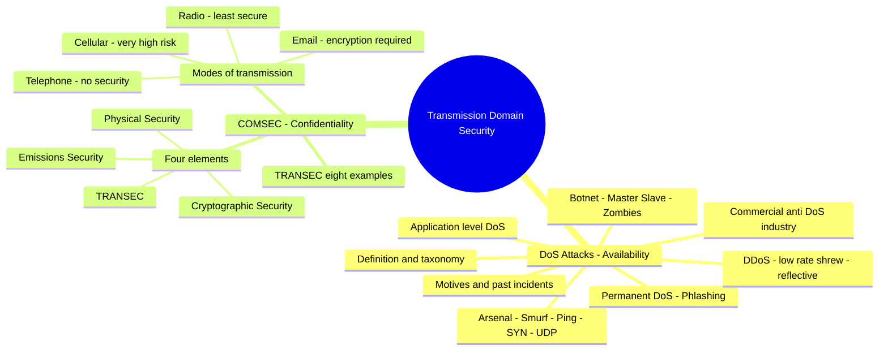
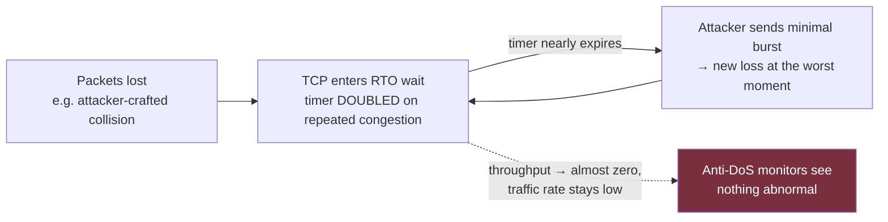
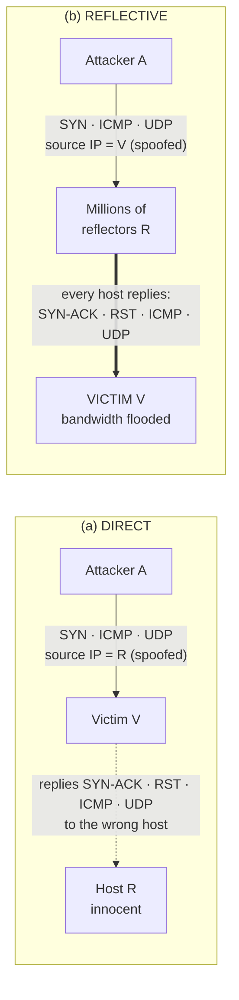
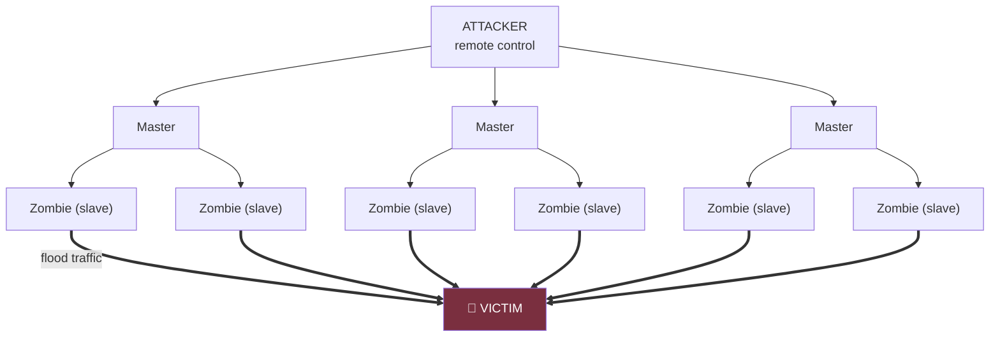
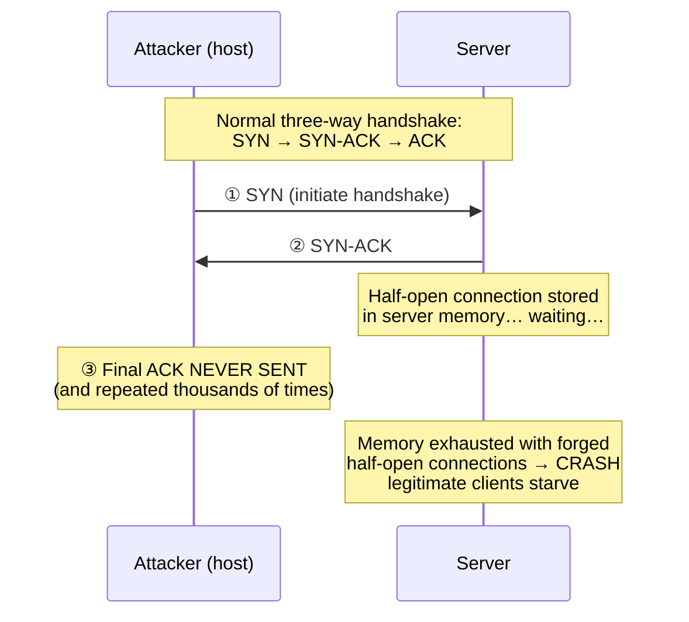
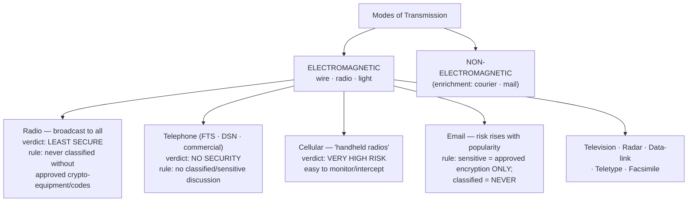

# Denial of Service Attacks & COMSEC (Communications Security) — Comprehensive Cybersecurity Notes

> **Scope note:** Two source documents are combined here: **(1) A SANS Institute Reading Room paper (©2011)** on **Denial of Service** — Chapter 2 *Literature Review* (pp. 4–7 of the paper) and Chapter 3 *Denial of Service in Detail* (pp. 8–9); and **(2) an official *End-End Security COMSEC Overview*** training document (3 pages) covering the **four elements of COMSEC** and **Transmission Security (TRANSEC)**. The pairing is deliberate: DoS attacks the **Availability** pillar of the CIA triad, while COMSEC defends the **Confidentiality/Authenticity** of communications — two halves of securing the transmission domain. Enrichment is marked throughout and cross-linked to earlier notes in this series.

---

## 1. Executive Overview & Core Concepts

### 1.1 What the Documents Cover

| Document | Sections | Core Subject |
| :--- | :--- | :--- |
| **SANS DoS paper** | 2.1–2.6, 3.0–3.1.4 | Security threats; DoS definition & taxonomy; attack mechanisms (DDoS, low-rate TCP "shrew", reflective); commercial anti-DoS industry; attacker motivations; historical incidents (Yahoo 2000, FARC 2008); botnet architecture; the four classic flood/crash attacks |
| **COMSEC Overview** | Intro, 2.1, TRANSEC section | Why communications security training persists; the **four COMSEC elements**; TRANSEC definition + **8 examples**; **modes of transmission** with security verdicts (radio, telephone, cellular, email) |

### 1.2 Fundamental Definitions

| Term | Definition (per sources) |
| :--- | :--- |
| **Denial of Service (DoS)** | *"An attack which makes an information or data unavailable to its intended hosts"* — an attack on **Availability** |
| **Distributed DoS (DDoS)** | *"The cohesive strength of many compromised systems working towards a single cause"* |
| **Botnet** | The attacking network — large numbers of systems attacking a specific victim |
| **Zombies / Slaves** | The thousands of compromised slave systems forming a botnet; owners usually **unaware** of malicious activity |
| **Master** | Intermediate host relaying attacker commands to slaves (Figure 2 architecture) |
| **Application-level DoS** | Attacks disrupting a **specific application** (crash a web browser, email application, media player), hindering normal functioning |
| **Permanent DoS (PDoS) / "Phlashing"** | Worst case — attacks causing **permanent damage**, mostly **firmware-based**, aiming to **completely destroy hardware** |
| **Firmware** | *"The inbuilt code or program embedded on every electronic system for its proper functioning"* |
| **Shrew attacks** | Low-rate DoS attacks that exploit **TCP timers (RTO)** instead of flooding |
| **RTO (Retransmission Time Out)** | TCP's wait timer after packet loss; **doubled** under heavier congestion |
| **Reflective attack** | Attack employing **intermediate hosts (reflectors)** — *"hard to trace back"* |
| **Smurf attack** | Classic reflective attack sending **ICMP ping packets** (to broadcast addresses) with a **spoofed victim source** |
| **Script Kiddies** | *"People who carry out attacks without having actual knowledge about it"* — using posted tools and instruction manuals |
| **COMSEC** | *"The protection afforded classified and sensitive information or operations"* via four applied elements |
| **TRANSEC** | *"All measures (**except physical protection**) designed to protect transmissions from interception and exploitation by means other than crypto analysis"* |
| **Emissions Security** | Limiting/stopping **unintentional emanations** from leaving a controlled space |
| **Modes of transmission** | The means of passing information — **electromagnetic or non-electromagnetic** |

### 1.3 Module-Level Synthesis

> **🔑 Key Takeaway:** The two documents bracket the transmission domain from opposite ends. The DoS paper shows how an adversary **destroys availability** of a service (bandwidth flooding, memory exhaustion, timer exploitation, firmware destruction). The COMSEC document shows how a defender **protects confidentiality and authenticity of everything transmitted** (crypto, transmission discipline, physical and emanations control). A complete transmission-security posture needs **both**: a service that is *available* (DoS-defended) **and** *private/authentic* (COMSEC-protected).



---

## 2. Page-by-Page Detailed Breakdown

## PART A — Denial of Service (SANS Paper)

### Page 1 (paper p. 4): §2.1 Threats & Impacts; §2.2 What Is DoS?

**§2.1 Security threats and impacts**
*   Many threats challenge IT-economy progress: **Man-in-the-Middle, Session Hijacking, Cross-Site Scripting, Spamming** — but **"Denial of Service is considered to be the most deadly weapon."**
*   **2009:** several series of **DDoS attacks against US information systems and South Korean IT databases**; attacks **originated from Canada, Japan, Australia and China** — the multi-country origin made the attack powerful. Other attacks brought down government websites, including the **Federal Trade Commission** and **Department of Transport** [1]. *(Enrichment: these are the July 4, 2009 botnet attacks; the 2008 Georgian websites mentioned later correspond to the Russo-Georgian war cyberattacks.)*

**§2.2 What is a Denial of Service?**
*   DoS = attack making **information/data unavailable to its intended hosts**. Underlying aspect: **choke the victim's network** → inaccessible to other clients.
*   Beyond "dumping abundant IP packets," the victim can be attacked **at various loopholes** making it unstable, depending on attack nature. Attack types crafted for [1]:
    *   **Congesting network resources**
    *   **Draining CPU memory**
    *   **Reducing computing power**
    *   **Exploiting timers**
    *   **Poisoning domain name translations** (DNS), etc.
*   **Application-level DoS:** attacks designed to **crash a web browser, email application, or even a media player** — when a specific application is disrupted and normal functioning hindered.
*   **Permanent DoS ("Phlashing") [27]:** worst case — **permanent damage**, mostly **firmware-based**, aiming at **complete hardware destruction**. If an attacker changes firmware and replaces it with a **defective or corrupt one, the hardware could no longer be used**. Targets: **routers, switches, bridges** → *"bringing an entire routing table to collapse."* A single-router fault can cause a **huge outage** without backups/rerouting. *"Devices that try to upgrade their firmware **online without checking the signature of a trusted source** fall prey to this attack."*

> **💡 Enrichment:** "Phlashing" (coined ~2008) is a play on *phishing*; real-world analogues include destructive IoT malware (e.g., **BrickerBot**, 2017, which permanently bricked insecure IoT devices) and router firmware implants. The signature-check rule maps directly to the earlier **firmware signing / OTA integrity** control from the IoT security notes.

### Page 2 (paper p. 5): §2.3 Attack Mechanisms — DDoS, Low-Rate TCP, Reflective

**§2.3.1 Distributed Denial of Service — the four-stage botnet build:**
1.  **Scan:** attacker group *"scans networks to hunt for vulnerable systems that are weak in security features"* — *"millions of host machines are vulnerable without secure patches and proper updates."*
2.  **Exploit:** bring hosts under control via **buffer overflow, dangling pointers, code injection** [25]; **root kits** are installed to incur these software exploitations.
3.  **Backdoor:** create backdoors allowing **special access for future entry**.
4.  **Harden & retain:** attackers **update the hosts and tighten their security so another attacker cannot use the same host** — future entry via the specially crafted back entry.

> **🔑 Key Takeaway:** A botnet operator is also a **defender of their own botnet** — patching zombies against rivals. This mirrors the *Trusted Insider at the hub* logic from threat-actor analysis: control, not just compromise, is the asset.

**§2.3.2 Low-rate TCP targeted DoS ("Shrew attacks")**
*   *"Unlike DDoS, low-rate TCP targeted attacks do **not** employ numerous packets to flood the network. Instead, they **exploit the working mechanism of TCP timers**, bringing the throughput of a system to **almost zero**."*
*   Attack packets are generated **only periodically, in very minimal quantity** → they *"easily disguise with the legitimate packets and escape from the Anti-DoS traffic monitoring systems."*
*   **TCP mechanics (per doc):** during congestion, the **congestion window is gradually reduced** until the network clears → sender's rate reduced → potential throughput drops. TCP waits for the **Retransmission Time Out (RTO)** to expire, then resends data. **When congestion is more, the RTO timer is doubled** before retransmission.
*   **The attack:** when packets are lost, TCP enters RTO. The attacker **calculates the RTO time and sends attacking packets to create packet collision and loss** exactly then — pushing TCP into a waiting state, *"pushing it again into the RTO waiting time."* No flooding needed; the attack *"effortlessly escapes traffic monitors due to its low traffic rate"* — *"a serious challenge for security experts"* [24].



> **💡 Enrichment:** This is the **synchronization/subfluous "shrew" attack** (Kuzmanovic & Knightly, 2003) — pulses matched to TCP's RTO (≈200 ms–1 s floor) collapse flows sharing the bottleneck. Known mitigations: raising/robustifying min-RTO, randomizing drop timers, and router-level packet scheduling — confirming the doc's "serious challenge" verdict.

**§2.3.3 Reflective DoS**
*   Employs **intermediate hosts** for the attack; *"reflectors are **hard to trace back** and thus a powerful weapon in the attacker's community."*

### Page 3 (paper p. 6): Direct vs Reflective (Figure 1), Commercial Importance, Attacker Motives

**Figure 1 — the two geometries [26]:**

| | **(a) Direct attack** | **(b) Reflective attack** |
| :--- | :--- | :--- |
| Attacker sends | TCP SYN, ICMP, UDP… **directly toward victim**, **source IP spoofed as host R** | TCP SYN, ICMP, UDP… **to millions of reflectors**, **source IP spoofed as the victim V** |
| Replies go to | **R** (victim corresponds with R believing it is the source) | **V** — *"all the reflectors reply, flooding the victim's bandwidth"* |
| Mitigation | **Easier** — *"just the attacker's network needs to be blocked"*; proper **trace-back mechanisms** can identify and stop the attacker's network | **Harder** — *"reflectors are spread across various networks"* |

*   **Smurf = the classic reflective attack:** *"sends ICMP ping packets towards the victim… almost similar to the ICMP ping of death — **the only difference is that Smurf uses reflectors in its operation**."*



> **💡 Enrichment:** Smurf works because **ICMP echo requests to an IP broadcast (directed broadcast) make every host on the segment reply** — amplifying one request into hundreds of replies. Definitive fixes: **disable IP directed broadcasts (RFC 2644)** on routers/hosts and deploy **ingress/egress filtering (BCP 38 / RFC 2827)** to kill source-IP spoofing at the edge. Modern reflective/amplified cousins: **DNS, NTP, and memcached amplification** (the 2018 memcached attack peaked ~1.7 Tbps), replacing broadcast ping as the amplifier of choice.

**§2.4 Commercial importance**
*   An **unresolved issue for nearly a decade** — researchers and experts *"trying hard to find an end to it."* **Government agencies recruit specialists** to protect national databases; **companies and e-commerce giants maintain special mitigation teams**; smaller agencies sell **anti-DoS business on yearly contracts**.
*   Vendors such as **VeriSign and Arbor Networks** [28][29] help companies host information securely — promising **99% uptime** with **immediate anomaly alerts to the network administrator**; protection from **DNS, HTTP and other web-based attacks that lead to DDoS**; some offer **backup services for critical data** so an **alternate server can be used when the original is compromised**.

> **💡 Enrichment:** this 2011 landscape is today's **scrubbing-centre/CDN market** (Cloudflare, Akamai Prolexic, Netscout/Arbor) — anycast absorption, BGP blackholing, and rate-limited scrubbing deliver the same "uptime promise," with record mitigations now exceeding **3 Tbps**.

**§2.5 What does the attacker want?** (begins)
*   Motives so far: **business isolation** — bring down a webpage/website so the company *"might lose all its online transactions and thus end up failing"*; **rivalry in business** as one main factor; **protestors showing dislike** by targeting government websites.

### Page 4 (paper p. 7): Attacker Motives (cont.) & Past Occurrences

**Motives (continued):**
*   **Political/geographic protest:** attacks against the **Georgian national, finance, and president's websites** [21]; similar attacks on **Iranian websites as part of election protest** [22]. *"Rioters chose these attacks against government and public websites as there are **minimal chances of being caught**."*
*   **Simplicity as an enabler:** *"Any beginner could perform this attack effortlessly without having much technical expertise."* Attackers **post tools and scripts online**; *"websites and forums give out tools along with instruction manuals."* People attacking **without actual knowledge** = **"Script Kiddies."**
*   **Content objections:** groups disliking published content attack it — **WikiLeaks** case study: a non-profit publishing news from **anonymous sources and whistle blowers** (a *whistle blower* = a person exposing illegal/unethical activities in an organization, often governmental). WikiLeaks *"had oppositions all over the country"* — the **Australian government blacklisted** it and stopped access; **Iceland, Germany, China, Thailand, USA** and many others also banned it. **Mass DDoS attacks were carried out against WikiLeaks and organizations that supported it** [23]. *(Enrichment: these are the 2010 "Operation Avenge Assange" attacks by Anonymous, including against MasterCard/PayPal for cutting WikiLeaks' funding.)*
*   **Money and ego:** *"web criminals who conduct attacks for money"*; attackers who perform *"just to show that they are capable and boast about it in their hacker's community."*

**§2.6 A study of past DoS occurrences**
*   *"There is still no effective control for this attack"* after ten years of occurrences.
*   **February 7, 2000 — Yahoo servers crashed:** the famous Internet site unavailable **several hours**, considerably affecting Yahoo's business. **Buy.com, eBay and CNN** attacked *"the very next day after Yahoo."* eBay — *"an online bank that undertakes millions of transactions online"* — was completely inaccessible, incurring huge loss. Downtime: **three hours for Yahoo**; other websites down for several more hours. **ZDnet, Etrade, Excite** bombarded with **more than 1 gigabit per second of data**, isolating servers from legitimate requests [2]. *(Enrichment: these were the "Mafiaboy" attacks — Canadian teenager Michael Calce, later convicted — launched via university-network zombies.)*
*   **July 2, 2008 — FARC case (DoS + MITM as a strategic weapon):** the **Revolutionary Armed Forces of Colombia (FARC)** was attacked using **Denial of Service and Man-in-the-Middle (MITM) attacks**. Attackers: the **Colombian National Forces (CNF)** — a series of DoS + MITM attacks **to bring out hostages**. FARC had to release **fifteen most crucial hostages, including Betancourt Ingrid** (famous social leader), **3 American citizens and 11 other members** — *"one of the most talked-about incidents in the history of the security industry that freed several hostages **without a single arm or ammunition being involved**"* [41].

> **🔑 Key Takeaway:** DoS is not only vandalism or extortion — the FARC incident shows **cyber operations substituting for kinetic force** (degrading guerrilla communications + spoofing MITM to manipulate coordination), foreshadowing the state-actor pre-positioning cases (Mumbai grid, Kudankulam) covered earlier in this series.

### Page 5 (paper p. 8): Chapter 3 — Botnets, Classification, and Attack Methods

*   **Botnet anatomy:** *"DoS is generally carried out with a large number of systems attacking a specific victim. Such an attacking network is called the **Botnet**… formed by thousands of slave systems usually termed as the **Zombies**."* Controlled/manipulated by a **remote attacker**; *"most of the time, the **real owner of a compromised machine is not aware** of the malicious activities."*
*   **Figure 2 — Master–Slave architecture in a Botnet:** **Attacker → Masters → Slaves (Zombies) → Victim**.



*   **Broad classification — two types [16]:** (1) **attack the user** — make him/her unable to use the service; (2) **attack the server itself** — *"the latter is **more dangerous** as it could affect **millions of legitimate clients** that could starve without getting served."*

**§3.1 Types of attacks — two methods (per Erikson Jon [1]; enrichment: this is *Jon Erickson*, author of *Hacking: The Art of Exploitation*):**
1.  **Flooding** — *"flood the network not leaving enough bandwidth for the legitimate packets to get through."*
2.  **Crashing** — *"crash a hardware or software item and make it inoperable"* — **web servers, routing devices, DNS look-up servers** are the common targets.

*   The project investigates both scenarios; the **DDoS paper by Lee Garber** [2] frames the four basic attacking methods that follow.

### Page 6 (paper p. 9): §3.1.1–3.1.4 The Four Classic Attacks

**§3.1.1 Smurf attack**
*   Works on *"the mechanism of **flooding the victim's bandwidth**."* The attacker sends **a large number of ICMP echo requests to a broadcast address**; **all ICMP messages have a spoofed source address = the victim's IP**. Eventually *"all the reply messages target and flood the victim's address."*

**§3.1.2 Ping Flood and Ping of Death**
*   **Ping flood:** similar to Smurf — *"the victim is bombarded with thousands of ping packets."*
*   **Ping of Death:** *"the victim is sent **corrupt packets that could crash the system**"* [3] — a **crash-class** (not flood-class) attack.
*   Both are *"very easy to craft and any novice attacker could do it with ease."* Demo command [17]:

```
Attacker# ./sing -echo -s 1024 -S ddos-1.example.com 192.168.81.255
Singing to 192.168.81.255 (192.168.81.255): 16 data bytes
```

*(Enrichment: `sing` sends crafted ICMP; `-S ddos-1.example.com` spoofs the source, `-s 1024` sets payload size, and the target `192.168.81.255` is a **broadcast address** — exactly the Smurf recipe. "Ping of Death" classically = an **oversized ICMP packet (>65,535 bytes)** that overflows legacy reassembly buffers.)*
*   *"There are enough effective defense mechanisms against Smurf and Ping attacks on the Internet lately. However, these attacks could cause **considerable damage in small Local Area Networks**."*

**§3.1.3 TCP SYN flood**
*   Whereas the above methods **consume bandwidth**, this attack *"aims at **exploiting server CPU memory**."*
*   **Handshake (per doc):** host sends a **SYN** to initiate; server replies with an **Acknowledgement** packet; host must send the final **SYN ACK** to establish the connection. *(Enrichment — precise TCP form: **SYN → SYN-ACK → ACK**; the doc's naming is slightly shuffled but the logic — a final host packet completing the handshake — is correct.)*
*   **The attack:** attackers **leave the handshake half open by not sending the last packet**. The **half-open state is stored in the server's memory** and the server **keeps waiting** for the final packet. *"When **thousands of such half-open connections** are initiated, the server **runs out of memory and crashes**. It will not be able to serve the legitimate clients as its memory is dumped with forged fake packets"* [5].



> **💡 Enrichment:** canonical defense = **SYN cookies** (stateless handshake; RFC 4987), plus firewall TCP interception/syn-proxy and backlog tuning — the stateful-firewall concepts from the *Security Mechanisms* notes in action.

**§3.1.4 UDP flood**
*   Similar to ping flood, but **UDP packets are bombarded** instead of ping packets. *"UDP could be a lot more effective than ICMP in smaller networks as the size of the UDP packets is **enormous**. The packet size could be set up to **65,000 bytes**, which could easily flood a given Ethernet network when **multiple zombies** are set up."*

---

## PART B — COMSEC Overview (End-End Security Document)

### Page 1: Why COMSEC? & The Four Elements

**The opening problem:** *"Despite all the security training, security warning posters, and other reminders, classified and sensitive information is still being disclosed to unauthorized personnel. Foreign intelligence-gathering activities continue despite our precautions."* → therefore we must **regularly educate all personnel** about security, *"especially in the areas of **communications security (COMSEC)**"* — *"the success of our security program **requires effort from us all**."*

**Scope:** COMSEC here is *"mainly concerned with the means of communication in which transmitting and receiving information requires **wire or radiant energy**."* **National Security is dependent on the security of the systems providing these electronic transfers.** The ideal: *"only the intended or authorized parties receive these transmissions in a usable format, and any unintended or unauthorized receipt of the transmissions is **unusable** by the recipient."* *(Enrichment: "unusable" is the crypto design goal — intercepted ciphertext without keys yields nothing.)*

**§2.1 Elements of COMSEC** — *"COMSEC is the protection afforded classified and sensitive information or operations that is achieved by applying the following four elements:"*

| # | Element | Definition (verbatim) |
| :--- | :--- | :--- |
| 1 | **Transmission Security (TRANSEC)** | The protection of information **when it is passed between parties** |
| 2 | **Cryptographic Security** | The **proper design, implementation, use and protection of Cryptographic (Encryption/Decryption) systems** used for the protection of information |
| 3 | **Physical Security** | The means by which **unauthorized parties are denied access** to information and materials |
| 4 | **Emissions Security** | The means by which **unintentional emanations are limited or stopped** from leaving the security of a controlled space |

*   **Purpose:** these four elements *"deny unauthorized persons/parties information of value, support operational access to systems, and/or **ensure the authenticity** of such telecommunications."*
*   **Why COMSEC:** *"COMSEC prevents unauthorized persons from obtaining information of intelligence value and/or gaining access to sensitive operations resulting from the **interception and analysis of our communications**."* (The document itself jokes: *would "knowledge of" be better?*)

> **💡 Enrichment:** the four elements map to CIA+A — Cryptographic Security → **Confidentiality**; TRANSEC → protection against **traffic analysis/interception**; Physical Security → **access control**; Emissions Security → the **TEMPEST** discipline (shielding, filtering, zoning of RF/EMANATE leaks); "ensure authenticity" → **Authentication**. This mirrors the *Security Mechanisms* AAA framework at national-security grade.

### Page 2: TRANSEC, Its Eight Examples, and Modes of Transmission

**TRANSEC definition:** *"that part of communications security that includes **all measures (except physical protection)** designed to protect transmissions from **interception and exploitation by means other than crypto analysis**."* *"Everyone must use transmission security, because **everyone uses at least the telephone** in the performance of their duties."*

**The eight examples of transmission security:**

1.  **Changing radio frequencies and call signs.**
2.  **Using message format** for classified record communications.
3.  **Using classification guides** to determine whether or not certain information should be sent over unsecure systems.
4.  **Using cryptographically secured telephones**, voice circuits, and air/ground communications systems.
5.  **Canceling or altering communications patterns** to prevent detection of a change from normal traffic flow and volume.
6.  **Using authentication** to ensure validity of receipt of traffic and to counter telecommunications systems intruders.
7.  **Using authorized codes** when unsecure telephone or radiotelephone communications are used.
8.  **Imposing radio or telephone silence.**

> **💡 Enrichment:** items 1, 5, 8 counter **traffic analysis** (who talks to whom, when, how much) — the adversary learns from *patterns* even when content is encrypted. Item 6 maps to the AAA **Accountability/Detection** layer; item 7 is the analog of sending **authorized code words over open channels**.

**Modes of transmission:** *"For official information to be useful, it is normally passed from one person to another. The various means of passing information are called **modes of transmission**… These modes may be **electromagnetic or non-electromagnetic**."* *(Enrichment: the document details only the electromagnetic branch — non-electromagnetic modes would be courier, physical mail, hand delivery.)*

**Electromagnetic transmission:** *"Signs, signals, writing, images, and sounds or information of any type when sent or received by **wire, radio, light, or other electromagnetic systems** are electromagnetic telecommunications."* Modes: **radio, telephone, television, radar, data-link, teletype, and facsimile**.

**Radio communications:** normally thought of as **air-to-air, air-to-ground, or ground-to-ground** — e.g., *"pilots talking to each other or to the control tower, and security police talking on their hand-held radios."*

### Page 3: Security Verdicts — Radio, Telephones, Cellular, Email

**Radio — the least secure:**
*   These forms make up *"only a small percentage of total radio communications"* — *"virtually all electromagnetic telecommunication systems transmit by **radio signals**."* Microwave radio signals **travel well beyond the equipment** (*"easily as you tune in your favorite radio station at home"*).
*   Radio is *"one of the **fastest** modes of communication — available to virtually everyone within an instant. However, because it is **impossible to control the number of listeners, radio is also the LEAST SECURE**."*
*   **Rule:** *"Classified information or information of possible intelligence value must **never be sent by radio** unless **approved secure crypto-equipment or codes** are used."*

**Telephones — no security:**
*   *"One of the fastest, most convenient, and most widely used communication modes."* All government sites/installations and contractor facilities connect to telephone networks; **government (FTS), military (DSN)**, and commercial long-distance networks connect *"virtually any telephone number, governmental, military or civilian, within the United States and overseas."* *(Enrichment: FTS = Federal Telecommunications System; DSN = Defense Switched Network.)*
*   *"These systems have one drawback — **they are not secure**. While the telephone is one of the fastest and most convenient modes of transmission, it offers **no security**."*
*   **Rule:** *"Classified, sensitive, and information of possible intelligence value **must not be discussed over these unprotected systems**. Approved **secure encryption systems** must be used for such communications."* Summary: *"**Never discuss classified or sensitive information on any unsecure electromagnetic transmission device.**"*

**Cellular telephones — very high risk:**
*   *"The use of cellular telephones has been on the rise over the last ten years… We now use our cell phones at home, in the car, at the mall, at work — virtually everywhere, making cell phones a **very high risk to security**."*
*   *"Because cell phones are more like **handheld radios**, their transmissions are **easier to monitor or intercept**."* Convenience *"can have a **devastating effect on security** if they are not used in a safe and security-minded manner."*

**Email — encryption mandatory for anything sensitive:**
*   *"Next to the use of telephones and cellular telephones, email has become one of the most convenient and widely used forms of communication… As email becomes more and more popular, **its risk to security also rises**."*
*   **Rule:** *"Unless an approved form of **encryption** is applied, email should not be used to transmit **sensitive** information, and email can **never** be used to transmit **classified** information."*

> **🔑 Cross-module bridge:** this rule is satisfied precisely by the **S/MIME and PGP/GPG** asymmetric-crypto systems covered in the encryption notes — *"public key cryptography so only the intended recipient can read private correspondence"* — which is the modern, commercial answer to the document's mandate.



---

## 3. Comparative Summary & Matrix

### 3.1 DoS Attack Arsenal — Master Table (SANS paper §3.1 + §2.3)

| Attack | Class (Flood/Crash) | Resource attacked | Mechanism | Difficulty | Context/Defense note (per doc + enrichment) |
| :--- | :--- | :--- | :--- | :--- | :--- |
| **Smurf** | Flood | Victim **bandwidth** | ICMP echo requests → **broadcast address**, source spoofed as victim; all replies hit victim | Easy (novice) | Reflective; fixed by disabling directed broadcast + anti-spoofing (enrichment: RFC 2644, BCP 38) |
| **Ping Flood** | Flood | Bandwidth | Thousands of ping packets bombarded | Easy (novice) | Damaging esp. in **small LANs** |
| **Ping of Death** | **Crash** | System stability | **Corrupt packets that crash the system** | Easy (novice) | Crash-class sibling of the flood family (enrichment: oversized ICMP >65,535 B) |
| **TCP SYN flood** | Flood of **state** | **Server CPU memory** | Half-open handshakes — SYN sent, final packet withheld; half-open states exhaust memory → crash | Moderate | Defense: SYN cookies, syn-proxy firewalls (enrichment) |
| **UDP flood** | Flood | Bandwidth (small networks) | UDP packets up to **65,000 bytes**, multiple zombies | Easy | More effective than ICMP on LANs |
| **Low-rate TCP / Shrew** | Timer exploitation | **Throughput** (→ ~zero) | Calculate RTO; pulse packets at timer expiry → endless RTO waits | **Serious challenge for experts** | Escapes Anti-DoS monitors by low rate |
| **DDoS** | Flood (distributed) | Everything at scale | Botnet: scan → exploit (buffer overflow, dangling pointers, code injection) → rootkits → backdoors → harden zombies | Tool-assisted | Multi-country origins amplify (2009 case) |
| **Reflective DoS** | Flood via reflectors | Victim bandwidth | Source spoofed as victim toward millions of reflectors; replies converge on victim | Easy, **hard to trace** | Reflector spread across networks hinders mitigation |
| **Application-level DoS** | Crash/hang | Specific app | Crash a web browser, email app, media player | Easy | Disrupts normal functioning of one service |
| **PDoS / Phlashing** | **Permanent destruction** | **Hardware/firmware** | Replace firmware with defective/corrupt image (unsigned online upgrades) | Targeted | Routers/switches/bridges → routing-table collapse |

### 3.2 Direct vs Reflective (Figure 1)

| Aspect | Direct | Reflective |
| :--- | :--- | :--- |
| Packets aimed at | Victim directly | Millions of intermediate reflectors |
| Spoofed source | Another host **R** (victim replies to R) | The **victim V** (reflectors reply to V) |
| Traceability | Easier — trace-back can identify the attacker's network | **Hard to trace back** — reflectors spread across networks |
| Mitigation | Block the attacker's network | Very hard; needs reflector-side hygiene |
| Example | (generic spoofed direct flood) | **Smurf attack** (only difference from Ping of Death: uses reflectors) |

### 3.3 Botnet Roles & Build Stages

| Stage/Role | Function |
| :--- | :--- |
| 1. Scan | Hunt vulnerable, unpatched hosts (millions exist) |
| 2. Exploit | **Buffer overflow, dangling pointers, code injection**; **rootkits** installed |
| 3. Backdoor | Special access for future entry |
| 4. Harden | Update + tighten zombie security so **rivals cannot steal the host** |
| Attacker | Remote controller of the entire botnet |
| Masters | Intermediate relays (Figure 2) |
| Zombies/Slaves | Thousands of compromised hosts; **owners unaware** |

### 3.4 The Four COMSEC Elements

| Element | Protects against | Maps to |
| :--- | :--- | :--- |
| **TRANSEC** | Interception & exploitation **other than cryptoanalysis** (traffic analysis, direction finding) | Confidentiality of *metadata/patterns* |
| **Cryptographic Security** | Content disclosure — design/implementation/use of encryption systems | Confidentiality (+ integrity) |
| **Physical Security** | Unauthorized access to information & materials | Access control |
| **Emissions Security** | **Unintentional emanations** leaving a controlled space | Side-channel confidentiality (enrichment: TEMPEST) |

### 3.5 Transmission Modes — Security Verdict Matrix (COMSEC doc)

| Mode | Speed/Convenience | Security verdict (per doc) | Standing rule |
| :--- | :--- | :--- | :--- |
| **Radio** | Fastest — *"available to virtually everyone within an instant"* | **Least secure** — impossible to control the number of listeners | Classified/intelligence-value info **never** by radio without approved crypto-equipment or codes |
| **Telephone** (FTS/DSN/commercial) | Fastest, most convenient, most widely used | **No security** | Classified/sensitive **must not** be discussed over unprotected systems; approved encryption required |
| **Cellular** | Used everywhere — home, car, mall, work | **Very high risk** — *"more like handheld radios"*; easy to monitor/intercept | Use in a safe, security-minded manner or risk devastation |
| **Email** | Most convenient after phones | **Risk rises with popularity** | Sensitive → **only with approved encryption**; classified → **never** |
| TV, radar, data-link, teletype, fax | Listed modes of EM transmission | (listed, not individually assessed) | Fall under the general EM rule |

### 3.6 Cross-Document Synthesis

| Bridge | DoS paper | COMSEC doc |
| :--- | :--- | :--- |
| CIA pillar under attack/defense | **Availability** (DoS denies service) | **Confidentiality + Authenticity** (COMSEC denies interception) |
| The transmission channel | The *target* — choke bandwidth, exhaust memory, corrupt timers, brick firmware | The *asset* — discipline every EM mode |
| Human factor | Script kiddies, unpatched owners (unaware zombies) | *"Success of our security program requires effort from us all"* — training despite fatigue |
| Signature/firmware | Phlashing exploits **unsigned online firmware upgrades** | Cryptographic Security = *"proper design, implementation, use and **protection**"* of crypto systems |
| Radio | (implicit: DDoS from many networks) | *"Least secure"* mode; radio silence as TRANSEC |
| Email | (application-level DoS can crash email apps) | Email may **never** carry classified data without approved encryption |

---

## 4. Key Terminology & Cheat Sheet

### 4.1 Glossary

| Term | Definition |
| :--- | :--- |
| **Backdoor (botnet)** | Special access installed for future re-entry; used instead of re-exploiting |
| **Broadcast address** | Network address (e.g., 192.168.81.255) delivered to all hosts — the Smurf amplifier |
| **Code injection / Dangling pointer / Buffer overflow** | Software exploitation classes used to seize hosts (enrichment: memory-corruption family) |
| **COMSEC** | Protection of classified/sensitive info in communications via 4 elements |
| **Congestion window** | TCP's sending window, gradually reduced during congestion |
| **Cryptographic Security** | Proper design/implementation/use/protection of encryption systems |
| **DNS poisoning** | Corrupting domain-name translations (a listed DoS vector) |
| **DSN / FTS** | Defense Switched Network / Federal Telecommunications System |
| **Emissions Security** | Limiting/stopping unintentional emanations (enrichment: TEMPEST) |
| **Half-open connection** | Handshake state (after SYN-ACK) awaiting final ACK — the SYN-flood currency |
| **ICMP echo request** | "Ping" packet — Smurf's raw material, sent to broadcast with spoofed source |
| **IP spoofing** | Forging the source IP address (direct: hide self; reflective: frame victim) |
| **Master / Slave (Zombie)** | Botnet relay tier / compromised foot-soldier host |
| **Phlashing (PDoS)** | Firmware-based permanent hardware destruction |
| **Radio silence** | TRANSEC example #8 — emit nothing, reveal nothing |
| **Reflectors** | Intermediate hosts tricked into replying to the victim |
| **Rootkit** | Stealth software installed to incur/host software exploitations on zombies |
| **RTO** | TCP Retransmission Time Out; **doubled** under heavier congestion; the shrew attack's clock |
| **Script Kiddies** | Attackers without actual knowledge, using posted tools/manuals |
| **Shrew attack** | Low-rate periodic packets timed to TCP's RTO → throughput ~zero |
| **Smurf attack** | Reflective ICMP-to-broadcast flood; = Ping of Death + reflectors |
| **SYN flood** | Thousands of half-open connections exhaust server memory |
| **Traffic-flow alteration** | TRANSEC example #5 — cancel/alter patterns so changes from normal volume go undetected |
| **TRANSEC** | Transmission protection measures **except physical protection**, against non-cryptoanalysis exploitation |
| **Whistle blower** | Person exposing illegal/unethical activities in an organization (WikiLeaks context) |

### 4.2 Numbers Cheat Sheet

| Item | Value |
| :--- | :--- |
| COMSEC elements | **4** (TRANSEC, Cryptographic, Physical, Emissions Security) |
| TRANSEC examples listed | **8** |
| Electromagnetic modes named | **7** (radio, telephone, TV, radar, data-link, teletype, facsimile) |
| EM transmission media | **3** (wire, radio, light) |
| Radio communication geometries | **3** (air-to-air, air-to-ground, ground-to-ground) |
| Security verdicts | Radio = **least secure**; telephone = **no security**; cellular = **very high risk**; email = **never classified** unencrypted |
| Botnet build stages | **4** (scan → exploit → backdoor → harden) |
| Botnet exploitation classes | **3** named (buffer overflow, dangling pointers, code injection) |
| DoS target list | **5** (network congestion, CPU memory drain, computing power, timers, DNS poisoning) |
| Attack methods (Erikson Jon) | **2** (flooding; crashing) |
| Broad attack classification | **2** types (attack the user; attack the server — the latter **more dangerous**) |
| UDP packet size | up to **65,000 bytes** |
| RTO behaviour | **doubled** when congestion is more |
| Shrew traffic profile | Periodic, **minimal quantity** — escapes monitors |
| 2009 DDoS targets | **US systems + South Korean IT databases**; origins: **Canada, Japan, Australia, China** |
| Feb 7, 2000 | **Yahoo crash** — **3 hours** downtime; next-day: **Buy.com, eBay, CNN**; **ZDnet, Etrade, Excite** hit with **>1 Gbps** |
| July 2, 2008 | **FARC attacked (DoS + MITM)** by **CNF** → **15 hostages** freed (Betancourt Ingrid, 3 Americans, 11 others) — *"without a single arm or ammunition"* |
| Anti-DoS vendor promise | **99% uptime** + immediate anomaly alerts (VeriSign, Arbor Networks) |
| sing demo command | `./sing -echo -s 1024 -S ddos-1.example.com 192.168.81.255` (16 data bytes) |
| Banned WikiLeaks countries named | Australia (+ blacklist), Iceland, Germany, China, Thailand, USA, others |

### 4.3 One-Line Recall Strings

*   **DoS paper:** *"DoS kills Availability — flood bandwidth (Smurf/Ping/UDP), exhaust state (SYN half-opens), starve timers (shrew = RTO-locked pulses), or brick firmware (Phlashing); build it as a botnet (scan → exploit → backdoor → harden) with masters and unaware zombies, aim it at users or — worse — servers, and remember motives: rivalry, protest, content, money, ego."*
*   **COMSEC doc:** *"Four elements guard the wire — TRANSEC (8 disciplines, from changing call signs to radio silence), Cryptographic Security, Physical Security, Emissions Security; radio is least secure, phones offer none, cells are handheld radios, and email never carries classified data without approved encryption."*

---
