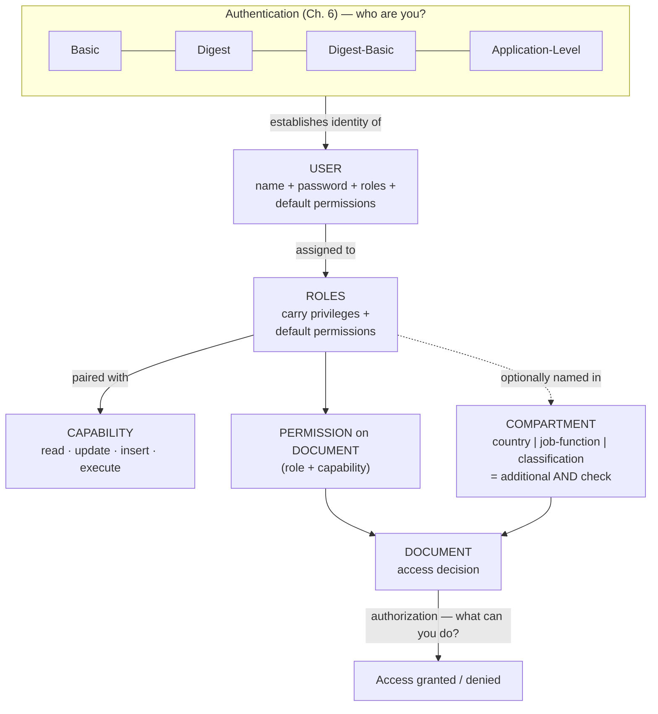
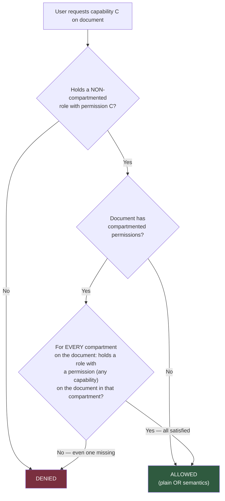
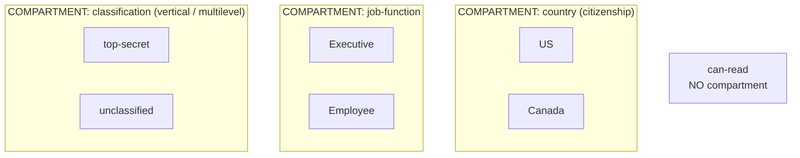
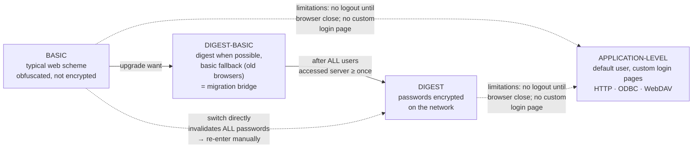

# MarkLogic Security: Compartment Security & User Authentication — Comprehensive Cybersecurity Notes

> **Scope note:** Two unique documents were provided (the *Compartment Security* chapter was attached twice with identical content, so it is combined here once): **(1) MarkLogic 8 — *Understanding and Using Security Guide*, Chapter 4 "Compartment Security"** (pp. 25–28, Feb 2015) and **(2) Chapter 6 "Authenticating Users"** (pp. 32–33). Both are product documentation for **MarkLogic Server** — an enterprise NoSQL document database — showing how a real system implements *multilateral security* (compartmentation) and *authentication*. Enrichment from general security knowledge is marked throughout and cross-linked to earlier notes in this series.

---

## 1. Executive Overview & Core Concepts

### 1.1 What This Module Covers

| Document | Sections | Core Subject |
| :--- | :--- | :--- |
| **Compartment Security** | 4.0 → 4.3.4 | An **extension to the security model** allowing **more complex security rules on documents** — roles grouped into named compartments that add an extra layer of access checks |
| **Authenticating Users** | 6.0 → 6.2.5 | **Users** (the basis of authentication), the **User → Role → Permission** model, and four **authentication schemes** (Basic, Digest, Digest-Basic, Application-Level) |

### 1.2 Fundamental Definitions

| Term | Definition (per sources) |
| :--- | :--- |
| **User** | *"The basis for authenticating requests to a MarkLogic application server"* — configured with a **name, password, set of roles, and set of default permissions** |
| **Role** | Carries **security attributes, such as privileges and default permissions**; *"central to document permissions"*; **users derive authorization from their roles** |
| **Permission** | Assigned to documents; **pairs a role with a capability** (read, update, insert, execute) |
| **Privilege** | A security attribute on roles controlling server-level actions (e.g., ability to execute built-in functions) |
| **Compartment** | ***"A name associated with a role"*** — roles are made part of a compartment by adding the compartment name to each role; the compartment name becomes an **additional check** when determining a user's authority to access or create documents |
| **Capability** | The operation granted by a permission: **read, update, insert, execute** |
| **Basic authentication** | Typical web-app scheme; user prompted for username/password; password **obfuscated but not encrypted** |
| **Digest authentication** | Same prompt flow as Basic, but **encrypts passwords sent over the network** |
| **Digest-Basic** | Uses **digest whenever possible, reverts to basic when needed** (e.g., older browsers); a migration bridge |
| **Application-Level authentication** | **Bypasses all authentication** — all users automatically logged in as a specified **default user** |
| **`admin` / `nobody`** | The two users created at initial installation: an **administrator with the `admin` role**, and **`nobody`** — *"created with no roles assigned and given a password which is randomly generated"* |

### 1.3 Core Principles & Cross-Module Synthesis

> **🔑 Key Takeaway (the big picture):** MarkLogic's model is a working implementation of concepts covered earlier in this course:
> *   **User → Role → Permission** = classic **Role-Based Access Control (RBAC)** *(enrichment: NIST RBAC model)* — authorization derives from roles, never assigned directly to users.
> *   **Compartment security** = the **"Compartmentation and Lattice Model"** from the *Multi-Lateral Security* notes (Anderson, 2001: *"code words as well as classifications... famous among the intelligence community"*) — implemented at the document-database layer.
> *   The worked example (§4.3) is *literally* the **multilateral security geometry**: a **vertical classification dimension** (top-secret/unclassified = multilevel, controls "downward" flow) combined with **horizontal dimensions** (country, job-function = multilateral, controls "across" leakage) — over shared data.
> *   **`nobody`** with no roles = the **principle of least privilege** as a default account. *(Enrichment: named after the Unix `nobody` unprivileged account.)*
> *   **Compartments as an additional AND-gate** = **defence in depth** applied to authorization: even possessing the right role is not enough; the compartment check must also pass.



---

## 2. Page-by-Page Detailed Breakdown

## PART A — Compartment Security (Document 1: §4.0–4.3.4)

### 4.0 Compartment Security — Overview (Page 25)

*   MarkLogic Server includes an extension to the security model called **compartment security**, which *"allows you to specify more complex security rules on documents."*
*   **Licensing gate:** to enable compartment security, **a license key that includes compartment security is required** — contact your MarkLogic sales representative. *(Enrichment: indicates an enterprise-tier feature; the security logic itself is layered on the standard permission model.)*
*   Chapter roadmap: **Understanding** (4.1) → **Configuring** (4.2) → **Example** (4.3).

### 4.1 Understanding Compartment Security (Page 25)

**The mechanism:**
*   A compartment is a **name associated with a role**; a role joins a compartment by **adding the compartment name to each role in the compartment**.
*   When a role is compartmented, the compartment name is used as an **additional check** when determining a user's authority to **access or create** documents in a database.
*   **Compartments have no effect on execute privileges.** *(Enrichment note: "privileges" here are server-level rights distinct from document permissions — compartments reshape document-access checks, not privilege evaluation.)*
*   **Baseline (no compartments):** *"permissions are checked using **OR** semantics."*

**The OR → AND transformation (core rule):**
*   Without compartments: a document with `read` for `role1` **and** `read` for `role2` is readable by anyone holding **either** role1 **or** role2.
*   If `role1` and `role2` carry **different compartments** (`compartment1`, `compartment2`): permissions are checked using **AND semantics for each compartment, as well as OR semantics for each non-compartmented role**. The user must possess **both role1 and role2**, *as well as a non-compartmented role that has a corresponding permission on the document*.

**Two additional rules:**
1.  **Compartment-wide gate:** *"If **any** permission on a document has a compartment, then the user must have that compartment in order to access **any** of the capabilities — even if the capability is not the one with the compartment."*
2.  **Update-permission requirement (integrity safeguard):** access requires **a permission in each compartment for which there is a permission on the document, regardless of the capability** of that permission. So a `read` permission for a role in `compartment1` demands that **some** role in `compartment1` also holds an `update` permission (not necessarily the same role). Violation → adding `read`, `insert`, or `execute` permissions referencing a compartmented role to a document with no corresponding-compartment `update` permission throws the **`XDMP-MUSTHAVEUPDATE`** exception.



> **💡 Exam Tip:** Read the semantics as two layers: **OR *within* a compartment** (any qualifying role in it), **AND *across* compartments** (every compartment on the document must be satisfied) — plus the **non-compartmented OR layer** on top. The compartment gate is capability-blind: it applies to *every* capability once any compartmented permission exists on the document.

### 4.2 Configuring Compartment Security (Pages 25–26)

*   **Only for new roles:** *"You can only add a compartment for a **new** role."* Path: **Admin Interface > Security > Roles > Create** → enter the compartment name in the **compartment field** while defining each role in the compartment.
*   **No in-place modification:** you **cannot modify an existing role** to use a compartment — you must **delete the role and re-create it** with the compartment.
*   **The role-ID trap:** re-created roles break existing document permissions because *"permissions you have on documents reference the **old role** (because they use the **role ID, not the role name**)."* To carry permissions over, you must **update those documents with new permissions referencing the new role**.

> **⚠️ Warning:** The role-ID-not-name behaviour is an operational footgun — deleting and recreating a role silently *orphans* every permission that referenced it. Audit documents before restructuring compartmented roles.

### 4.3 Example — Compartment Security (Page 26)

*   **Disclaimer:** the scenario *"is not meant to demonstrate the correct way to set up compartment security, as your situation is likely to be unique"* — it demonstrates **how compartment security works** and may give ideas for your own model.
*   **Scenario:** a MarkLogic application for a **government department** where:
    1.  Documents are **classified** with a security classification dictating who may access them;
    2.  Access to some documents is restricted **based on the citizenship of the user**;
    3.  Some documents are only accessible to employees with **certain job functions**.
*   Prerequisites: access to both the **Admin Interface** and **Query Console**. Steps: **Create Roles → Create Users → Create Documents & Add Permissions → Test It Out**.

> **🔑 Cross-module synthesis:** This is the **multilateral security figure (Fig. 8.2) made concrete** — a **shared document store** gated simultaneously by a *vertical* classification axis (multilevel) and two *horizontal* axes (citizenship, job function) that cut across it. Anderson's verdict that compartmentation *"is not so effective for medical records because of the difference in requirements"* is resolved here differently: compartmentation works well for **document-level government data** where dimensions are naturally separable.

### 4.3.1 Create Roles — Three Compartments + One Free Role (Page 26)

Created via **Admin Interface > Security > Roles > Create**:

| # | Roles created | Compartment name | Compartment meaning |
| :--- | :--- | :--- | :--- |
| 1 | **`US`**, **`Canada`** | `country` | Citizenship restriction |
| 2 | **`Executive`**, **`Employee`** | `job-function` | Job-function restriction |
| 3 | **`top-secret`**, **`unclassified`** | `classification` | Security classification |
| 4 | **`can-read`** | **none** | Non-compartmented baseline role |



### 4.3.2 Create Users (Page 27)

Via **Admin Interface > Security > Users > Create**:

| User | Roles | Country ✔ | Job-Function ✔ | Classification ✔ | Non-compartmented |
| :--- | :--- | :--- | :--- | :--- | :--- |
| **Don** | Executive, US, top-secret, can-read | US | Executive | top-secret | can-read |
| **Ellen** | Employee, US, unclassified, can-read | US | Employee | unclassified | can-read |
| **Frank** | Executive, Canada, top-secret, can-read | Canada | Executive | top-secret | can-read |
| **Gary** | can-read | — | — | — | can-read |
| **Hannah** | unclassified, can-read | — | — | unclassified | can-read |

> **💡 Exam Tip:** **Don is the only user in all three compartments.** Predicting the access matrix from this observation alone gets you most of the answer.

### 4.3.3 Create the Documents and Add Permissions (Page 27)

Via **MarkLogic Query Console** — one document per permission combination:

| Document | Permissions [Role, Capability] | Users with Access |
| :--- | :--- | :--- |
| **doc1.xml** | (Executive, read), (Executive, update), (US, read), (US, update), (top-secret, read), (top-secret, update), (can-read, read), (can-read, update) | **Don** |
| **doc2.xml** | (US, read), (US, update), (can-read, read), (can-read, update) | **Don and Ellen** |
| **doc3.xml** | (can-read, read), (can-read, update) | **All users** |
| **doc4.xml** | (Canada, read), (US, read), (US, update), (can-read, read), (can-read, update) | **Frank, Don, Ellen** |
| **doc5.xml** | (unclassified, read), (unclassified, update), (can-read, read), (can-read, update) | **Ellen, Hannah** |

### 4.3.4 Test It Out — Verification with XQuery (Page 28)

*   Use **Query Console** to execute queries verifying each user's access against the table above.
*   The sample uses **`xdmp:eval`** and **`xdmp:user`** to execute a query **in the context of each different user** — *"modify the document URI and the user name to verify the permissions until you understand how the compartment security logic works."* Correct setup ⇒ results match the permission table.

**Document insertion (doc1.xml — one `<a>` element + eight permissions):**

```xquery
xquery version "1.0-ml";
declare namespace html = "http://www.w3.org/1999/xhtml";
xdmp:document-insert(
    "/doc1.xml", <a>This is document 1.</a>,
    (xdmp:permission("can-read", "read"),
     xdmp:permission("can-read", "update"),
     xdmp:permission("US", "read"),
     xdmp:permission("US", "update"),
     xdmp:permission("Executive", "read"),
     xdmp:permission("Executive", "update"),
     xdmp:permission("top-secret", "read"),
     xdmp:permission("top-secret", "update")))
```

**User-context verification query:**

```xquery
xquery version "1.0-ml";
declare namespace html = "http://www.w3.org/1999/xhtml";
xdmp:eval('fn:doc("/doc1.xml")', (),
  <options xmlns="xdmp:eval">
    <user-id>{xdmp:user("Don")}</user-id>
  </options>)
```

*   **The doc1 verdict (verbatim logic):** *"The `doc1.xml` document can only be read by **Don** because the permissions designate **all three compartments** and Don is the only user with a role in all three of the necessary compartmented roles **Executive, US, and top-secret**, plus the basic **can-read** role."*
*   Create the remaining documents (`doc2`–`doc5`) by changing the **URI, text, and permissions** per the table.

### Worked Walkthrough — Why Each Access List Is Correct

Applying the decision model (§4.1 rules) user-by-user:

| Doc | Compartments on document | Non-compartmented gate | Reasoning → Result |
| :--- | :--- | :--- | :--- |
| **doc1** | `job-function` (Executive), `country` (US), `classification` (top-secret) — **three distinct compartments → AND across all** | can-read | Need Executive **AND** US **AND** top-secret **AND** can-read. Don ✓. Frank ✗ (has Canada, not **US** — the country permission names US only). Ellen ✗ (no Executive, no top-secret). Gary/Hannah ✗ → **Don only** |
| **doc2** | `country` (US) — **single compartment** | can-read | Need US **AND** can-read. Don ✓, Ellen ✓. Frank ✗ (Canada ≠ US), Hannah ✗ (no country), Gary ✗ → **Don and Ellen** |
| **doc3** | *(none)* | can-read | Pure **OR** semantics — every user holds can-read → **All users** |
| **doc4** | `country` — **but two roles from the same compartment (Canada, US)** | can-read | Within one compartment, roles behave with **OR**: US satisfies it (Don, Ellen), **Canada also satisfies it** (Frank) → **Frank, Don, Ellen**; Gary/Hannah lack any country role ✗ |
| **doc5** | `classification` (unclassified) | can-read | Need unclassified **AND** can-read. Ellen ✓, Hannah ✓. Don ✗ (holds top-secret, not unclassified), Frank ✗ → **Ellen, Hannah** |

> **🔑 Key Takeaway (the two asymmetries to memorise):**
> 1.  **doc1 vs doc4** shows the difference between roles in **different** compartments (AND — need *the named roles*) and roles in the **same** compartment (OR — *any* of them suffices for that compartment).
> 2.  **Hannah reads doc5 but not doc4**, while **Frank reads doc4 but not doc5** — a user's *combination* of compartmented roles, not any single role, determines access. This is precisely why simple role checklists cannot express the policy and compartments are needed.

---

## PART B — Authenticating Users (Document 2: §6.0–6.2.5)

### 6.0 Overview (Page 32)

*   *"MarkLogic Server authenticates users when they access an application."* The chapter covers **Users** (6.1) and **Types of Authentication** (6.2).

### 6.1 Users (Page 32)

*   A **user** is the basis for authenticating requests to an application server. **Users are assigned to roles**; roles carry security attributes (privileges, default permissions); document permissions **pair a role with a capability**; **users derive authorization from their roles** — never directly.
*   **Configuration:** Admin Interface — assign a user a **name, password, set of roles, and set of default permissions**. Inspect a user's attributes via the **`User:username`** link. (Full details: *"Security Administration"* chapter, *Administrator's Guide*.)
*   **Two users created at initial installation:**
    1.  An **authorized administrator** with the **`admin`** role — you are prompted for its username and password during installation.
    2.  **`nobody`** — *"created with **no roles assigned** and given a **password which is randomly generated**."*

> **💡 Enrichment (why `nobody` matters):** an unprivileged, role-less account guarantees that unauthenticated or unconfigured access resolves to **zero authorization** — the least-privilege default. Its randomly generated password prevents someone logging in as `nobody` to probe the system. Analogous to the Unix `nobody` account and to "deny by default" ACL philosophy from the *Security Mechanisms* notes.

### 6.2 Types of Authentication (Page 32)

*   You can control the authentication scheme for **HTTP, WebDAV, ODBC, and XDBC App Servers**. Schemes: **Basic → Digest → Digest-Basic → Limitations → Application Level**.

#### 6.2.1 Basic
*   The **typical authentication scheme for web applications**: the user accessing an application page is **prompted for a username and password**.
*   **Critical property:** *"In basic mode, the password is **obfuscated but not encrypted**."*

> **💡 Enrichment:** HTTP Basic (RFC 7617) merely **Base64-encodes** `username:password` — reversible by anyone who captures the traffic. Hence the doc's careful wording: obfuscation ≠ encryption. In practice Basic must ride inside **HTTPS/TLS**.

#### 6.2.2 Digest
*   Works the same way as Basic (same prompt), but **offers encryption of passwords sent over the network**.

> **⚠️ Operational note (verbatim):** changing an App Server **from basic to digest invalidates all passwords in the security database** — they must be **re-entered** in the Admin Interface. **Migration path:** move to **digest-basic** first, then switch to **digest-only once every user has accessed the server at least once** — on first access after the change, *"the server computes the digest password by extracting the relevant information from the credentials supplied in basic mode."*

#### 6.2.3 Digest-Basic
*   Uses the **more secure digest scheme whenever possible**, **reverting to basic when needed** — e.g., **some older browsers do not support digest authentication**.
*   Doubles as the **migration bridge** from basic to digest (same first-access credential-computation behaviour as above).

#### 6.2.4 Limitations of Digest and Basic Authentication
*   *"The browser does not provide a way to clear a user's authentication information in basic or digest mode"* → **the user remains logged in until the browser is shut down**.
*   **No custom login page** is possible with these schemes.
*   For certain deployments, **application-level authentication may be more appropriate**.

> **💡 Enrichment:** these are the classic HTTP-native-auth limitations — credentials cached by the user agent, no server-controlled logout, no branding/UX control. Modern equivalents solve this with **form-based login + session cookies/tokens**, which is exactly the application-level model below.

#### 6.2.5 Application Level
*   **Bypasses all authentication** and **automatically logs all users in as a specified `default user`** (set in the Admin Interface). Accessing users **inherit the security attributes (roles, privileges, default permissions) of the default user**.
*   **Availability:** HTTP, ODBC, and WebDAV servers. *(Note: XDBC — the intro's fourth server type — is not listed here.)*
*   **Pattern:** the default user *"should have the required privileges to at least read the initial page of the application"*; users are then **given the opportunity to explicitly log in** to the rest of the application from that page. How much is reachable pre-login depends on *"the application and the roles that the default user is part of."* Worked configuration: *"Using Custom Login Pages"* (p. 62).

```mermaid
sequenceDiagram
    participant Br as Browser (Basic vs Digest)
    participant S as App Server
    Note over Br,S: BASIC — prompt user/pass;<br/>password obfuscated (Base64) but NOT encrypted
    Br->>S: Request page
    S->>Br: 401 prompt (scheme: Basic)
    Br->>S: username + obfuscated password
    S->>Br: Page (or reject)
    Note over Br,S: DIGEST — same prompt flow;<br/>password ENCRYPTED over the network
    Br->>S: Request page
    S->>Br: 401 prompt (scheme: Digest)
    Br->>S: username + protected password form
    S->>Br: Page (or reject)
```



---

## 3. Comparative Summary & Matrix

### 3.1 Authentication Schemes — Master Comparison

| Aspect | **Basic** | **Digest** | **Digest-Basic** | **Application-Level** |
| :--- | :--- | :--- | :--- | :--- |
| Prompt flow | Username + password prompt | Same as Basic | Same as Basic | **No prompt** — auto-login as default user |
| Password protection | **Obfuscated, NOT encrypted** | **Encrypted** over network | Digest when possible; basic otherwise | Depends on app design |
| Security rank | Lowest | Highest (of HTTP-native) | Negotiated middle | *Bypasses auth entirely* (trust shifts to app) |
| Custom login page | ❌ | ❌ | ❌ | ✅ (*"Using Custom Login Pages"*, p. 62) |
| Logout control | ❌ until browser closes | ❌ until browser closes | ❌ | ✅ (application-managed) |
| Migration notes | — | Direct switch **invalidates all passwords** → re-enter | Bridge: basic→digest-basic→digest; digest computed on first login | Default user must at least read the initial page |
| Availability | HTTP, WebDAV, ODBC, XDBC | HTTP, WebDAV, ODBC, XDBC | HTTP, WebDAV, ODBC, XDBC | **HTTP, ODBC, WebDAV** (no XDBC) |
| Typical use | Simple web apps | Stricter credential protection | Mixed browser estates / migration | Public pages + explicit login for the rest |

### 3.2 OR vs AND Permission Semantics

| Situation | Semantics | Example from walkthrough |
| :--- | :--- | :--- |
| Roles with **no compartment** | **OR** — any one suffices | doc3: all users via `can-read` |
| Roles in the **same** compartment on a document | OR *within* that compartment | doc4: Canada **or** US both open it |
| Roles in **different** compartments on a document | **AND across compartments** (+ non-compartmented OR) | doc1: need Executive AND US AND top-secret AND can-read |
| Any compartmented permission exists on document | Compartment gate applies to **every capability** | Capability-blind extra check |
| `read/insert/execute` added for compartmented role without `update` in that compartment | **`XDMP-MUSTHAVEUPDATE` exception** | Integrity safeguard |

### 3.3 The Compartment Example — Full Access Matrix (Verified)

| User | doc1 (3 compartments: AND) | doc2 (country) | doc3 (open) | doc4 (country: CA or US) | doc5 (classification: unclassified) |
| :--- | :--- | :--- | :--- | :--- | :--- |
| **Don** (Ex, US, TS, can-read) | ✅ **only reader** | ✅ | ✅ | ✅ | ❌ |
| **Ellen** (Em, US, Unc, can-read) | ❌ | ✅ | ✅ | ✅ | ✅ |
| **Frank** (Ex, CA, TS, can-read) | ❌ (no US) | ❌ | ✅ | ✅ | ❌ |
| **Gary** (can-read only) | ❌ | ❌ | ✅ | ❌ | ❌ |
| **Hannah** (Unc, can-read) | ❌ | ❌ | ✅ | ❌ | ✅ |

### 3.4 Users, Roles & Default Accounts

| Concept | Detail |
| :--- | :--- |
| Authorization source | **Roles only** — *"users derive authorization to perform actions from their roles"* |
| User configuration | Name, password, roles, default permissions (Admin Interface) |
| Install-time users | **`admin`** (prompted credentials) and **`nobody`** (no roles, random password) |
| Compartment assignment | **New roles only**; delete-and-recreate otherwise; permissions bind to **role ID** |

### 3.5 Cross-Module Synthesis (this course series)

| Concept | Where seen before | MarkLogic realisation |
| :--- | :--- | :--- |
| Compartmentation & lattice model | *Multi-Lateral Security* (Anderson, 2001) | Compartments = named role groups; the government example mirrors "code words + classifications" |
| Multilevel (vertical) vs multilateral (horizontal) | Figures 8.1/8.2 | `classification` = vertical; `country`, `job-function` = horizontal, over shared data |
| Least privilege | *Security Mechanisms* | `nobody` account with zero roles |
| Authentication proofs (knows/has/is) | *Security Mechanisms* | Basic/Digest = "knows"; the schemes authenticate **users**, authorization stays role-based |
| Principle: separate authentication from authorization | AAA framework | Ch. 6 authenticates; compartment security authorizes |
| Default-deny | ACL implicit deny-all | Role-less user ⇒ no permissions ⇒ no access |

---

## 4. Key Terminology & Cheat Sheet

### 4.1 Glossary

| Term | Definition |
| :--- | :--- |
| **Capability** | Operation bound to a role by a document permission: **read, update, insert, execute** |
| **Compartment** | Name associated with roles; adds an **additional access/create check** on documents |
| **Compartment-wide gate** | If *any* permission on a document has a compartment, the user must hold that compartment to use **any** capability |
| **Default user** | Account all users are auto-logged-in-as under application-level authentication |
| **Digest-Basic** | Hybrid scheme: digest when supported, basic fallback; migration bridge |
| **Document permission** | **(role, capability)** pair attached to a document |
| **`nobody`** | Install-time user: no roles, randomly generated password (least-privilege default) |
| **Role-ID binding** | Document permissions reference the **role ID, not name** — recreating a role orphans them |
| **Role** | Security-attribute carrier (privileges + default permissions); users derive authorization from roles |
| **XDMP-MUSTHAVEUPDATE** | Exception thrown when read/insert/execute permissions reference a compartmented role with no corresponding-compartment `update` permission |
| **XDBC / ODBC / WebDAV / HTTP App Servers** | The four MarkLogic server types whose authentication scheme is configurable |
| *Enrichment:* **Base64 obfuscation** | What Basic auth actually does — encoding, not encryption (RFC 7617; Digest = RFC 7616) |

### 4.2 Numbers Cheat Sheet

| Item | Value |
| :--- | :--- |
| Compartments in example | **3** (`country`, `job-function`, `classification`) |
| Roles created | **7** — US, Canada, Executive, Employee, top-secret, unclassified, can-read |
| Compartmented roles | **6** (2 per compartment) + **1** non-compartmented (`can-read`) |
| Users in example | **5** — Don, Ellen, Frank, Gary, Hannah |
| User in all three compartments | **Don only** |
| Sample documents | **5** (doc1–doc5), each with **read + update** per role |
| doc1 permissions | **8** (4 roles × read/update) → readable by **1** user |
| doc4 insight | Canada + US = **same** compartment → OR ⇒ 3 readers |
| Install-time users | **2** (`admin`, `nobody`) |
| Authentication schemes | **4** (Basic, Digest, Digest-Basic, Application-Level) |
| Configurable App Server types | **4** (HTTP, WebDAV, ODBC, XDBC); Application-Level on **3** (no XDBC) |
| Basic-auth protection | Obfuscated but **not encrypted** |
| Digest switch hazard | **Invalidates all passwords** → re-enter, or migrate via digest-basic |
| Pre-login access floor | Default user must **at least read the initial page** |
| License requirement | Compartment security needs a **license key including it** |
| Custom login pages reference | p. 62 (*"Using Custom Login Pages"*) |

### 4.3 One-Line Recall Strings

*   **Compartment Security:** *"A compartment is a name on roles: OR within, AND across, plus a non-compartmented role — any compartment on the document gates every capability, and every compartment needs an update permission or XDMP-MUSTHAVEUPDATE; Don alone spans all three, so doc1 is his alone."*
*   **Authentication:** *"Users→roles→authorization; two install accounts (admin, nobody); Basic obfuscates, Digest encrypts (switch = re-enter all passwords, or bridge via Digest-Basic), both trap you logged-in with no custom login page — so Application-Level gives a default user and real login pages."*

---
