# 🧠 DATA STRUCTURES & ALGORITHMS — COMPLETE MASTER NOTES
### · Every Unit · Every Topic · One File ·

> **How to read this compilation.** This single file merges all five DSA note files in this folder into one master document. Every definition, program, worked trace, table, complexity analysis, and exam problem from the originals is preserved **complete and unmodified** — the only additions are part banners, overview diagrams, extra illustrative diagrams at key concept points, cross-topic tables, and this guide. The original per-topic files remain untouched for focused study.

| Part | Source file | Coverage |
|---|---|---|
| **I** | `1.Sorting.md` | Unit-V: Searching (Linear, Binary) · Sorting (Bubble, Selection, Insertion, Quick, Merge) · Data-structure classification · Arrays vs. lists · Stack & Queue ADTs · Intro to Trees & Graphs |
| **II** | `2.LinkedList.md` | Unit-3: SLL/CLL/DLL · Dynamic memory allocation · Stack & Queue via lists · BigInt addition & polynomial applications |
| **III** | `3.Trees.md` | Units 4–5: Tree terminology · Binary-tree combinatorics (Catalan) · Traversals · BST operations · Hashing & collision resolution |
| **IV** | `4.Graphs.md` | Unit-6: Graph representations · DFS & BFS · Minimum Spanning Trees (Prim's & Kruskal's + DSU) |
| **V** | `5.AVL_Trees.md` | Unit-7: AVL invariant & Fibonacci height proof · Rotations · Insertion/deletion rebalancing · Landscape of balanced trees |

> 💡 All `mermaid` blocks render as real diagrams on GitHub, VS Code (Markdown preview), Obsidian and Typora. All `text` blocks are ASCII diagrams that render everywhere.

---

## 🗺️ Master Learning Roadmap

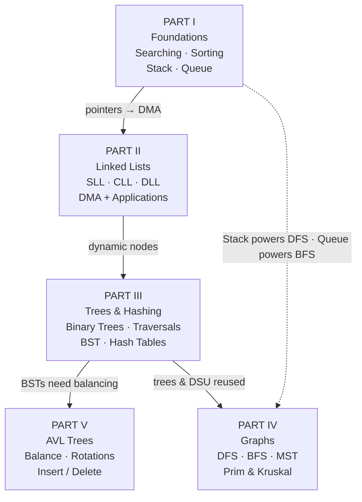

## 📑 Master Table of Contents

### PART I — Sorting, Searching & Introduction to Data Structures
1. Classification of data structures (linear/non-linear, homogeneous/heterogeneous, static/dynamic)
2. Arrays vs. linked lists — full architectural comparison
3. Singly linked lists: node anatomy, insert at beginning/position/end, ordered-list search state table
4. Searching: Linear search (iterative + recursive) · Binary search (iterative + recursive) + methods comparison
5. Sorting: classification tree (internal vs external) · Bubble · Selection · Insertion · Quick (Hoare partition) · Merge — each with pseudocode, C code, and pass-by-pass worked traces
6. Stack ADT: formal push/pop/peep algorithms, overflow/underflow, menu-driven C program, 7 applications
7. Queue ADT: linear queue C code, false overflow, circular queue algorithms, 5 applications
8. Introduction to trees & graphs (formal definitions + ADT operations)
9. Master complexity & comparison matrix (incl. Quick Sort vs. Merge Sort)
10. University exam questions, traces & solutions · source audit & errata

### PART II — Linked Lists
1. Introduction, core characteristics, advantages/disadvantages
2. Arrays vs. linked lists (deep memory-model comparison) · Dynamic Memory Allocation (DMA) in C
3. Types of linked lists (SLL, DLL, CLL)
4. Singly linked lists: insertions · deletions · traversal & counting · linear search · concatenation (iterative + recursive) · merging two sorted lists · 3-pointer in-place reversal · complete menu-driven C program
5. Stack & Queue ADTs implemented via linked lists (O(1) operations, no false overflow)
6. Circular linked lists: concept, insertion, deletion, do-while search & traversal
7. Doubly linked lists: 3-field node anatomy, insertions, deletions (incl. by value), bidirectional traversal
8. Application 1: arbitrary-precision (BigInt) addition of long positive integers · Application 2: polynomial representation & addition (merge paradigm) — full C programs
9. Master time & space complexity matrix (Array vs SLL vs DLL vs CLL)
10. Exam revision points & common pitfalls (memory leaks, dangling pointers, double-pointer convention)

### PART III — Trees, BST & Hashing
1. Trees: definition, graph-theoretic math ($|E| = n-1$), real-world systems applications
2. Comprehensive terminology & anatomy (degree, level, depth, height, subtree, forest)
3. Taxonomy of trees (general, binary, BST, AVL, red-black, N-ary)
4. Binary trees: Catalan-number combinatorics (unlabeled/labeled) · rooted/full/perfect/almost-complete/skewed variants
5. Traversals: Preorder/Inorder/Postorder/Level-order with C code + visual shortcuts (contour walk, ground mirror, leaf plucking)
6. BST: invariant, number of distinct BSTs (Catalan), step-by-step construction example
7. BST operations: search walkthrough, leaf insertion, deletion (3 canonical cases)
8. Hashing: motivation, good hash functions (division, mid-square, folding), collisions & load factor
9. Collision resolution: separate chaining · open addressing · linear/quadratic/double probing — every method fully traced + clustering comparison tables
10. Core algorithms: leaf count, total nodes, k-th smallest in BST, BST validation (range method), max depth, hash table with linear probing in C
11. Cartesian / maximum binary trees from inorder
12. Solved exam problems & MCQ bank · master formula bank & quick revision

### PART IV — Graphs, Traversals & Minimum Spanning Trees
1. Formal definitions: $G = (V, E)$, edge classifications, paths, cycles, connectivity
2. Representations: adjacency matrix (weighted/unweighted), adjacency list, comparative analysis
3. DFS (stack-based, full execution trace) and BFS (queue-based, full execution trace) + DFS vs BFS comparison
4. Graph search strategies & early exit
5. MST concept, spanning tree definition, cut property, real-world applications, greedy paradigm
6. Prim's algorithm: pseudocode, d/p arrays, complete 5-iteration state trace, complete C implementation
7. Kruskal's algorithm: pseudocode, Disjoint-Set Union, full accept/reject trace, complete C implementation (path compression + union by rank)
8. Master comparison: Prim's vs Kruskal's
9. Exam revision cheat sheet & practice problems

### PART V — Balanced & AVL Trees
1. The unbalanced BST problem: $O(h)$ operations, height spectrum $\lfloor \lg n \rfloor \le h \le n-1$
2. AVL invariant, balance factor, node augmentation
3. Mathematical proof of logarithmic height (Fibonacci bound, golden ratio: $h < 1.44\,\lg n$)
4. Tree rotations: the rebalancing primitives (right & left)
5. AVL insertion: the four imbalance cases (LL, RR, LR, RL) + MIT step-by-step trace
6. AVL deletion: the height-deficit propagation phenomenon
7. AVL sort & algorithmic complexity bounds
8. The landscape of balanced search trees (B-trees, red-black, splay, treaps, skip lists…)
9. ADT vs data structure (priority queue & predecessor/successor implementations)
10. Complete AVL C implementation (insert + delete) · cheat sheet & practice problems

## ⚡ Cross-Topic Complexity Quick Reference

| Structure | Search | Insert | Delete | Key caveat |
|---|---|---|---|---|
| Unsorted array | $O(n)$ | $O(1)$ at end | $O(n)$ | no order ⇒ linear scan only |
| Sorted array | $O(\log n)$ | $O(n)$ (shift) | $O(n)$ | binary search ⚡ needs random access |
| Singly linked list | $O(n)$ | $O(1)$ at head | $O(1)$ with pointer | no random access, poor cache locality |
| Hash table (average) | **$O(1)$** | $O(1)$ | $O(1)$* | worst $O(n)$; *deletion needs tombstones in open addressing |
| BST | $O(\log n)$ avg / $O(n)$ worst | same | same | skew kills the log guarantee |
| AVL tree | $O(\log n)$ guaranteed | $O(\log n)$, ≤ 2 rotations | $O(\log n)$, cascade rotations | strict balance everywhere |
| Binary heap | $O(1)$ find-min | $O(\log n)$ | $O(\log n)$ delete-min | no fast predecessor/successor |
| Graph DFS / BFS | — | — | — | $O(V + E)$ time, needs stack / queue |

## 📏 The Big-O Ladder — Why Data-Structure Choice Matters

```text
 n          log₂ n     n           n·log n        n²
 16         ≈ 4        16          64             256
 1,024      10         10³         1.02×10⁴       1.05×10⁶
 10⁶        ≈ 20       10⁶         2×10⁷          10¹²          ← O(n²) is infeasible here
 10⁹        ≈ 30       10⁹         3×10¹⁰         10¹⁸          ← hopeless

 O(log n) structures (Binary Search · BST · AVL · Hash tables) scale to billions of
 keys, while O(n²) sorts (Bubble · Selection · Insertion) choke near 10⁵ elements.
 Remember the ladder:  O(log n)  <  O(n)  <  O(n log n)  <  O(n²)  <  O(2ⁿ)
```

---

# PART I — Sorting, Searching & Introduction to Data Structures

> **Source:** `1.Sorting.md` (Unit-V: Searching, Sorting and Introduction to Data Structures — CPDS, GR11A1003). Complete content preserved below.

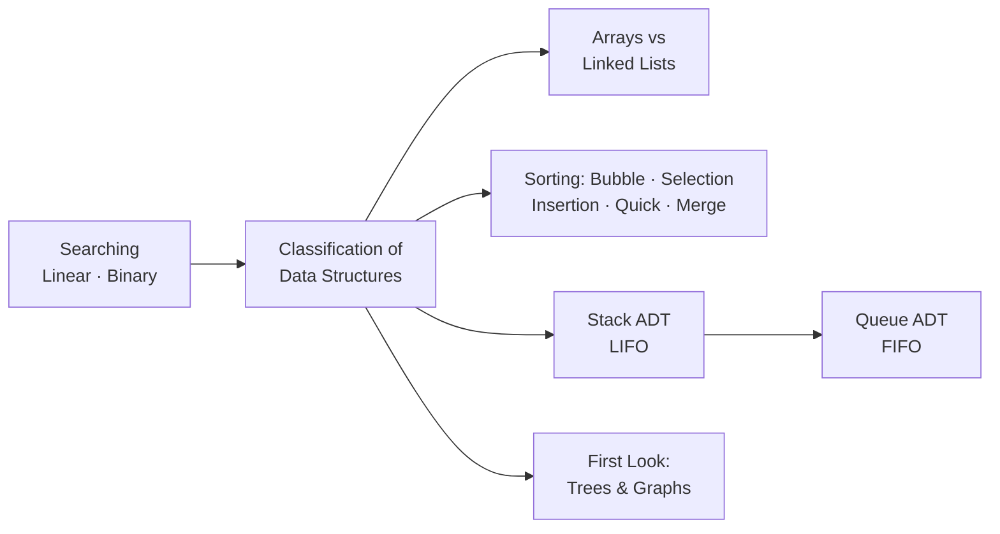

# UNIT-V: Searching, Sorting, and Introduction to Data Structures
**Course:** Computer Programming & Data Structures (CPDS)  
**Target:** B.Tech. I Year (Subject Code: GR11A1003) & Technical Interview Preparation  
**Source Material:** Unit-V Previous Year Question Bank & Core DSA Curriculum  

---

## Table of Contents
1. [Course & Unit Overview](#1-course--unit-overview)
2. [Classification of Data Structures](#2-classification-of-data-structures)
3. [Linear Lists: Arrays vs. Linked Lists](#3-linear-lists-arrays-vs-linked-lists)
4. [Singly Linked Lists: Core Operations](#4-singly-linked-lists-core-operations)
5. [Searching Algorithms](#5-searching-algorithms)
   - [Linear (Sequential) Search](#51-linear-sequential-search)
   - [Binary Search (Iterative & Recursive)](#52-binary-search)
6. [Sorting Algorithms](#6-sorting-algorithms)
   - [Classification: Internal vs. External Sorts](#61-classification-of-sorting-techniques)
   - [Bubble Sort (Exchange Sort)](#62-bubble-sort-exchange-sort)
   - [Selection Sort](#63-selection-sort)
   - [Insertion Sort](#64-insertion-sort)
   - [Quick Sort (Partition Exchange Sort)](#65-quick-sort-partition-exchange-sort)
   - [Merge Sort (Divide-and-Conquer)](#66-merge-sort-divide-and-conquer)
7. [The Stack Abstract Data Type (ADT)](#7-the-stack-abstract-data-type-adt)
8. [The Queue Abstract Data Type (ADT)](#8-the-queue-abstract-data-type-adt)
9. [Introduction to Non-Linear Data Structures: Trees](#9-introduction-to-non-linear-data-structures-trees)
10. [Introduction to Non-Linear Data Structures: Graphs](#10-introduction-to-non-linear-data-structures-graphs)
11. [Master Complexity & Comparison Matrix](#11-master-complexity--comparison-matrix)
12. [University Exam Questions, Traces & Solutions](#12-university-exam-questions-traces--solutions)
13. [Source Audit & Critical Errata](#13-source-audit--critical-errata)

---

## 1. Course & Unit Overview

Unit-V covers the foundational pillars of algorithmic problem solving:
1. **Searching Techniques:** Finding target items sequentially or via divide-and-conquer logarithmic reduction (`Linear Search`, `Binary Search`).
2. **Sorting Techniques:** Rearranging unordered lists into ascending or descending keys via comparison-based internal and external strategies (`Bubble`, `Selection`, `Insertion`, `Quick`, and `Merge Sort`).
3. **Linear Data Structures:** Sequential structures where every item has a unique predecessor and successor (`Arrays`, `Linked Lists`, `Stacks`, `Queues`).
4. **Non-Linear Data Structures:** Multi-level, hierarchical, or interconnected structures (`Trees`, `Binary Trees`, `Graphs`).

---

## 2. Classification of Data Structures

### 2.1 Definition
> **Data Structure:** A specialized format for organizing, storing, processing, and accessing data along with the logical relationships between the individual elements. It determines how operations such as insertion, deletion, traversal, retrieval, and access are carried out.

Data structures can be **nested** (a data structure containing instances of another data structure) and serve as concrete implementations of **Abstract Data Types (ADTs)**.

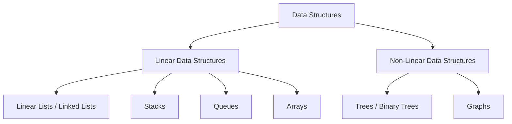

### 2.2 Taxonomy of Data Structures

| Classification Axis | Type | Definition & Characteristics | Examples |
|---|---|---|---|
| **Arrangement** | **Linear** | Elements form a sequential sequence; each element has a unique predecessor and successor (except first and last). | Arrays, Linked Lists, Stacks, Queues |
| | **Non-Linear** | Elements are organized hierarchically or interconnectedly across multiple levels. | Trees, Graphs |
| **Data Homogeneity** | **Homogeneous** | All stored elements are strictly of the identical data type. | Arrays (e.g., `int arr[10]`) |
| | **Non-Homogeneous** | Elements of differing primitive or composite types grouped together. | C `struct`, C++ `class` |
| **Memory Allocation** | **Static** | Size and memory layout are fixed at compile time. Cannot grow or shrink during execution. | Static Arrays |
| | **Dynamic** | Memory allocated at runtime on the heap using Dynamic Memory Allocation (DMA: `malloc()`, `calloc()`). Can expand or shrink dynamically. | Linked Lists, Dynamic Trees |

---

## 3. Linear Lists: Arrays vs. Linked Lists

### 3.1 Linear List ADT
A **Linear List** is an ordered collection of finite values $(e_1, e_2, \dots, e_n)$.
- **Mathematical sequence:** Each occurrence of an item is distinct, even if values duplicate.
- **Core Operations:**
  - `create()`: Initialize an empty list.
  - `isEmpty()`: Check if size is 0.
  - `prepend(item)`: Insert element at the beginning (new head).
  - `append(item)`: Insert element at the end (new tail).
  - `head()`: Retrieve or inspect the first element.
  - `tail()`: Return list consisting of all elements except the first.
  - `delete(item)`: Remove specified element.
  - `search(key)`: Locate element matching key.
  - `display()`: Enumerate elements in sequence.

### 3.2 Comparison: Arrays vs. Linked Lists

```
Array (Contiguous Memory):
Index:    0      1      2      3
Addr:  [1000] [1004] [1008] [1012]
Val:   |  10  |  20  |  30  |  40  |

Linked List (Non-Contiguous Memory via Pointers):
Head -> [10 | 2000] ----> [20 | 3000] ----> [30 | NULL]
Addr:     1000              2000              3000
```

| Parameter | Array Implementation | Linked List Implementation |
|---|---|---|
| **Memory Allocation** | **Static:** Compile-time, fixed size. | **Dynamic:** Run-time via heap (`malloc`). |
| **Storage Layout** | **Contiguous:** Requires consecutive physical memory blocks. | **Non-contiguous:** Nodes scattered anywhere in memory, linked via pointers. |
| **Resizing Flexibility** | Fixed size. Expanding requires allocating a new array and copying elements. | Fully dynamic. Expands and contracts node-by-node on demand. |
| **Memory Overhead** | Minimal (stores only data elements, zero pointer overhead). | Higher (each node requires extra bytes for pointer fields). |
| **Element Access** | Direct / Random access: $O(1)$ via index formula `Base + (i * size)`. | Sequential access: $O(n)$ by traversing pointers from `head`. |
| **Insertion / Deletion** | Costly: $O(n)$ due to shifting elements left or right. | Efficient: $O(1)$ pointer redirection once position is reached. |
| **Memory Fragmentation** | Vulnerable to external fragmentation; large allocations fail if no single contiguous block exists. | Efficient utilization of scattered free memory fragments. |

---

## 4. Singly Linked Lists: Core Operations

### 4.1 Node Structure & Conventions
A Singly Linked List consists of self-referential structures where each node has:
1. `data`: The information payload.
2. `next`: A pointer holding the address of the succeeding node (or `NULL` if last).

```c
struct Node {
    int data;
    struct Node* next;
};
struct Node* head = NULL;
```

```text
HEAD ──► [ Data: 12 | Next: • ] ──► [ Data: 99 | Next: • ] ──► [ Data: 37 | Next: NULL ]
```

---

### 4.2 Insertion at Beginning

**Logic:**
1. Allocate memory for `new_node`.
2. Assign `new_node->data = val`.
3. Set `new_node->next = head`.
4. Point `head = new_node`.

```c
void insertAtBeginning(int val) {
    struct Node* new_node = (struct Node*)malloc(sizeof(struct Node));
    new_node->data = val;
    new_node->next = head;
    head = new_node;
}
```

```text
Before: HEAD ──► [ 10 | • ] ──► [ 20 | NULL ]
Insert: [ 5 | • ] ──► [ 10 | • ]
After:  HEAD ──► [ 5 | • ] ──► [ 10 | • ] ──► [ 20 | NULL ]
```

---

### 4.3 Insertion at a Given Position ($1$-based index `pos`)

**Logic:**
1. If `pos == 1`, insert at beginning.
2. Otherwise, traverse pointer `temp` to node at `pos - 1`.
3. Link `new_node->next = temp->next`.
4. Link `temp->next = new_node`.

```c
void insertAtPosition(int val, int pos) {
    struct Node* new_node = (struct Node*)malloc(sizeof(struct Node));
    new_node->data = val;
    
    if (pos == 1) {
        new_node->next = head;
        head = new_node;
        return;
    }
    
    struct Node* temp = head;
    int i = 1;
    while (i < pos - 1 && temp != NULL) {
        temp = temp->next;
        i++;
    }
    
    if (temp == NULL) {
        printf("Position out of range!\n");
        free(new_node);
        return;
    }
    
    new_node->next = temp->next;
    temp->next = new_node;
}
```

**Pointer surgery visualized** (predecessor = `temp`, located at `pos - 1`):

```text
         BEFORE                                    AFTER
 ... ──► [ temp | • ] ─────────────────►   ... ──► [ temp | • ] ──┐
               │                                          ▼
               └──────────► [ next | ... ]       [ new | • ] ────► [ next | ... ]

 Step 1:  new_node->next = temp->next   (new node grabs the successor chain)
 Step 2:  temp->next  = new_node        (predecessor adopts the new node)
 ⚠ ORDER MATTERS: reversing these two steps orphans the rest of the list!
```

---

### 4.4 Insertion at End

**Logic:**
1. Allocate `new_node` and set `new_node->next = NULL`.
2. If `head == NULL`, set `head = new_node`.
3. Otherwise, traverse to the last node (`temp->next != NULL`).
4. Set `temp->next = new_node`.

```c
void insertAtEnd(int val) {
    struct Node* new_node = (struct Node*)malloc(sizeof(struct Node));
    new_node->data = val;
    new_node->next = NULL;
    
    if (head == NULL) {
        head = new_node;
        return;
    }
    
    struct Node* temp = head;
    while (temp->next != NULL) {
        temp = temp->next;
    }
    temp->next = new_node;
}
```

---

### 4.5 Searching in an Ordered Linear Linked List

When searching in an ordered linked list (e.g., to find the exact insertion or deletion point), the search algorithm maintains two moving pointers:
- `pcur`: Points to current candidate node.
- `ppre`: Points to predecessor of `pcur`.

#### Formal State Table for Ordered List Search
Given a search target key in an ascending list:

| Condition | `ppre` Pointer State | `pcur` Pointer State | Return Value | Meaning |
|---|---|---|:---:|---|
| $\text{Target} < \text{First Node}$ | `NULL` | First node | `0` (False) | Target is smaller than all list items. |
| $\text{Target} == \text{First Node}$ | `NULL` | First node | `1` (True) | Target located at head. |
| $\text{First} < \text{Target} < \text{Last}$ (Not present) | Largest node $< \text{Target}$ | First node $> \text{Target}$ | `0` (False) | Target belongs between `ppre` and `pcur`. |
| $\text{Target} == \text{Middle Node}$ | Node's immediate predecessor | Matching node | `1` (True) | Target found in interior. |
| $\text{Target} == \text{Last Node}$ | Predecessor of last node | Last node | `1` (True) | Target located at tail. |
| $\text{Target} > \text{Last Node}$ | Last node | `NULL` | `0` (False) | Target exceeds all elements in list. |

---

## 5. Searching Algorithms

Searching is the algorithmic process of locating the position of a specified target key within a collection, or determining its absence.

---

### 5.1 Linear (Sequential) Search

#### Definition & Mechanism
Linear search examines each element in sequence from index $0$ to $n-1$ (or $n-1$ down to $0$) until a match is found or the end of the collection is reached.
- **Applicability:** Works on both **sorted** and **unsorted** arrays or linked lists.
- **Requires no random access:** Suitable for sequential media.

#### Iterative C Implementation
```c
#include <stdio.h>

int linearSearch(int arr[], int n, int key) {
    for (int i = 0; i < n; i++) {
        if (arr[i] == key) {
            return i; // Return 0-based index of match
        }
    }
    return -1; // Unsuccessful
}

int main() {
    int arr[] = {11, 2, 23, 14, 55};
    int n = 5, key = 14;
    int pos = linearSearch(arr, n, key);
    if (pos != -1)
        printf("Search successful, element found at position: %d\n", pos);
    else
        printf("Search unsuccessful, element not found\n");
    return 0;
}
```

#### Recursive Linear Search
```c
int recLinearSearch(int arr[], int n, int key) {
    if (n <= 0)
        return -1; // Base case: searched whole array without match
    if (arr[n - 1] == key)
        return n - 1; // Found at current end
    return recLinearSearch(arr, n - 1, key); // Recur on remaining prefix
}
```

#### Complexity Analysis
- **Best Case:** $O(1)$ — Element is found at the very first position checked.
- **Worst Case:** $O(n)$ — Element is at the last position or not present.
- **Average Case:** $O(n)$ — Number of comparisons is approximately $(n+1)/2$.
- **Space Complexity:** $O(1)$ auxiliary memory (iterative), $O(n)$ stack frames (recursive).

---

### 5.2 Binary Search

#### Definition & Preconditions
Binary Search uses a **divide-and-conquer** approach:
1. Compares the search key against the middle element `arr[mid]`.
2. If `key == arr[mid]`, search terminates successfully.
3. If `key < arr[mid]`, search narrows to the lower sub-array (`ub = mid - 1`).
4. If `key > arr[mid]`, search narrows to the upper sub-array (`lb = mid + 1`).
5. Repeated until `lb > ub` (element not found).

> **Crucial Restriction:** Binary Search **CANNOT** be applied directly on **unsorted** data structures. Furthermore, it requires $O(1)$ **random access** (arrays), making it impractical on standard singly linked lists where locating the midpoint requires $O(n)$ pointer traversal.

#### Step-by-Step Visualization

```text
Array: [10, 25, 32, 55, 78, 84], Target Key = 78
Pass 1: lb = 0, ub = 5, mid = (0 + 5) / 2 = 2 -> arr[2] = 32
        Since 78 > 32, set lb = mid + 1 = 3.
Pass 2: lb = 3, ub = 5, mid = (3 + 5) / 2 = 4 -> arr[4] = 78
        78 == 78 -> MATCH FOUND at index 4!
```

**Why it is logarithmic — the search space halves every comparison:**

```text
Search-Space Halving (n = 32 → worst case only 5 comparisons):

 Pass 0:  [■■■■■■■■■■■■■■■■■■■■■■■■■■■■■■■■]  32 elements
 Pass 1:              [■■■■■■■■■■■■■■■■]       16   (check mid → keep one half)
 Pass 2:                         [■■■■■■■■]      8
 Pass 3:                            [■■■■]       4
 Pass 4:                              [■■]       2
 Pass 5:                              [■]        1  → answer
 n elements ⇒ ~log₂(n) probes  (32 → 5 probes, 1,000,000 → ~20 probes!)

#### Iterative C Implementation
```c
#include <stdio.h>

int binarySearchIterative(int arr[], int n, int key) {
    int lb = 0, ub = n - 1;
    while (lb <= ub) {
        int mid = (lb + ub) / 2;
        if (arr[mid] == key)
            return mid;
        else if (key < arr[mid])
            ub = mid - 1;
        else
            lb = mid + 1;
    }
    return -1;
}
```

#### Recursive C Implementation
```c
int binarySearchRecursive(int arr[], int key, int lb, int ub) {
    if (lb > ub)
        return -1; // Base case: element absent
    
    int mid = (lb + ub) / 2;
    if (arr[mid] == key)
        return mid;
    else if (key < arr[mid])
        return binarySearchRecursive(arr, key, lb, mid - 1);
    else
        return binarySearchRecursive(arr, key, mid + 1, ub);
}
```

#### Complexity Analysis
- **Best Case:** $O(1)$ — Target is exactly at the midpoint on the first check.
- **Worst Case:** $O(\log_2 n)$ — The search range is halved on each iteration until size 1 is reached ($n/2^k = 1 \implies k = \log_2 n$).
- **Average Case:** $O(\log_2 n)$.
- **Space Complexity:**
  - Iterative: $O(1)$ auxiliary space.
  - Recursive: $O(\log_2 n)$ call stack space.

#### Search Methods Comparison

| Feature | Linear Search | Binary Search |
|---|---|---|
| **Prerequisite Ordering** | None (works on unsorted & sorted). | Data **MUST** be sorted. |
| **Data Structure Support** | Arrays, Linked Lists, Streams. | Requires direct index access (Arrays). |
| **Time Complexity (Worst)**| $O(n)$ | $O(\log n)$ |
| **Comparisons for $n=10^6$** | Up to $1,000,000$ comparisons. | Maximum $\approx 20$ comparisons. |
| **Implementation Type** | Sequential iteration. | Divide-and-Conquer interval reduction. |

---

## 6. Sorting Algorithms

Sorting rearranges records into an ordered sequence according to a key value (numerical, alphabetical, or custom).

---

### 6.1 Classification of Sorting Techniques

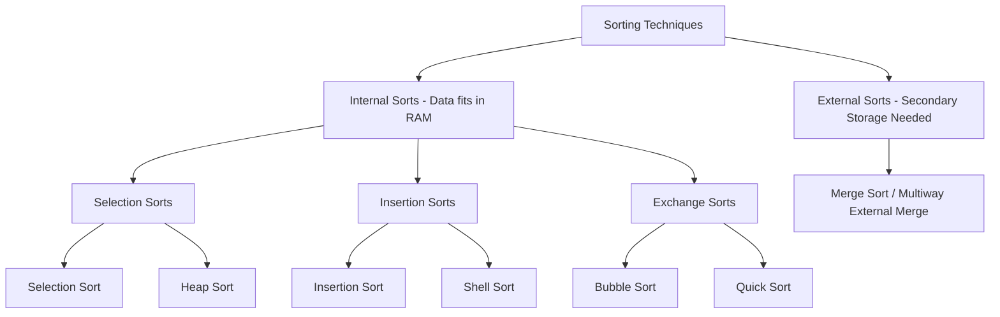

- **Internal Sorts:** Entire dataset fits into main memory (RAM). Very fast access, but bounded by RAM capacity.
- **External Sorts:** Massive datasets exceed primary memory capacity and reside on secondary storage (HDD/SSD). Processes data in blocks by sorting chunks internally and merging them back (e.g., Multiway Merge Sort).

---

### 6.2 Bubble Sort (Exchange Sort)

#### Core Concept
Bubble Sort repeatedly steps through the list, compares adjacent elements, and swaps them if they are in the wrong order. With each pass, the highest (or lowest) unsorted element **bubbles up** to its final position at the end. An imaginary wall separates the unsorted prefix from the sorted suffix.

```text
Unsorted Sub-list                    Sorted Sub-list
[ ... arr[0] ... arr[n-i-1] ... ]  |  [ arr[n-i] ... arr[n-1] ]
                                  ^ Imaginary Wall moves left
```

#### Standard Algorithm & Pseudocode
```text
Algorithm Bubble_Sort(A, N):
Step 1: Repeat For P = 1 to N - 1
Step 2:     Repeat For J = 0 to N - P - 1
Step 3:         If (A[J] > A[J + 1]) Then
                    Swap(A[J], A[J + 1])
Step 4: Exit
```

#### Complete C Implementation
```c
#include <stdio.h>

void bubbleSort(int arr[], int n) {
    int i, j, temp;
    for (i = 0; i < n - 1; i++) {
        for (j = 0; j < n - i - 1; j++) {
            if (arr[j] > arr[j + 1]) {
                temp = arr[j];
                arr[j] = arr[j + 1];
                arr[j + 1] = temp;
            }
        }
    }
}
```

#### Pass-by-Pass Worked Example
Input Array: `[10, 47, 12, 54, 19, 23]` ($N = 6$)

```
Original:    [10, 47, 12, 54, 19, 23]
Pass 1:      10<47 (no swap) -> 47>12 (swap: 10,12,47) -> 47<54 (no swap) -> 
             54>19 (swap: 10,12,47,19,54) -> 54>23 (swap: 10,12,47,19,23,54)
             Result: [10, 12, 47, 19, 23 | 54] (54 locked in place)
Pass 2:      [10, 12, 19, 23 | 47, 54]         (47 locked)
Pass 3:      [10, 12, 19 | 23, 47, 54]         (23 locked)
Pass 4:      [10, 12 | 19, 23, 47, 54]         (19 locked)
Pass 5:      [10 | 12, 19, 23, 47, 54]         (Fully Sorted!)
```

#### Complexity Analysis
- Total comparisons:
  $$\sum_{i=1}^{n-1} (n - i) = \frac{n(n-1)}{2} = \frac{n^2 - n}{2}$$
- **Worst Case:** $O(n^2)$ (Array reverse sorted).
- **Average Case:** $O(n^2)$.
- **Best Case (Unoptimized):** $O(n^2)$ (Still makes all comparisons).
- **Best Case (Optimized with swapped flag):** $O(n)$ if array already sorted.
- **Auxiliary Space:** $O(1)$ (In-place).
- **Stability:** Stable.

---

### 6.3 Selection Sort

#### Core Concept
Divides the list into a sorted prefix and an unsorted suffix. In each pass, it finds the **minimum element** in the unsorted sub-list and swaps it with the first element of that sub-list. The imaginary wall moves forward by one position each pass.

```text
Pass k:
[ Sorted Elements ] | [ Search for minimum among these ]
                    ^ Swap minimum with element at this boundary
```

#### Selection Sort Algorithm
```text
Algorithm Selection_Sort(A, N):
Step 1: Repeat For K = 0 to N - 2
Step 2:     Set POS = K
Step 3:     Repeat For J = K + 1 to N - 1
                If A[J] < A[POS] Then
                    POS = J
Step 4:     If POS != K Then
                Swap(A[K], A[POS])
Step 5: Exit
```

#### Complete C Implementation
```c
#include <stdio.h>

void selectionSort(int a[], int n) {
    int i, j, min_idx, temp;
    for (i = 0; i < n - 1; i++) {
        min_idx = i;
        for (j = i + 1; j < n; j++) {
            if (a[j] < a[min_idx]) {
                min_idx = j;
            }
        }
        if (min_idx != i) {
            temp = a[i];
            a[i] = a[min_idx];
            a[min_idx] = temp;
        }
    }
}
```

#### Pass-by-Pass Worked Example
Input Array: `[23, 78, 45, 8, 32, 56]` ($N = 6$)

```
Original:    [ 23, 78, 45,  8, 32, 56 ]
Pass 1:      Min in [23..56] is 8 at pos 3. Swap 23 and 8:
             [  8 | 78, 45, 23, 32, 56 ]
Pass 2:      Min in [78..56] is 23 at pos 3. Swap 78 and 23:
             [  8,  23 | 45, 78, 32, 56 ]
Pass 3:      Min in [45..56] is 32 at pos 4. Swap 45 and 32:
             [  8,  23,  32 | 78, 45, 56 ]
Pass 4:      Min in [78..56] is 45 at pos 4. Swap 78 and 45:
             [  8,  23,  32,  45 | 78, 56 ]
Pass 5:      Min in [78..56] is 56 at pos 5. Swap 78 and 56:
             [  8,  23,  32,  45,  56 | 78 ]
Final Array: [ 8, 23, 32, 45, 56, 78 ]
```

#### Complexity Analysis
- Total comparisons:
  $$\frac{n(n-1)}{2} = O(n^2) \quad \text{for all cases (Best, Average, Worst)}.$$
- Number of Swaps: At most $n - 1$ swaps (extremely useful when write operations are expensive, such as EEPROM/Flash storage).
- **Auxiliary Space:** $O(1)$ (In-place).
- **Stability:** Unstable (swapping over distant elements can invert relative order of duplicates).

---

### 6.4 Insertion Sort

#### Core Concept
Insertion sort builds the final sorted array one item at a time. It works the way people sort playing cards:
1. Hold cards face up in left hand (sorted sub-array).
2. Take one card from the table (unsorted sub-array) as `key`.
3. Compare `key` with cards in hand from right to left, shifting larger cards one position to the right to make room.
4. Insert `key` into its proper open slot.

```text
Sorted Hand (A[1 .. j-1])       Current Key      Unsorted Cards on Table
[  2   4   5   6  ]              [ 1 ]            [ 3 ]
   Shift 6, 5, 4, 2 to right ---> Insert 1 at index 1
Result: [ 1  2  4  5  6 ]
```

#### Standard Algorithm (CLRS Convention)
```text
Algorithm INSERTION_SORT(A):
1. FOR j = 2 TO length[A]
2.     key = A[j]
3.     // Insert A[j] into the sorted sequence A[1 .. j - 1]
4.     i = j - 1
5.     WHILE i > 0 AND A[i] > key
6.         A[i + 1] = A[i]
7.         i = i - 1
8.     A[i + 1] = key
```

#### Complete C Implementation
```c
#include <stdio.h>

void insertionSort(int a[], int n) {
    int i, j, key;
    for (i = 1; i < n; i++) {
        key = a[i];
        j = i - 1;
        // Shift elements greater than key to the right
        while (j >= 0 && a[j] > key) {
            a[j + 1] = a[j];
            j = j - 1;
        }
        a[j + 1] = key;
    }
}
```

#### Pass-by-Pass Worked Example
Input Array: `[78, 23, 45, 8, 32, 36]` ($N = 6$)

```
Original:    [ 78 | 23, 45,  8, 32, 36 ]
Pass 1:      key = 23. 78 > 23 -> shift 78. Insert 23.
             [ 23, 78 | 45,  8, 32, 36 ]
Pass 2:      key = 45. 78 > 45 -> shift 78. Insert 45.
             [ 23, 45, 78 |  8, 32, 36 ]
Pass 3:      key = 8.  78, 45, 23 all > 8 -> shift all. Insert 8.
             [  8, 23, 45, 78 | 32, 36 ]
Pass 4:      key = 32. 78, 45 > 32 -> shift 78, 45. Insert 32.
             [  8, 23, 32, 45, 78 | 36 ]
Pass 5:      key = 36. 78, 45 > 36 -> shift 78, 45. Insert 36.
             [  8, 23, 32, 36, 45, 78 ]
```

#### Complexity Analysis
- **Best Case:** $O(n)$ — Already sorted array; inner loop condition `a[j] > key` fails immediately on first comparison in each pass.
- **Worst Case:** $O(n^2)$ — Reverse sorted array; each element is compared with and shifted past all elements in the sorted prefix.
- **Average Case:** $O(n^2)$.
- **Auxiliary Space:** $O(1)$ (In-place).
- **Stability:** Stable (identical elements are not shifted past each other).
- **Adaptive:** Highly efficient for nearly sorted lists or small arrays ($N \le 16$).

---

### 6.5 Quick Sort (Partition Exchange Sort)

#### Core Concept
Invented by **C.A.R. Hoare**, Quick Sort is based on the **Divide-and-Conquer** paradigm:
1. **Pivot Selection:** Pick an element from the array to act as the `pivot`.
2. **Partition:** Rearrange elements around the pivot such that:
   - All elements smaller than the pivot are placed to its left.
   - All elements greater than or equal to the pivot are placed to its right.
   - The pivot lands in its exact, final sorted position.
3. **Conquer:** Recursively apply Quick Sort to the left and right sub-arrays until base case ($N \le 1$) is reached.

```text
Original:  [ 8, 3, 2, 11, 5, 14, 0, 2, 9, 4, 20 ]
Pivot: 8
Partition: [ 4, 3, 2, 2, 5, 0 ]  <-- [ 8 ] -->  [ 11, 9, 14, 20 ]
           (Elements < 8)          Pivot         (Elements >= 8)
                 |                                      |
         Recurse on Left Sub-list               Recurse on Right Sub-list
```

#### Hoare-Partition Quick Sort C Program
```c
#include <stdio.h>

void quicksort(int a[], int low, int high) {
    int pivot, t, i, j;
    if (low < high) {
        pivot = a[low]; // Choosing first element as pivot
        i = low + 1;
        j = high;
        
        while (1) {
            while (i <= high && a[i] <= pivot)
                i++;
            while (j >= low && a[j] > pivot)
                j--;
            if (i < j) {
                t = a[i];
                a[i] = a[j];
                a[j] = t;
            } else {
                break;
            }
        }
        // Place pivot in its correct sorted position
        a[low] = a[j];
        a[j] = pivot;
        
        // Recursive calls for partitions
        quicksort(a, low, j - 1);
        quicksort(a, j + 1, high);
    }
}
```

#### Partition Step Trace
Input: `35, 54, 12, 18, 23, 15, 45, 38` ($low = 0, high = 7$, `pivot = 35`):
- `i` scans right from `low+1` searching for element $> 35$ (finds $54$ at index 1).
- `j` scans left from `high` searching for element $\le 35$ (finds $15$ at index 5).
- Since $i < j$, swap $54$ and $15$: array becomes `[35, 15, 12, 18, 23, 54, 45, 38]`.
- Continue scanning: `i` reaches index 5 ($54 > 35$), `j` reaches index 4 ($23 \le 35$).
- Now $i \ge j$ (pointers cross). Break loop and swap `pivot = a[low]` with `a[j] = a[4]`:
- Array after partition: `[23, 15, 12, 18] | 35 | [54, 45, 38]`.
- Pivot $35$ is now at its final position!

#### Complexity & Trade-Offs
- **Best Case:** $O(n \log_2 n)$ — Pivot divides array into two balanced halves ($T(n) = 2T(n/2) + \Theta(n)$).
- **Average Case:** $O(n \log_2 n)$.
- **Worst Case:** $O(n^2)$ — Pivot chosen is consistently the extreme (smallest or largest), e.g., when array is already sorted and first element is picked as pivot ($T(n) = T(n-1) + \Theta(n)$).
- **Auxiliary Space:** $O(\log_2 n)$ recursive call stack depth (worst case $O(n)$ if degenerate).
- **Advantages:** Fastest general-purpose internal sort in practice due to small constant factors and cache locality; sorts in-place.
- **Disadvantages:** Complex recursive logic; unstable; quadratic worst-case behavior without randomized pivot.

---

### 6.6 Merge Sort (Divide-and-Conquer)

#### Core Concept
Merge Sort strictly adheres to the 3-phase **Divide-and-Conquer** paradigm:
1. **Divide:** Split array $A[p .. r]$ into two sub-arrays $A[p .. q]$ and $A[q+1 .. r]$ at midpoint $q = \lfloor (p+r)/2 \rfloor$.
2. **Conquer:** Recursively sort both sub-arrays using Merge Sort.
3. **Combine:** Merge the two sorted sub-arrays into a single sorted array using a temporary buffer.

```text
Divide Phase:
                    [ 39, 9, 81, 45, 90, 27, 72, 18 ]
                               /              \
               [ 39, 9, 81, 45 ]              [ 90, 27, 72, 18 ]
                   /         \                    /          \
             [ 39, 9 ]     [ 81, 45 ]       [ 90, 27 ]     [ 72, 18 ]
              /     \       /      \         /      \       /      \
            [39]    [9]   [81]    [45]     [90]    [27]   [72]    [18]

Merge (Combine) Phase:
            [ 9, 39 ]     [ 45, 81 ]       [ 27, 90 ]     [ 18, 72 ]
                   \         /                    \          /
               [ 9, 39, 45, 81 ]              [ 18, 27, 72, 90 ]
                               \              /
                    [ 9, 18, 27, 39, 45, 72, 81, 90 ]
```

#### Merge Sort C Implementation
```c
#include <stdio.h>

void mergesort(int a[], int low, int mid, int high) {
    int t[100];
    int i = low, j = mid + 1, k = low;
    
    // Merge two halves into temp array t
    while (i <= mid && j <= high) {
        if (a[i] <= a[j])
            t[k++] = a[i++];
        else
            t[k++] = a[j++];
    }
    while (i <= mid)
        t[k++] = a[i++];
    while (j <= high)
        t[k++] = a[j++];
        
    // Copy merged elements back to original array
    for (i = low; i <= high; i++)
        a[i] = t[i];
}

void msortdiv(int a[], int low, int high) {
    if (low < high) {
        int mid = (low + high) / 2;
        msortdiv(a, low, mid);        // Sort left half
        msortdiv(a, mid + 1, high);    // Sort right half
        mergesort(a, low, mid, high); // Merge halves
    }
}
```

#### Complexity Analysis
- Recurrence Relation:
  $$T(n) = 2T(n/2) + O(n)$$
- By Master Theorem:
  $$T(n) = O(n \log_2 n) \quad \text{across Best, Average, and Worst cases!}$$
- **Auxiliary Space:** $O(n)$ extra memory needed for temporary merging array.
- **Stability:** **Stable** (preserves initial order of duplicate keys).
- **Best Use Case:** Preferred for sorting **Linked Lists** (no random access needed, $O(1)$ extra space) and massive datasets requiring **External Sorting** from disk.

---

## 7. The Stack Abstract Data Type (ADT)

### 7.1 Definition & Properties
A **Stack** is a linear data structure that permits insertions and deletions exclusively at a single designated end called the **TOP**.
- Principle: **LIFO (Last-In-First-Out)** or **FILO (First-In-Last-Out)**.
- Insertion operation is called **PUSH**.
- Deletion operation is called **POP**.
- Inspection of the top element without removing it is called **PEEP** (or **PEEK**).
- **Physical Analogy:** A stack of cafeteria plates, coins, or a railway shunting track where cars enter and reverse out from a dead-end siding.

```text
         |           |
         |  arr[3]   |  <--- TOP (Most accessible element)
         |  arr[2]   |
         |  arr[1]   |
         |  arr[0]   |
         +-----------+
```

---

### 7.2 Boundary Conditions
1. **Stack Overflow:** Attempting to `PUSH` into an already full stack (`TOP == MAX - 1` in 0-indexed systems).
2. **Stack Underflow:** Attempting to `POP` from an empty stack (`TOP == -1` in 0-indexed systems).

---

### 7.3 Formal Textbook Algorithms (1-Based Representation)
Let stack be vector $S[1 \dots N]$ with pointer $TOP$ ($TOP = 0$ indicates empty stack):

#### 1. Push Procedure
```text
Algorithm Push(S, TOP, X):
1. [Check Overflow]
   If TOP >= N Then
       Write("Stack Overflow")
       Return
2. [Increment Pointer]
   TOP = TOP + 1
3. [Insert Element]
   S[TOP] = X
4. [Finish]
   Return
```

#### 2. Pop Function
```text
Algorithm Pop(S, TOP):
1. [Check Underflow]
   If TOP == 0 Then
       Write("Stack Underflow")
       Exit
2. [Decrement Pointer]
   TOP = TOP - 1
3. [Return Former Top Item]
   Return S[TOP + 1]
```

#### 3. Peep Function ($I$-th element from top)
```text
Algorithm Peep(S, TOP, I):
1. [Check Valid Boundary]
   If (TOP - I + 1) <= 0 Then
       Write("Stack Underflow on Peep")
       Exit
2. [Return Element]
   Return S[TOP - I + 1]
```

---

### 7.4 Menu-Driven C Program for Stack
```c
#include <stdio.h>
#include <stdlib.h>
#define MAX 5

int stack[MAX];
int top = -1;

void push() {
    int item;
    if (top == MAX - 1) {
        printf("\nStack Overflow! Cannot push.\n");
        return;
    }
    printf("Enter value to push: ");
    scanf("%d", &item);
    top++;
    stack[top] = item;
    printf("Pushed %d onto stack.\n", item);
}

void pop() {
    if (top == -1) {
        printf("\nStack Underflow! Stack is empty.\n");
        return;
    }
    printf("\nPopped item is: %d\n", stack[top]);
    top--;
}

void display() {
    if (top == -1) {
        printf("\nStack is empty.\n");
        return;
    }
    printf("\nStack contents (TOP to BOTTOM):\n");
    for (int i = top; i >= 0; i--) {
        printf("  | %d |\n", stack[i]);
    }
    printf("  +---+\n");
}

int main() {
    int ch;
    while (1) {
        printf("\n*** STACK MENU ***\n");
        printf("1. PUSH\n2. POP\n3. DISPLAY\n4. EXIT\n");
        printf("Enter your choice: ");
        scanf("%d", &ch);
        switch (ch) {
            case 1: push(); break;
            case 2: pop(); break;
            case 3: display(); break;
            case 4: exit(0);
            default: printf("Invalid option! Try again.\n");
        }
    }
    return 0;
}
```

---

### 7.5 Applications of Stacks
1. **Expression Conversion:** Infix to Postfix (Reverse Polish) and Infix to Prefix notations.
2. **Expression Evaluation:** Evaluating postfix and prefix expressions in single linear passes.
3. **Function Call / Recursion Management:** Compilers allocate stack activation records (call stack) to preserve return addresses, parameters, and local variables.
4. **Syntax Parsing & Bracket Matching:** Validating matching pairs of `()`, `{}`, `[]` in compilers.
5. **Backtracking & Graph Traversal:** Implementing Depth-First Search (DFS) and undo/redo operations.
6. **Interrupt Handling:** Hardware and OS store processor context and machine status words on stack upon interrupts.
7. **Tree Traversals:** Non-recursive implementations of Inorder, Preorder, and Postorder tree walks.

---

## 8. The Queue Abstract Data Type (ADT)

**Stack vs. Queue — the two fundamental linear ADTs side by side:**

```text
            STACK (LIFO)                          QUEUE (FIFO)

       push →  | arr[2] | ← pop/peek        enqueue →  [ 30 ][ 20 ][ 10 ] → dequeue
               | arr[1] |                          ▲                    ▲
               | arr[0] |                        REAR                FRONT
               +---------+                    (insert here)        (remove here)
       ONE open end: top.               TWO open ends: rear & front.
       Newest element leaves first.     Oldest element leaves first.

 Used for:  recursion, undo, DFS,      Used for: scheduling, spooling,
            bracket matching, parsing             BFS, buffers, message queues
```

### 8.1 Definition & Properties
A **Queue** is an ordered linear data structure that operates on the **FIFO (First-In-First-Out)** or **FCFS (First-Come-First-Served)** principle:
- Insertion takes place at the **REAR** end (`ENQUEUE`).
- Deletion takes place at the **FRONT** end (`DEQUEUE`).
- The earliest element added is the first element removed.

```text
               +-----------------------------------+
  ENQUEUE ---> | rear | ... | ... | ... |  front   | ---> DEQUEUE
 (At REAR end) +-----------------------------------+    (From FRONT end)
```

---

### 8.2 Standard Linear Queue Implementation in C
```c
#include <stdio.h>
#include <stdlib.h>
#define SIZE 5

int arr[SIZE];
int front = -1, rear = -1;

void enqueue() {
    int val;
    if (rear == SIZE - 1) {
        printf("Queue Overflow!\n");
        return;
    }
    printf("Enter element to enqueue: ");
    scanf("%d", &val);
    if (front == -1)
        front = 0;
    rear++;
    arr[rear] = val;
}

void dequeue() {
    if (front == -1 || front > rear) {
        printf("Queue Underflow!\n");
        return;
    }
    printf("Dequeued element: %d\n", arr[front]);
    front++;
    if (front > rear) { // Reset when all elements removed
        front = -1;
        rear = -1;
    }
}

void display() {
    if (front == -1) {
        printf("Queue is empty!\n");
        return;
    }
    printf("Queue elements: FRONT -> ");
    for (int i = front; i <= rear; i++) {
        printf("%d ", arr[i]);
    }
    printf("<- REAR\n");
}
```

---

### 8.3 Circular Queue Algorithms (1-Based Representation)
In standard linear arrays, dequeuing elements causes unused empty slots at the front of the array that cannot be reused once `rear == SIZE - 1` (false overflow). A **Circular Queue** solves this by wrapping indices circularly around the boundary.

**Visualizing the false-overflow problem:**

```text
False Overflow in a Linear Queue (why circular queues exist), SIZE = 6:

 Full:        FRONT                     REAR
               ↓                        ↓
            [ a ][ b ][ c ][ d ][ e ][ f ]        (front=0, rear=5)

 After 3 dequeues:
            [    ][    ][    ][ d ][ e ][ f ]
            └ empty ┘   ▲FRONT=3        ▲REAR=5  (== SIZE-1 → "Overflow!")
            ⚑ Slots 0, 1, 2 are EMPTY but unusable — memory wasted!

 Circular Queue: REAR wraps back to slot 0 and reuses the holes:
            [ g ][ h ][    ][ d ][ e ][ f ]
              ▲ REAR wrapped here
```

#### Enqueue Algorithm
```text
Algorithm Enqueue(queue, n, front, rear, item):
1. [Check for Overflow]
   If (front == 1 AND rear == n) OR (front == rear + 1) Then:
       Print "Queue Overflow"
       Return
2. [Determine New Rear]
   If front == NULL Then:
       Set front = 1, rear = 1
   Else If rear == n Then:
       Set rear = 1
   Else:
       Set rear = rear + 1
3. [Insert Element]
   Set queue[rear] = item
4. Return
```

#### Dequeue Algorithm
```text
Algorithm Dequeue(queue, n, front, rear, item):
1. [Check for Underflow]
   If front == NULL Then:
       Print "Queue Underflow"
       Return
2. [Extract Front Element]
   Set item = queue[front]
3. [Determine New Front]
   If front == rear Then:
       // Queue had only one element; now reset to empty
       Set front = NULL, rear = NULL
   Else If front == n Then:
       Set front = 1
   Else:
       Set front = front + 1
4. Return
```

---

### 8.4 Applications of Queues
1. **CPU & Job Scheduling:** Multi-programming systems use Ready Queues, FCFS, and Round-Robin time slicing.
2. **Operating System Spooling:** Print spoolers manage documents waiting for printer hardware.
3. **Multithreading & Synchronization:** Blocking queues facilitate thread-safe producer-consumer communication.
4. **Breadth-First Search (BFS):** Graph and tree level-order explorations.
5. **Real-Time Asynchronous Buffers:** Handling audio/video streaming, network packets, and message brokers (e.g., Kafka, RabbitMQ).

---

## 9. Introduction to Non-Linear Data Structures: Trees

### 9.1 Definition of a Tree
> **Tree:** A finite set $T$ of one or more nodes such that:
> 1. There is a specially designated node called the **root**.
> 2. The remaining nodes are partitioned into $m \ge 0$ disjoint sets $T_1, T_2, \dots, T_m$, each of which is itself a tree called a **subtree** of the root.

#### Recursive Set Notation Example
- $T_1 = \{\}$ (Empty tree)
- $T_2 = \{a\}$ (Single-node tree: root is $a$)
- $T_3 = \{a, \{b, \{c, \{d\}\}\}, \{e\}, \{f, \{g, \{h\}, \{i\}\}\}\}$

```text
               a (Root)
            /  |  \
           b   e   f
          /         \
         c           g
        /           / \
       d           h   i
```

---

### 9.2 Fundamental Tree Terminology

| Term | Technical Definition | Example in $T_3$ Above |
|---|---|---|
| **Root** | The topmost node having no parent. | Node `a` |
| **Parent** | A node that has direct links to descending nodes. | `f` is parent of `g` |
| **Child** | A node directly connected below its parent. | `b, e, f` are children of `a` |
| **Siblings** | Nodes that share the exact same immediate parent. | `h` and `i` are siblings (parent `g`) |
| **Leaf (Terminal)** | A node having **degree = 0** (no children). | `d, e, h, i` |
| **Internal / Interior**| Any non-leaf node with at least one child (and not a pure empty root). | `a, b, c, f, g` |
| **Ancestor** | Any node on the direct path from the root down to a given node. | Ancestors of `h` are `g, f, a` |
| **Degree of a Node** | The number of children (subtrees) connected to that node. | Degree of `a` = 3; Degree of `g` = 2; Degree of `d` = 0 |
| **Degree of a Tree** | The maximum degree among all nodes in the tree. | Degree of tree = 3 (due to node `a`) |
| **Level of a Node** | Distance / length of path from root. Root is at **Level 0**. | Level of `a` = 0; Level of `b` = 1; Level of `d` = 3 |
| **Depth / Height** | The length of the longest path from the root to a leaf node. | Height = 4 (counting nodes on path `a -> b -> c -> d`) |

---

### 9.3 Binary Trees

#### Definition
A **Binary Tree** is a hierarchical tree data structure in which **each node has at most two children**, referred to as the **left child** and the **right child**.

```text
Valid Binary Trees:
     (Root)            (Root)
     /    \            /
   (L)    (R)        (L)
                     /
                   (L)

NOT a Binary Tree (Violations):
     (A)                 (A) <-----+
   /  |  \              /   \      | (Cycle!)
 (B) (C) (D)          (B)   (C) ---+
 (3 children)        (Child has multiple parents / Graph cycle)
```

#### Properties & Mathematical Formulas of Full / Perfect Binary Trees

```text
Level 0:              [45]                 -> 2^0 = 1 node  (Height 1)
                     /    \
Level 1:         [24]      [76]            -> 2^1 = 2 nodes (Height 2)
                 /  \      /  \
Level 2:       [14] [32] [61] [87]         -> 2^2 = 4 nodes (Height 3)
               / \  / \  / \  / \
Level 3:      8  20 27 37 56 67 81 94      -> 2^3 = 8 nodes (Height 4)
```

- **Maximum nodes at Level $l$:**
  $$\text{Nodes at level } l = 2^l \quad (\text{for } l \ge 0)$$
- **Total maximum nodes in a binary tree of height $h$:**
  $$n = \sum_{l=0}^{h-1} 2^l = 2^h - 1$$
- **Minimum height for a binary tree containing $n$ nodes:**
  $$h = \lceil \log_2(n + 1) \rceil$$

---

## 10. Introduction to Non-Linear Data Structures: Graphs

### 10.1 Definition
> **Graph:** A graph $G = (V, E)$ consists of:
> 1. A finite set of **Vertices (or Nodes)**, denoted by $V$.
> 2. A finite set of **Edges (or Arcs)**, denoted by $E$, where each edge is an ordered pair $(u, v)$ (directed graph) or unordered pair $\{u, v\}$ (undirected graph) connecting vertices $u, v \in V$.

```text
Undirected Graph:                  Directed Graph (Digraph):
     (1) ------- (2)                      (1) ------> (2)
      |         / |                        |         ^
      |       /   |                        |        /
      |     /     |                        v      /
     (3) ------- (4)                      (3) ------> (4)
```

Edges may be assigned an **edge value (weight)**, representing cost, distance, latency, or capacity.

### 10.2 Graph Abstract Data Type (ADT) Operations

| Operation Signature | Purpose / Functionality |
|---|---|
| `adjacent(G, x, y)` | Boolean query: tests if there is an edge directly connecting vertex $x$ to $y$. |
| `neighbors(G, x)` | Returns a list of all vertices $y$ such that edge $(x, y) \in E$. |
| `add(G, x, y)` | Inserts a new edge connecting $x$ to $y$ if absent. |
| `delete(G, x, y)` | Removes edge $(x, y)$ from graph $G$. |
| `get_node_value(G, x)` | Retrieves the payload/label associated with vertex $x$. |
| `set_node_value(G, x, a)` | Assigns label $a$ to vertex $x$. |
| `get_edge_value(G, x, y)` | Returns weight, capacity, or cost of edge $(x, y)$. |
| `set_edge_value(G, x, y, v)`| Sets the weight of edge $(x, y)$ to value $v$. |

---

## 11. Master Complexity & Comparison Matrix

### 11.1 Algorithm Complexity Table

| Algorithm | Category | Best Time | Average Time | Worst Time | Auxiliary Space | Stable? | In-Place? |
|---|---|:---:|:---:|:---:|:---:|:---:|:---:|
| **Linear Search** | Searching | $O(1)$ | $O(n)$ | $O(n)$ | $O(1)$ | N/A | Yes |
| **Binary Search** | Searching | $O(1)$ | $O(\log n)$ | $O(\log n)$ | $O(1)$ Iterative / $O(\log n)$ Rec. | N/A | Yes |
| **Bubble Sort** | Internal (Exchange) | $O(n)$ (opt.) / $O(n^2)$ | $O(n^2)$ | $O(n^2)$ | $O(1)$ | **Yes** | **Yes** |
| **Selection Sort** | Internal (Selection) | $O(n^2)$ | $O(n^2)$ | $O(n^2)$ | $O(1)$ | **No** | **Yes** |
| **Insertion Sort** | Internal (Insertion) | $O(n)$ | $O(n^2)$ | $O(n^2)$ | $O(1)$ | **Yes** | **Yes** |
| **Quick Sort** | Internal (Exchange / D&C)| $O(n \log n)$ | $O(n \log n)$ | $O(n^2)$ | $O(\log n)$ call stack | **No** | **Yes** |
| **Merge Sort** | External / Internal (D&C)| $O(n \log n)$ | $O(n \log n)$ | $O(n \log n)$ | $O(n)$ buffer | **Yes** | **No** |

---

### 11.2 Key Algorithmic Distinctions

#### How to Pick the Right Sort in an Exam / Interview

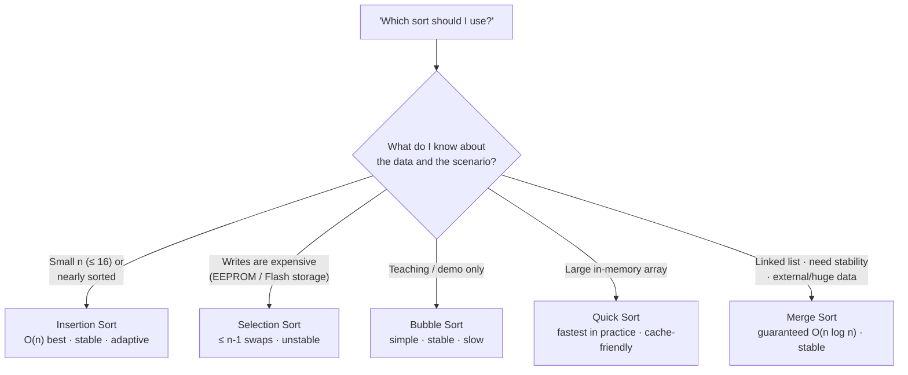

#### Quick Sort vs. Merge Sort

| Criteria | Quick Sort | Merge Sort |
|---|---|---|
| **Paradigm** | Divide-and-Conquer (partition exchange). | Divide-and-Conquer (halving and merging). |
| **Partitioning** | Pivot divides based on relative values. | Splits mechanically at midpoint $n/2$. |
| **Work Distribution** | Most work is done **before recursion** (during partitioning). | Most work is done **after recursion** (during merging). |
| **Memory Allocation** | In-place ($O(\log n)$ stack space). | Requires $O(n)$ auxiliary memory buffer. |
| **Worst-Case Time** | $O(n^2)$ (degenerate partitions). | Guaranteed $O(n \log n)$ in all cases. |
| **Best Suited For** | In-memory primitive arrays (cache-efficient). | Linked lists, large datasets, external tape/disk sorting. |

---

## 12. University Exam Questions, Traces & Solutions

### Problem 1: Bubble Sort Complete Trace
**Question:** Show the bubble sort results for each pass for the following initial array of elements:  
`35, 18, 7, 12, 5, 23, 16, 3, 1` ($N = 9$)

**Step-by-Step Solution:**
- **Initial:** `[35, 18, 7, 12, 5, 23, 16, 3, 1]`
- **Pass 1:** Adjacent comparisons bubble $35$ to the end:  
  `[18, 7, 12, 5, 23, 16, 3, 1 | 35]`
- **Pass 2:** $23$ bubbles to position 7:  
  `[7, 12, 5, 18, 16, 3, 1 | 23, 35]`
- **Pass 3:** $18$ bubbles to position 6:  
  `[7, 5, 12, 16, 3, 1 | 18, 23, 35]`
- **Pass 4:** $16$ bubbles to position 5:  
  `[5, 7, 12, 3, 1 | 16, 18, 23, 35]`
- **Pass 5:** $12$ bubbles to position 4:  
  `[5, 7, 3, 1 | 12, 16, 18, 23, 35]`
- **Pass 6:** $7$ bubbles to position 3:  
  `[5, 3, 1 | 7, 12, 16, 18, 23, 35]`
- **Pass 7:** $5$ bubbles to position 2:  
  `[3, 1 | 5, 7, 12, 16, 18, 23, 35]`
- **Pass 8:** $3$ bubbles to position 1:  
  `[1 | 3, 5, 7, 12, 16, 18, 23, 35]`
- **Final Sorted Array:** `[1, 3, 5, 7, 12, 16, 18, 23, 35]`

---

### Problem 2: Insertion Sort Complete Trace
**Question:** Demonstrate the insertion sort results for each insertion for the initial array:  
`25, 6, 15, 12, 8, 34, 9, 18, 2` ($N = 9$)

**Step-by-Step Solution:**
- **Initial:** `[ 25 | 6, 15, 12, 8, 34, 9, 18, 2 ]`
- **Iteration 1 (key = 6):** `[ 6, 25 | 15, 12, 8, 34, 9, 18, 2 ]`
- **Iteration 2 (key = 15):** `[ 6, 15, 25 | 12, 8, 34, 9, 18, 2 ]`
- **Iteration 3 (key = 12):** `[ 6, 12, 15, 25 | 8, 34, 9, 18, 2 ]`
- **Iteration 4 (key = 8):** `[ 6, 8, 12, 15, 25 | 34, 9, 18, 2 ]`
- **Iteration 5 (key = 34):** `[ 6, 8, 12, 15, 25, 34 | 9, 18, 2 ]`
- **Iteration 6 (key = 9):** `[ 6, 8, 9, 12, 15, 25, 34 | 18, 2 ]`
- **Iteration 7 (key = 18):** `[ 6, 8, 9, 12, 15, 18, 25, 34 | 2 ]`
- **Iteration 8 (key = 2):** `[ 2, 6, 8, 9, 12, 15, 18, 25, 34 ]`
- **Final Sorted Array:** `[2, 6, 8, 9, 12, 15, 18, 25, 34]`

---

### Problem 3: Selection Sort Complete Trace
**Question:** Demonstrate the selection sort results for each pass for:  
`21, 6, 3, 57, 13, 9, 14, 18, 2` ($N = 9$)

**Step-by-Step Solution:**
- **Initial:** `[ 21, 6, 3, 57, 13, 9, 14, 18, 2 ]`
- **Pass 1:** Minimum is $2$ (pos 8). Swap with $21$:  
  `[ 2 | 6, 3, 57, 13, 9, 14, 18, 21 ]`
- **Pass 2:** Minimum is $3$ (pos 2). Swap with $6$:  
  `[ 2, 3 | 6, 57, 13, 9, 14, 18, 21 ]`
- **Pass 3:** Minimum is $6$ (pos 2). Already in place:  
  `[ 2, 3, 6 | 57, 13, 9, 14, 18, 21 ]`
- **Pass 4:** Minimum is $9$ (pos 5). Swap with $57$:  
  `[ 2, 3, 6, 9 | 13, 57, 14, 18, 21 ]`
- **Pass 5:** Minimum is $13$ (pos 4). Already in place:  
  `[ 2, 3, 6, 9, 13 | 57, 14, 18, 21 ]`
- **Pass 6:** Minimum is $14$ (pos 6). Swap with $57$:  
  `[ 2, 3, 6, 9, 13, 14 | 57, 18, 21 ]`
- **Pass 7:** Minimum is $18$ (pos 7). Swap with $57$:  
  `[ 2, 3, 6, 9, 13, 14, 18 | 57, 21 ]`
- **Pass 8:** Minimum is $21$ (pos 8). Swap with $57$:  
  `[ 2, 3, 6, 9, 13, 14, 18, 21 | 57 ]`
- **Final Sorted Array:** `[2, 3, 6, 9, 13, 14, 18, 21, 57]`

---

### Problem 4: Advanced Stack Construction Problem
**Question (from Page 41):** Using only the primitive operations `push`, `pop`, `stacktop`, and `empty`:
1. Given an integer $n$, set variable $i$ to the $n$-th element from the top of the stack, leaving the stack unchanged.
2. Set variable $i$ to the bottom element of the stack, leaving the stack empty.

**Solutions:**

#### Part 1: Retrieve $n$-th Element Leaving Stack Unchanged
```c
// Algorithm to retrieve n-th element from top preserving stack
int get_nth_element(Stack* S, int n) {
    Stack temp;
    initStack(&temp);
    int target_val;
    
    // Step 1: Pop n - 1 elements and push into auxiliary stack temp
    for (int count = 1; count < n; count++) {
        push(&temp, pop(S));
    }
    
    // Step 2: The current top is the n-th element
    target_val = stacktop(S);
    
    // Step 3: Restore all elements back to S to leave it unchanged
    while (!empty(&temp)) {
        push(S, pop(&temp));
    }
    
    return target_val;
}
```

#### Part 2: Retrieve Bottom Element Leaving Stack Empty
```c
// Algorithm to retrieve bottom element leaving stack empty
int get_bottom_element(Stack* S) {
    int val;
    while (!empty(S)) {
        val = pop(S); // Overwrites val until the very last (bottom) item is popped
    }
    return val; // Stack is now empty, val holds the former bottom item
}
```

---

### Problem 5: Array Queue with Front/Rear Headers
**Question (from Page 42):** Implement a queue of integers in C by using an array `int q[QUEUESIZE]`, where `q[0]` stores the index of front, `q[1]` stores rear, and `q[2]` through `q[QUEUESIZE - 1]` hold elements. Write routines for `init`, `insert`, `remove`, and `empty`.

```c
#include <stdio.h>
#define QUEUESIZE 10

void init(int q[]) {
    q[0] = 2;  // front points to first available data slot
    q[1] = 1;  // rear initialized behind front (empty state)
}

int empty(int q[]) {
    return (q[1] < q[0]); // rear < front means queue is empty
}

void insert(int q[], int val) {
    if (q[1] == QUEUESIZE - 1) {
        printf("Queue Overflow!\n");
        return;
    }
    q[1]++;          // Increment rear
    q[q[1]] = val;   // Store in data slot
}

int remove_element(int q[]) {
    if (empty(q)) {
        printf("Queue Underflow!\n");
        return -1;
    }
    int item = q[q[0]]; // Extract from front
    q[0]++;             // Advance front
    return item;
}
```

---

## 13. Source Audit & Critical Errata

During analysis of the source lecture notes/question bank, several textbook ambiguities and typographies were identified. Below are the verified corrections:

1. **Merge Sort Recursive Algorithm (Source Page 13):**
   - *Source Text Error:* Steps 3 and 4 listed `MERGE(A, p, q)` and `MERGE(A, q+1, r)` instead of `MERGE-SORT(A, p, q)` and `MERGE-SORT(A, q+1, r)`.
   - *Correction:* The divide phase must call the recursive function `MERGE-SORT` on both halves before invoking the combine procedure `MERGE(A, p, q, r)`.
2. **Selection Sort C Program Direction (Source Page 8 & 9):**
   - *Discrepancy:* The code compared `if(a[j] > a[min]) min = j;` and the sample output showed descending order (`8 6 5 4 2`), while the accompanying theory explained finding the smallest element for ascending sort.
   - *Correction:* In standard ascending selection sort, the condition is `if(a[j] < a[min]) min = j;`. Both implementations are clarified in Section 6.3.
3. **Queue Initial Indexing Conventions:**
   - *Observation:* The source text switches between $0$-indexed C implementations (`front = -1, rear = -1`) and $1$-indexed formal algorithms (`front = NULL, rear = NULL` with $1$ to $n$ slots).
   - *Resolution:* Both models are explicitly documented above with their corresponding boundary condition math.

# PART II — Linked Lists (SLL, CLL, DLL + Applications)

> **Source:** `2.LinkedList.md` (Unit-3 – Data Structures, B.M.S. College of Engineering). Complete content preserved below.

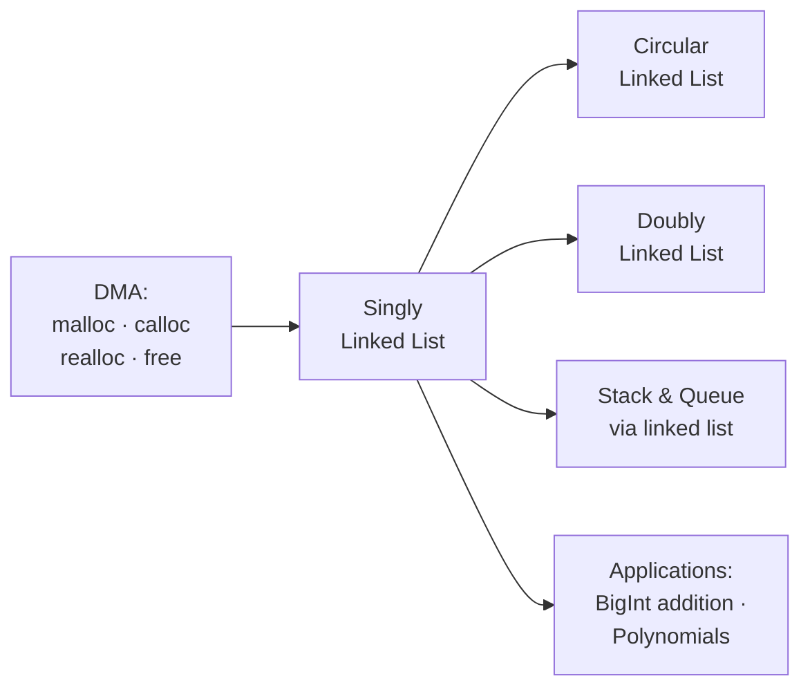

# UNIT-3: Data Structures — Linked Lists
**Course:** Data Structures & Algorithms (B.Tech. Curriculum)  
**Faculty / Source:** Dr. Selva Kumar S, Assistant Professor, B.M.S. College of Engineering (Unit-3)  
**Scope:** Comprehensive Study Notes, Academic Exam Guide, Technical Interview Implementations, Memory Diagnostics & Real-World Applications  

---

## Table of Contents
1. [Introduction to Linked Lists](#1-introduction-to-linked-lists)
2. [Arrays vs. Linked Lists: Architectural Comparison](#2-arrays-vs-linked-lists-architectural-comparison)
3. [Dynamic Memory Allocation (DMA) in C](#3-dynamic-memory-allocation-dma-in-c)
4. [Types of Linked Lists](#4-types-of-linked-lists)
5. [Singly Linked Lists (SLL)](#5-singly-linked-lists-sll)
   - [Node Anatomy & C Structures](#51-node-anatomy--c-structures)
   - [Insertion Operations](#52-insertion-operations)
   - [Deletion Operations](#53-deletion-operations)
   - [Traversal, Display & Node Counting](#54-traversal-display--node-counting)
   - [Linear Search Operation](#55-linear-search-operation)
   - [Concatenation (Iterative & Recursive)](#56-concatenation-of-two-linked-lists)
   - [Merging Sorted Linked Lists](#57-merging-two-sorted-linked-lists)
   - [Reversing a Singly Linked List (3-Pointer Method)](#58-reversing-a-singly-linked-list)
   - [Complete Menu-Driven C Program for SLL](#59-complete-menu-driven-c-program-for-sll)
6. [Linear ADT Implementations via Linked Lists](#6-linear-adt-implementations-via-linked-lists)
   - [Stack Implementation (LIFO)](#61-stack-implementation-using-linked-list)
   - [Queue Implementation (FIFO)](#62-queue-implementation-using-linked-list)
7. [Circular Linked Lists (CLL)](#7-circular-linked-lists-cll)
   - [Concept & Structural Properties](#71-concept--structural-properties)
   - [Insertion Operations](#72-circular-insertion-operations)
   - [Deletion Operations](#73-circular-deletion-operations)
   - [Search and Traversal](#74-circular-search-and-traversal)
8. [Doubly Linked Lists (DLL)](#8-doubly-linked-lists-dll)
   - [Node Anatomy & Two-Way Pointers](#81-node-anatomy--two-way-pointers)
   - [Insertion Operations](#82-doubly-insertion-operations)
   - [Deletion Operations](#83-doubly-deletion-operations)
   - [Bidirectional Traversal & Search](#84-bidirectional-traversal--search)
9. [Real-World Applications of Linked Lists](#9-real-world-applications-of-linked-lists)
   - [Application 1: Addition of Long Positive Integers (BigInt)](#91-application-1-addition-of-long-positive-integers-arbitrary-precision)
   - [Application 2: Polynomial Representation & Addition](#92-application-2-polynomial-representation--addition)
10. [Master Time & Space Complexity Matrix](#10-master-time--space-complexity-matrix)
11. [Exam Revision Points & Common Pitfalls](#11-exam-revision-points--common-pitfalls)

---

## 1. Introduction to Linked Lists

### 1.1 Definition
> **Linked List:** A linear, dynamic data structure consisting of a sequence of self-referential structures called **nodes**, where each node contains its own data payload and one or more **pointers (addresses)** referencing successor and/or predecessor nodes.

Unlike arrays, where elements occupy physically contiguous memory cells, linked list nodes can be scattered non-contiguously across arbitrary locations on the **Heap**. The sequential relationship between elements is maintained strictly via pointer links.

```text
HEADER / HEAD
  [ 1000 ] 
     |
     v
   [ Data: 20 | Next: 2000 ] ──► [ Data: 33 | Next: 3000 ] ──► [ Data: 14 | Next: NULL ]
   Address: 1000                 Address: 2000                 Address: 3000
```

---

### 1.2 Core Characteristics
1. **Dynamic Resizing:** Memory is allocated at runtime node-by-node on demand. The list grows and shrinks dynamically without needing an initial capacity bound.
2. **Non-Contiguous Allocation:** Eliminates the need for large blocks of continuous physical memory.
3. **Foundation for Advanced Structures:** Serves as the building block for dynamic Stacks, dynamic Queues, Adjacency Lists in Graphs, Polynomial algebra, and Tree structures.

---

### 1.3 Advantages & Disadvantages

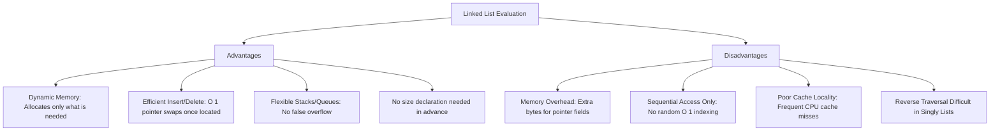

---

## 2. Arrays vs. Linked Lists: Architectural Comparison

```text
Array Memory Model (Contiguous):
Index:     0        1        2        3        4
Address: [0x100]  [0x104]  [0x108]  [0x112]  [0x116]
Value:   |  20  | |  33  | |  14  | |  65  | |  81  |

Linked List Memory Model (Non-Contiguous via Pointers):
Head ──► [ 20 | 0x850 ] ──► [ 33 | 0x320 ] ──► [ 14 | 0x990 ] ──► [ 81 | 0x140 ] ──► [ 65 | NULL ]
Addr:       0x100               0x850               0x320               0x990               0x140
```

| Parameter | Array (Static Array) | Linked List |
|---|---|---|
| **Memory Allocation** | **Static:** Allocated at compile time in the Stack/Data segment. | **Dynamic:** Allocated at runtime on the Heap via `malloc()` / `calloc()`. |
| **Size Flexibility** | Fixed capacity. Cannot expand or contract during program execution. | Variable capacity. Expands and contracts seamlessly node-by-node. |
| **Memory Layout** | Strictly **contiguous** physical memory addresses. | **Non-contiguous** memory blocks scattered across heap space. |
| **Element Access** | Direct / Random access in **$O(1)$** time via formula: $\text{Base} + (i \times \text{element\_size})$. | Sequential access only; requires traversing pointers from `head` in **$O(n)$** time. |
| **Insertion / Deletion** | Costly **$O(n)$** time due to shifting elements left or right to fill/open space. | Fast **$O(1)$** pointer update once the target position/pointer is reached. |
| **Memory Overhead** | Minimal (stores only raw data values, zero pointer overhead). | High overhead: stores data plus $4$ bytes (32-bit) or $8$ bytes (64-bit) pointer per node. |
| **Memory Wastage** | Space is wasted if array is underutilized; fails if capacity is exceeded. | Wastes memory on link pointers, but wastes zero space on unused element slots. |
| **Cache Locality** | **Excellent:** Sequential physical memory maximizes CPU cache line hits and hardware prefetching. | **Poor:** Scattered memory locations cause frequent CPU cache misses. |

---

## 3. Dynamic Memory Allocation (DMA) in C

Static data structures require sizing decisions at compile time. In dynamic linked structures, memory must be explicitly managed during program execution via standard library routines declared in `<stdlib.h>`.

### 3.1 Core DMA Functions

| Function Name | Prototype | Return Value | Purpose & Characteristics |
|---|---|---|---|
| `sizeof()` | `sizeof(type_or_variable)` | `size_t` (bytes) | Compile-time operator returning the exact memory footprint in bytes. |
| `malloc()` | `void* malloc(size_t size)` | Pointer to first byte, or `NULL` on failure | Allocates a raw block of `size` bytes. **Memory is uninitialized** (contains indeterminate garbage values). |
| `calloc()` | `void* calloc(size_t num, size_t size)` | Pointer to first byte, or `NULL` | Allocates memory for an array of `num` elements of `size` bytes each. **Initializes all bits to zero**. |
| `realloc()` | `void* realloc(void *ptr, size_t new_size)` | Pointer to resized block, or `NULL` | Resizes an existing memory block previously allocated by `malloc()` or `calloc()`. |
| `free()` | `void free(void *ptr)` | `void` | Deallocates heap memory previously allocated, releasing it back to the operating system. |

---

### 3.2 Dynamic Allocation Syntax & Node Instantiation
```c
#include <stdio.h>
#include <stdlib.h>

// 1. Primitive integer allocation
int *arr = (int *)malloc(10 * sizeof(int));

// 2. Linked list node allocation
struct Node {
    int data;
    struct Node *next;
};

struct Node *node_ptr = (struct Node *)malloc(sizeof(struct Node));
if (node_ptr == NULL) {
    printf("Memory Allocation Failed (Heap Exhausted)!\n");
    exit(1);
}
node_ptr->data = 25;
node_ptr->next = NULL;

// 3. Releasing memory
free(node_ptr);
node_ptr = NULL; // Prevent dangling pointer
```

---

## 4. Types of Linked Lists

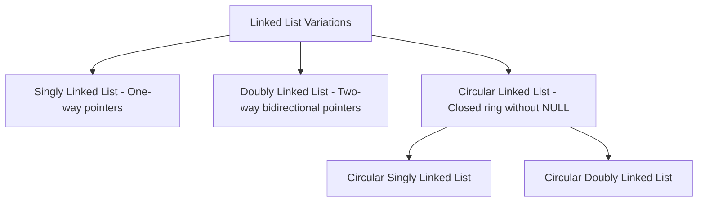

1. **Singly Linked List (SLL):** Each node contains data and a single pointer `next` directed to the subsequent node. The last node points to `NULL`.
2. **Doubly Linked List (DLL):** Each node contains data and two pointers: `prev` (pointing to the preceding node) and `next` (pointing to the subsequent node). Allows bidirectional traversal.
3. **Circular Linked List (CLL):** The last node's link field does not store `NULL`; instead, it wraps around to store the address of the `head` node, forming an unbroken circular chain.

**All variants side by side (one-glance memory model):**

```text
 SLL:  HEAD ──► [ 10 | • ] ──► [ 20 | • ] ──► [ 30 | ∅ ]         (1 pointer; ends in NULL)

 DLL:  HEAD ⇄ [ ∅| 10 | • ] ⇄ [ •| 20 | • ] ⇄ [ •| 30 | ∅ ]      (2 pointers; walk both ways)

 CLL:  HEAD ──► [ 10 | • ] ──► [ 20 | • ] ──► [ 30 | • ] ──┐      (tail loops back to HEAD)
                ▲                                          │
                └──────────────────────────────────────────┘

 Memory per node:   SLL: data + 1 pointer    DLL: data + 2 pointers    CLL: data + 1 pointer
```

---

## 5. Singly Linked Lists (SLL)

### 5.1 Node Anatomy & C Structures
A singly linked node consists of two logical parts:
- **Data Field:** Stores primitive values or structured payloads.
- **Link Field (`next`):** Stores a pointer of type `struct Node*` to the successor node.

```c
// Standard integer node
struct Node {
    int data;
    struct Node *next;
};

// Complex payload node (e.g., Library Book)
typedef struct Books {
    char title[50];
    char author[50];
    char subject[100];
    int book_id;
    struct Books *next;
} Book;
```

---

### 5.2 Insertion Operations

```text
Three Insertion Scenarios:
1. At the Beginning (Front)  --> O(1)
2. At the End (Append)        --> O(n) without tail / O(1) with tail
3. At a Specified Position    --> O(n)
```

#### 1. Insertion at Beginning
**Logic:**
1. Allocate memory for `new_node`.
2. Assign `new_node->data = val`.
3. Set `new_node->next = *head_ref`.
4. Update `*head_ref = new_node`.

```c
void push(struct Node** head_ref, int new_data) {
    struct Node* new_node = (struct Node*)malloc(sizeof(struct Node));
    new_node->data = new_data;
    new_node->next = (*head_ref);
    (*head_ref) = new_node;
}
```

```text
Before: HEAD ──► [ A | • ] ──► [ B | NULL ]
Insert: [ E | • ] ──► [ A | • ]
After:  HEAD ──► [ E | • ] ──► [ A | • ] ──► [ B | NULL ]
```

---

#### 2. Insertion at End
**Logic:**
1. Allocate `new_node` and set `new_node->next = NULL`.
2. If list is empty (`*head_ref == NULL`), set `*head_ref = new_node; return;`.
3. Otherwise, traverse pointer `last` until `last->next == NULL`.
4. Reassign `last->next = new_node`.

```c
void append(struct Node** head_ref, int new_data) {
    struct Node* new_node = (struct Node*)malloc(sizeof(struct Node));
    new_node->data = new_data;
    new_node->next = NULL;

    if (*head_ref == NULL) {
        *head_ref = new_node;
        return;
    }

    struct Node* last = *head_ref;
    while (last->next != NULL) {
        last = last->next;
    }
    last->next = new_node;
}
```

---

#### 3. Insertion After a Given Position / Node
**Logic:**
1. Traverse `temp` to node at location `pos - 1`.
2. Ensure `temp != NULL` (position exists).
3. Connect `new_node->next = temp->next`.
4. Connect `temp->next = new_node`.

```c
void insertAfter(struct Node* prev_node, int new_data) {
    if (prev_node == NULL) {
        printf("The given previous node cannot be NULL\n");
        return;
    }
    struct Node* new_node = (struct Node*)malloc(sizeof(struct Node));
    new_node->data = new_data;
    new_node->next = prev_node->next;
    prev_node->next = new_node;
}
```

```text
Before: ... [ temp | • ] ─────────────► [ next_node | • ] ...
                  \                     ^
                   \                   /
After:  ... [ temp | • ] ──► [ new_node | • ]
```

---

### 5.3 Deletion Operations

```text
Three Deletion Scenarios:
1. At the Beginning (Front)  --> O(1)
2. At the End (Last)         --> O(n)
3. At a Specified Position    --> O(n)
```

#### 1. Deletion at Beginning
**Logic:**
1. Check if `head == NULL` (Underflow).
2. Save address of first node: `ptr = head`.
3. Advance head pointer: `head = head->next`.
4. Free old head memory: `free(ptr)`.

```c
void deleteBeginning(struct Node** head_ref) {
    if (*head_ref == NULL) {
        printf("List Underflow! List is empty.\n");
        return;
    }
    struct Node* temp = *head_ref;
    *head_ref = (*head_ref)->next;
    free(temp);
}
```

---

#### 2. Deletion at End
**Logic:**
1. If `head == NULL`, return underflow.
2. If list contains only 1 node (`head->next == NULL`), `free(head); head = NULL; return;`.
3. Maintain two pointers (`ptr` and `prev`). Traverse until `ptr->next == NULL`.
4. Break the link: `prev->next = NULL`.
5. Free last node: `free(ptr)`.

```c
void deleteEnd(struct Node** head_ref) {
    if (*head_ref == NULL) {
        printf("List is empty\n");
        return;
    }
    if ((*head_ref)->next == NULL) {
        free(*head_ref);
        *head_ref = NULL;
        return;
    }
    struct Node* ptr = *head_ref;
    struct Node* prev = NULL;
    while (ptr->next != NULL) {
        prev = ptr;
        ptr = ptr->next;
    }
    prev->next = NULL;
    free(ptr);
}
```

---

#### 3. Deletion at Specified Position ($1$-Based Index `loc`)
**Logic:**
1. Traverse `ptr` to position `loc`, keeping track of predecessor `prev`.
2. If `ptr == NULL`, target location is beyond list length.
3. Bypass node: `prev->next = ptr->next`.
4. Free node: `free(ptr)`.

```c
void deleteAtPosition(struct Node** head_ref, int loc) {
    if (*head_ref == NULL) return;
    
    struct Node* temp = *head_ref;
    if (loc == 1) {
        *head_ref = temp->next;
        free(temp);
        return;
    }
    
    struct Node* prev = NULL;
    for (int i = 1; temp != NULL && i < loc; i++) {
        prev = temp;
        temp = temp->next;
    }
    
    if (temp == NULL) {
        printf("Position %d does not exist in list.\n", loc);
        return;
    }
    
    prev->next = temp->next;
    free(temp);
}
```

---

### 5.4 Traversal, Display & Node Counting

```c
// Traversal and display
void printList(struct Node* node) {
    printf("List: HEAD -> ");
    while (node != NULL) {
        printf("[%d | •] -> ", node->data);
        node = node->next;
    }
    printf("NULL\n");
}

// Counting total nodes
int countNodes(struct Node* head) {
    int count = 0;
    struct Node* temp = head;
    while (temp != NULL) {
        count++;
        temp = temp->next;
    }
    return count;
}
```

---

### 5.5 Linear Search Operation
Traverses the list sequentially and compares each node's data against the search key.

```c
int searchList(struct Node* head, int key) {
    struct Node* current = head;
    int index = 1; // 1-based index
    while (current != NULL) {
        if (current->data == key)
            return index; // Found at position
        current = current->next;
        index++;
    }
    return -1; // Not found
}
```
- **Time Complexity:** Best Case $O(1)$, Worst Case $O(n)$.

---

### 5.6 Concatenation of Two Linked Lists
Appends list `b` to the tail of list `a`.

#### 1. Iterative Concatenation:
```c
struct Node* concat(struct Node* start1, struct Node* start2) {
    if (start1 == NULL) return start2;
    if (start2 == NULL) return start1;
    
    struct Node* ptr = start1;
    while (ptr->next != NULL) {
        ptr = ptr->next;
    }
    ptr->next = start2;
    return start1;
}
```

#### 2. Recursive Concatenation:
```c
void concatenateRecursive(struct Node* a, struct Node* b) {
    if (a != NULL && b != NULL) {
        if (a->next == NULL)
            a->next = b;
        else
            concatenateRecursive(a->next, b);
    }
}
```

---

### 5.7 Merging Two Sorted Linked Lists
Given two pre-sorted singly linked lists, merge them into a single sorted list in **$O(n_1 + n_2)$** time without allocating new node data fields (by rearranging pointers).

```text
List 1: [ 4 ] ──► [ 8 ] ──► [ 15 ] ──► [ 19 ] ──► NULL
List 2: [ 7 ] ──► [ 9 ] ──► [ 10 ] ──► [ 16 ] ──► NULL

Merged: [ 4 ] ──► [ 7 ] ──► [ 8 ] ──► [ 9 ] ──► [ 10 ] ──► [ 15 ] ──► [ 16 ] ──► [ 19 ] ──► NULL
```

```c
struct Node* mergeSorted(struct Node* head1, struct Node* head2) {
    if (head1 == NULL) return head2;
    if (head2 == NULL) return head1;

    struct Node* mergedHead = NULL;
    struct Node* mergedTail = NULL;

    // Pick initial head
    if (head1->data <= head2->data) {
        mergedHead = head1;
        head1 = head1->next;
    } else {
        mergedHead = head2;
        head2 = head2->next;
    }
    mergedTail = mergedHead;

    // Splice remaining nodes
    while (head1 != NULL && head2 != NULL) {
        if (head1->data <= head2->data) {
            mergedTail->next = head1;
            mergedTail = head1;
            head1 = head1->next;
        } else {
            mergedTail->next = head2;
            mergedTail = head2;
            head2 = head2->next;
        }
    }

    // Attach remaining tail
    if (head1 != NULL)
        mergedTail->next = head1;
    else
        mergedTail->next = head2;

    return mergedHead;
}
```

---

### 5.8 Reversing a Singly Linked List
In-place iterative reversal using the **3-pointer technique (`prev`, `current`, `next`)**:

```text
Step-by-step 3-Pointer Reversal:

Initial:    prev = NULL, current = Head [1]
            (NULL) <--- [1]       [2] ──► [3] ──► NULL
                          ^        ^
                         prev     curr

Iteration:  1. next = current->next      (Preserve reference to remainder)
            2. current->next = prev      (Reverse directional pointer)
            3. prev = current            (Advance prev forward)
            4. current = next            (Advance curr forward)

Final:      *head_ref = prev             (New head points to former tail)
```

```c
void reverse(struct Node** head_ref) {
    struct Node* prev = NULL;
    struct Node* current = *head_ref;
    struct Node* next = NULL;

    while (current != NULL) {
        next = current->next;     // 1. Store next node
        current->next = prev;     // 2. Reverse current node pointer
        prev = current;           // 3. Move prev forward
        current = next;           // 4. Move current forward
    }
    *head_ref = prev;             // 5. Update head to new front
}
```
- **Time Complexity:** $O(n)$
- **Auxiliary Space:** $O(1)$

**Full reversal trace on `1 → 2 → 3 → NULL` (watch all three pointers move):**

```text
 init:    prev = NULL   curr = [1]                    ∅     [1]──►[2]──►[3]──►∅
                       next = ?
 pass 1:  next = [2]; [1]->next = prev;                ∅◄──[1]    [2]──►[3]──►∅
          prev = [1]; curr = [2]
 pass 2:  next = [3]; [2]->next = [1];                ∅◄──[1]◄──[2]    [3]──►∅
          prev = [2]; curr = [3]
 pass 3:  next = NULL; [3]->next = [2];               ∅◄──[1]◄──[2]◄──[3]
          prev = [3]; curr = NULL  →  loop stops
 result:  *head_ref = prev = [3]          HEAD ──► [3]──►[2]──►[1]──► NULL ✔
```

---

### 5.9 Complete Menu-Driven C Program for SLL
```c
#include <stdio.h>
#include <stdlib.h>

struct node {
    int data;
    struct node *next;
};
struct node *head = NULL;

void beginsert() {
    struct node *ptr = (struct node *)malloc(sizeof(struct node));
    int item;
    if (ptr == NULL) {
        printf("\nOVERFLOW\n");
        return;
    }
    printf("\nEnter value: ");
    scanf("%d", &item);
    ptr->data = item;
    ptr->next = head;
    head = ptr;
    printf("Node inserted at beginning.\n");
}

void lastinsert() {
    struct node *ptr = (struct node *)malloc(sizeof(struct node));
    struct node *temp;
    int item;
    if (ptr == NULL) {
        printf("\nOVERFLOW\n");
        return;
    }
    printf("\nEnter value: ");
    scanf("%d", &item);
    ptr->data = item;
    ptr->next = NULL;
    if (head == NULL) {
        head = ptr;
    } else {
        temp = head;
        while (temp->next != NULL) {
            temp = temp->next;
        }
        temp->next = ptr;
    }
    printf("Node inserted at end.\n");
}

void randominsert() {
    int i, loc, item;
    struct node *ptr = (struct node *)malloc(sizeof(struct node));
    struct node *temp;
    if (ptr == NULL) {
        printf("\nOVERFLOW\n");
        return;
    }
    printf("\nEnter element value: ");
    scanf("%d", &item);
    printf("Enter location after which to insert: ");
    scanf("%d", &loc);
    ptr->data = item;
    temp = head;
    for (i = 0; i < loc - 1; i++) {
        temp = temp->next;
        if (temp == NULL) {
            printf("\nCannot insert, location out of range.\n");
            free(ptr);
            return;
        }
    }
    ptr->next = temp->next;
    temp->next = ptr;
    printf("Node inserted.\n");
}

void begin_delete() {
    struct node *ptr;
    if (head == NULL) {
        printf("\nList is empty\n");
        return;
    }
    ptr = head;
    head = ptr->next;
    free(ptr);
    printf("\nNode deleted from beginning.\n");
}

void last_delete() {
    struct node *ptr, *ptr1;
    if (head == NULL) {
        printf("\nList is empty\n");
        return;
    }
    if (head->next == NULL) {
        free(head);
        head = NULL;
        printf("\nOnly node deleted.\n");
        return;
    }
    ptr = head;
    while (ptr->next != NULL) {
        ptr1 = ptr;
        ptr = ptr->next;
    }
    ptr1->next = NULL;
    free(ptr);
    printf("\nNode deleted from end.\n");
}

void display() {
    struct node *ptr = head;
    if (ptr == NULL) {
        printf("\nNothing to print (Empty list).\n");
        return;
    }
    printf("\nPrinting list elements: ");
    while (ptr != NULL) {
        printf("%d -> ", ptr->data);
        ptr = ptr->next;
    }
    printf("NULL\n");
}

int main() {
    int choice = 0;
    while (choice != 7) {
        printf("\n*** Singly Linked List Menu ***\n");
        printf("1. Insert Beginning\n2. Insert End\n3. Insert Random\n");
        printf("4. Delete Beginning\n5. Delete End\n6. Display\n7. Exit\n");
        printf("Enter your choice: ");
        scanf("%d", &choice);
        switch (choice) {
            case 1: beginsert(); break;
            case 2: lastinsert(); break;
            case 3: randominsert(); break;
            case 4: begin_delete(); break;
            case 5: last_delete(); break;
            case 6: display(); break;
            case 7: exit(0);
            default: printf("Invalid choice!\n");
        }
    }
    return 0;
}
```

---

## 6. Linear ADT Implementations via Linked Lists

### 6.1 Stack Implementation using Linked List
In a linked-list-based Stack, the `head` pointer functions as the **TOP** of the stack:
- **`push(val)`:** Insert node at the **beginning** of the list ($O(1)$).
- **`pop()`:** Delete node from the **beginning** of the list ($O(1)$).
- **No Overflow Limit:** Stack never overflows unless total system heap memory is exhausted.

```text
       +-----+      +-----------+      +-----------+
TOP ──►| 30  | ───► | 20 |   •  | ───► | 10 | NULL |
       +-----+      +-----------+      +-----------+
      (New Head)
```

```c
void pushStack(struct node** top_ref, int val) {
    struct node* new_node = (struct node*)malloc(sizeof(struct node));
    if (new_node == NULL) {
        printf("Heap Overflow!\n");
        return;
    }
    new_node->data = val;
    new_node->next = *top_ref;
    *top_ref = new_node;
}

int popStack(struct node** top_ref) {
    if (*top_ref == NULL) {
        printf("Stack Underflow!\n");
        return -1;
    }
    struct node* temp = *top_ref;
    int popped = temp->data;
    *top_ref = (*top_ref)->next;
    free(temp);
    return popped;
}
```

---

### 6.2 Queue Implementation using Linked List
In a linked-list-based Queue, we maintain two pointers:
- **`front`:** Points to the first node (where **Dequeue** occurs in $O(1)$).
- **`rear`:** Points to the last node (where **Enqueue** occurs in $O(1)$).

```text
FRONT                                                 REAR
  |                                                     |
  v                                                     v
[ 10 | • ] ────────► [ 20 | • ] ────────► [ 30 | • ] ──► [ 40 | NULL ]
  |                                                        ^
DEQUEUE (Pop from Front)                       ENQUEUE (Append to Rear)
```

```c
struct Queue {
    struct node *front, *rear;
};

void enqueue(struct Queue* q, int val) {
    struct node* temp = (struct node*)malloc(sizeof(struct node));
    temp->data = val;
    temp->next = NULL;
    if (q->rear == NULL) {
        q->front = q->rear = temp;
        return;
    }
    q->rear->next = temp;
    q->rear = temp;
}

int dequeue(struct Queue* q) {
    if (q->front == NULL) {
        printf("Queue Underflow!\n");
        return -1;
    }
    struct node* temp = q->front;
    int data = temp->data;
    q->front = q->front->next;
    if (q->front == NULL)
        q->rear = NULL;
    free(temp);
    return data;
}
```

---

## 7. Circular Linked Lists (CLL)

### 7.1 Concept & Structural Properties
A **Circular Linked List** is an unbroken sequence where every node contains a valid address; **no node points to `NULL`**. The `next` pointer of the final node loops back to point to the `head` node.

```text
HEAD
  |
  v
[ 1 | • ] ──► [ 2 | • ] ──► [ 3 | • ]
  ^                                 |
  +─────────────────────────────────+  (Last node loops back to HEAD)
```

- **Advantage:** Any node can serve as a starting point; the entire list can be traversed from any arbitrary node.
- **Applications:** CPU Round-Robin time-slice scheduling, audio/video playlist repeat loops, multiplayer turn-based game rotations.

---

### 7.2 Circular Insertion Operations

#### 1. Circular Insertion at Beginning:
```c
void circularInsertBeginning(struct node** head_ref, int item) {
    struct node* ptr = (struct node*)malloc(sizeof(struct node));
    ptr->data = item;
    
    if (*head_ref == NULL) {
        *head_ref = ptr;
        ptr->next = *head_ref;
        return;
    }
    
    // Traverse to the last node to update its next pointer
    struct node* temp = *head_ref;
    while (temp->next != *head_ref) {
        temp = temp->next;
    }
    ptr->next = *head_ref;
    temp->next = ptr;
    *head_ref = ptr; // Update head
}
```

#### 2. Circular Insertion at End:
```c
void circularInsertEnd(struct node** head_ref, int item) {
    struct node* ptr = (struct node*)malloc(sizeof(struct node));
    ptr->data = item;
    
    if (*head_ref == NULL) {
        *head_ref = ptr;
        ptr->next = *head_ref;
        return;
    }
    
    struct node* temp = *head_ref;
    while (temp->next != *head_ref) {
        temp = temp->next;
    }
    temp->next = ptr;
    ptr->next = *head_ref; // Close loop to head
}
```

---

### 7.3 Circular Deletion Operations

#### 1. Circular Deletion at Beginning:
```c
void circularDeleteBeginning(struct node** head_ref) {
    if (*head_ref == NULL) {
        printf("Underflow!\n");
        return;
    }
    if ((*head_ref)->next == *head_ref) { // Single node
        free(*head_ref);
        *head_ref = NULL;
        return;
    }
    struct node* temp = *head_ref;
    struct node* last = *head_ref;
    while (last->next != *head_ref) {
        last = last->next;
    }
    last->next = (*head_ref)->next;
    *head_ref = (*head_ref)->next;
    free(temp);
}
```

#### 2. Circular Deletion at End:
```c
void circularDeleteEnd(struct node** head_ref) {
    if (*head_ref == NULL) return;
    if ((*head_ref)->next == *head_ref) {
        free(*head_ref);
        *head_ref = NULL;
        return;
    }
    struct node* ptr = *head_ref;
    struct node* preptr = NULL;
    while (ptr->next != *head_ref) {
        preptr = ptr;
        ptr = ptr->next;
    }
    preptr->next = *head_ref; // Point second-to-last node back to head
    free(ptr);
}
```

---

### 7.4 Circular Search and Traversal
Notice that the loop terminating condition is `temp->next != head` (not `!= NULL`), followed by processing the final node:

```c
void circularTraverse(struct node* head) {
    if (head == NULL) {
        printf("List is empty\n");
        return;
    }
    struct node* ptr = head;
    printf("Circular List: ");
    do {
        printf("%d -> ", ptr->data);
        ptr = ptr->next;
    } while (ptr != head);
    printf("(HEAD)\n");
}
```

---

## 8. Doubly Linked Lists (DLL)

### 8.1 Node Anatomy & Two-Way Pointers
A Doubly Linked List node has **three fields**:
1. `prev`: Pointer storing the memory address of the **preceding node** (or `NULL` if head).
2. `data`: The element payload.
3. `next`: Pointer storing the memory address of the **succeeding node** (or `NULL` if tail).

```c
struct DLLNode {
    struct DLLNode *prev;
    int data;
    struct DLLNode *next;
};
```

```text
HEAD
  |
  v
[ NULL | 10 | • ] <=====> [ • | 20 | • ] <=====> [ • | 30 | NULL ]
```

---

### 8.2 Doubly Insertion Operations

#### 1. Insertion at Beginning:
```c
void insertBeginningDLL(struct DLLNode** head_ref, int item) {
    struct DLLNode* ptr = (struct DLLNode*)malloc(sizeof(struct DLLNode));
    ptr->data = item;
    ptr->prev = NULL;
    ptr->next = *head_ref;

    if (*head_ref != NULL) {
        (*head_ref)->prev = ptr;
    }
    *head_ref = ptr;
}
```

#### 2. Insertion at End:
```c
void insertEndDLL(struct DLLNode** head_ref, int item) {
    struct DLLNode* ptr = (struct DLLNode*)malloc(sizeof(struct DLLNode));
    ptr->data = item;
    ptr->next = NULL;

    if (*head_ref == NULL) {
        ptr->prev = NULL;
        *head_ref = ptr;
        return;
    }

    struct DLLNode* temp = *head_ref;
    while (temp->next != NULL) {
        temp = temp->next;
    }
    temp->next = ptr;
    ptr->prev = temp;
}
```

#### 3. Insertion After a Specified Node:
```c
void insertAfterDLL(struct DLLNode* prev_node, int item) {
    if (prev_node == NULL) return;

    struct DLLNode* ptr = (struct DLLNode*)malloc(sizeof(struct DLLNode));
    ptr->data = item;
    ptr->next = prev_node->next;
    ptr->prev = prev_node;

    if (prev_node->next != NULL) {
        prev_node->next->prev = ptr;
    }
    prev_node->next = ptr;
}
```

**The four pointer updates in a DLL insertion (order matters!):**

```text
Inserting node X after node P:

 BEFORE:   ... ⇄ [ •| A |• ] ⇄ [ •| P |• ] ⇄ [ •| N |• ] ⇄ ...
                                  │ (1)  ▲ (2)
                                  ▼      │
 AFTER:    ... ⇄ [ •| A |• ] ⇄ [ •| P |• ] ⇄ [ •| X |• ] ⇄ [ •| N |• ] ⇄ ...

   1. X->next  = P->next       (X points forward to N)
   2. X->prev  = P             (X points backward to P)
   3. P->next  = X             (P adopts X as its successor)
   4. N->prev  = X             (N adopts X as its predecessor — skip if N is NULL)
```

---

### 8.3 Doubly Deletion Operations

#### 1. Deletion at Beginning:
```c
void deleteBeginningDLL(struct DLLNode** head_ref) {
    if (*head_ref == NULL) return;
    struct DLLNode* ptr = *head_ref;
    *head_ref = (*head_ref)->next;
    if (*head_ref != NULL) {
        (*head_ref)->prev = NULL;
    }
    free(ptr);
}
```

#### 2. Deletion at End:
```c
void deleteEndDLL(struct DLLNode** head_ref) {
    if (*head_ref == NULL) return;
    if ((*head_ref)->next == NULL) {
        free(*head_ref);
        *head_ref = NULL;
        return;
    }
    struct DLLNode* ptr = *head_ref;
    while (ptr->next != NULL) {
        ptr = ptr->next;
    }
    ptr->prev->next = NULL;
    free(ptr);
}
```

#### 3. Deletion of Node by Value:
```c
void deleteNodeDLL(struct DLLNode** head_ref, int val) {
    struct DLLNode* temp = *head_ref;
    while (temp != NULL && temp->data != val) {
        temp = temp->next;
    }
    if (temp == NULL) {
        printf("Node with value %d not found.\n", val);
        return;
    }
    if (*head_ref == temp) {
        *head_ref = temp->next;
    }
    if (temp->next != NULL) {
        temp->next->prev = temp->prev;
    }
    if (temp->prev != NULL) {
        temp->prev->next = temp->next;
    }
    free(temp);
}
```

---

### 8.4 Bidirectional Traversal & Search
Because each node maintains both `prev` and `next`, DLLs can be traversed forward and backward:

```c
void traverseForward(struct DLLNode* head) {
    while (head != NULL) {
        printf("%d <-> ", head->data);
        head = head->next;
    }
    printf("NULL\n");
}

void traverseBackward(struct DLLNode* tail) {
    while (tail != NULL) {
        printf("%d <-> ", tail->data);
        tail = tail->prev;
    }
    printf("NULL\n");
}
```

---

## 9. Real-World Applications of Linked Lists

### 9.1 Application 1: Addition of Long Positive Integers (Arbitrary Precision)

#### Problem Context:
Standard numeric types (`int` = 32 bits, `unsigned long long` = 64 bits) can only store integers up to $\approx 1.84 \times 10^{19}$. When dealing with cryptographic keys or scientific computation involving 50+ to 1000+ digits, primitive data types overflow.

#### The Linked List Solution:
1. Long numbers are read as strings (e.g., `num1 = "458"`, `num2 = "7985"`).
2. Digits are parsed and **inserted at the beginning** of a linked list. This ensures that the **Least Significant Digit (LSD)** sits at the `head`, mirroring manual right-to-left paper addition:
   - `num1 = "458"` $\implies$ `head1: 8 -> 5 -> 4 -> NULL`
   - `num2 = "7985"` $\implies$ `head2: 5 -> 8 -> 9 -> 7 -> NULL`
3. Traversal adds corresponding digit pairs along with `carry`:
   - $\text{sum} = d_1 + d_2 + \text{carry}$
   - $\text{new\_digit} = \text{sum} \bmod 10$
   - $\text{carry} = \text{sum} / 10$

```text
head1:   [ 8 | • ] ──► [ 5 | • ] ──► [ 4 | NULL ]
          +             +             +
head2:   [ 5 | • ] ──► [ 8 | • ] ──► [ 9 | • ] ──► [ 7 | NULL ]
------------------------------------------------------------------
Sum:      13            14            14             8
Digits:   '3'           '4'           '4'           '8'
Carry:     1             1             1             0

Result List / Buffer: "3448"
Reversed Output:      "8443"  (Correct: 458 + 7985 = 8443!)
```

#### Complete Implementation in C:
```c
#include <stdio.h>
#include <stdlib.h>
#include <string.h>

struct DigitNode {
    int digit;
    struct DigitNode* next;
};

struct DigitNode* insertDigit(struct DigitNode* head, int d) {
    struct DigitNode* new_node = (struct DigitNode*)malloc(sizeof(struct DigitNode));
    new_node->digit = d;
    new_node->next = head; // Insert at front to reverse order
    return new_node;
}

void addLongIntegers(char num1[], char num2[], char result[]) {
    struct DigitNode *head1 = NULL, *head2 = NULL;
    
    // Convert string to linked list with LSD at head
    for (int i = 0; num1[i] != '\0'; i++)
        head1 = insertDigit(head1, num1[i] - '0');
    for (int i = 0; num2[i] != '\0'; i++)
        head2 = insertDigit(head2, num2[i] - '0');

    int carry = 0, index = 0;
    struct DigitNode *t1 = head1, *t2 = head2;

    while (t1 != NULL || t2 != NULL || carry != 0) {
        int d1 = (t1 != NULL) ? t1->digit : 0;
        int d2 = (t2 != NULL) ? t2->digit : 0;
        int sum = d1 + d2 + carry;

        carry = sum / 10;
        result[index++] = (sum % 10) + '0';

        if (t1 != NULL) t1 = t1->next;
        if (t2 != NULL) t2 = t2->next;
    }
    result[index] = '\0';

    // Reverse result string to display MSD first
    int len = strlen(result);
    for (int i = 0; i < len / 2; i++) {
        char temp = result[i];
        result[i] = result[len - 1 - i];
        result[len - 1 - i] = temp;
    }
}
```

---

### 9.2 Application 2: Polynomial Representation & Addition

#### Mathematical Formulation:
A single-variable polynomial $P(x) = c_n x^{e_n} + c_{n-1} x^{e_{n-1}} + \dots + c_0 x^{e_0}$ is represented as a linked list where each node stores:
1. `coef`: The coefficient ($c_i$).
2. `exp`: The exponent power ($e_i$).
3. `next`: Pointer to the term with the next lower exponent.

```c
struct PolyNode {
    int coef;
    int exp;
    struct PolyNode* next;
};
```

```text
Poly 1: 3x^8 + 5x^7 - 2x^6 + 8x^4
[ 3 | 8 | • ] ──► [ 5 | 7 | • ] ──► [ -2 | 6 | • ] ──► [ 8 | 4 | NULL ]

Poly 2: 4x^7 + 5x^6 - x^3 + 7x^2 - 3
[ 4 | 7 | • ] ──► [ 5 | 6 | • ] ──► [ -1 | 3 | • ] ──► [ 7 | 2 | • ] ──► [ -3 | 0 | NULL ]
```

#### Addition Logic (Merge Paradigm):
Simultaneously traverse both lists with pointers `p` and `q`:
1. **If `p->exp == q->exp`:** Add coefficients: `sum_coef = p->coef + q->coef`. If `sum_coef != 0`, append term `(sum_coef, p->exp)` to result list. Advance both `p` and `q`.
2. **If `p->exp > q->exp`:** Append term `(p->coef, p->exp)` to result list. Advance `p`.
3. **If `p->exp < q->exp`:** Append term `(q->coef, q->exp)` to result list. Advance `q`.
4. **Append Remainder:** Once one polynomial terminates, append all remaining nodes of the unfinished list.

```text
Result of Poly 1 + Poly 2:
3x^8 + 9x^7 + 3x^6 + 8x^4 - x^3 + 7x^2 - 3

[ 3 | 8 | • ] ──► [ 9 | 7 | • ] ──► [ 3 | 6 | • ] ──► [ 8 | 4 | • ] ──► [ -1 | 3 | • ] ──► [ 7 | 2 | • ] ──► [ -3 | 0 | NULL ]
```

#### Complete C Program:
```c
#include <stdio.h>
#include <stdlib.h>

struct PolyNode {
    int coef;
    int exp;
    struct PolyNode* next;
};

struct PolyNode* createTerm(int c, int e) {
    struct PolyNode* new_term = (struct PolyNode*)malloc(sizeof(struct PolyNode));
    new_term->coef = c;
    new_term->exp = e;
    new_term->next = NULL;
    return new_term;
}

void appendTerm(struct PolyNode** head, int c, int e) {
    struct PolyNode* new_term = createTerm(c, e);
    if (*head == NULL) {
        *head = new_term;
        return;
    }
    struct PolyNode* temp = *head;
    while (temp->next != NULL)
        temp = temp->next;
    temp->next = new_term;
}

struct PolyNode* addPolynomials(struct PolyNode* p1, struct PolyNode* p2) {
    struct PolyNode* result = NULL;

    while (p1 != NULL && p2 != NULL) {
        if (p1->exp == p2->exp) {
            int sum = p1->coef + p2->coef;
            if (sum != 0)
                appendTerm(&result, sum, p1->exp);
            p1 = p1->next;
            p2 = p2->next;
        } else if (p1->exp > p2->exp) {
            appendTerm(&result, p1->coef, p1->exp);
            p1 = p1->next;
        } else {
            appendTerm(&result, p2->coef, p2->exp);
            p2 = p2->next;
        }
    }

    while (p1 != NULL) {
        appendTerm(&result, p1->coef, p1->exp);
        p1 = p1->next;
    }
    while (p2 != NULL) {
        appendTerm(&result, p2->coef, p2->exp);
        p2 = p2->next;
    }

    return result;
}

void displayPoly(struct PolyNode* p) {
    while (p != NULL) {
        printf("%dx^%d", p->coef, p->exp);
        if (p->next != NULL && p->next->coef >= 0)
            printf(" + ");
        else if (p->next != NULL)
            printf(" ");
        p = p->next;
    }
    printf("\n");
}
```

---

## 10. Master Time & Space Complexity Matrix

| Operation | Static Array | Singly Linked List (SLL) | Doubly Linked List (DLL) | Circular Linked List (CLL) |
|---|:---:|:---:|:---:|:---:|
| **Access by Index $[k]$** | **$O(1)$** | $O(n)$ | $O(n)$ | $O(n)$ |
| **Search by Value** | $O(n)$ (or $O(\log n)$ sorted) | $O(n)$ | $O(n)$ | $O(n)$ |
| **Insert at Beginning** | $O(n)$ (Shift all) | **$O(1)$** | **$O(1)$** | **$O(1)$** (with tail) / $O(n)$ |
| **Insert at End** | $O(1)$ (if space) | $O(n)$ (or $O(1)$ with tail) | $O(n)$ (or $O(1)$ with tail) | **$O(1)$** (with tail) / $O(n)$ |
| **Insert After Node** | $O(n)$ (Shift right) | **$O(1)$** | **$O(1)$** | **$O(1)$** |
| **Delete at Beginning** | $O(n)$ (Shift left) | **$O(1)$** | **$O(1)$** | **$O(1)$** (with tail) / $O(n)$ |
| **Delete at End** | $O(1)$ | $O(n)$ | $O(1)$ (with tail) | $O(n)$ |
| **Delete Given Node** | $O(n)$ | $O(n)$ (needs predecessor)| **$O(1)$** (direct node pointer) | $O(n)$ |
| **Reverse Traversal** | **$O(1)$** | Not possible / $O(n)$ stack | **$O(1)$** (via `prev`) | Not directly possible |
| **Auxiliary Memory Overhead** | **$0$** (No pointers) | $1$ pointer per node | $2$ pointers per node | $1$ pointer per node |

---

## 11. Exam Revision Points & Common Pitfalls

### Key Takeaways for Examinations:
1. **Dynamic Sizing:** Linked lists allow runtime memory expansion without predetermining capacity bounds.
2. **Double Pointer Convention (`**head_ref`):** Used when a function modifies the `head` pointer itself (e.g., `push()`, `deleteBeginning()`). If passed as a single pointer `*head`, modifications remain local to the function frame.
3. **Pointers Overhead:** For an $n$-element integer list on a 64-bit architecture:
   - Data: $4 \times n$ bytes.
   - Pointers: $8 \times n$ bytes.
   - Pointer overhead exceeds raw payload size!
4. **Circular Termination:** Never test for `ptr == NULL` in a circular linked list; this creates an **infinite loop**. The proper terminating condition is `ptr->next == head` or a `do { ... } while(ptr != head);` construct.
5. **Reversal Pointers:** The classical iterative reversal requires precisely **three moving pointers** (`prev = NULL`, `current = head`, `next = NULL`).

### Common Pitfalls to Avoid:
- **Memory Leaks:** Always invoke `free(ptr)` when deleting nodes. Failing to do so causes unreferenced memory to accumulate on the heap.
- **Dangling Pointers:** Accessing `node->next` after `free(node)` invokes undefined behavior. Always store `temp = node->next` before calling `free(node)`.
- **Dereferencing NULL:** Always guard pointer traversals with `if (temp == NULL)` before accessing `temp->next` or `temp->data`.

# PART III — Trees, Binary Search Trees & Hashing

> **Source:** `3.Trees.md` (Units 4 & 5 — Trees and Hashing, B.M.S. College of Engineering). Complete content preserved below.

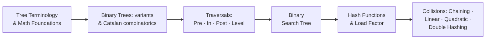

# UNIT-4 & 5: Data Structures — Trees and Hashing
**Course:** Data Structures & Algorithms (B.Tech. Curriculum)  
**Faculty / Source:** Dr. Selva Kumar S, Assistant Professor, B.M.S. College of Engineering (Units 4 & 5)  
**Scope:** Complete Academic Lecture Notes, Interview Preparation, Mathematical Derivations & Verified Implementations  

---

## Table of Contents
1. [Introduction to Trees & Mathematical Foundations](#1-introduction-to-trees--mathematical-foundations)
2. [Comprehensive Tree Terminology & Anatomy](#2-comprehensive-tree-terminology--anatomy)
3. [Taxonomy & Types of Trees](#3-taxonomy--types-of-trees)
4. [Binary Trees: Combinatorics & Structural Variants](#4-binary-trees-combinatorics--structural-variants)
5. [Tree Traversal Techniques & Visual Shortcuts](#5-tree-traversal-techniques--visual-shortcuts)
6. [Binary Search Trees (BST): Theory & Construction](#6-binary-search-trees-bst-theory--construction)
7. [BST Operations: Search, Insertion, and Deletion](#7-bst-operations-search-insertion-and-deletion)
8. [Hashing: Principles, Mechanisms & Hash Functions](#8-hashing-principles-mechanisms--hash-functions)
9. [Collision Resolution Techniques](#9-collision-resolution-techniques)
   - [Separate Chaining (Open Hashing)](#91-separate-chaining-open-hashing)
   - [Open Addressing (Closed Hashing)](#92-open-addressing-closed-hashing)
   - [Linear Probing](#93-linear-probing)
   - [Quadratic Probing](#94-quadratic-probing)
   - [Double Hashing](#95-double-hashing)
   - [Comparative Analysis & Clustering Behavior](#96-comparative-analysis-of-collision-resolution-methods)
10. [Core Algorithms & Interview Implementations](#10-core-algorithms--interview-implementations)
11. [Cartesian & Maximum Binary Trees from Inorder](#11-cartesian--maximum-binary-trees-from-inorder)
12. [Solved Examination Problems & MCQ Bank](#12-solved-examination-problems--mcq-bank)
13. [Master Formula Bank & Quick Revision Summary](#13-master-formula-bank--quick-revision-summary)

---

## 1. Introduction to Trees & Mathematical Foundations

### 1.1 Definition
> **Tree:** A tree is a non-linear, hierarchical data structure consisting of a finite set of **nodes** connected by directed or undirected links called **edges**.

Unlike linear data structures (arrays, linked lists, stacks, queues) where elements are traversed sequentially in $O(n)$ time, trees organize data hierarchically, enabling logarithmic $O(\log n)$ search, insertion, and retrieval operations.

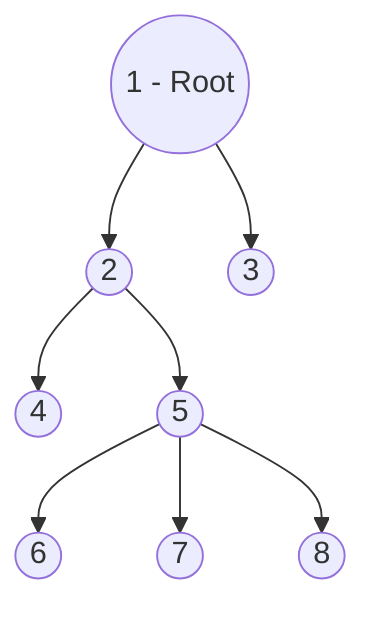

---

### 1.2 Mathematical Properties of Trees (Graph-Theoretic Foundation)
In discrete mathematics and graph theory, a tree is defined as an **undirected, connected, acyclic graph**:
1. **Unique Path Property:** There exists **one and only one** simple path between every pair of vertices in a tree. Adding any edge creates a cycle; removing any edge disconnects the graph.
2. **Vertices and Edges Relation:** A tree with $n$ vertices contains strictly **$n - 1$ edges**:
   $$|E| = |V| - 1$$
3. **Minimal Connectivity:** A graph is a tree if and only if it is **minimally connected** (connected, but removing any edge disconnects it).
4. **Acyclic Connectivity:** Any connected graph with $n$ vertices and $n - 1$ edges is guaranteed to be a tree (contains zero cycles).

---

### 1.3 Real-World & Systems Applications of Trees

| Tree Variant | Real-World Application | Why Trees are Used |
|---|---|---|
| **Binary Search Tree (BST)** | Dynamic set lookup, symbol tables, dictionary searching | Fast $O(\log n)$ membership testing and ordered traversal. |
| **Binary Heap** | Priority Queues, Heap Sort, Dijkstra’s shortest path | Efficient $O(1)$ peek and $O(\log n)$ extraction of extremum (min/max). |
| **Trie (Prefix Tree)** | Network IP routing tables in modern routers, auto-complete, spell-check | Prefix-based string lookup independent of dictionary size; depends only on key length $O(L)$. |
| **B-Trees & B+ Trees** | Relational Database Indexing (MySQL InnoDB, PostgreSQL), File Systems (NTFS, ext4) | High fan-out reduces disk I/O operations by storing blocks in multi-way balanced structures. |
| **T-Trees** | In-Memory Database Systems (IMDBs) | Combines the storage efficiency of AVL trees with the cache benefits of B-trees. |
| **Abstract Syntax Tree (AST)** | Compilers and Interpreters (GCC, Clang, V8 engine) | Validates language grammar rules and represents hierarchical program syntax for code generation. |

---

## 2. Comprehensive Tree Terminology & Anatomy

```text
                     (A)  <------------------------ ROOT (Level 0, Depth 0, Height 3)
                   /     \
                 /         \
               (B)         (C)  <------------------ PARENT of G, H; SIBLING of B
             /  |  \       /  \
           (D) (E) (F)   (G)  (H) <---------------- LEAF / TERMINAL NODE (Degree 0)
              /   \       |
            (I)   (J)    (K)  <-------------------- DESCENDANTS of C and G
```

### 2.1 Glossary of Terms

- **Node:** An independent entity storing data (a key or payload) alongside pointers/links referencing child nodes.
- **Root Node:** The unique topmost node from which the entire tree originates. A valid tree has **exactly one root** and can never have multiple roots.
- **Edge:** The directed link or branch connecting a parent node to a child node. A tree of $n$ nodes always possesses $n - 1$ edges.
- **Parent:** A node that has an outgoing edge/branch leading down to another node. In a general tree, a parent can have any number of children.
- **Child:** A node that is the direct descendant of a node. Every node in a tree except the root is a child node.
- **Siblings:** Nodes that share the exact same immediate parent node (e.g., in the diagram above, `I` and `J` are siblings of parent `E`; `D`, `E`, and `F` are siblings of parent `B`).
- **Leaf Node (External Node / Terminal Node):** Any node that possesses **zero children** ($\text{Degree} = 0$). Examples: `D`, `I`, `J`, `F`, `K`, `H`.
- **Internal Node (Non-Terminal Node):** Any node with **at least one child**. Every non-leaf node (including the root, provided the tree has $>1$ node) is an internal node. Examples: `A`, `B`, `C`, `E`, `G`.
- **Degree of a Node:** The total number of children directly attached to that node.
  - $\text{Degree}(A) = 2$
  - $\text{Degree}(B) = 3$
  - $\text{Degree}(C) = 2$
  - $\text{Degree}(E) = 2$
  - $\text{Degree}(G) = 1$
  - $\text{Degree}(D) = 0$
- **Degree of a Tree:** The **maximum degree** among all nodes in the tree:
  $$\text{Degree}(\text{Tree}) = \max_{u \in V} (\text{Degree}(u)) = 3$$
- **Level of a Node:** The generation step measured from top to bottom. The root is defined at **Level 0**, its children at **Level 1**, grandchildren at **Level 2**, and so on.
- **Depth of a Node:** The total number of edges from the root node to that specific node.
  - $\text{Depth}(\text{Root}) = 0$
  - $\text{Depth}(B) = 1$
  - $\text{Depth}(K) = 3$
  - *Depth of a tree* is the maximum depth among all nodes (equal to the number of edges on the longest path from root to leaf).
- **Height of a Node:** The number of edges on the **longest downward path** from that node to a descendant leaf node.
  - $\text{Height}(\text{any leaf}) = 0$
  - $\text{Height}(E) = 1$ (path $E \to I$ or $E \to J$)
  - $\text{Height}(B) = 2$ (path $B \to E \to I$)
  - $\text{Height}(\text{Tree}) = \text{Height}(\text{Root}) = 3$ (path $A \to B \to E \to I$)
- **Subtree:** A portion of a tree that is itself a valid tree. Any node $u$ together with all its descendants forms a subtree rooted at $u$.
- **Forest:** A set of zero or more **disjoint trees**. Removing the root node from a tree decomposes it into a forest composed of its subtrees.

---

## 3. Taxonomy & Types of Trees

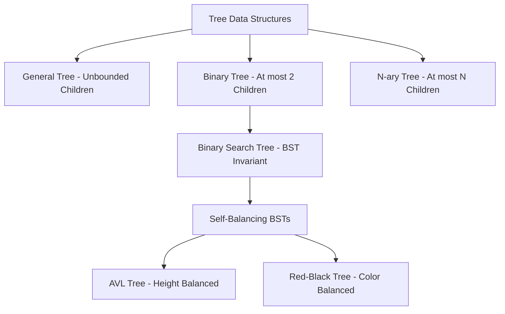

1. **General Tree:** Nodes have arbitrary, unbounded numbers of children ($0$ to $\infty$).
2. **Binary Tree:** Each node has at most two children (left child and right child).
3. **Binary Search Tree (BST):** A binary tree with the key ordering constraint: $\text{keys}(\text{left subtree}) < \text{key}(\text{root}) < \text{keys}(\text{right subtree})$.
4. **AVL Tree:** Adelson-Velsky and Landis self-balancing BST where the heights of the two child subtrees of any node differ by at most one ($\text{Balance Factor} \in \{-1, 0, +1\}$).
5. **Red-Black Tree:** A self-balancing BST with node color tags (Red/Black) ensuring no leaf path is more than twice as long as any other.
6. **$N$-ary Tree:** A tree where each node can have at most $N$ children (e.g., 2-3 trees, B-Trees).

---

## 4. Binary Trees: Combinatorics & Structural Variants

### 4.1 Combinatorics of Binary Trees

#### 1. Unlabeled Binary Trees
An **unlabeled binary tree** consists of nodes that have structural shape and child distinctions (left vs. right), but hold no distinguishing values/labels.

The total number of structurally distinct binary trees that can be formed using $n$ unlabeled nodes is given by the **$n$-th Catalan Number ($C_n$)**:

$$T(n) = C_n = \frac{1}{n + 1} \binom{2n}{n} = \frac{(2n)!}{(n + 1)! \, n!}$$

##### Worked Example ($n = 3$ Unlabeled Nodes):
$$T(3) = \frac{1}{3 + 1} \binom{2 \times 3}{3} = \frac{1}{4} \binom{6}{3} = \frac{1}{4} \times \frac{6 \times 5 \times 4}{3 \times 2 \times 1} = \frac{20}{4} = 5$$

All 5 distinct topological shapes:
```text
  Tree 1          Tree 2          Tree 3          Tree 4          Tree 5
    O               O               O               O               O
   /               /                 \               \             / \
  O               O                   O               O           O   O
 /                 \                 /                 \
O                   O               O                   O
```

---

#### 2. Labeled Binary Trees
A **labeled binary tree** assigns a distinct label (e.g., $A, B, C$) to every node. Since any given topological structure of $n$ nodes can have its labels permuted in $n!$ distinct ways:

$$\text{Total Labeled Trees} = C_n \times n! = \left( \frac{1}{n + 1} \binom{2n}{n} \right) \times n! = \frac{(2n)!}{(n + 1)!}$$

##### Worked Example ($n = 3$ Labeled Nodes):
$$\text{Total} = C_3 \times 3! = 5 \times 6 = 30 \text{ distinct labeled binary trees}$$

For the single symmetric structure `Root with Left & Right child`, the $3! = 6$ arrangements are:
```text
    (A)         (A)         (B)         (B)         (C)         (C)
   /   \       /   \       /   \       /   \       /   \       /   \
 (B)   (C)   (C)   (B)   (A)   (C)   (C)   (A)   (A)   (B)   (B)   (A)
```

---

### 4.2 Structural Variants of Binary Trees

```text
Types of Binary Trees:
1. Rooted Binary Tree
2. Full / Strictly Binary Tree
3. Complete / Perfect Binary Tree
4. Almost Complete Binary Tree
5. Skewed Binary Tree
```

#### 1. Rooted Binary Tree
A binary tree that satisfies:
- Possesses a designated root node.
- Every node has at most 2 children.

#### 2. Full / Strictly Binary Tree
A binary tree in which **every node has either 0 or 2 children**. No node has exactly 1 child.

```text
    Valid Full Binary Tree:                 Invalid Full Binary Tree:
             (A)                                     (A)
            /   \                                   /   \
          (B)   (C)                               (B)   (C)
         /   \                                   /   \    \
       (D)   (E)                               (D)   (E)  (H) <-- Node C has
            /   \                                    /         only 1 child!
          (F)   (G)                                (F)
    (Every node has 0 or 2 children)
```

#### 3. Perfect (Complete) Binary Tree
A binary tree that satisfies two strict criteria:
1. Every internal node has **exactly 2 children**.
2. **All leaf nodes reside at the exact same level**.

```text
             (A)                   Level 0
            /   \
          (B)   (C)                Level 1
         /  \   /  \
        D    E F    G              Level 2 (All leaves at same level)
```
- Total nodes in a perfect binary tree of height $h$ (with root height $1$): $n = 2^h - 1$.
- Total leaves: $2^{h-1}$.

#### 4. Almost Complete Binary Tree (CLRS "Complete Binary Tree")
A binary tree that satisfies:
1. All levels are completely filled, except possibly the last level.
2. The last level has its nodes filled strictly **from left to right** without any intervening gaps.

```text
        Valid Almost Complete:               Invalid Almost Complete:
                 (A)                                   (A)
               /     \                               /     \
             (B)     (C)                           (B)     (C)
            /   \    /                            /   \       \
          (D)   (E) (F)                         (D)   (E)     (F)
   (Filled left-to-right at last level)     (Missing left child for C; gap exists!)
```

#### 5. Skewed Binary Tree
A tree where all internal nodes have **one and only one child**, causing the tree to degenerate into a linear linked list of height $n - 1$:
- **Left Skewed Binary Tree:** Every node has only a left child.
- **Right Skewed Binary Tree:** Every node has only a right child.

```text
    Left Skewed:              Right Skewed:
         (A)                       (A)
        /                             \
      (B)                             (B)
     /                                   \
   (C)                                   (C)
  /                                         \
(D)                                         (D)
```
- **Depth / Height:** Exactly $n - 1$ edges.
- **Degenerate performance:** Search complexity degrades from $O(\log n)$ to $O(n)$.

---

## 5. Tree Traversal Techniques & Visual Shortcuts

Tree traversal is the process of visiting every node in a tree data structure **exactly once**.

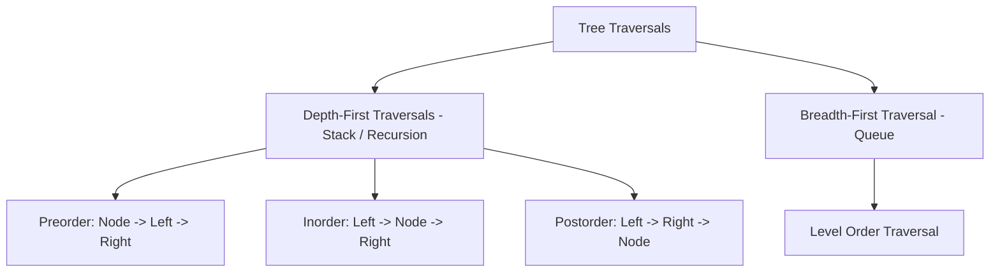

---

### Reference Tree for Traversal Examples

```text
             (A)
           /     \
         (B)     (C)
        /   \   /   \
       (D)  (E)(F)  (G)
```

---

### 5.1 Preorder Traversal ($N - L - R$)

#### Algorithm:
1. **Visit the Root node.**
2. **Traverse the Left subtree** recursively in Preorder.
3. **Traverse the Right subtree** recursively in Preorder.

```c
void preorder(struct node *root) {
    if (root != NULL) {
        printf("%c ", root->data);
        preorder(root->left);
        preorder(root->right);
    }
}
```

#### Visual Shortcut (Left-Contour / Perimeter Walk):
Imagine walking along the perimeter of the tree starting from the top left of the root, keeping your hand touching the tree on your left. Record each node the **first time** you pass by its left side:

```text
Contour Path:
Start at A (left side) -> B (left side) -> D (left side) -> loop under D ->
B -> E (left side) -> loop under E -> B -> A -> C (left side) ->
F (left side) -> loop under F -> C -> G (left side) -> loop under G -> End.
```
$$\text{Preorder Sequence:} \quad \mathbf{A, B, D, E, C, F, G}$$

---

### 5.2 Inorder Traversal ($L - N - R$)

#### Algorithm:
1. **Traverse the Left subtree** recursively in Inorder.
2. **Visit the Root node.**
3. **Traverse the Right subtree** recursively in Inorder.

```c
void inorder(struct node *root) {
    if (root != NULL) {
        inorder(root->left);
        printf("%c ", root->data);
        inorder(root->right);
    }
}
```

#### Visual Shortcut (Horizontal Projection onto Ground Mirror):
Place a plane mirror horizontally along the bottom baseline of the tree. Drop a vertical plumb-line (projection) straight down from every node onto the mirror:

```text
               (A)
              /   \
            (B)   (C)
           /  \   /  \
         (D)  (E)(F) (G)
          |    |  | |  | |  |
Ground:   D    B  E A  F C  G
```
$$\text{Inorder Sequence:} \quad \mathbf{D, B, E, A, F, C, G}$$

> [!IMPORTANT]
> For any **Binary Search Tree (BST)**, an Inorder Traversal **ALWAYS** visits the nodes in strictly **sorted, non-decreasing order**.

---

### 5.3 Postorder Traversal ($L - R - N$)

#### Algorithm:
1. **Traverse the Left subtree** recursively in Postorder.
2. **Traverse the Right subtree** recursively in Postorder.
3. **Visit the Root node.**

```c
void postorder(struct node *root) {
    if (root != NULL) {
        postorder(root->left);
        postorder(root->right);
        printf("%c ", root->data);
    }
}
```

#### Visual Shortcut (Plucking Leaves from Left to Right):
Repeatedly find and pluck the leftmost leaf node in the remaining tree until all nodes are removed:
1. In left branch, leftmost leaves are `D`, then `E`. Pluck `D`, then `E`.
2. Now `B` becomes a leaf; pluck `B`.
3. In right branch, leftmost leaves are `F`, then `G`. Pluck `F`, then `G`.
4. Now `C` becomes a leaf; pluck `C`.
5. Finally, root `A` is left alone; pluck `A`.

$$\text{Postorder Sequence:} \quad \mathbf{D, E, B, F, G, C, A}$$

---

### 5.4 Breadth-First Search (Level Order Traversal)

Level Order Traversal visits nodes horizontally, level by level from top to bottom, and left to right within each level:

$$\text{Level 0:} \quad A$$
$$\text{Level 1:} \quad B, C$$
$$\text{Level 2:} \quad D, E, F, G$$
$$\text{Full BFS Sequence:} \quad \mathbf{A, B, C, D, E, F, G}$$

Implemented using an auxiliary **FIFO Queue**:
```text
Queue Algorithm:
1. Enqueue root.
2. While queue is not empty:
   a. Dequeue node u and print its value.
   b. If u->left exists, Enqueue(u->left).
   c. If u->right exists, Enqueue(u->right).
```

---

## 6. Binary Search Trees (BST): Theory & Construction

### 6.1 The BST Invariant
A **Binary Search Tree** is a binary tree where every node $X$ satisfies:
- For every node $Y$ in the **left subtree** of $X$: $\text{Key}(Y) < \text{Key}(X)$.
- For every node $Z$ in the **right subtree** of $X$: $\text{Key}(Z) > \text{Key}(X)$.
- Both the left and right subtrees must themselves be valid binary search trees.

```text
                 [25]
               /      \
            [20]      [36]
           /    \     /   \
        [10]   [22] [30]  [40]
        /  \        /     /   \
      [5]  [12]   [28]  [38]  [48]
```

---

### 6.2 Number of Distinct BSTs for $n$ Distinct Keys
When constructing binary search trees using $n$ distinct sorted keys, the inorder traversal is fixed (must equal the sorted keys). Therefore, **every distinct unlabeled binary tree shape corresponds to exactly one unique BST**.

The number of distinct BSTs with $n$ distinct keys is given by the Catalan number:

$$\text{Distinct BSTs}(n) = C_n = \frac{1}{n + 1} \binom{2n}{n}$$

For keys $\{A, B, C\}$ ($n = 3$): exactly $C_3 = 5$ distinct BSTs:
```text
    (A)           (A)           (B)           (C)           (C)
      \             \          /   \         /             /
      (B)           (C)      (A)   (C)     (A)           (B)
        \           /                        \           /
        (C)       (B)                        (B)       (A)
```

---

### 6.3 Step-by-Step BST Construction Example
**Input Sequence:** `50, 70, 60, 20, 90, 10, 40, 100`

- **Insert 50:** Tree is empty $\implies$ `50` becomes **root**.
- **Insert 70:** $70 > 50 \implies$ insert as **right child** of `50`.
- **Insert 60:** $60 > 50$ (go right), $60 < 70 \implies$ insert as **left child** of `70`.
- **Insert 20:** $20 < 50 \implies$ insert as **left child** of `50`.
- **Insert 90:** $90 > 50$ (go right), $90 > 70 \implies$ insert as **right child** of `70`.
- **Insert 10:** $10 < 50$ (go left), $10 < 20 \implies$ insert as **left child** of `20`.
- **Insert 40:** $40 < 50$ (go left), $40 > 20 \implies$ insert as **right child** of `20`.
- **Insert 100:** $100 > 50 \to 100 > 70 \to 100 > 90 \implies$ insert as **right child** of `90`.

#### Final Constructed BST:
```text
                   (50)
                 /      \
              (20)      (70)
             /    \     /   \
          (10)   (40) (60)  (90)
                               \
                              (100)
```

---

## 7. BST Operations: Search, Insertion, and Deletion

### 7.1 Search Operation

#### Logic:
1. If current node is `NULL`, return `NULL` (Key not present).
2. If `key == node->data`, return `node` (Match found).
3. If `key < node->data`, recurse on `node->left`.
4. If `key > node->data`, recurse on `node->right`.

```c
struct Node* search(struct Node* root, int key) {
    if (root == NULL || root->data == key)
        return root;
    if (key < root->data)
        return search(root->left, key);
    else
        return search(root->right, key);
}
```

**Walkthrough Example (Search for Key = 45):**
- Start at root `25`: $45 > 25 \implies$ go to right child `50`.
- At node `50`: $45 < 50 \implies$ go to left child `35`.
- At node `35`: $45 > 35 \implies$ go to right child `44`.
- At node `44`: $45 > 44 \implies$ right child is `NULL`.
- **Conclusion:** $45$ is absent from the tree.

**The same search drawn as the path actually taken (note how half the tree is pruned at each step):**

```text
               [25]   45 > 25  ⇒ go RIGHT      (never inspect left of 25 again!)
               /
            [50]      45 < 50  ⇒ go LEFT      (right subtree of 50 pruned!)
            /
          [35]      45 > 35  ⇒ go RIGHT
                \
               [44]   45 > 44  ⇒ go RIGHT → NULL
                                       ✘  45 is NOT in the tree

 Only 5 nodes examined instead of all n — O(h) = O(log n) when balanced.
```

---

### 7.2 Insertion Operation
In a standard BST, a new key is **always inserted as a child of some leaf node**:
1. Search down the tree until a `NULL` pointer is encountered.
2. Allocate a new node and link it at that `NULL` position.

```c
struct Node* newNode(int item) {
    struct Node* temp = (struct Node*)malloc(sizeof(struct Node));
    temp->data = item;
    temp->left = temp->right = NULL;
    return temp;
}

struct Node* insert(struct Node* node, int key) {
    if (node == NULL)
        return newNode(key);
    if (key < node->data)
        node->left = insert(node->left, key);
    else if (key > node->data)
        node->right = insert(node->right, key);
    return node;
}
```

---

### 7.3 Deletion Operation (The Three Canonical Cases)

Deletion is the most intricate BST operation because the search-tree invariant must be preserved.

```text
Case 1: Deletion of Leaf Node (0 children)
        Just disconnect and free the node.

Case 2: Deletion of Node with 1 Child
        Bypass the node: link parent directly to child, then free node.

Case 3: Deletion of Node with 2 Children
        Replace node's data with either:
        - Method 1: Inorder Successor (Smallest key in right subtree)
        - Method 2: Inorder Predecessor (Largest key in left subtree)
        Then recursively delete the successor/predecessor node from its original sub-tree.
```

#### Visualizing Case 3 (Deleting Node with 2 Children):
Suppose we wish to delete node `15`:

```text
               (20)                                  (20)
              /    \                                /    \
           [15]    (30)                          [16]    (30)
          /    \               Delete 15        /    \
       (10)    (17)        ==============>   (10)    (17)
       /  \    /  \        Replace with      /  \       \
     (2) (12)(16) (19)     Inorder Succ:   (2) (12)     (19)
                           Min of Right Subtree
                           which is 16!
```

#### Complete C Implementation for Deletion:
```c
struct Node* findMin(struct Node* root) {
    while (root->left != NULL)
        root = root->left;
    return root;
}

struct Node* deleteNode(struct Node* root, int key) {
    if (root == NULL)
        return root;
        
    if (key < root->data)
        root->left = deleteNode(root->left, key);
    else if (key > root->data)
        root->right = deleteNode(root->right, key);
    else {
        // Node found! Handle the 3 cases:
        
        // Case 1: No children (Leaf)
        if (root->left == NULL && root->right == NULL) {
            free(root);
            return NULL;
        }
        // Case 2: One child
        else if (root->left == NULL) {
            struct Node* temp = root->right;
            free(root);
            return temp;
        }
        else if (root->right == NULL) {
            struct Node* temp = root->left;
            free(root);
            return temp;
        }
        // Case 3: Two children
        else {
            // Find inorder successor (minimum in right subtree)
            struct Node* temp = findMin(root->right);
            root->data = temp->data;
            // Delete the successor from right subtree
            root->right = deleteNode(root->right, temp->data);
        }
    }
    return root;
}
```

---

## 8. Hashing: Principles, Mechanisms & Hash Functions

### 8.1 The Motivation Behind Hashing
While Binary Search Trees offer $O(\log n)$ average search time, retrieval still involves comparison chains. **Hashing** is a data structure technique that achieves **$O(1)$ constant average-time search, insertion, and deletion**, completely bypassing sequential comparison.

```text
   Key  ───► [ Hash Function h(k) ] ───► Hash Value (Index) ───► [ Bucket in Hash Table ]
 "Alice" ───►      h("Alice")       ───►         3           ───► Table[3]
```

- **Hash Table:** A fixed-size array of $m$ buckets used to store data items.
- **Hash Function ($h$):** A mathematical transformation that maps a large or variable key domain into a compact integer range $[0, m - 1]$.
- **Hash Value:** The integer index computed by $h(\text{key})$.

---

### 8.2 Desirable Properties of a Good Hash Function
1. **Efficiently Computable:** Must execute in $O(1)$ time with low constant overhead.
2. **Minimizes Collisions:** Must distribute keys uniformly across all table slots (**Uniform Hashing Assumption**).
3. **Full Table Utilization:** Must avoid clustering items into a small subset of indices.

---

### 8.3 Common Hash Function Construction Methods

#### 1. Division Method
$$h(k) = k \bmod m$$
- Fast (single hardware modulo operation).
- **Best Practice:** Choose $m$ to be a **prime number** not close to a power of 2 or 10, to minimize pattern bias.

#### 2. Mid-Square Method
1. Square the numeric key: $k^2$.
2. Extract the middle $r$ digits of the squared result.
3. If table size is $m = 10^r$, the extracted digits form the hash address.
- **Example:** For $k = 1234$, $k^2 = 1522756$. Extract middle digits $22 \implies h(k) = 22$.

#### 3. Folding Method
The key is partitioned into multiple chunks whose width matches the table index size:
- **Fold Shift:** Chunks are simply added together: $\text{Index} = (c_1 + c_2 + c_3) \bmod m$.
- **Fold Boundary:** Extreme chunks are reversed before adding.

---

### 8.4 The Collision Phenomenon & Load Factor
> **Collision:** Occurs when a hash function maps two distinct keys to the exact same hash table bucket:
> $$h(k_1) = h(k_2) \quad \text{where } k_1 \ne k_2$$

By the **Pigeonhole Principle**, if the number of possible keys exceeds table size $m$, collisions are mathematically unavoidable.

- **Load Factor ($\alpha$):**
  $$\alpha = \frac{n}{m}$$
  where $n$ is the number of stored keys and $m$ is the total capacity of the hash table.
  - In Open Addressing: strictly $\alpha \le 1$.

**Load factor intuition (m = 10 table slots):**

```text
 α = 0.3:   [■][  ][  ][■][  ][  ][  ][■][  ][  ]      n = 3 keys, m = 10
 α = 0.7:   [■][■][  ][■][■][■][  ][■][■][  ]      n = 7 keys, m = 10
 α = 1.0:   [■][■][■][■][■][■][■][■][■][■]      n = 10 = m (open addressing is FULL!)

 Higher α ⇒ more collisions ⇒ longer chains / probes ⇒ slower operations.
 Open addressing best practice: resize + rehash once α crosses ≈ 0.7;
 Separate chaining tolerates α > 1 because lists simply grow.
```
  - In Separate Chaining: $\alpha$ can exceed $1$ ($\alpha > 1$).

---

## 9. Collision Resolution Techniques

```mermaid
graph TD
    CR[Collision Resolution Techniques]
    CR --> Chaining[Separate Chaining - Open Hashing]
    CR --> OpenAddr[Open Addressing - Closed Hashing]
    
    OpenAddr --> LP[Linear Probing - f(i) = i]
    OpenAddr --> QP[Quadratic Probing - f(i) = i^2]
    OpenAddr --> DH[Double Hashing - f(i) = i * h2(k)]
```

---

### 9.1 Separate Chaining (Open Hashing)

#### Mechanism
Each bucket in the hash table acts as the head pointer to an independent **singly linked list**. When a collision occurs, the new item is simply inserted into the linked list belonging to that slot.

#### Step-by-Step Worked Example:
- Hash Function: $h(k) = k \bmod 7$ (Table size $m = 7$, indices $0 \dots 6$).
- Input Sequence: `50, 700, 76, 85, 92, 73, 101`

```text
Calculations:
50  mod 7 = 1  ---> Insert in bucket 1
700 mod 7 = 0  ---> Insert in bucket 0
76  mod 7 = 6  ---> Insert in bucket 6
85  mod 7 = 1  ---> Collision at bucket 1! Add to linked list: 50 -> 85
92  mod 7 = 1  ---> Collision at bucket 1! Add to linked list: 50 -> 85 -> 92
73  mod 7 = 3  ---> Insert in bucket 3
101 mod 7 = 3  ---> Collision at bucket 3! Add to linked list: 73 -> 101
```

```text
Hash Table (Separate Chaining Structure):
Index
[0] ──► [ 700 | NULL ]
[1] ──► [ 50  | • ] ──► [ 85 | • ] ──► [ 92 | NULL ]
[2] ──► NULL
[3] ──► [ 73  | • ] ──► [ 101 | NULL ]
[4] ──► NULL
[5] ──► NULL
[6] ──► [ 76  | NULL ]
```

---

### 9.2 Open Addressing (Closed Hashing)

#### Mechanism
All keys are stored **directly inside the hash table array**. No external linked lists or pointers are used. If a collision occurs at index $h(k)$, alternative slots are inspected (**probed**) systematically until an empty bucket is located:

$$\text{Probe Sequence Formula:} \quad h(k, i) = \big( h_1(k) + f(i) \big) \bmod m \quad (i = 0, 1, 2, \dots)$$

#### Deletion in Open Addressing:
When deleting an item, the slot **cannot simply be cleared to empty (`NULL`)**, because doing so would break subsequent probe chains for other keys that collided on that slot. Instead, the slot is marked with a special sentinel value: **"DELETED" (Tombstone)**.
- Search continues through `DELETED` slots.
- Insert can reuse `DELETED` slots.

---

### 9.3 Linear Probing

#### Collision Function:
$$f(i) = i$$
$$h(k, i) = (h(k) + i) \bmod m$$

If a collision occurs at $h(k)$, probe consecutive cells: $(h(k)+1) \bmod m$, $(h(k)+2) \bmod m, \dots$

#### Step-by-Step Worked Example:
- Hash Function: $h(k) = k \bmod 7$ ($m = 7$)
- Insertion Sequence: `76, 93, 40, 47, 10, 55`

```text
Key 76: 76 mod 7 = 6. Slot [6] is empty. Place at [6].              (1 probe)
Key 93: 93 mod 7 = 2. Slot [2] is empty. Place at [2].              (1 probe)
Key 40: 40 mod 7 = 5. Slot [5] is empty. Place at [5].              (1 probe)
Key 47: 47 mod 7 = 5. Slot [5] occupied (40)!
        Probe i=1: (5+1)%7 = 6 -> Occupied (76)!
        Probe i=2: (5+2)%7 = 0 -> Empty! Place at [0].             (3 probes)
Key 10: 10 mod 7 = 3. Slot [3] is empty. Place at [3].              (1 probe)
Key 55: 55 mod 7 = 6. Slot [6] occupied (76)!
        Probe i=1: (6+1)%7 = 0 -> Occupied (47)!
        Probe i=2: (6+2)%7 = 1 -> Empty! Place at [1].             (3 probes)
```

```text
Final State:
Index:   0    1    2    3    4    5    6
Key:   [47] [55] [93] [10] [  ] [40] [76]
```

- **Advantage:** Trivial to compute; superior cache locality because adjacent array elements reside in the same CPU cache line.
- **Disadvantage (Primary Clustering):** Long contiguous blocks of occupied cells form. Once a cluster grows, any key hashing into or near the cluster prolongs the probe chain, rapidly degrading search performance.

**Primary clustering visualized:**

```text
 Table state after some insertions under LINEAR probing:

 [47][55][93][10][   ][   ][76]
  └──── cluster of 4 ────┘         └─ lone key

 Any key hashing INSIDE or NEXT TO the cluster is dragged along it:
    h(k) = 2 → probes 2, 3, 4, 5 … (slides along the block)
    h(k) = 4 (empty!) → probes 4, 5, 6, 0 … (still absorbed by neighbours!)
 Every unfortunate key EXTENDS the cluster ⇒ probes snowball toward O(n).

 Remedies:
    Quadratic probing : jumps +1, +4, +9, … — hops out of the cluster
    Double hashing    : each key gets its own step size — no shared sequences
```

---

### 9.4 Quadratic Probing

#### Collision Function:
$$f(i) = i^2$$
$$h(k, i) = (h(k) + i^2) \bmod m$$

Probing advances quadratically: $(h(k)+1) \bmod m$, $(h(k)+4) \bmod m$, $(h(k)+9) \bmod m, \dots$

#### Step-by-Step Worked Example:
- Hash Function: $h(k) = k \bmod 7$ ($m = 7$)
- Insertion Sequence: `76, 40, 48, 5, 55`

```text
Key 76: 76 mod 7 = 6. Slot [6] empty. Place at [6].                (1 probe)
Key 40: 40 mod 7 = 5. Slot [5] empty. Place at [5].                (1 probe)
Key 48: 48 mod 7 = 6. Slot [6] occupied (76)!
        Probe i=1: (6 + 1^2)%7 = 7%7 = 0. Empty! Place at [0].     (2 probes)
Key 5:  5 mod 7 = 5. Slot [5] occupied (40)!
        Probe i=1: (5 + 1^2)%7 = 6%7 = 6. Occupied (76)!
        Probe i=2: (5 + 2^2)%7 = 9%7 = 2. Empty! Place at [2].     (3 probes)
Key 55: 55 mod 7 = 6. Slot [6] occupied (76)!
        Probe i=1: (6 + 1^2)%7 = 0%7 = 0. Occupied (48)!
        Probe i=2: (6 + 2^2)%7 = 10%7 = 3. Empty! Place at [3].    (3 probes)
```

```text
Final State:
Index:   0    1    2    3    4    5    6
Key:   [48] [  ] [ 5] [55] [  ] [40] [76]
```

- **Advantage:** Eliminates **Primary Clustering**.
- **Disadvantage (Secondary Clustering):** Keys that hash to the same initial slot ($h(k_1) = h(k_2)$) traverse the exact same probe sequence.

---

### 9.5 Double Hashing

#### Collision Function:
$$f(i) = i \cdot h_2(k)$$
$$h(k, i) = \big( h_1(k) + i \cdot h_2(k) \big) \bmod m$$

Uses two independent hash functions:
- Primary function $h_1(k)$ determines the initial slot.
- Secondary function $h_2(k)$ determines the probe step size.

> [!IMPORTANT]
> To guarantee that the probe sequence visits all $m$ slots:
> 1. $h_2(k) \ne 0$ for all $k$.
> 2. $h_2(k)$ must be **relatively prime** to table size $m$ (typically satisfied by choosing $m$ prime and $h_2(k) = R - (k \bmod R)$ where $R < m$ is a prime).

#### Step-by-Step Worked Example:
- Table size $m = 7$.
- Primary Hash: $h_1(k) = k \bmod 7$
- Secondary Hash: $h_2(k) = 5 - (k \bmod 5)$
- Insertion Sequence: `76, 93, 40, 47, 10, 55`

```text
Key 76: h1(76) = 6. Slot [6] empty. Place at [6].                  (1 probe)
Key 93: h1(93) = 2. Slot [2] empty. Place at [2].                  (1 probe)
Key 40: h1(40) = 5. Slot [5] empty. Place at [5].                  (1 probe)
Key 47: h1(47) = 5. Slot [5] occupied (40)!
        h2(47) = 5 - (47 mod 5) = 5 - 2 = 3.
        Probe i=1: (5 + 1*3)%7 = 8%7 = 1. Empty! Place at [1].     (2 probes)
Key 10: h1(10) = 3. Slot [3] empty. Place at [3].                  (1 probe)
Key 55: h1(55) = 6. Slot [6] occupied (76)!
        h2(55) = 5 - (55 mod 5) = 5 - 0 = 5.
        Probe i=1: (6 + 1*5)%7 = 11%7 = 4. Empty! Place at [4].    (2 probes)
```

```text
Final State:
Index:   0    1    2    3    4    5    6
Key:   [  ] [47] [93] [10] [55] [40] [76]
```

---

### 9.6 Comparative Analysis of Collision Resolution Methods

#### Separate Chaining vs. Open Addressing

| Comparison Parameter | Separate Chaining (Open Hashing) | Open Addressing (Closed Hashing) |
|---|---|---|
| **Storage Location** | Stored in linked lists outside the hash table array. | Stored directly inside the hash table slots. |
| **Max Load Factor ($\alpha$)** | Can exceed $1$ ($\alpha > 1$). | Strictly bounded by $\alpha \le 1$. |
| **Deletion Complexity** | Straightforward (standard linked list node removal). | Difficult; requires tombstone marker (`DELETED`). |
| **Memory Overhead** | Requires extra pointer storage for list nodes. | Zero pointer overhead (stores only keys/values). |
| **Cache Locality** | Poor (nodes scattered non-contiguously in heap memory). | Excellent (contiguous memory array, prefetch friendly). |
| **Table Saturation** | Never gets "full"; lists grow indefinitely. | Fails/overflows when table slots are fully occupied. |

---

#### Comparison of Open Addressing Probing Strategies

| Strategy | Primary Clustering? | Secondary Clustering? | Distinct Probe Sequences | Cache Locality |
|---|:---:|:---:|:---:|:---:|
| **Linear Probing** | **Yes** | **Yes** | $m$ | **Best** (Sequential array access) |
| **Quadratic Probing** | **No** | **Yes** | $m$ | **Moderate** |
| **Double Hashing** | **No** | **No** | $m^2$ | **Poor** (Scattered jump steps) |

---

## 10. Core Algorithms & Interview Implementations

### 10.1 Count Leaf Nodes in a Binary Tree
```c
int getLeafCount(struct node* node) {
    if (node == NULL)
        return 0;
    if (node->left == NULL && node->right == NULL)
        return 1;
    return getLeafCount(node->left) + getLeafCount(node->right);
}
```
- **Time Complexity:** $O(n)$
- **Space Complexity:** $O(h)$ auxiliary recursion stack.

---

### 10.2 Count Total Nodes in a Binary Tree
```c
int countNodes(struct node* root) {
    if (root == NULL)
        return 0;
    return 1 + countNodes(root->left) + countNodes(root->right);
}
```

---

### 10.3 Find the $k$-th Smallest Element in a BST
Because an inorder traversal of a BST processes keys in ascending order, the $k$-th element visited during inorder traversal is guaranteed to be the $k$-th smallest key.

```c
#include <limits.h>

int kthSmallestUtil(struct node* root, int* counter, int k) {
    if (root == NULL)
        return INT_MAX;

    // Search left subtree
    int left = kthSmallestUtil(root->left, counter, k);
    if (left != INT_MAX)
        return left;

    // Process current node
    (*counter)++;
    if (*counter == k)
        return root->data;

    // Search right subtree
    return kthSmallestUtil(root->right, counter, k);
}

int kthSmallest(struct node* root, int k) {
    int counter = 0;
    return kthSmallestUtil(root, &counter, k);
}
```
- **Time Complexity:** $O(h + k)$
- **Space Complexity:** $O(h)$

---

### 10.4 Validate Whether a Binary Tree is a Valid BST
A common novice error is checking only whether `node->left->data < node->data < node->right->data`. This misses violations in deeper subtrees. The correct algorithm maintains a valid numerical range $[minKey, maxKey]$ and shrinks the boundary at each recursive descent:

```c
#include <stdbool.h>

bool isBST(struct node* node, int minKey, int maxKey) {
    if (node == NULL)
        return true;

    // Validate current node within strict bounds
    if (node->data <= minKey || node->data >= maxKey)
        return false;

    // Shrink range for left and right children
    return isBST(node->left, minKey, node->data) &&
           isBST(node->right, node->data, maxKey);
}
```

---

### 10.5 Maximum Depth (Height) of a Binary Tree
```c
int maxDepth(struct node* node) {
    if (node == NULL)
        return 0;
    
    int lDepth = maxDepth(node->left);
    int rDepth = maxDepth(node->right);

    return (lDepth > rDepth ? lDepth + 1 : rDepth + 1);
}
```

---

### 10.6 Complete Hash Table Implementation with Linear Probing in C
```c
#include <stdio.h>
#define SIZE 7

int hashTable[SIZE];

void init() {
    for (int i = 0; i < SIZE; i++)
        hashTable[i] = -1; // -1 represents empty slot
}

void insert(int value) {
    int key = value % SIZE;
    int i = 0;
    while (i < SIZE) {
        int index = (key + i) % SIZE;
        if (hashTable[index] == -1 || hashTable[index] == -2) { // -2 represents DELETED
            hashTable[index] = value;
            printf("%d inserted at index %d\n", value, index);
            return;
        }
        i++;
    }
    printf("Hash Table Full! Unable to insert %d\n", value);
}

void search(int value) {
    int key = value % SIZE;
    int i = 0;
    while (i < SIZE) {
        int index = (key + i) % SIZE;
        if (hashTable[index] == value) {
            printf("Found %d at index %d\n", value, index);
            return;
        }
        if (hashTable[index] == -1) // Unoccupied slot terminates probe
            break;
        i++;
    }
    printf("Value %d NOT found\n", value);
}

void del(int value) {
    int key = value % SIZE;
    int i = 0;
    while (i < SIZE) {
        int index = (key + i) % SIZE;
        if (hashTable[index] == value) {
            hashTable[index] = -2; // Mark as DELETED (tombstone)
            printf("%d deleted from index %d\n", value, index);
            return;
        }
        if (hashTable[index] == -1)
            break;
        i++;
    }
    printf("Value %d not present to delete\n", value);
}
```

---

## 11. Cartesian & Maximum Binary Trees from Inorder

A **Maximum Binary Tree (Cartesian Tree)** is a unique binary tree constructed from an array such that:
1. An **inorder traversal** of the tree reproduces the original array sequence.
2. The tree satisfies the **max-heap property**: the root of every subtree contains the **maximum element** in that subarray range.

### Construction Principle:
1. Locate the index of the maximum element in `inorder[start .. end]`.
2. Allocate this maximum element as the `root`.
3. Recursively construct the left subtree from `inorder[start .. maxIndex - 1]`.
4. Recursively construct the right subtree from `inorder[maxIndex + 1 .. end]`.

---

#### Example 1 (from Source Page 110):
**Input:** `inorder[] = {5, 10, 40, 30, 28}`
- Maximum in `{5, 10, 40, 30, 28}` is `40` $\implies$ Root is `40`.
- Left subarray: `{5, 10}`. Max is `10` $\implies$ Left child of `40` is `10`. Left child of `10` is `5`.
- Right subarray: `{30, 28}`. Max is `30` $\implies$ Right child of `40` is `30`. Right child of `30` is `28`.

```text
               (40)
              /    \
           (10)    (30)
           /          \
         (5)          (28)
```

---

#### Example 2 (from Source Page 111):
**Input:** `inorder[] = {1, 7, 5, 50, 40, 10}`
- Maximum element is `50` $\implies$ Root is `50`.
- Left subtree partition: `{1, 7, 5}`. Max is `7` (root of left), with left child `1` and right child `5`.
- Right subtree partition: `{40, 10}`. Max is `40` (root of right), with right child `10`.

```text
               (50)
              /    \
            (7)    (40)
           /   \      \
         (1)   (5)    (10)
```

---

## 12. Solved Examination Problems & MCQ Bank

### Problem 1: Subtree Node Counts of BST Root
**Question (Page 48):**  
A binary search tree is generated by inserting the following integers in order:  
`50, 15, 62, 5, 20, 58, 91, 3, 8, 37, 60, 24`  
The number of nodes in the left subtree and right subtree of the root respectively is:  
A. $(4, 7)$  
B. $(7, 4)$  
C. $(8, 3)$  
D. $(3, 8)$  

**Solution:**
- The first inserted key `50` is the **root** of the BST.
- Every key strictly less than $50$ belongs to the **left subtree**:
  $$\text{Keys } < 50: \quad \{15, 5, 20, 3, 8, 37, 24\} \implies \mathbf{7 \text{ nodes}}$$
- Every key strictly greater than $50$ belongs to the **right subtree**:
  $$\text{Keys } > 50: \quad \{62, 58, 91, 60\} \implies \mathbf{4 \text{ nodes}}$$
- **Correct Answer:** **B. (7, 4)**

---

### Problem 2: Distinct BSTs with 4 Keys
**Question (Page 49):**  
How many distinct binary search trees can be constructed out of $4$ distinct keys?  
A. 5  
B. 14  
C. 24  
D. 35  

**Solution:**
Using the Catalan number formula for $n = 4$:
$$C_4 = \frac{1}{4 + 1} \binom{2 \times 4}{4} = \frac{1}{5} \binom{8}{4} = \frac{1}{5} \times \frac{8 \times 7 \times 6 \times 5}{4 \times 3 \times 2 \times 1} = \frac{70}{5} = \mathbf{14}$$
- **Correct Answer:** **B. 14**

---

### Problem 3: Inorder Traversal of Natural Number BST
**Question (Page 55):**  
Suppose the numbers `7, 5, 1, 8, 3, 6, 0, 9, 4, 2` are inserted in that order into an initially empty binary search tree. What is the inorder traversal sequence of the resultant tree?  
A. `7, 5, 1, 0, 3, 2, 4, 6, 8, 9`  
B. `0, 2, 4, 3, 1, 6, 5, 9, 8, 7`  
C. `0, 1, 2, 3, 4, 5, 6, 7, 8, 9`  
D. `9, 8, 6, 4, 2, 3, 0, 1, 5, 7`  

**Solution:**
By definition, the Inorder traversal ($Left - Root - Right$) of any binary search tree produces keys in strictly **sorted ascending order**. Sorting the input set yields:
$$0, 1, 2, 3, 4, 5, 6, 7, 8, 9$$
- **Correct Answer:** **C**

---

### Problem 4: Reconstructing Postorder from BST Preorder
**Question (Page 56):**  
The preorder traversal sequence of a binary search tree is:  
`30, 20, 10, 15, 25, 23, 39, 35, 42`  
Which one of the following is the postorder traversal sequence of the same tree?  
A. `10, 20, 15, 23, 25, 35, 42, 39, 30`  
B. `15, 10, 25, 23, 20, 42, 35, 39, 30`  
C. `15, 20, 10, 23, 25, 42, 35, 39, 30`  
D. `15, 10, 23, 25, 20, 35, 42, 39, 30`  

**Solution:**
1. In Preorder ($Root - Left - Right$), the first element `30` is the **root**.
2. Left subtree consists of all keys $< 30$: `{20, 10, 15, 25, 23}`.
3. Right subtree consists of all keys $> 30$: `{39, 35, 42}`.
4. Construct the tree:
   - Root of left subtree is `20`. Its left subtree has `{10, 15}` (root `10`, right child `15`). Its right subtree has `{25, 23}` (root `25`, left child `23`).
   - Root of right subtree is `39`. Its left child is `35`, right child is `42`.
5. Postorder ($Left - Right - Root$):
   - Left subtree of `20`: `15, 10`
   - Right subtree of `20`: `23, 25`
   - Node `20`: `20` $\implies$ Left subtree postorder is `15, 10, 23, 25, 20`.
   - Right subtree postorder: `35, 42, 39`.
   - Finally the main root `30`.
6. Combined Postorder:
   $$\mathbf{15, 10, 23, 25, 20, 35, 42, 39, 30}$$
- **Correct Answer:** **D**

---

## 13. Master Formula Bank & Quick Revision Summary

### 1. Combinatorics & Formulas
- Edges in a tree with $n$ nodes:
  $$|E| = n - 1$$
- Unlabeled binary trees with $n$ nodes:
  $$C_n = \frac{1}{n + 1} \binom{2n}{n}$$
- Labeled binary trees with $n$ nodes:
  $$\text{Labeled}(n) = C_n \times n! = \frac{(2n)!}{(n + 1)!}$$
- Distinct BSTs with $n$ distinct keys:
  $$\text{BSTs}(n) = C_n = \frac{1}{n + 1} \binom{2n}{n}$$
- Max nodes at level $l$ (Root at level 0):
  $$2^l$$
- Max nodes in binary tree of height $h$ (Root height 1):
  $$2^h - 1$$
- Minimum height for $n$ nodes:
  $$h = \lceil \log_2(n + 1) \rceil$$

---

### 2. Time Complexities Matrix

| Operation | Array | Singly Linked List | BST (Average) | BST (Worst Case) | Hash Table (Average) | Hash Table (Worst Case) |
|---|:---:|:---:|:---:|:---:|:---:|:---:|
| **Search** | $O(n)$ / $O(\log n)$ (sorted) | $O(n)$ | $O(\log n)$ | $O(n)$ | $\mathbf{O(1)}$ | $O(n)$ |
| **Insert** | $O(n)$ | $O(1)$ (head) / $O(n)$ | $O(\log n)$ | $O(n)$ | $\mathbf{O(1)}$ | $O(n)$ |
| **Delete** | $O(n)$ | $O(1)$ (with pointer) | $O(\log n)$ | $O(n)$ | $\mathbf{O(1)}$ | $O(n)$ |

# PART IV — Graphs, Traversals & Minimum Spanning Trees

> **Source:** `4.Graphs.md` (Unit-6 – Graph Theory, Representations, Traversals, MST). Complete content preserved below.

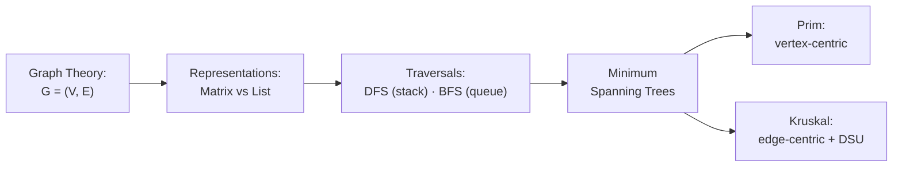

# UNIT-6: Graph Theory — Representations, Traversals, and Minimum Spanning Trees
**Course:** Data Structures & Algorithms (B.Tech. Curriculum)  
**Topic:** Graphs, DFS, BFS, Minimum Spanning Trees (Prim's & Kruskal's Algorithms)  
**Scope:** Formal Mathematical Definitions, Matrix & List Representations, Step-by-Step Traversal Traces, Disjoint-Set Union (DSU), Algorithm Implementations & Exam Revision Guide  

---

## Table of Contents
1. [Foundational Graph Theory & Core Definitions](#1-foundational-graph-theory--core-definitions)
2. [Graph Representation Models](#2-graph-representation-models)
   - [Adjacency Matrix](#21-adjacency-matrix)
   - [Adjacency List](#22-adjacency-list)
   - [Comparative Analysis: Matrix vs. List](#23-comparative-analysis-matrix-vs-list)
3. [Graph Traversal Techniques](#3-graph-traversal-techniques)
   - [Depth-First Search (DFS)](#31-depth-first-search-dfs)
   - [Breadth-First Search (BFS)](#32-breadth-first-search-bfs)
   - [Comparative Analysis: DFS vs. BFS](#33-comparative-analysis-dfs-vs-bfs)
4. [Graph Search Strategies & Early Exit](#4-graph-search-strategies--early-exit)
5. [Minimum Spanning Trees (MST)](#5-minimum-spanning-trees-mst)
   - [Concept, Cut Property & Network Applications](#51-concept-cut-property--network-applications)
   - [The Greedy Choice Paradigm](#52-the-greedy-choice-paradigm)
6. [Prim's Algorithm (Vertex-Centric Growing Tree)](#6-prims-algorithm-vertex-centric-growing-tree)
   - [Algorithm & Supporting Structures](#61-algorithm--supporting-structures)
   - [Comprehensive Step-by-Step State Trace](#62-comprehensive-step-by-step-state-trace)
   - [Complete C Implementation](#63-complete-c-implementation-of-prims-algorithm)
7. [Kruskal's Algorithm (Edge-Centric Forest Merging)](#7-kruskals-algorithm-edge-centric-forest-merging)
   - [Algorithm & Disjoint-Set Union (DSU)](#71-algorithm--disjoint-set-union-dsu)
   - [Comprehensive Step-by-Step Acceptance/Rejection Trace](#72-comprehensive-step-by-step-acceptancerejection-trace)
   - [Complete C Implementation](#73-complete-c-implementation-of-kruskals-algorithm)
8. [Master Comparison: Prim's vs. Kruskal's Algorithm](#8-master-comparison-prims-vs-kruskals-algorithm)
9. [Exam Revision Cheat Sheet & Practice Problems](#9-exam-revision-cheat-sheet--practice-problems)

---

## 1. Foundational Graph Theory & Core Definitions

### 1.1 Formal Mathematical Definition
> **Graph:** A graph $G = (V, E)$ is an ordered pair consisting of:
> 1. A finite set of **Vertices (or Nodes)**, denoted by $V$.
> 2. A finite set of **Edges (or Arcs)**, denoted by $E$, where each edge $e \in E$ is a 2-tuple $(v, w)$ connecting vertices $v, w \in V$. The edge $e$ is said to be **incident** on $v$ and $w$.

```text
Undirected Graph Example:
Vertices: V = {0, 1, 2, 3, 4}
Edges:    E = {(0, 1), (1, 2), (1, 3), (1, 4), (2, 3), (3, 4), (4, 0)}

      (0) -------------- (1)
       |  \             / | \
       |    \         /   |   \
       |      \     /     |     (2)
       |        \ /       |   /
       |        / \       | /
      (4) -------------- (3)
```

---

### 1.2 Edge Classifications & Attributes

```mermaid
graph TD
    Edges[Edge Classifications]
    Edges --> Dir[Directionality]
    Edges --> Wgt[Weight / Cost]
    
    Dir --> UndirE[Undirected Edge: Unordered pair {u, v}]
    Dir --> DirE[Directed Edge / Arc: Ordered pair (u, v)]
    
    Wgt --> UnwgtE[Unweighted: Unit cost]
    Wgt --> WgtE[Weighted: Numerical cost w(u, v)]
```

1. **Undirected Edge:** Edge $\{u, v\}$ has no orientation. Traversal is bidirectional ($u \leftrightarrow v$).
2. **Directed Edge (Arc):** Edge $(u, v)$ has an orientation from source vertex $u$ to destination vertex $w$ ($u \to v$).
3. **Weighted Graph:** Every edge $e$ is associated with a numerical weight $w(e) \in \mathbb{R}$, representing physical distance, network latency, bandwidth capacity, or monetary routing cost.

```text
Directed, Unweighted Graph:             Directed, Weighted Graph:
      (0) ──► (1)                            (0) ─── 2 ──► (1)
     / |     / | \                          / |          / | \
    1  |    /  |  5                        1  |        6   1  5
   v   v   v   v   v                      v   v       v    v   v
  (4) ──► (3) ──► (2)                    (4) ─── 1 ──► (3) ─── 3 ──► (2)
```

---

### 1.3 Paths and Connectivity
- **Path:** A sequence of alternating vertices and edges connecting vertex $v_0$ to $v_n$:
  - Alternating representation: $(v_0, e_1, v_1, e_2, v_2, \dots, v_{n-1}, e_n, v_n)$
  - Vertex-only representation: $(v_0, v_1, v_2, \dots, v_n)$ where $(v_{i-1}, v_i) \in E$ for all $1 \le i \le n$.
- **Cycle:** A path in which the starting and ending vertices are identical ($v_0 = v_n$), with all intermediate vertices distinct.
- **Connected Graph:** An undirected graph is connected if, for **every pair** of vertices $v, w \in V$, there exists at least one valid path connecting $v$ to $w$.
- **Disconnected Graph:** Contains two or more isolated subgraphs called **connected components**.

```text
Connected Graph:                       Disconnected Graph (2 Components):
  (0) ─── (1) ─── (2)                    (0)         (1) ─── (2)
   |       |                              |           |
  (4) ─── (3)                            (4)         (3)
```

---

## 2. Graph Representation Models

### 2.1 Adjacency Matrix

#### Concept
An **Adjacency Matrix** $A$ is a 2D square matrix of dimension $|V| \times |V|$, where rows and columns represent vertices:
- **Unweighted Graph:**
  $$A[u][v] = \begin{cases} 1 & \text{if } (u, v) \in E \\ 0 & \text{otherwise} \end{cases}$$
- **Weighted Graph:**
  $$A[u][v] = \begin{cases} w(u, v) & \text{if } (u, v) \in E \\ \infty & \text{if } (u, v) \notin E \text{ and } u \ne v \\ 0 & \text{if } u = v \end{cases}$$

---

#### Matrices for the 5-Vertex Example Graphs:

**1. Directed Unweighted Graph Matrix:**
$$A = \begin{pmatrix}
0 & 1 & 0 & 0 & 1 \\
0 & 0 & 1 & 1 & 1 \\
0 & 0 & 0 & 0 & 0 \\
0 & 0 & 1 & 0 & 0 \\
0 & 0 & 0 & 1 & 0
\end{pmatrix}$$

**2. Directed Weighted Graph Matrix:**
$$A = \begin{pmatrix}
\infty & 2 & \infty & \infty & 1 \\
\infty & \infty & 5 & 1 & 6 \\
\infty & \infty & \infty & \infty & \infty \\
\infty & \infty & 3 & \infty & \infty \\
\infty & \infty & \infty & 1 & \infty
\end{pmatrix}$$

- **Space Complexity:** $\Theta(V^2)$, regardless of the number of edges.
- **Advantage:** $O(1)$ constant-time lookup to verify edge existence: `isEdge(u, v)`.
- **Disadvantage:** Inefficient memory utilization for **sparse graphs** where $|E| \ll |V|^2$.

---

### 2.2 Adjacency List

#### Concept
An array of linked lists, with array length equal to $|V|$. Slot `Adj[u]` points to a linked list containing all neighbor vertices $v$ directly adjacent to $u$. In weighted graphs, each linked node stores both the `destination` vertex and the `weight` attribute.

```text
Unweighted Adjacency List:
[0] ──► [ 1 ] ──► [ 4 ] ──► NULL
[1] ──► [ 2 ] ──► [ 3 ] ──► [ 4 ] ──► NULL
[2] ──► NULL
[3] ──► [ 2 ] ──► NULL
[4] ──► [ 3 ] ──► NULL

Weighted Adjacency List:
[0] ──► [ dest: 1 | w: 2 ] ──► [ dest: 4 | w: 1 ] ──► NULL
[1] ──► [ dest: 2 | w: 5 ] ──► [ dest: 3 | w: 1 ] ──► [ dest: 4 | w: 6 ] ──► NULL
[2] ──► NULL
[3] ──► [ dest: 2 | w: 3 ] ──► NULL
[4] ──► [ dest: 3 | w: 1 ] ──► NULL
```

- **Space Complexity:**
  - Directed: $O(V + E)$
  - Undirected: $O(V + 2E)$
- **Advantage:** Highly memory-efficient for sparse graphs; neighborhood iteration takes $O(\text{degree}(u))$ rather than checking all $V$ slots.

---

### 2.3 Comparative Analysis: Matrix vs. List

| Operation / Metric | Adjacency Matrix | Adjacency List | Winner / Optimal Use Case |
|---|:---:|:---:|---|
| **Memory Footprint** | $\Theta(V^2)$ | $\Theta(V + E)$ | **List** for sparse graphs ($E \ll V^2$); **Matrix** for dense graphs ($E \approx V^2$). |
| **Check if $(u, v) \in E$** | $O(1)$ | $O(\text{deg}(u))$ | **Matrix** (instant indexing). |
| **Find all neighbors of $u$** | $O(V)$ | $O(\text{deg}(u))$ | **List** (inspects only existing neighbors). |
| **Add a new edge** | $O(1)$ | $O(1)$ (insert at list head) | Tie. |
| **Delete an edge** | $O(1)$ | $O(\text{deg}(u))$ | **Matrix**. |
| **Add a vertex** | $O(V^2)$ (resize matrix) | $O(1)$ (append list slot) | **List**. |

---

## 3. Graph Traversal Techniques

Graph traversal systematically visits every reachable vertex in a predefined order without falling into infinite loops caused by cycles.

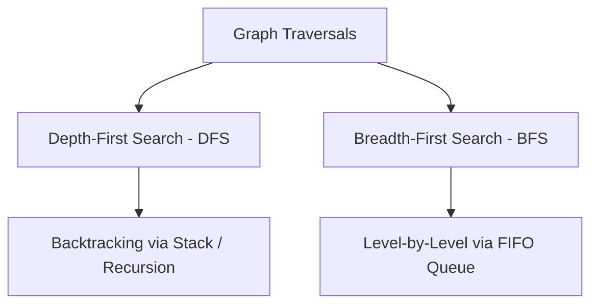

---

### 3.1 Depth-First Search (DFS)

#### Mechanism
DFS explores as deep as possible along each branch before **backtracking**. When a dead end or previously visited node is reached, the search retreats to the most recent ancestor with unexplored neighbors.
- **Core Auxiliary Data Structure:** **LIFO Stack** (explicit stack or system call stack via recursion).
- **Tie-Breaking Rule:** When multiple unvisited neighbors exist, visit the vertex with the **smallest numerical label first**.

---

#### Formal Stack-Based Algorithm
```text
Procedure DEPTH-FIRST(G, start):
1. Initialize all vertices in V as "unvisited".
2. Create an empty Stack S.
3. Push start vertex onto S.
4. While S is not empty:
     n = Pop(S)
     If n is "unvisited":
         Mark n as "visited"
         Output n to terminal
         For each neighbor v in Adj[n] (in descending order so smallest pops first):
             If v is "unvisited":
                 Push v onto S
```

---

#### Step-by-Step Execution Trace (Start Vertex = 0)
Given graph with edges: $(0,1), (0,2), (0,3), (1,4), (3,4)$:

```text
Step 0: S = [ 0 ]
        All vertices Unvisited: { 0:U, 1:U, 2:U, 3:U, 4:U }

Step 1: Pop 0. Mark 0 as VISITED. Output: 0.
        Neighbors of 0 are 1, 2, 3. Push to stack:
        S = [ 3, 2, 1 ]  (Top is 1)

Step 2: Pop 1. Mark 1 as VISITED. Output: 1.
        Neighbors of 1 are 4 (and already visited/queued 3). Push unvisited 4:
        S = [ 3, 2, 3, 4 ] (Top is 4)

Step 3: Pop 4. Mark 4 as VISITED. Output: 4.
        Neighbors of 4 are 3. Push 3:
        S = [ 3, 2, 3, 3 ] (Top is 3)

Step 4: Pop 3. Mark 3 as VISITED. Output: 3.
        Neighbors of 3 have all been visited or queued.
        Next pops of redundant 3s on stack see 3 is already marked VISITED -> Ignored!

Step 5: Pop 2. Mark 2 as VISITED. Output: 2.
        S becomes empty.
```

$$\mathbf{\text{Final DFS Traversal Sequence: } \quad 0 \to 1 \to 3 \to 4 \to 2 \quad (\text{or } 0 \to 1 \to 4 \to 3 \to 2)}$$

---

### 3.2 Breadth-First Search (BFS)

#### Mechanism
BFS explores the graph **layer by layer** (level by level), visiting all immediate neighbors of the start vertex before proceeding to distance-2 neighbors, distance-3 neighbors, and so on.
- **Core Auxiliary Data Structure:** **FIFO Queue**.
- **Tie-Breaking Rule:** Smallest numerical label visited first.

---

#### Formal Queue-Based Algorithm
```text
Procedure BREADTH-FIRST(G, start):
1. Initialize all vertices in V as "unvisited".
2. Create an empty Queue Q.
3. Mark start as "visited"
4. Enqueue(Q, start)
5. While Q is not empty:
     n = Dequeue(Q)
     Output n to terminal
     For each neighbor v in Adj[n] (in ascending numerical order):
         If v is "unvisited":
             Mark v as "visited"
             Enqueue(Q, v)
```

---

#### Step-by-Step Execution Trace (Start Vertex = 0)

```text
Initialization: Enqueue(0). Marked: { 0:V }
Q = [ 0 ]

Iteration 1: Dequeue 0. Output: 0.
             Unvisited neighbors of 0 are 1, 2, 3.
             Enqueue 1, 2, 3. Marked: { 0, 1, 2, 3: V }
             Q = [ 1, 2, 3 ]

Iteration 2: Dequeue 1. Output: 1.
             Neighbor 4 is unvisited. Enqueue 4. Marked: { 0, 1, 2, 3, 4: V }
             Q = [ 2, 3, 4 ]

Iteration 3: Dequeue 2. Output: 2.
             No unvisited neighbors.
             Q = [ 3, 4 ]

Iteration 4: Dequeue 3. Output: 3.
             No unvisited neighbors.
             Q = [ 4 ]

Iteration 5: Dequeue 4. Output: 4.
             Queue is now empty. Traversal terminates.
```

$$\mathbf{\text{Final BFS Traversal Sequence: } \quad 0 \to 1 \to 2 \to 3 \to 4}$$

---

### 3.3 Comparative Analysis: DFS vs. BFS

**How the search frontier shapes the traversal:**

```text
 DFS — "a snake, diving deep":          BFS — "a ripple, expanding in rings":

        0                                    0  ← start
      /   \                                / | \
     1     2      go DEEP first           1  2  3   ← ring 1 (all distance-1)
     |     |                              |  |
     4     3      backtrack when a        4        ← ring 2 (all distance-2)
                  dead end is hit

 DFS frontier = a STACK (LIFO): the newest discovery gets explored first.
 BFS frontier = a QUEUE (FIFO): the oldest discovery expands first.
 ⇒ BFS guarantees SHORTEST paths (fewest edges) on unweighted graphs; DFS does not.
```

| Parameter | Depth-First Search (DFS) | Breadth-First Search (BFS) |
|---|---|---|
| **Data Structure** | **Stack** (or Recursion Call Stack) | **FIFO Queue** |
| **Traversal Direction** | Plunges deep along branches, then backtracks. | Expands outwards concentrically layer by layer. |
| **Shortest Path** | Does not guarantee shortest paths. | **Guarantees shortest path** (minimum edges) on unweighted graphs. |
| **Time Complexity** | $O(V + E)$ (Adjacency List) / $O(V^2)$ (Matrix) | $O(V + E)$ (Adjacency List) / $O(V^2)$ (Matrix) |
| **Space Complexity** | $O(h)$ where $h \le V$ is maximum recursion depth. | $O(w)$ where $w \le V$ is maximum level width. |
| **Primary Applications** | Topological sorting, cycle detection, strongly connected components, maze generation. | Shortest path in unweighted networks, peer-to-peer neighbor discovery, web crawling. |

---

## 4. Graph Search Strategies & Early Exit

While a full traversal visits every node in the graph component, **Graph Search** seeks a designated target element $T$.
- **Early Exit Rule:** The moment `n == target` is dequeued or popped, the algorithm immediately terminates and returns success without processing remaining vertices.
- **Unreachable Target:** If the stack/queue empties and the target has not been observed, conclude that no valid path connects source $S$ to target $T$.

---

## 5. Minimum Spanning Trees (MST)

### 5.1 Concept, Cut Property & Network Applications
> **Spanning Tree:** For a connected, undirected graph $G = (V, E)$, a spanning tree $T = (V, E')$ is a connected, acyclic subgraph spanning **all vertices in $V$** using strictly **$|V| - 1$ edges**.

> **Minimum Spanning Tree (MST):** A spanning tree whose total sum of edge weights is minimized:
> $$\text{Cost}(T) = \sum_{e \in E'} w(e) \quad \text{is minimal among all possible spanning trees}$$

```text
Original Weighted Graph G:                      Minimum Spanning Tree T:
        (0) ─── 2 ─── (1)                               (0) ─── 2 ─── (1)
       / |           / | \                             /               |
      1  |         6   1  5                           1                1
     /   |       /     |   \                         /                 |
   (4) ──+── 1 ──► (3) ── 3 ── (2)                 (4) ─── 1 ─── (3) ── 3 ── (2)
                                                 
   Edges in G: 7 edges                           Edges in MST: |V| - 1 = 4 edges
                                                 Total MST Cost: 1 + 1 + 1 + 3 = 6
```

#### Real-World Engineering Applications:
- **Telecommunication Networks:** Minimizing copper/fiber cabling required to interconnect server rooms or telephone exchanges.
- **Electrical Power Grids:** Wiring regional sub-stations with minimal high-voltage transmission line expenditure.
- **Pipeline Layout:** Connecting municipal water or gas distribution hubs at lowest installation cost.
- **Cluster Analysis in Machine Learning:** Single-linkage hierarchical clustering.

---

### 5.2 The Greedy Choice Paradigm
Both **Prim's** and **Kruskal's** algorithms are classic **Greedy Algorithms**:
- They make locally optimal choices at each stage in the hope of finding a global optimum.
- Proven optimal by the **Cut Property (MST Lemma):** For any cut $(S, V \setminus S)$ of a graph, the minimum-weight edge crossing the cut must belong to the Minimum Spanning Tree.

**The Cut Property drawn out (why greedy is provably safe):**

```text
 Partition the vertices into any two sets S and V ∖ S:

        S = { A, B }                    V ∖ S = { C, D }
       ┌─────────────┐                 ┌─────────────┐
       │     (A)     │     w = 2       │     (C)     │
       │             │       |         │             │
       │     (B)     │       |  w = 9  │     (D)     │
       └─────────────┘       |         └─────────────┘
              \__________ crossing edges ________/
             w = ...                  w = 12 (heavier)

 Among ALL edges that cross the cut, the MINIMUM one (w = 2) belongs to SOME
 minimum spanning tree. Prim and Kruskal both lean on this lemma so that every
 locally-greedy edge choice stays globally safe.
```

---

## 6. Prim's Algorithm (Vertex-Centric Growing Tree)

### 6.1 Algorithm & Supporting Structures
Prim’s algorithm maintains **one single tree** throughout execution and grows it by adding one vertex/edge at each step:
1. Start with an arbitrary root vertex $s$.
2. At every iteration, find an unvisited vertex that has the **lightest connecting edge** to any vertex already in the tree.
3. Attach that vertex and repeat until all $|V|$ vertices are included.

#### Supporting Arrays & Structures:
- $d[i]$: Array of size $|V|$ storing the minimum connection weight from the current tree to vertex $i$.
- $p[i]$: Array storing the parent vertex in the MST that achieves $d[i]$.
- $Q$: Priority queue containing all **UNKNOWN** (unvisited) vertices keyed on $d[i]$.
- $s$: Source vertex.

---

#### Formal Procedure: `PRIM(G, s)`
```text
Procedure PRIM(G, s):
1. For each vertex v in V:
       d[v] = positive infinity
       p[v] = NULL
   d[s] = 0
2. Q = V (Initialize Priority Queue with all vertices)
3. While Q is not empty:
4.     u = ExtractMin(Q)      // Vertex with smallest d[u] joins the MST
5.     Mark u as KNOWN
6.     For each vertex v in Adj[u]:
7.         If v is UNKNOWN and d[v] > weight(u, v):
8.             d[v] = weight(u, v)   // Relaxation: shorter connection found
9.             p[v] = u              // Update parent of v to u
```

---

### 6.2 Comprehensive Step-by-Step State Trace

**Input Graph Edges & Weights:**
- $(v_0, v_4) = 1$
- $(v_0, v_1) = 2$
- $(v_1, v_3) = 1$
- $(v_1, v_4) = 6$
- $(v_1, v_2) = 5$
- $(v_3, v_4) = 1$
- $(v_2, v_3) = 3$

**Source Vertex:** $s = v_0$

---

#### Iteration-by-Iteration State Table:

```text
Initial State (0):
  s = v0: d[v0] = 0. All other d[v] = infinity.
  Q = { v0, v1, v2, v3, v4 }

  Vertex | Known |   d_v    |   p_v   
  -------+-------+----------+---------
    v0   |   F   |    0     |    -    
    v1   |   F   |  infinity|    -    
    v2   |   F   |  infinity|    -    
    v3   |   F   |  infinity|    -    
    v4   |   F   |  infinity|    -    

Iteration 1:
  ExtractMin: v0 (d[v0] = 0). Mark v0 as KNOWN.
  Examine neighbors of v0:
    - v1: weight(v0, v1) = 2 < infinity -> d[v1] = 2, p[v1] = v0
    - v4: weight(v0, v4) = 1 < infinity -> d[v4] = 1, p[v4] = v0
  Q = { v4(1), v1(2), v2(inf), v3(inf) }

  Vertex | Known |   d_v    |   p_v   
  -------+-------+----------+---------
    v0   |   T   |    0     |    -    
    v1   |   F   |    2     |   v0    
    v2   |   F   |  infinity|    -    
    v3   |   F   |  infinity|    -    
    v4   |   F   |    1     |   v0    

Iteration 2:
  ExtractMin: v4 (d[v4] = 1). Mark v4 as KNOWN. (MST Edge: (v0, v4), cost 1)
  Examine neighbors of v4:
    - v3: weight(v4, v3) = 1 < infinity -> d[v3] = 1, p[v3] = v4
    - v1: weight(v4, v1) = 6 > d[v1](2) -> Unchanged
  Q = { v3(1), v1(2), v2(inf) }

  Vertex | Known |   d_v    |   p_v   
  -------+-------+----------+---------
    v0   |   T   |    0     |    -    
    v1   |   F   |    2     |   v0    
    v2   |   F   |  infinity|    -    
    v3   |   F   |    1     |   v4    
    v4   |   T   |    1     |   v0    

Iteration 3:
  ExtractMin: v3 (d[v3] = 1). Mark v3 as KNOWN. (MST Edge: (v4, v3), cost 1)
  Examine neighbors of v3:
    - v1: weight(v3, v1) = 1 < d[v1](2) -> d[v1] = 1, p[v1] = v3  (UPDATED!)
    - v2: weight(v3, v2) = 3 < infinity -> d[v2] = 3, p[v2] = v3
  Q = { v1(1), v2(3) }

  Vertex | Known |   d_v    |   p_v   
  -------+-------+----------+---------
    v0   |   T   |    0     |    -    
    v1   |   F   |    1     |   v3    
    v2   |   F   |    3     |   v3    
    v3   |   T   |    1     |   v4    
    v4   |   T   |    1     |   v0    

Iteration 4:
  ExtractMin: v1 (d[v1] = 1). Mark v1 as KNOWN. (MST Edge: (v3, v1), cost 1)
  Examine neighbors of v1:
    - v2: weight(v1, v2) = 5 > d[v2](3) -> Unchanged
  Q = { v2(3) }

  Vertex | Known |   d_v    |   p_v   
  -------+-------+----------+---------
    v0   |   T   |    0     |    -    
    v1   |   T   |    1     |   v3    
    v2   |   F   |    3     |   v3    
    v3   |   T   |    1     |   v4    
    v4   |   T   |    1     |   v0    

Iteration 5:
  ExtractMin: v2 (d[v2] = 3). Mark v2 as KNOWN. (MST Edge: (v3, v2), cost 3)
  Q becomes empty. Algorithm terminates!

  Final MST Edges Selected:
    1. (v0, v4) with weight 1
    2. (v4, v3) with weight 1
    3. (v3, v1) with weight 1
    4. (v3, v2) with weight 3

  Total Minimum Spanning Tree Weight = 1 + 1 + 1 + 3 = 6
```

---

### 6.3 Complete C Implementation of Prim's Algorithm
```c
#include <stdio.h>
#include <stdbool.h>
#include <limits.h>

#define V 5

int minKey(int key[], bool mstSet[]) {
    int min = INT_MAX, min_index = -1;
    for (int v = 0; v < V; v++) {
        if (!mstSet[v] && key[v] < min) {
            min = key[v];
            min_index = v;
        }
    }
    return min_index;
}

void primMST(int graph[V][V]) {
    int parent[V]; // Stores constructed MST
    int key[V];    // Minimum weight edge to connect vertex
    bool mstSet[V]; // Set of vertices included in MST

    for (int i = 0; i < V; i++) {
        key[i] = INT_MAX;
        mstSet[i] = false;
    }

    key[0] = 0;     // Start from vertex 0
    parent[0] = -1; // First node is root of MST

    for (int count = 0; count < V - 1; count++) {
        int u = minKey(key, mstSet);
        mstSet[u] = true;

        for (int v = 0; v < V; v++) {
            if (graph[u][v] && !mstSet[v] && graph[u][v] < key[v]) {
                parent[v] = u;
                key[v] = graph[u][v];
            }
        }
    }

    printf("Edge \tWeight\n");
    int total_cost = 0;
    for (int i = 1; i < V; i++) {
        printf("%d - %d \t%d \n", parent[i], i, graph[i][parent[i]]);
        total_cost += graph[i][parent[i]];
    }
    printf("Total MST Cost: %d\n", total_cost);
}
```

---

## 7. Kruskal's Algorithm (Edge-Centric Forest Merging)

### 7.1 Algorithm & Disjoint-Set Union (DSU)
Kruskal’s algorithm adopts an **edge-centric** perspective:
1. Initialize each vertex as its own independent singleton tree (a **Forest** of $|V|$ trees).
2. Sort all edges in the entire graph in non-decreasing order of weight into a Priority Queue $Q$.
3. Greedily extract the smallest edge $(u, v)$:
   - If $u$ and $v$ belong to **different trees** (i.e., $\text{FIND-SET}(u) \ne \text{FIND-SET}(v)$), **ACCEPT** the edge and merge the two trees.
   - If $u$ and $v$ already belong to the **same tree**, **REJECT** the edge (adding it would create a cycle).
4. Terminate when $|V| - 1$ edges have been accepted.

---

#### Formal Procedure: `KRUSKAL(G)`
```text
Procedure KRUSKAL(G):
1. F = Forest containing { {v} for each v in V }
2. MST = empty set
3. Q = All edges E sorted by weight in non-decreasing order
4. While Q is not empty and |MST| < |V| - 1:
5.     (u, v) = ExtractMin(Q)
6.     If FIND-SET(u) != FIND-SET(v):      // Cycle Check!
7.         UNION(FIND-SET(u), FIND-SET(v)) // Merge the two trees
8.         MST = MST Union { (u, v) }
9. Return MST
```

---

### 7.2 Comprehensive Step-by-Step Acceptance/Rejection Trace

**Sorted Edges Priority Queue $Q$:**
1. $(v_0, v_4)$ : Weight = 1
2. $(v_1, v_3)$ : Weight = 1
3. $(v_3, v_4)$ : Weight = 1
4. $(v_0, v_1)$ : Weight = 2
5. $(v_2, v_3)$ : Weight = 3
6. $(v_1, v_2)$ : Weight = 5
7. $(v_1, v_4)$ : Weight = 6

---

#### Detailed Step-by-Step Log:

```text
Step 0:
  Forest: F = { {v0}, {v1}, {v2}, {v3}, {v4} }
  MST = { }

Step 1: ExtractMin -> Edge (v0, v4), weight = 1
  FIND(v0) = {v0}, FIND(v4) = {v4}  -> Different Sets!
  Status: ACCEPTED
  Action: Merge {v0} and {v4}
  Forest: F = { {v0, v4}, {v1}, {v2}, {v3} }
  MST = { (v0, v4) }

Step 2: ExtractMin -> Edge (v1, v3), weight = 1
  FIND(v1) = {v1}, FIND(v3) = {v3}  -> Different Sets!
  Status: ACCEPTED
  Action: Merge {v1} and {v3}
  Forest: F = { {v0, v4}, {v1, v3}, {v2} }
  MST = { (v0, v4), (v1, v3) }

Step 3: ExtractMin -> Edge (v3, v4), weight = 1
  FIND(v3) = {v1, v3}, FIND(v4) = {v0, v4} -> Different Sets!
  Status: ACCEPTED
  Action: Merge {v0, v4} and {v1, v3}
  Forest: F = { {v0, v1, v3, v4}, {v2} }
  MST = { (v0, v4), (v1, v3), (v3, v4) }

Step 4: ExtractMin -> Edge (v0, v1), weight = 2
  FIND(v0) = {v0, v1, v3, v4}
  FIND(v1) = {v0, v1, v3, v4}
  -> SAME SET! Adding this edge forms a cycle (v0 - v4 - v3 - v1 - v0).
  Status: REJECTED!
  Forest remains: F = { {v0, v1, v3, v4}, {v2} }
  MST remains: { (v0, v4), (v1, v3), (v3, v4) }

Step 5: ExtractMin -> Edge (v2, v3), weight = 3
  FIND(v2) = {v2}, FIND(v3) = {v0, v1, v3, v4} -> Different Sets!
  Status: ACCEPTED
  Action: Merge {v2} and {v0, v1, v3, v4}
  Forest: F = { {v0, v1, v2, v3, v4} }  (Single Unified Tree!)
  MST = { (v0, v4), (v1, v3), (v3, v4), (v2, v3) }

Step 6:
  Count of accepted edges = |V| - 1 = 4.
  All remaining edges in Q ((v1, v2):5 and (v1, v4):6) are rejected as cycles.
  Algorithm terminates with minimal total cost: 1 + 1 + 1 + 3 = 6.
```

---

### 7.3 Complete C Implementation of Kruskal's Algorithm
```c
#include <stdio.h>
#include <stdlib.h>

struct Edge {
    int src, dest, weight;
};

struct Subset {
    int parent;
    int rank;
};

// Disjoint-Set Find with Path Compression
int find(struct Subset subsets[], int i) {
    if (subsets[i].parent != i)
        subsets[i].parent = find(subsets, subsets[i].parent);
    return subsets[i].parent;
}

// Disjoint-Set Union by Rank
void Union(struct Subset subsets[], int x, int y) {
    int xroot = find(subsets, x);
    int yroot = find(subsets, y);

    if (subsets[xroot].rank < subsets[yroot].rank)
        subsets[xroot].parent = yroot;
    else if (subsets[xroot].rank > subsets[yroot].rank)
        subsets[yroot].parent = xroot;
    else {
        subsets[yroot].parent = xroot;
        subsets[xroot].rank++;
    }
}

int compareEdges(const void* a, const void* b) {
    return ((struct Edge*)a)->weight - ((struct Edge*)b)->weight;
}

void kruskalMST(struct Edge edges[], int V, int E) {
    qsort(edges, E, sizeof(edges[0]), compareEdges);

    struct Subset* subsets = (struct Subset*)malloc(V * sizeof(struct Subset));
    for (int v = 0; v < V; v++) {
        subsets[v].parent = v;
        subsets[v].rank = 0;
    }

    struct Edge result[V];
    int e = 0; // Index for result[]
    int i = 0; // Index for sorted edges

    while (e < V - 1 && i < E) {
        struct Edge next_edge = edges[i++];
        int x = find(subsets, next_edge.src);
        int y = find(subsets, next_edge.dest);

        if (x != y) { // No cycle!
            result[e++] = next_edge;
            Union(subsets, x, y);
        }
    }

    printf("Edges in constructed MST:\n");
    int total_weight = 0;
    for (i = 0; i < e; i++) {
        printf("%d -- %d == %d\n", result[i].src, result[i].dest, result[i].weight);
        total_weight += result[i].weight;
    }
    printf("Total MST Weight: %d\n", total_weight);
    free(subsets);
}
```

---

## 8. Master Comparison: Prim's vs. Kruskal's Algorithm

| Comparison Parameter | Prim's Algorithm | Kruskal's Algorithm |
|---|---|---|
| **Fundamental Viewpoint** | **Vertex-centric** (grows a single tree from a root). | **Edge-centric** (picks global lightest edges, merges forest). |
| **Intermediate State** | Always maintains **one connected sub-tree** at every intermediate step. | Maintains a **forest of multiple disconnected subtrees** that gradually merge. |
| **Cycle Prevention** | Inherently prevents cycles by choosing only edges leading to **unvisited** vertices. | Relies on **Disjoint-Set Union (Union-Find)** to detect and reject cycles. |
| **Optimal Graph Density** | **Dense Graphs ($E \approx V^2$):** Performs exceptionally well ($O(V^2)$ with matrix). | **Sparse Graphs ($E \approx V$):** Performs better ($O(E \log V)$). |
| **Time Complexity (Standard)**| $O(E \log V)$ with Binary Heap / $O(V^2)$ with Matrix. | $O(E \log E)$ or $O(E \log V)$ (dominated by edge sorting). |
| **Time Complexity (Optimal)** | $O(E + V \log V)$ with Fibonacci Heap. | $O(E \log V)$ with Union-Find by Rank & Path Compression. |
| **Disconnected Graphs** | Computes MST only for the component containing start vertex. | Naturally finds a **Minimum Spanning Forest (MSF)** across all components. |

---

## 9. Exam Revision Cheat Sheet & Practice Problems

### Key Formulas:
- Undirected tree edge count: $|E| = |V| - 1$
- Handshaking Lemma: $\sum_{v \in V} \text{deg}(v) = 2|E|$
- Complete graph edges: $|E| = \frac{V(V - 1)}{2}$

---

### Practice Problem 1: Cycle Detection in Kruskal's
**Question:** In the Kruskal trace above, why was edge $(v_0, v_1)$ with weight 2 rejected even though weight 2 is smaller than weight 3 of $(v_2, v_3)$?  
**Answer:** Because both vertices $v_0$ and $v_1$ already belonged to the same connected component $\{v_0, v_1, v_3, v_4\}$. Connecting them would form an internal closed cycle $(v_0 - v_4 - v_3 - v_1 - v_0)$, violating the definition of a tree.

---

### Practice Problem 2: BFS Shortest Path Property
**Question:** Can Breadth-First Search (BFS) be used to find the shortest path between two nodes in a graph with arbitrary edge weights (e.g., weights 1, 5, 10)?  
**Answer:** **No.** BFS only guarantees the shortest path (minimum number of hops/edges) on **unweighted graphs** (or graphs where all edges have identical positive weights). For non-negative arbitrary weighted graphs, **Dijkstra's Algorithm** must be used.

# PART V — Balanced & AVL Trees

> **Source:** `5.AVL_Trees.md` (Unit-7 – Balanced Binary Search Trees & AVL Trees, based on MIT 6.006). Complete content preserved below.

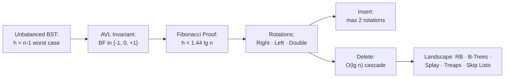

# UNIT-7: Balanced Binary Search Trees & AVL Trees
**Course:** Advanced Data Structures & Algorithms  
**Source & Curriculum:** MIT 6.006 (Introduction to Algorithms) — Lecture 6: Balanced Binary Search Trees  
**Professors:** Prof. Erik Demaine & Prof. Srini Devadas (MIT EECS)  
**Scope:** The Need for Balance, AVL Invariant & Golden Ratio Proof, Rotation Primitives, Insert & Delete Mechanics, Taxonomy of Balanced Trees, and ADT vs. Data Structure Paradigms  

---

## Table of Contents
1. [The Problem of Unbalanced BSTs & The Need for Balance](#1-the-problem-of-unbalanced-bsts--the-need-for-balance)
2. [AVL Trees: Invariant, Definition & Balance Factor](#2-avl-trees-invariant-definition--balance-factor)
3. [Mathematical Proof of Logarithmic Height (Fibonacci Bound)](#3-mathematical-proof-of-logarithmic-height-fibonacci-bound)
4. [Tree Rotations: The Rebalancing Primitives](#4-tree-rotations-the-rebalancing-primitives)
5. [AVL Insertion: The Four Imbalance Cases](#5-avl-insertion-the-four-imbalance-cases)
6. [Comprehensive Step-by-Step AVL Insertion Trace](#6-comprehensive-step-by-step-avl-insertion-trace)
7. [AVL Deletion: The Propagation Phenomenon](#7-avl-deletion-the-propagation-phenomenon)
8. [AVL Sort & Algorithmic Complexity Bounds](#8-avl-sort--algorithmic-complexity-bounds)
9. [The Landscape of Balanced Search Trees](#9-the-landscape-of-balanced-search-trees)
10. [The Big Picture: Abstract Data Types (ADT) vs. Data Structures](#10-the-big-picture-abstract-data-types-adt-vs-data-structures)
11. [Complete C Implementation of AVL Tree](#11-complete-c-implementation-of-avl-tree)
12. [Exam Revision Cheat Sheet & Practice Problems](#12-exam-revision-cheat-sheet--practice-problems)

---

## 1. The Problem of Unbalanced BSTs & The Need for Balance

### 1.1 Recall: Binary Search Tree (BST) Properties
A standard **Binary Search Tree** is a rooted binary tree where each node maintains:
- `key`: The stored data value.
- `left`: Pointer to the left child node.
- `right`: Pointer to the right child node.
- `parent`: Pointer to the parent node.

```text
Node Structure:
             [ Parent ]
                 |
                 v
             [  Key  ]
             /       \
      [ Left ]       [ Right ]
```

#### The BST Search Invariant:
For every node with key $x$:
- All keys in the **left subtree** are $\le x$ (or $< x$ for distinct key sets).
- All keys in the **right subtree** are $\ge x$ (or $> x$ for distinct key sets).

```text
                  ( x )
                 /     \
             (<= x)   (>= x)
```

---

### 1.2 Height Definition (CLRS Appendix B.5 Convention)
> **Height of a Node:** The length (measured as the **number of edges**) of the longest downward path from that node to a leaf.
- Height of a leaf node: $\text{height}(\text{leaf}) = 0$.
- Height of an empty / absent child: $\text{height}(\text{NIL}) = -1$.
- Height of any internal node:
  $$\text{height}(u) = 1 + \max\big(\text{height}(u.\text{left}), \, \text{height}(u.\text{right})\big)$$
- **Height of the Tree ($h$):** The height of its root node ($\text{height}(\text{root})$).

```text
Heights of Nodes in an Unbalanced BST:
                  (41) [h = 3]
                 /    \
        [h = 2] (20)   (65) [h = 1]
               /   \       \
      [h = 0] (11) (29)     (50) [h = 0]
                   / [h = 1]
                 (26) [h = 0]
```

---

### 1.3 The Run-Time Dependency on Height
Every fundamental dynamic set operation supported by a BST runs in **$O(h)$ time**, where $h$ is the height of the tree:
- `Search(x)`
- `Insert(x)`
- `Delete(x)`
- `Minimum()` / `Maximum()`
- `Successor(x)` (next-larger key)
- `Predecessor(x)` (next-smaller key)

#### The Height Spectrum:

```text
Best Case (Perfect Balance):               Worst Case (Degenerate Skewed Path):
             ( )                                     ( )
           /     \                                    \
         ( )     ( )                                  ( )
        /   \   /   \                                   \
       ()   () ()   ()                                  ( )
                                                          \
     Height h = floor(lg n)                               ( )
     Search: O(lg n)                                 Height h = n - 1
                                                     Search: O(n) (Linear chain!)
```

$$\lfloor \lg n \rfloor \le h \le n - 1$$

- If keys are inserted in sorted order ($1, 2, 3, 4, 5$), a naive BST degrades into a linear linked list where $h = n - 1$, destroying search efficiency ($O(n)$).
- **Core Motivation for Balanced BSTs:** Enforce a structural invariant so that the height is dynamically guaranteed to remain **$h = O(\lg n)$** under arbitrary sequences of insertions and deletions, ensuring all operations execute in strictly **$O(\lg n)$** worst-case time.

---

## 2. AVL Trees: Invariant, Definition & Balance Factor

### 2.1 Historical Discovery
Invented in **1962** by Soviet mathematicians **Georgy Adel'son-Vel'skii and Evgenii Landis**, the **AVL Tree** was the world's first self-balancing binary search tree.

---

### 2.2 The AVL Balance Invariant
> **The AVL Property:** For **every node** in the tree, the heights of its left and right child subtrees may differ by **at most $\pm 1$**.

$$\text{Balance Factor } BF(u) = \text{height}(u.\text{left}) - \text{height}(u.\text{right})$$
$$\text{Valid AVL Condition: } \quad BF(u) \in \{-1, \, 0, \, +1\}$$

```text
                  ( u )
                 /     \
               /         \
         [ Left ]       [ Right ]
         Height: k-1    Height: k        ===> BF(u) = (k-1) - k = -1  (VALID)
```

- If $BF(u) = +1$: Node $u$ is **left-heavy**.
- If $BF(u) = 0$: Node $u$ is **perfect-balanced**.
- If $BF(u) = -1$: Node $u$ is **right-heavy**.
- If $|BF(u)| \ge 2$: The node is **out of balance** and violates the AVL property; rotations must be triggered.

---

### 2.3 Data Structure Augmentation
To maintain balance in $O(\lg n)$ time without recomputing heights from scratch, each node stores its own height as an augmented attribute:

```c
struct AVLNode {
    int key;
    int height; // Augmented field storing height of subtree
    struct AVLNode *left;
    struct AVLNode *right;
    struct AVLNode *parent;
};
```
*(Alternatively, a 2-bit field can be used to store only the balance factor $\{-1, 0, +1\}$).*

---

## 3. Mathematical Proof of Logarithmic Height (Fibonacci Bound)

How do we prove mathematically that restricting $|BF| \le 1$ guarantees $h = O(\lg n)$?

### 3.1 Worst-Case (Minimal) AVL Tree Analysis
To find the maximum possible height for a given number of nodes $n$, we analyze the opposite question: **What is the minimum number of nodes ($N_h$) required to construct an AVL tree of height $h$?**

The worst-case (most sparse) AVL tree occurs when every node along the critical path has a balance factor of $\pm 1$. Therefore, an AVL tree of height $h$ must have one child of height $h - 1$ and the other child of height $h - 2$:

$$N_h = N_{h-1} + N_{h-2} + 1$$

#### Base Cases (using $\text{height}(\text{NIL}) = -1$):
- $N_{-1} = 0$ (empty tree)
- $N_0 = 1$ (single root node)
- $N_1 = N_0 + N_{-1} + 1 = 1 + 0 + 1 = 2$
- $N_2 = N_1 + N_0 + 1 = 2 + 1 + 1 = 4$
- $N_3 = N_2 + N_1 + 1 = 4 + 2 + 1 = 7$
- $N_4 = N_3 + N_2 + 1 = 7 + 4 + 1 = 12$

```text
Minimal AVL Trees (Fibonacci Trees):
h = 0:       h = 1:          h = 2:                 h = 3:
 (o)          (o)             (o)                    (o)
             /               /   \                  /   \
           (o)             (o)   (o)              (o)   (o)
                          /                      /   \    \
                        (o)                    (o)   (o)  (o)
                                               /
                                             (o)
Nodes: 1     Nodes: 2        Nodes: 4               Nodes: 7
```

---

### 3.2 Lower Bounding $N_h$
Since $N_{h-1} > N_{h-2}$:
$$N_h = N_{h-1} + N_{h-2} + 1 > 2 N_{h-2}$$
$$N_h > 2 N_{h-2} > 4 N_{h-4} > \dots > 2^{h/2}$$
Taking logarithms of both sides:
$$\lg N_h > \frac{h}{2} \implies h < 2 \lg N_h$$

This elementary inequality immediately establishes that **$h = O(\lg n)$**.

---

### 3.3 Exact Closed-Form via the Golden Ratio ($\phi$)
Notice the recurrence $N_h = N_{h-1} + N_{h-2} + 1$ is related to the **Fibonacci sequence** ($F_0 = 0, F_1 = 1, F_2 = 1, F_3 = 2, F_4 = 3, F_5 = 5, \dots$):

By mathematical induction:
$$N_h = F_{h+3} - 1$$
*(Check: $N_0 = F_3 - 1 = 2 - 1 = 1$; $N_1 = F_4 - 1 = 3 - 1 = 2$; $N_2 = F_5 - 1 = 5 - 1 = 4$; $N_3 = F_6 - 1 = 8 - 1 = 7$).*

By Binet's Fibonacci formula, $F_k \approx \frac{\phi^k}{\sqrt{5}}$, where $\phi = \frac{1 + \sqrt{5}}{2} \approx 1.61803$ (the **Golden Ratio**):

$$n \ge N_h > \frac{\phi^{h+2}}{\sqrt{5}} - 1$$
$$n + 1 > \frac{\phi^{h+2}}{\sqrt{5}}$$
$$\log_\phi(n + 1) > h + 2 - \log_\phi(\sqrt{5})$$
$$h < \log_\phi n \approx \frac{\lg n}{\lg \phi} \approx \frac{\lg n}{0.69424} \approx \mathbf{1.4404 \, \lg n}$$

> [!IMPORTANT]
> **Key Theoretical Bound:**
> An AVL tree's maximum height is strictly bounded by:
> $$h < 1.440 \lg n$$
> This means an AVL tree is at most **$44\%$ taller than a perfectly balanced complete binary tree** ($\lg n$), guaranteeing strict $O(\lg n)$ operation bounds.

---

## 4. Tree Rotations: The Rebalancing Primitives

When an insertion or deletion unbalances a node ($|BF| = 2$), we restore the AVL property using **Rotations**.
- A rotation is a local pointer reassignment taking **$O(1)$ constant time**.
- Rotations preserve the **BST Inorder Traversal Property**:
  $$\text{Inorder Sequence: } A < x < B < y < C$$

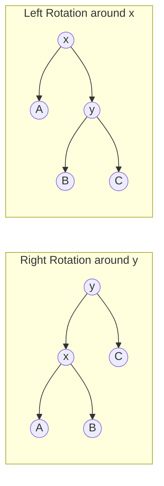

---

### 4.1 Right Rotation (`Right-Rotate(y)`)
Used when node $y$ is left-heavy ($BF = +2$).

```text
         ( y )                              ( x )
        /     \        Right-Rotate(y)     /     \
      ( x )    C      ================>   A      ( y )
     /     \                                    /     \
    A       B                                  B       C
```
**Pointer Adjustments:**
1. Let $x = y.\text{left}$.
2. Set $y.\text{left} = x.\text{right}$ (subtree $B$).
3. Set $x.\text{right} = y$.
4. Update heights of $y$, then $x$.

---

### 4.2 Left Rotation (`Left-Rotate(x)`)
Used when node $x$ is right-heavy ($BF = -2$).

```text
      ( x )                                  ( y )
     /     \           Left-Rotate(x)       /     \
    A      ( y )      ================>   ( x )    C
          /     \                        /     \
         B       C                      A       B
```
**Pointer Adjustments:**
1. Let $y = x.\text{right}$.
2. Set $x.\text{right} = y.\text{left}$ (subtree $B$).
3. Set $y.\text{left} = x$.
4. Update heights of $x$, then $y$.

---

## 5. AVL Insertion: The Four Imbalance Cases

### 5.1 Insertion Workflow
1. Perform standard BST insertion to place the new key at a leaf slot ($O(\lg n)$).
2. Trace the path from the newly inserted node upwards toward the root, updating node heights.
3. Identify the **lowest ancestor $x$** that violates the balance invariant ($|BF(x)| = 2$).
4. Apply the corresponding rebalancing rotation.

---

### 5.2 The Four Disjoint Cases

**Rotation chooser — decide instantly during an exam:**

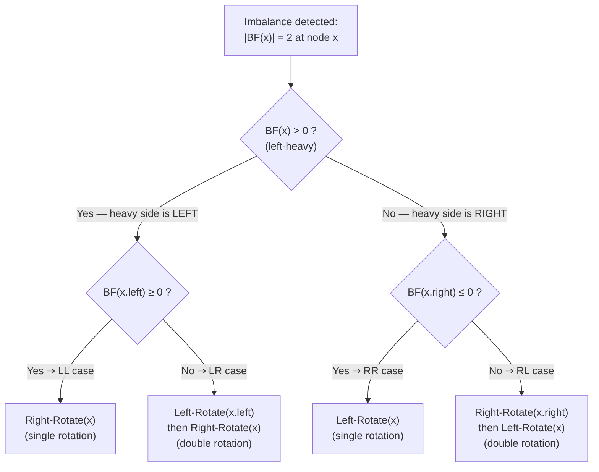

```text
Case 1: Left-Left (LL) Heavy    ---> Single Right-Rotate(x)
Case 2: Right-Right (RR) Heavy  ---> Single Left-Rotate(x)
Case 3: Left-Right (LR) Heavy   ---> Double Rotation: Left-Rotate(x.left), then Right-Rotate(x)
Case 4: Right-Left (RL) Heavy   ---> Double Rotation: Right-Rotate(x.right), then Left-Rotate(x)
```

---

#### Case 1: Right-Right (RR) Imbalance (Single Left Rotation)
- **Condition:** Node $x$ has $BF(x) = -2$, and its right child $y$ has $BF(y) \le 0$ (right-heavy or balanced).

```text
        ( x ) [k+2]                               ( y ) [k+1]
       /     \                                   /     \
    [A]       ( y ) [k+1]   Left-Rotate(x)    ( x ) [k] [C] [k]
   (k-1)     /     \       ==============>   /     \
           [B]     [C]                      [A]   [B]
          (k-1)    (k)                     (k-1) (k-1)
```

---

#### Case 2: Right-Left (RL) Imbalance (Double Rotation)
- **Condition:** Node $x$ has $BF(x) = -2$, but its right child $z$ is left-heavy ($BF(z) = +1$).
- **Resolution:**
  1. Rotate right around child $z$ to transform the structure into an RR case.
  2. Rotate left around $x$.

```text
        ( x )                               ( x )                               ( y )
       /     \                             /     \                             /     \
      A       ( z )      Right-Rotate(z)  A       ( y )      Left-Rotate(x)  ( x )   ( z )
             /     \    ================>        /     \    ================> /   \   /   \
           ( y )    D                           B      ( z )                 A     B C     D
          /     \                                     /     \
         B       C                                   C       D
```

---

> [!TIP]
> **Single vs. Double Rotation Invariant for Insert:**
> After applying **at most one** rotation (single or double) at the lowest unbalanced node $x$, the height of that subtree returns to its exact value prior to insertion. Consequently, **no further ancestor can be unbalanced**. Insertion requires **at most 2 rotations** ($O(1)$ rebalancing steps)!

---

## 6. Comprehensive Step-by-Step AVL Insertion Trace

*(Directly derived from MIT 6.006 Lecture 6, Figure 7)*

### Initial Tree State:
Keys in tree: $\{41, 20, 11, 29, 26, 65, 50\}$

```text
                  (41) [h=3]
                 /    \
         [h=2] (20)   (65) [h=1]
               /  \       \
       [h=0] (11) (29)    (50) [h=0]
                  / [h=1]
                (26) [h=0]
```

---

### Step 1: Insert Key `23`

1. **BST Placement:**
   - $23 < 41 \to 23 > 20 \to 23 < 29 \to 23 < 26$.
   - Insert $23$ as **left child** of node `26`.

2. **Height & Balance Updates (Bottom-Up):**
   - Node `23`: $\text{height} = 0$.
   - Node `26`: left height $0$, right height $-1 \implies \text{height} = 1, BF = +1$.
   - Node `29`: left child `26` has height $1$, right child is NIL (height $-1$).
     $$BF(29) = 1 - (-1) = \mathbf{+2} \quad \text{(VIOLATION at } x = 29\text{!)}$$
   - Child `26` has $BF(26) = +1 \implies$ **Left-Left (LL) Case**!

3. **Rebalancing Action: `Right-Rotate(29)`**

```text
Before Rotation at 29:                       After Right-Rotate(29):
            (29) [BF = +2]                             (26) [h = 1]
           /                                          /    \
        (26) [BF = +1]             =====>          (23)    (29)
        /                                          [h=0]   [h=0]
     (23) [h = 0]
```

4. **Resulting Subtree:** Node `20` now has right child `26`, whose children are `23` and `29`. The subtree height at `26` is $1$ (same as `29` before insertion). Tree is fully balanced!

---

### Step 2: Insert Key `55`

1. **BST Placement:**
   - $55 > 41 \to 55 < 65 \to 55 > 50$.
   - Insert $55$ as **right child** of node `50`.

2. **Height & Balance Updates (Bottom-Up):**
   - Node `55`: $\text{height} = 0$.
   - Node `50`: left height $-1$, right height $0 \implies \text{height} = 1, BF = -1$.
   - Node `65`: left child `50` has height $1$, right child is NIL (height $-1$).
     $$BF(65) = 1 - (-1) = \mathbf{+2} \quad \text{(VIOLATION at } x = 65\text{!)}$$
   - Check child `50`: $BF(50) = -1$ (right-heavy).
   - This is the **Left-Right (LR) Case** at $x = 65$!

3. **Rebalancing Action: Double Rotation**
   - **Step 2a: `Left-Rotate(50)`**
     Transforms the left child into left-heavy: `55` becomes parent of `50`.
   - **Step 2b: `Right-Rotate(65)`**
     Brings `55` to the top; `50` becomes left child, `65` becomes right child.

```text
Before Rebalance:          Step 2a: Left-Rotate(50)      Step 2b: Right-Rotate(65)
      (65) [BF = +2]                 (65)                          (55) [h = 1]
     /                              /                             /    \
  (50) [BF = -1]      =====>     (55)             =====>       (50)    (65)
     \                           /                             [h=0]   [h=0]
     (55)                      (50)
```

4. **Final Balanced Tree:**
```text
                        (41) [h = 3]
                      /      \
              [h=2] (20)     (55) [h = 1]
                    /  \     /  \
            [h=0] (11) (26) (50)(65)
                       /  \
                     (23) (29)
```

---

## 7. AVL Deletion: The Propagation Phenomenon

### 7.1 Deletion Mechanism
1. Perform standard BST deletion:
   - If node has $0$ children: delete directly.
   - If node has $1$ child: splice child to parent.
   - If node has $2$ children: swap with **inorder successor** (or predecessor) and delete that node.
2. Walk up the ancestor chain to the root, decrementing heights and checking balance factors.

---

### 7.2 Why Deletion Can Cause $O(\lg n)$ Rotations
Unlike insertion (where a single rotation restores the pre-insertion subtree height), **deletion reduces the height of a subtree**.

```text
1. Node deleted in subtree T.
2. Height of T decreases by 1.
3. Parent P becomes unbalanced (BF = +/- 2).
4. Rotation at P restores local balance, BUT the height of the entire P-subtree 
   has now decreased by 1 relative to P's parent!
5. This height deficit ripples up to grandparent, great-grandparent...
```

- In the worst case (a Fibonacci tree), rebalancing cascades through every ancestor up to the root.
- **Maximum rotations during insertion:** $\le 2$ ($O(1)$).
- **Maximum rotations during deletion:** $\le 2 \times h = O(\lg n)$.
- However, since each rotation takes $O(1)$, **total deletion time remains strictly $O(\lg n)$**.

---

## 8. AVL Sort & Algorithmic Complexity Bounds

AVL trees can be utilized as a comparison-based sorting engine (**AVL Sort**):

```text
Algorithm AVL-Sort(Array A of n elements):
1. Create an empty AVL tree T.
2. For each element x in A:
       Insert x into T.                  // Takes Theta(lg k) for k-th item
   Total insertion time = sum_{k=1}^n lg k = Theta(n lg n)
3. Perform In-Order Traversal of T:
       Output keys sequentially.         // Takes Theta(n) time
4. Total Run Time = Theta(n lg n) + Theta(n) = Theta(n lg n)
```

- **Comparison Sorting Lower Bound:** Any comparison-based sorting algorithm requires $\Omega(n \lg n)$ comparisons in the worst case (via decision tree lower bound: $\lg(n!) \approx n \lg n - n \lg e$).
- **Conclusion:** AVL Sort is **asymptotically optimal**!

---

## 9. The Landscape of Balanced Search Trees

| Data Structure | Authors & Year | Balancing Mechanism | Worst-Case Height | Invariant Guarantee |
|---|---|---|:---:|---|
| **AVL Trees** | Adel'son-Vel'skii & Landis (1962) | Heights of sibling subtrees differ by $\le 1$ | **$1.44 \lg n$** | Strict worst-case $O(\lg n)$. |
| **B-Trees / 2-3-4 Trees** | Bayer & McCreight (1972) | Multi-way branching; all leaves at identical depth | $O(\log_B n)$ | Designed for block storage & disk I/O. |
| **BB$[\alpha]$ Trees** | Nievergelt & Reingold (1973) | Weight-balanced based on subtree sizes | $O(\lg n)$ | Balances based on operational frequencies. |
| **Red-Black Trees** | Bayer (1972) / Guibas & Sedgewick (1978) | Color tags (Red/Black); no path $> 2 \times$ shortest path | **$2.00 \lg n$** | Looser balance than AVL; faster inserts/deletes. |
| **Splay Trees** | Sleator & Tarjan (1985) | Splaying accessed nodes to root via rotations | $O(n)$ worst, **$O(\lg n)$ amortized** | Self-optimizing for locality of access. |
| **Skip Lists** | Pugh (1989) | Probabilistic multi-level linked forward pointers | $O(\lg n)$ with high probability | Simple lock-free concurrency. |
| **Scapegoat Trees** | Galperin & Rivest (1993) | Rebuilds unbalanced subtrees from scratch | $O(\lg n)$ worst-case lookup | Zero per-node memory overhead. |
| **Treaps** | Seidel & Aragon (1996) | Dual BST on keys + Min-Heap on randomized priorities | $O(\lg n)$ with high probability | Cartesian tree mapping. |

---

## 10. The Big Picture: Abstract Data Types (ADT) vs. Data Structures

A fundamental theme in computer science is the separation of interface and implementation:
- **Abstract Data Type (ADT):** The semantic contract or interface specification (what operations are supported and what they mean).
- **Data Structure (DS):** The concrete algorithmic representation and layout in memory (how operations are achieved).

---

### Comparison 1: Priority Queue ADT Implementations

$$\text{Operations: } \text{insert}(x), \, \text{deletemin}(), \, \text{findmin}()$$

| Priority Queue Operation | Binary Heap | AVL Tree |
|---|:---:|:---:|
| `new-empty-queue()` | $\Theta(1)$ | $\Theta(1)$ |
| `insert(x)` | $\Theta(\lg n)$ | $\Theta(\lg n)$ |
| `deletemin()` | $\Theta(\lg n)$ | $\Theta(\lg n)$ |
| `findmin()` | $\mathbf{\Theta(1)}$ | $\Theta(\lg n) \xrightarrow{\text{augmented with min pointer}} \mathbf{\Theta(1)}$ |

---

### Comparison 2: Predecessor / Successor ADT Implementations

$$\text{Operations: } \text{insert}(x), \, \text{delete}(x), \, \text{predecessor}(x), \, \text{successor}(x)$$

| Operation | Binary Heap | AVL Tree |
|---|:---:|:---:|
| `new-empty()` | $\Theta(1)$ | $\Theta(1)$ |
| `insert(x)` | $\Theta(\lg n)$ | $\Theta(\lg n)$ |
| `delete(x)` | $\Theta(\lg n)$ | $\Theta(\lg n)$ |
| `predecessor(x)` (next-smaller) | $\mathbf{\Theta(n)}$ *(Must scan entire array!)* | $\mathbf{\Theta(\lg n)}$ |
| `successor(x)` (next-larger) | $\mathbf{\Theta(n)}$ *(Must scan entire array!)* | $\mathbf{\Theta(\lg n)}$ |

> [!CAUTION]
> **Why Heaps Cannot Replace Balanced BSTs:**
> A Binary Heap maintains only a partial ancestral ordering (parent $\le$ child), providing no information about relative left-right order. Finding the predecessor or successor in a Heap requires an exhaustive linear scan ($\Theta(n)$). An AVL Tree maintains total order, supporting predecessor and successor queries in $\Theta(\lg n)$ time!

---

## 11. Complete C Implementation of AVL Tree

```c
#include <stdio.h>
#include <stdlib.h>

struct Node {
    int key;
    struct Node *left;
    struct Node *right;
    int height;
};

// Utility to get height (handles NULL)
int height(struct Node *n) {
    if (n == NULL) return -1;
    return n->height;
}

int max(int a, int b) {
    return (a > b) ? a : b;
}

struct Node* newNode(int key) {
    struct Node* node = (struct Node*)malloc(sizeof(struct Node));
    node->key = key;
    node->left = NULL;
    node->right = NULL;
    node->height = 0; // Leaf has height 0
    return node;
}

// Right rotation around y
struct Node* rightRotate(struct Node *y) {
    struct Node *x = y->left;
    struct Node *T2 = x->right;

    // Perform rotation
    x->right = y;
    y->left = T2;

    // Update heights
    y->height = max(height(y->left), height(y->right)) + 1;
    x->height = max(height(x->left), height(x->right)) + 1;

    return x; // New root
}

// Left rotation around x
struct Node* leftRotate(struct Node *x) {
    struct Node *y = x->right;
    struct Node *T2 = y->left;

    // Perform rotation
    y->left = x;
    x->right = T2;

    // Update heights
    x->height = max(height(x->left), height(x->right)) + 1;
    y->height = max(height(y->left), height(y->right)) + 1;

    return y; // New root
}

// Get Balance Factor
int getBalance(struct Node *n) {
    if (n == NULL) return 0;
    return height(n->left) - height(n->right);
}

// Recursive Insert
struct Node* insert(struct Node* node, int key) {
    // 1. Standard BST insertion
    if (node == NULL)
        return newNode(key);

    if (key < node->key)
        node->left = insert(node->left, key);
    else if (key > node->key)
        node->right = insert(node->right, key);
    else
        return node; // Duplicate keys not allowed

    // 2. Update height of current ancestor
    node->height = 1 + max(height(node->left), height(node->right));

    // 3. Check balance factor
    int balance = getBalance(node);

    // Case 1: Left-Left (LL)
    if (balance > 1 && key < node->left->key)
        return rightRotate(node);

    // Case 2: Right-Right (RR)
    if (balance < -1 && key > node->right->key)
        return leftRotate(node);

    // Case 3: Left-Right (LR)
    if (balance > 1 && key > node->left->key) {
        node->left = leftRotate(node->left);
        return rightRotate(node);
    }

    // Case 4: Right-Left (RL)
    if (balance < -1 && key < node->right->key) {
        node->right = rightRotate(node->right);
        return leftRotate(node);
    }

    return node;
}

// Find node with minimum key
struct Node* minValueNode(struct Node* node) {
    struct Node* current = node;
    while (current->left != NULL)
        current = current->left;
    return current;
}

// Recursive Deletion
struct Node* deleteNode(struct Node* root, int key) {
    if (root == NULL) return root;

    if (key < root->key)
        root->left = deleteNode(root->left, key);
    else if (key > root->key)
        root->right = deleteNode(root->right, key);
    else {
        // Node with only one child or no child
        if ((root->left == NULL) || (root->right == NULL)) {
            struct Node *temp = root->left ? root->left : root->right;
            if (temp == NULL) { // No child
                temp = root;
                root = NULL;
            } else { // One child
                *root = *temp;
            }
            free(temp);
        } else {
            // Node with two children: get inorder successor
            struct Node* temp = minValueNode(root->right);
            root->key = temp->key;
            root->right = deleteNode(root->right, temp->key);
        }
    }

    if (root == NULL) return root;

    // 2. Update height
    root->height = 1 + max(height(root->left), height(root->right));

    // 3. Balance checking
    int balance = getBalance(root);

    // Left-Left
    if (balance > 1 && getBalance(root->left) >= 0)
        return rightRotate(root);

    // Left-Right
    if (balance > 1 && getBalance(root->left) < 0) {
        root->left = leftRotate(root->left);
        return rightRotate(root);
    }

    // Right-Right
    if (balance < -1 && getBalance(root->right) <= 0)
        return leftRotate(root);

    // Right-Left
    if (balance < -1 && getBalance(root->right) > 0) {
        root->right = rightRotate(root->right);
        return leftRotate(root);
    }

    return root;
}
```

---

## 12. Exam Revision Cheat Sheet & Practice Problems

### Master Formulas & Properties:
- **Balance Factor Formula:** $BF(u) = \text{height}(u.\text{left}) - \text{height}(u.\text{right}) \in \{-1, 0, +1\}$.
- **Minimal Nodes Recurrence:** $N_h = N_{h-1} + N_{h-2} + 1 = F_{h+3} - 1$.
- **Maximum Height Bound:** $h < 1.440 \lg n$.
- **Insertion Rotation Bound:** At most **$1$ rotation** (single or double).
- **Deletion Rotation Bound:** Up to **$O(\lg n)$ rotations**.

---

### Practice Problem 1: Minimum Nodes for Height $h = 4$
**Question:** What is the minimum number of nodes required to construct an AVL tree of height $4$?  
**Solution:**
Using the recurrence $N_h = N_{h-1} + N_{h-2} + 1$:
- $N_0 = 1$
- $N_1 = 2$
- $N_2 = 2 + 1 + 1 = 4$
- $N_3 = 4 + 2 + 1 = 7$
- $N_4 = 7 + 4 + 1 = \mathbf{12}$ nodes!

---

### Practice Problem 2: Identify the Rotation Case
**Question:** In an AVL tree, node $X$ has $BF(X) = -2$, and its right child $Y$ has $BF(Y) = +1$. Which sequence of rotations will restore balance?  
**Answer:** This is the **Right-Left (RL) Case**. It requires a double rotation:
1. `Right-Rotate(Y)` on the right child.
2. `Left-Rotate(X)` on node $X$.

---

# 🎓 FINAL REVISION CHECKLIST

Before your exam or interview, make sure you can do every item below **from memory**:

- [ ] Explain **LIFO vs FIFO** and trace stack push/pop + queue enqueue/dequeue, including overflow/underflow conditions
- [ ] **Trace** Bubble, Selection, Insertion, Quick and Merge sorts on a fresh 8–9 element array
- [ ] State best/average/worst time, auxiliary space, and **stability** for every sorting algorithm
- [ ] Decide which sort fits a scenario: small *n* or nearly sorted → insertion · expensive writes (EEPROM/Flash) → selection · linked lists or external sorting → merge · large in-memory array → quick
- [ ] Implement in C from scratch: SLL insert (beginning/end/position), delete (beginning/end/position), merge of two sorted lists, and the 3-pointer reversal
- [ ] Explain why a **CLL must never terminate on `NULL`** (infinite loop!) and write the correct `do-while` traversal
- [ ] Insert into a DLL touching all **four pointers in the right order**
- [ ] Recite the core formulas: $|E| = n-1$ · Catalan counts $C_1 \dots C_5 = 1, 2, 5, 14, 42$ · max nodes at level $l = 2^l$ · total nodes $n = 2^h - 1$ · $h_{min} = \lceil \log_2(n+1) \rceil$
- [ ] Produce Preorder / Inorder / Postorder / Level-order of any tree using the visual shortcut techniques (contour walk · ground mirror · leaf plucking)
- [ ] Build a BST from an insertion sequence; delete a node in all 3 cases (leaf · 1 child · 2 children with inorder successor)
- [ ] Insert a key sequence into a hash table using **separate chaining / linear / quadratic / double hashing**, and identify which clustering each method causes
- [ ] Convert a graph between adjacency matrix and adjacency list, and state when each representation wins
- [ ] Trace **DFS and BFS** with the tie-breaking rule and explain why only BFS guarantees shortest-hop paths
- [ ] Run **Prim's and Kruskal's** on any weighted graph, quote the MST cost, and explain the **Cut Property**
- [ ] Identify **LL / RR / LR / RL** imbalance, apply the correct single/double rotation, and rebuild heights bottom-up
- [ ] Derive the AVL bounds: $N_h = N_{h-1} + N_{h-2} + 1 = F_{h+3} - 1$ and $h < 1.44\,\lg n$

> ✅ Every original source file is preserved untouched — use this master file for full-course revision, and the original per-topic files for focused single-topic study.

