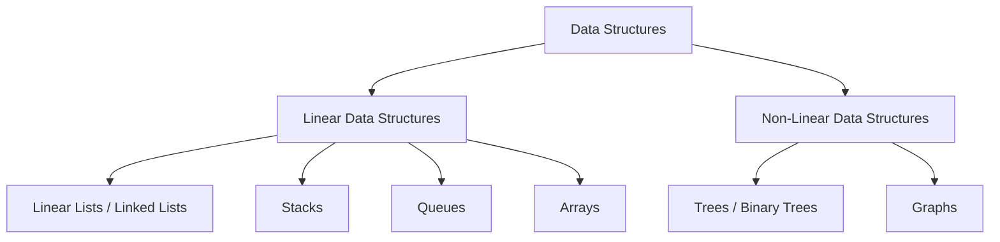
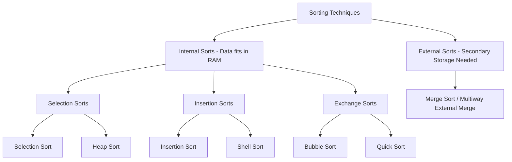

# UNIT-V: Searching, Sorting, and Introduction to Data Structures
**Course:** Computer Programming & Data Structures (CPDS)  
**Target:** B.Tech. I Year (Subject Code: GR11A1003) & Technical Interview Preparation  
**Source Material:** Unit-V Previous Year Question Bank & Core DSA Curriculum  

---

## Table of Contents
1. [Course & Unit Overview](#1-course--unit-overview)
2. [Classification of Data Structures](#2-classification-of-data-structures)
3. [Linear Lists: Arrays vs. Linked Lists](#3-linear-lists-arrays-vs-linked-lists)
4. [Singly Linked Lists: Core Operations](#4-singly-linked-lists-core-operations)
5. [Searching Algorithms](#5-searching-algorithms)
   - [Linear (Sequential) Search](#51-linear-sequential-search)
   - [Binary Search (Iterative & Recursive)](#52-binary-search)
6. [Sorting Algorithms](#6-sorting-algorithms)
   - [Classification: Internal vs. External Sorts](#61-classification-of-sorting-techniques)
   - [Bubble Sort (Exchange Sort)](#62-bubble-sort-exchange-sort)
   - [Selection Sort](#63-selection-sort)
   - [Insertion Sort](#64-insertion-sort)
   - [Quick Sort (Partition Exchange Sort)](#65-quick-sort-partition-exchange-sort)
   - [Merge Sort (Divide-and-Conquer)](#66-merge-sort-divide-and-conquer)
7. [The Stack Abstract Data Type (ADT)](#7-the-stack-abstract-data-type-adt)
8. [The Queue Abstract Data Type (ADT)](#8-the-queue-abstract-data-type-adt)
9. [Introduction to Non-Linear Data Structures: Trees](#9-introduction-to-non-linear-data-structures-trees)
10. [Introduction to Non-Linear Data Structures: Graphs](#10-introduction-to-non-linear-data-structures-graphs)
11. [Master Complexity & Comparison Matrix](#11-master-complexity--comparison-matrix)
12. [University Exam Questions, Traces & Solutions](#12-university-exam-questions-traces--solutions)
13. [Source Audit & Critical Errata](#13-source-audit--critical-errata)

---

## 1. Course & Unit Overview

Unit-V covers the foundational pillars of algorithmic problem solving:
1. **Searching Techniques:** Finding target items sequentially or via divide-and-conquer logarithmic reduction (`Linear Search`, `Binary Search`).
2. **Sorting Techniques:** Rearranging unordered lists into ascending or descending keys via comparison-based internal and external strategies (`Bubble`, `Selection`, `Insertion`, `Quick`, and `Merge Sort`).
3. **Linear Data Structures:** Sequential structures where every item has a unique predecessor and successor (`Arrays`, `Linked Lists`, `Stacks`, `Queues`).
4. **Non-Linear Data Structures:** Multi-level, hierarchical, or interconnected structures (`Trees`, `Binary Trees`, `Graphs`).

---

## 2. Classification of Data Structures

### 2.1 Definition
> **Data Structure:** A specialized format for organizing, storing, processing, and accessing data along with the logical relationships between the individual elements. It determines how operations such as insertion, deletion, traversal, retrieval, and access are carried out.

Data structures can be **nested** (a data structure containing instances of another data structure) and serve as concrete implementations of **Abstract Data Types (ADTs)**.



### 2.2 Taxonomy of Data Structures

| Classification Axis | Type | Definition & Characteristics | Examples |
|---|---|---|---|
| **Arrangement** | **Linear** | Elements form a sequential sequence; each element has a unique predecessor and successor (except first and last). | Arrays, Linked Lists, Stacks, Queues |
| | **Non-Linear** | Elements are organized hierarchically or interconnectedly across multiple levels. | Trees, Graphs |
| **Data Homogeneity** | **Homogeneous** | All stored elements are strictly of the identical data type. | Arrays (e.g., `int arr[10]`) |
| | **Non-Homogeneous** | Elements of differing primitive or composite types grouped together. | C `struct`, C++ `class` |
| **Memory Allocation** | **Static** | Size and memory layout are fixed at compile time. Cannot grow or shrink during execution. | Static Arrays |
| | **Dynamic** | Memory allocated at runtime on the heap using Dynamic Memory Allocation (DMA: `malloc()`, `calloc()`). Can expand or shrink dynamically. | Linked Lists, Dynamic Trees |

---

## 3. Linear Lists: Arrays vs. Linked Lists

### 3.1 Linear List ADT
A **Linear List** is an ordered collection of finite values $(e_1, e_2, \dots, e_n)$.
- **Mathematical sequence:** Each occurrence of an item is distinct, even if values duplicate.
- **Core Operations:**
  - `create()`: Initialize an empty list.
  - `isEmpty()`: Check if size is 0.
  - `prepend(item)`: Insert element at the beginning (new head).
  - `append(item)`: Insert element at the end (new tail).
  - `head()`: Retrieve or inspect the first element.
  - `tail()`: Return list consisting of all elements except the first.
  - `delete(item)`: Remove specified element.
  - `search(key)`: Locate element matching key.
  - `display()`: Enumerate elements in sequence.

### 3.2 Comparison: Arrays vs. Linked Lists

```
Array (Contiguous Memory):
Index:    0      1      2      3
Addr:  [1000] [1004] [1008] [1012]
Val:   |  10  |  20  |  30  |  40  |

Linked List (Non-Contiguous Memory via Pointers):
Head -> [10 | 2000] ----> [20 | 3000] ----> [30 | NULL]
Addr:     1000              2000              3000
```

| Parameter | Array Implementation | Linked List Implementation |
|---|---|---|
| **Memory Allocation** | **Static:** Compile-time, fixed size. | **Dynamic:** Run-time via heap (`malloc`). |
| **Storage Layout** | **Contiguous:** Requires consecutive physical memory blocks. | **Non-contiguous:** Nodes scattered anywhere in memory, linked via pointers. |
| **Resizing Flexibility** | Fixed size. Expanding requires allocating a new array and copying elements. | Fully dynamic. Expands and contracts node-by-node on demand. |
| **Memory Overhead** | Minimal (stores only data elements, zero pointer overhead). | Higher (each node requires extra bytes for pointer fields). |
| **Element Access** | Direct / Random access: $O(1)$ via index formula `Base + (i * size)`. | Sequential access: $O(n)$ by traversing pointers from `head`. |
| **Insertion / Deletion** | Costly: $O(n)$ due to shifting elements left or right. | Efficient: $O(1)$ pointer redirection once position is reached. |
| **Memory Fragmentation** | Vulnerable to external fragmentation; large allocations fail if no single contiguous block exists. | Efficient utilization of scattered free memory fragments. |

---

## 4. Singly Linked Lists: Core Operations

### 4.1 Node Structure & Conventions
A Singly Linked List consists of self-referential structures where each node has:
1. `data`: The information payload.
2. `next`: A pointer holding the address of the succeeding node (or `NULL` if last).

```c
struct Node {
    int data;
    struct Node* next;
};
struct Node* head = NULL;
```

```text
HEAD ──► [ Data: 12 | Next: • ] ──► [ Data: 99 | Next: • ] ──► [ Data: 37 | Next: NULL ]
```

---

### 4.2 Insertion at Beginning

**Logic:**
1. Allocate memory for `new_node`.
2. Assign `new_node->data = val`.
3. Set `new_node->next = head`.
4. Point `head = new_node`.

```c
void insertAtBeginning(int val) {
    struct Node* new_node = (struct Node*)malloc(sizeof(struct Node));
    new_node->data = val;
    new_node->next = head;
    head = new_node;
}
```

```text
Before: HEAD ──► [ 10 | • ] ──► [ 20 | NULL ]
Insert: [ 5 | • ] ──► [ 10 | • ]
After:  HEAD ──► [ 5 | • ] ──► [ 10 | • ] ──► [ 20 | NULL ]
```

---

### 4.3 Insertion at a Given Position ($1$-based index `pos`)

**Logic:**
1. If `pos == 1`, insert at beginning.
2. Otherwise, traverse pointer `temp` to node at `pos - 1`.
3. Link `new_node->next = temp->next`.
4. Link `temp->next = new_node`.

```c
void insertAtPosition(int val, int pos) {
    struct Node* new_node = (struct Node*)malloc(sizeof(struct Node));
    new_node->data = val;
    
    if (pos == 1) {
        new_node->next = head;
        head = new_node;
        return;
    }
    
    struct Node* temp = head;
    int i = 1;
    while (i < pos - 1 && temp != NULL) {
        temp = temp->next;
        i++;
    }
    
    if (temp == NULL) {
        printf("Position out of range!\n");
        free(new_node);
        return;
    }
    
    new_node->next = temp->next;
    temp->next = new_node;
}
```

---

### 4.4 Insertion at End

**Logic:**
1. Allocate `new_node` and set `new_node->next = NULL`.
2. If `head == NULL`, set `head = new_node`.
3. Otherwise, traverse to the last node (`temp->next != NULL`).
4. Set `temp->next = new_node`.

```c
void insertAtEnd(int val) {
    struct Node* new_node = (struct Node*)malloc(sizeof(struct Node));
    new_node->data = val;
    new_node->next = NULL;
    
    if (head == NULL) {
        head = new_node;
        return;
    }
    
    struct Node* temp = head;
    while (temp->next != NULL) {
        temp = temp->next;
    }
    temp->next = new_node;
}
```

---

### 4.5 Searching in an Ordered Linear Linked List

When searching in an ordered linked list (e.g., to find the exact insertion or deletion point), the search algorithm maintains two moving pointers:
- `pcur`: Points to current candidate node.
- `ppre`: Points to predecessor of `pcur`.

#### Formal State Table for Ordered List Search
Given a search target key in an ascending list:

| Condition | `ppre` Pointer State | `pcur` Pointer State | Return Value | Meaning |
|---|---|---|:---:|---|
| $\text{Target} < \text{First Node}$ | `NULL` | First node | `0` (False) | Target is smaller than all list items. |
| $\text{Target} == \text{First Node}$ | `NULL` | First node | `1` (True) | Target located at head. |
| $\text{First} < \text{Target} < \text{Last}$ (Not present) | Largest node $< \text{Target}$ | First node $> \text{Target}$ | `0` (False) | Target belongs between `ppre` and `pcur`. |
| $\text{Target} == \text{Middle Node}$ | Node's immediate predecessor | Matching node | `1` (True) | Target found in interior. |
| $\text{Target} == \text{Last Node}$ | Predecessor of last node | Last node | `1` (True) | Target located at tail. |
| $\text{Target} > \text{Last Node}$ | Last node | `NULL` | `0` (False) | Target exceeds all elements in list. |

---

## 5. Searching Algorithms

Searching is the algorithmic process of locating the position of a specified target key within a collection, or determining its absence.

---

### 5.1 Linear (Sequential) Search

#### Definition & Mechanism
Linear search examines each element in sequence from index $0$ to $n-1$ (or $n-1$ down to $0$) until a match is found or the end of the collection is reached.
- **Applicability:** Works on both **sorted** and **unsorted** arrays or linked lists.
- **Requires no random access:** Suitable for sequential media.

#### Iterative C Implementation
```c
#include <stdio.h>

int linearSearch(int arr[], int n, int key) {
    for (int i = 0; i < n; i++) {
        if (arr[i] == key) {
            return i; // Return 0-based index of match
        }
    }
    return -1; // Unsuccessful
}

int main() {
    int arr[] = {11, 2, 23, 14, 55};
    int n = 5, key = 14;
    int pos = linearSearch(arr, n, key);
    if (pos != -1)
        printf("Search successful, element found at position: %d\n", pos);
    else
        printf("Search unsuccessful, element not found\n");
    return 0;
}
```

#### Recursive Linear Search
```c
int recLinearSearch(int arr[], int n, int key) {
    if (n <= 0)
        return -1; // Base case: searched whole array without match
    if (arr[n - 1] == key)
        return n - 1; // Found at current end
    return recLinearSearch(arr, n - 1, key); // Recur on remaining prefix
}
```

#### Complexity Analysis
- **Best Case:** $O(1)$ — Element is found at the very first position checked.
- **Worst Case:** $O(n)$ — Element is at the last position or not present.
- **Average Case:** $O(n)$ — Number of comparisons is approximately $(n+1)/2$.
- **Space Complexity:** $O(1)$ auxiliary memory (iterative), $O(n)$ stack frames (recursive).

---

### 5.2 Binary Search

#### Definition & Preconditions
Binary Search uses a **divide-and-conquer** approach:
1. Compares the search key against the middle element `arr[mid]`.
2. If `key == arr[mid]`, search terminates successfully.
3. If `key < arr[mid]`, search narrows to the lower sub-array (`ub = mid - 1`).
4. If `key > arr[mid]`, search narrows to the upper sub-array (`lb = mid + 1`).
5. Repeated until `lb > ub` (element not found).

> **Crucial Restriction:** Binary Search **CANNOT** be applied directly on **unsorted** data structures. Furthermore, it requires $O(1)$ **random access** (arrays), making it impractical on standard singly linked lists where locating the midpoint requires $O(n)$ pointer traversal.

#### Step-by-Step Visualization

```text
Array: [10, 25, 32, 55, 78, 84], Target Key = 78
Pass 1: lb = 0, ub = 5, mid = (0 + 5) / 2 = 2 -> arr[2] = 32
        Since 78 > 32, set lb = mid + 1 = 3.
Pass 2: lb = 3, ub = 5, mid = (3 + 5) / 2 = 4 -> arr[4] = 78
        78 == 78 -> MATCH FOUND at index 4!
```

#### Iterative C Implementation
```c
#include <stdio.h>

int binarySearchIterative(int arr[], int n, int key) {
    int lb = 0, ub = n - 1;
    while (lb <= ub) {
        int mid = (lb + ub) / 2;
        if (arr[mid] == key)
            return mid;
        else if (key < arr[mid])
            ub = mid - 1;
        else
            lb = mid + 1;
    }
    return -1;
}
```

#### Recursive C Implementation
```c
int binarySearchRecursive(int arr[], int key, int lb, int ub) {
    if (lb > ub)
        return -1; // Base case: element absent
    
    int mid = (lb + ub) / 2;
    if (arr[mid] == key)
        return mid;
    else if (key < arr[mid])
        return binarySearchRecursive(arr, key, lb, mid - 1);
    else
        return binarySearchRecursive(arr, key, mid + 1, ub);
}
```

#### Complexity Analysis
- **Best Case:** $O(1)$ — Target is exactly at the midpoint on the first check.
- **Worst Case:** $O(\log_2 n)$ — The search range is halved on each iteration until size 1 is reached ($n/2^k = 1 \implies k = \log_2 n$).
- **Average Case:** $O(\log_2 n)$.
- **Space Complexity:**
  - Iterative: $O(1)$ auxiliary space.
  - Recursive: $O(\log_2 n)$ call stack space.

#### Search Methods Comparison

| Feature | Linear Search | Binary Search |
|---|---|---|
| **Prerequisite Ordering** | None (works on unsorted & sorted). | Data **MUST** be sorted. |
| **Data Structure Support** | Arrays, Linked Lists, Streams. | Requires direct index access (Arrays). |
| **Time Complexity (Worst)**| $O(n)$ | $O(\log n)$ |
| **Comparisons for $n=10^6$** | Up to $1,000,000$ comparisons. | Maximum $\approx 20$ comparisons. |
| **Implementation Type** | Sequential iteration. | Divide-and-Conquer interval reduction. |

---

## 6. Sorting Algorithms

Sorting rearranges records into an ordered sequence according to a key value (numerical, alphabetical, or custom).

---

### 6.1 Classification of Sorting Techniques



- **Internal Sorts:** Entire dataset fits into main memory (RAM). Very fast access, but bounded by RAM capacity.
- **External Sorts:** Massive datasets exceed primary memory capacity and reside on secondary storage (HDD/SSD). Processes data in blocks by sorting chunks internally and merging them back (e.g., Multiway Merge Sort).

---

### 6.2 Bubble Sort (Exchange Sort)

#### Core Concept
Bubble Sort repeatedly steps through the list, compares adjacent elements, and swaps them if they are in the wrong order. With each pass, the highest (or lowest) unsorted element **bubbles up** to its final position at the end. An imaginary wall separates the unsorted prefix from the sorted suffix.

```text
Unsorted Sub-list                    Sorted Sub-list
[ ... arr[0] ... arr[n-i-1] ... ]  |  [ arr[n-i] ... arr[n-1] ]
                                  ^ Imaginary Wall moves left
```

#### Standard Algorithm & Pseudocode
```text
Algorithm Bubble_Sort(A, N):
Step 1: Repeat For P = 1 to N - 1
Step 2:     Repeat For J = 0 to N - P - 1
Step 3:         If (A[J] > A[J + 1]) Then
                    Swap(A[J], A[J + 1])
Step 4: Exit
```

#### Complete C Implementation
```c
#include <stdio.h>

void bubbleSort(int arr[], int n) {
    int i, j, temp;
    for (i = 0; i < n - 1; i++) {
        for (j = 0; j < n - i - 1; j++) {
            if (arr[j] > arr[j + 1]) {
                temp = arr[j];
                arr[j] = arr[j + 1];
                arr[j + 1] = temp;
            }
        }
    }
}
```

#### Pass-by-Pass Worked Example
Input Array: `[10, 47, 12, 54, 19, 23]` ($N = 6$)

```
Original:    [10, 47, 12, 54, 19, 23]
Pass 1:      10<47 (no swap) -> 47>12 (swap: 10,12,47) -> 47<54 (no swap) -> 
             54>19 (swap: 10,12,47,19,54) -> 54>23 (swap: 10,12,47,19,23,54)
             Result: [10, 12, 47, 19, 23 | 54] (54 locked in place)
Pass 2:      [10, 12, 19, 23 | 47, 54]         (47 locked)
Pass 3:      [10, 12, 19 | 23, 47, 54]         (23 locked)
Pass 4:      [10, 12 | 19, 23, 47, 54]         (19 locked)
Pass 5:      [10 | 12, 19, 23, 47, 54]         (Fully Sorted!)
```

#### Complexity Analysis
- Total comparisons:
  $$\sum_{i=1}^{n-1} (n - i) = \frac{n(n-1)}{2} = \frac{n^2 - n}{2}$$
- **Worst Case:** $O(n^2)$ (Array reverse sorted).
- **Average Case:** $O(n^2)$.
- **Best Case (Unoptimized):** $O(n^2)$ (Still makes all comparisons).
- **Best Case (Optimized with swapped flag):** $O(n)$ if array already sorted.
- **Auxiliary Space:** $O(1)$ (In-place).
- **Stability:** Stable.

---

### 6.3 Selection Sort

#### Core Concept
Divides the list into a sorted prefix and an unsorted suffix. In each pass, it finds the **minimum element** in the unsorted sub-list and swaps it with the first element of that sub-list. The imaginary wall moves forward by one position each pass.

```text
Pass k:
[ Sorted Elements ] | [ Search for minimum among these ]
                    ^ Swap minimum with element at this boundary
```

#### Selection Sort Algorithm
```text
Algorithm Selection_Sort(A, N):
Step 1: Repeat For K = 0 to N - 2
Step 2:     Set POS = K
Step 3:     Repeat For J = K + 1 to N - 1
                If A[J] < A[POS] Then
                    POS = J
Step 4:     If POS != K Then
                Swap(A[K], A[POS])
Step 5: Exit
```

#### Complete C Implementation
```c
#include <stdio.h>

void selectionSort(int a[], int n) {
    int i, j, min_idx, temp;
    for (i = 0; i < n - 1; i++) {
        min_idx = i;
        for (j = i + 1; j < n; j++) {
            if (a[j] < a[min_idx]) {
                min_idx = j;
            }
        }
        if (min_idx != i) {
            temp = a[i];
            a[i] = a[min_idx];
            a[min_idx] = temp;
        }
    }
}
```

#### Pass-by-Pass Worked Example
Input Array: `[23, 78, 45, 8, 32, 56]` ($N = 6$)

```
Original:    [ 23, 78, 45,  8, 32, 56 ]
Pass 1:      Min in [23..56] is 8 at pos 3. Swap 23 and 8:
             [  8 | 78, 45, 23, 32, 56 ]
Pass 2:      Min in [78..56] is 23 at pos 3. Swap 78 and 23:
             [  8,  23 | 45, 78, 32, 56 ]
Pass 3:      Min in [45..56] is 32 at pos 4. Swap 45 and 32:
             [  8,  23,  32 | 78, 45, 56 ]
Pass 4:      Min in [78..56] is 45 at pos 4. Swap 78 and 45:
             [  8,  23,  32,  45 | 78, 56 ]
Pass 5:      Min in [78..56] is 56 at pos 5. Swap 78 and 56:
             [  8,  23,  32,  45,  56 | 78 ]
Final Array: [ 8, 23, 32, 45, 56, 78 ]
```

#### Complexity Analysis
- Total comparisons:
  $$\frac{n(n-1)}{2} = O(n^2) \quad \text{for all cases (Best, Average, Worst)}.$$
- Number of Swaps: At most $n - 1$ swaps (extremely useful when write operations are expensive, such as EEPROM/Flash storage).
- **Auxiliary Space:** $O(1)$ (In-place).
- **Stability:** Unstable (swapping over distant elements can invert relative order of duplicates).

---

### 6.4 Insertion Sort

#### Core Concept
Insertion sort builds the final sorted array one item at a time. It works the way people sort playing cards:
1. Hold cards face up in left hand (sorted sub-array).
2. Take one card from the table (unsorted sub-array) as `key`.
3. Compare `key` with cards in hand from right to left, shifting larger cards one position to the right to make room.
4. Insert `key` into its proper open slot.

```text
Sorted Hand (A[1 .. j-1])       Current Key      Unsorted Cards on Table
[  2   4   5   6  ]              [ 1 ]            [ 3 ]
   Shift 6, 5, 4, 2 to right ---> Insert 1 at index 1
Result: [ 1  2  4  5  6 ]
```

#### Standard Algorithm (CLRS Convention)
```text
Algorithm INSERTION_SORT(A):
1. FOR j = 2 TO length[A]
2.     key = A[j]
3.     // Insert A[j] into the sorted sequence A[1 .. j - 1]
4.     i = j - 1
5.     WHILE i > 0 AND A[i] > key
6.         A[i + 1] = A[i]
7.         i = i - 1
8.     A[i + 1] = key
```

#### Complete C Implementation
```c
#include <stdio.h>

void insertionSort(int a[], int n) {
    int i, j, key;
    for (i = 1; i < n; i++) {
        key = a[i];
        j = i - 1;
        // Shift elements greater than key to the right
        while (j >= 0 && a[j] > key) {
            a[j + 1] = a[j];
            j = j - 1;
        }
        a[j + 1] = key;
    }
}
```

#### Pass-by-Pass Worked Example
Input Array: `[78, 23, 45, 8, 32, 36]` ($N = 6$)

```
Original:    [ 78 | 23, 45,  8, 32, 36 ]
Pass 1:      key = 23. 78 > 23 -> shift 78. Insert 23.
             [ 23, 78 | 45,  8, 32, 36 ]
Pass 2:      key = 45. 78 > 45 -> shift 78. Insert 45.
             [ 23, 45, 78 |  8, 32, 36 ]
Pass 3:      key = 8.  78, 45, 23 all > 8 -> shift all. Insert 8.
             [  8, 23, 45, 78 | 32, 36 ]
Pass 4:      key = 32. 78, 45 > 32 -> shift 78, 45. Insert 32.
             [  8, 23, 32, 45, 78 | 36 ]
Pass 5:      key = 36. 78, 45 > 36 -> shift 78, 45. Insert 36.
             [  8, 23, 32, 36, 45, 78 ]
```

#### Complexity Analysis
- **Best Case:** $O(n)$ — Already sorted array; inner loop condition `a[j] > key` fails immediately on first comparison in each pass.
- **Worst Case:** $O(n^2)$ — Reverse sorted array; each element is compared with and shifted past all elements in the sorted prefix.
- **Average Case:** $O(n^2)$.
- **Auxiliary Space:** $O(1)$ (In-place).
- **Stability:** Stable (identical elements are not shifted past each other).
- **Adaptive:** Highly efficient for nearly sorted lists or small arrays ($N \le 16$).

---

### 6.5 Quick Sort (Partition Exchange Sort)

#### Core Concept
Invented by **C.A.R. Hoare**, Quick Sort is based on the **Divide-and-Conquer** paradigm:
1. **Pivot Selection:** Pick an element from the array to act as the `pivot`.
2. **Partition:** Rearrange elements around the pivot such that:
   - All elements smaller than the pivot are placed to its left.
   - All elements greater than or equal to the pivot are placed to its right.
   - The pivot lands in its exact, final sorted position.
3. **Conquer:** Recursively apply Quick Sort to the left and right sub-arrays until base case ($N \le 1$) is reached.

```text
Original:  [ 8, 3, 2, 11, 5, 14, 0, 2, 9, 4, 20 ]
Pivot: 8
Partition: [ 4, 3, 2, 2, 5, 0 ]  <-- [ 8 ] -->  [ 11, 9, 14, 20 ]
           (Elements < 8)          Pivot         (Elements >= 8)
                 |                                      |
         Recurse on Left Sub-list               Recurse on Right Sub-list
```

#### Hoare-Partition Quick Sort C Program
```c
#include <stdio.h>

void quicksort(int a[], int low, int high) {
    int pivot, t, i, j;
    if (low < high) {
        pivot = a[low]; // Choosing first element as pivot
        i = low + 1;
        j = high;
        
        while (1) {
            while (i <= high && a[i] <= pivot)
                i++;
            while (j >= low && a[j] > pivot)
                j--;
            if (i < j) {
                t = a[i];
                a[i] = a[j];
                a[j] = t;
            } else {
                break;
            }
        }
        // Place pivot in its correct sorted position
        a[low] = a[j];
        a[j] = pivot;
        
        // Recursive calls for partitions
        quicksort(a, low, j - 1);
        quicksort(a, j + 1, high);
    }
}
```

#### Partition Step Trace
Input: `35, 54, 12, 18, 23, 15, 45, 38` ($low = 0, high = 7$, `pivot = 35`):
- `i` scans right from `low+1` searching for element $> 35$ (finds $54$ at index 1).
- `j` scans left from `high` searching for element $\le 35$ (finds $15$ at index 5).
- Since $i < j$, swap $54$ and $15$: array becomes `[35, 15, 12, 18, 23, 54, 45, 38]`.
- Continue scanning: `i` reaches index 5 ($54 > 35$), `j` reaches index 4 ($23 \le 35$).
- Now $i \ge j$ (pointers cross). Break loop and swap `pivot = a[low]` with `a[j] = a[4]`:
- Array after partition: `[23, 15, 12, 18] | 35 | [54, 45, 38]`.
- Pivot $35$ is now at its final position!

#### Complexity & Trade-Offs
- **Best Case:** $O(n \log_2 n)$ — Pivot divides array into two balanced halves ($T(n) = 2T(n/2) + \Theta(n)$).
- **Average Case:** $O(n \log_2 n)$.
- **Worst Case:** $O(n^2)$ — Pivot chosen is consistently the extreme (smallest or largest), e.g., when array is already sorted and first element is picked as pivot ($T(n) = T(n-1) + \Theta(n)$).
- **Auxiliary Space:** $O(\log_2 n)$ recursive call stack depth (worst case $O(n)$ if degenerate).
- **Advantages:** Fastest general-purpose internal sort in practice due to small constant factors and cache locality; sorts in-place.
- **Disadvantages:** Complex recursive logic; unstable; quadratic worst-case behavior without randomized pivot.

---

### 6.6 Merge Sort (Divide-and-Conquer)

#### Core Concept
Merge Sort strictly adheres to the 3-phase **Divide-and-Conquer** paradigm:
1. **Divide:** Split array $A[p .. r]$ into two sub-arrays $A[p .. q]$ and $A[q+1 .. r]$ at midpoint $q = \lfloor (p+r)/2 \rfloor$.
2. **Conquer:** Recursively sort both sub-arrays using Merge Sort.
3. **Combine:** Merge the two sorted sub-arrays into a single sorted array using a temporary buffer.

```text
Divide Phase:
                    [ 39, 9, 81, 45, 90, 27, 72, 18 ]
                               /              \
               [ 39, 9, 81, 45 ]              [ 90, 27, 72, 18 ]
                   /         \                    /          \
             [ 39, 9 ]     [ 81, 45 ]       [ 90, 27 ]     [ 72, 18 ]
              /     \       /      \         /      \       /      \
            [39]    [9]   [81]    [45]     [90]    [27]   [72]    [18]

Merge (Combine) Phase:
            [ 9, 39 ]     [ 45, 81 ]       [ 27, 90 ]     [ 18, 72 ]
                   \         /                    \          /
               [ 9, 39, 45, 81 ]              [ 18, 27, 72, 90 ]
                               \              /
                    [ 9, 18, 27, 39, 45, 72, 81, 90 ]
```

#### Merge Sort C Implementation
```c
#include <stdio.h>

void mergesort(int a[], int low, int mid, int high) {
    int t[100];
    int i = low, j = mid + 1, k = low;
    
    // Merge two halves into temp array t
    while (i <= mid && j <= high) {
        if (a[i] <= a[j])
            t[k++] = a[i++];
        else
            t[k++] = a[j++];
    }
    while (i <= mid)
        t[k++] = a[i++];
    while (j <= high)
        t[k++] = a[j++];
        
    // Copy merged elements back to original array
    for (i = low; i <= high; i++)
        a[i] = t[i];
}

void msortdiv(int a[], int low, int high) {
    if (low < high) {
        int mid = (low + high) / 2;
        msortdiv(a, low, mid);        // Sort left half
        msortdiv(a, mid + 1, high);    // Sort right half
        mergesort(a, low, mid, high); // Merge halves
    }
}
```

#### Complexity Analysis
- Recurrence Relation:
  $$T(n) = 2T(n/2) + O(n)$$
- By Master Theorem:
  $$T(n) = O(n \log_2 n) \quad \text{across Best, Average, and Worst cases!}$$
- **Auxiliary Space:** $O(n)$ extra memory needed for temporary merging array.
- **Stability:** **Stable** (preserves initial order of duplicate keys).
- **Best Use Case:** Preferred for sorting **Linked Lists** (no random access needed, $O(1)$ extra space) and massive datasets requiring **External Sorting** from disk.

---

## 7. The Stack Abstract Data Type (ADT)

### 7.1 Definition & Properties
A **Stack** is a linear data structure that permits insertions and deletions exclusively at a single designated end called the **TOP**.
- Principle: **LIFO (Last-In-First-Out)** or **FILO (First-In-Last-Out)**.
- Insertion operation is called **PUSH**.
- Deletion operation is called **POP**.
- Inspection of the top element without removing it is called **PEEP** (or **PEEK**).
- **Physical Analogy:** A stack of cafeteria plates, coins, or a railway shunting track where cars enter and reverse out from a dead-end siding.

```text
         |           |
         |  arr[3]   |  <--- TOP (Most accessible element)
         |  arr[2]   |
         |  arr[1]   |
         |  arr[0]   |
         +-----------+
```

---

### 7.2 Boundary Conditions
1. **Stack Overflow:** Attempting to `PUSH` into an already full stack (`TOP == MAX - 1` in 0-indexed systems).
2. **Stack Underflow:** Attempting to `POP` from an empty stack (`TOP == -1` in 0-indexed systems).

---

### 7.3 Formal Textbook Algorithms (1-Based Representation)
Let stack be vector $S[1 \dots N]$ with pointer $TOP$ ($TOP = 0$ indicates empty stack):

#### 1. Push Procedure
```text
Algorithm Push(S, TOP, X):
1. [Check Overflow]
   If TOP >= N Then
       Write("Stack Overflow")
       Return
2. [Increment Pointer]
   TOP = TOP + 1
3. [Insert Element]
   S[TOP] = X
4. [Finish]
   Return
```

#### 2. Pop Function
```text
Algorithm Pop(S, TOP):
1. [Check Underflow]
   If TOP == 0 Then
       Write("Stack Underflow")
       Exit
2. [Decrement Pointer]
   TOP = TOP - 1
3. [Return Former Top Item]
   Return S[TOP + 1]
```

#### 3. Peep Function ($I$-th element from top)
```text
Algorithm Peep(S, TOP, I):
1. [Check Valid Boundary]
   If (TOP - I + 1) <= 0 Then
       Write("Stack Underflow on Peep")
       Exit
2. [Return Element]
   Return S[TOP - I + 1]
```

---

### 7.4 Menu-Driven C Program for Stack
```c
#include <stdio.h>
#include <stdlib.h>
#define MAX 5

int stack[MAX];
int top = -1;

void push() {
    int item;
    if (top == MAX - 1) {
        printf("\nStack Overflow! Cannot push.\n");
        return;
    }
    printf("Enter value to push: ");
    scanf("%d", &item);
    top++;
    stack[top] = item;
    printf("Pushed %d onto stack.\n", item);
}

void pop() {
    if (top == -1) {
        printf("\nStack Underflow! Stack is empty.\n");
        return;
    }
    printf("\nPopped item is: %d\n", stack[top]);
    top--;
}

void display() {
    if (top == -1) {
        printf("\nStack is empty.\n");
        return;
    }
    printf("\nStack contents (TOP to BOTTOM):\n");
    for (int i = top; i >= 0; i--) {
        printf("  | %d |\n", stack[i]);
    }
    printf("  +---+\n");
}

int main() {
    int ch;
    while (1) {
        printf("\n*** STACK MENU ***\n");
        printf("1. PUSH\n2. POP\n3. DISPLAY\n4. EXIT\n");
        printf("Enter your choice: ");
        scanf("%d", &ch);
        switch (ch) {
            case 1: push(); break;
            case 2: pop(); break;
            case 3: display(); break;
            case 4: exit(0);
            default: printf("Invalid option! Try again.\n");
        }
    }
    return 0;
}
```

---

### 7.5 Applications of Stacks
1. **Expression Conversion:** Infix to Postfix (Reverse Polish) and Infix to Prefix notations.
2. **Expression Evaluation:** Evaluating postfix and prefix expressions in single linear passes.
3. **Function Call / Recursion Management:** Compilers allocate stack activation records (call stack) to preserve return addresses, parameters, and local variables.
4. **Syntax Parsing & Bracket Matching:** Validating matching pairs of `()`, `{}`, `[]` in compilers.
5. **Backtracking & Graph Traversal:** Implementing Depth-First Search (DFS) and undo/redo operations.
6. **Interrupt Handling:** Hardware and OS store processor context and machine status words on stack upon interrupts.
7. **Tree Traversals:** Non-recursive implementations of Inorder, Preorder, and Postorder tree walks.

---

## 8. The Queue Abstract Data Type (ADT)

### 8.1 Definition & Properties
A **Queue** is an ordered linear data structure that operates on the **FIFO (First-In-First-Out)** or **FCFS (First-Come-First-Served)** principle:
- Insertion takes place at the **REAR** end (`ENQUEUE`).
- Deletion takes place at the **FRONT** end (`DEQUEUE`).
- The earliest element added is the first element removed.

```text
               +-----------------------------------+
  ENQUEUE ---> | rear | ... | ... | ... |  front   | ---> DEQUEUE
 (At REAR end) +-----------------------------------+    (From FRONT end)
```

---

### 8.2 Standard Linear Queue Implementation in C
```c
#include <stdio.h>
#include <stdlib.h>
#define SIZE 5

int arr[SIZE];
int front = -1, rear = -1;

void enqueue() {
    int val;
    if (rear == SIZE - 1) {
        printf("Queue Overflow!\n");
        return;
    }
    printf("Enter element to enqueue: ");
    scanf("%d", &val);
    if (front == -1)
        front = 0;
    rear++;
    arr[rear] = val;
}

void dequeue() {
    if (front == -1 || front > rear) {
        printf("Queue Underflow!\n");
        return;
    }
    printf("Dequeued element: %d\n", arr[front]);
    front++;
    if (front > rear) { // Reset when all elements removed
        front = -1;
        rear = -1;
    }
}

void display() {
    if (front == -1) {
        printf("Queue is empty!\n");
        return;
    }
    printf("Queue elements: FRONT -> ");
    for (int i = front; i <= rear; i++) {
        printf("%d ", arr[i]);
    }
    printf("<- REAR\n");
}
```

---

### 8.3 Circular Queue Algorithms (1-Based Representation)
In standard linear arrays, dequeuing elements causes unused empty slots at the front of the array that cannot be reused once `rear == SIZE - 1` (false overflow). A **Circular Queue** solves this by wrapping indices circularly around the boundary.

#### Enqueue Algorithm
```text
Algorithm Enqueue(queue, n, front, rear, item):
1. [Check for Overflow]
   If (front == 1 AND rear == n) OR (front == rear + 1) Then:
       Print "Queue Overflow"
       Return
2. [Determine New Rear]
   If front == NULL Then:
       Set front = 1, rear = 1
   Else If rear == n Then:
       Set rear = 1
   Else:
       Set rear = rear + 1
3. [Insert Element]
   Set queue[rear] = item
4. Return
```

#### Dequeue Algorithm
```text
Algorithm Dequeue(queue, n, front, rear, item):
1. [Check for Underflow]
   If front == NULL Then:
       Print "Queue Underflow"
       Return
2. [Extract Front Element]
   Set item = queue[front]
3. [Determine New Front]
   If front == rear Then:
       // Queue had only one element; now reset to empty
       Set front = NULL, rear = NULL
   Else If front == n Then:
       Set front = 1
   Else:
       Set front = front + 1
4. Return
```

---

### 8.4 Applications of Queues
1. **CPU & Job Scheduling:** Multi-programming systems use Ready Queues, FCFS, and Round-Robin time slicing.
2. **Operating System Spooling:** Print spoolers manage documents waiting for printer hardware.
3. **Multithreading & Synchronization:** Blocking queues facilitate thread-safe producer-consumer communication.
4. **Breadth-First Search (BFS):** Graph and tree level-order explorations.
5. **Real-Time Asynchronous Buffers:** Handling audio/video streaming, network packets, and message brokers (e.g., Kafka, RabbitMQ).

---

## 9. Introduction to Non-Linear Data Structures: Trees

### 9.1 Definition of a Tree
> **Tree:** A finite set $T$ of one or more nodes such that:
> 1. There is a specially designated node called the **root**.
> 2. The remaining nodes are partitioned into $m \ge 0$ disjoint sets $T_1, T_2, \dots, T_m$, each of which is itself a tree called a **subtree** of the root.

#### Recursive Set Notation Example
- $T_1 = \{\}$ (Empty tree)
- $T_2 = \{a\}$ (Single-node tree: root is $a$)
- $T_3 = \{a, \{b, \{c, \{d\}\}\}, \{e\}, \{f, \{g, \{h\}, \{i\}\}\}\}$

```text
               a (Root)
            /  |  \
           b   e   f
          /         \
         c           g
        /           / \
       d           h   i
```

---

### 9.2 Fundamental Tree Terminology

| Term | Technical Definition | Example in $T_3$ Above |
|---|---|---|
| **Root** | The topmost node having no parent. | Node `a` |
| **Parent** | A node that has direct links to descending nodes. | `f` is parent of `g` |
| **Child** | A node directly connected below its parent. | `b, e, f` are children of `a` |
| **Siblings** | Nodes that share the exact same immediate parent. | `h` and `i` are siblings (parent `g`) |
| **Leaf (Terminal)** | A node having **degree = 0** (no children). | `d, e, h, i` |
| **Internal / Interior**| Any non-leaf node with at least one child (and not a pure empty root). | `a, b, c, f, g` |
| **Ancestor** | Any node on the direct path from the root down to a given node. | Ancestors of `h` are `g, f, a` |
| **Degree of a Node** | The number of children (subtrees) connected to that node. | Degree of `a` = 3; Degree of `g` = 2; Degree of `d` = 0 |
| **Degree of a Tree** | The maximum degree among all nodes in the tree. | Degree of tree = 3 (due to node `a`) |
| **Level of a Node** | Distance / length of path from root. Root is at **Level 0**. | Level of `a` = 0; Level of `b` = 1; Level of `d` = 3 |
| **Depth / Height** | The length of the longest path from the root to a leaf node. | Height = 4 (counting nodes on path `a -> b -> c -> d`) |

---

### 9.3 Binary Trees

#### Definition
A **Binary Tree** is a hierarchical tree data structure in which **each node has at most two children**, referred to as the **left child** and the **right child**.

```text
Valid Binary Trees:
     (Root)            (Root)
     /    \            /
   (L)    (R)        (L)
                     /
                   (L)

NOT a Binary Tree (Violations):
     (A)                 (A) <-----+
   /  |  \              /   \      | (Cycle!)
 (B) (C) (D)          (B)   (C) ---+
 (3 children)        (Child has multiple parents / Graph cycle)
```

#### Properties & Mathematical Formulas of Full / Perfect Binary Trees

```text
Level 0:              [45]                 -> 2^0 = 1 node  (Height 1)
                     /    \
Level 1:         [24]      [76]            -> 2^1 = 2 nodes (Height 2)
                 /  \      /  \
Level 2:       [14] [32] [61] [87]         -> 2^2 = 4 nodes (Height 3)
               / \  / \  / \  / \
Level 3:      8  20 27 37 56 67 81 94      -> 2^3 = 8 nodes (Height 4)
```

- **Maximum nodes at Level $l$:**
  $$\text{Nodes at level } l = 2^l \quad (\text{for } l \ge 0)$$
- **Total maximum nodes in a binary tree of height $h$:**
  $$n = \sum_{l=0}^{h-1} 2^l = 2^h - 1$$
- **Minimum height for a binary tree containing $n$ nodes:**
  $$h = \lceil \log_2(n + 1) \rceil$$

---

## 10. Introduction to Non-Linear Data Structures: Graphs

### 10.1 Definition
> **Graph:** A graph $G = (V, E)$ consists of:
> 1. A finite set of **Vertices (or Nodes)**, denoted by $V$.
> 2. A finite set of **Edges (or Arcs)**, denoted by $E$, where each edge is an ordered pair $(u, v)$ (directed graph) or unordered pair $\{u, v\}$ (undirected graph) connecting vertices $u, v \in V$.

```text
Undirected Graph:                  Directed Graph (Digraph):
     (1) ------- (2)                      (1) ------> (2)
      |         / |                        |         ^
      |       /   |                        |        /
      |     /     |                        v      /
     (3) ------- (4)                      (3) ------> (4)
```

Edges may be assigned an **edge value (weight)**, representing cost, distance, latency, or capacity.

### 10.2 Graph Abstract Data Type (ADT) Operations

| Operation Signature | Purpose / Functionality |
|---|---|
| `adjacent(G, x, y)` | Boolean query: tests if there is an edge directly connecting vertex $x$ to $y$. |
| `neighbors(G, x)` | Returns a list of all vertices $y$ such that edge $(x, y) \in E$. |
| `add(G, x, y)` | Inserts a new edge connecting $x$ to $y$ if absent. |
| `delete(G, x, y)` | Removes edge $(x, y)$ from graph $G$. |
| `get_node_value(G, x)` | Retrieves the payload/label associated with vertex $x$. |
| `set_node_value(G, x, a)` | Assigns label $a$ to vertex $x$. |
| `get_edge_value(G, x, y)` | Returns weight, capacity, or cost of edge $(x, y)$. |
| `set_edge_value(G, x, y, v)`| Sets the weight of edge $(x, y)$ to value $v$. |

---

## 11. Master Complexity & Comparison Matrix

### 11.1 Algorithm Complexity Table

| Algorithm | Category | Best Time | Average Time | Worst Time | Auxiliary Space | Stable? | In-Place? |
|---|---|:---:|:---:|:---:|:---:|:---:|:---:|
| **Linear Search** | Searching | $O(1)$ | $O(n)$ | $O(n)$ | $O(1)$ | N/A | Yes |
| **Binary Search** | Searching | $O(1)$ | $O(\log n)$ | $O(\log n)$ | $O(1)$ Iterative / $O(\log n)$ Rec. | N/A | Yes |
| **Bubble Sort** | Internal (Exchange) | $O(n)$ (opt.) / $O(n^2)$ | $O(n^2)$ | $O(n^2)$ | $O(1)$ | **Yes** | **Yes** |
| **Selection Sort** | Internal (Selection) | $O(n^2)$ | $O(n^2)$ | $O(n^2)$ | $O(1)$ | **No** | **Yes** |
| **Insertion Sort** | Internal (Insertion) | $O(n)$ | $O(n^2)$ | $O(n^2)$ | $O(1)$ | **Yes** | **Yes** |
| **Quick Sort** | Internal (Exchange / D&C)| $O(n \log n)$ | $O(n \log n)$ | $O(n^2)$ | $O(\log n)$ call stack | **No** | **Yes** |
| **Merge Sort** | External / Internal (D&C)| $O(n \log n)$ | $O(n \log n)$ | $O(n \log n)$ | $O(n)$ buffer | **Yes** | **No** |

---

### 11.2 Key Algorithmic Distinctions

#### Quick Sort vs. Merge Sort

| Criteria | Quick Sort | Merge Sort |
|---|---|---|
| **Paradigm** | Divide-and-Conquer (partition exchange). | Divide-and-Conquer (halving and merging). |
| **Partitioning** | Pivot divides based on relative values. | Splits mechanically at midpoint $n/2$. |
| **Work Distribution** | Most work is done **before recursion** (during partitioning). | Most work is done **after recursion** (during merging). |
| **Memory Allocation** | In-place ($O(\log n)$ stack space). | Requires $O(n)$ auxiliary memory buffer. |
| **Worst-Case Time** | $O(n^2)$ (degenerate partitions). | Guaranteed $O(n \log n)$ in all cases. |
| **Best Suited For** | In-memory primitive arrays (cache-efficient). | Linked lists, large datasets, external tape/disk sorting. |

---

## 12. University Exam Questions, Traces & Solutions

### Problem 1: Bubble Sort Complete Trace
**Question:** Show the bubble sort results for each pass for the following initial array of elements:  
`35, 18, 7, 12, 5, 23, 16, 3, 1` ($N = 9$)

**Step-by-Step Solution:**
- **Initial:** `[35, 18, 7, 12, 5, 23, 16, 3, 1]`
- **Pass 1:** Adjacent comparisons bubble $35$ to the end:  
  `[18, 7, 12, 5, 23, 16, 3, 1 | 35]`
- **Pass 2:** $23$ bubbles to position 7:  
  `[7, 12, 5, 18, 16, 3, 1 | 23, 35]`
- **Pass 3:** $18$ bubbles to position 6:  
  `[7, 5, 12, 16, 3, 1 | 18, 23, 35]`
- **Pass 4:** $16$ bubbles to position 5:  
  `[5, 7, 12, 3, 1 | 16, 18, 23, 35]`
- **Pass 5:** $12$ bubbles to position 4:  
  `[5, 7, 3, 1 | 12, 16, 18, 23, 35]`
- **Pass 6:** $7$ bubbles to position 3:  
  `[5, 3, 1 | 7, 12, 16, 18, 23, 35]`
- **Pass 7:** $5$ bubbles to position 2:  
  `[3, 1 | 5, 7, 12, 16, 18, 23, 35]`
- **Pass 8:** $3$ bubbles to position 1:  
  `[1 | 3, 5, 7, 12, 16, 18, 23, 35]`
- **Final Sorted Array:** `[1, 3, 5, 7, 12, 16, 18, 23, 35]`

---

### Problem 2: Insertion Sort Complete Trace
**Question:** Demonstrate the insertion sort results for each insertion for the initial array:  
`25, 6, 15, 12, 8, 34, 9, 18, 2` ($N = 9$)

**Step-by-Step Solution:**
- **Initial:** `[ 25 | 6, 15, 12, 8, 34, 9, 18, 2 ]`
- **Iteration 1 (key = 6):** `[ 6, 25 | 15, 12, 8, 34, 9, 18, 2 ]`
- **Iteration 2 (key = 15):** `[ 6, 15, 25 | 12, 8, 34, 9, 18, 2 ]`
- **Iteration 3 (key = 12):** `[ 6, 12, 15, 25 | 8, 34, 9, 18, 2 ]`
- **Iteration 4 (key = 8):** `[ 6, 8, 12, 15, 25 | 34, 9, 18, 2 ]`
- **Iteration 5 (key = 34):** `[ 6, 8, 12, 15, 25, 34 | 9, 18, 2 ]`
- **Iteration 6 (key = 9):** `[ 6, 8, 9, 12, 15, 25, 34 | 18, 2 ]`
- **Iteration 7 (key = 18):** `[ 6, 8, 9, 12, 15, 18, 25, 34 | 2 ]`
- **Iteration 8 (key = 2):** `[ 2, 6, 8, 9, 12, 15, 18, 25, 34 ]`
- **Final Sorted Array:** `[2, 6, 8, 9, 12, 15, 18, 25, 34]`

---

### Problem 3: Selection Sort Complete Trace
**Question:** Demonstrate the selection sort results for each pass for:  
`21, 6, 3, 57, 13, 9, 14, 18, 2` ($N = 9$)

**Step-by-Step Solution:**
- **Initial:** `[ 21, 6, 3, 57, 13, 9, 14, 18, 2 ]`
- **Pass 1:** Minimum is $2$ (pos 8). Swap with $21$:  
  `[ 2 | 6, 3, 57, 13, 9, 14, 18, 21 ]`
- **Pass 2:** Minimum is $3$ (pos 2). Swap with $6$:  
  `[ 2, 3 | 6, 57, 13, 9, 14, 18, 21 ]`
- **Pass 3:** Minimum is $6$ (pos 2). Already in place:  
  `[ 2, 3, 6 | 57, 13, 9, 14, 18, 21 ]`
- **Pass 4:** Minimum is $9$ (pos 5). Swap with $57$:  
  `[ 2, 3, 6, 9 | 13, 57, 14, 18, 21 ]`
- **Pass 5:** Minimum is $13$ (pos 4). Already in place:  
  `[ 2, 3, 6, 9, 13 | 57, 14, 18, 21 ]`
- **Pass 6:** Minimum is $14$ (pos 6). Swap with $57$:  
  `[ 2, 3, 6, 9, 13, 14 | 57, 18, 21 ]`
- **Pass 7:** Minimum is $18$ (pos 7). Swap with $57$:  
  `[ 2, 3, 6, 9, 13, 14, 18 | 57, 21 ]`
- **Pass 8:** Minimum is $21$ (pos 8). Swap with $57$:  
  `[ 2, 3, 6, 9, 13, 14, 18, 21 | 57 ]`
- **Final Sorted Array:** `[2, 3, 6, 9, 13, 14, 18, 21, 57]`

---

### Problem 4: Advanced Stack Construction Problem
**Question (from Page 41):** Using only the primitive operations `push`, `pop`, `stacktop`, and `empty`:
1. Given an integer $n$, set variable $i$ to the $n$-th element from the top of the stack, leaving the stack unchanged.
2. Set variable $i$ to the bottom element of the stack, leaving the stack empty.

**Solutions:**

#### Part 1: Retrieve $n$-th Element Leaving Stack Unchanged
```c
// Algorithm to retrieve n-th element from top preserving stack
int get_nth_element(Stack* S, int n) {
    Stack temp;
    initStack(&temp);
    int target_val;
    
    // Step 1: Pop n - 1 elements and push into auxiliary stack temp
    for (int count = 1; count < n; count++) {
        push(&temp, pop(S));
    }
    
    // Step 2: The current top is the n-th element
    target_val = stacktop(S);
    
    // Step 3: Restore all elements back to S to leave it unchanged
    while (!empty(&temp)) {
        push(S, pop(&temp));
    }
    
    return target_val;
}
```

#### Part 2: Retrieve Bottom Element Leaving Stack Empty
```c
// Algorithm to retrieve bottom element leaving stack empty
int get_bottom_element(Stack* S) {
    int val;
    while (!empty(S)) {
        val = pop(S); // Overwrites val until the very last (bottom) item is popped
    }
    return val; // Stack is now empty, val holds the former bottom item
}
```

---

### Problem 5: Array Queue with Front/Rear Headers
**Question (from Page 42):** Implement a queue of integers in C by using an array `int q[QUEUESIZE]`, where `q[0]` stores the index of front, `q[1]` stores rear, and `q[2]` through `q[QUEUESIZE - 1]` hold elements. Write routines for `init`, `insert`, `remove`, and `empty`.

```c
#include <stdio.h>
#define QUEUESIZE 10

void init(int q[]) {
    q[0] = 2;  // front points to first available data slot
    q[1] = 1;  // rear initialized behind front (empty state)
}

int empty(int q[]) {
    return (q[1] < q[0]); // rear < front means queue is empty
}

void insert(int q[], int val) {
    if (q[1] == QUEUESIZE - 1) {
        printf("Queue Overflow!\n");
        return;
    }
    q[1]++;          // Increment rear
    q[q[1]] = val;   // Store in data slot
}

int remove_element(int q[]) {
    if (empty(q)) {
        printf("Queue Underflow!\n");
        return -1;
    }
    int item = q[q[0]]; // Extract from front
    q[0]++;             // Advance front
    return item;
}
```

---

## 13. Source Audit & Critical Errata

During analysis of the source lecture notes/question bank, several textbook ambiguities and typographies were identified. Below are the verified corrections:

1. **Merge Sort Recursive Algorithm (Source Page 13):**
   - *Source Text Error:* Steps 3 and 4 listed `MERGE(A, p, q)` and `MERGE(A, q+1, r)` instead of `MERGE-SORT(A, p, q)` and `MERGE-SORT(A, q+1, r)`.
   - *Correction:* The divide phase must call the recursive function `MERGE-SORT` on both halves before invoking the combine procedure `MERGE(A, p, q, r)`.
2. **Selection Sort C Program Direction (Source Page 8 & 9):**
   - *Discrepancy:* The code compared `if(a[j] > a[min]) min = j;` and the sample output showed descending order (`8 6 5 4 2`), while the accompanying theory explained finding the smallest element for ascending sort.
   - *Correction:* In standard ascending selection sort, the condition is `if(a[j] < a[min]) min = j;`. Both implementations are clarified in Section 6.3.
3. **Queue Initial Indexing Conventions:**
   - *Observation:* The source text switches between $0$-indexed C implementations (`front = -1, rear = -1`) and $1$-indexed formal algorithms (`front = NULL, rear = NULL` with $1$ to $n$ slots).
   - *Resolution:* Both models are explicitly documented above with their corresponding boundary condition math.
