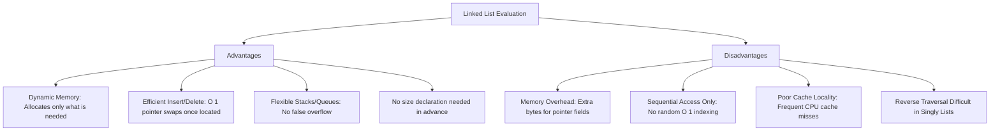
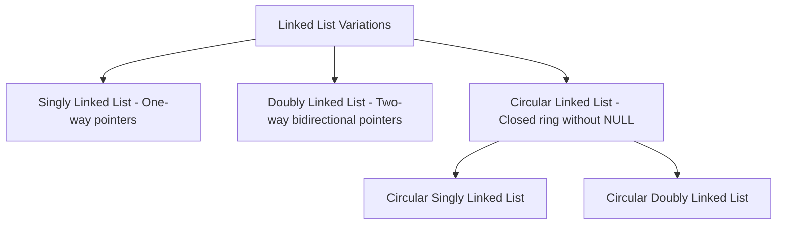

# UNIT-3: Data Structures — Linked Lists
**Course:** Data Structures & Algorithms (B.Tech. Curriculum)  
**Faculty / Source:** Dr. Selva Kumar S, Assistant Professor, B.M.S. College of Engineering (Unit-3)  
**Scope:** Comprehensive Study Notes, Academic Exam Guide, Technical Interview Implementations, Memory Diagnostics & Real-World Applications  

---

## Table of Contents
1. [Introduction to Linked Lists](#1-introduction-to-linked-lists)
2. [Arrays vs. Linked Lists: Architectural Comparison](#2-arrays-vs-linked-lists-architectural-comparison)
3. [Dynamic Memory Allocation (DMA) in C](#3-dynamic-memory-allocation-dma-in-c)
4. [Types of Linked Lists](#4-types-of-linked-lists)
5. [Singly Linked Lists (SLL)](#5-singly-linked-lists-sll)
   - [Node Anatomy & C Structures](#51-node-anatomy--c-structures)
   - [Insertion Operations](#52-insertion-operations)
   - [Deletion Operations](#53-deletion-operations)
   - [Traversal, Display & Node Counting](#54-traversal-display--node-counting)
   - [Linear Search Operation](#55-linear-search-operation)
   - [Concatenation (Iterative & Recursive)](#56-concatenation-of-two-linked-lists)
   - [Merging Sorted Linked Lists](#57-merging-two-sorted-linked-lists)
   - [Reversing a Singly Linked List (3-Pointer Method)](#58-reversing-a-singly-linked-list)
   - [Complete Menu-Driven C Program for SLL](#59-complete-menu-driven-c-program-for-sll)
6. [Linear ADT Implementations via Linked Lists](#6-linear-adt-implementations-via-linked-lists)
   - [Stack Implementation (LIFO)](#61-stack-implementation-using-linked-list)
   - [Queue Implementation (FIFO)](#62-queue-implementation-using-linked-list)
7. [Circular Linked Lists (CLL)](#7-circular-linked-lists-cll)
   - [Concept & Structural Properties](#71-concept--structural-properties)
   - [Insertion Operations](#72-circular-insertion-operations)
   - [Deletion Operations](#73-circular-deletion-operations)
   - [Search and Traversal](#74-circular-search-and-traversal)
8. [Doubly Linked Lists (DLL)](#8-doubly-linked-lists-dll)
   - [Node Anatomy & Two-Way Pointers](#81-node-anatomy--two-way-pointers)
   - [Insertion Operations](#82-doubly-insertion-operations)
   - [Deletion Operations](#83-doubly-deletion-operations)
   - [Bidirectional Traversal & Search](#84-bidirectional-traversal--search)
9. [Real-World Applications of Linked Lists](#9-real-world-applications-of-linked-lists)
   - [Application 1: Addition of Long Positive Integers (BigInt)](#91-application-1-addition-of-long-positive-integers-arbitrary-precision)
   - [Application 2: Polynomial Representation & Addition](#92-application-2-polynomial-representation--addition)
10. [Master Time & Space Complexity Matrix](#10-master-time--space-complexity-matrix)
11. [Exam Revision Points & Common Pitfalls](#11-exam-revision-points--common-pitfalls)

---

## 1. Introduction to Linked Lists

### 1.1 Definition
> **Linked List:** A linear, dynamic data structure consisting of a sequence of self-referential structures called **nodes**, where each node contains its own data payload and one or more **pointers (addresses)** referencing successor and/or predecessor nodes.

Unlike arrays, where elements occupy physically contiguous memory cells, linked list nodes can be scattered non-contiguously across arbitrary locations on the **Heap**. The sequential relationship between elements is maintained strictly via pointer links.

```text
HEADER / HEAD
  [ 1000 ] 
     |
     v
   [ Data: 20 | Next: 2000 ] ──► [ Data: 33 | Next: 3000 ] ──► [ Data: 14 | Next: NULL ]
   Address: 1000                 Address: 2000                 Address: 3000
```

---

### 1.2 Core Characteristics
1. **Dynamic Resizing:** Memory is allocated at runtime node-by-node on demand. The list grows and shrinks dynamically without needing an initial capacity bound.
2. **Non-Contiguous Allocation:** Eliminates the need for large blocks of continuous physical memory.
3. **Foundation for Advanced Structures:** Serves as the building block for dynamic Stacks, dynamic Queues, Adjacency Lists in Graphs, Polynomial algebra, and Tree structures.

---

### 1.3 Advantages & Disadvantages



---

## 2. Arrays vs. Linked Lists: Architectural Comparison

```text
Array Memory Model (Contiguous):
Index:     0        1        2        3        4
Address: [0x100]  [0x104]  [0x108]  [0x112]  [0x116]
Value:   |  20  | |  33  | |  14  | |  65  | |  81  |

Linked List Memory Model (Non-Contiguous via Pointers):
Head ──► [ 20 | 0x850 ] ──► [ 33 | 0x320 ] ──► [ 14 | 0x990 ] ──► [ 81 | 0x140 ] ──► [ 65 | NULL ]
Addr:       0x100               0x850               0x320               0x990               0x140
```

| Parameter | Array (Static Array) | Linked List |
|---|---|---|
| **Memory Allocation** | **Static:** Allocated at compile time in the Stack/Data segment. | **Dynamic:** Allocated at runtime on the Heap via `malloc()` / `calloc()`. |
| **Size Flexibility** | Fixed capacity. Cannot expand or contract during program execution. | Variable capacity. Expands and contracts seamlessly node-by-node. |
| **Memory Layout** | Strictly **contiguous** physical memory addresses. | **Non-contiguous** memory blocks scattered across heap space. |
| **Element Access** | Direct / Random access in **$O(1)$** time via formula: $\text{Base} + (i \times \text{element\_size})$. | Sequential access only; requires traversing pointers from `head` in **$O(n)$** time. |
| **Insertion / Deletion** | Costly **$O(n)$** time due to shifting elements left or right to fill/open space. | Fast **$O(1)$** pointer update once the target position/pointer is reached. |
| **Memory Overhead** | Minimal (stores only raw data values, zero pointer overhead). | High overhead: stores data plus $4$ bytes (32-bit) or $8$ bytes (64-bit) pointer per node. |
| **Memory Wastage** | Space is wasted if array is underutilized; fails if capacity is exceeded. | Wastes memory on link pointers, but wastes zero space on unused element slots. |
| **Cache Locality** | **Excellent:** Sequential physical memory maximizes CPU cache line hits and hardware prefetching. | **Poor:** Scattered memory locations cause frequent CPU cache misses. |

---

## 3. Dynamic Memory Allocation (DMA) in C

Static data structures require sizing decisions at compile time. In dynamic linked structures, memory must be explicitly managed during program execution via standard library routines declared in `<stdlib.h>`.

### 3.1 Core DMA Functions

| Function Name | Prototype | Return Value | Purpose & Characteristics |
|---|---|---|---|
| `sizeof()` | `sizeof(type_or_variable)` | `size_t` (bytes) | Compile-time operator returning the exact memory footprint in bytes. |
| `malloc()` | `void* malloc(size_t size)` | Pointer to first byte, or `NULL` on failure | Allocates a raw block of `size` bytes. **Memory is uninitialized** (contains indeterminate garbage values). |
| `calloc()` | `void* calloc(size_t num, size_t size)` | Pointer to first byte, or `NULL` | Allocates memory for an array of `num` elements of `size` bytes each. **Initializes all bits to zero**. |
| `realloc()` | `void* realloc(void *ptr, size_t new_size)` | Pointer to resized block, or `NULL` | Resizes an existing memory block previously allocated by `malloc()` or `calloc()`. |
| `free()` | `void free(void *ptr)` | `void` | Deallocates heap memory previously allocated, releasing it back to the operating system. |

---

### 3.2 Dynamic Allocation Syntax & Node Instantiation
```c
#include <stdio.h>
#include <stdlib.h>

// 1. Primitive integer allocation
int *arr = (int *)malloc(10 * sizeof(int));

// 2. Linked list node allocation
struct Node {
    int data;
    struct Node *next;
};

struct Node *node_ptr = (struct Node *)malloc(sizeof(struct Node));
if (node_ptr == NULL) {
    printf("Memory Allocation Failed (Heap Exhausted)!\n");
    exit(1);
}
node_ptr->data = 25;
node_ptr->next = NULL;

// 3. Releasing memory
free(node_ptr);
node_ptr = NULL; // Prevent dangling pointer
```

---

## 4. Types of Linked Lists



1. **Singly Linked List (SLL):** Each node contains data and a single pointer `next` directed to the subsequent node. The last node points to `NULL`.
2. **Doubly Linked List (DLL):** Each node contains data and two pointers: `prev` (pointing to the preceding node) and `next` (pointing to the subsequent node). Allows bidirectional traversal.
3. **Circular Linked List (CLL):** The last node's link field does not store `NULL`; instead, it wraps around to store the address of the `head` node, forming an unbroken circular chain.

---

## 5. Singly Linked Lists (SLL)

### 5.1 Node Anatomy & C Structures
A singly linked node consists of two logical parts:
- **Data Field:** Stores primitive values or structured payloads.
- **Link Field (`next`):** Stores a pointer of type `struct Node*` to the successor node.

```c
// Standard integer node
struct Node {
    int data;
    struct Node *next;
};

// Complex payload node (e.g., Library Book)
typedef struct Books {
    char title[50];
    char author[50];
    char subject[100];
    int book_id;
    struct Books *next;
} Book;
```

---

### 5.2 Insertion Operations

```text
Three Insertion Scenarios:
1. At the Beginning (Front)  --> O(1)
2. At the End (Append)        --> O(n) without tail / O(1) with tail
3. At a Specified Position    --> O(n)
```

#### 1. Insertion at Beginning
**Logic:**
1. Allocate memory for `new_node`.
2. Assign `new_node->data = val`.
3. Set `new_node->next = *head_ref`.
4. Update `*head_ref = new_node`.

```c
void push(struct Node** head_ref, int new_data) {
    struct Node* new_node = (struct Node*)malloc(sizeof(struct Node));
    new_node->data = new_data;
    new_node->next = (*head_ref);
    (*head_ref) = new_node;
}
```

```text
Before: HEAD ──► [ A | • ] ──► [ B | NULL ]
Insert: [ E | • ] ──► [ A | • ]
After:  HEAD ──► [ E | • ] ──► [ A | • ] ──► [ B | NULL ]
```

---

#### 2. Insertion at End
**Logic:**
1. Allocate `new_node` and set `new_node->next = NULL`.
2. If list is empty (`*head_ref == NULL`), set `*head_ref = new_node; return;`.
3. Otherwise, traverse pointer `last` until `last->next == NULL`.
4. Reassign `last->next = new_node`.

```c
void append(struct Node** head_ref, int new_data) {
    struct Node* new_node = (struct Node*)malloc(sizeof(struct Node));
    new_node->data = new_data;
    new_node->next = NULL;

    if (*head_ref == NULL) {
        *head_ref = new_node;
        return;
    }

    struct Node* last = *head_ref;
    while (last->next != NULL) {
        last = last->next;
    }
    last->next = new_node;
}
```

---

#### 3. Insertion After a Given Position / Node
**Logic:**
1. Traverse `temp` to node at location `pos - 1`.
2. Ensure `temp != NULL` (position exists).
3. Connect `new_node->next = temp->next`.
4. Connect `temp->next = new_node`.

```c
void insertAfter(struct Node* prev_node, int new_data) {
    if (prev_node == NULL) {
        printf("The given previous node cannot be NULL\n");
        return;
    }
    struct Node* new_node = (struct Node*)malloc(sizeof(struct Node));
    new_node->data = new_data;
    new_node->next = prev_node->next;
    prev_node->next = new_node;
}
```

```text
Before: ... [ temp | • ] ─────────────► [ next_node | • ] ...
                  \                     ^
                   \                   /
After:  ... [ temp | • ] ──► [ new_node | • ]
```

---

### 5.3 Deletion Operations

```text
Three Deletion Scenarios:
1. At the Beginning (Front)  --> O(1)
2. At the End (Last)         --> O(n)
3. At a Specified Position    --> O(n)
```

#### 1. Deletion at Beginning
**Logic:**
1. Check if `head == NULL` (Underflow).
2. Save address of first node: `ptr = head`.
3. Advance head pointer: `head = head->next`.
4. Free old head memory: `free(ptr)`.

```c
void deleteBeginning(struct Node** head_ref) {
    if (*head_ref == NULL) {
        printf("List Underflow! List is empty.\n");
        return;
    }
    struct Node* temp = *head_ref;
    *head_ref = (*head_ref)->next;
    free(temp);
}
```

---

#### 2. Deletion at End
**Logic:**
1. If `head == NULL`, return underflow.
2. If list contains only 1 node (`head->next == NULL`), `free(head); head = NULL; return;`.
3. Maintain two pointers (`ptr` and `prev`). Traverse until `ptr->next == NULL`.
4. Break the link: `prev->next = NULL`.
5. Free last node: `free(ptr)`.

```c
void deleteEnd(struct Node** head_ref) {
    if (*head_ref == NULL) {
        printf("List is empty\n");
        return;
    }
    if ((*head_ref)->next == NULL) {
        free(*head_ref);
        *head_ref = NULL;
        return;
    }
    struct Node* ptr = *head_ref;
    struct Node* prev = NULL;
    while (ptr->next != NULL) {
        prev = ptr;
        ptr = ptr->next;
    }
    prev->next = NULL;
    free(ptr);
}
```

---

#### 3. Deletion at Specified Position ($1$-Based Index `loc`)
**Logic:**
1. Traverse `ptr` to position `loc`, keeping track of predecessor `prev`.
2. If `ptr == NULL`, target location is beyond list length.
3. Bypass node: `prev->next = ptr->next`.
4. Free node: `free(ptr)`.

```c
void deleteAtPosition(struct Node** head_ref, int loc) {
    if (*head_ref == NULL) return;
    
    struct Node* temp = *head_ref;
    if (loc == 1) {
        *head_ref = temp->next;
        free(temp);
        return;
    }
    
    struct Node* prev = NULL;
    for (int i = 1; temp != NULL && i < loc; i++) {
        prev = temp;
        temp = temp->next;
    }
    
    if (temp == NULL) {
        printf("Position %d does not exist in list.\n", loc);
        return;
    }
    
    prev->next = temp->next;
    free(temp);
}
```

---

### 5.4 Traversal, Display & Node Counting

```c
// Traversal and display
void printList(struct Node* node) {
    printf("List: HEAD -> ");
    while (node != NULL) {
        printf("[%d | •] -> ", node->data);
        node = node->next;
    }
    printf("NULL\n");
}

// Counting total nodes
int countNodes(struct Node* head) {
    int count = 0;
    struct Node* temp = head;
    while (temp != NULL) {
        count++;
        temp = temp->next;
    }
    return count;
}
```

---

### 5.5 Linear Search Operation
Traverses the list sequentially and compares each node's data against the search key.

```c
int searchList(struct Node* head, int key) {
    struct Node* current = head;
    int index = 1; // 1-based index
    while (current != NULL) {
        if (current->data == key)
            return index; // Found at position
        current = current->next;
        index++;
    }
    return -1; // Not found
}
```
- **Time Complexity:** Best Case $O(1)$, Worst Case $O(n)$.

---

### 5.6 Concatenation of Two Linked Lists
Appends list `b` to the tail of list `a`.

#### 1. Iterative Concatenation:
```c
struct Node* concat(struct Node* start1, struct Node* start2) {
    if (start1 == NULL) return start2;
    if (start2 == NULL) return start1;
    
    struct Node* ptr = start1;
    while (ptr->next != NULL) {
        ptr = ptr->next;
    }
    ptr->next = start2;
    return start1;
}
```

#### 2. Recursive Concatenation:
```c
void concatenateRecursive(struct Node* a, struct Node* b) {
    if (a != NULL && b != NULL) {
        if (a->next == NULL)
            a->next = b;
        else
            concatenateRecursive(a->next, b);
    }
}
```

---

### 5.7 Merging Two Sorted Linked Lists
Given two pre-sorted singly linked lists, merge them into a single sorted list in **$O(n_1 + n_2)$** time without allocating new node data fields (by rearranging pointers).

```text
List 1: [ 4 ] ──► [ 8 ] ──► [ 15 ] ──► [ 19 ] ──► NULL
List 2: [ 7 ] ──► [ 9 ] ──► [ 10 ] ──► [ 16 ] ──► NULL

Merged: [ 4 ] ──► [ 7 ] ──► [ 8 ] ──► [ 9 ] ──► [ 10 ] ──► [ 15 ] ──► [ 16 ] ──► [ 19 ] ──► NULL
```

```c
struct Node* mergeSorted(struct Node* head1, struct Node* head2) {
    if (head1 == NULL) return head2;
    if (head2 == NULL) return head1;

    struct Node* mergedHead = NULL;
    struct Node* mergedTail = NULL;

    // Pick initial head
    if (head1->data <= head2->data) {
        mergedHead = head1;
        head1 = head1->next;
    } else {
        mergedHead = head2;
        head2 = head2->next;
    }
    mergedTail = mergedHead;

    // Splice remaining nodes
    while (head1 != NULL && head2 != NULL) {
        if (head1->data <= head2->data) {
            mergedTail->next = head1;
            mergedTail = head1;
            head1 = head1->next;
        } else {
            mergedTail->next = head2;
            mergedTail = head2;
            head2 = head2->next;
        }
    }

    // Attach remaining tail
    if (head1 != NULL)
        mergedTail->next = head1;
    else
        mergedTail->next = head2;

    return mergedHead;
}
```

---

### 5.8 Reversing a Singly Linked List
In-place iterative reversal using the **3-pointer technique (`prev`, `current`, `next`)**:

```text
Step-by-step 3-Pointer Reversal:

Initial:    prev = NULL, current = Head [1]
            (NULL) <--- [1]       [2] ──► [3] ──► NULL
                          ^        ^
                         prev     curr

Iteration:  1. next = current->next      (Preserve reference to remainder)
            2. current->next = prev      (Reverse directional pointer)
            3. prev = current            (Advance prev forward)
            4. current = next            (Advance curr forward)

Final:      *head_ref = prev             (New head points to former tail)
```

```c
void reverse(struct Node** head_ref) {
    struct Node* prev = NULL;
    struct Node* current = *head_ref;
    struct Node* next = NULL;

    while (current != NULL) {
        next = current->next;     // 1. Store next node
        current->next = prev;     // 2. Reverse current node pointer
        prev = current;           // 3. Move prev forward
        current = next;           // 4. Move current forward
    }
    *head_ref = prev;             // 5. Update head to new front
}
```
- **Time Complexity:** $O(n)$
- **Auxiliary Space:** $O(1)$

---

### 5.9 Complete Menu-Driven C Program for SLL
```c
#include <stdio.h>
#include <stdlib.h>

struct node {
    int data;
    struct node *next;
};
struct node *head = NULL;

void beginsert() {
    struct node *ptr = (struct node *)malloc(sizeof(struct node));
    int item;
    if (ptr == NULL) {
        printf("\nOVERFLOW\n");
        return;
    }
    printf("\nEnter value: ");
    scanf("%d", &item);
    ptr->data = item;
    ptr->next = head;
    head = ptr;
    printf("Node inserted at beginning.\n");
}

void lastinsert() {
    struct node *ptr = (struct node *)malloc(sizeof(struct node));
    struct node *temp;
    int item;
    if (ptr == NULL) {
        printf("\nOVERFLOW\n");
        return;
    }
    printf("\nEnter value: ");
    scanf("%d", &item);
    ptr->data = item;
    ptr->next = NULL;
    if (head == NULL) {
        head = ptr;
    } else {
        temp = head;
        while (temp->next != NULL) {
            temp = temp->next;
        }
        temp->next = ptr;
    }
    printf("Node inserted at end.\n");
}

void randominsert() {
    int i, loc, item;
    struct node *ptr = (struct node *)malloc(sizeof(struct node));
    struct node *temp;
    if (ptr == NULL) {
        printf("\nOVERFLOW\n");
        return;
    }
    printf("\nEnter element value: ");
    scanf("%d", &item);
    printf("Enter location after which to insert: ");
    scanf("%d", &loc);
    ptr->data = item;
    temp = head;
    for (i = 0; i < loc - 1; i++) {
        temp = temp->next;
        if (temp == NULL) {
            printf("\nCannot insert, location out of range.\n");
            free(ptr);
            return;
        }
    }
    ptr->next = temp->next;
    temp->next = ptr;
    printf("Node inserted.\n");
}

void begin_delete() {
    struct node *ptr;
    if (head == NULL) {
        printf("\nList is empty\n");
        return;
    }
    ptr = head;
    head = ptr->next;
    free(ptr);
    printf("\nNode deleted from beginning.\n");
}

void last_delete() {
    struct node *ptr, *ptr1;
    if (head == NULL) {
        printf("\nList is empty\n");
        return;
    }
    if (head->next == NULL) {
        free(head);
        head = NULL;
        printf("\nOnly node deleted.\n");
        return;
    }
    ptr = head;
    while (ptr->next != NULL) {
        ptr1 = ptr;
        ptr = ptr->next;
    }
    ptr1->next = NULL;
    free(ptr);
    printf("\nNode deleted from end.\n");
}

void display() {
    struct node *ptr = head;
    if (ptr == NULL) {
        printf("\nNothing to print (Empty list).\n");
        return;
    }
    printf("\nPrinting list elements: ");
    while (ptr != NULL) {
        printf("%d -> ", ptr->data);
        ptr = ptr->next;
    }
    printf("NULL\n");
}

int main() {
    int choice = 0;
    while (choice != 7) {
        printf("\n*** Singly Linked List Menu ***\n");
        printf("1. Insert Beginning\n2. Insert End\n3. Insert Random\n");
        printf("4. Delete Beginning\n5. Delete End\n6. Display\n7. Exit\n");
        printf("Enter your choice: ");
        scanf("%d", &choice);
        switch (choice) {
            case 1: beginsert(); break;
            case 2: lastinsert(); break;
            case 3: randominsert(); break;
            case 4: begin_delete(); break;
            case 5: last_delete(); break;
            case 6: display(); break;
            case 7: exit(0);
            default: printf("Invalid choice!\n");
        }
    }
    return 0;
}
```

---

## 6. Linear ADT Implementations via Linked Lists

### 6.1 Stack Implementation using Linked List
In a linked-list-based Stack, the `head` pointer functions as the **TOP** of the stack:
- **`push(val)`:** Insert node at the **beginning** of the list ($O(1)$).
- **`pop()`:** Delete node from the **beginning** of the list ($O(1)$).
- **No Overflow Limit:** Stack never overflows unless total system heap memory is exhausted.

```text
       +-----+      +-----------+      +-----------+
TOP ──►| 30  | ───► | 20 |   •  | ───► | 10 | NULL |
       +-----+      +-----------+      +-----------+
      (New Head)
```

```c
void pushStack(struct node** top_ref, int val) {
    struct node* new_node = (struct node*)malloc(sizeof(struct node));
    if (new_node == NULL) {
        printf("Heap Overflow!\n");
        return;
    }
    new_node->data = val;
    new_node->next = *top_ref;
    *top_ref = new_node;
}

int popStack(struct node** top_ref) {
    if (*top_ref == NULL) {
        printf("Stack Underflow!\n");
        return -1;
    }
    struct node* temp = *top_ref;
    int popped = temp->data;
    *top_ref = (*top_ref)->next;
    free(temp);
    return popped;
}
```

---

### 6.2 Queue Implementation using Linked List
In a linked-list-based Queue, we maintain two pointers:
- **`front`:** Points to the first node (where **Dequeue** occurs in $O(1)$).
- **`rear`:** Points to the last node (where **Enqueue** occurs in $O(1)$).

```text
FRONT                                                 REAR
  |                                                     |
  v                                                     v
[ 10 | • ] ────────► [ 20 | • ] ────────► [ 30 | • ] ──► [ 40 | NULL ]
  |                                                        ^
DEQUEUE (Pop from Front)                       ENQUEUE (Append to Rear)
```

```c
struct Queue {
    struct node *front, *rear;
};

void enqueue(struct Queue* q, int val) {
    struct node* temp = (struct node*)malloc(sizeof(struct node));
    temp->data = val;
    temp->next = NULL;
    if (q->rear == NULL) {
        q->front = q->rear = temp;
        return;
    }
    q->rear->next = temp;
    q->rear = temp;
}

int dequeue(struct Queue* q) {
    if (q->front == NULL) {
        printf("Queue Underflow!\n");
        return -1;
    }
    struct node* temp = q->front;
    int data = temp->data;
    q->front = q->front->next;
    if (q->front == NULL)
        q->rear = NULL;
    free(temp);
    return data;
}
```

---

## 7. Circular Linked Lists (CLL)

### 7.1 Concept & Structural Properties
A **Circular Linked List** is an unbroken sequence where every node contains a valid address; **no node points to `NULL`**. The `next` pointer of the final node loops back to point to the `head` node.

```text
HEAD
  |
  v
[ 1 | • ] ──► [ 2 | • ] ──► [ 3 | • ]
  ^                                 |
  +─────────────────────────────────+  (Last node loops back to HEAD)
```

- **Advantage:** Any node can serve as a starting point; the entire list can be traversed from any arbitrary node.
- **Applications:** CPU Round-Robin time-slice scheduling, audio/video playlist repeat loops, multiplayer turn-based game rotations.

---

### 7.2 Circular Insertion Operations

#### 1. Circular Insertion at Beginning:
```c
void circularInsertBeginning(struct node** head_ref, int item) {
    struct node* ptr = (struct node*)malloc(sizeof(struct node));
    ptr->data = item;
    
    if (*head_ref == NULL) {
        *head_ref = ptr;
        ptr->next = *head_ref;
        return;
    }
    
    // Traverse to the last node to update its next pointer
    struct node* temp = *head_ref;
    while (temp->next != *head_ref) {
        temp = temp->next;
    }
    ptr->next = *head_ref;
    temp->next = ptr;
    *head_ref = ptr; // Update head
}
```

#### 2. Circular Insertion at End:
```c
void circularInsertEnd(struct node** head_ref, int item) {
    struct node* ptr = (struct node*)malloc(sizeof(struct node));
    ptr->data = item;
    
    if (*head_ref == NULL) {
        *head_ref = ptr;
        ptr->next = *head_ref;
        return;
    }
    
    struct node* temp = *head_ref;
    while (temp->next != *head_ref) {
        temp = temp->next;
    }
    temp->next = ptr;
    ptr->next = *head_ref; // Close loop to head
}
```

---

### 7.3 Circular Deletion Operations

#### 1. Circular Deletion at Beginning:
```c
void circularDeleteBeginning(struct node** head_ref) {
    if (*head_ref == NULL) {
        printf("Underflow!\n");
        return;
    }
    if ((*head_ref)->next == *head_ref) { // Single node
        free(*head_ref);
        *head_ref = NULL;
        return;
    }
    struct node* temp = *head_ref;
    struct node* last = *head_ref;
    while (last->next != *head_ref) {
        last = last->next;
    }
    last->next = (*head_ref)->next;
    *head_ref = (*head_ref)->next;
    free(temp);
}
```

#### 2. Circular Deletion at End:
```c
void circularDeleteEnd(struct node** head_ref) {
    if (*head_ref == NULL) return;
    if ((*head_ref)->next == *head_ref) {
        free(*head_ref);
        *head_ref = NULL;
        return;
    }
    struct node* ptr = *head_ref;
    struct node* preptr = NULL;
    while (ptr->next != *head_ref) {
        preptr = ptr;
        ptr = ptr->next;
    }
    preptr->next = *head_ref; // Point second-to-last node back to head
    free(ptr);
}
```

---

### 7.4 Circular Search and Traversal
Notice that the loop terminating condition is `temp->next != head` (not `!= NULL`), followed by processing the final node:

```c
void circularTraverse(struct node* head) {
    if (head == NULL) {
        printf("List is empty\n");
        return;
    }
    struct node* ptr = head;
    printf("Circular List: ");
    do {
        printf("%d -> ", ptr->data);
        ptr = ptr->next;
    } while (ptr != head);
    printf("(HEAD)\n");
}
```

---

## 8. Doubly Linked Lists (DLL)

### 8.1 Node Anatomy & Two-Way Pointers
A Doubly Linked List node has **three fields**:
1. `prev`: Pointer storing the memory address of the **preceding node** (or `NULL` if head).
2. `data`: The element payload.
3. `next`: Pointer storing the memory address of the **succeeding node** (or `NULL` if tail).

```c
struct DLLNode {
    struct DLLNode *prev;
    int data;
    struct DLLNode *next;
};
```

```text
HEAD
  |
  v
[ NULL | 10 | • ] <=====> [ • | 20 | • ] <=====> [ • | 30 | NULL ]
```

---

### 8.2 Doubly Insertion Operations

#### 1. Insertion at Beginning:
```c
void insertBeginningDLL(struct DLLNode** head_ref, int item) {
    struct DLLNode* ptr = (struct DLLNode*)malloc(sizeof(struct DLLNode));
    ptr->data = item;
    ptr->prev = NULL;
    ptr->next = *head_ref;

    if (*head_ref != NULL) {
        (*head_ref)->prev = ptr;
    }
    *head_ref = ptr;
}
```

#### 2. Insertion at End:
```c
void insertEndDLL(struct DLLNode** head_ref, int item) {
    struct DLLNode* ptr = (struct DLLNode*)malloc(sizeof(struct DLLNode));
    ptr->data = item;
    ptr->next = NULL;

    if (*head_ref == NULL) {
        ptr->prev = NULL;
        *head_ref = ptr;
        return;
    }

    struct DLLNode* temp = *head_ref;
    while (temp->next != NULL) {
        temp = temp->next;
    }
    temp->next = ptr;
    ptr->prev = temp;
}
```

#### 3. Insertion After a Specified Node:
```c
void insertAfterDLL(struct DLLNode* prev_node, int item) {
    if (prev_node == NULL) return;

    struct DLLNode* ptr = (struct DLLNode*)malloc(sizeof(struct DLLNode));
    ptr->data = item;
    ptr->next = prev_node->next;
    ptr->prev = prev_node;

    if (prev_node->next != NULL) {
        prev_node->next->prev = ptr;
    }
    prev_node->next = ptr;
}
```

---

### 8.3 Doubly Deletion Operations

#### 1. Deletion at Beginning:
```c
void deleteBeginningDLL(struct DLLNode** head_ref) {
    if (*head_ref == NULL) return;
    struct DLLNode* ptr = *head_ref;
    *head_ref = (*head_ref)->next;
    if (*head_ref != NULL) {
        (*head_ref)->prev = NULL;
    }
    free(ptr);
}
```

#### 2. Deletion at End:
```c
void deleteEndDLL(struct DLLNode** head_ref) {
    if (*head_ref == NULL) return;
    if ((*head_ref)->next == NULL) {
        free(*head_ref);
        *head_ref = NULL;
        return;
    }
    struct DLLNode* ptr = *head_ref;
    while (ptr->next != NULL) {
        ptr = ptr->next;
    }
    ptr->prev->next = NULL;
    free(ptr);
}
```

#### 3. Deletion of Node by Value:
```c
void deleteNodeDLL(struct DLLNode** head_ref, int val) {
    struct DLLNode* temp = *head_ref;
    while (temp != NULL && temp->data != val) {
        temp = temp->next;
    }
    if (temp == NULL) {
        printf("Node with value %d not found.\n", val);
        return;
    }
    if (*head_ref == temp) {
        *head_ref = temp->next;
    }
    if (temp->next != NULL) {
        temp->next->prev = temp->prev;
    }
    if (temp->prev != NULL) {
        temp->prev->next = temp->next;
    }
    free(temp);
}
```

---

### 8.4 Bidirectional Traversal & Search
Because each node maintains both `prev` and `next`, DLLs can be traversed forward and backward:

```c
void traverseForward(struct DLLNode* head) {
    while (head != NULL) {
        printf("%d <-> ", head->data);
        head = head->next;
    }
    printf("NULL\n");
}

void traverseBackward(struct DLLNode* tail) {
    while (tail != NULL) {
        printf("%d <-> ", tail->data);
        tail = tail->prev;
    }
    printf("NULL\n");
}
```

---

## 9. Real-World Applications of Linked Lists

### 9.1 Application 1: Addition of Long Positive Integers (Arbitrary Precision)

#### Problem Context:
Standard numeric types (`int` = 32 bits, `unsigned long long` = 64 bits) can only store integers up to $\approx 1.84 \times 10^{19}$. When dealing with cryptographic keys or scientific computation involving 50+ to 1000+ digits, primitive data types overflow.

#### The Linked List Solution:
1. Long numbers are read as strings (e.g., `num1 = "458"`, `num2 = "7985"`).
2. Digits are parsed and **inserted at the beginning** of a linked list. This ensures that the **Least Significant Digit (LSD)** sits at the `head`, mirroring manual right-to-left paper addition:
   - `num1 = "458"` $\implies$ `head1: 8 -> 5 -> 4 -> NULL`
   - `num2 = "7985"` $\implies$ `head2: 5 -> 8 -> 9 -> 7 -> NULL`
3. Traversal adds corresponding digit pairs along with `carry`:
   - $\text{sum} = d_1 + d_2 + \text{carry}$
   - $\text{new\_digit} = \text{sum} \bmod 10$
   - $\text{carry} = \text{sum} / 10$

```text
head1:   [ 8 | • ] ──► [ 5 | • ] ──► [ 4 | NULL ]
          +             +             +
head2:   [ 5 | • ] ──► [ 8 | • ] ──► [ 9 | • ] ──► [ 7 | NULL ]
------------------------------------------------------------------
Sum:      13            14            14             8
Digits:   '3'           '4'           '4'           '8'
Carry:     1             1             1             0

Result List / Buffer: "3448"
Reversed Output:      "8443"  (Correct: 458 + 7985 = 8443!)
```

#### Complete Implementation in C:
```c
#include <stdio.h>
#include <stdlib.h>
#include <string.h>

struct DigitNode {
    int digit;
    struct DigitNode* next;
};

struct DigitNode* insertDigit(struct DigitNode* head, int d) {
    struct DigitNode* new_node = (struct DigitNode*)malloc(sizeof(struct DigitNode));
    new_node->digit = d;
    new_node->next = head; // Insert at front to reverse order
    return new_node;
}

void addLongIntegers(char num1[], char num2[], char result[]) {
    struct DigitNode *head1 = NULL, *head2 = NULL;
    
    // Convert string to linked list with LSD at head
    for (int i = 0; num1[i] != '\0'; i++)
        head1 = insertDigit(head1, num1[i] - '0');
    for (int i = 0; num2[i] != '\0'; i++)
        head2 = insertDigit(head2, num2[i] - '0');

    int carry = 0, index = 0;
    struct DigitNode *t1 = head1, *t2 = head2;

    while (t1 != NULL || t2 != NULL || carry != 0) {
        int d1 = (t1 != NULL) ? t1->digit : 0;
        int d2 = (t2 != NULL) ? t2->digit : 0;
        int sum = d1 + d2 + carry;

        carry = sum / 10;
        result[index++] = (sum % 10) + '0';

        if (t1 != NULL) t1 = t1->next;
        if (t2 != NULL) t2 = t2->next;
    }
    result[index] = '\0';

    // Reverse result string to display MSD first
    int len = strlen(result);
    for (int i = 0; i < len / 2; i++) {
        char temp = result[i];
        result[i] = result[len - 1 - i];
        result[len - 1 - i] = temp;
    }
}
```

---

### 9.2 Application 2: Polynomial Representation & Addition

#### Mathematical Formulation:
A single-variable polynomial $P(x) = c_n x^{e_n} + c_{n-1} x^{e_{n-1}} + \dots + c_0 x^{e_0}$ is represented as a linked list where each node stores:
1. `coef`: The coefficient ($c_i$).
2. `exp`: The exponent power ($e_i$).
3. `next`: Pointer to the term with the next lower exponent.

```c
struct PolyNode {
    int coef;
    int exp;
    struct PolyNode* next;
};
```

```text
Poly 1: 3x^8 + 5x^7 - 2x^6 + 8x^4
[ 3 | 8 | • ] ──► [ 5 | 7 | • ] ──► [ -2 | 6 | • ] ──► [ 8 | 4 | NULL ]

Poly 2: 4x^7 + 5x^6 - x^3 + 7x^2 - 3
[ 4 | 7 | • ] ──► [ 5 | 6 | • ] ──► [ -1 | 3 | • ] ──► [ 7 | 2 | • ] ──► [ -3 | 0 | NULL ]
```

#### Addition Logic (Merge Paradigm):
Simultaneously traverse both lists with pointers `p` and `q`:
1. **If `p->exp == q->exp`:** Add coefficients: `sum_coef = p->coef + q->coef`. If `sum_coef != 0`, append term `(sum_coef, p->exp)` to result list. Advance both `p` and `q`.
2. **If `p->exp > q->exp`:** Append term `(p->coef, p->exp)` to result list. Advance `p`.
3. **If `p->exp < q->exp`:** Append term `(q->coef, q->exp)` to result list. Advance `q`.
4. **Append Remainder:** Once one polynomial terminates, append all remaining nodes of the unfinished list.

```text
Result of Poly 1 + Poly 2:
3x^8 + 9x^7 + 3x^6 + 8x^4 - x^3 + 7x^2 - 3

[ 3 | 8 | • ] ──► [ 9 | 7 | • ] ──► [ 3 | 6 | • ] ──► [ 8 | 4 | • ] ──► [ -1 | 3 | • ] ──► [ 7 | 2 | • ] ──► [ -3 | 0 | NULL ]
```

#### Complete C Program:
```c
#include <stdio.h>
#include <stdlib.h>

struct PolyNode {
    int coef;
    int exp;
    struct PolyNode* next;
};

struct PolyNode* createTerm(int c, int e) {
    struct PolyNode* new_term = (struct PolyNode*)malloc(sizeof(struct PolyNode));
    new_term->coef = c;
    new_term->exp = e;
    new_term->next = NULL;
    return new_term;
}

void appendTerm(struct PolyNode** head, int c, int e) {
    struct PolyNode* new_term = createTerm(c, e);
    if (*head == NULL) {
        *head = new_term;
        return;
    }
    struct PolyNode* temp = *head;
    while (temp->next != NULL)
        temp = temp->next;
    temp->next = new_term;
}

struct PolyNode* addPolynomials(struct PolyNode* p1, struct PolyNode* p2) {
    struct PolyNode* result = NULL;

    while (p1 != NULL && p2 != NULL) {
        if (p1->exp == p2->exp) {
            int sum = p1->coef + p2->coef;
            if (sum != 0)
                appendTerm(&result, sum, p1->exp);
            p1 = p1->next;
            p2 = p2->next;
        } else if (p1->exp > p2->exp) {
            appendTerm(&result, p1->coef, p1->exp);
            p1 = p1->next;
        } else {
            appendTerm(&result, p2->coef, p2->exp);
            p2 = p2->next;
        }
    }

    while (p1 != NULL) {
        appendTerm(&result, p1->coef, p1->exp);
        p1 = p1->next;
    }
    while (p2 != NULL) {
        appendTerm(&result, p2->coef, p2->exp);
        p2 = p2->next;
    }

    return result;
}

void displayPoly(struct PolyNode* p) {
    while (p != NULL) {
        printf("%dx^%d", p->coef, p->exp);
        if (p->next != NULL && p->next->coef >= 0)
            printf(" + ");
        else if (p->next != NULL)
            printf(" ");
        p = p->next;
    }
    printf("\n");
}
```

---

## 10. Master Time & Space Complexity Matrix

| Operation | Static Array | Singly Linked List (SLL) | Doubly Linked List (DLL) | Circular Linked List (CLL) |
|---|:---:|:---:|:---:|:---:|
| **Access by Index $[k]$** | **$O(1)$** | $O(n)$ | $O(n)$ | $O(n)$ |
| **Search by Value** | $O(n)$ (or $O(\log n)$ sorted) | $O(n)$ | $O(n)$ | $O(n)$ |
| **Insert at Beginning** | $O(n)$ (Shift all) | **$O(1)$** | **$O(1)$** | **$O(1)$** (with tail) / $O(n)$ |
| **Insert at End** | $O(1)$ (if space) | $O(n)$ (or $O(1)$ with tail) | $O(n)$ (or $O(1)$ with tail) | **$O(1)$** (with tail) / $O(n)$ |
| **Insert After Node** | $O(n)$ (Shift right) | **$O(1)$** | **$O(1)$** | **$O(1)$** |
| **Delete at Beginning** | $O(n)$ (Shift left) | **$O(1)$** | **$O(1)$** | **$O(1)$** (with tail) / $O(n)$ |
| **Delete at End** | $O(1)$ | $O(n)$ | $O(1)$ (with tail) | $O(n)$ |
| **Delete Given Node** | $O(n)$ | $O(n)$ (needs predecessor)| **$O(1)$** (direct node pointer) | $O(n)$ |
| **Reverse Traversal** | **$O(1)$** | Not possible / $O(n)$ stack | **$O(1)$** (via `prev`) | Not directly possible |
| **Auxiliary Memory Overhead** | **$0$** (No pointers) | $1$ pointer per node | $2$ pointers per node | $1$ pointer per node |

---

## 11. Exam Revision Points & Common Pitfalls

### Key Takeaways for Examinations:
1. **Dynamic Sizing:** Linked lists allow runtime memory expansion without predetermining capacity bounds.
2. **Double Pointer Convention (`**head_ref`):** Used when a function modifies the `head` pointer itself (e.g., `push()`, `deleteBeginning()`). If passed as a single pointer `*head`, modifications remain local to the function frame.
3. **Pointers Overhead:** For an $n$-element integer list on a 64-bit architecture:
   - Data: $4 \times n$ bytes.
   - Pointers: $8 \times n$ bytes.
   - Pointer overhead exceeds raw payload size!
4. **Circular Termination:** Never test for `ptr == NULL` in a circular linked list; this creates an **infinite loop**. The proper terminating condition is `ptr->next == head` or a `do { ... } while(ptr != head);` construct.
5. **Reversal Pointers:** The classical iterative reversal requires precisely **three moving pointers** (`prev = NULL`, `current = head`, `next = NULL`).

### Common Pitfalls to Avoid:
- **Memory Leaks:** Always invoke `free(ptr)` when deleting nodes. Failing to do so causes unreferenced memory to accumulate on the heap.
- **Dangling Pointers:** Accessing `node->next` after `free(node)` invokes undefined behavior. Always store `temp = node->next` before calling `free(node)`.
- **Dereferencing NULL:** Always guard pointer traversals with `if (temp == NULL)` before accessing `temp->next` or `temp->data`.
