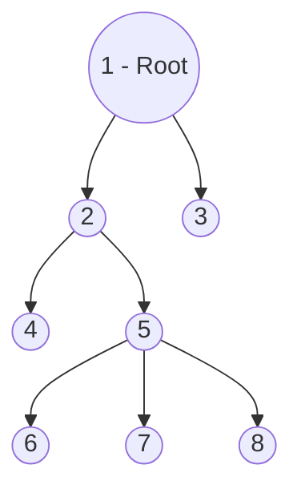
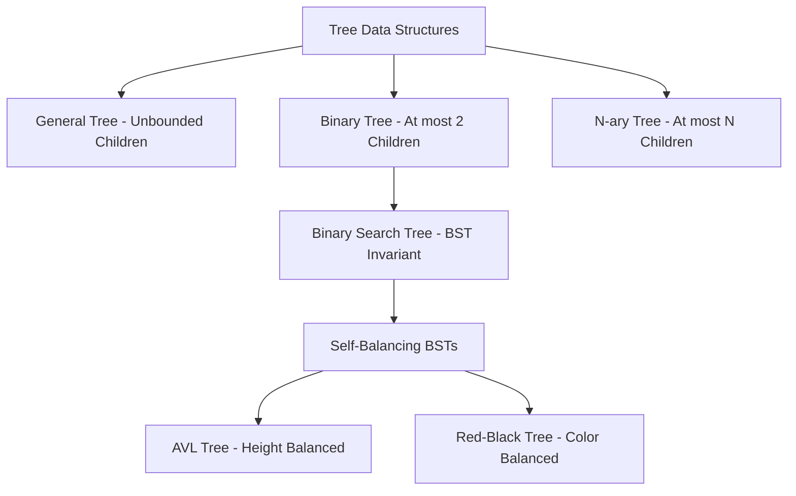
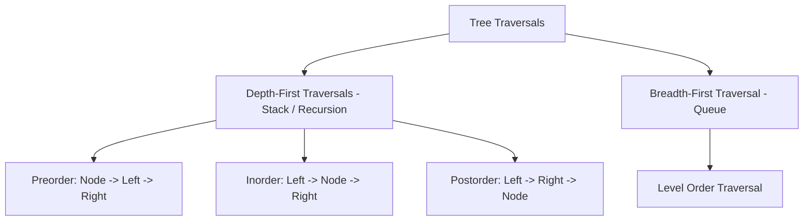

# UNIT-4 & 5: Data Structures — Trees and Hashing
**Course:** Data Structures & Algorithms (B.Tech. Curriculum)  
**Faculty / Source:** Dr. Selva Kumar S, Assistant Professor, B.M.S. College of Engineering (Units 4 & 5)  
**Scope:** Complete Academic Lecture Notes, Interview Preparation, Mathematical Derivations & Verified Implementations  

---

## Table of Contents
1. [Introduction to Trees & Mathematical Foundations](#1-introduction-to-trees--mathematical-foundations)
2. [Comprehensive Tree Terminology & Anatomy](#2-comprehensive-tree-terminology--anatomy)
3. [Taxonomy & Types of Trees](#3-taxonomy--types-of-trees)
4. [Binary Trees: Combinatorics & Structural Variants](#4-binary-trees-combinatorics--structural-variants)
5. [Tree Traversal Techniques & Visual Shortcuts](#5-tree-traversal-techniques--visual-shortcuts)
6. [Binary Search Trees (BST): Theory & Construction](#6-binary-search-trees-bst-theory--construction)
7. [BST Operations: Search, Insertion, and Deletion](#7-bst-operations-search-insertion-and-deletion)
8. [Hashing: Principles, Mechanisms & Hash Functions](#8-hashing-principles-mechanisms--hash-functions)
9. [Collision Resolution Techniques](#9-collision-resolution-techniques)
   - [Separate Chaining (Open Hashing)](#91-separate-chaining-open-hashing)
   - [Open Addressing (Closed Hashing)](#92-open-addressing-closed-hashing)
   - [Linear Probing](#93-linear-probing)
   - [Quadratic Probing](#94-quadratic-probing)
   - [Double Hashing](#95-double-hashing)
   - [Comparative Analysis & Clustering Behavior](#96-comparative-analysis-of-collision-resolution-methods)
10. [Core Algorithms & Interview Implementations](#10-core-algorithms--interview-implementations)
11. [Cartesian & Maximum Binary Trees from Inorder](#11-cartesian--maximum-binary-trees-from-inorder)
12. [Solved Examination Problems & MCQ Bank](#12-solved-examination-problems--mcq-bank)
13. [Master Formula Bank & Quick Revision Summary](#13-master-formula-bank--quick-revision-summary)

---

## 1. Introduction to Trees & Mathematical Foundations

### 1.1 Definition
> **Tree:** A tree is a non-linear, hierarchical data structure consisting of a finite set of **nodes** connected by directed or undirected links called **edges**.

Unlike linear data structures (arrays, linked lists, stacks, queues) where elements are traversed sequentially in $O(n)$ time, trees organize data hierarchically, enabling logarithmic $O(\log n)$ search, insertion, and retrieval operations.



---

### 1.2 Mathematical Properties of Trees (Graph-Theoretic Foundation)
In discrete mathematics and graph theory, a tree is defined as an **undirected, connected, acyclic graph**:
1. **Unique Path Property:** There exists **one and only one** simple path between every pair of vertices in a tree. Adding any edge creates a cycle; removing any edge disconnects the graph.
2. **Vertices and Edges Relation:** A tree with $n$ vertices contains strictly **$n - 1$ edges**:
   $$|E| = |V| - 1$$
3. **Minimal Connectivity:** A graph is a tree if and only if it is **minimally connected** (connected, but removing any edge disconnects it).
4. **Acyclic Connectivity:** Any connected graph with $n$ vertices and $n - 1$ edges is guaranteed to be a tree (contains zero cycles).

---

### 1.3 Real-World & Systems Applications of Trees

| Tree Variant | Real-World Application | Why Trees are Used |
|---|---|---|
| **Binary Search Tree (BST)** | Dynamic set lookup, symbol tables, dictionary searching | Fast $O(\log n)$ membership testing and ordered traversal. |
| **Binary Heap** | Priority Queues, Heap Sort, Dijkstra’s shortest path | Efficient $O(1)$ peek and $O(\log n)$ extraction of extremum (min/max). |
| **Trie (Prefix Tree)** | Network IP routing tables in modern routers, auto-complete, spell-check | Prefix-based string lookup independent of dictionary size; depends only on key length $O(L)$. |
| **B-Trees & B+ Trees** | Relational Database Indexing (MySQL InnoDB, PostgreSQL), File Systems (NTFS, ext4) | High fan-out reduces disk I/O operations by storing blocks in multi-way balanced structures. |
| **T-Trees** | In-Memory Database Systems (IMDBs) | Combines the storage efficiency of AVL trees with the cache benefits of B-trees. |
| **Abstract Syntax Tree (AST)** | Compilers and Interpreters (GCC, Clang, V8 engine) | Validates language grammar rules and represents hierarchical program syntax for code generation. |

---

## 2. Comprehensive Tree Terminology & Anatomy

```text
                     (A)  <------------------------ ROOT (Level 0, Depth 0, Height 3)
                   /     \
                 /         \
               (B)         (C)  <------------------ PARENT of G, H; SIBLING of B
             /  |  \       /  \
           (D) (E) (F)   (G)  (H) <---------------- LEAF / TERMINAL NODE (Degree 0)
              /   \       |
            (I)   (J)    (K)  <-------------------- DESCENDANTS of C and G
```

### 2.1 Glossary of Terms

- **Node:** An independent entity storing data (a key or payload) alongside pointers/links referencing child nodes.
- **Root Node:** The unique topmost node from which the entire tree originates. A valid tree has **exactly one root** and can never have multiple roots.
- **Edge:** The directed link or branch connecting a parent node to a child node. A tree of $n$ nodes always possesses $n - 1$ edges.
- **Parent:** A node that has an outgoing edge/branch leading down to another node. In a general tree, a parent can have any number of children.
- **Child:** A node that is the direct descendant of a node. Every node in a tree except the root is a child node.
- **Siblings:** Nodes that share the exact same immediate parent node (e.g., in the diagram above, `I` and `J` are siblings of parent `E`; `D`, `E`, and `F` are siblings of parent `B`).
- **Leaf Node (External Node / Terminal Node):** Any node that possesses **zero children** ($\text{Degree} = 0$). Examples: `D`, `I`, `J`, `F`, `K`, `H`.
- **Internal Node (Non-Terminal Node):** Any node with **at least one child**. Every non-leaf node (including the root, provided the tree has $>1$ node) is an internal node. Examples: `A`, `B`, `C`, `E`, `G`.
- **Degree of a Node:** The total number of children directly attached to that node.
  - $\text{Degree}(A) = 2$
  - $\text{Degree}(B) = 3$
  - $\text{Degree}(C) = 2$
  - $\text{Degree}(E) = 2$
  - $\text{Degree}(G) = 1$
  - $\text{Degree}(D) = 0$
- **Degree of a Tree:** The **maximum degree** among all nodes in the tree:
  $$\text{Degree}(\text{Tree}) = \max_{u \in V} (\text{Degree}(u)) = 3$$
- **Level of a Node:** The generation step measured from top to bottom. The root is defined at **Level 0**, its children at **Level 1**, grandchildren at **Level 2**, and so on.
- **Depth of a Node:** The total number of edges from the root node to that specific node.
  - $\text{Depth}(\text{Root}) = 0$
  - $\text{Depth}(B) = 1$
  - $\text{Depth}(K) = 3$
  - *Depth of a tree* is the maximum depth among all nodes (equal to the number of edges on the longest path from root to leaf).
- **Height of a Node:** The number of edges on the **longest downward path** from that node to a descendant leaf node.
  - $\text{Height}(\text{any leaf}) = 0$
  - $\text{Height}(E) = 1$ (path $E \to I$ or $E \to J$)
  - $\text{Height}(B) = 2$ (path $B \to E \to I$)
  - $\text{Height}(\text{Tree}) = \text{Height}(\text{Root}) = 3$ (path $A \to B \to E \to I$)
- **Subtree:** A portion of a tree that is itself a valid tree. Any node $u$ together with all its descendants forms a subtree rooted at $u$.
- **Forest:** A set of zero or more **disjoint trees**. Removing the root node from a tree decomposes it into a forest composed of its subtrees.

---

## 3. Taxonomy & Types of Trees



1. **General Tree:** Nodes have arbitrary, unbounded numbers of children ($0$ to $\infty$).
2. **Binary Tree:** Each node has at most two children (left child and right child).
3. **Binary Search Tree (BST):** A binary tree with the key ordering constraint: $\text{keys}(\text{left subtree}) < \text{key}(\text{root}) < \text{keys}(\text{right subtree})$.
4. **AVL Tree:** Adelson-Velsky and Landis self-balancing BST where the heights of the two child subtrees of any node differ by at most one ($\text{Balance Factor} \in \{-1, 0, +1\}$).
5. **Red-Black Tree:** A self-balancing BST with node color tags (Red/Black) ensuring no leaf path is more than twice as long as any other.
6. **$N$-ary Tree:** A tree where each node can have at most $N$ children (e.g., 2-3 trees, B-Trees).

---

## 4. Binary Trees: Combinatorics & Structural Variants

### 4.1 Combinatorics of Binary Trees

#### 1. Unlabeled Binary Trees
An **unlabeled binary tree** consists of nodes that have structural shape and child distinctions (left vs. right), but hold no distinguishing values/labels.

The total number of structurally distinct binary trees that can be formed using $n$ unlabeled nodes is given by the **$n$-th Catalan Number ($C_n$)**:

$$T(n) = C_n = \frac{1}{n + 1} \binom{2n}{n} = \frac{(2n)!}{(n + 1)! \, n!}$$

##### Worked Example ($n = 3$ Unlabeled Nodes):
$$T(3) = \frac{1}{3 + 1} \binom{2 \times 3}{3} = \frac{1}{4} \binom{6}{3} = \frac{1}{4} \times \frac{6 \times 5 \times 4}{3 \times 2 \times 1} = \frac{20}{4} = 5$$

All 5 distinct topological shapes:
```text
  Tree 1          Tree 2          Tree 3          Tree 4          Tree 5
    O               O               O               O               O
   /               /                 \               \             / \
  O               O                   O               O           O   O
 /                 \                 /                 \
O                   O               O                   O
```

---

#### 2. Labeled Binary Trees
A **labeled binary tree** assigns a distinct label (e.g., $A, B, C$) to every node. Since any given topological structure of $n$ nodes can have its labels permuted in $n!$ distinct ways:

$$\text{Total Labeled Trees} = C_n \times n! = \left( \frac{1}{n + 1} \binom{2n}{n} \right) \times n! = \frac{(2n)!}{(n + 1)!}$$

##### Worked Example ($n = 3$ Labeled Nodes):
$$\text{Total} = C_3 \times 3! = 5 \times 6 = 30 \text{ distinct labeled binary trees}$$

For the single symmetric structure `Root with Left & Right child`, the $3! = 6$ arrangements are:
```text
    (A)         (A)         (B)         (B)         (C)         (C)
   /   \       /   \       /   \       /   \       /   \       /   \
 (B)   (C)   (C)   (B)   (A)   (C)   (C)   (A)   (A)   (B)   (B)   (A)
```

---

### 4.2 Structural Variants of Binary Trees

```text
Types of Binary Trees:
1. Rooted Binary Tree
2. Full / Strictly Binary Tree
3. Complete / Perfect Binary Tree
4. Almost Complete Binary Tree
5. Skewed Binary Tree
```

#### 1. Rooted Binary Tree
A binary tree that satisfies:
- Possesses a designated root node.
- Every node has at most 2 children.

#### 2. Full / Strictly Binary Tree
A binary tree in which **every node has either 0 or 2 children**. No node has exactly 1 child.

```text
    Valid Full Binary Tree:                 Invalid Full Binary Tree:
             (A)                                     (A)
            /   \                                   /   \
          (B)   (C)                               (B)   (C)
         /   \                                   /   \    \
       (D)   (E)                               (D)   (E)  (H) <-- Node C has
            /   \                                    /         only 1 child!
          (F)   (G)                                (F)
    (Every node has 0 or 2 children)
```

#### 3. Perfect (Complete) Binary Tree
A binary tree that satisfies two strict criteria:
1. Every internal node has **exactly 2 children**.
2. **All leaf nodes reside at the exact same level**.

```text
             (A)                   Level 0
            /   \
          (B)   (C)                Level 1
         /  \   /  \
        D    E F    G              Level 2 (All leaves at same level)
```
- Total nodes in a perfect binary tree of height $h$ (with root height $1$): $n = 2^h - 1$.
- Total leaves: $2^{h-1}$.

#### 4. Almost Complete Binary Tree (CLRS "Complete Binary Tree")
A binary tree that satisfies:
1. All levels are completely filled, except possibly the last level.
2. The last level has its nodes filled strictly **from left to right** without any intervening gaps.

```text
        Valid Almost Complete:               Invalid Almost Complete:
                 (A)                                   (A)
               /     \                               /     \
             (B)     (C)                           (B)     (C)
            /   \    /                            /   \       \
          (D)   (E) (F)                         (D)   (E)     (F)
   (Filled left-to-right at last level)     (Missing left child for C; gap exists!)
```

#### 5. Skewed Binary Tree
A tree where all internal nodes have **one and only one child**, causing the tree to degenerate into a linear linked list of height $n - 1$:
- **Left Skewed Binary Tree:** Every node has only a left child.
- **Right Skewed Binary Tree:** Every node has only a right child.

```text
    Left Skewed:              Right Skewed:
         (A)                       (A)
        /                             \
      (B)                             (B)
     /                                   \
   (C)                                   (C)
  /                                         \
(D)                                         (D)
```
- **Depth / Height:** Exactly $n - 1$ edges.
- **Degenerate performance:** Search complexity degrades from $O(\log n)$ to $O(n)$.

---

## 5. Tree Traversal Techniques & Visual Shortcuts

Tree traversal is the process of visiting every node in a tree data structure **exactly once**.



---

### Reference Tree for Traversal Examples

```text
             (A)
           /     \
         (B)     (C)
        /   \   /   \
       (D)  (E)(F)  (G)
```

---

### 5.1 Preorder Traversal ($N - L - R$)

#### Algorithm:
1. **Visit the Root node.**
2. **Traverse the Left subtree** recursively in Preorder.
3. **Traverse the Right subtree** recursively in Preorder.

```c
void preorder(struct node *root) {
    if (root != NULL) {
        printf("%c ", root->data);
        preorder(root->left);
        preorder(root->right);
    }
}
```

#### Visual Shortcut (Left-Contour / Perimeter Walk):
Imagine walking along the perimeter of the tree starting from the top left of the root, keeping your hand touching the tree on your left. Record each node the **first time** you pass by its left side:

```text
Contour Path:
Start at A (left side) -> B (left side) -> D (left side) -> loop under D ->
B -> E (left side) -> loop under E -> B -> A -> C (left side) ->
F (left side) -> loop under F -> C -> G (left side) -> loop under G -> End.
```
$$\text{Preorder Sequence:} \quad \mathbf{A, B, D, E, C, F, G}$$

---

### 5.2 Inorder Traversal ($L - N - R$)

#### Algorithm:
1. **Traverse the Left subtree** recursively in Inorder.
2. **Visit the Root node.**
3. **Traverse the Right subtree** recursively in Inorder.

```c
void inorder(struct node *root) {
    if (root != NULL) {
        inorder(root->left);
        printf("%c ", root->data);
        inorder(root->right);
    }
}
```

#### Visual Shortcut (Horizontal Projection onto Ground Mirror):
Place a plane mirror horizontally along the bottom baseline of the tree. Drop a vertical plumb-line (projection) straight down from every node onto the mirror:

```text
               (A)
              /   \
            (B)   (C)
           /  \   /  \
         (D)  (E)(F) (G)
          |    |  | |  | |  |
Ground:   D    B  E A  F C  G
```
$$\text{Inorder Sequence:} \quad \mathbf{D, B, E, A, F, C, G}$$

> [!IMPORTANT]
> For any **Binary Search Tree (BST)**, an Inorder Traversal **ALWAYS** visits the nodes in strictly **sorted, non-decreasing order**.

---

### 5.3 Postorder Traversal ($L - R - N$)

#### Algorithm:
1. **Traverse the Left subtree** recursively in Postorder.
2. **Traverse the Right subtree** recursively in Postorder.
3. **Visit the Root node.**

```c
void postorder(struct node *root) {
    if (root != NULL) {
        postorder(root->left);
        postorder(root->right);
        printf("%c ", root->data);
    }
}
```

#### Visual Shortcut (Plucking Leaves from Left to Right):
Repeatedly find and pluck the leftmost leaf node in the remaining tree until all nodes are removed:
1. In left branch, leftmost leaves are `D`, then `E`. Pluck `D`, then `E`.
2. Now `B` becomes a leaf; pluck `B`.
3. In right branch, leftmost leaves are `F`, then `G`. Pluck `F`, then `G`.
4. Now `C` becomes a leaf; pluck `C`.
5. Finally, root `A` is left alone; pluck `A`.

$$\text{Postorder Sequence:} \quad \mathbf{D, E, B, F, G, C, A}$$

---

### 5.4 Breadth-First Search (Level Order Traversal)

Level Order Traversal visits nodes horizontally, level by level from top to bottom, and left to right within each level:

$$\text{Level 0:} \quad A$$
$$\text{Level 1:} \quad B, C$$
$$\text{Level 2:} \quad D, E, F, G$$
$$\text{Full BFS Sequence:} \quad \mathbf{A, B, C, D, E, F, G}$$

Implemented using an auxiliary **FIFO Queue**:
```text
Queue Algorithm:
1. Enqueue root.
2. While queue is not empty:
   a. Dequeue node u and print its value.
   b. If u->left exists, Enqueue(u->left).
   c. If u->right exists, Enqueue(u->right).
```

---

## 6. Binary Search Trees (BST): Theory & Construction

### 6.1 The BST Invariant
A **Binary Search Tree** is a binary tree where every node $X$ satisfies:
- For every node $Y$ in the **left subtree** of $X$: $\text{Key}(Y) < \text{Key}(X)$.
- For every node $Z$ in the **right subtree** of $X$: $\text{Key}(Z) > \text{Key}(X)$.
- Both the left and right subtrees must themselves be valid binary search trees.

```text
                 [25]
               /      \
            [20]      [36]
           /    \     /   \
        [10]   [22] [30]  [40]
        /  \        /     /   \
      [5]  [12]   [28]  [38]  [48]
```

---

### 6.2 Number of Distinct BSTs for $n$ Distinct Keys
When constructing binary search trees using $n$ distinct sorted keys, the inorder traversal is fixed (must equal the sorted keys). Therefore, **every distinct unlabeled binary tree shape corresponds to exactly one unique BST**.

The number of distinct BSTs with $n$ distinct keys is given by the Catalan number:

$$\text{Distinct BSTs}(n) = C_n = \frac{1}{n + 1} \binom{2n}{n}$$

For keys $\{A, B, C\}$ ($n = 3$): exactly $C_3 = 5$ distinct BSTs:
```text
    (A)           (A)           (B)           (C)           (C)
      \             \          /   \         /             /
      (B)           (C)      (A)   (C)     (A)           (B)
        \           /                        \           /
        (C)       (B)                        (B)       (A)
```

---

### 6.3 Step-by-Step BST Construction Example
**Input Sequence:** `50, 70, 60, 20, 90, 10, 40, 100`

- **Insert 50:** Tree is empty $\implies$ `50` becomes **root**.
- **Insert 70:** $70 > 50 \implies$ insert as **right child** of `50`.
- **Insert 60:** $60 > 50$ (go right), $60 < 70 \implies$ insert as **left child** of `70`.
- **Insert 20:** $20 < 50 \implies$ insert as **left child** of `50`.
- **Insert 90:** $90 > 50$ (go right), $90 > 70 \implies$ insert as **right child** of `70`.
- **Insert 10:** $10 < 50$ (go left), $10 < 20 \implies$ insert as **left child** of `20`.
- **Insert 40:** $40 < 50$ (go left), $40 > 20 \implies$ insert as **right child** of `20`.
- **Insert 100:** $100 > 50 \to 100 > 70 \to 100 > 90 \implies$ insert as **right child** of `90`.

#### Final Constructed BST:
```text
                   (50)
                 /      \
              (20)      (70)
             /    \     /   \
          (10)   (40) (60)  (90)
                               \
                              (100)
```

---

## 7. BST Operations: Search, Insertion, and Deletion

### 7.1 Search Operation

#### Logic:
1. If current node is `NULL`, return `NULL` (Key not present).
2. If `key == node->data`, return `node` (Match found).
3. If `key < node->data`, recurse on `node->left`.
4. If `key > node->data`, recurse on `node->right`.

```c
struct Node* search(struct Node* root, int key) {
    if (root == NULL || root->data == key)
        return root;
    if (key < root->data)
        return search(root->left, key);
    else
        return search(root->right, key);
}
```

**Walkthrough Example (Search for Key = 45):**
- Start at root `25`: $45 > 25 \implies$ go to right child `50`.
- At node `50`: $45 < 50 \implies$ go to left child `35`.
- At node `35`: $45 > 35 \implies$ go to right child `44`.
- At node `44`: $45 > 44 \implies$ right child is `NULL`.
- **Conclusion:** $45$ is absent from the tree.

---

### 7.2 Insertion Operation
In a standard BST, a new key is **always inserted as a child of some leaf node**:
1. Search down the tree until a `NULL` pointer is encountered.
2. Allocate a new node and link it at that `NULL` position.

```c
struct Node* newNode(int item) {
    struct Node* temp = (struct Node*)malloc(sizeof(struct Node));
    temp->data = item;
    temp->left = temp->right = NULL;
    return temp;
}

struct Node* insert(struct Node* node, int key) {
    if (node == NULL)
        return newNode(key);
    if (key < node->data)
        node->left = insert(node->left, key);
    else if (key > node->data)
        node->right = insert(node->right, key);
    return node;
}
```

---

### 7.3 Deletion Operation (The Three Canonical Cases)

Deletion is the most intricate BST operation because the search-tree invariant must be preserved.

```text
Case 1: Deletion of Leaf Node (0 children)
        Just disconnect and free the node.

Case 2: Deletion of Node with 1 Child
        Bypass the node: link parent directly to child, then free node.

Case 3: Deletion of Node with 2 Children
        Replace node's data with either:
        - Method 1: Inorder Successor (Smallest key in right subtree)
        - Method 2: Inorder Predecessor (Largest key in left subtree)
        Then recursively delete the successor/predecessor node from its original sub-tree.
```

#### Visualizing Case 3 (Deleting Node with 2 Children):
Suppose we wish to delete node `15`:

```text
               (20)                                  (20)
              /    \                                /    \
           [15]    (30)                          [16]    (30)
          /    \               Delete 15        /    \
       (10)    (17)        ==============>   (10)    (17)
       /  \    /  \        Replace with      /  \       \
     (2) (12)(16) (19)     Inorder Succ:   (2) (12)     (19)
                           Min of Right Subtree
                           which is 16!
```

#### Complete C Implementation for Deletion:
```c
struct Node* findMin(struct Node* root) {
    while (root->left != NULL)
        root = root->left;
    return root;
}

struct Node* deleteNode(struct Node* root, int key) {
    if (root == NULL)
        return root;
        
    if (key < root->data)
        root->left = deleteNode(root->left, key);
    else if (key > root->data)
        root->right = deleteNode(root->right, key);
    else {
        // Node found! Handle the 3 cases:
        
        // Case 1: No children (Leaf)
        if (root->left == NULL && root->right == NULL) {
            free(root);
            return NULL;
        }
        // Case 2: One child
        else if (root->left == NULL) {
            struct Node* temp = root->right;
            free(root);
            return temp;
        }
        else if (root->right == NULL) {
            struct Node* temp = root->left;
            free(root);
            return temp;
        }
        // Case 3: Two children
        else {
            // Find inorder successor (minimum in right subtree)
            struct Node* temp = findMin(root->right);
            root->data = temp->data;
            // Delete the successor from right subtree
            root->right = deleteNode(root->right, temp->data);
        }
    }
    return root;
}
```

---

## 8. Hashing: Principles, Mechanisms & Hash Functions

### 8.1 The Motivation Behind Hashing
While Binary Search Trees offer $O(\log n)$ average search time, retrieval still involves comparison chains. **Hashing** is a data structure technique that achieves **$O(1)$ constant average-time search, insertion, and deletion**, completely bypassing sequential comparison.

```text
   Key  ───► [ Hash Function h(k) ] ───► Hash Value (Index) ───► [ Bucket in Hash Table ]
 "Alice" ───►      h("Alice")       ───►         3           ───► Table[3]
```

- **Hash Table:** A fixed-size array of $m$ buckets used to store data items.
- **Hash Function ($h$):** A mathematical transformation that maps a large or variable key domain into a compact integer range $[0, m - 1]$.
- **Hash Value:** The integer index computed by $h(\text{key})$.

---

### 8.2 Desirable Properties of a Good Hash Function
1. **Efficiently Computable:** Must execute in $O(1)$ time with low constant overhead.
2. **Minimizes Collisions:** Must distribute keys uniformly across all table slots (**Uniform Hashing Assumption**).
3. **Full Table Utilization:** Must avoid clustering items into a small subset of indices.

---

### 8.3 Common Hash Function Construction Methods

#### 1. Division Method
$$h(k) = k \bmod m$$
- Fast (single hardware modulo operation).
- **Best Practice:** Choose $m$ to be a **prime number** not close to a power of 2 or 10, to minimize pattern bias.

#### 2. Mid-Square Method
1. Square the numeric key: $k^2$.
2. Extract the middle $r$ digits of the squared result.
3. If table size is $m = 10^r$, the extracted digits form the hash address.
- **Example:** For $k = 1234$, $k^2 = 1522756$. Extract middle digits $22 \implies h(k) = 22$.

#### 3. Folding Method
The key is partitioned into multiple chunks whose width matches the table index size:
- **Fold Shift:** Chunks are simply added together: $\text{Index} = (c_1 + c_2 + c_3) \bmod m$.
- **Fold Boundary:** Extreme chunks are reversed before adding.

---

### 8.4 The Collision Phenomenon & Load Factor
> **Collision:** Occurs when a hash function maps two distinct keys to the exact same hash table bucket:
> $$h(k_1) = h(k_2) \quad \text{where } k_1 \ne k_2$$

By the **Pigeonhole Principle**, if the number of possible keys exceeds table size $m$, collisions are mathematically unavoidable.

- **Load Factor ($\alpha$):**
  $$\alpha = \frac{n}{m}$$
  where $n$ is the number of stored keys and $m$ is the total capacity of the hash table.
  - In Open Addressing: strictly $\alpha \le 1$.
  - In Separate Chaining: $\alpha$ can exceed $1$ ($\alpha > 1$).

---

## 9. Collision Resolution Techniques

```mermaid
graph TD
    CR[Collision Resolution Techniques]
    CR --> Chaining[Separate Chaining - Open Hashing]
    CR --> OpenAddr[Open Addressing - Closed Hashing]
    
    OpenAddr --> LP[Linear Probing - f(i) = i]
    OpenAddr --> QP[Quadratic Probing - f(i) = i^2]
    OpenAddr --> DH[Double Hashing - f(i) = i * h2(k)]
```

---

### 9.1 Separate Chaining (Open Hashing)

#### Mechanism
Each bucket in the hash table acts as the head pointer to an independent **singly linked list**. When a collision occurs, the new item is simply inserted into the linked list belonging to that slot.

#### Step-by-Step Worked Example:
- Hash Function: $h(k) = k \bmod 7$ (Table size $m = 7$, indices $0 \dots 6$).
- Input Sequence: `50, 700, 76, 85, 92, 73, 101`

```text
Calculations:
50  mod 7 = 1  ---> Insert in bucket 1
700 mod 7 = 0  ---> Insert in bucket 0
76  mod 7 = 6  ---> Insert in bucket 6
85  mod 7 = 1  ---> Collision at bucket 1! Add to linked list: 50 -> 85
92  mod 7 = 1  ---> Collision at bucket 1! Add to linked list: 50 -> 85 -> 92
73  mod 7 = 3  ---> Insert in bucket 3
101 mod 7 = 3  ---> Collision at bucket 3! Add to linked list: 73 -> 101
```

```text
Hash Table (Separate Chaining Structure):
Index
[0] ──► [ 700 | NULL ]
[1] ──► [ 50  | • ] ──► [ 85 | • ] ──► [ 92 | NULL ]
[2] ──► NULL
[3] ──► [ 73  | • ] ──► [ 101 | NULL ]
[4] ──► NULL
[5] ──► NULL
[6] ──► [ 76  | NULL ]
```

---

### 9.2 Open Addressing (Closed Hashing)

#### Mechanism
All keys are stored **directly inside the hash table array**. No external linked lists or pointers are used. If a collision occurs at index $h(k)$, alternative slots are inspected (**probed**) systematically until an empty bucket is located:

$$\text{Probe Sequence Formula:} \quad h(k, i) = \big( h_1(k) + f(i) \big) \bmod m \quad (i = 0, 1, 2, \dots)$$

#### Deletion in Open Addressing:
When deleting an item, the slot **cannot simply be cleared to empty (`NULL`)**, because doing so would break subsequent probe chains for other keys that collided on that slot. Instead, the slot is marked with a special sentinel value: **"DELETED" (Tombstone)**.
- Search continues through `DELETED` slots.
- Insert can reuse `DELETED` slots.

---

### 9.3 Linear Probing

#### Collision Function:
$$f(i) = i$$
$$h(k, i) = (h(k) + i) \bmod m$$

If a collision occurs at $h(k)$, probe consecutive cells: $(h(k)+1) \bmod m$, $(h(k)+2) \bmod m, \dots$

#### Step-by-Step Worked Example:
- Hash Function: $h(k) = k \bmod 7$ ($m = 7$)
- Insertion Sequence: `76, 93, 40, 47, 10, 55`

```text
Key 76: 76 mod 7 = 6. Slot [6] is empty. Place at [6].              (1 probe)
Key 93: 93 mod 7 = 2. Slot [2] is empty. Place at [2].              (1 probe)
Key 40: 40 mod 7 = 5. Slot [5] is empty. Place at [5].              (1 probe)
Key 47: 47 mod 7 = 5. Slot [5] occupied (40)!
        Probe i=1: (5+1)%7 = 6 -> Occupied (76)!
        Probe i=2: (5+2)%7 = 0 -> Empty! Place at [0].             (3 probes)
Key 10: 10 mod 7 = 3. Slot [3] is empty. Place at [3].              (1 probe)
Key 55: 55 mod 7 = 6. Slot [6] occupied (76)!
        Probe i=1: (6+1)%7 = 0 -> Occupied (47)!
        Probe i=2: (6+2)%7 = 1 -> Empty! Place at [1].             (3 probes)
```

```text
Final State:
Index:   0    1    2    3    4    5    6
Key:   [47] [55] [93] [10] [  ] [40] [76]
```

- **Advantage:** Trivial to compute; superior cache locality because adjacent array elements reside in the same CPU cache line.
- **Disadvantage (Primary Clustering):** Long contiguous blocks of occupied cells form. Once a cluster grows, any key hashing into or near the cluster prolongs the probe chain, rapidly degrading search performance.

---

### 9.4 Quadratic Probing

#### Collision Function:
$$f(i) = i^2$$
$$h(k, i) = (h(k) + i^2) \bmod m$$

Probing advances quadratically: $(h(k)+1) \bmod m$, $(h(k)+4) \bmod m$, $(h(k)+9) \bmod m, \dots$

#### Step-by-Step Worked Example:
- Hash Function: $h(k) = k \bmod 7$ ($m = 7$)
- Insertion Sequence: `76, 40, 48, 5, 55`

```text
Key 76: 76 mod 7 = 6. Slot [6] empty. Place at [6].                (1 probe)
Key 40: 40 mod 7 = 5. Slot [5] empty. Place at [5].                (1 probe)
Key 48: 48 mod 7 = 6. Slot [6] occupied (76)!
        Probe i=1: (6 + 1^2)%7 = 7%7 = 0. Empty! Place at [0].     (2 probes)
Key 5:  5 mod 7 = 5. Slot [5] occupied (40)!
        Probe i=1: (5 + 1^2)%7 = 6%7 = 6. Occupied (76)!
        Probe i=2: (5 + 2^2)%7 = 9%7 = 2. Empty! Place at [2].     (3 probes)
Key 55: 55 mod 7 = 6. Slot [6] occupied (76)!
        Probe i=1: (6 + 1^2)%7 = 0%7 = 0. Occupied (48)!
        Probe i=2: (6 + 2^2)%7 = 10%7 = 3. Empty! Place at [3].    (3 probes)
```

```text
Final State:
Index:   0    1    2    3    4    5    6
Key:   [48] [  ] [ 5] [55] [  ] [40] [76]
```

- **Advantage:** Eliminates **Primary Clustering**.
- **Disadvantage (Secondary Clustering):** Keys that hash to the same initial slot ($h(k_1) = h(k_2)$) traverse the exact same probe sequence.

---

### 9.5 Double Hashing

#### Collision Function:
$$f(i) = i \cdot h_2(k)$$
$$h(k, i) = \big( h_1(k) + i \cdot h_2(k) \big) \bmod m$$

Uses two independent hash functions:
- Primary function $h_1(k)$ determines the initial slot.
- Secondary function $h_2(k)$ determines the probe step size.

> [!IMPORTANT]
> To guarantee that the probe sequence visits all $m$ slots:
> 1. $h_2(k) \ne 0$ for all $k$.
> 2. $h_2(k)$ must be **relatively prime** to table size $m$ (typically satisfied by choosing $m$ prime and $h_2(k) = R - (k \bmod R)$ where $R < m$ is a prime).

#### Step-by-Step Worked Example:
- Table size $m = 7$.
- Primary Hash: $h_1(k) = k \bmod 7$
- Secondary Hash: $h_2(k) = 5 - (k \bmod 5)$
- Insertion Sequence: `76, 93, 40, 47, 10, 55`

```text
Key 76: h1(76) = 6. Slot [6] empty. Place at [6].                  (1 probe)
Key 93: h1(93) = 2. Slot [2] empty. Place at [2].                  (1 probe)
Key 40: h1(40) = 5. Slot [5] empty. Place at [5].                  (1 probe)
Key 47: h1(47) = 5. Slot [5] occupied (40)!
        h2(47) = 5 - (47 mod 5) = 5 - 2 = 3.
        Probe i=1: (5 + 1*3)%7 = 8%7 = 1. Empty! Place at [1].     (2 probes)
Key 10: h1(10) = 3. Slot [3] empty. Place at [3].                  (1 probe)
Key 55: h1(55) = 6. Slot [6] occupied (76)!
        h2(55) = 5 - (55 mod 5) = 5 - 0 = 5.
        Probe i=1: (6 + 1*5)%7 = 11%7 = 4. Empty! Place at [4].    (2 probes)
```

```text
Final State:
Index:   0    1    2    3    4    5    6
Key:   [  ] [47] [93] [10] [55] [40] [76]
```

---

### 9.6 Comparative Analysis of Collision Resolution Methods

#### Separate Chaining vs. Open Addressing

| Comparison Parameter | Separate Chaining (Open Hashing) | Open Addressing (Closed Hashing) |
|---|---|---|
| **Storage Location** | Stored in linked lists outside the hash table array. | Stored directly inside the hash table slots. |
| **Max Load Factor ($\alpha$)** | Can exceed $1$ ($\alpha > 1$). | Strictly bounded by $\alpha \le 1$. |
| **Deletion Complexity** | Straightforward (standard linked list node removal). | Difficult; requires tombstone marker (`DELETED`). |
| **Memory Overhead** | Requires extra pointer storage for list nodes. | Zero pointer overhead (stores only keys/values). |
| **Cache Locality** | Poor (nodes scattered non-contiguously in heap memory). | Excellent (contiguous memory array, prefetch friendly). |
| **Table Saturation** | Never gets "full"; lists grow indefinitely. | Fails/overflows when table slots are fully occupied. |

---

#### Comparison of Open Addressing Probing Strategies

| Strategy | Primary Clustering? | Secondary Clustering? | Distinct Probe Sequences | Cache Locality |
|---|:---:|:---:|:---:|:---:|
| **Linear Probing** | **Yes** | **Yes** | $m$ | **Best** (Sequential array access) |
| **Quadratic Probing** | **No** | **Yes** | $m$ | **Moderate** |
| **Double Hashing** | **No** | **No** | $m^2$ | **Poor** (Scattered jump steps) |

---

## 10. Core Algorithms & Interview Implementations

### 10.1 Count Leaf Nodes in a Binary Tree
```c
int getLeafCount(struct node* node) {
    if (node == NULL)
        return 0;
    if (node->left == NULL && node->right == NULL)
        return 1;
    return getLeafCount(node->left) + getLeafCount(node->right);
}
```
- **Time Complexity:** $O(n)$
- **Space Complexity:** $O(h)$ auxiliary recursion stack.

---

### 10.2 Count Total Nodes in a Binary Tree
```c
int countNodes(struct node* root) {
    if (root == NULL)
        return 0;
    return 1 + countNodes(root->left) + countNodes(root->right);
}
```

---

### 10.3 Find the $k$-th Smallest Element in a BST
Because an inorder traversal of a BST processes keys in ascending order, the $k$-th element visited during inorder traversal is guaranteed to be the $k$-th smallest key.

```c
#include <limits.h>

int kthSmallestUtil(struct node* root, int* counter, int k) {
    if (root == NULL)
        return INT_MAX;

    // Search left subtree
    int left = kthSmallestUtil(root->left, counter, k);
    if (left != INT_MAX)
        return left;

    // Process current node
    (*counter)++;
    if (*counter == k)
        return root->data;

    // Search right subtree
    return kthSmallestUtil(root->right, counter, k);
}

int kthSmallest(struct node* root, int k) {
    int counter = 0;
    return kthSmallestUtil(root, &counter, k);
}
```
- **Time Complexity:** $O(h + k)$
- **Space Complexity:** $O(h)$

---

### 10.4 Validate Whether a Binary Tree is a Valid BST
A common novice error is checking only whether `node->left->data < node->data < node->right->data`. This misses violations in deeper subtrees. The correct algorithm maintains a valid numerical range $[minKey, maxKey]$ and shrinks the boundary at each recursive descent:

```c
#include <stdbool.h>

bool isBST(struct node* node, int minKey, int maxKey) {
    if (node == NULL)
        return true;

    // Validate current node within strict bounds
    if (node->data <= minKey || node->data >= maxKey)
        return false;

    // Shrink range for left and right children
    return isBST(node->left, minKey, node->data) &&
           isBST(node->right, node->data, maxKey);
}
```

---

### 10.5 Maximum Depth (Height) of a Binary Tree
```c
int maxDepth(struct node* node) {
    if (node == NULL)
        return 0;
    
    int lDepth = maxDepth(node->left);
    int rDepth = maxDepth(node->right);

    return (lDepth > rDepth ? lDepth + 1 : rDepth + 1);
}
```

---

### 10.6 Complete Hash Table Implementation with Linear Probing in C
```c
#include <stdio.h>
#define SIZE 7

int hashTable[SIZE];

void init() {
    for (int i = 0; i < SIZE; i++)
        hashTable[i] = -1; // -1 represents empty slot
}

void insert(int value) {
    int key = value % SIZE;
    int i = 0;
    while (i < SIZE) {
        int index = (key + i) % SIZE;
        if (hashTable[index] == -1 || hashTable[index] == -2) { // -2 represents DELETED
            hashTable[index] = value;
            printf("%d inserted at index %d\n", value, index);
            return;
        }
        i++;
    }
    printf("Hash Table Full! Unable to insert %d\n", value);
}

void search(int value) {
    int key = value % SIZE;
    int i = 0;
    while (i < SIZE) {
        int index = (key + i) % SIZE;
        if (hashTable[index] == value) {
            printf("Found %d at index %d\n", value, index);
            return;
        }
        if (hashTable[index] == -1) // Unoccupied slot terminates probe
            break;
        i++;
    }
    printf("Value %d NOT found\n", value);
}

void del(int value) {
    int key = value % SIZE;
    int i = 0;
    while (i < SIZE) {
        int index = (key + i) % SIZE;
        if (hashTable[index] == value) {
            hashTable[index] = -2; // Mark as DELETED (tombstone)
            printf("%d deleted from index %d\n", value, index);
            return;
        }
        if (hashTable[index] == -1)
            break;
        i++;
    }
    printf("Value %d not present to delete\n", value);
}
```

---

## 11. Cartesian & Maximum Binary Trees from Inorder

A **Maximum Binary Tree (Cartesian Tree)** is a unique binary tree constructed from an array such that:
1. An **inorder traversal** of the tree reproduces the original array sequence.
2. The tree satisfies the **max-heap property**: the root of every subtree contains the **maximum element** in that subarray range.

### Construction Principle:
1. Locate the index of the maximum element in `inorder[start .. end]`.
2. Allocate this maximum element as the `root`.
3. Recursively construct the left subtree from `inorder[start .. maxIndex - 1]`.
4. Recursively construct the right subtree from `inorder[maxIndex + 1 .. end]`.

---

#### Example 1 (from Source Page 110):
**Input:** `inorder[] = {5, 10, 40, 30, 28}`
- Maximum in `{5, 10, 40, 30, 28}` is `40` $\implies$ Root is `40`.
- Left subarray: `{5, 10}`. Max is `10` $\implies$ Left child of `40` is `10`. Left child of `10` is `5`.
- Right subarray: `{30, 28}`. Max is `30` $\implies$ Right child of `40` is `30`. Right child of `30` is `28`.

```text
               (40)
              /    \
           (10)    (30)
           /          \
         (5)          (28)
```

---

#### Example 2 (from Source Page 111):
**Input:** `inorder[] = {1, 7, 5, 50, 40, 10}`
- Maximum element is `50` $\implies$ Root is `50`.
- Left subtree partition: `{1, 7, 5}`. Max is `7` (root of left), with left child `1` and right child `5`.
- Right subtree partition: `{40, 10}`. Max is `40` (root of right), with right child `10`.

```text
               (50)
              /    \
            (7)    (40)
           /   \      \
         (1)   (5)    (10)
```

---

## 12. Solved Examination Problems & MCQ Bank

### Problem 1: Subtree Node Counts of BST Root
**Question (Page 48):**  
A binary search tree is generated by inserting the following integers in order:  
`50, 15, 62, 5, 20, 58, 91, 3, 8, 37, 60, 24`  
The number of nodes in the left subtree and right subtree of the root respectively is:  
A. $(4, 7)$  
B. $(7, 4)$  
C. $(8, 3)$  
D. $(3, 8)$  

**Solution:**
- The first inserted key `50` is the **root** of the BST.
- Every key strictly less than $50$ belongs to the **left subtree**:
  $$\text{Keys } < 50: \quad \{15, 5, 20, 3, 8, 37, 24\} \implies \mathbf{7 \text{ nodes}}$$
- Every key strictly greater than $50$ belongs to the **right subtree**:
  $$\text{Keys } > 50: \quad \{62, 58, 91, 60\} \implies \mathbf{4 \text{ nodes}}$$
- **Correct Answer:** **B. (7, 4)**

---

### Problem 2: Distinct BSTs with 4 Keys
**Question (Page 49):**  
How many distinct binary search trees can be constructed out of $4$ distinct keys?  
A. 5  
B. 14  
C. 24  
D. 35  

**Solution:**
Using the Catalan number formula for $n = 4$:
$$C_4 = \frac{1}{4 + 1} \binom{2 \times 4}{4} = \frac{1}{5} \binom{8}{4} = \frac{1}{5} \times \frac{8 \times 7 \times 6 \times 5}{4 \times 3 \times 2 \times 1} = \frac{70}{5} = \mathbf{14}$$
- **Correct Answer:** **B. 14**

---

### Problem 3: Inorder Traversal of Natural Number BST
**Question (Page 55):**  
Suppose the numbers `7, 5, 1, 8, 3, 6, 0, 9, 4, 2` are inserted in that order into an initially empty binary search tree. What is the inorder traversal sequence of the resultant tree?  
A. `7, 5, 1, 0, 3, 2, 4, 6, 8, 9`  
B. `0, 2, 4, 3, 1, 6, 5, 9, 8, 7`  
C. `0, 1, 2, 3, 4, 5, 6, 7, 8, 9`  
D. `9, 8, 6, 4, 2, 3, 0, 1, 5, 7`  

**Solution:**
By definition, the Inorder traversal ($Left - Root - Right$) of any binary search tree produces keys in strictly **sorted ascending order**. Sorting the input set yields:
$$0, 1, 2, 3, 4, 5, 6, 7, 8, 9$$
- **Correct Answer:** **C**

---

### Problem 4: Reconstructing Postorder from BST Preorder
**Question (Page 56):**  
The preorder traversal sequence of a binary search tree is:  
`30, 20, 10, 15, 25, 23, 39, 35, 42`  
Which one of the following is the postorder traversal sequence of the same tree?  
A. `10, 20, 15, 23, 25, 35, 42, 39, 30`  
B. `15, 10, 25, 23, 20, 42, 35, 39, 30`  
C. `15, 20, 10, 23, 25, 42, 35, 39, 30`  
D. `15, 10, 23, 25, 20, 35, 42, 39, 30`  

**Solution:**
1. In Preorder ($Root - Left - Right$), the first element `30` is the **root**.
2. Left subtree consists of all keys $< 30$: `{20, 10, 15, 25, 23}`.
3. Right subtree consists of all keys $> 30$: `{39, 35, 42}`.
4. Construct the tree:
   - Root of left subtree is `20`. Its left subtree has `{10, 15}` (root `10`, right child `15`). Its right subtree has `{25, 23}` (root `25`, left child `23`).
   - Root of right subtree is `39`. Its left child is `35`, right child is `42`.
5. Postorder ($Left - Right - Root$):
   - Left subtree of `20`: `15, 10`
   - Right subtree of `20`: `23, 25`
   - Node `20`: `20` $\implies$ Left subtree postorder is `15, 10, 23, 25, 20`.
   - Right subtree postorder: `35, 42, 39`.
   - Finally the main root `30`.
6. Combined Postorder:
   $$\mathbf{15, 10, 23, 25, 20, 35, 42, 39, 30}$$
- **Correct Answer:** **D**

---

## 13. Master Formula Bank & Quick Revision Summary

### 1. Combinatorics & Formulas
- Edges in a tree with $n$ nodes:
  $$|E| = n - 1$$
- Unlabeled binary trees with $n$ nodes:
  $$C_n = \frac{1}{n + 1} \binom{2n}{n}$$
- Labeled binary trees with $n$ nodes:
  $$\text{Labeled}(n) = C_n \times n! = \frac{(2n)!}{(n + 1)!}$$
- Distinct BSTs with $n$ distinct keys:
  $$\text{BSTs}(n) = C_n = \frac{1}{n + 1} \binom{2n}{n}$$
- Max nodes at level $l$ (Root at level 0):
  $$2^l$$
- Max nodes in binary tree of height $h$ (Root height 1):
  $$2^h - 1$$
- Minimum height for $n$ nodes:
  $$h = \lceil \log_2(n + 1) \rceil$$

---

### 2. Time Complexities Matrix

| Operation | Array | Singly Linked List | BST (Average) | BST (Worst Case) | Hash Table (Average) | Hash Table (Worst Case) |
|---|:---:|:---:|:---:|:---:|:---:|:---:|
| **Search** | $O(n)$ / $O(\log n)$ (sorted) | $O(n)$ | $O(\log n)$ | $O(n)$ | $\mathbf{O(1)}$ | $O(n)$ |
| **Insert** | $O(n)$ | $O(1)$ (head) / $O(n)$ | $O(\log n)$ | $O(n)$ | $\mathbf{O(1)}$ | $O(n)$ |
| **Delete** | $O(n)$ | $O(1)$ (with pointer) | $O(\log n)$ | $O(n)$ | $\mathbf{O(1)}$ | $O(n)$ |
