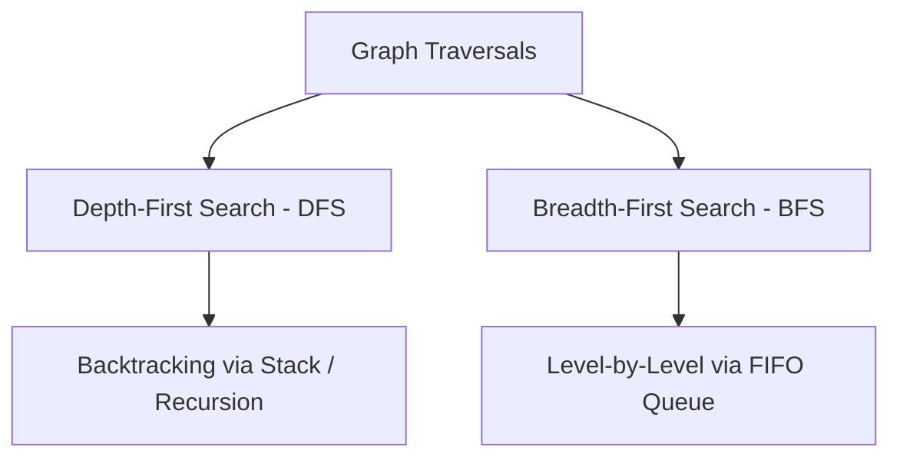

# UNIT-6: Graph Theory — Representations, Traversals, and Minimum Spanning Trees
**Course:** Data Structures & Algorithms (B.Tech. Curriculum)  
**Topic:** Graphs, DFS, BFS, Minimum Spanning Trees (Prim's & Kruskal's Algorithms)  
**Scope:** Formal Mathematical Definitions, Matrix & List Representations, Step-by-Step Traversal Traces, Disjoint-Set Union (DSU), Algorithm Implementations & Exam Revision Guide  

---

## Table of Contents
1. [Foundational Graph Theory & Core Definitions](#1-foundational-graph-theory--core-definitions)
2. [Graph Representation Models](#2-graph-representation-models)
   - [Adjacency Matrix](#21-adjacency-matrix)
   - [Adjacency List](#22-adjacency-list)
   - [Comparative Analysis: Matrix vs. List](#23-comparative-analysis-matrix-vs-list)
3. [Graph Traversal Techniques](#3-graph-traversal-techniques)
   - [Depth-First Search (DFS)](#31-depth-first-search-dfs)
   - [Breadth-First Search (BFS)](#32-breadth-first-search-bfs)
   - [Comparative Analysis: DFS vs. BFS](#33-comparative-analysis-dfs-vs-bfs)
4. [Graph Search Strategies & Early Exit](#4-graph-search-strategies--early-exit)
5. [Minimum Spanning Trees (MST)](#5-minimum-spanning-trees-mst)
   - [Concept, Cut Property & Network Applications](#51-concept-cut-property--network-applications)
   - [The Greedy Choice Paradigm](#52-the-greedy-choice-paradigm)
6. [Prim's Algorithm (Vertex-Centric Growing Tree)](#6-prims-algorithm-vertex-centric-growing-tree)
   - [Algorithm & Supporting Structures](#61-algorithm--supporting-structures)
   - [Comprehensive Step-by-Step State Trace](#62-comprehensive-step-by-step-state-trace)
   - [Complete C Implementation](#63-complete-c-implementation-of-prims-algorithm)
7. [Kruskal's Algorithm (Edge-Centric Forest Merging)](#7-kruskals-algorithm-edge-centric-forest-merging)
   - [Algorithm & Disjoint-Set Union (DSU)](#71-algorithm--disjoint-set-union-dsu)
   - [Comprehensive Step-by-Step Acceptance/Rejection Trace](#72-comprehensive-step-by-step-acceptancerejection-trace)
   - [Complete C Implementation](#73-complete-c-implementation-of-kruskals-algorithm)
8. [Master Comparison: Prim's vs. Kruskal's Algorithm](#8-master-comparison-prims-vs-kruskals-algorithm)
9. [Exam Revision Cheat Sheet & Practice Problems](#9-exam-revision-cheat-sheet--practice-problems)

---

## 1. Foundational Graph Theory & Core Definitions

### 1.1 Formal Mathematical Definition
> **Graph:** A graph $G = (V, E)$ is an ordered pair consisting of:
> 1. A finite set of **Vertices (or Nodes)**, denoted by $V$.
> 2. A finite set of **Edges (or Arcs)**, denoted by $E$, where each edge $e \in E$ is a 2-tuple $(v, w)$ connecting vertices $v, w \in V$. The edge $e$ is said to be **incident** on $v$ and $w$.

```text
Undirected Graph Example:
Vertices: V = {0, 1, 2, 3, 4}
Edges:    E = {(0, 1), (1, 2), (1, 3), (1, 4), (2, 3), (3, 4), (4, 0)}

      (0) -------------- (1)
       |  \             / | \
       |    \         /   |   \
       |      \     /     |     (2)
       |        \ /       |   /
       |        / \       | /
      (4) -------------- (3)
```

---

### 1.2 Edge Classifications & Attributes

```mermaid
graph TD
    Edges[Edge Classifications]
    Edges --> Dir[Directionality]
    Edges --> Wgt[Weight / Cost]
    
    Dir --> UndirE[Undirected Edge: Unordered pair {u, v}]
    Dir --> DirE[Directed Edge / Arc: Ordered pair (u, v)]
    
    Wgt --> UnwgtE[Unweighted: Unit cost]
    Wgt --> WgtE[Weighted: Numerical cost w(u, v)]
```

1. **Undirected Edge:** Edge $\{u, v\}$ has no orientation. Traversal is bidirectional ($u \leftrightarrow v$).
2. **Directed Edge (Arc):** Edge $(u, v)$ has an orientation from source vertex $u$ to destination vertex $w$ ($u \to v$).
3. **Weighted Graph:** Every edge $e$ is associated with a numerical weight $w(e) \in \mathbb{R}$, representing physical distance, network latency, bandwidth capacity, or monetary routing cost.

```text
Directed, Unweighted Graph:             Directed, Weighted Graph:
      (0) ──► (1)                            (0) ─── 2 ──► (1)
     / |     / | \                          / |          / | \
    1  |    /  |  5                        1  |        6   1  5
   v   v   v   v   v                      v   v       v    v   v
  (4) ──► (3) ──► (2)                    (4) ─── 1 ──► (3) ─── 3 ──► (2)
```

---

### 1.3 Paths and Connectivity
- **Path:** A sequence of alternating vertices and edges connecting vertex $v_0$ to $v_n$:
  - Alternating representation: $(v_0, e_1, v_1, e_2, v_2, \dots, v_{n-1}, e_n, v_n)$
  - Vertex-only representation: $(v_0, v_1, v_2, \dots, v_n)$ where $(v_{i-1}, v_i) \in E$ for all $1 \le i \le n$.
- **Cycle:** A path in which the starting and ending vertices are identical ($v_0 = v_n$), with all intermediate vertices distinct.
- **Connected Graph:** An undirected graph is connected if, for **every pair** of vertices $v, w \in V$, there exists at least one valid path connecting $v$ to $w$.
- **Disconnected Graph:** Contains two or more isolated subgraphs called **connected components**.

```text
Connected Graph:                       Disconnected Graph (2 Components):
  (0) ─── (1) ─── (2)                    (0)         (1) ─── (2)
   |       |                              |           |
  (4) ─── (3)                            (4)         (3)
```

---

## 2. Graph Representation Models

### 2.1 Adjacency Matrix

#### Concept
An **Adjacency Matrix** $A$ is a 2D square matrix of dimension $|V| \times |V|$, where rows and columns represent vertices:
- **Unweighted Graph:**
  $$A[u][v] = \begin{cases} 1 & \text{if } (u, v) \in E \\ 0 & \text{otherwise} \end{cases}$$
- **Weighted Graph:**
  $$A[u][v] = \begin{cases} w(u, v) & \text{if } (u, v) \in E \\ \infty & \text{if } (u, v) \notin E \text{ and } u \ne v \\ 0 & \text{if } u = v \end{cases}$$

---

#### Matrices for the 5-Vertex Example Graphs:

**1. Directed Unweighted Graph Matrix:**
$$A = \begin{pmatrix}
0 & 1 & 0 & 0 & 1 \\
0 & 0 & 1 & 1 & 1 \\
0 & 0 & 0 & 0 & 0 \\
0 & 0 & 1 & 0 & 0 \\
0 & 0 & 0 & 1 & 0
\end{pmatrix}$$

**2. Directed Weighted Graph Matrix:**
$$A = \begin{pmatrix}
\infty & 2 & \infty & \infty & 1 \\
\infty & \infty & 5 & 1 & 6 \\
\infty & \infty & \infty & \infty & \infty \\
\infty & \infty & 3 & \infty & \infty \\
\infty & \infty & \infty & 1 & \infty
\end{pmatrix}$$

- **Space Complexity:** $\Theta(V^2)$, regardless of the number of edges.
- **Advantage:** $O(1)$ constant-time lookup to verify edge existence: `isEdge(u, v)`.
- **Disadvantage:** Inefficient memory utilization for **sparse graphs** where $|E| \ll |V|^2$.

---

### 2.2 Adjacency List

#### Concept
An array of linked lists, with array length equal to $|V|$. Slot `Adj[u]` points to a linked list containing all neighbor vertices $v$ directly adjacent to $u$. In weighted graphs, each linked node stores both the `destination` vertex and the `weight` attribute.

```text
Unweighted Adjacency List:
[0] ──► [ 1 ] ──► [ 4 ] ──► NULL
[1] ──► [ 2 ] ──► [ 3 ] ──► [ 4 ] ──► NULL
[2] ──► NULL
[3] ──► [ 2 ] ──► NULL
[4] ──► [ 3 ] ──► NULL

Weighted Adjacency List:
[0] ──► [ dest: 1 | w: 2 ] ──► [ dest: 4 | w: 1 ] ──► NULL
[1] ──► [ dest: 2 | w: 5 ] ──► [ dest: 3 | w: 1 ] ──► [ dest: 4 | w: 6 ] ──► NULL
[2] ──► NULL
[3] ──► [ dest: 2 | w: 3 ] ──► NULL
[4] ──► [ dest: 3 | w: 1 ] ──► NULL
```

- **Space Complexity:**
  - Directed: $O(V + E)$
  - Undirected: $O(V + 2E)$
- **Advantage:** Highly memory-efficient for sparse graphs; neighborhood iteration takes $O(\text{degree}(u))$ rather than checking all $V$ slots.

---

### 2.3 Comparative Analysis: Matrix vs. List

| Operation / Metric | Adjacency Matrix | Adjacency List | Winner / Optimal Use Case |
|---|:---:|:---:|---|
| **Memory Footprint** | $\Theta(V^2)$ | $\Theta(V + E)$ | **List** for sparse graphs ($E \ll V^2$); **Matrix** for dense graphs ($E \approx V^2$). |
| **Check if $(u, v) \in E$** | $O(1)$ | $O(\text{deg}(u))$ | **Matrix** (instant indexing). |
| **Find all neighbors of $u$** | $O(V)$ | $O(\text{deg}(u))$ | **List** (inspects only existing neighbors). |
| **Add a new edge** | $O(1)$ | $O(1)$ (insert at list head) | Tie. |
| **Delete an edge** | $O(1)$ | $O(\text{deg}(u))$ | **Matrix**. |
| **Add a vertex** | $O(V^2)$ (resize matrix) | $O(1)$ (append list slot) | **List**. |

---

## 3. Graph Traversal Techniques

Graph traversal systematically visits every reachable vertex in a predefined order without falling into infinite loops caused by cycles.



---

### 3.1 Depth-First Search (DFS)

#### Mechanism
DFS explores as deep as possible along each branch before **backtracking**. When a dead end or previously visited node is reached, the search retreats to the most recent ancestor with unexplored neighbors.
- **Core Auxiliary Data Structure:** **LIFO Stack** (explicit stack or system call stack via recursion).
- **Tie-Breaking Rule:** When multiple unvisited neighbors exist, visit the vertex with the **smallest numerical label first**.

---

#### Formal Stack-Based Algorithm
```text
Procedure DEPTH-FIRST(G, start):
1. Initialize all vertices in V as "unvisited".
2. Create an empty Stack S.
3. Push start vertex onto S.
4. While S is not empty:
     n = Pop(S)
     If n is "unvisited":
         Mark n as "visited"
         Output n to terminal
         For each neighbor v in Adj[n] (in descending order so smallest pops first):
             If v is "unvisited":
                 Push v onto S
```

---

#### Step-by-Step Execution Trace (Start Vertex = 0)
Given graph with edges: $(0,1), (0,2), (0,3), (1,4), (3,4)$:

```text
Step 0: S = [ 0 ]
        All vertices Unvisited: { 0:U, 1:U, 2:U, 3:U, 4:U }

Step 1: Pop 0. Mark 0 as VISITED. Output: 0.
        Neighbors of 0 are 1, 2, 3. Push to stack:
        S = [ 3, 2, 1 ]  (Top is 1)

Step 2: Pop 1. Mark 1 as VISITED. Output: 1.
        Neighbors of 1 are 4 (and already visited/queued 3). Push unvisited 4:
        S = [ 3, 2, 3, 4 ] (Top is 4)

Step 3: Pop 4. Mark 4 as VISITED. Output: 4.
        Neighbors of 4 are 3. Push 3:
        S = [ 3, 2, 3, 3 ] (Top is 3)

Step 4: Pop 3. Mark 3 as VISITED. Output: 3.
        Neighbors of 3 have all been visited or queued.
        Next pops of redundant 3s on stack see 3 is already marked VISITED -> Ignored!

Step 5: Pop 2. Mark 2 as VISITED. Output: 2.
        S becomes empty.
```

$$\mathbf{\text{Final DFS Traversal Sequence: } \quad 0 \to 1 \to 3 \to 4 \to 2 \quad (\text{or } 0 \to 1 \to 4 \to 3 \to 2)}$$

---

### 3.2 Breadth-First Search (BFS)

#### Mechanism
BFS explores the graph **layer by layer** (level by level), visiting all immediate neighbors of the start vertex before proceeding to distance-2 neighbors, distance-3 neighbors, and so on.
- **Core Auxiliary Data Structure:** **FIFO Queue**.
- **Tie-Breaking Rule:** Smallest numerical label visited first.

---

#### Formal Queue-Based Algorithm
```text
Procedure BREADTH-FIRST(G, start):
1. Initialize all vertices in V as "unvisited".
2. Create an empty Queue Q.
3. Mark start as "visited"
4. Enqueue(Q, start)
5. While Q is not empty:
     n = Dequeue(Q)
     Output n to terminal
     For each neighbor v in Adj[n] (in ascending numerical order):
         If v is "unvisited":
             Mark v as "visited"
             Enqueue(Q, v)
```

---

#### Step-by-Step Execution Trace (Start Vertex = 0)

```text
Initialization: Enqueue(0). Marked: { 0:V }
Q = [ 0 ]

Iteration 1: Dequeue 0. Output: 0.
             Unvisited neighbors of 0 are 1, 2, 3.
             Enqueue 1, 2, 3. Marked: { 0, 1, 2, 3: V }
             Q = [ 1, 2, 3 ]

Iteration 2: Dequeue 1. Output: 1.
             Neighbor 4 is unvisited. Enqueue 4. Marked: { 0, 1, 2, 3, 4: V }
             Q = [ 2, 3, 4 ]

Iteration 3: Dequeue 2. Output: 2.
             No unvisited neighbors.
             Q = [ 3, 4 ]

Iteration 4: Dequeue 3. Output: 3.
             No unvisited neighbors.
             Q = [ 4 ]

Iteration 5: Dequeue 4. Output: 4.
             Queue is now empty. Traversal terminates.
```

$$\mathbf{\text{Final BFS Traversal Sequence: } \quad 0 \to 1 \to 2 \to 3 \to 4}$$

---

### 3.3 Comparative Analysis: DFS vs. BFS

| Parameter | Depth-First Search (DFS) | Breadth-First Search (BFS) |
|---|---|---|
| **Data Structure** | **Stack** (or Recursion Call Stack) | **FIFO Queue** |
| **Traversal Direction** | Plunges deep along branches, then backtracks. | Expands outwards concentrically layer by layer. |
| **Shortest Path** | Does not guarantee shortest paths. | **Guarantees shortest path** (minimum edges) on unweighted graphs. |
| **Time Complexity** | $O(V + E)$ (Adjacency List) / $O(V^2)$ (Matrix) | $O(V + E)$ (Adjacency List) / $O(V^2)$ (Matrix) |
| **Space Complexity** | $O(h)$ where $h \le V$ is maximum recursion depth. | $O(w)$ where $w \le V$ is maximum level width. |
| **Primary Applications** | Topological sorting, cycle detection, strongly connected components, maze generation. | Shortest path in unweighted networks, peer-to-peer neighbor discovery, web crawling. |

---

## 4. Graph Search Strategies & Early Exit

While a full traversal visits every node in the graph component, **Graph Search** seeks a designated target element $T$.
- **Early Exit Rule:** The moment `n == target` is dequeued or popped, the algorithm immediately terminates and returns success without processing remaining vertices.
- **Unreachable Target:** If the stack/queue empties and the target has not been observed, conclude that no valid path connects source $S$ to target $T$.

---

## 5. Minimum Spanning Trees (MST)

### 5.1 Concept, Cut Property & Network Applications
> **Spanning Tree:** For a connected, undirected graph $G = (V, E)$, a spanning tree $T = (V, E')$ is a connected, acyclic subgraph spanning **all vertices in $V$** using strictly **$|V| - 1$ edges**.

> **Minimum Spanning Tree (MST):** A spanning tree whose total sum of edge weights is minimized:
> $$\text{Cost}(T) = \sum_{e \in E'} w(e) \quad \text{is minimal among all possible spanning trees}$$

```text
Original Weighted Graph G:                      Minimum Spanning Tree T:
        (0) ─── 2 ─── (1)                               (0) ─── 2 ─── (1)
       / |           / | \                             /               |
      1  |         6   1  5                           1                1
     /   |       /     |   \                         /                 |
   (4) ──+── 1 ──► (3) ── 3 ── (2)                 (4) ─── 1 ─── (3) ── 3 ── (2)
                                                 
   Edges in G: 7 edges                           Edges in MST: |V| - 1 = 4 edges
                                                 Total MST Cost: 1 + 1 + 1 + 3 = 6
```

#### Real-World Engineering Applications:
- **Telecommunication Networks:** Minimizing copper/fiber cabling required to interconnect server rooms or telephone exchanges.
- **Electrical Power Grids:** Wiring regional sub-stations with minimal high-voltage transmission line expenditure.
- **Pipeline Layout:** Connecting municipal water or gas distribution hubs at lowest installation cost.
- **Cluster Analysis in Machine Learning:** Single-linkage hierarchical clustering.

---

### 5.2 The Greedy Choice Paradigm
Both **Prim's** and **Kruskal's** algorithms are classic **Greedy Algorithms**:
- They make locally optimal choices at each stage in the hope of finding a global optimum.
- Proven optimal by the **Cut Property (MST Lemma):** For any cut $(S, V \setminus S)$ of a graph, the minimum-weight edge crossing the cut must belong to the Minimum Spanning Tree.

---

## 6. Prim's Algorithm (Vertex-Centric Growing Tree)

### 6.1 Algorithm & Supporting Structures
Prim’s algorithm maintains **one single tree** throughout execution and grows it by adding one vertex/edge at each step:
1. Start with an arbitrary root vertex $s$.
2. At every iteration, find an unvisited vertex that has the **lightest connecting edge** to any vertex already in the tree.
3. Attach that vertex and repeat until all $|V|$ vertices are included.

#### Supporting Arrays & Structures:
- $d[i]$: Array of size $|V|$ storing the minimum connection weight from the current tree to vertex $i$.
- $p[i]$: Array storing the parent vertex in the MST that achieves $d[i]$.
- $Q$: Priority queue containing all **UNKNOWN** (unvisited) vertices keyed on $d[i]$.
- $s$: Source vertex.

---

#### Formal Procedure: `PRIM(G, s)`
```text
Procedure PRIM(G, s):
1. For each vertex v in V:
       d[v] = positive infinity
       p[v] = NULL
   d[s] = 0
2. Q = V (Initialize Priority Queue with all vertices)
3. While Q is not empty:
4.     u = ExtractMin(Q)      // Vertex with smallest d[u] joins the MST
5.     Mark u as KNOWN
6.     For each vertex v in Adj[u]:
7.         If v is UNKNOWN and d[v] > weight(u, v):
8.             d[v] = weight(u, v)   // Relaxation: shorter connection found
9.             p[v] = u              // Update parent of v to u
```

---

### 6.2 Comprehensive Step-by-Step State Trace

**Input Graph Edges & Weights:**
- $(v_0, v_4) = 1$
- $(v_0, v_1) = 2$
- $(v_1, v_3) = 1$
- $(v_1, v_4) = 6$
- $(v_1, v_2) = 5$
- $(v_3, v_4) = 1$
- $(v_2, v_3) = 3$

**Source Vertex:** $s = v_0$

---

#### Iteration-by-Iteration State Table:

```text
Initial State (0):
  s = v0: d[v0] = 0. All other d[v] = infinity.
  Q = { v0, v1, v2, v3, v4 }

  Vertex | Known |   d_v    |   p_v   
  -------+-------+----------+---------
    v0   |   F   |    0     |    -    
    v1   |   F   |  infinity|    -    
    v2   |   F   |  infinity|    -    
    v3   |   F   |  infinity|    -    
    v4   |   F   |  infinity|    -    

Iteration 1:
  ExtractMin: v0 (d[v0] = 0). Mark v0 as KNOWN.
  Examine neighbors of v0:
    - v1: weight(v0, v1) = 2 < infinity -> d[v1] = 2, p[v1] = v0
    - v4: weight(v0, v4) = 1 < infinity -> d[v4] = 1, p[v4] = v0
  Q = { v4(1), v1(2), v2(inf), v3(inf) }

  Vertex | Known |   d_v    |   p_v   
  -------+-------+----------+---------
    v0   |   T   |    0     |    -    
    v1   |   F   |    2     |   v0    
    v2   |   F   |  infinity|    -    
    v3   |   F   |  infinity|    -    
    v4   |   F   |    1     |   v0    

Iteration 2:
  ExtractMin: v4 (d[v4] = 1). Mark v4 as KNOWN. (MST Edge: (v0, v4), cost 1)
  Examine neighbors of v4:
    - v3: weight(v4, v3) = 1 < infinity -> d[v3] = 1, p[v3] = v4
    - v1: weight(v4, v1) = 6 > d[v1](2) -> Unchanged
  Q = { v3(1), v1(2), v2(inf) }

  Vertex | Known |   d_v    |   p_v   
  -------+-------+----------+---------
    v0   |   T   |    0     |    -    
    v1   |   F   |    2     |   v0    
    v2   |   F   |  infinity|    -    
    v3   |   F   |    1     |   v4    
    v4   |   T   |    1     |   v0    

Iteration 3:
  ExtractMin: v3 (d[v3] = 1). Mark v3 as KNOWN. (MST Edge: (v4, v3), cost 1)
  Examine neighbors of v3:
    - v1: weight(v3, v1) = 1 < d[v1](2) -> d[v1] = 1, p[v1] = v3  (UPDATED!)
    - v2: weight(v3, v2) = 3 < infinity -> d[v2] = 3, p[v2] = v3
  Q = { v1(1), v2(3) }

  Vertex | Known |   d_v    |   p_v   
  -------+-------+----------+---------
    v0   |   T   |    0     |    -    
    v1   |   F   |    1     |   v3    
    v2   |   F   |    3     |   v3    
    v3   |   T   |    1     |   v4    
    v4   |   T   |    1     |   v0    

Iteration 4:
  ExtractMin: v1 (d[v1] = 1). Mark v1 as KNOWN. (MST Edge: (v3, v1), cost 1)
  Examine neighbors of v1:
    - v2: weight(v1, v2) = 5 > d[v2](3) -> Unchanged
  Q = { v2(3) }

  Vertex | Known |   d_v    |   p_v   
  -------+-------+----------+---------
    v0   |   T   |    0     |    -    
    v1   |   T   |    1     |   v3    
    v2   |   F   |    3     |   v3    
    v3   |   T   |    1     |   v4    
    v4   |   T   |    1     |   v0    

Iteration 5:
  ExtractMin: v2 (d[v2] = 3). Mark v2 as KNOWN. (MST Edge: (v3, v2), cost 3)
  Q becomes empty. Algorithm terminates!

  Final MST Edges Selected:
    1. (v0, v4) with weight 1
    2. (v4, v3) with weight 1
    3. (v3, v1) with weight 1
    4. (v3, v2) with weight 3

  Total Minimum Spanning Tree Weight = 1 + 1 + 1 + 3 = 6
```

---

### 6.3 Complete C Implementation of Prim's Algorithm
```c
#include <stdio.h>
#include <stdbool.h>
#include <limits.h>

#define V 5

int minKey(int key[], bool mstSet[]) {
    int min = INT_MAX, min_index = -1;
    for (int v = 0; v < V; v++) {
        if (!mstSet[v] && key[v] < min) {
            min = key[v];
            min_index = v;
        }
    }
    return min_index;
}

void primMST(int graph[V][V]) {
    int parent[V]; // Stores constructed MST
    int key[V];    // Minimum weight edge to connect vertex
    bool mstSet[V]; // Set of vertices included in MST

    for (int i = 0; i < V; i++) {
        key[i] = INT_MAX;
        mstSet[i] = false;
    }

    key[0] = 0;     // Start from vertex 0
    parent[0] = -1; // First node is root of MST

    for (int count = 0; count < V - 1; count++) {
        int u = minKey(key, mstSet);
        mstSet[u] = true;

        for (int v = 0; v < V; v++) {
            if (graph[u][v] && !mstSet[v] && graph[u][v] < key[v]) {
                parent[v] = u;
                key[v] = graph[u][v];
            }
        }
    }

    printf("Edge \tWeight\n");
    int total_cost = 0;
    for (int i = 1; i < V; i++) {
        printf("%d - %d \t%d \n", parent[i], i, graph[i][parent[i]]);
        total_cost += graph[i][parent[i]];
    }
    printf("Total MST Cost: %d\n", total_cost);
}
```

---

## 7. Kruskal's Algorithm (Edge-Centric Forest Merging)

### 7.1 Algorithm & Disjoint-Set Union (DSU)
Kruskal’s algorithm adopts an **edge-centric** perspective:
1. Initialize each vertex as its own independent singleton tree (a **Forest** of $|V|$ trees).
2. Sort all edges in the entire graph in non-decreasing order of weight into a Priority Queue $Q$.
3. Greedily extract the smallest edge $(u, v)$:
   - If $u$ and $v$ belong to **different trees** (i.e., $\text{FIND-SET}(u) \ne \text{FIND-SET}(v)$), **ACCEPT** the edge and merge the two trees.
   - If $u$ and $v$ already belong to the **same tree**, **REJECT** the edge (adding it would create a cycle).
4. Terminate when $|V| - 1$ edges have been accepted.

---

#### Formal Procedure: `KRUSKAL(G)`
```text
Procedure KRUSKAL(G):
1. F = Forest containing { {v} for each v in V }
2. MST = empty set
3. Q = All edges E sorted by weight in non-decreasing order
4. While Q is not empty and |MST| < |V| - 1:
5.     (u, v) = ExtractMin(Q)
6.     If FIND-SET(u) != FIND-SET(v):      // Cycle Check!
7.         UNION(FIND-SET(u), FIND-SET(v)) // Merge the two trees
8.         MST = MST Union { (u, v) }
9. Return MST
```

---

### 7.2 Comprehensive Step-by-Step Acceptance/Rejection Trace

**Sorted Edges Priority Queue $Q$:**
1. $(v_0, v_4)$ : Weight = 1
2. $(v_1, v_3)$ : Weight = 1
3. $(v_3, v_4)$ : Weight = 1
4. $(v_0, v_1)$ : Weight = 2
5. $(v_2, v_3)$ : Weight = 3
6. $(v_1, v_2)$ : Weight = 5
7. $(v_1, v_4)$ : Weight = 6

---

#### Detailed Step-by-Step Log:

```text
Step 0:
  Forest: F = { {v0}, {v1}, {v2}, {v3}, {v4} }
  MST = { }

Step 1: ExtractMin -> Edge (v0, v4), weight = 1
  FIND(v0) = {v0}, FIND(v4) = {v4}  -> Different Sets!
  Status: ACCEPTED
  Action: Merge {v0} and {v4}
  Forest: F = { {v0, v4}, {v1}, {v2}, {v3} }
  MST = { (v0, v4) }

Step 2: ExtractMin -> Edge (v1, v3), weight = 1
  FIND(v1) = {v1}, FIND(v3) = {v3}  -> Different Sets!
  Status: ACCEPTED
  Action: Merge {v1} and {v3}
  Forest: F = { {v0, v4}, {v1, v3}, {v2} }
  MST = { (v0, v4), (v1, v3) }

Step 3: ExtractMin -> Edge (v3, v4), weight = 1
  FIND(v3) = {v1, v3}, FIND(v4) = {v0, v4} -> Different Sets!
  Status: ACCEPTED
  Action: Merge {v0, v4} and {v1, v3}
  Forest: F = { {v0, v1, v3, v4}, {v2} }
  MST = { (v0, v4), (v1, v3), (v3, v4) }

Step 4: ExtractMin -> Edge (v0, v1), weight = 2
  FIND(v0) = {v0, v1, v3, v4}
  FIND(v1) = {v0, v1, v3, v4}
  -> SAME SET! Adding this edge forms a cycle (v0 - v4 - v3 - v1 - v0).
  Status: REJECTED!
  Forest remains: F = { {v0, v1, v3, v4}, {v2} }
  MST remains: { (v0, v4), (v1, v3), (v3, v4) }

Step 5: ExtractMin -> Edge (v2, v3), weight = 3
  FIND(v2) = {v2}, FIND(v3) = {v0, v1, v3, v4} -> Different Sets!
  Status: ACCEPTED
  Action: Merge {v2} and {v0, v1, v3, v4}
  Forest: F = { {v0, v1, v2, v3, v4} }  (Single Unified Tree!)
  MST = { (v0, v4), (v1, v3), (v3, v4), (v2, v3) }

Step 6:
  Count of accepted edges = |V| - 1 = 4.
  All remaining edges in Q ((v1, v2):5 and (v1, v4):6) are rejected as cycles.
  Algorithm terminates with minimal total cost: 1 + 1 + 1 + 3 = 6.
```

---

### 7.3 Complete C Implementation of Kruskal's Algorithm
```c
#include <stdio.h>
#include <stdlib.h>

struct Edge {
    int src, dest, weight;
};

struct Subset {
    int parent;
    int rank;
};

// Disjoint-Set Find with Path Compression
int find(struct Subset subsets[], int i) {
    if (subsets[i].parent != i)
        subsets[i].parent = find(subsets, subsets[i].parent);
    return subsets[i].parent;
}

// Disjoint-Set Union by Rank
void Union(struct Subset subsets[], int x, int y) {
    int xroot = find(subsets, x);
    int yroot = find(subsets, y);

    if (subsets[xroot].rank < subsets[yroot].rank)
        subsets[xroot].parent = yroot;
    else if (subsets[xroot].rank > subsets[yroot].rank)
        subsets[yroot].parent = xroot;
    else {
        subsets[yroot].parent = xroot;
        subsets[xroot].rank++;
    }
}

int compareEdges(const void* a, const void* b) {
    return ((struct Edge*)a)->weight - ((struct Edge*)b)->weight;
}

void kruskalMST(struct Edge edges[], int V, int E) {
    qsort(edges, E, sizeof(edges[0]), compareEdges);

    struct Subset* subsets = (struct Subset*)malloc(V * sizeof(struct Subset));
    for (int v = 0; v < V; v++) {
        subsets[v].parent = v;
        subsets[v].rank = 0;
    }

    struct Edge result[V];
    int e = 0; // Index for result[]
    int i = 0; // Index for sorted edges

    while (e < V - 1 && i < E) {
        struct Edge next_edge = edges[i++];
        int x = find(subsets, next_edge.src);
        int y = find(subsets, next_edge.dest);

        if (x != y) { // No cycle!
            result[e++] = next_edge;
            Union(subsets, x, y);
        }
    }

    printf("Edges in constructed MST:\n");
    int total_weight = 0;
    for (i = 0; i < e; i++) {
        printf("%d -- %d == %d\n", result[i].src, result[i].dest, result[i].weight);
        total_weight += result[i].weight;
    }
    printf("Total MST Weight: %d\n", total_weight);
    free(subsets);
}
```

---

## 8. Master Comparison: Prim's vs. Kruskal's Algorithm

| Comparison Parameter | Prim's Algorithm | Kruskal's Algorithm |
|---|---|---|
| **Fundamental Viewpoint** | **Vertex-centric** (grows a single tree from a root). | **Edge-centric** (picks global lightest edges, merges forest). |
| **Intermediate State** | Always maintains **one connected sub-tree** at every intermediate step. | Maintains a **forest of multiple disconnected subtrees** that gradually merge. |
| **Cycle Prevention** | Inherently prevents cycles by choosing only edges leading to **unvisited** vertices. | Relies on **Disjoint-Set Union (Union-Find)** to detect and reject cycles. |
| **Optimal Graph Density** | **Dense Graphs ($E \approx V^2$):** Performs exceptionally well ($O(V^2)$ with matrix). | **Sparse Graphs ($E \approx V$):** Performs better ($O(E \log V)$). |
| **Time Complexity (Standard)**| $O(E \log V)$ with Binary Heap / $O(V^2)$ with Matrix. | $O(E \log E)$ or $O(E \log V)$ (dominated by edge sorting). |
| **Time Complexity (Optimal)** | $O(E + V \log V)$ with Fibonacci Heap. | $O(E \log V)$ with Union-Find by Rank & Path Compression. |
| **Disconnected Graphs** | Computes MST only for the component containing start vertex. | Naturally finds a **Minimum Spanning Forest (MSF)** across all components. |

---

## 9. Exam Revision Cheat Sheet & Practice Problems

### Key Formulas:
- Undirected tree edge count: $|E| = |V| - 1$
- Handshaking Lemma: $\sum_{v \in V} \text{deg}(v) = 2|E|$
- Complete graph edges: $|E| = \frac{V(V - 1)}{2}$

---

### Practice Problem 1: Cycle Detection in Kruskal's
**Question:** In the Kruskal trace above, why was edge $(v_0, v_1)$ with weight 2 rejected even though weight 2 is smaller than weight 3 of $(v_2, v_3)$?  
**Answer:** Because both vertices $v_0$ and $v_1$ already belonged to the same connected component $\{v_0, v_1, v_3, v_4\}$. Connecting them would form an internal closed cycle $(v_0 - v_4 - v_3 - v_1 - v_0)$, violating the definition of a tree.

---

### Practice Problem 2: BFS Shortest Path Property
**Question:** Can Breadth-First Search (BFS) be used to find the shortest path between two nodes in a graph with arbitrary edge weights (e.g., weights 1, 5, 10)?  
**Answer:** **No.** BFS only guarantees the shortest path (minimum number of hops/edges) on **unweighted graphs** (or graphs where all edges have identical positive weights). For non-negative arbitrary weighted graphs, **Dijkstra's Algorithm** must be used.
