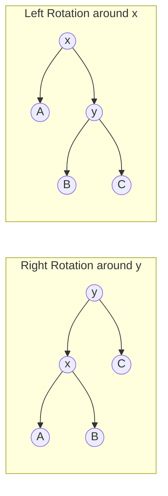

# UNIT-7: Balanced Binary Search Trees & AVL Trees
**Course:** Advanced Data Structures & Algorithms  
**Source & Curriculum:** MIT 6.006 (Introduction to Algorithms) — Lecture 6: Balanced Binary Search Trees  
**Professors:** Prof. Erik Demaine & Prof. Srini Devadas (MIT EECS)  
**Scope:** The Need for Balance, AVL Invariant & Golden Ratio Proof, Rotation Primitives, Insert & Delete Mechanics, Taxonomy of Balanced Trees, and ADT vs. Data Structure Paradigms  

---

## Table of Contents
1. [The Problem of Unbalanced BSTs & The Need for Balance](#1-the-problem-of-unbalanced-bsts--the-need-for-balance)
2. [AVL Trees: Invariant, Definition & Balance Factor](#2-avl-trees-invariant-definition--balance-factor)
3. [Mathematical Proof of Logarithmic Height (Fibonacci Bound)](#3-mathematical-proof-of-logarithmic-height-fibonacci-bound)
4. [Tree Rotations: The Rebalancing Primitives](#4-tree-rotations-the-rebalancing-primitives)
5. [AVL Insertion: The Four Imbalance Cases](#5-avl-insertion-the-four-imbalance-cases)
6. [Comprehensive Step-by-Step AVL Insertion Trace](#6-comprehensive-step-by-step-avl-insertion-trace)
7. [AVL Deletion: The Propagation Phenomenon](#7-avl-deletion-the-propagation-phenomenon)
8. [AVL Sort & Algorithmic Complexity Bounds](#8-avl-sort--algorithmic-complexity-bounds)
9. [The Landscape of Balanced Search Trees](#9-the-landscape-of-balanced-search-trees)
10. [The Big Picture: Abstract Data Types (ADT) vs. Data Structures](#10-the-big-picture-abstract-data-types-adt-vs-data-structures)
11. [Complete C Implementation of AVL Tree](#11-complete-c-implementation-of-avl-tree)
12. [Exam Revision Cheat Sheet & Practice Problems](#12-exam-revision-cheat-sheet--practice-problems)

---

## 1. The Problem of Unbalanced BSTs & The Need for Balance

### 1.1 Recall: Binary Search Tree (BST) Properties
A standard **Binary Search Tree** is a rooted binary tree where each node maintains:
- `key`: The stored data value.
- `left`: Pointer to the left child node.
- `right`: Pointer to the right child node.
- `parent`: Pointer to the parent node.

```text
Node Structure:
             [ Parent ]
                 |
                 v
             [  Key  ]
             /       \
      [ Left ]       [ Right ]
```

#### The BST Search Invariant:
For every node with key $x$:
- All keys in the **left subtree** are $\le x$ (or $< x$ for distinct key sets).
- All keys in the **right subtree** are $\ge x$ (or $> x$ for distinct key sets).

```text
                  ( x )
                 /     \
             (<= x)   (>= x)
```

---

### 1.2 Height Definition (CLRS Appendix B.5 Convention)
> **Height of a Node:** The length (measured as the **number of edges**) of the longest downward path from that node to a leaf.
- Height of a leaf node: $\text{height}(\text{leaf}) = 0$.
- Height of an empty / absent child: $\text{height}(\text{NIL}) = -1$.
- Height of any internal node:
  $$\text{height}(u) = 1 + \max\big(\text{height}(u.\text{left}), \, \text{height}(u.\text{right})\big)$$
- **Height of the Tree ($h$):** The height of its root node ($\text{height}(\text{root})$).

```text
Heights of Nodes in an Unbalanced BST:
                  (41) [h = 3]
                 /    \
        [h = 2] (20)   (65) [h = 1]
               /   \       \
      [h = 0] (11) (29)     (50) [h = 0]
                   / [h = 1]
                 (26) [h = 0]
```

---

### 1.3 The Run-Time Dependency on Height
Every fundamental dynamic set operation supported by a BST runs in **$O(h)$ time**, where $h$ is the height of the tree:
- `Search(x)`
- `Insert(x)`
- `Delete(x)`
- `Minimum()` / `Maximum()`
- `Successor(x)` (next-larger key)
- `Predecessor(x)` (next-smaller key)

#### The Height Spectrum:

```text
Best Case (Perfect Balance):               Worst Case (Degenerate Skewed Path):
             ( )                                     ( )
           /     \                                    \
         ( )     ( )                                  ( )
        /   \   /   \                                   \
       ()   () ()   ()                                  ( )
                                                          \
     Height h = floor(lg n)                               ( )
     Search: O(lg n)                                 Height h = n - 1
                                                     Search: O(n) (Linear chain!)
```

$$\lfloor \lg n \rfloor \le h \le n - 1$$

- If keys are inserted in sorted order ($1, 2, 3, 4, 5$), a naive BST degrades into a linear linked list where $h = n - 1$, destroying search efficiency ($O(n)$).
- **Core Motivation for Balanced BSTs:** Enforce a structural invariant so that the height is dynamically guaranteed to remain **$h = O(\lg n)$** under arbitrary sequences of insertions and deletions, ensuring all operations execute in strictly **$O(\lg n)$** worst-case time.

---

## 2. AVL Trees: Invariant, Definition & Balance Factor

### 2.1 Historical Discovery
Invented in **1962** by Soviet mathematicians **Georgy Adel'son-Vel'skii and Evgenii Landis**, the **AVL Tree** was the world's first self-balancing binary search tree.

---

### 2.2 The AVL Balance Invariant
> **The AVL Property:** For **every node** in the tree, the heights of its left and right child subtrees may differ by **at most $\pm 1$**.

$$\text{Balance Factor } BF(u) = \text{height}(u.\text{left}) - \text{height}(u.\text{right})$$
$$\text{Valid AVL Condition: } \quad BF(u) \in \{-1, \, 0, \, +1\}$$

```text
                  ( u )
                 /     \
               /         \
         [ Left ]       [ Right ]
         Height: k-1    Height: k        ===> BF(u) = (k-1) - k = -1  (VALID)
```

- If $BF(u) = +1$: Node $u$ is **left-heavy**.
- If $BF(u) = 0$: Node $u$ is **perfect-balanced**.
- If $BF(u) = -1$: Node $u$ is **right-heavy**.
- If $|BF(u)| \ge 2$: The node is **out of balance** and violates the AVL property; rotations must be triggered.

---

### 2.3 Data Structure Augmentation
To maintain balance in $O(\lg n)$ time without recomputing heights from scratch, each node stores its own height as an augmented attribute:

```c
struct AVLNode {
    int key;
    int height; // Augmented field storing height of subtree
    struct AVLNode *left;
    struct AVLNode *right;
    struct AVLNode *parent;
};
```
*(Alternatively, a 2-bit field can be used to store only the balance factor $\{-1, 0, +1\}$).*

---

## 3. Mathematical Proof of Logarithmic Height (Fibonacci Bound)

How do we prove mathematically that restricting $|BF| \le 1$ guarantees $h = O(\lg n)$?

### 3.1 Worst-Case (Minimal) AVL Tree Analysis
To find the maximum possible height for a given number of nodes $n$, we analyze the opposite question: **What is the minimum number of nodes ($N_h$) required to construct an AVL tree of height $h$?**

The worst-case (most sparse) AVL tree occurs when every node along the critical path has a balance factor of $\pm 1$. Therefore, an AVL tree of height $h$ must have one child of height $h - 1$ and the other child of height $h - 2$:

$$N_h = N_{h-1} + N_{h-2} + 1$$

#### Base Cases (using $\text{height}(\text{NIL}) = -1$):
- $N_{-1} = 0$ (empty tree)
- $N_0 = 1$ (single root node)
- $N_1 = N_0 + N_{-1} + 1 = 1 + 0 + 1 = 2$
- $N_2 = N_1 + N_0 + 1 = 2 + 1 + 1 = 4$
- $N_3 = N_2 + N_1 + 1 = 4 + 2 + 1 = 7$
- $N_4 = N_3 + N_2 + 1 = 7 + 4 + 1 = 12$

```text
Minimal AVL Trees (Fibonacci Trees):
h = 0:       h = 1:          h = 2:                 h = 3:
 (o)          (o)             (o)                    (o)
             /               /   \                  /   \
           (o)             (o)   (o)              (o)   (o)
                          /                      /   \    \
                        (o)                    (o)   (o)  (o)
                                               /
                                             (o)
Nodes: 1     Nodes: 2        Nodes: 4               Nodes: 7
```

---

### 3.2 Lower Bounding $N_h$
Since $N_{h-1} > N_{h-2}$:
$$N_h = N_{h-1} + N_{h-2} + 1 > 2 N_{h-2}$$
$$N_h > 2 N_{h-2} > 4 N_{h-4} > \dots > 2^{h/2}$$
Taking logarithms of both sides:
$$\lg N_h > \frac{h}{2} \implies h < 2 \lg N_h$$

This elementary inequality immediately establishes that **$h = O(\lg n)$**.

---

### 3.3 Exact Closed-Form via the Golden Ratio ($\phi$)
Notice the recurrence $N_h = N_{h-1} + N_{h-2} + 1$ is related to the **Fibonacci sequence** ($F_0 = 0, F_1 = 1, F_2 = 1, F_3 = 2, F_4 = 3, F_5 = 5, \dots$):

By mathematical induction:
$$N_h = F_{h+3} - 1$$
*(Check: $N_0 = F_3 - 1 = 2 - 1 = 1$; $N_1 = F_4 - 1 = 3 - 1 = 2$; $N_2 = F_5 - 1 = 5 - 1 = 4$; $N_3 = F_6 - 1 = 8 - 1 = 7$).*

By Binet's Fibonacci formula, $F_k \approx \frac{\phi^k}{\sqrt{5}}$, where $\phi = \frac{1 + \sqrt{5}}{2} \approx 1.61803$ (the **Golden Ratio**):

$$n \ge N_h > \frac{\phi^{h+2}}{\sqrt{5}} - 1$$
$$n + 1 > \frac{\phi^{h+2}}{\sqrt{5}}$$
$$\log_\phi(n + 1) > h + 2 - \log_\phi(\sqrt{5})$$
$$h < \log_\phi n \approx \frac{\lg n}{\lg \phi} \approx \frac{\lg n}{0.69424} \approx \mathbf{1.4404 \, \lg n}$$

> [!IMPORTANT]
> **Key Theoretical Bound:**
> An AVL tree's maximum height is strictly bounded by:
> $$h < 1.440 \lg n$$
> This means an AVL tree is at most **$44\%$ taller than a perfectly balanced complete binary tree** ($\lg n$), guaranteeing strict $O(\lg n)$ operation bounds.

---

## 4. Tree Rotations: The Rebalancing Primitives

When an insertion or deletion unbalances a node ($|BF| = 2$), we restore the AVL property using **Rotations**.
- A rotation is a local pointer reassignment taking **$O(1)$ constant time**.
- Rotations preserve the **BST Inorder Traversal Property**:
  $$\text{Inorder Sequence: } A < x < B < y < C$$



---

### 4.1 Right Rotation (`Right-Rotate(y)`)
Used when node $y$ is left-heavy ($BF = +2$).

```text
         ( y )                              ( x )
        /     \        Right-Rotate(y)     /     \
      ( x )    C      ================>   A      ( y )
     /     \                                    /     \
    A       B                                  B       C
```
**Pointer Adjustments:**
1. Let $x = y.\text{left}$.
2. Set $y.\text{left} = x.\text{right}$ (subtree $B$).
3. Set $x.\text{right} = y$.
4. Update heights of $y$, then $x$.

---

### 4.2 Left Rotation (`Left-Rotate(x)`)
Used when node $x$ is right-heavy ($BF = -2$).

```text
      ( x )                                  ( y )
     /     \           Left-Rotate(x)       /     \
    A      ( y )      ================>   ( x )    C
          /     \                        /     \
         B       C                      A       B
```
**Pointer Adjustments:**
1. Let $y = x.\text{right}$.
2. Set $x.\text{right} = y.\text{left}$ (subtree $B$).
3. Set $y.\text{left} = x$.
4. Update heights of $x$, then $y$.

---

## 5. AVL Insertion: The Four Imbalance Cases

### 5.1 Insertion Workflow
1. Perform standard BST insertion to place the new key at a leaf slot ($O(\lg n)$).
2. Trace the path from the newly inserted node upwards toward the root, updating node heights.
3. Identify the **lowest ancestor $x$** that violates the balance invariant ($|BF(x)| = 2$).
4. Apply the corresponding rebalancing rotation.

---

### 5.2 The Four Disjoint Cases

```text
Case 1: Left-Left (LL) Heavy    ---> Single Right-Rotate(x)
Case 2: Right-Right (RR) Heavy  ---> Single Left-Rotate(x)
Case 3: Left-Right (LR) Heavy   ---> Double Rotation: Left-Rotate(x.left), then Right-Rotate(x)
Case 4: Right-Left (RL) Heavy   ---> Double Rotation: Right-Rotate(x.right), then Left-Rotate(x)
```

---

#### Case 1: Right-Right (RR) Imbalance (Single Left Rotation)
- **Condition:** Node $x$ has $BF(x) = -2$, and its right child $y$ has $BF(y) \le 0$ (right-heavy or balanced).

```text
        ( x ) [k+2]                               ( y ) [k+1]
       /     \                                   /     \
    [A]       ( y ) [k+1]   Left-Rotate(x)    ( x ) [k] [C] [k]
   (k-1)     /     \       ==============>   /     \
           [B]     [C]                      [A]   [B]
          (k-1)    (k)                     (k-1) (k-1)
```

---

#### Case 2: Right-Left (RL) Imbalance (Double Rotation)
- **Condition:** Node $x$ has $BF(x) = -2$, but its right child $z$ is left-heavy ($BF(z) = +1$).
- **Resolution:**
  1. Rotate right around child $z$ to transform the structure into an RR case.
  2. Rotate left around $x$.

```text
        ( x )                               ( x )                               ( y )
       /     \                             /     \                             /     \
      A       ( z )      Right-Rotate(z)  A       ( y )      Left-Rotate(x)  ( x )   ( z )
             /     \    ================>        /     \    ================> /   \   /   \
           ( y )    D                           B      ( z )                 A     B C     D
          /     \                                     /     \
         B       C                                   C       D
```

---

> [!TIP]
> **Single vs. Double Rotation Invariant for Insert:**
> After applying **at most one** rotation (single or double) at the lowest unbalanced node $x$, the height of that subtree returns to its exact value prior to insertion. Consequently, **no further ancestor can be unbalanced**. Insertion requires **at most 2 rotations** ($O(1)$ rebalancing steps)!

---

## 6. Comprehensive Step-by-Step AVL Insertion Trace

*(Directly derived from MIT 6.006 Lecture 6, Figure 7)*

### Initial Tree State:
Keys in tree: $\{41, 20, 11, 29, 26, 65, 50\}$

```text
                  (41) [h=3]
                 /    \
         [h=2] (20)   (65) [h=1]
               /  \       \
       [h=0] (11) (29)    (50) [h=0]
                  / [h=1]
                (26) [h=0]
```

---

### Step 1: Insert Key `23`

1. **BST Placement:**
   - $23 < 41 \to 23 > 20 \to 23 < 29 \to 23 < 26$.
   - Insert $23$ as **left child** of node `26`.

2. **Height & Balance Updates (Bottom-Up):**
   - Node `23`: $\text{height} = 0$.
   - Node `26`: left height $0$, right height $-1 \implies \text{height} = 1, BF = +1$.
   - Node `29`: left child `26` has height $1$, right child is NIL (height $-1$).
     $$BF(29) = 1 - (-1) = \mathbf{+2} \quad \text{(VIOLATION at } x = 29\text{!)}$$
   - Child `26` has $BF(26) = +1 \implies$ **Left-Left (LL) Case**!

3. **Rebalancing Action: `Right-Rotate(29)`**

```text
Before Rotation at 29:                       After Right-Rotate(29):
            (29) [BF = +2]                             (26) [h = 1]
           /                                          /    \
        (26) [BF = +1]             =====>          (23)    (29)
        /                                          [h=0]   [h=0]
     (23) [h = 0]
```

4. **Resulting Subtree:** Node `20` now has right child `26`, whose children are `23` and `29`. The subtree height at `26` is $1$ (same as `29` before insertion). Tree is fully balanced!

---

### Step 2: Insert Key `55`

1. **BST Placement:**
   - $55 > 41 \to 55 < 65 \to 55 > 50$.
   - Insert $55$ as **right child** of node `50`.

2. **Height & Balance Updates (Bottom-Up):**
   - Node `55`: $\text{height} = 0$.
   - Node `50`: left height $-1$, right height $0 \implies \text{height} = 1, BF = -1$.
   - Node `65`: left child `50` has height $1$, right child is NIL (height $-1$).
     $$BF(65) = 1 - (-1) = \mathbf{+2} \quad \text{(VIOLATION at } x = 65\text{!)}$$
   - Check child `50`: $BF(50) = -1$ (right-heavy).
   - This is the **Left-Right (LR) Case** at $x = 65$!

3. **Rebalancing Action: Double Rotation**
   - **Step 2a: `Left-Rotate(50)`**
     Transforms the left child into left-heavy: `55` becomes parent of `50`.
   - **Step 2b: `Right-Rotate(65)`**
     Brings `55` to the top; `50` becomes left child, `65` becomes right child.

```text
Before Rebalance:          Step 2a: Left-Rotate(50)      Step 2b: Right-Rotate(65)
      (65) [BF = +2]                 (65)                          (55) [h = 1]
     /                              /                             /    \
  (50) [BF = -1]      =====>     (55)             =====>       (50)    (65)
     \                           /                             [h=0]   [h=0]
     (55)                      (50)
```

4. **Final Balanced Tree:**
```text
                        (41) [h = 3]
                      /      \
              [h=2] (20)     (55) [h = 1]
                    /  \     /  \
            [h=0] (11) (26) (50)(65)
                       /  \
                     (23) (29)
```

---

## 7. AVL Deletion: The Propagation Phenomenon

### 7.1 Deletion Mechanism
1. Perform standard BST deletion:
   - If node has $0$ children: delete directly.
   - If node has $1$ child: splice child to parent.
   - If node has $2$ children: swap with **inorder successor** (or predecessor) and delete that node.
2. Walk up the ancestor chain to the root, decrementing heights and checking balance factors.

---

### 7.2 Why Deletion Can Cause $O(\lg n)$ Rotations
Unlike insertion (where a single rotation restores the pre-insertion subtree height), **deletion reduces the height of a subtree**.

```text
1. Node deleted in subtree T.
2. Height of T decreases by 1.
3. Parent P becomes unbalanced (BF = +/- 2).
4. Rotation at P restores local balance, BUT the height of the entire P-subtree 
   has now decreased by 1 relative to P's parent!
5. This height deficit ripples up to grandparent, great-grandparent...
```

- In the worst case (a Fibonacci tree), rebalancing cascades through every ancestor up to the root.
- **Maximum rotations during insertion:** $\le 2$ ($O(1)$).
- **Maximum rotations during deletion:** $\le 2 \times h = O(\lg n)$.
- However, since each rotation takes $O(1)$, **total deletion time remains strictly $O(\lg n)$**.

---

## 8. AVL Sort & Algorithmic Complexity Bounds

AVL trees can be utilized as a comparison-based sorting engine (**AVL Sort**):

```text
Algorithm AVL-Sort(Array A of n elements):
1. Create an empty AVL tree T.
2. For each element x in A:
       Insert x into T.                  // Takes Theta(lg k) for k-th item
   Total insertion time = sum_{k=1}^n lg k = Theta(n lg n)
3. Perform In-Order Traversal of T:
       Output keys sequentially.         // Takes Theta(n) time
4. Total Run Time = Theta(n lg n) + Theta(n) = Theta(n lg n)
```

- **Comparison Sorting Lower Bound:** Any comparison-based sorting algorithm requires $\Omega(n \lg n)$ comparisons in the worst case (via decision tree lower bound: $\lg(n!) \approx n \lg n - n \lg e$).
- **Conclusion:** AVL Sort is **asymptotically optimal**!

---

## 9. The Landscape of Balanced Search Trees

| Data Structure | Authors & Year | Balancing Mechanism | Worst-Case Height | Invariant Guarantee |
|---|---|---|:---:|---|
| **AVL Trees** | Adel'son-Vel'skii & Landis (1962) | Heights of sibling subtrees differ by $\le 1$ | **$1.44 \lg n$** | Strict worst-case $O(\lg n)$. |
| **B-Trees / 2-3-4 Trees** | Bayer & McCreight (1972) | Multi-way branching; all leaves at identical depth | $O(\log_B n)$ | Designed for block storage & disk I/O. |
| **BB$[\alpha]$ Trees** | Nievergelt & Reingold (1973) | Weight-balanced based on subtree sizes | $O(\lg n)$ | Balances based on operational frequencies. |
| **Red-Black Trees** | Bayer (1972) / Guibas & Sedgewick (1978) | Color tags (Red/Black); no path $> 2 \times$ shortest path | **$2.00 \lg n$** | Looser balance than AVL; faster inserts/deletes. |
| **Splay Trees** | Sleator & Tarjan (1985) | Splaying accessed nodes to root via rotations | $O(n)$ worst, **$O(\lg n)$ amortized** | Self-optimizing for locality of access. |
| **Skip Lists** | Pugh (1989) | Probabilistic multi-level linked forward pointers | $O(\lg n)$ with high probability | Simple lock-free concurrency. |
| **Scapegoat Trees** | Galperin & Rivest (1993) | Rebuilds unbalanced subtrees from scratch | $O(\lg n)$ worst-case lookup | Zero per-node memory overhead. |
| **Treaps** | Seidel & Aragon (1996) | Dual BST on keys + Min-Heap on randomized priorities | $O(\lg n)$ with high probability | Cartesian tree mapping. |

---

## 10. The Big Picture: Abstract Data Types (ADT) vs. Data Structures

A fundamental theme in computer science is the separation of interface and implementation:
- **Abstract Data Type (ADT):** The semantic contract or interface specification (what operations are supported and what they mean).
- **Data Structure (DS):** The concrete algorithmic representation and layout in memory (how operations are achieved).

---

### Comparison 1: Priority Queue ADT Implementations

$$\text{Operations: } \text{insert}(x), \, \text{deletemin}(), \, \text{findmin}()$$

| Priority Queue Operation | Binary Heap | AVL Tree |
|---|:---:|:---:|
| `new-empty-queue()` | $\Theta(1)$ | $\Theta(1)$ |
| `insert(x)` | $\Theta(\lg n)$ | $\Theta(\lg n)$ |
| `deletemin()` | $\Theta(\lg n)$ | $\Theta(\lg n)$ |
| `findmin()` | $\mathbf{\Theta(1)}$ | $\Theta(\lg n) \xrightarrow{\text{augmented with min pointer}} \mathbf{\Theta(1)}$ |

---

### Comparison 2: Predecessor / Successor ADT Implementations

$$\text{Operations: } \text{insert}(x), \, \text{delete}(x), \, \text{predecessor}(x), \, \text{successor}(x)$$

| Operation | Binary Heap | AVL Tree |
|---|:---:|:---:|
| `new-empty()` | $\Theta(1)$ | $\Theta(1)$ |
| `insert(x)` | $\Theta(\lg n)$ | $\Theta(\lg n)$ |
| `delete(x)` | $\Theta(\lg n)$ | $\Theta(\lg n)$ |
| `predecessor(x)` (next-smaller) | $\mathbf{\Theta(n)}$ *(Must scan entire array!)* | $\mathbf{\Theta(\lg n)}$ |
| `successor(x)` (next-larger) | $\mathbf{\Theta(n)}$ *(Must scan entire array!)* | $\mathbf{\Theta(\lg n)}$ |

> [!CAUTION]
> **Why Heaps Cannot Replace Balanced BSTs:**
> A Binary Heap maintains only a partial ancestral ordering (parent $\le$ child), providing no information about relative left-right order. Finding the predecessor or successor in a Heap requires an exhaustive linear scan ($\Theta(n)$). An AVL Tree maintains total order, supporting predecessor and successor queries in $\Theta(\lg n)$ time!

---

## 11. Complete C Implementation of AVL Tree

```c
#include <stdio.h>
#include <stdlib.h>

struct Node {
    int key;
    struct Node *left;
    struct Node *right;
    int height;
};

// Utility to get height (handles NULL)
int height(struct Node *n) {
    if (n == NULL) return -1;
    return n->height;
}

int max(int a, int b) {
    return (a > b) ? a : b;
}

struct Node* newNode(int key) {
    struct Node* node = (struct Node*)malloc(sizeof(struct Node));
    node->key = key;
    node->left = NULL;
    node->right = NULL;
    node->height = 0; // Leaf has height 0
    return node;
}

// Right rotation around y
struct Node* rightRotate(struct Node *y) {
    struct Node *x = y->left;
    struct Node *T2 = x->right;

    // Perform rotation
    x->right = y;
    y->left = T2;

    // Update heights
    y->height = max(height(y->left), height(y->right)) + 1;
    x->height = max(height(x->left), height(x->right)) + 1;

    return x; // New root
}

// Left rotation around x
struct Node* leftRotate(struct Node *x) {
    struct Node *y = x->right;
    struct Node *T2 = y->left;

    // Perform rotation
    y->left = x;
    x->right = T2;

    // Update heights
    x->height = max(height(x->left), height(x->right)) + 1;
    y->height = max(height(y->left), height(y->right)) + 1;

    return y; // New root
}

// Get Balance Factor
int getBalance(struct Node *n) {
    if (n == NULL) return 0;
    return height(n->left) - height(n->right);
}

// Recursive Insert
struct Node* insert(struct Node* node, int key) {
    // 1. Standard BST insertion
    if (node == NULL)
        return newNode(key);

    if (key < node->key)
        node->left = insert(node->left, key);
    else if (key > node->key)
        node->right = insert(node->right, key);
    else
        return node; // Duplicate keys not allowed

    // 2. Update height of current ancestor
    node->height = 1 + max(height(node->left), height(node->right));

    // 3. Check balance factor
    int balance = getBalance(node);

    // Case 1: Left-Left (LL)
    if (balance > 1 && key < node->left->key)
        return rightRotate(node);

    // Case 2: Right-Right (RR)
    if (balance < -1 && key > node->right->key)
        return leftRotate(node);

    // Case 3: Left-Right (LR)
    if (balance > 1 && key > node->left->key) {
        node->left = leftRotate(node->left);
        return rightRotate(node);
    }

    // Case 4: Right-Left (RL)
    if (balance < -1 && key < node->right->key) {
        node->right = rightRotate(node->right);
        return leftRotate(node);
    }

    return node;
}

// Find node with minimum key
struct Node* minValueNode(struct Node* node) {
    struct Node* current = node;
    while (current->left != NULL)
        current = current->left;
    return current;
}

// Recursive Deletion
struct Node* deleteNode(struct Node* root, int key) {
    if (root == NULL) return root;

    if (key < root->key)
        root->left = deleteNode(root->left, key);
    else if (key > root->key)
        root->right = deleteNode(root->right, key);
    else {
        // Node with only one child or no child
        if ((root->left == NULL) || (root->right == NULL)) {
            struct Node *temp = root->left ? root->left : root->right;
            if (temp == NULL) { // No child
                temp = root;
                root = NULL;
            } else { // One child
                *root = *temp;
            }
            free(temp);
        } else {
            // Node with two children: get inorder successor
            struct Node* temp = minValueNode(root->right);
            root->key = temp->key;
            root->right = deleteNode(root->right, temp->key);
        }
    }

    if (root == NULL) return root;

    // 2. Update height
    root->height = 1 + max(height(root->left), height(root->right));

    // 3. Balance checking
    int balance = getBalance(root);

    // Left-Left
    if (balance > 1 && getBalance(root->left) >= 0)
        return rightRotate(root);

    // Left-Right
    if (balance > 1 && getBalance(root->left) < 0) {
        root->left = leftRotate(root->left);
        return rightRotate(root);
    }

    // Right-Right
    if (balance < -1 && getBalance(root->right) <= 0)
        return leftRotate(root);

    // Right-Left
    if (balance < -1 && getBalance(root->right) > 0) {
        root->right = rightRotate(root->right);
        return leftRotate(root);
    }

    return root;
}
```

---

## 12. Exam Revision Cheat Sheet & Practice Problems

### Master Formulas & Properties:
- **Balance Factor Formula:** $BF(u) = \text{height}(u.\text{left}) - \text{height}(u.\text{right}) \in \{-1, 0, +1\}$.
- **Minimal Nodes Recurrence:** $N_h = N_{h-1} + N_{h-2} + 1 = F_{h+3} - 1$.
- **Maximum Height Bound:** $h < 1.440 \lg n$.
- **Insertion Rotation Bound:** At most **$1$ rotation** (single or double).
- **Deletion Rotation Bound:** Up to **$O(\lg n)$ rotations**.

---

### Practice Problem 1: Minimum Nodes for Height $h = 4$
**Question:** What is the minimum number of nodes required to construct an AVL tree of height $4$?  
**Solution:**
Using the recurrence $N_h = N_{h-1} + N_{h-2} + 1$:
- $N_0 = 1$
- $N_1 = 2$
- $N_2 = 2 + 1 + 1 = 4$
- $N_3 = 4 + 2 + 1 = 7$
- $N_4 = 7 + 4 + 1 = \mathbf{12}$ nodes!

---

### Practice Problem 2: Identify the Rotation Case
**Question:** In an AVL tree, node $X$ has $BF(X) = -2$, and its right child $Y$ has $BF(Y) = +1$. Which sequence of rotations will restore balance?  
**Answer:** This is the **Right-Left (RL) Case**. It requires a double rotation:
1. `Right-Rotate(Y)` on the right child.
2. `Left-Rotate(X)` on node $X$.
