# Q.1 Describe the use of JRE and JVM in java 

## Describe the Use of JRE and JVM in Java

### Introduction

When studying Java, two core terms frequently surface: **JRE** (Java Runtime Environment) and **JVM** (Java Virtual Machine). Understanding these two components is essential because they form the operational foundation that allows Java code to execute across different operating systems. While the Java Development Kit (JDK) is used for writing and compiling code, the JRE and JVM are responsible for actually running it.

---

## Definition

### 1. Java Virtual Machine (JVM)

The **Java Virtual Machine (JVM)** is an abstract, specification-compliant computing machine that provides a runtime environment in which Java bytecode can be executed. It translates platform-agnostic bytecode (`.class` files) into machine-specific native instructions understandable by the underlying host operating system and hardware.

### 2. Java Runtime Environment (JRE)

The **Java Runtime Environment (JRE)** is a software bundle packaged by Oracle (or other OpenJDK providers) that provides the minimum requirements needed to execute a Java application. It physically packs the **JVM**, core class libraries (`java.lang`, `java.util`, etc.), and supporting runtime files.

---

## Detailed Explanation

### Purpose and Importance of JVM

* **Platform Independence ("Write Once, Run Anywhere"):** The JVM acts as a software-based interpreter/compiler layer between compiled Java bytecode and the host operating system (Windows, Linux, macOS). Because every OS has its own dedicated JVM implementation, the same bytecode runs universally without modification.
* **Memory Management & Garbage Collection:** The JVM allocates memory dynamically (Heap and Stack areas) and runs automated background daemon threads (Garbage Collectors) to deallocate unreferenced objects, preventing memory leaks.
* **Bytecode Verification:** Before executing code, the JVM's bytecode verifier checks incoming code fragments for security breaches, illegal pointer manipulation, or stack over/underflows.

### Purpose and Importance of JRE

* **Execution Package:** While the JVM executes instructions, it cannot do so in a vacuum. It requires pre-built packages, libraries, and property settings. The JRE supplies this complete operational context.
* **End-User Distribution:** JRE is intended for end-users who only want to run Java applications or applets, rather than develop new ones (which would require the full JDK).

---

## Diagram

The following architecture diagram illustrates the nesting relationship and execution flow from source code through the JRE and JVM layers:

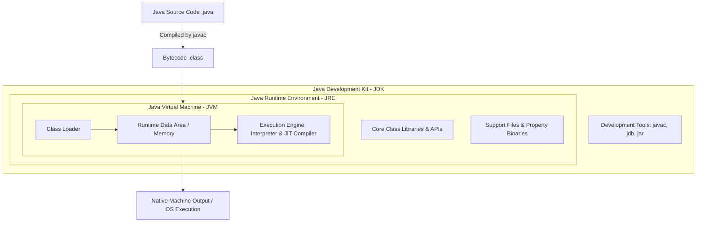

### Diagram Explanation

* **JDK contains JRE:** The development kit bundles everything needed to build software, including compiler tools (`javac`).
* **JRE contains JVM & Libraries:** The runtime environment bundles the core class libraries and the execution engine.
* **JVM executes Bytecode:** Inside the JVM, the Class Loader brings in compiled classes, memory areas store data, and the Execution Engine converts bytecode to native machine code.

---

## Syntax and Java Code Examples

To observe how the JRE and JVM interact during execution, consider a standard standalone application:

```java
public class RuntimeDemo {
    public static void main(String[] args) {
        // Fetching JVM system properties managed by the JRE runtime
        String javaVersion = System.getProperty("java.version");
        String osName = System.getProperty("os.name");
        String jvmName = System.getProperty("java.vm.name");

        System.out.println("--- JRE & JVM Environment Details ---");
        System.out.println("Operating System : " + osName);
        System.out.println("Java Version (JRE) : " + javaVersion);
        System.out.println("Virtual Machine (JVM): " + jvmName);
    }
}

```

### Code Breakdown

* `System.getProperty(...)`: Queries environmental configurations managed dynamically by the JRE libraries at runtime.
* `java.vm.name`: Specifically requests the underlying virtual machine implementation name (typically the HotSpot VM).

---

## Output and Step-by-Step Execution

When compiled via `javac RuntimeDemo.java` and executed via `java RuntimeDemo` on a typical system, the terminal output appears as follows:

```text
--- JRE & JVM Environment Details ---
Operating System : Linux
Java Version (JRE) : 21.0.2
Virtual Machine (JVM): OpenJDK 64-Bit Server VM

```

### Execution Steps

1. **Class Loading:** The JVM's Class Loader reads `RuntimeDemo.class` bytecode into memory.
2. **Verification:** The Bytecode Verifier checks instruction validity.
3. **Execution:** The JVM interpreter and JIT compiler translate statements into native machine commands.
4. **Library Lookup:** Calls to `System.getProperty()` access pre-loaded core class library definitions bundled inside the JRE.

---

## Comparison Table: JDK vs. JRE vs. JVM

| Feature | JVM (Java Virtual Machine) | JRE (Java Runtime Environment) | JDK (Java Development Kit) |
| --- | --- | --- | --- |
| **Primary Role** | Executes compiled Java bytecode line-by-line. | Provides the environment to run Java programs. | Provides tools to write, compile, and debug Java code. |
| **Includes** | Bytecode verifier, interpreter, JIT compiler, memory heap. | JVM + Core Libraries + Support files. | JRE + Development tools (`javac`, `jdb`, `javap`). |
| **Platform Independent?** | No (Each OS has a specific JVM implementation). | No (Tied to a specific OS architecture). | No (Tied to target OS platform). |
| **Target Audience** | Software execution engines. | End-users running Java apps. | Java developers and programmers. |

---

## Important Points to Remember

* **JVM is an instance/implementation:** It provides runtime isolation, security verification, and garbage collection.
* **JRE is a superset of JVM:** It bundles the JVM along with standard Java class libraries required for execution.
* **Independence:** You cannot run Java bytecode without a JRE/JVM, and you cannot compile source code (`.java` to `.class`) without a JDK.

---

## Conclusion

The **JVM** and **JRE** work together to achieve Java's cross-platform goal. The JVM acts as the runtime engine executing instructions and managing memory, while the JRE wraps around the JVM to provide the necessary libraries and configurations required to launch Java software smoothly on any host machine.

---

## References

* **Java Virtual Machine Specification**, Oracle Documentation.
* **Overview of the Java Virtual Machine**, Wikipedia OpenJDK Resources.
* **JRE Components and Architecture**, Oracle Solaris Developer's Guide.

# Q2. Explain the Features of java in detail. 

## Explain the Features of Java in Detail

### Introduction

Java is one of the most widely adopted, high-level, class-based, object-oriented programming languages. First released by Sun Microsystems (now owned by Oracle) in 1995, Java was designed with a specific philosophy summarized by its famous slogan: **"Write Once, Run Anywhere" (WORA)**.

To achieve platform independence, security, robustness, and high performance, Java incorporates a unique combination of language design features and runtime architecture.

---

## Definition

Java features refer to the core design principles, structural capabilities, and execution characteristics that define how Java programs are written, compiled, and executed. These features distinguish Java from procedural languages like C and provide a secure, portable, and high-performance environment for enterprise application development.

---

## Detailed Explanation of Java Features

The key features of Java can be categorized into several major pillars:

### 1. Simple, Familiar, and Easy to Learn

* Java was designed to be easy for professional programmers to learn and use effectively.
* It borrows much of its syntax from **C and C++**, making it intuitive. However, Java removed complex and unsafe features such as **explicit pointer arithmetic**, **operator overloading**, and **multiple inheritance of classes**, replacing them with cleaner alternatives like references and interfaces.

### 2. Object-Oriented (OOP)

Java is a pure object-oriented language (except for primitive data types). Everything in Java is structured around objects and classes. Its primary OOP pillars are:

* **Encapsulation:** Wrapping data and methods into a single unit.
* **Inheritance:** Reusing existing code properties across parent-child class hierarchies.
* **Polymorphism:** Enabling a single interface or method to represent different underlying forms (via method overloading and overriding).
* **Abstraction:** Hiding complex implementation details and showing only essential features.

### 3. Platform Independent and Portable ("Write Once, Run Anywhere")

* Unlike languages like C++, which compile source code directly into machine-specific native code, Java compiles source code (`.java`) into an intermediate, platform-neutral format called **Bytecode** (`.class`).
* This bytecode is not tied to any specific operating system or hardware architecture. Any machine equipped with a **Java Virtual Machine (JVM)** can interpret or compile this bytecode into native machine instructions at runtime, making Java truly portable across Windows, Linux, macOS, and embedded devices.

### 4. Architecture-Neutral

Java bytecode is completely architecture-neutral. It does not assume a specific CPU word size, memory layout, or processor architecture. A `.class` file generated on a 64-bit Linux server runs identically on a different hardware configuration as long as a compliant JVM is installed.

### 5. Robust and Reliable

Java places a heavy emphasis on early checking for potential errors, eliminating error-prone situations by taking strict compile-time and runtime safety measures:

* **Strong Memory Management:** Unlike C/C++, Java does not give programmers direct access to memory addresses via pointers, preventing memory corruption.
* **Automatic Garbage Collection:** The JVM handles memory deallocation in the background, reclaiming memory from unreferenced objects to prevent memory leaks.
* **Exceptional Exception Handling:** Java enforces structured error handling via `try`, `catch`, `finally`, and `throws` blocks, preventing abrupt application crashes.
* **Strong Type Checking:** Java is a strongly typed language, catching type mismatch errors at compile time.

### 6. Secure

Java is designed for networked and distributed environments, making security a primary design goal:

* **No Pointers:** Because Java lacks direct pointer manipulation, programs cannot maliciously access arbitrary memory locations or compromise system security.
* **Bytecode Verifier:** Before running bytecode, the JVM's verifier inspects code fragments for illegal code constructs, stack overflows, or unauthorized access violations.
* **Security Manager (Sandbox):** Historically, Java applets and applications run inside a secure sandbox environment that restricts access to local file systems, networks, and system resources.

### 7. High Performance

* Early versions of Java were purely interpreted, resulting in slower execution speeds compared to compiled languages like C++.
* Modern Java overcomes this through **Just-In-Time (JIT) compilation**. The JIT compiler monitors bytecode execution, identifies frequently executed blocks ("hot spots"), and compiles them directly into native machine code on-the-fly, enabling execution speeds comparable to native languages.

### 8. Distributed

* Java is designed for the internet and distributed computing. It includes extensive networking libraries (in the `java.net` package) that make it easy to handle TCP/IP sockets, HTTP connections, Remote Method Invocation (RMI), and distributed web services.

### 9. Multi-Threaded

* Java supports multi-threading out of the box. Developers can build concurrent programs containing multiple threads of execution running simultaneously.
* The language includes built-in synchronization mechanisms, thread lifecycle management (`java.lang.Thread`), and high-level concurrency utilities (`java.util.concurrent`), making it ideal for high-throughput server applications and multi-core processing.

### 10. Dynamic and Extensible

* Java is a dynamic language because it can adapt to evolving environments at runtime. It supports **dynamic class loading**, meaning classes are loaded into memory only when required during execution.
* It also supports reflection (`java.lang.reflect`), allowing programs to inspect and manipulate classes, interfaces, fields, and methods at runtime.

---

## Diagram

The following diagram illustrates how Java's architecture enables portability and platform independence:

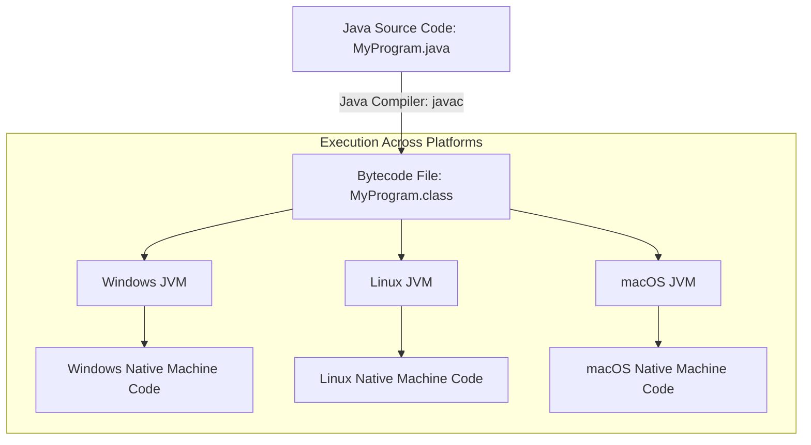

### Diagram Explanation

* **Compilation Phase:** The Java compiler (`javac`) converts human-readable `.java` source code into platform-independent `.class` bytecode.
* **Execution Phase:** This single bytecode file can be distributed across different operating systems. Each OS uses its own tailored JVM implementation to translate the bytecode into native machine instructions specific to that hardware.

---

## Syntax and Java Code Examples

To demonstrate several core Java features in a single program—such as Object-Oriented principles, multi-threading, and robust exception handling—consider the following example:

```java
// A simple class demonstrating OOP and multi-threading features
class WorkerThread extends Thread {
    private String taskName;

    public WorkerThread(String taskName) {
        this.taskName = taskName;
    }

    @Override
    public void run() {
        try {
            System.out.println(taskName + " is running on a separate thread.");
            // Simulate processing time
            Thread.sleep(500);
            System.out.println(taskName + " has completed successfully.");
        } catch (InterruptedException e) {
            // Robust exception handling
            System.err.println("Thread interrupted: " + e.getMessage());
        }
    }
}

public class JavaFeaturesDemo {
    public static void main(String[] args) {
        System.out.println("--- Starting Java Multi-threaded Application ---");

        // Creating and starting multiple threads concurrently
        WorkerThread worker1 = new WorkerThread("Task-Alpha");
        WorkerThread worker2 = new WorkerThread("Task-Beta");

        worker1.start();
        worker2.start();
    }
}

```

### Code Breakdown

* `class WorkerThread extends Thread`: Demonstrates object-oriented inheritance and multi-threading capabilities.
* `@Override`: A language annotation ensuring compile-time safety when overriding parent class methods.
* `try-catch block`: Demonstrates robust exception handling by catching `InterruptedException`.
* `worker1.start()`: Triggers concurrent execution paths managed by the JVM thread scheduler.

---

## Output and Step-by-Step Execution

When compiled and run, the output appears as follows (thread execution order may vary due to concurrent scheduling):

```text
--- Starting Java Multi-threaded Application ---
Task-Alpha is running on a separate thread.
Task-Beta is running on a separate thread.
Task-Alpha has completed successfully.
Task-Beta has completed successfully.

```

### Execution Steps

1. **Compilation:** `javac JavaFeaturesDemo.java` generates bytecode files (`JavaFeaturesDemo.class` and `WorkerThread.class`).
2. **Class Loading:** The JVM loads classes dynamically into memory.
3. **Execution:** The `main` method executes sequentially, instantiating and launching two independent worker threads.
4. **Concurrency:** The JVM schedules both threads to run concurrently alongside the main thread.

---

## Comparison Table: Java vs. Traditional Languages (C/C++)

| Feature | Java | C / C++ |
| --- | --- | --- |
| **Platform Independence** | Platform-independent (Write Once, Run Anywhere via JVM). | Platform-dependent (compiled directly to native machine code). |
| **Memory Management** | Automatic via Garbage Collector. | Manual via `malloc`/`free` (C) or `new`/`delete` (C++). |
| **Pointers** | No explicit pointer arithmetic (uses references). | Direct pointer manipulation supported (can lead to memory corruption). |
| **Inheritance Model** | Single class inheritance, multiple interface implementation. | Supports multiple class inheritance (C++). |
| **Execution Speed** | Accelerated via JIT compilation (near native speed). | Directly compiled to native code (typically faster out-of-the-box). |

---

## Important Points to Remember

* **WORA (Write Once, Run Anywhere):** Java code runs on any machine with a compatible JVM without recompilation.
* **Automatic Garbage Collection:** Relieves developers from manual memory management, eliminating common memory leaks.
* **No Pointers:** Enhances application security and stability by preventing arbitrary memory access.
* **JIT Compilation:** Combines the portability of interpretation with the speed of native compilation.

---

## Conclusion

Java’s enduring popularity stems from its robust feature set. By balancing object-oriented design, strict security controls, automatic memory management, and platform independence through the JVM, Java provides a reliable and scalable environment for everything from small embedded devices to massive enterprise cloud applications.

---

## References

* **The Java Language Specification**, Oracle Documentation. [Link](https://docs.oracle.com/javase/specs/)
* **Overview of Java Technology**, Oracle Java Documentation. [Link](https://docs.oracle.com/en/java/)
* **The Java Virtual Machine Specification**, Oracle Documentation.

# Q.3 Classify the different types of Inheritance in Java with examples 

## Classify the Different Types of Inheritance in Java with Examples

### Introduction

Inheritance is one of the foundational pillars of Object-Oriented Programming (OOP) in Java. It allows a new class (known as the **subclass** or **derived class**) to adopt the fields and methods of an existing class (known as the **superclass** or **base class**).

Inheritance promotes **code reusability**, establishes a natural hierarchical relationship between classes, and enables **polymorphism**. Java supports multiple ways of structuring these relationships, though it applies specific rules to maintain code clarity and prevent architectural complexity.

---

## Definition

**Inheritance** is an OOP mechanism where a class acquires the properties (attributes and behaviors) of another class.

In Java, inheritance is implemented using the `extends` keyword:

```java
class Subclass extends Superclass {
    // Additional fields and methods
}

```

---

## Classification of Inheritance in Java

Java supports specific types of inheritance based on how classes relate to one another:

1. **Single Inheritance**
2. **Multilevel Inheritance**
3. **Hierarchical Inheritance**
4. **Multiple Inheritance (via Interfaces)**
5. **Hybrid Inheritance (via Interfaces)**

> **Important Note on Multiple Class Inheritance:** Java **does not support multiple inheritance with classes** (i.e., a class cannot extend more than one class simultaneously) to avoid the "Diamond Problem" of conflicting method implementations. However, Java allows multiple inheritance of behavior through **Interfaces**.

---

## Detailed Explanation and Examples

### 1. Single Inheritance

In single inheritance, a single subclass inherits from a single superclass. This is the simplest and most common form of inheritance.

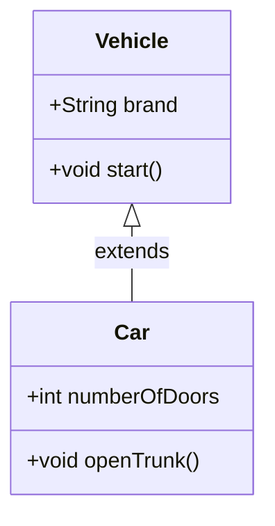

#### Java Code Example: Single Inheritance

```java
// Superclass
class Vehicle {
    String brand = "Generic Brand";

    public void start() {
        System.out.println("The vehicle is starting...");
    }
}

// Subclass extending Vehicle
class Car extends Vehicle {
    int numberOfDoors = 4;

    public void openTrunk() {
        System.out.println("Trunk opened for brand: " + brand);
    }
}

public class SingleInheritanceDemo {
    public static void main(String[] args) {
        Car myCar = new Car();
        myCar.start();      // Inherited method from Vehicle
        myCar.openTrunk();  // Defined in Car
        System.out.println("Doors: " + myCar.numberOfDoors);
    }
}

```

---

### 2. Multilevel Inheritance

In multilevel inheritance, a subclass is derived from another subclass, forming a chain of inheritance (Class C inherits from Class B, which in turn inherits from Class A).

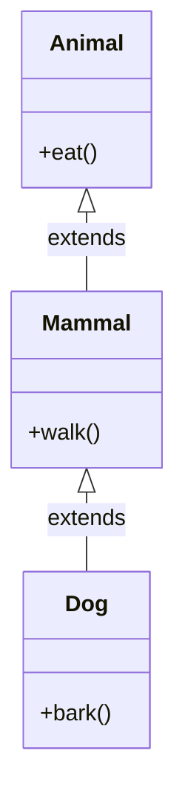

#### Java Code Example: Multilevel Inheritance

```java
class Animal {
    public void eat() {
        System.out.println("This animal eats food.");
    }
}

class Mammal extends Animal {
    public void walk() {
        System.out.println("This mammal walks on land.");
    }
}

class Dog extends Mammal {
    public void bark() {
        System.out.println("The dog barks: Woof! Woof!");
    }
}

public class MultilevelInheritanceDemo {
    public static void main(String[] args) {
        Dog myDog = new Dog();
        myDog.eat();   // Inherited from Animal via Mammal
        myDog.walk();  // Inherited from Mammal
        myDog.bark();  // Defined in Dog
    }
}

```

---

### 3. Hierarchical Inheritance

In hierarchical inheritance, multiple subclasses inherit from a single superclass. This is useful when several classes share common behavior defined in a parent class.

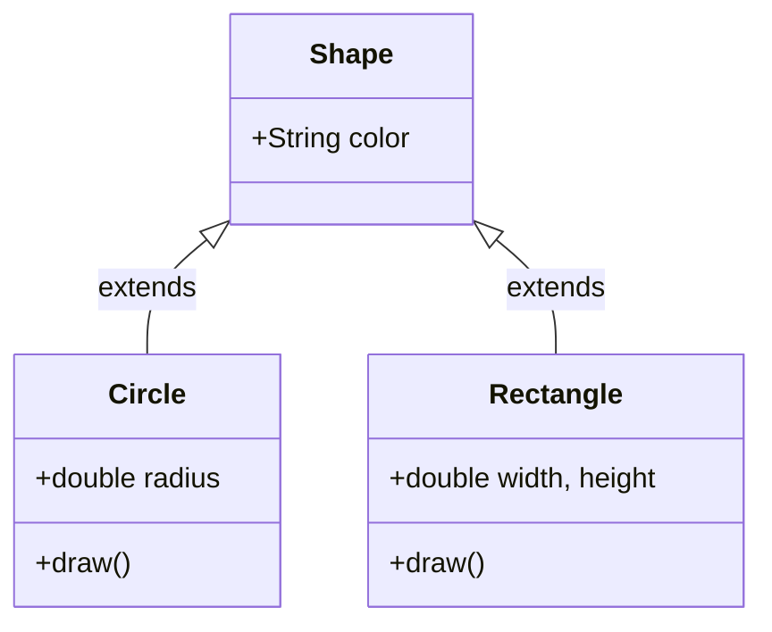

#### Java Code Example: Hierarchical Inheritance

```java
class Shape {
    String color;

    public void displayColor() {
        System.out.println("Shape color: " + color);
    }
}

class Circle extends Shape {
    double radius;

    public void drawCircle() {
        System.out.println("Drawing a circle with radius: " + radius);
    }
}

class Rectangle extends Shape {
    double length, width;

    public void drawRectangle() {
        System.out.println("Drawing a rectangle.");
    }
}

public class HierarchicalInheritanceDemo {
    public static void main(String[] args) {
        Circle c = new Circle();
        c.color = "Red";
        c.displayColor();
        c.radius = 5.5;
        c.drawCircle();

        Rectangle r = new Rectangle();
        r.color = "Blue";
        r.displayColor();
        r.drawRectangle();
    }
}

```

---

### 4. Multiple Inheritance via Interfaces

As noted earlier, Java does not permit a class to extend multiple classes. However, a class can implement **multiple interfaces**, thereby inheriting method contracts from multiple sources without ambiguity issues.

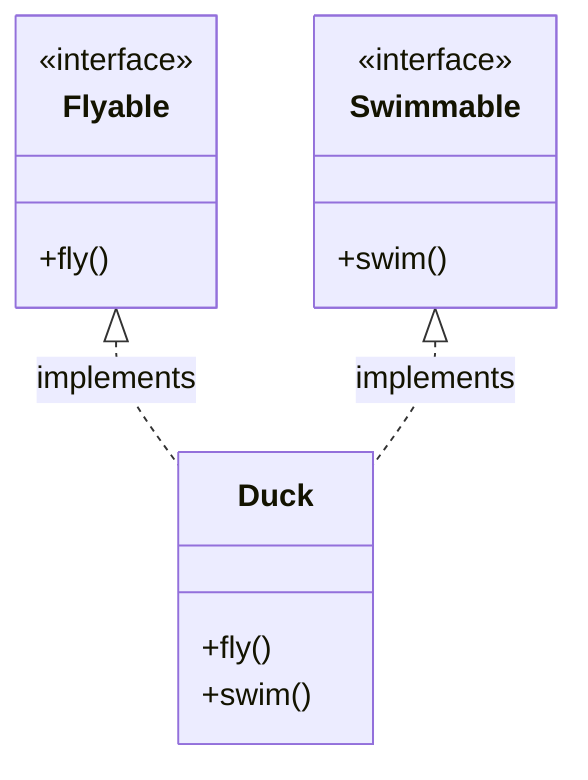

#### Java Code Example: Multiple Inheritance via Interfaces

```java
interface Flyable {
    void fly();
}

interface Swimmable {
    void swim();
}

// Implementing multiple interfaces
class Duck implements Flyable, Swimmable {
    @Override
    public void fly() {
        System.out.println("The duck is flying.");
    }

    @Override
    public void swim() {
        System.out.println("The duck is swimming.");
    }
}

public class InterfaceInheritanceDemo {
    public static void main(String[] args) {
        Duck myDuck = new Duck();
        myDuck.fly();
        myDuck.swim();
    }
}

```

---

## Output and Step-by-Step Execution

When compiling and executing `SingleInheritanceDemo.java`, the JVM processes the code as follows:

```text
The vehicle is starting...
Trunk opened for brand: Generic Brand
Doors: 4

```

### Execution Steps

1. **Instantiation:** `Car myCar = new Car();` allocates memory for a `Car` object, which internally initializes its superclass (`Vehicle`) portion first.
2. **Method Dispatch:** Calling `myCar.start()` looks up the method in `Car`. Since `Car` does not override `start()`, the JVM climbs the hierarchy to find `start()` in `Vehicle`.
3. **Field Access:** Properties like `brand` and `numberOfDoors` are resolved according to their respective scopes.

---

## Comparison Table: Types of Inheritance in Java

| Type of Inheritance | Class Support | Interface Support | Description |
| --- | --- | --- | --- |
| **Single** | Yes | Yes | One subclass inherits from one superclass. |
| **Multilevel** | Yes | Yes | A chain of inheritance (A $\rightarrow$ B $\rightarrow$ C). |
| **Hierarchical** | Yes | Yes | Multiple subclasses inherit from a single superclass. |
| **Multiple** | **No** (Class ambiguity) | **Yes** | A class inherits from multiple sources safely via contracts. |
| **Hybrid** | **No** (Direct classes) | **Yes** | A combination of two or more types of inheritance. |

---

## Important Points to Remember

* **`extends` keyword:** Used by classes to inherit from another class.
* **`implements` keyword:** Used by classes to inherit behavior contracts from interfaces.
* **`super` keyword:** Used within a subclass to explicitly reference the immediate parent class constructor or methods.
* **Constructor Chaining:** When a subclass object is created, the superclass constructor executes first, followed by the subclass constructor.
* **Private Members:** Subclasses do not inherit `private` fields or methods of their superclass directly; they must access them via public or protected getter/setter methods.

---

## Conclusion

Inheritance is an essential mechanism for writing maintainable and scalable Java applications. By organizing code into logical hierarchies through single, multilevel, and hierarchical structures—and leveraging interfaces for multiple inheritance—developers can maximize code reusability and enforce consistent design patterns.

---

## References

* **The Java Tutorials - Inheritance**, Oracle Documentation. [Link](https://www.google.com/search?q=https://docs.oracle.com/javase/tutorial/java/javaOO/subclasses.html)
* **The Java Language Specification - Classes and Interfaces**, Oracle Documentation. [Link](https://docs.oracle.com/javase/specs/)


---
# Q.4. Construct a Java program using the exception handling and write a program to describe the Throws class

## Exception Handling in Java: Using the `throws` Keyword

### Introduction

In Java, exceptions are runtime or compile-time abnormal conditions that disrupt the normal flow of program execution. When a method encounters an error condition that it cannot handle locally, it can pass the responsibility of handling that exception up to the calling method.

This delegation is achieved using the **`throws`** keyword in the method signature. Understanding `throws` is crucial for writing robust, maintainable enterprise software where errors must be propagated correctly to higher layers of an application.

---

## Definition

### 1. Exception Handling

Exception handling is a built-in mechanism in Java designed to manage runtime errors gracefully, preventing sudden application termination and allowing the program to take corrective recovery actions.

### 2. The `throws` Keyword

The `throws` keyword is used in a method declaration to inform the compiler and calling methods that the current method might throw one or more specified types of exceptions. It delegates exception handling responsibility to whichever method calls it.

---

## Detailed Explanation

### Purpose and Importance of `throws`

* **Delegation of Responsibility:** Sometimes a lower-level method (e.g., a file reader utility) does not possess enough context to decide *how* to handle an error (like displaying an alert to a user or logging a failure). `throws` allows the method to pass the exception upward to a higher-level controller.
* **Enforcing Checked Exceptions:** Java enforces strict rules on **Checked Exceptions** (exceptions that inherit from `Exception` but not `RuntimeException`). Any method that calls code capable of throwing a checked exception *must* either catch it using a `try-catch` block or declare it in its signature using `throws`.

### Syntax of `throws`

```java
ReturnType methodName(parameters) throws ExceptionType1, ExceptionType2 {
    // Method body where an exception might occur
}

```

### Difference Between `throw` and `throws`

* **`throw`** (lowercase): Used explicitly to throw an instance of an exception from inside a method or block.
* **`throws`** (plural/with 's'): Used in a method signature to declare that the method might throw exceptions during its execution.

---

## Diagram

The following sequence diagram illustrates how an exception bubbles up from a lower-level method utilizing `throws` to a higher-level caller that handles it:

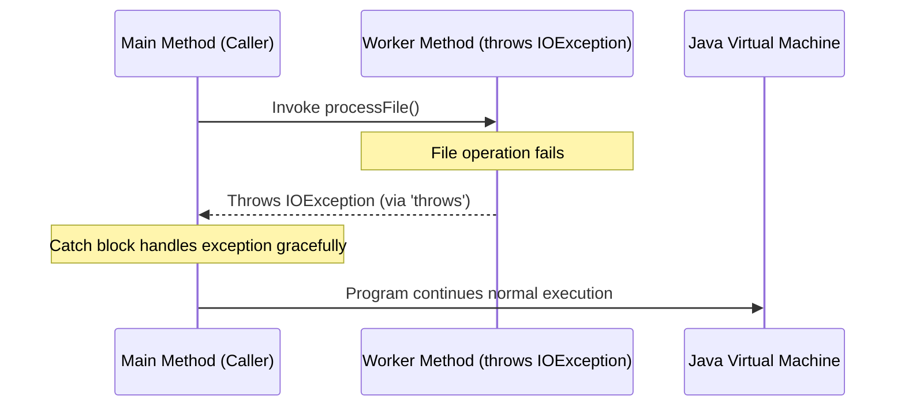

### Diagram Explanation

1. The `main` method invokes a worker method.
2. The worker method encounters an error and declares `throws IOException` in its signature, passing the exception back to the caller instead of crashing.
3. The calling `main` method catches the exception, ensuring the program recovers gracefully.

---

## Syntax and Java Code Examples

The following complete, runnable Java program demonstrates how to declare an exception using `throws` and handle it properly in a calling method:

```java
import java.io.File;
import java.io.FileNotFoundException;
import java.util.Scanner;

public class ThrowsKeywordDemo {

    // Method declares that it throws FileNotFoundException using 'throws'
    public static void readConfigurationFile(String filePath) throws FileNotFoundException {
        File file = new File(filePath);
        
        // If file does not exist, Scanner throws FileNotFoundException automatically,
        // which is then propagated upward because of the 'throws' declaration.
        Scanner scanner = new Scanner(file);
        
        System.out.println("File loaded successfully!");
        scanner.close();
    }

    public static void main(String[] args) {
        String nonExistentFile = "config_settings.txt";

        System.out.println("--- Attempting to open configuration file ---");

        try {
            // Calling the method that declares 'throws'
            readConfigurationFile(nonExistentFile);
        } catch (FileNotFoundException e) {
            // Handling the propagated exception gracefully
            System.err.println("[Caught Exception]: The specified file was not found.");
            System.err.println("Details: " + e.getMessage());
        }

        System.out.println("--- Program continued execution normally ---");
    }
}

```

### Code Breakdown

* `throws FileNotFoundException`: Informs the compiler that `readConfigurationFile` does not handle file-missing errors internally; any caller must handle it.
* `new Scanner(file)`: Attempts to open a file on disk, which can trigger a checked `FileNotFoundException`.
* `try-catch block in main`: Since `readConfigurationFile` declared `throws`, `main` is forced by the compiler to handle the exception, ensuring safety.

---

## Output and Step-by-Step Execution

When compiled and run using a file path that does not exist on disk, the output is as follows:

```text
--- Attempting to open configuration file ---
[Caught Exception]: The specified file was not found.
Details: config_settings.txt (No such file or directory)
Overall status: Program recovered successfully and continued execution.
--- Program continued execution normally ---

```

### Execution Steps

1. Execution starts at `main()`, entering the `try` block.
2. `readConfigurationFile()` is invoked with a non-existent file path.
3. `Scanner` attempts to locate the file, fails, and instantiates a `FileNotFoundException`.
4. Because `readConfigurationFile` has no `catch` block for it, the exception checks the method signature, sees `throws FileNotFoundException`, and immediately exits the method, returning the exception to `main()`.
5. The `catch (FileNotFoundException e)` block in `main` intercepts the exception, prints the error message, and allows the program to proceed rather than terminating abruptly.

---

## Comparison Table: `throw` vs. `throws`

| Feature | `throw` | `throws` |
| --- | --- | --- |
| **Purpose** | Used to explicitly throw an exception object. | Used in a method signature to declare exceptions a method might throw. |
| **Placement** | Used inside a method body or block of code. | Used in the method header/signature declaration. |
| **Argument** | Followed by an instance of an `Throwable` class (e.g., `throw new ArithmeticException();`). | Followed by class name(s) of exception types (e.g., `throws IOException, SQLException`). |
| **Quantity** | Can throw **one** exception object at a time. | Can declare **multiple** comma-separated exception types. |

---

## Important Points to Remember

* **Checked vs. Unchecked:** While `throws` can technically be used for any exception, it is mandatory for **Checked Exceptions** to satisfy Java's compile-time requirement.
* **Propagation Chain:** If method A calls method B, and method B calls method C (which declares `throws`), the exception propagates from C to B, and B must either handle it or declare `throws` as well.
* **`main` method delegation:** Even the `main` method can declare `throws`, though doing so means any uncaught exceptions will bubble up to the JVM, causing a stack trace crash.
* **Overriding Rules:** When a child class overrides a parent class method, the overriding method can throw the same checked exception or a subclass of it, but it cannot throw broader checked exceptions.

---

## Conclusion

The `throws` keyword is an essential component of Java's exception handling infrastructure. By delegating error management from low-level utility methods up to high-level controllers, developers can keep business logic clean, reusable, and resilient against unexpected runtime failures.

---

## References

* **The Java Tutorials - Defining and Using Exceptions**, Oracle Documentation. [Link](https://docs.oracle.com/javase/tutorial/essential/exceptions/declaring.html)
* **The Java Language Specification - Exceptions**, Oracle Documentation. [Link](https://docs.oracle.com/javase/specs/)
---

# Q5. Explain the abstract and interface in detail with examples

## Comprehensive Study Notes: Abstract Classes vs. Interfaces in Java

### Introduction

In Object-Oriented Programming (OOP), **Abstraction** is the core principle of hiding complex implementation details and exposing only the essential features of an object. In Java, abstraction is implemented primarily through two constructs: **Abstract Classes** and **Interfaces**.

While both establish a contract that subclasses must fulfill, they differ significantly in design intent, memory model, inheritance capabilities, and language rules. Understanding these differences is essential for software design and university examinations.

---

## 1. Abstract Classes in Detail

### Definition & Characteristics

An abstract class is a class declared with the `abstract` keyword. It serves as a partial template for a family of related subclasses.

* **Instantiation:** An abstract class **cannot be instantiated** directly using the `new` keyword. Attempting to do so results in a compile-time error.
* **Constructors:** Abstract classes can have constructors, which are invoked via `super()` when a subclass is instantiated.
* **State & Fields:** Can contain instance variables (state), static variables, and final constants.
* **Methods:** Can contain both **abstract methods** (methods without a body, forcing subclasses to implement them) and **concrete methods** (fully implemented methods that subclasses inherit directly).
* **Access Modifiers:** Abstract methods and variables can have any visibility modifier (`public`, `protected`, `default`, or `private` for helper methods).

### Syntax Structure

```java
abstract class BankAccount {
    protected String accountNumber;
    protected double balance;

    // Constructor for abstract class
    public BankAccount(String accountNumber, double initialBalance) {
        this.accountNumber = accountNumber;
        this.balance = initialBalance;
    }

    // Concrete method shared by all accounts
    public void deposit(double amount) {
        if (amount > 0) {
            balance += amount;
            System.out.println("Deposited: $" + amount);
        }
    }

    // Abstract method (no body; must be implemented by subclasses)
    public abstract void calculateInterest();
}

```

---

## 2. Interfaces in Detail

### Definition & Characteristics

An interface is a reference type in Java that acts as a contract for behavior. It defines *what* actions a class must perform, but not *how* those actions are performed.

* **Instantiation:** Cannot be instantiated directly.
* **State & Fields:** Cannot maintain instance state. All fields declared in an interface are implicitly `public static final` (constants).
* **Methods:**
* Prior to Java 8, interfaces could only contain `public abstract` methods.
* **Java 8** introduced `default` and `static` methods with bodies, allowing backward-compatible API evolution.
* **Java 9** introduced `private` methods to share common code between default methods.


* **Multiple Inheritance:** A class can implement **multiple interfaces**, overcoming Java's single-class inheritance limitation.

### Syntax Structure

```java
interface Auditable {
    // Implicitly public static final
    String AUDIT_AGENCY = "GlobalFinance Corp";

    // Abstract method
    void generateAuditReport();

    // Default method (Java 8+)
    default void printStandardHeader() {
        System.out.println("--- Official Audit Report ---");
    }
}

```

---

## 3. Architectural Diagrams

### Diagram 1: Abstract Class Hierarchy (IS-A Relationship)

The following Mermaid class diagram shows an abstract class `Vehicle` sharing core state and concrete behavior with specialized subclasses (`Car` and `Truck`).

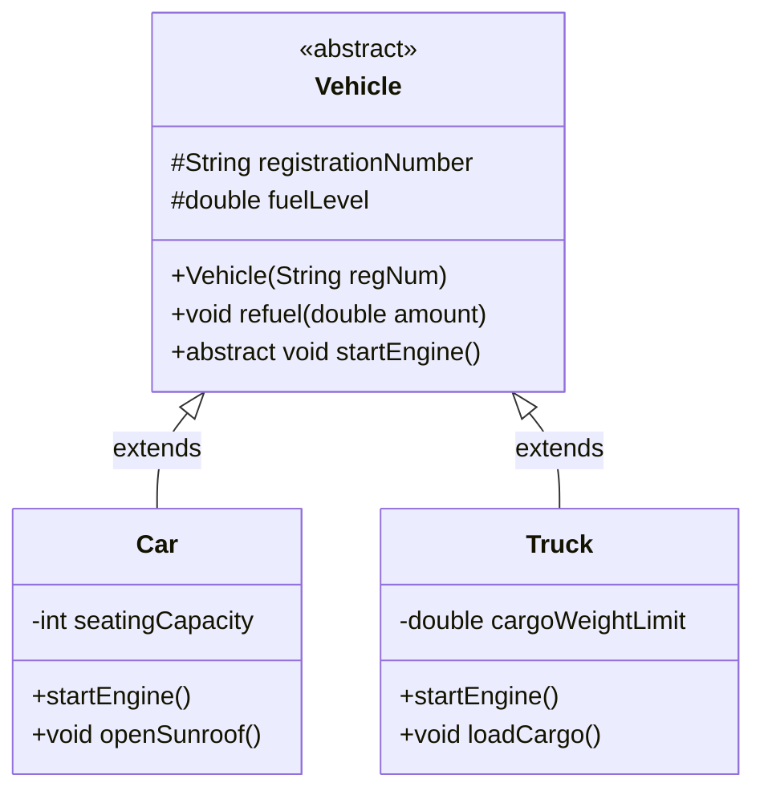

### Diagram 2: Interface Implementation (CAN-DO Relationship)

The following diagram illustrates multiple interface implementations, showing how unrelated classes can adopt common behavioral contracts.

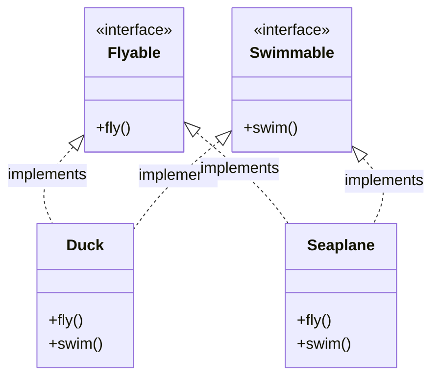

---

## 4. Comprehensive Java Code Example

The following complete program demonstrates both abstract classes and multiple interfaces working together:

```java
// Abstract Class representing shared identity and state
abstract class Employee {
    protected String name;
    protected int id;

    public Employee(String name, int id) {
        this.name = name;
        this.id = id;
    }

    // Concrete method
    public void displayDetails() {
        System.out.println("Employee ID: " + id + ", Name: " + name);
    }

    // Abstract method
    public abstract double calculatePay();
}

// Interface 1: Behavioral contract for remote workers
interface RemoteWorker {
    void connectToVPN();
    
    default void logAttendance() {
        System.out.println("Remote attendance logged digitally.");
    }
}

// Interface 2: Behavioral contract for stock-eligible personnel
interface StockHolder {
    void allocateShares();
}

// Concrete Subclass extending Abstract Class and implementing multiple Interfaces
class SoftwareEngineer extends Employee implements RemoteWorker, StockHolder {
    private double monthlySalary;

    public SoftwareEngineer(String name, int id, double monthlySalary) {
        super(name, id);
        this.monthlySalary = monthlySalary;
    }

    @Override
    public double calculatePay() {
        return monthlySalary;
    }

    @Override
    public void connectToVPN() {
        System.out.println(name + " connected securely to corporate VPN.");
    }

    @Override
    public void allocateShares() {
        System.out.println(name + " received 500 stock options.");
    }
}

public class AbstractionDeepDive {
    public static void main(String[] args) {
        // Polymorphic instantiation
        Employee emp = new SoftwareEngineer("Alice Smith", 101, 8500.0);
        
        emp.displayDetails();
        System.out.println("Monthly Pay: $" + emp.calculatePay());

        // Type casting to access interface methods
        RemoteWorker remote = (SoftwareEngineer) emp;
        remote.connectToVPN();
        remote.logAttendance();

        StockHolder shareholder = (SoftwareEngineer) emp;
        shareholder.allocateShares();
    }
}

```

---

## 5. Execution Output

When compiled and run, the program produces the following output:

```text
Employee ID: 101, Name: Alice Smith
Monthly Pay: $8500.0
Alice Smith connected securely to corporate VPN.
Remote attendance logged digitally.
Alice Smith received 500 stock options.

```

### Execution Steps

1. **Object Allocation:** `new SoftwareEngineer(...)` allocates memory, triggering constructor chaining from `Employee` upward to initialize instance fields (`name`, `id`).
2. **Method Dispatch:** Virtual method invocation (`emp.calculatePay()`) resolves dynamically at runtime to the implementation inside `SoftwareEngineer`.
3. **Interface Casting:** Casting the reference to `RemoteWorker` and `StockHolder` enables invocation of specific behavioral contracts without exposing unrelated class methods.

---

## 6. Comprehensive Comparison Table

| Feature | Abstract Class | Interface |
| --- | --- | --- |
| **Inheritance Limit** | A class can extend only **one** abstract class. | A class can implement **multiple** interfaces. |
| **State / Variables** | Can have instance variables, non-final fields, and state. | Fields are implicitly `public static final` constants. |
| **Constructors** | Can define constructors (called via `super()`). | Cannot have constructors. |
| **Method Implementation** | Can contain both abstract and fully implemented concrete methods. | Historically abstract-only; now supports `default`, `static`, and `private` methods. |
| **Speed / Performance** | Slightly faster method lookup during runtime dispatch. | Incurs minor interface table (itable) lookup overhead. |
| **Design Concept** | Represents an **"IS-A"** taxonomic relationship (shared essence). | Represents a **"CAN-DO"** behavioral capability (shared role). |

---

## 7. Important Points to Remember for Examinations

* **Code Reusability:** Abstract classes excel when subclasses share substantial common code, instance variables, or constructor logic.
* **Decoupling:** Interfaces excel when defining common protocols across completely unrelated class hierarchies.
* **Diamond Problem Prevention:** Java avoids multiple class inheritance ambiguity by disallowing multiple class extension, but allows multiple interfaces since interface fields have no state and default method conflicts must be explicitly resolved by the implementing class.

---

## 8. References

* **The Java Tutorials - Abstract Methods and Classes**, Oracle Documentation. [Link](https://docs.oracle.com/javase/tutorial/java/IandI/abstract.html)
* **The Java Tutorials - Interfaces**, Oracle Documentation. [Link](https://docs.oracle.com/javase/tutorial/java/IandI/createinterface.html)
* **The Java Language Specification - Classes and Interfaces**, Oracle Documentation.

---

#  Q6. Explain the conditional statements with examples

## Conditional Statements in Java

### Introduction

By default, Java programs execute sequentially from top to bottom, line by line. However, real-world applications require decision-making capabilities—such as checking if a user is logged in, verifying account balances, or grading exam scores.

**Conditional statements** allow a program to evaluate boolean expressions and direct execution along different paths based on whether a condition evaluates to `true` or `false`.

---

## Definition

Conditional statements (also known as decision-making statements) are control flow structures that evaluate a boolean condition and execute specific blocks of code depending on the outcome of that evaluation.

Java provides several constructs for conditional execution:

1. `if` statement
2. `if-else` statement
3. `if-else-if` ladder (nested decisions)
4. `switch` statement (including enhanced switch expressions)
5. Ternary operator (`? :`) as a shorthand conditional expression

---

## Detailed Explanation of Conditional Constructs

### 1. The `if` Statement

The simplest conditional statement evaluates a single boolean expression. If the expression is `true`, the code block inside the braces executes; otherwise, it is skipped entirely.

```java
if (condition) {
    // Executed only if condition is true
}

```

### 2. The `if-else` Statement

The `if-else` statement provides a binary branch. If the condition is `true`, the `if` block runs; if it is `false`, the alternative `else` block runs.

```java
if (condition) {
    // Executed if condition is true
} else {
    // Executed if condition is false
}

```

### 3. The `if-else-if` Ladder

When you need to evaluate multiple mutually exclusive conditions sequentially, you chain `if` and `else if` blocks together. The first condition that evaluates to `true` executes its block, and the rest of the ladder is skipped.

```java
if (condition1) {
    // Action 1
} else if (condition2) {
    // Action 2
} else {
    // Default action if all conditions are false
}

```

### 4. The `switch` Statement

The `switch` statement evaluates a variable or expression against a list of constant values (called `case` labels). It is cleaner and often more efficient than a long `if-else-if` ladder when comparing a single variable against multiple exact values.

* *Supported Types:* `int`, `byte`, `short`, `char`, `String`, and `Enum`.
* *Enhanced Switch (Java 14+):* Modern Java supports arrow syntax (`->`) which eliminates the need for `break` statements and prevents accidental fall-through bugs.

### 5. The Ternary Operator (`? :`)

A shorthand inline alternative to `if-else` used for assigning values based on a condition:

```java
variable = (condition) ? expressionIfTrue : expressionIfFalse;

```

---

## Diagram

The following Mermaid flowchart illustrates the decision-making logic of an `if-else-if` ladder:

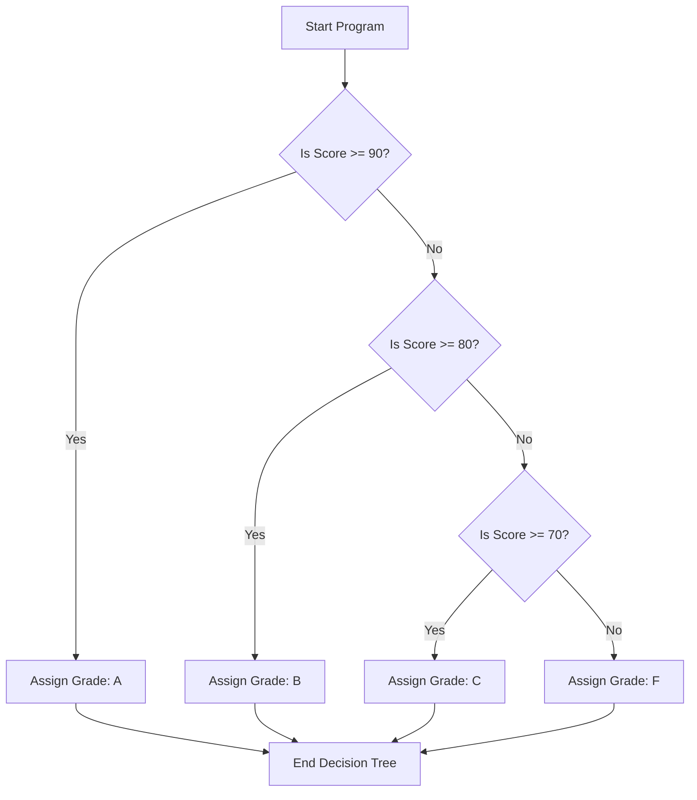

### Diagram Explanation

* The execution flow enters the decision tree from the top.
* Each diamond represents a boolean condition test (`if` or `else if`).
* If a condition is met, the corresponding block executes and exits the decision structure; otherwise, execution falls through to the next check.

---

## Syntax and Java Code Examples

The following complete, runnable Java program demonstrates `if-else`, a `switch` statement, and the ternary operator:

```java
public class ConditionalStatementsDemo {
    public static void main(String[] args) {
        int testScore = 85;
        String dayOfWeek = "WEDNESDAY";

        System.out.println("--- 1. If-Else-If Ladder (Grading System) ---");
        char grade;
        if (testScore >= 90) {
            grade = 'A';
        } else if (testScore >= 80) {
            grade = 'B';
        } else if (testScore >= 70) {
            grade = 'C';
        } else {
            grade = 'F';
        }
        System.out.println("Score: " + testScore + " -> Grade: " + grade);

        System.out.println("\n--- 2. Modern Switch Statement ---");
        // Using Java 14+ arrow syntax (no break needed)
        String schedule = switch (dayOfWeek) {
            Opens:
            case "MONDAY", "TUESDAY", "WEDNESDAY", "THURSDAY" -> "Standard Lecture Day";
            case "FRIDAY" -> "Lab Session & Project Review";
            case "SATURDAY", "SUNDAY" -> "Weekend / Holiday";
            default -> "Invalid Day";
        };
        System.out.println(dayOfWeek + " schedule: " + schedule);

        System.out.println("\n--- 3. Ternary Operator (Pass/Fail Check) ---");
        String status = (testScore >= 50) ? "PASSED" : "FAILED";
        System.out.println("Exam Status: " + status);
    }
}

```

### Code Breakdown

* `if-else-if ladder`: Checks score thresholds sequentially to determine letter grades.
* `switch expression`: Evaluates `dayOfWeek` string using modern Java arrow syntax (`->`), automatically returning the matching result without requiring `break` statements.
* `Ternary operator`: Evaluates `testScore >= 50` inline and assigns `"PASSED"` or `"FAILED"` directly to the string variable.

---

## Output and Step-by-Step Execution

When compiled and executed, the program produces the following output:

```text
--- 1. If-Else-If Ladder (Grading System) ---
Score: 85 -> Grade: B

--- 2. Modern Switch Statement ---
WEDNESDAY schedule: Standard Lecture Day

--- 3. Ternary Operator (Pass/Fail Check) ---
Exam Status: PASSED

```

### Execution Steps

1. **Grading Evaluation:** `testScore` is 85. The first condition (`85 >= 90`) is false. The second condition (`85 >= 80`) is true, assigning `'B'` and exiting the ladder.
2. **Switch Evaluation:** `dayOfWeek` matches `"WEDNESDAY"`, matching the multi-label case and returning `"Standard Lecture Day"`.
3. **Ternary Evaluation:** `85 >= 50` evaluates to true, resulting in the assignment of `"PASSED"`.

---

## Comparison Table: `if-else` vs. `switch`

| Feature | `if-else` Statement | `switch` Statement |
| --- | --- | --- |
| **Evaluation Type** | Evaluates boolean expressions (can check ranges, inequalities like `>`, `<`). | Evaluates exact equality matches against discrete constant values. |
| **Readability** | Can become verbose and hard to read when nested deeply ("Arrow Anti-pattern"). | Highly readable and clean when checking a single variable against many fixed options. |
| **Performance** | Evaluates sequentially ($O(N)$ worst-case checks). | Can be optimized by the JVM into jump tables or lookup tables for large number of cases ($O(1)$ lookup). |
| **Data Types** | Works with boolean expressions, objects, and all primitives. | Restricted to integers, strings, chars, enums (and wrapper types). |

---

## Important Points to Remember

* **Boolean Requirement:** The condition inside an `if` statement *must* evaluate to a boolean value (`true` or `false`). In Java, integers cannot be used as conditions (unlike C/C++ where `if (5)` is valid).
* **Fall-Through in Traditional Switch:** Traditional `switch` cases require a `break` statement at the end of each case block, otherwise execution "falls through" to subsequent cases. Modern Java arrow syntax (`->`) eliminates this risk.
* **Short-Circuit Evaluation:** When using logical operators (`&&` or `||`) inside conditions, Java evaluates from left to right and stops as soon as the outcome is determined (e.g., if the first operand of an `&&` is `false`, the second is never evaluated).

---

## Conclusion

Conditional statements are fundamental building blocks of program logic in Java. They enable applications to respond dynamically to inputs, user actions, and runtime states. Choosing between an `if-else` ladder and a `switch` statement depends on whether you are evaluating complex range conditions or discrete exact values.

---

## References

* **The Java Tutorials - Branching Statements**, Oracle Documentation. [Link](https://docs.oracle.com/javase/tutorial/java/nutsandbolts/flow.html)
* **The Java Language Specification - Statements**, Oracle Documentation. [Link](https://docs.oracle.com/javase/specs/)

---

# Q7. What is JDBC explain in detail.

## JDBC (Java Database Connectivity) in Detail

### Introduction

Most modern enterprise applications require persistent data storage—such as user profiles, transaction histories, or product catalogs—stored in Relational Database Management Systems (RDBMS) like MySQL, PostgreSQL, Oracle, or SQL Server.

To bridge the gap between Java applications and external databases without writing database-specific native code for each platform, Java provides a standardized industry standard: **JDBC** (Java Database Connectivity).

---

## Definition

**JDBC** is an application programming interface (API) specified in Java that defines how a client application can connect to, query, and update data within a relational database.

Contained primarily within the `java.sql` and `javax.sql` packages, JDBC provides a uniform set of classes and interfaces that allow Java developers to write database-agnostic code, meaning the same application logic can switch between different database vendors (e.g., from MySQL to Oracle) with minimal configuration changes.

---

## Detailed Explanation

### 1. Core Components and Interfaces of JDBC

The JDBC API consists of several core interfaces and classes that govern the database communication lifecycle:

* **`DriverManager`:** Manages a list of database drivers. It acts as the traffic controller, matching connection requests from a Java application to the appropriate database driver.
* **`Connection`:** Represents a physical session or communication link with the database. All SQL commands are executed and transactions are managed within the context of an active `Connection`.
* **`Statement` / `PreparedStatement` / `CallableStatement`:**
* `Statement`: Used for executing static SQL statements.
* `PreparedStatement`: Used for executing pre-compiled, parameterized SQL queries, protecting applications against **SQL Injection** attacks and improving performance.
* `CallableStatement`: Used for executing database stored procedures.


* **`ResultSet`:** A data table representation returned by executing a database query (e.g., `SELECT`). It provides cursor navigation to iterate through rows.

### 2. The 4 Types of JDBC Drivers

A JDBC driver translates Java JDBC calls into database-specific network protocols. JDBC drivers are classified into four distinct types:

1. **Type 1: JDBC-ODBC Bridge Driver (Deprecated):** Uses an ODBC driver to connect to the database. Requires client-side software installation and is obsolete in modern Java.
2. **Type 2: Native-API / Part-Java Driver:** Converts JDBC calls into database-specific client library calls (written in C/C++). Requires native libraries installed on the client machine.
3. **Type 3: Network Protocol / Middleware Driver:** Uses a middle-tier server to translate JDBC calls into middleware-independent network protocols, which then communicate with the database.
4. **Type 4: Thin / Native-Protocol Pure Java Driver (Most Popular):** Written entirely in Java, this driver connects directly and natively to the database engine over TCP/IP sockets without requiring any client-side native libraries or middleware.

### 3. Steps to Connect and Query a Database via JDBC

Writing a standard JDBC program involves six sequential steps:

1. **Import JDBC packages:** Import `java.sql.*`.
2. **Load and Register the Driver:** (Optional in modern JDBC 4.0+, as the `DriverManager` auto-loads drivers found on the classpath).
3. **Open a Connection:** Establish a session using `DriverManager.getConnection(url, user, password)`.
4. **Create a Statement:** Prepare a SQL query using `Statement` or `PreparedStatement`.
5. **Execute the Query and Process Results:** Run `executeUpdate()` for insertions/updates or `executeQuery()` for selects, iterating over the returned `ResultSet`.
6. **Close Connections:** Safely close `ResultSet`, `Statement`, and `Connection` objects to prevent memory leaks and database cursor exhaustion (best handled automatically using **try-with-resources**).

---

## Diagram

The following architecture diagram illustrates how a Java application interacts with a relational database via the JDBC API and a Type 4 JDBC driver:

```mermaid
flowchart TD
    subgraph Java Application
        A[Java Code / Business Logic]
    end

    subgraph JDBC API (java.sql)
        B[DriverManager]
        C[Connection Interface]
        D[Statement / PreparedStatement]
        E[ResultSet]
    end

    subgraph JDBC Type 4 Driver
        F[Vendor-Specific Pure Java Driver]
    end

    subgraph Database Server
        G[(Relational Database: MySQL / PostgreSQL)]
    end

    A -->|1. Requests Connection| B
    B -->|2. Establishes Session| C
    C -->|3. Creates| D
    D -->|4. Sends SQL Command| F
    F -->|5. Network Protocol TCP/IP| G
    G -->|6. Returns Data Rows| F
    F -->|7. Wraps Data in| E
    E -->|8. Processed by App| A

```

### Diagram Explanation

* **Java Application Layer:** Issues high-level database commands using standard `java.sql` interfaces.
* **JDBC API Layer:** Acts as a universal standard abstraction layer so the application remains decoupled from specific database vendors.
* **Driver & Network Layer:** The Type 4 driver translates these standard calls into the database's native network protocol.
* **Database Layer:** Executes the command and returns the requested data.

---

## Syntax and Java Code Examples

The following complete, runnable Java program demonstrates how to establish a secure database connection, execute a parameterized query using a `PreparedStatement`, and process the results using modern **try-with-resources** syntax:

```java
import java.sql.Connection;
import java.sql.DriverManager;
import java.sql.PreparedStatement;
import java.sql.ResultSet;
import java.sql.SQLException;

public class JDBCDemo {
    // Database connection credentials (example URL for MySQL)
    private static final String DB_URL = "jdbc:mysql://localhost:3306/university_db";
    private static final String USER = "root";
    private static final String PASS = "secure_password";

    public static void main(String[] args) {
        String sqlQuery = "SELECT student_id, name, major FROM students WHERE gpa > ?";
        double gpaThreshold = 3.5;

        System.out.println("--- Attempting Database Connection ---");

        // Try-with-resources ensures automatic closing of connections and statements
        try (Connection conn = DriverManager.getConnection(DB_URL, USER, PASS);
             PreparedStatement pstmt = conn.prepareStatement(sqlQuery)) {

            // Set parameter to prevent SQL injection
            pstmt.setDouble(1, gpaThreshold);

            // Execute query and retrieve result set
            try (ResultSet rs = pstmt.executeQuery()) {
                System.out.println("Query executed successfully. High-Achieving Students:");
                System.out.println("--------------------------------------------------");

                boolean hasResults = false;
                while (rs.next()) {
                    hasResults = true;
                    int id = rs.getInt("student_id");
                    String name = rs.getString("name");
                    String major = rs.getString("major");

                    System.out.printf("ID: %d | Name: %s | Major: %s%n", id, name, major);
                }

                if (!hasResults) {
                    System.out.println("No students found matching the criteria.");
                }
            }

        } catch (SQLException e) {
            System.err.println("[Database Error]: " + e.getMessage());
            e.printStackTrace();
        }
    }
}

```

### Code Breakdown

* `DriverManager.getConnection(...)`: Connects to the database server using the specified JDBC connection URL, username, and password.
* `PreparedStatement pstmt`: Pre-compiles the SQL query with a placeholder (`?`), guarding against SQL injection vulnerabilities.
* `pstmt.setDouble(1, 3.5)`: Binds the threshold value securely to the first query parameter.
* `rs.next()`: Iterates sequentially through the rows returned by the database server.
* **Try-with-resources blocks:** Automatically release database sockets and resources in reverse order upon completion, preventing resource leaks.

---

## Output and Step-by-Step Execution

When executed successfully against a running database server containing matching records, the output appears as follows:

```text
--- Attempting Database Connection ---
Query executed successfully. High-Achieving Students:
--------------------------------------------------
ID: 101 | Name: Alice Johnson | Major: Computer Science
ID: 104 | Name: Marcus Chen   | Major: Software Engineering
ID: 109 | Name: Elena Rostova | Major: Data Science

```

### Execution Steps

1. **Driver Resolution:** `DriverManager` scans the classpath for drivers supporting the `jdbc:mysql` protocol scheme.
2. **Handshake:** A TCP/IP connection handshake is established with the MySQL server running on port `3306`.
3. **Compilation:** The SQL statement is sent to the database engine for syntax verification and execution plan compilation.
4. **Data Retrieval:** The database streams matching records back across the network socket, encapsulated inside a `ResultSet` cursor.

---

## Comparison Table: `Statement` vs. `PreparedStatement`

| Feature | `Statement` | `PreparedStatement` |
| --- | --- | --- |
| **Execution** | Used for executing static SQL statements without parameters. | Used for executing dynamic, parameterized SQL queries. |
| **Compilation** | Compiled by the database engine **every single time** it is executed. | Pre-compiled once by the database engine and reused efficiently. |
| **Security** | Vulnerable to **SQL Injection** attacks if user input is concatenated directly. | Highly secure against SQL injection due to strict parameter binding. |
| **Performance** | Slower when executed repeatedly with different parameter values. | Faster and optimized for repetitive batch or parameterized execution. |

---

## Important Points to Remember

* **JAR Dependencies:** To connect to a specific database, its corresponding JDBC driver `.jar` file (e.g., `mysql-connector-j.jar`) must be included in the project's build path or module path.
* **Resource Leaks:** Always close database resources (`Connection`, `Statement`, `ResultSet`). Modern Java applications prefer **try-with-resources** blocks introduced in Java 7.
* **SQL Injection Prevention:** Always prefer `PreparedStatement` over raw string concatenation with `Statement` when handling user input.
* **Type 4 Drivers:** In modern industrial Java development, Type 4 (Pure Java) drivers are the universal standard due to their performance and ease of deployment.

---

## Conclusion

JDBC is the foundational data access standard in Java. By providing a decoupled API layer (`java.sql`), JDBC enables Java applications to interact with any relational database uniformly. Understanding its driver architecture, connection lifecycle, and security best practices is essential for developing robust enterprise applications.

---

## References

* **Java Database Connectivity (JDBC) API Documentation**, Oracle Documentation. [Link](https://www.google.com/search?q=https://docs.oracle.com/en/java/javase/docs/api/java.sql/module-summary.html)
* **JDBC Tutorial - The Java Tutorials**, Oracle Documentation. [Link](https://docs.oracle.com/javase/tutorial/jdbc/)

---

# Q8. Explain the multithreading in Java with examples

## Multithreading in Java

### Introduction

Modern computer processors feature multiple cores capable of executing multiple instructions simultaneously. To harness this hardware power effectively, applications must perform multiple tasks concurrently—such as handling network requests while keeping a graphical user interface responsive.

Java provides built-in, first-class support for concurrent execution through **multithreading**, allowing a program to divide itself into two or more concurrently running tasks known as threads.

---

## Definitions

### 1. Process vs. Thread

* **Process:** A self-contained execution environment that has its own distinct address space and memory allocated by the operating system. Processes are heavyweight and communicate via inter-process communication (IPC).
* **Thread:** The smallest unit of execution within a process. A single process can contain multiple threads that share the same memory space (heap memory) and resources, making thread creation and context switching lightweight.

### 2. Multithreading

**Multithreading** is the execution of two or more threads concurrently (or in parallel on multi-core processors) within a single program or process, maximizing CPU utilization and application responsiveness.

---

## Detailed Explanation

### 1. Thread Life Cycle (States)

Throughout its existence, a thread moves through several distinct states managed by the JVM and operating system thread scheduler:

1. **New:** A thread object has been created using the `new` keyword, but its `start()` method has not yet been invoked.
2. **Runnable:** The thread is ready to run and is waiting for CPU time from the thread scheduler.
3. **Running:** The thread scheduler has selected the thread, and its `run()` method is actively executing.
4. **Blocked / Waiting / Timed Waiting:** The thread is temporarily inactive because it is waiting for a resource lock (`synchronized`), sleeping (`Thread.sleep()`), or waiting for I/O operations to complete.
5. **Terminated / Dead:** The thread has finished executing its `run()` method or has been abruptly stopped due to an unhandled exception.

### 2. Two Ways to Create Threads in Java

Java provides two primary mechanisms to define and run a thread:

* **By Implementing the `Runnable` Interface (Preferred):** The class implements the `java.lang.Runnable` interface and overrides the `run()` method. An instance of this class is then passed to a `Thread` object. This approach avoids Java's single-class inheritance restriction and cleanly separates task logic from thread mechanics.
* **By Extending the `Thread` Class:** The class inherits from `java.lang.Thread` and overrides its `run()` method. Calling `.start()` on this object launches a new thread.

### 3. Thread Synchronization and Safety

Because multiple threads share the same heap memory space, concurrent modifications to shared variables can lead to data inconsistency and **race conditions**.

* **The `synchronized` Keyword:** Java uses monitor locks (intrinsic locks) to ensure that only one thread can execute a critical section of code at a time, preventing data corruption.

---

## Diagram

The following state diagram illustrates the lifecycle and state transitions of a thread in Java:

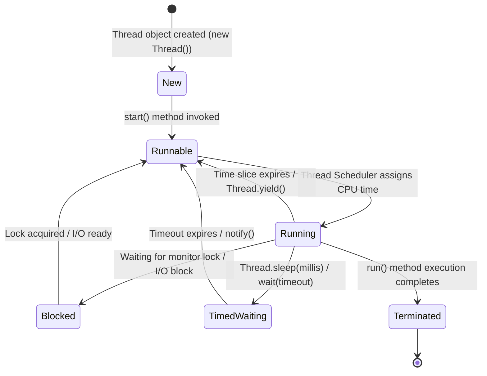

### Diagram Explanation

* **New $\rightarrow$ Runnable $\rightarrow$ Running:** Moving from object creation to active execution.
* **Running $\rightarrow$ Blocked/Waiting:** Temporary suspension due to resource contention or sleeping.
* **Running $\rightarrow$ Terminated:** Normal exit path when work is finished.

---

## Syntax and Java Code Examples

The following complete, runnable Java program demonstrates how to create threads using the `Runnable` interface, synchronize access to a shared counter to prevent race conditions, and use `Thread.join()` to wait for threads to complete:

```java
// Shared resource class with synchronization
class Counter {
    private int count = 0;

    // Synchronized method ensures thread-safe atomic increments
    public synchronized void increment() {
        count++;
    }

    public int getCount() {
        return count;
    }
}

// Task implementing Runnable interface
class WorkerTask implements Runnable {
    private Counter counter;

    public WorkerTask(Counter counter) {
        this.counter = counter;
    }

    @Override
    public void run() {
        for (int i = 0; i < 1000; i++) {
            counter.increment();
        }
        System.out.println(Thread.currentThread().getName() + " finished work.");
    }
}

public class MultithreadingDemo {
    public static void main(String[] args) throws InterruptedException {
        Counter sharedCounter = new Counter();

        // Creating multiple threads sharing the same task logic
        Thread t1 = new Thread(new WorkerTask(sharedCounter), "Worker-1");
        Thread t2 = new Thread(new WorkerTask(sharedCounter), "Worker-2");

        System.out.println("--- Starting Concurrent Execution ---");
        t1.start();
        t2.start();

        // Main thread waits for t1 and t2 to finish execution
        t1.join();
        t2.join();

        System.out.println("--- All threads completed ---");
        System.out.println("Final Expected Counter Value: 2000");
        System.out.println("Actual Final Counter Value   : " + sharedCounter.getCount());
    }
}

```

### Code Breakdown

* `implements Runnable`: Defines task logic without binding to a specific class hierarchy.
* `synchronized void increment()`: Ensures mutual exclusion; two threads cannot modify `count` simultaneously, avoiding race conditions.
* `t1.join()`: Pauses the calling (`main`) thread until `t1` completes its execution, ensuring correct result printing.

---

## Output and Step-by-Step Execution

When compiled and executed, the program output appears as follows:

```text
--- Starting Concurrent Execution ---
Worker-1 finished work.
Worker-2 finished work.
--- All threads completed ---
Final Expected Counter Value: 2000
Actual Final Counter Value   : 2000

```

### Execution Steps

1. **Initialization:** The `main` method initializes a single `Counter` instance and creates two independent thread objects (`Worker-1` and `Worker-2`).
2. **Concurrent Scheduling:** Calling `.start()` triggers the JVM to request OS-level threads. Both `Worker-1` and `Worker-2` begin executing their `run()` methods concurrently.
3. **Synchronization:** As threads race to increment `count`, the `synchronized` keyword queues access, guaranteeing that no increment operations are lost.
4. **Join & Completion:** The `main` thread waits via `join()`, then prints the final accurate counter value.

---

## Comparison Table: Extending `Thread` vs. Implementing `Runnable`

| Feature | Extending `Thread` Class | Implementing `Runnable` Interface |
| --- | --- | --- |
| **Inheritance** | Consumes your single class inheritance slot (cannot extend any other class). | Leaves inheritance open; your class can still extend another parent class. |
| **Code Separation** | Task logic and thread control mechanism are tightly coupled. | Task logic (`Runnable`) is cleanly separated from thread management (`Thread`). |
| **Code Reuse** | Harder to share task instances across multiple threads. | Highly shareable; the same `Runnable` instance can be executed by multiple threads. |
| **Best Practice** | Generally discouraged in modern enterprise applications. | **Recommended standard** for multithreaded design in Java. |

---

## Important Points to Remember

* **Always Call `.start()`, Never `.run()`:** Calling `start()` creates a new thread stack and tells the JVM to invoke `run()` asynchronously. Calling `run()` directly executes it synchronously on the current thread like an ordinary method call.
* **Race Conditions:** Occur when multiple threads read and write shared mutable state without synchronization.
* **Deadlocks:** A situation where two or more threads are blocked forever, waiting for locks held by each other. Proper lock ordering prevents deadlocks.
* **Executor Framework (`java.util.concurrent`):** Modern Java applications prefer higher-level thread pools (`ExecutorService`) over manual `Thread` creation for better resource management.

---

## Conclusion

Multithreading is a powerful capability in Java that enables high-performance, concurrent application design. By understanding thread states, synchronization, and the `Runnable` interface, developers can build responsive applications that maximize multi-core hardware efficiency safely.

---

## References

* **The Java Tutorials - Defining and Starting a Thread**, Oracle Documentation. [Link](https://docs.oracle.com/javase/tutorial/essential/concurrency/threads.html)
* **The Java Tutorials - Synchronization**, Oracle Documentation. [Link](https://docs.oracle.com/javase/tutorial/essential/concurrency/sync.html)
* **Java API Documentation - `java.lang.Thread` & `java.util.concurrent**`, Oracle Documentation.

---

# Q9. Explain the OOPS feature in Brief

## Object-Oriented Programming (OOP) Features in Brief

### Introduction

Object-Oriented Programming (OOP) is a programming paradigm based on the concept of **"objects"**, which contain data (attributes) and code (methods). Java is designed around object-oriented principles, making software modular, reusable, scalable, and easier to maintain.

---

## Definition

Object-Oriented Programming is a methodology that models real-world entities as software objects, organizing code into classes and leveraging four core pillars: **Encapsulation**, **Inheritance**, **Polymorphism**, and **Abstraction**.

---

## The Core Pillars of OOP

### 1. Classes and Objects (Foundational Concepts)

* **Class:** A user-defined blueprint or prototype from which objects are created. It defines variables and methods common to all objects of a certain kind.
* **Object:** An instance of a class that possesses a state (attributes) and behavior (methods).

### 2. Encapsulation (Data Hiding)

* Encapsulation is the mechanism of wrapping data (variables) and code acting on the data (methods) together as a single unit.
* In Java, this is achieved by declaring class variables as `private` and providing public getter and setter methods to control access and validate data modifications.

### 3. Inheritance (Code Reusability)

* Inheritance allows a new class (subclass/derived class) to adopt the properties and behaviors of an existing class (superclass/base class).
* It promotes code reusability and establishes a hierarchical relationship between classes using the `extends` keyword.

### 4. Polymorphism (Many Forms)

* Polymorphism allows a single action or method to behave differently depending on the context.
* **Compile-time Polymorphism (Method Overloading):** Multiple methods share the same name with different parameter signatures within the same class.
* **Runtime Polymorphism (Method Overriding):** A subclass provides a specific implementation of a method that is already defined in its parent class.

### 5. Abstraction (Hiding Complexity)

* Abstraction focuses on hiding internal implementation details and exposing only the essential features of an object.
* In Java, abstraction is implemented using **Abstract Classes** and **Interfaces**.

---

## Diagram

The following flowchart summarizes the four primary pillars of Object-Oriented Programming:

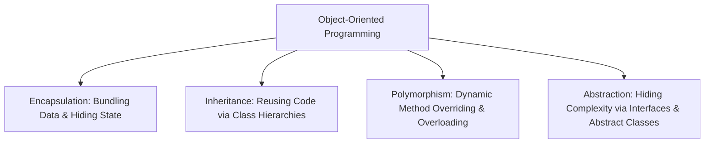

---

## Syntax and Java Code Examples

The following concise Java program demonstrates Encapsulation, Inheritance, and Polymorphism in a single example:

```java
// 1. Encapsulated Superclass
class Animal {
    private String name; // Encapsulated field

    public Animal(String name) {
        this.name = name;
    }

    public String getName() {
        return name;
    }

    // Method to be overridden (Polymorphism)
    public void sound() {
        System.out.println("Some generic animal sound...");
    }
}

// 2. Inheritance (Dog extends Animal)
class Dog extends Animal {
    public Dog(String name) {
        super(name);
    }

    // Runtime Polymorphism (Method Overriding)
    @Override
    public void sound() {
        System.out.println(getName() + " barks: Woof! Woof!");
    }
}

public class OOPFeaturesDemo {
    public static void main(String[] args) {
        // Polymorphic reference: Parent type holding a Child object
        Animal myPet = new Dog("Buddy");

        System.out.println("Pet Name (Encapsulated): " + myPet.getName());
        
        // Executes overridden method dynamically at runtime
        myPet.sound();
    }
}

```

### Code Breakdown

* `private String name`: Demonstrates **Encapsulation** by hiding field access behind public getter methods.
* `class Dog extends Animal`: Demonstrates **Inheritance** by acquiring parent properties.
* `@Override void sound()`: Demonstrates **Polymorphism**, allowing the subclass to define specialized behavior.

---

## Output and Step-by-Step Execution

When compiled and executed, the program produces the following output:

```text
Pet Name (Encapsulated): Buddy
Buddy barks: Woof! Woof!

```

### Execution Steps

1. **Instantiation:** `new Dog("Buddy")` invokes constructor chaining up to `Animal`, initializing the private `name` field securely.
2. **Encapsulation Access:** `myPet.getName()` retrieves the private attribute safely.
3. **Dynamic Dispatch:** `myPet.sound()` resolves at runtime to execute the `Dog` class's overridden method rather than the generic `Animal` version.

---

## Summary Table: The Four Pillars of OOP

| OOP Pillar | Primary Purpose | Java Implementation Keyword |
| --- | --- | --- |
| **Encapsulation** | Protects data state and restricts unauthorized access. | `private`, `public` (Getters/Setters) |
| **Inheritance** | Promotes code reusability and hierarchical relationships. | `extends` |
| **Polymorphism** | Enables flexible, dynamic behavior for methods and objects. | Method Overloading / `@Override` |
| **Abstraction** | Hides complex logic behind clean, simplified contracts. | `abstract`, `interface` |

---

## Important Points to Remember

* **Security via Encapsulation:** Always make instance variables `private` and expose them via public getters and setters.
* **Single Class Inheritance:** Java supports single class inheritance (`extends`), but allows multiple interface implementation (`implements`).
* **Runtime Binding:** Polymorphism relies on dynamic method dispatch, where the JVM determines which method implementation to run based on the actual object type at runtime, not the reference type.

---

## Conclusion

Object-Oriented Programming features—Encapsulation, Inheritance, Polymorphism, and Abstraction—form the backbone of Java design. They transform complex programming problems into modular, secure, and reusable components.

---

## References

* **Object-Oriented Programming Concepts (Java Tutorials)**, Oracle Documentation. [Link](https://docs.oracle.com/javase/tutorial/java/concepts/)
* **The Java Language Specification**, Oracle Documentation. [Link](https://docs.oracle.com/javase/specs/)

---

# Q10. Explain the thread life cycle in detail

## Explain the Thread Life Cycle in Detail

### Introduction

In Java, a thread is the smallest unit of execution within a process. Throughout its operational lifetime, a thread transitions through several distinct states managed by the Java Virtual Machine (JVM) and the underlying operating system thread scheduler.

Understanding the thread life cycle is critical for diagnosing performance bottlenecks, avoiding deadlocks, and writing reliable concurrent applications.

---

## Definition

The **thread life cycle** refers to the various states a thread can occupy from the moment it is created until it completes execution or dies.

Since Java 5, these states are formally defined as an enum within the `java.lang.Thread` class: **`Thread.State`**. A thread can be in only **one** of these six states at any given point in time.

---

## Detailed Explanation of the 6 Thread States

### 1. `NEW`

* **Condition:** A thread object has been created using the `new` keyword, but the `.start()` method has not yet been invoked.
* **Characteristics:** At this stage, the thread is merely a standard Java object in heap memory. No underlying operating system thread resources have been allocated yet.

### 2. `RUNNABLE`

* **Condition:** The thread is ready to run and is waiting for processor/CPU time.
* **Characteristics:** When a thread's `.start()` method is called, it transitions from `NEW` to `RUNNABLE`. In JVM terminology, `RUNNABLE` covers both threads that are actively executing on a CPU core and those waiting in the OS run-queue for their next scheduling time slice.

### 3. `BLOCKED`

* **Condition:** A thread is temporarily inactive because it is waiting to acquire an intrinsic monitor lock to enter a `synchronized` block or method.
* **Characteristics:** The thread remains in this state until another thread holding the lock releases it, allowing the blocked thread to attempt acquiring it again.

### 4. `WAITING`

* **Condition:** A thread enters this state when it waits indefinitely for another thread to perform a specific action.
* **Trigger Methods:**
* `Object.wait()` (without timeout)
* `Thread.join()` (without timeout)
* `LockSupport.park()`


* **Characteristics:** The thread stays dormant until another thread explicitly wakes it up using `Object.notify()` or `Object.notifyAll()`.

### 5. `TIMED_WAITING`

* **Condition:** Similar to `WAITING`, but with a specified positive waiting timeout limit.
* **Trigger Methods:**
* `Thread.sleep(long millis)`
* `Object.wait(long timeout)`
* `Thread.join(long millis)`
* `LockSupport.parkNanos()` / `LockSupport.parkUntil()`


* **Characteristics:** The thread automatically returns to the `RUNNABLE` state either when the specified timeout expires or when it receives an interruption/notification.

### 6. `TERMINATED` (Dead)

* **Condition:** A thread has completed its execution normally or has terminated abruptly due to an unhandled exception or error.
* **Characteristics:** Once a thread reaches this state, its life cycle is complete, and it cannot be restarted (calling `.start()` on a terminated thread throws an `IllegalThreadStateException`).

---

## Diagram

The following state transition diagram illustrates the complete life cycle of a Java thread and the methods that trigger state changes:

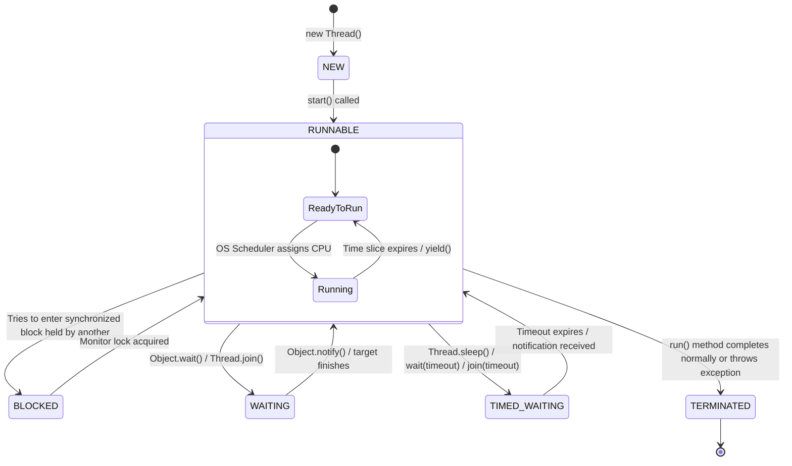

### Diagram Explanation

* **Initialization:** A thread begins as `NEW` and moves to `RUNNABLE` via `start()`.
* **Execution & Interruption:** While `RUNNABLE`, it loops between active execution and waiting for CPU time slices. Calls to synchronization locks, `wait()`, or `sleep()` move it into `BLOCKED`, `WAITING`, or `TIMED_WAITING` respectively.
* **Completion:** Exiting the `run()` method transitions the thread to `TERMINATED`.

---

## Syntax and Java Code Examples

The following complete, runnable Java program explicitly monitors and prints the various states of a thread during its life cycle:

```java
public class ThreadLifecycleDemo implements Runnable {

    @Override
    public void run() {
        try {
            // 1. Thread goes into TIMED_WAITING state
            Thread.sleep(300);
        } catch (InterruptedException e) {
            Thread.currentThread().interrupt();
        }
    }

    public static void main(String[] args) throws InterruptedException {
        Thread worker = new Thread(new ThreadLifecycleDemo(), "WorkerThread");

        // State 1: NEW (Thread created, start() not yet called)
        System.out.println("1. After creation (NEW): " + worker.getState());

        worker.start();

        // State 2: RUNNABLE (Thread is started and running/ready)
        System.out.println("2. After start() (RUNNABLE): " + worker.getState());

        // Give the worker thread a moment to enter sleep()
        Thread.sleep(100);

        // State 3: TIMED_WAITING (Thread is sleeping)
        System.out.println("3. While sleeping (TIMED_WAITING): " + worker.getState());

        // Wait for the worker thread to finish execution completely
        worker.join();

        // State 4: TERMINATED (Thread execution completed)
        System.out.println("4. After completion (TERMINATED): " + worker.getState());
    }
}

```

### Code Breakdown

* `worker.getState()`: Queries the current virtual machine state of the thread instance at runtime.
* `Thread.sleep(300)`: Forces the worker thread into the `TIMED_WAITING` state.
* `worker.join()`: Blocks the main thread until the worker thread finishes, ensuring safe final state inspection.

---

## Output and Step-by-Step Execution

When compiled and executed, the program produces the following output:

```text
1. After creation (NEW): NEW
2. After start() (RUNNABLE): RUNNABLE
3. While sleeping (TIMED_WAITING): TIMED_WAITING
4. After completion (TERMINATED): TERMINATED

```

### Execution Steps

1. **Creation:** Instantiating `new Thread(...)` assigns the `NEW` state.
2. **Activation:** Invoking `worker.start()` changes state to `RUNNABLE`.
3. **Sleeping:** Inside `run()`, `Thread.sleep(300)` places the thread into `TIMED_WAITING`.
4. **Termination:** After waking up, the `run()` method exits, placing the thread into `TERMINATED`.

---

## Summary Table: Thread States & Triggers

| Thread State | Description | Common Trigger Methods / Actions |
| --- | --- | --- |
| **`NEW`** | Created but unstarted. | `new Thread()` |
| **`RUNNABLE`** | Executing or ready for CPU allocation. | `start()` |
| **`BLOCKED`** | Waiting for an intrinsic monitor lock. | Attempting to enter a `synchronized` block/method. |
| **`WAITING`** | Waiting indefinitely for another thread. | `Object.wait()`, `Thread.join()`, `LockSupport.park()` |
| **`TIMED_WAITING`** | Waiting for a specified timeout period. | `Thread.sleep()`, `wait(timeout)`, `join(timeout)` |
| **`TERMINATED`** | Execution completed. | Exit from `run()` method. |

---

## Important Points to Remember

* **One-Way Ticket:** A thread can transition from `NEW` to `RUNNABLE` only once. Once a thread reaches `TERMINATED`, it can never be restarted.
* **Polling via `getState()`:** The `Thread.getState()` method is primarily used for monitoring, debugging, and logging purposes rather than for synchronization control logic.
* **OS vs. JVM States:** Java thread states are virtual machine states and do not always map 1:1 to underlying operating system kernel states.

---

## Conclusion

The thread life cycle governs how threads are born, managed, suspended, and destroyed in Java. Mastering the six states (`NEW`, `RUNNABLE`, `BLOCKED`, `WAITING`, `TIMED_WAITING`, `TERMINATED`) enables developers to analyze thread dumps, debug concurrency issues, and build high-performance multi-threaded applications.

---

## References

* **Java Platform SE API - `Thread.State` Enumeration**, Oracle Documentation. [Link](https://www.google.com/search?q=https://docs.oracle.com/en/java/javase/21/docs/api/java.base/java/lang/Thread.State.html)
* **The Java Tutorials - Defining and Starting a Thread**, Oracle Documentation. [Link](https://docs.oracle.com/javase/tutorial/essential/concurrency/threads.html)