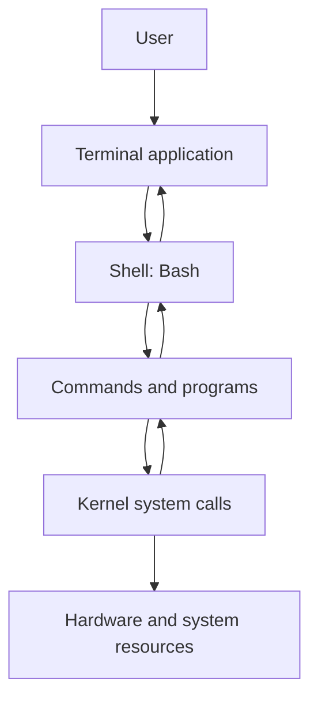
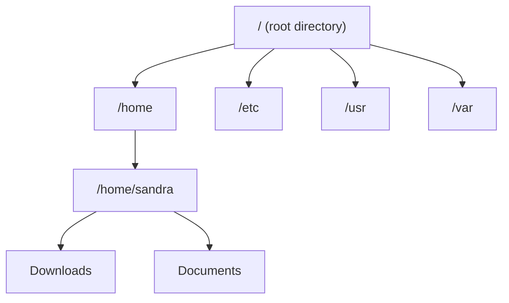
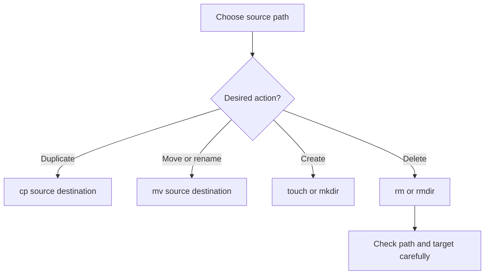
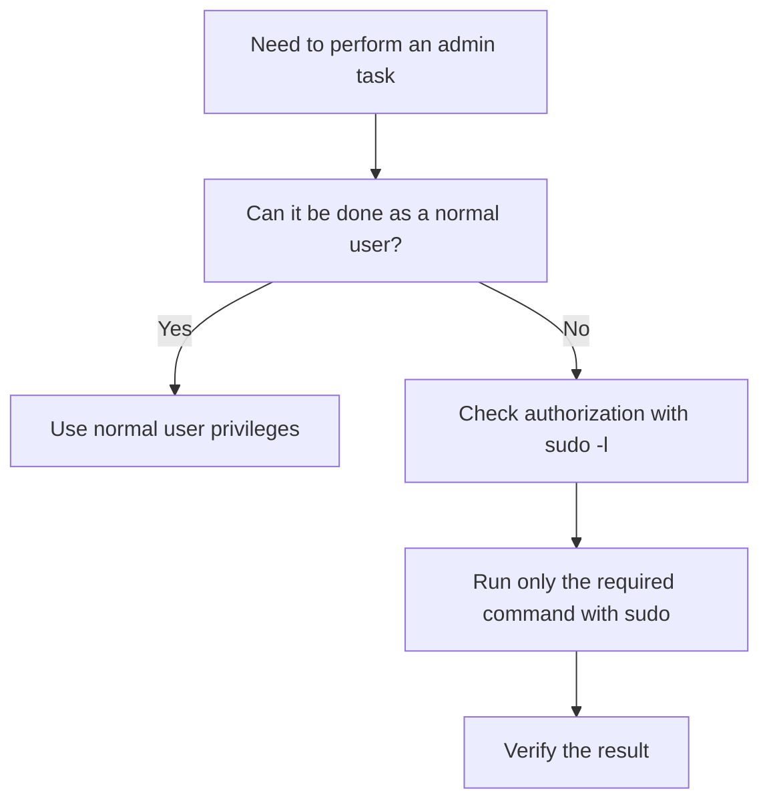

# 03. Introduction to Working with the Linux Command Line

> Beginner-friendly, exam-oriented notes based primarily on the two
> supplied PDFs:
> `Linux - 03 Introduction to working with Command Line.pdf` and
> `Linux - 03 Introduction to working with Command Line - 2.pdf`. The
> files overlap substantially, so repeated material is combined while
> useful details from both are retained.

## Source coverage and accuracy notes

The PDFs cover the shell and Bash, prompts, navigation and paths, help
tools, file naming, listing and managing files, wildcards,
system/resource information, history and aliases, and user privileges.

A few points need qualification: - A shell interprets commands and
requests services through operating-system interfaces; it does not
normally communicate directly with hardware. - Terminal key combinations
for virtual consoles vary by distribution, desktop environment, and
configuration. - Linux filenames are case-sensitive on common Linux
filesystems, but exact behavior can vary by filesystem and mount
options. - A filename component is commonly limited to 255 **bytes** on
common Linux filesystems; full-path limits depend on the filesystem and
API. - `shred` is not a reliable universal secure-erasure method,
especially on SSDs, copy-on-write filesystems, journaled filesystems,
RAID, and network storage. - Commands such as `rm -rf`, `sudo`,
`passwd`, and commands that change system time or storage require care.

------------------------------------------------------------------------

## 1. What Is a Shell? What Is Bash?

A **shell** is a program that provides an interface for users to run
commands and automate tasks. A shell reads input, interprets command
syntax, starts programs, and supports features such as pipes,
redirection, variables, and scripts.

**Bash** means **Bourne Again Shell**. It is a popular command-line
shell and scripting language on Linux.

### Where the shell fits



The terminal displays text and accepts keyboard input. The shell
interprets commands. Programs request operating-system services, and the
kernel manages resources and hardware access.

### Main shell functions

-   **Command interpretation:** parses commands, arguments, quotes, and
    expansions.
-   **Program execution:** starts utilities and applications.
-   **Input/output handling:** supports redirection such as `>` and
    pipes such as `|`.
-   **Automation:** runs shell scripts containing multiple commands.
-   **Environment management:** maintains variables, working directory,
    and shell options.

### CLI shell vs. graphical shell

  -----------------------------------------------------------------------
  Command-line interface (CLI)        Graphical user interface (GUI)
  ----------------------------------- -----------------------------------
  Text commands typed at a prompt     Windows, icons, menus, and pointers

  Efficient for automation and remote Often easier for visual exploration
  administration                      

  Examples: Bash, Zsh, Fish           Examples: GNOME Shell and desktop
                                      environments
  -----------------------------------------------------------------------

**Exam point:** A terminal is the application/interface window; Bash is
the shell running inside it. They are not the same thing.

------------------------------------------------------------------------

## 2. Understanding the Command Prompt

A common Bash prompt looks like:

``` text
sandra@localhost:~$
```

  Part          Meaning
  ------------- ------------------------------------------------
  `sandra`      Current username
  `localhost`   Hostname of the computer
  `~`           Current directory is the user's home directory
  `$`           Usually indicates an ordinary user prompt
  `#`           Commonly indicates a root prompt

The exact prompt can be customized, so these symbols are conventions
rather than a security guarantee. Use `whoami` to verify the current
identity.

### Terminal and virtual consoles

-   A **terminal emulator** runs in the graphical desktop.
-   A **virtual console/TTY** provides a text-based login session.
-   Key combinations for switching consoles differ between systems; do
    not assume the same `Ctrl + Alt + F-key` mapping works everywhere.

------------------------------------------------------------------------

## 3. Navigating Directories and Understanding Paths

Linux organizes files in a tree starting at the root directory `/`.



### Special path symbols

  Symbol          Meaning                             Example
  --------------- ----------------------------------- ------------------
  `/`             Root directory and path separator   `/etc/hosts`
  `.`             Current directory                   `./script.sh`
  `..`            Parent directory                    `cd ..`
  `~`             Current user's home directory       `cd ~/Documents`
  `-` in `cd -`   Previous working directory          `cd -`

### Absolute vs. relative paths

-   **Absolute path:** begins at `/` and identifies a location
    independently of the current directory,
    e.g. `/home/sandra/Downloads`.
-   **Relative path:** is interpreted from the current working
    directory, e.g. `Downloads` or `../notes.md`.

  -----------------------------------------------------------------------
  Command                 Purpose                 Example
  ----------------------- ----------------------- -----------------------
  `pwd`                   Print current working   `pwd`
                          directory               

  `pwd -L`                Show logical path,      `pwd -L`
                          usually preserving      
                          symbolic-link path      
                          components              

  `pwd -P`                Show physical path,     `pwd -P`
                          resolving symbolic      
                          links                   

  `cd /etc`               Change to an absolute   `cd /etc`
                          path                    

  `cd Documents`          Enter a child directory `cd Documents`
                          relative to the current 
                          location                

  `cd ..`                 Move to parent          `cd ..`
                          directory               

  `cd ~` or `cd`          Go to home directory    `cd`

  `cd -`                  Return to previous      `cd -`
                          directory               
  -----------------------------------------------------------------------

Bash also tracks the current location in `$PWD`:

``` bash
echo "$PWD"          # Print current directory
echo "${PWD##*/}"    # Print final path component
```

Quote variables such as `"$PWD"` when using them in commands because
paths can contain spaces.

------------------------------------------------------------------------

## 4. Getting Help from the Command Line

Linux provides local documentation, so internet access is not always
required.

  -----------------------------------------------------------------------
  Tool                    Purpose                 Example
  ----------------------- ----------------------- -----------------------
  `man`                   Open a command's manual `man ls`
                          page                    

  `--help`                Show a concise option   `ls --help`
                          summary, when supported 

  `help`                  Explain Bash built-in   `help cd`
                          commands                

  `info`                  Browse GNU Info         `info coreutils`
                          documentation           

  `apropos`               Search manual-page      `apropos partition`
                          descriptions by keyword 

  `whatis`                Show a short            `whatis ls`
                          manual-page description 
  -----------------------------------------------------------------------

Useful `man` navigation: - `Space` / `Page Down`: move down. - `b` /
`Page Up`: move up. - `/keyword`: search. - `n`: next search match. -
`q`: quit.

**Tip:** `cd` is a Bash built-in, so use `help cd` or `man bash` if
`man cd` does not provide what you expect.

------------------------------------------------------------------------

## 5. File Names, Listing Files, and Basic Inspection

### File naming basics

-   Linux filenames are normally **case-sensitive**: `Report.txt` and
    `report.txt` are different names.
-   A leading dot makes a name hidden by default in ordinary directory
    listings, e.g. `.bashrc`.
-   File extensions such as `.txt` and `.png` are conventions; Linux
    does not require them.
-   Avoid spaces in names for simpler command use, or quote/escape
    spaces when needed.
-   On common Linux filesystems, an individual filename component is
    typically limited to 255 bytes. Exact limits vary.

### Listing with `ls`

  Command    What it does
  ---------- -----------------------------------------------------------
  `ls`       List visible entries
  `ls -l`    Long format: permissions, owner/group, size, timestamp
  `ls -a`    Include hidden entries
  `ls -lh`   Long format with human-readable sizes
  `ls -t`    Sort by modification time, newest first
  `ls -r`    Reverse the selected sort order
  `ls -R`    Recursively list subdirectories
  `ls -S`    Sort by file size, largest first
  `ls -1`    One entry per line
  `ls -i`    Show inode numbers
  `ls -F`    Append indicators such as `/` to directories on GNU/Linux

Examples:

``` bash
ls -lah
ls -lt /var/log
ls -lhS
ls -a .
```

### Viewing file contents

``` bash
cat notes.txt             # Print whole file; best for short files
less notes.txt            # Read a long file interactively; press q to quit
head -n 5 notes.txt       # First five lines
tail -n 10 notes.txt      # Last ten lines
tail -f application.log   # Follow new lines as they are appended
```

`cat` can flood the terminal if a file is very large. Use `less` for
long logs or documents.

------------------------------------------------------------------------

## 6. Creating, Copying, Moving, and Removing Files

### Essential commands

  ---------------------------------------------------------------------------------
  Command                 Purpose                 Example
  ----------------------- ----------------------- ---------------------------------
  `touch`                 Create an empty file if `touch notes.txt`
                          absent, or update       
                          timestamps              

  `mkdir`                 Create a directory      `mkdir projects`

  `mkdir -p`              Create nested           `mkdir -p work/linux/notes`
                          directories as needed   

  `cp`                    Copy files              `cp notes.txt notes-backup.txt`

  `cp -r`                 Copy a directory tree   `cp -r project project-backup`
                          recursively             

  `mv`                    Move or rename          `mv old.txt new.txt`

  `rm`                    Remove files            `rm temp.txt`

  `rm -r`                 Remove a directory tree `rm -r old-folder`
                          recursively             

  `rmdir`                 Remove an empty         `rmdir empty-folder`
                          directory               
  ---------------------------------------------------------------------------------

### File-operation flow



### Destructive-command safety

-   `rm` normally removes directory entries without moving them to a
    graphical trash folder.
-   `rm -rf path` recursively removes the target without prompting in
    many situations. A wrong path can cause major data loss.
-   Before deleting, inspect the target with `pwd` and `ls`.
-   Be especially careful with variables in commands such as
    `rm -rf "$DIR"`.
-   Avoid running destructive commands with `sudo` unless necessary and
    the target is verified.

### About `shred`

The source PDF describes `shred` as overwriting a file before deleting
it. Example syntax:

``` bash
shred -uvn 3 -- secret.txt
```

This requests three overwrite passes and removal, with verbose output.
**Do not treat this as a guaranteed secure-erasure solution.** SSD wear
levelling, copy-on-write filesystems, snapshots, journaling, RAID, and
network storage can prevent predictable in-place overwriting. For
sensitive data, use an appropriate storage/device encryption and
sanitization process supported by the device and organization. Never run
wipe commands against a disk or partition unless the target is
positively identified.

------------------------------------------------------------------------

## 7. Wildcards and Filename Globbing

A **wildcard/glob** is a pattern the shell expands into matching
filenames before the command is run.

  -----------------------------------------------------------------------
  Pattern                 Meaning                 Example
  ----------------------- ----------------------- -----------------------
  `*`                     Zero or more characters `ls *.txt`

  `?`                     Exactly one character   `ls file?.log`

  `[abc]`                 One character from the  `ls [abc]*.txt`
                          listed set              

  `[a-d]`                 One character in the    `ls report[0-9].pdf`
                          range                   

  `[!abc]`                One character not in    `ls [!abc]*.txt`
                          the listed set in Bash  
                          glob patterns           
  -----------------------------------------------------------------------

Suppose the directory contains:

``` text
file1.log
fileA.log
file10.log
notes
notes.txt
.env
```

Then: - `file?.log` matches `file1.log` and `fileA.log`, but not
`file10.log`. - `*.txt` matches `notes.txt`. - `*` normally matches
visible non-hidden names, not `.env`. - `*.*` requires a dot in the
filename, so it does **not** mean "all files"; it misses names such as
`notes`.

### Critical warning about wildcards and deletion

Before using a wildcard with `rm`, preview the match first:

``` bash
printf '%s\n' a*.txt
ls -- a*.txt
```

Only then run a deletion command if the matches are exactly what you
intend. If no files match, Bash's default behavior may leave the pattern
unexpanded; shell options can change this behavior.

------------------------------------------------------------------------

## 8. System Information and Resource Monitoring

### Date and time

``` bash
date
date -u
date +%D
date +%T
date -d '2026-10-12'
```

-   `date` displays the current local date and time.
-   `date -u` displays UTC.
-   `+%D` formats the date as `MM/DD/YY`; `+%T` formats time as
    `HH:MM:SS`.
-   `date -d` parses a date string on GNU `date`; exact syntax differs
    on some non-GNU systems.
-   Changing system time affects the whole machine and normally requires
    administrative privileges. Use the system's time service when
    possible rather than setting the clock manually.

### Memory, disk space, and directory usage

  -------------------------------------------------------------------------
  Command                 Purpose                 Example
  ----------------------- ----------------------- -------------------------
  `free -h`               RAM and swap summary in `free -h`
                          readable units          

  `free -m`               Display memory in       `free -m`
                          MiB-style units         

  `free -h -s 2`          Refresh every two       `free -h -s 2`
                          seconds                 

  `df -h`                 Filesystem space usage  `df -h`

  `df -hT`                Filesystem usage and    `df -hT`
                          type                    

  `df -h /home`           Check the filesystem    `df -h /home`
                          containing `/home`      

  `du -sh folder/`        Summarize directory     `du -sh ~/Downloads`
                          usage                   

  `du -h --max-depth=1`   Show usage of immediate `du -h --max-depth=1 .`
                          subdirectories on GNU   
                          `du`                    
  -------------------------------------------------------------------------

**Remember:** `df` reports usage of mounted filesystems; `du` estimates
space used by files and directories.

### Hardware and identity discovery

  -----------------------------------------------------------------------
  Command                             Purpose
  ----------------------------------- -----------------------------------
  `uname -a`                          Kernel/system information

  `lscpu`                             CPU architecture and topology

  `lsblk -f`                          Block devices, partitions,
                                      filesystem details

  `lsusb`                             USB devices, if the utility is
                                      installed

  `lshw`                              Detailed hardware inventory; may
                                      need installation/privileges

  `whoami`                            Current effective username

  `id`                                User ID and group IDs

  `last -n 2`                         Show recent login records where
                                      available

  `dmesg`                             Kernel ring-buffer messages; access
                                      may be restricted

  `cal -y`                            Calendar for the year, if `cal` is
                                      installed

  `touch test`                        Create `test` if absent, otherwise
                                      update timestamps
  -----------------------------------------------------------------------

Some utilities are not installed by default on every distribution. Log
locations and permissions vary; use `journalctl` on systemd systems
where appropriate.

------------------------------------------------------------------------

## 9. Shell Productivity: History, Completion, `which`, and Aliases

### History and Tab completion

-   **Up/Down arrows:** browse previous commands in the current shell
    history.
-   **Ctrl + R:** search command history interactively in Bash.
-   **Tab:** complete a unique command or path.
-   **Tab twice:** often shows possible completions if the match is
    ambiguous.

Be careful when re-running commands from history: a previous command may
have changed files or system settings.

### `which` and command lookup

``` bash
which python3
```

`which` is commonly used to find an executable in `PATH`, but behavior
can vary and it may not identify shell built-ins or aliases reliably. In
Bash, these are often more informative:

``` bash
command -v cd
command -v python3
type ls
```

-   `type` describes how Bash interprets a command name.
-   `command -v` asks the shell how a command would be resolved.

### Aliases

An alias is a short name for a command or command sequence:

``` bash
alias
alias gtd='cd ~/Documents'
gtd
```

This defines `gtd` as a shortcut for changing to `~/Documents` in the
current shell. To make an alias persist across Bash sessions, add it to
an appropriate startup file such as `~/.bashrc`, then reload the file or
open a new shell.

Avoid aliases that hide dangerous behavior or make commands confusing.

------------------------------------------------------------------------

## 10. Users, Root, `sudo`, `su`, and Passwords

Linux is a multi-user operating system. Permissions and account
privileges control who can access or change system resources.

### Common privilege levels

-   **Standard user:** ordinary account with limited system-wide
    privileges.
-   **Root user:** superuser with broad administrative access.
-   **Sudo-enabled user:** an account allowed by policy to run selected
    commands with elevated privileges.

### Privilege commands

  ------------------------------------------------------------------------
  Command                  Purpose                 Example
  ------------------------ ----------------------- -----------------------
  `whoami`                 Print effective         `whoami`
                           username                

  `id`                     Show UID and group      `id`
                           memberships             

  `sudo -l`                List commands the       `sudo -l`
                           current user may run    
                           through sudo            

  `sudo command`           Run one command with    `sudo apt update`
                           elevated privileges if  
                           authorized              

  `sudo -i`                Start a root            `sudo -i`
                           login-style shell if    
                           authorized              

  `su -`                   Switch to another user  `su -`
                           (root by default) with  
                           a login environment     

  `passwd`                 Change the current      `passwd`
                           user's password         

  `sudo passwd username`   Set/change another      `sudo passwd alice`
                           account's password with 
                           sufficient privilege    
  ------------------------------------------------------------------------

### Safer privilege workflow



Prefer `sudo` for a specific administrative command rather than
remaining in a root shell unnecessarily. Root can alter or delete almost
any accessible system file, so a typo can have serious consequences.

### Root account caveat

Some distributions, including typical Ubuntu desktop installations,
commonly disable direct root-password login and use `sudo` instead. Do
not set a root password unless you understand the security and
administrative implications and your system's policy. Distribution
behavior differs.

------------------------------------------------------------------------

## 11. Putting the Commands Together: A Safe Practice Session

Use a temporary folder in your home directory so you do not modify
system files:

``` bash
mkdir -p ~/linux-practice/demo
cd ~/linux-practice/demo
pwd
touch notes.txt report1.txt report2.txt
mkdir docs
cp notes.txt docs/notes-copy.txt
ls -lah
ls report?.txt
du -sh .
df -h .
```

Expected outcomes: 1. `pwd` prints the absolute path of the practice
directory. 2. `touch` creates empty files. 3. `mkdir` creates `docs`. 4.
`cp` creates a copy inside `docs`. 5. `ls -lah` lists visible and hidden
entries with details. 6. `ls report?.txt` matches `report1.txt` and
`report2.txt`. 7. `du` estimates the practice directory's usage. 8. `df`
reports the filesystem's overall space usage.

Clean up only after confirming you are in the correct location:

``` bash
pwd
ls -la
```

Then remove the practice directory if you no longer need it:

``` bash
rm -r ~/linux-practice
```

This last command is destructive: check the path carefully before
executing it.

------------------------------------------------------------------------

## 12. Exam Preparation and Quick Revision

### Important definitions

-   **Shell:** program that interprets user commands and supports
    command execution and scripting.
-   **Bash:** Bourne Again Shell, a widely used command-line shell and
    scripting language.
-   **Terminal emulator:** graphical application that provides a text
    terminal for shell interaction.
-   **Absolute path:** path starting from `/`.
-   **Relative path:** path interpreted from the current working
    directory.
-   **Wildcard/glob:** shell pattern expanded to matching filenames.
-   **Root user:** account with broad administrative privileges.
-   **`sudo`:** mechanism for running authorized commands with elevated
    privileges.
-   **Alias:** shell-defined shortcut for a command or command sequence.
-   **Filesystem usage (`df`):** space information for mounted
    filesystems.
-   **Directory usage (`du`):** estimate of storage consumed by
    files/directories.

### Frequently confused commands

  -----------------------------------------------------------------------
  Pair                                Difference
  ----------------------------------- -----------------------------------
  `pwd` vs. `ls`                      `pwd` prints the current location;
                                      `ls` lists directory contents.

  `cp` vs. `mv`                       `cp` copies; `mv` moves or renames.

  `rm` vs. `rmdir`                    `rm` removes files and can
                                      recursively remove trees with
                                      options; `rmdir` removes empty
                                      directories.

  `df` vs. `du`                       `df` reports filesystem capacity;
                                      `du` estimates usage by paths.

  `man` vs. `--help`                  `man` opens a manual page; `--help`
                                      typically prints a short usage
                                      summary.

  `sudo` vs. `su`                     `sudo` runs authorized commands as
                                      another identity; `su` switches
                                      user/shell.

  `.` vs. `..`                        Current directory vs. parent
                                      directory.

  `*` vs. `*.*`                       `*` matches non-hidden filenames
                                      generally; `*.*` requires a dot and
                                      misses extensionless names.
  -----------------------------------------------------------------------

### Short-answer questions

1.  Define a shell and state four of its functions.
2.  Differentiate a terminal emulator and Bash.
3.  Explain the parts of `user@host:~$`.
4.  Differentiate absolute and relative paths with examples.
5.  What do `.`, `..`, and `~` mean?
6.  Explain `man`, `help`, `apropos`, and `whatis`.
7.  What is filename globbing? Explain `*`, `?`, and `[abc]`.
8.  Why does `*.*` not match every file in Linux?
9.  Differentiate `df` and `du`.
10. Explain the purpose of `sudo` and why root access should be limited.

### Practical questions

1.  Write commands to show your current directory and move to its
    parent.
2.  List hidden files in long format.
3.  Create nested directories `practice/linux/commands`.
4.  Copy a file, rename the copy, and verify both files exist.
5.  Show the first five and last five lines of a text file.
6.  Show filesystem space and the size of a chosen directory.
7.  Use a wildcard to list all `.txt` files, then explain why hidden
    `.txt` files may not appear.
8.  Find how Bash resolves `cd` and `ls`.
9.  Explain why `rm -rf` is dangerous.
10. Give one example of a command that should be run with `sudo` and
    explain why.

### Quick revision sheet

-   Bash interprets commands; the terminal displays the interaction.
-   `pwd` shows location; `cd` changes location; `ls` lists entries.
-   `/` starts absolute paths; relative paths depend on the current
    directory.
-   `.` = current directory, `..` = parent, `~` = home.
-   Use `man`, `help`, `--help`, `apropos`, and `whatis` to find help.
-   `cp` copies, `mv` moves/renames, `rm` removes, `mkdir` creates
    directories.
-   `*`, `?`, and `[...]` are expanded by the shell to match filenames.
-   `df` shows filesystem space; `du` estimates directory/file usage.
-   `free` reports RAM and swap; `lsblk` shows block devices; `uname`
    reports kernel/system information.
-   `Ctrl + R` searches Bash history; Tab performs completion.
-   `sudo` grants only the elevated access permitted by system policy.
-   Verify paths before destructive commands; `shred` is not a
    guaranteed secure-erasure tool on modern storage.

------------------------------------------------------------------------

## 13. Sources and Further Reading

### Primary sources

-   `Linux - 03 Introduction to working with Command Line.pdf` (11
    pages).
-   `Linux - 03 Introduction to working with Command Line - 2.pdf` (9
    pages).

### Supplementary sources

1.  GNU Coreutils manual --- file operations, command behavior, and
    permissions:
    https://www.gnu.org/software/coreutils/manual/coreutils.html
2.  GNU Coreutils, setting permissions:
    https://www.gnu.org/software/coreutils/manual/html_node/Setting-Permissions.html
3.  GNU Bash Reference Manual: https://www.gnu.org/software/bash/manual/
4.  Linux man-pages project: https://www.kernel.org/doc/man-pages/

These sources supplement the PDFs for command behavior and clarify areas
where command options or system behavior can differ by distribution.
