# Operating Systems — Complete Notes (Sem 1)

> **Compiled from 13 topic files.** Theory is deliberately compressed: one-line definitions, tables, and diagrams. Every diagram from the original notes is preserved.
>
> **How to use:** read the *In one line* box → study the diagram → memorise the table → check the *Exam hits* bullets. Revise only the tables + diagrams before the exam.

---

## Contents

**Part I — OS Fundamentals**
1. [Introduction to Operating Systems](#1-introduction-to-operating-systems)
2. [Evolution of Operating Systems](#2-evolution-of-operating-systems)
3. [OS Architecture & Execution](#3-os-architecture--execution)
4. [OS as a Service & Process Management](#4-os-as-a-service--process-management)

**Part II — Linux Foundations**
5. [FOSS & Linux](#5-foss--linux)
6. [Partitioning in Linux](#6-partitioning-in-linux)

**Part III — Command Line & Access Control**
7. [Linux Command Line](#7-linux-command-line)
8. [Linux Access Control](#8-linux-access-control)
9. [User & Group Management](#9-user--group-management)

**Part IV — Data & Automation**
10. [Archiving & Compression](#10-archiving--compression)
11. [I/O Redirection & Piping](#11-io-redirection--piping)
12. [Filesystem Mounting & Mount Points](#12-filesystem-mounting--mount-points)
13. [Shell Scripting](#13-shell-scripting)

**Appendix** — [Rapid-Fire Revision](#appendix-rapid-fire-revision)

---
---

# PART I — OS FUNDAMENTALS

---

# 1. Introduction to Operating Systems

> **In one line:** The OS is the software layer that turns raw hardware into a safe, usable, programmable machine.

## 1.1 Definition

An **Operating System (OS)** is system software that **manages hardware** and provides a **clean abstract environment** for programs to run.

| Source | Definition |
|---|---|
| Silberschatz & Galvin | "A program that acts as an intermediary between a user and the computer hardware." |
| Tanenbaum | "A resource manager that gives programs a clean abstract view of resources and manages them efficiently and securely." |

The OS runs in **Kernel Mode (Ring 0)** and exposes high-level abstractions: **files, processes, virtual memory, sockets**.

## 1.2 Why we need an OS (bare-metal problems)

| Without an OS | Consequence |
|---|---|
| Direct hardware manipulation | Programmer must control disk heads, sectors, registers manually |
| No scheduler | Only one program at a time — no concurrency |
| No memory protection | One program can overwrite/crash everything |
| No drivers | Every developer rewrites device code — duplication |

## 1.3 Types of OS

| Category | Key characteristics | Examples |
|---|---|---|
| Desktop / general purpose | Low latency, multitasking, user interaction | Windows, macOS, Linux |
| Mobile | Power efficiency, touch, restricted memory | Android, iOS |
| Server | Throughput, security, uptime, minimal GUI | RHEL, Windows Server, FreeBSD |
| Network OS (NOS) | Runs on routers/switches, routes packets | Cisco IOS, JunOS, Cumulus |

## 1.4 Three core goals

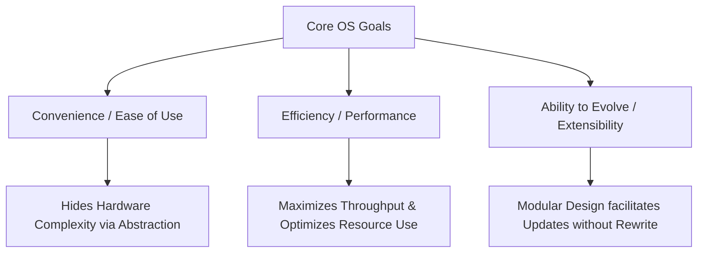

| Goal | Meaning |
|---|---|
| **Convenience** | Hides hardware behind a UI (GUI/CLI) |
| **Efficiency** | Maximise CPU utilisation & throughput; minimise response/turnaround time |
| **Evolvability** | Modular design → add drivers/features without rewriting the core |

## 1.5 Dual role: allocator + control program

**Resource Allocator** — adjudicates competing requests for CPU, memory, storage, I/O.

| Multiplexing | Meaning | Example |
|---|---|---|
| **Time (temporal)** | Shared sequentially over time | CPU scheduling |
| **Space (spatial)** | Divided simultaneously | RAM split into blocks |

**Efficiency mechanisms:**
- **Spooling** — queue slow I/O (printers) on disk so the CPU never blocks.
- **DMA** — a controller moves data between device and RAM while the CPU keeps working.

## 1.6 System components

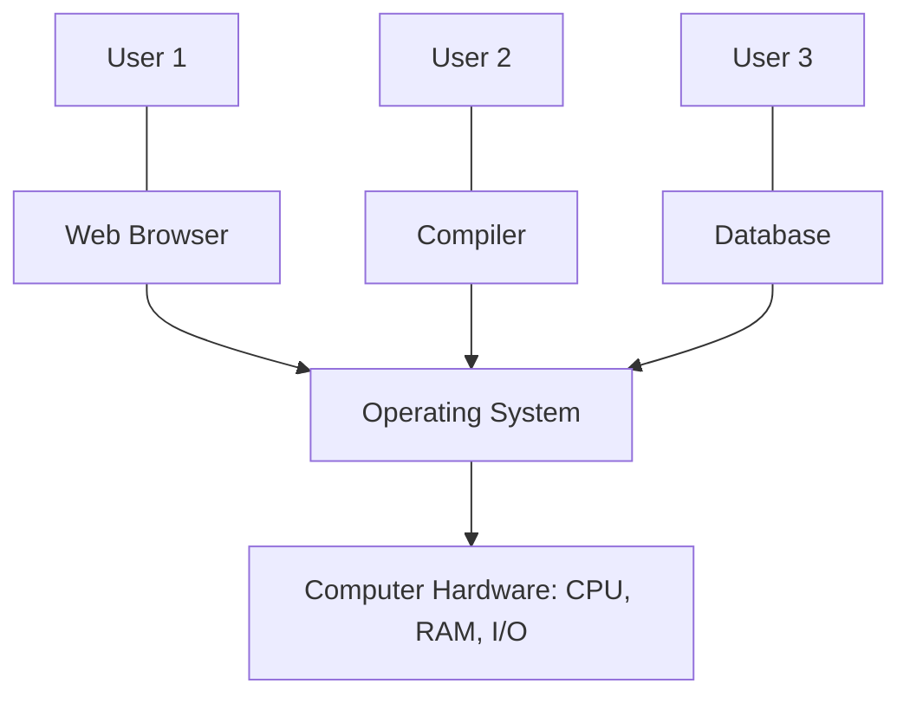

Four components: **Hardware → OS → Application programs → Users**.

## 1.7 Kernel vs OS

```
+--------------------------------------------------------+
|                  Application Programs                  |
+--------------------------------------------------------+
|     System Programs (Shells, Compilers, Daemons)       |  User Mode (Ring 3)
==========================[ System Call Interface ]=======
|  The Kernel (Scheduler, Memory Mgmt, VFS, Drivers)     |  Kernel Mode (Ring 0)
+--------------------------------------------------------+
|                     Physical Hardware                  |
+--------------------------------------------------------+
```

- **Kernel** = the single program always running, directly on hardware.
- **OS** = kernel + system programs + shell + daemons.

**Kernel subsystems:** Process Manager · Memory Manager · File System Manager · Device Driver Framework.

## 1.8 Two viewpoints

| View | Cares about |
|---|---|
| **User view** | Ease of use, responsiveness, battery life |
| **System view** | Interrupts, resource requests, state transitions, throughput, security |

## 1.9 Core OS functions

| Function | Responsibilities |
|---|---|
| **Main memory** | Track used/free memory, swap/paging, allocate & free (`malloc`/`free`) |
| **File management** | Create/delete files & dirs, read/write, map to secondary storage, backup |
| **I/O system** | Buffering, caching, spooling, uniform driver interface |
| **Secondary storage** | Free-space management, allocation (contiguous/linked/indexed), disk scheduling |

## ✅ Exam hits — Chapter 1

- Mode switch happens **only** via **interrupt, exception, or system call**.
- CPU scheduling = **time** multiplexing; RAM allocation = **space** multiplexing.
- Kernel ≠ OS. Kernel = always-resident core; OS = kernel + system programs.
- `SIGSEGV` = MMU detected an illegal access → trap → kernel terminates the process.

---

# 2. Evolution of Operating Systems

> **In one line:** Each era solved the previous era's idle-CPU problem — the constant theme is **maximising CPU utilisation**.

## 2.1 Timeline

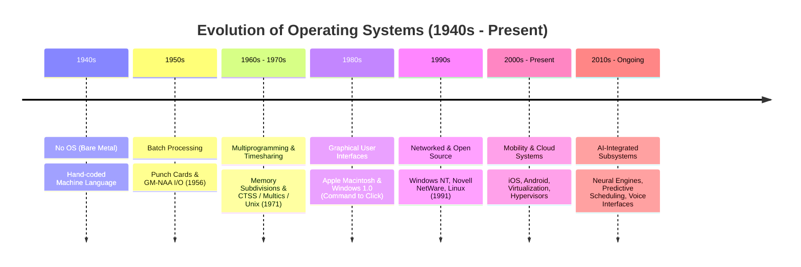

## 2.2 The eras

### (a) 1940s — Bare metal
- One user had the machine for a time slot; programs on paper tape/plugboards.
- No scheduling, no protection → any bug halted the whole machine.

```
[ Human Programmer ] ---> [ Hand-Coded Machine Language ] ---> [ Physical Circuits / Vacuum Tubes ]
```

### (b) 1950s — Batch processing
- **GM-NAA I/O (1956)** — first true OS prototype (IBM 704).
- Jobs on **punch cards** → operator batches them → **Resident Monitor** runs them.
- **Bottleneck:** mechanical I/O far slower than CPU → CPU idle.

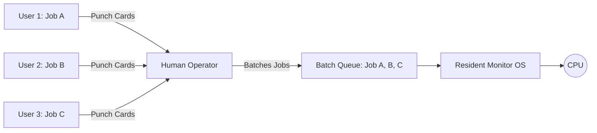

### (c) 1960s–70s — Multiprogramming & timesharing
- RAM split into partitions holding **multiple jobs**.
- On I/O wait → kernel context-switches to another **ready** job.
- **Timesharing** (CTSS 1961, Multics 1969) adds tiny time slices → each user feels sole access.
- **Unix (1971)** gave clean process/permission/file abstractions.

```
Monolithic Batch Memory Layout (1950s)
+------------------------------------------+
|  Resident Monitor (OS)                   |
+------------------------------------------+
|  User Job (CPU sits idle during I/O)     |
+------------------------------------------+

Multiprogramming Memory Layout (1960s)
+------------------------------------------+
|  Operating System Kernel                 |
+------------------------------------------+
|  Job 1 (Waiting for Disk I/O)            |  <-- CPU switches context to Job 2
+------------------------------------------+
|  Job 2 (Actively Executing on CPU)       |
+------------------------------------------+
|  Job 3 (Waiting in Ready Queue)          |
+------------------------------------------+
```

### (d) 1980s — PCs & GUI
- CP/M, MS-DOS returned to single-user/single-tasking (memory limits).
- **Macintosh (1984)**, **Windows (1985)** → GUI.
- Architectural shift: linear command loop → **asynchronous event-driven** kernel.

```
[ Command Line Interface ] --- 'dir /a /p' ---> [ Text Output Shell ]
[ Graphical Interface ]    --- User Click  ---> [ Event Loop Handler ] ---> [ WIMP Element (Windows, Icons, Menus, Pointer) ]
```

### (e) 1990s — Networked
- Windows NT, Novell NetWare; **TCP/IP stack inside the kernel**.
- Remote files (NFS/SMB) look local. **Linux (1991)** proves open-source monolithic kernels.

### (f) 2000s–present — Mobile & cloud
- iOS/Android = specialised forks of Darwin/XNU and Linux.

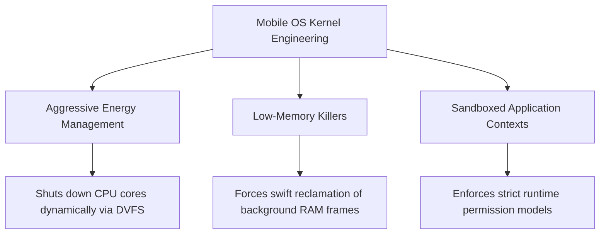

- **Cloud:** hypervisors (KVM, ESXi) run many isolated guest OSes on one host.

### (g) Now — AI in the kernel
- Predictive thread scheduling, page pre-fetching, adaptive power profiles.

## 2.3 Advantages vs risks of modern OS

| Advantages | Risks |
|---|---|
| Hardware abstraction + drivers | Single point of failure (kernel bug = crash) |
| Concurrency via scheduling | High-value malware target (rootkits) |
| Resource optimisation | OS itself consumes CPU/RAM |
| File & memory protection | Maintenance, patching, learning curve |

## ✅ Exam hits — Chapter 2

- **Multiprogramming = keep the CPU busy during I/O** (the definition to write).
- Batch processing could not multiprogram: one job in memory, no protection boundaries.
- GUI was not cosmetic — it required an **event-driven kernel**.
- Old models persist: batch in finance, embedded in industry, timesharing in HPC.

---

# 3. OS Architecture & Execution

> **In one line:** Architecture decides what runs in Ring 0; execution is a loop of traps, dispatch, and returns.

## 3.1 Three architectures

### Monolithic
Entire OS = one program in one address space in **Ring 0**; subsystems call each other directly.
- **Examples:** Linux, MS-DOS, traditional Unix, FreeBSD.
- **+** Peak performance, direct hardware access.
- **−** One driver bug → kernel panic; hard to maintain.

### Microkernel
Kernel keeps only **IPC, basic scheduling, primitive VM**. File systems, network, drivers run as **user-space servers (Ring 3)**.

```
+-------------------------------------------------------------------------+
|  User Space (Ring 3)                                                    |
|  [App/Client] ------> [File Server] ------> [Network] ------> [Drivers] |
|        ^                     ^                                          |
|        +-----(via IPC)-------+                                          |
+-------------------------------------------------------------------------+
=============================[ Kernel Boundary ]===========================
+-------------------------------------------------------------------------+
|  Kernel Space (Ring 0)                                                  |
|  [ IPC ] <-----------------> [ Basic Scheduling ] <---> [ Primitive VM ]|
+-------------------------------------------------------------------------+
```

- **Examples:** Mach (macOS/iOS core), QNX, Minix 3, L4.
- **+** Fault isolation (restart a crashed server), small attack surface, extensible.
- **−** IPC = **double context switch** → slower.

### Hybrid
Microkernel-style modularity, but performance-critical services (graphics, network) pulled back into Ring 0.
- **Examples:** Windows NT (10/11/Server), macOS/iOS (**XNU** = Mach + FreeBSD).
- **+** Near-monolithic speed with modular structure; loadable kernel modules.
- **−** Complex boundaries; a Ring 0 graphics driver can still crash everything.

| Feature | Monolithic | Microkernel | Hybrid |
|---|---|---|---|
| Services in Ring 0 | All | Minimum | Critical ones |
| Speed | Highest | Lowest | High |
| Fault isolation | Poor | Best | Medium |
| Examples | Linux, Unix | QNX, Minix | Windows NT, XNU |

## 3.2 Process states

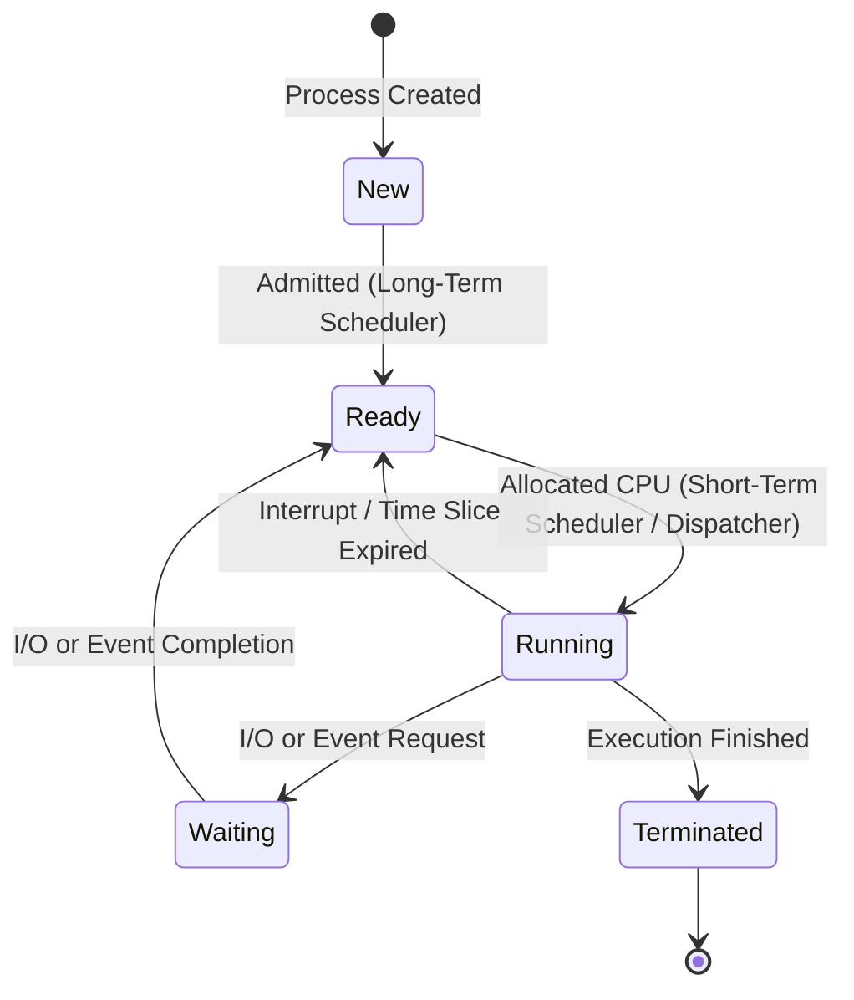

**Context switch:** save registers of A into its **PCB** → load B's PCB → set PC to B's next instruction.

## 3.3 Memory management

- Virtual address space split into **pages**; physical RAM into **frames**.
- **MMU** translates via **page tables** → process A cannot touch B's frames.

## 3.4 Virtual File System (VFS)

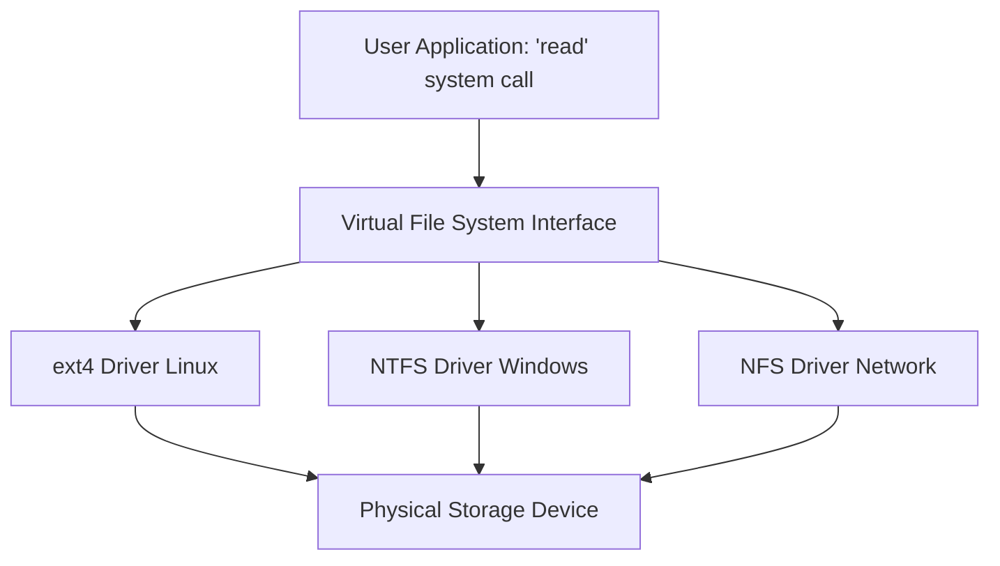

VFS defines uniform objects (`inode`, `file`, `superblock`, `dentry`); `read()` is dispatched to the concrete driver's function pointer.

## 3.5 System call execution

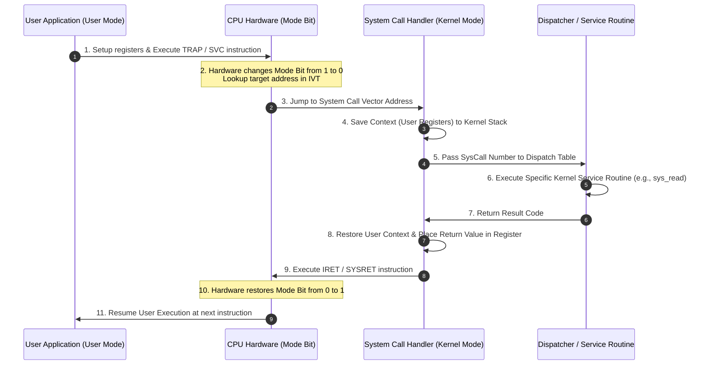

**Four phases:**
1. **Initiate** — app loads parameters into registers and executes `TRAP`/`SVC`/`SYSCALL`.
2. **Mode switch** — hardware flips the mode bit, reads the **IVT**, jumps to the handler.
3. **Dispatch** — handler saves registers, indexes the **system call dispatch table**, calls e.g. `sys_write()`.
4. **Return** — result in `rax`, stack cleaned, `IRET`/`SYSRET` restores user mode.

## 3.6 Boot sequence

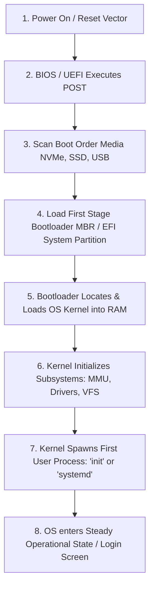

| Stage | Detail |
|---|---|
| **Reset vector** | CPU starts in Real Mode at `0xFFFFFFF0` (firmware) |
| **POST** | BIOS/UEFI tests RAM, enumerates PCI, initialises graphics |
| **Bootloader** | Legacy: first 512 B **MBR**. UEFI: **EFI System Partition** (FAT32) |
| **Kernel** | GRUB loads `vmlinuz`, decompresses, jumps to it |
| **PID 1** | Kernel mounts `/` and starts `init`/`systemd` (`smss.exe` on Windows) |

## ✅ Exam hits — Chapter 3

- Microkernel slowness = **4 switches** (app→kernel→server→kernel→app).
- User code **cannot** jump to kernel addresses; only a `TRAP` through the IVT is legal.
- Dispatch table = array of function pointers → prevents arbitrary kernel code execution.
- VFS = **polymorphism in C** via `struct file_operations`.

---

# 4. OS as a Service & Process Management

> **In one line:** A process is a running program with its own address space, state, and PCB — and switching between them is pure overhead.

## 4.1 Program vs process

| Program | Process |
|---|---|
| Passive file on disk | Active execution in RAM |
| No state | Address space, registers, stack, PCB |

## 4.2 OS as a Service (OSaaS)

The OS layer is abstracted away from the user; a provider manages kernel, drivers, and resources.

- **Containers:** Linux **namespaces** (isolation) + **cgroups** (resource limits) share one host kernel.
- **Serverless:** scales 0 → thousands of instances on events.
- **Virtualisation:** guest OS talks to a **hypervisor/VMM** via paravirtualised drivers.

## 4.3 Single-tasking vs multitasking

| Single-tasking | Multitasking |
|---|---|
| One process owns all memory/registers | RAM split into per-process regions |
| Runs until `exit` | **Timer interrupt** preempts; short-term scheduler switches |
| CPU starves during I/O | CPU stays busy |

## 4.4 CPU-bound vs I/O-bound

```
CPU-Bound Process Cycle:
+------------------------+      +------------------------+
|   Long CPU Burst       | ---> | Short I/O Wait Phase   |
+------------------------+      +------------------------+

I/O-Bound Process Cycle:
+------------------------+      +------------------------+
| Short CPU Burst        | ---> |  Long I/O Wait Phase   |
+------------------------+      +------------------------+
```

| Type | Behaviour | Examples |
|---|---|---|
| **CPU-bound** | Long CPU bursts, rare I/O | Video encoding, simulations, crypto, ML training |
| **I/O-bound** | Short bursts, long waits | Web servers, DBMS, editors, file transfer |

## 4.5 Process creation (`fork` + `exec`)

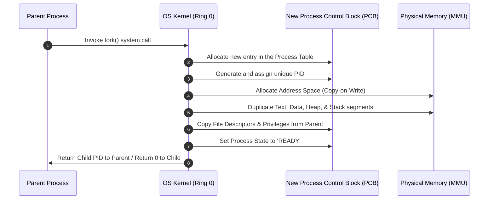

**Five steps:** PID allocation → PCB construction → address space (**Copy-on-Write**) → inherit fds/credentials/env → state `READY` + enqueue.

> ⭐ `fork()` returns **twice**: child PID to parent, **0** in the child.

## 4.6 Termination, zombies, orphans

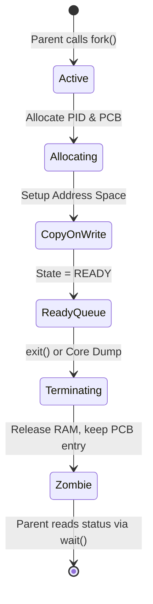

| Term | Meaning |
|---|---|
| **Zombie** | Child exited; RAM freed but PCB entry kept until parent calls `wait()`. Too many → **PID exhaustion**. |
| **Orphan** | Parent died first; adopted by PID 1 (`init`/`systemd`). |

## 4.7 Context switching

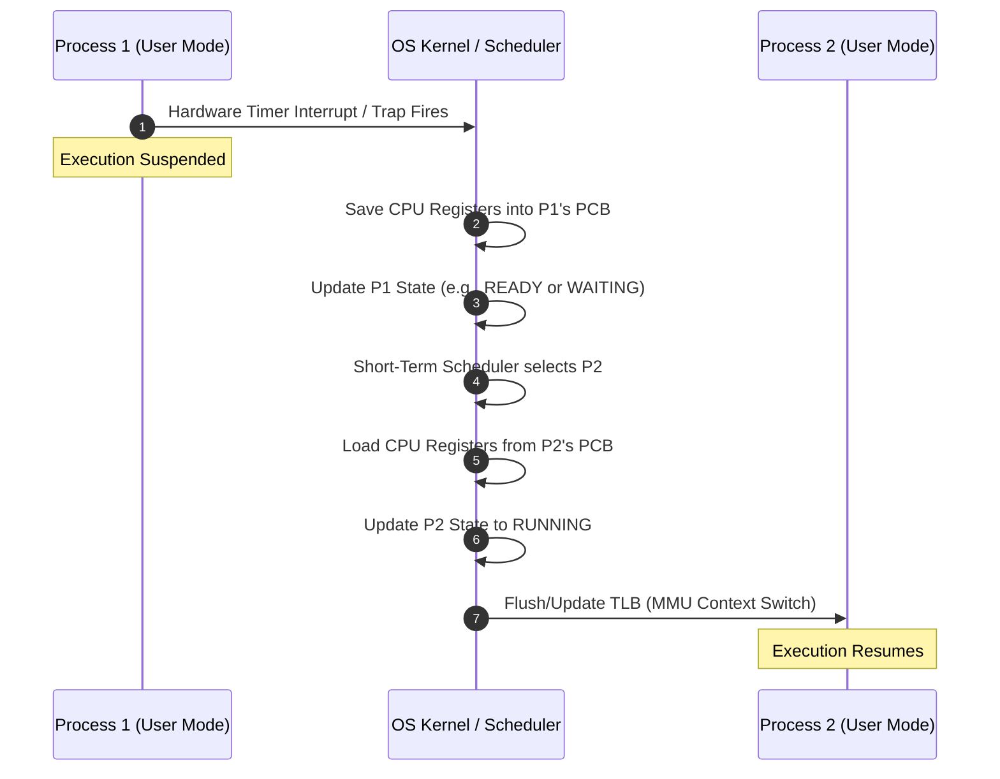

**Costs:**
- **Direct:** save/restore registers, swap page-table pointer.
- **Indirect ("cache cold"):** TLB flush + L1/L2/L3 eviction → the new process starts slow.

## 4.8 The management subsystems

### CPU scheduling
- **Non-preemptive** — process keeps CPU until it blocks/exits (FCFS).
- **Preemptive** — kernel can preempt (Round Robin, MLFQ).

### IPC

| Mechanism | Model | Kernel involvement | Speed |
|---|---|---|---|
| **Shared memory** | Same frames mapped into both page tables | Low (setup only) | Fastest |
| **Message passing** | Kernel buffers (`msgsnd`/`msgrcv`) | High (syscall per message) | Slow |
| **Pipes / sockets** | Byte streams | High | Moderate |

### Synchronisation
- **Race condition** — result depends on timing.
- **Critical section** — code touching shared data; needs **mutual exclusion**.
- **Mutex** — one holder, **ownership** (only the locker may unlock).
- **Semaphore** — counter with atomic `wait()`/`P` and `signal()`/`V`; **no ownership**.

### Deadlock — 4 Coffman conditions (all must hold)

1. **Mutual exclusion**
2. **Hold and wait**
3. **No preemption**
4. **Circular wait**

## ✅ Exam hits — Chapter 4

- `fork()`: parent gets PID, child gets **0**.
- Thread switch < process switch: **same address space → no TLB flush**.
- Zombie ≠ orphan. Zombie waits for `wait()`; orphan is adopted by PID 1.
- Mutex has **ownership**; a semaphore does not.
- MLFQ infers behaviour: full time slice used → demote (CPU-bound); early yield → stay high (I/O-bound).

---
---

# PART II — LINUX FOUNDATIONS

---

# 5. FOSS & Linux

> **In one line:** FOSS is about **freedom, not price**; Linux is only the **kernel** — a distribution is kernel + everything else.

## 5.1 FOSS

**FOSS = Free and Open Source Software** — software whose licence grants users the right to use, study, modify, and share it.

**Not the same as:** free of cost · bug-free · unlicensed · uniform licences · automatically secure.

| Source code | Executable |
|---|---|
| Human-readable instructions | Machine-runnable binary |

```
Source code
    |
    | compiler / interpreter / build tools
    v
Runnable program
```

## 5.2 The four freedoms

| # | Freedom | Meaning |
|---|---|---|
| **0** | Run | Use the program for any purpose |
| **1** | Study & change | Inspect and modify (needs source access) |
| **2** | Redistribute copies | Share with others |
| **3** | Distribute modified versions | Publish improvements |

**Memory aid:** *Run → Study/change → Share → Share changes.*

**GPL** = a **copyleft** licence: distributing modified versions carries source-code and licensing obligations. Not every open-source licence is copyleft (some are permissive).

**History:** 1984 GNU Project (Stallman) → 1991 Linux kernel (Torvalds). GNU and Linux are **separate projects** that combine into GNU/Linux.

## 5.3 Kernel vs distribution

| Term | Meaning |
|---|---|
| **Linux kernel** | Core managing CPU, memory, devices, filesystems, network, IPC, security |
| **GNU tools** | Bash, GCC, coreutils, libraries |
| **Distribution** | Installable system: bootloader + kernel + init + libraries + shell + package manager (+ GUI) |
| **GNU/Linux** | Common name for kernel + GNU components |

**Distro families:** Debian-based (Debian, Ubuntu, Mint → APT/dpkg) · Red Hat-related (RHEL, Fedora → RPM/DNF) · Others (Arch, SUSE, Kali) · Non-Linux (FreeBSD, GNU/Hurd — *not* Linux).

**Android** uses the Linux **kernel** but has its own userspace, framework, and runtime.

## 5.4 Layers

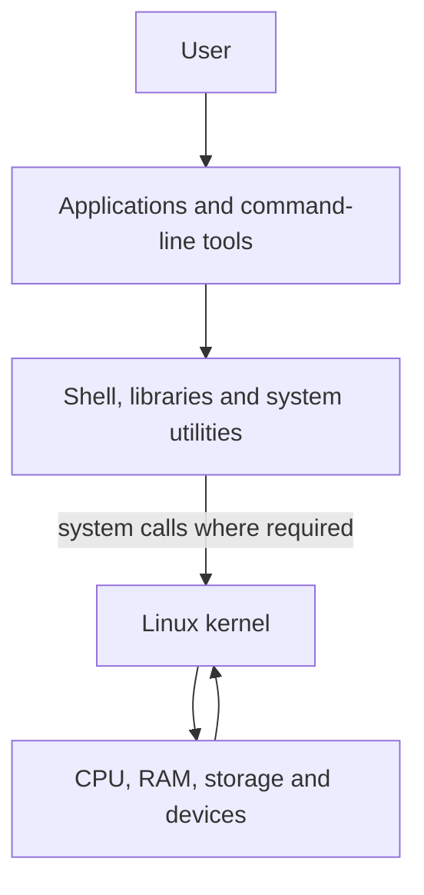

The **shell interprets commands; it is not the kernel.** Applications reach the kernel through libraries and **system calls**.

## 5.5 Linux features

Multi-user · multitasking · multithreading · multiprocessing · networking/clustering · wide hardware support · many filesystems (ext4, XFS, Btrfs) · privilege separation (root vs user).

> ⚠️ Linux is **not immune** to malware. Permissions help; updates, least privilege, and backups are still required.

**Three access modes:** CLI-only · manual/hybrid graphical · graphical desktop by default.

## 5.6 Boot process

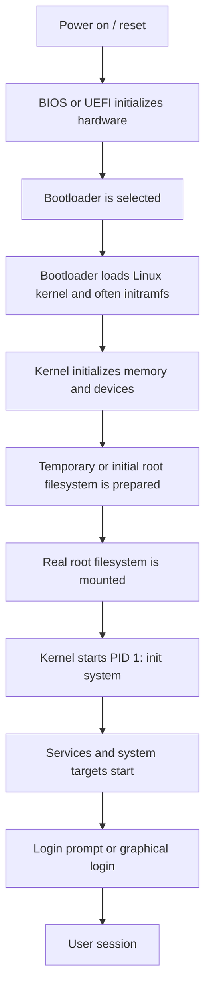

**initramfs** = temporary in-memory root holding the drivers/tools needed to mount the real root (e.g. storage or encryption drivers).

Useful checks: `uname -r` · `ps -p 1 -o pid,comm,args` · `systemctl get-default` · `journalctl -b`.

## 5.7 Kernel architecture

**Monolithic but modular:**
- Monolithic — process, memory, network, filesystem all run in kernel space.
- Modular — **loadable kernel modules (LKMs)** add drivers/features at runtime.

```mermaid
sequenceDiagram
    participant A as User application
    participant L as C library / runtime
    participant K as Kernel
    participant D as Device or filesystem

    A->>L: Call an OS-related function
    L->>K: System call request
    Note over K: Switch to kernel mode; validate request
    K->>D: Perform required operation
    D-->>K: Result or error
    K-->>L: Return value
    L-->>A: Result available in user space
```

| Subsystem | Responsibility |
|---|---|
| System-call interface | Entry point for user requests |
| Process management / scheduler | Create tasks, choose who runs |
| Memory management | Virtual→physical mapping, protection |
| VFS | Uniform interface over filesystems |
| Device drivers | Kernel ↔ hardware translation |
| Networking | Protocol stack, sockets |
| IPC | Pipes, signals, shared memory, queues |
| Security | Permissions, LSM |

Module inspection: `lsmod` · `modinfo NAME` · `uname -r`.

## 5.8 Filesystem Hierarchy Standard (FHS)

```
/
├── bin       Essential user commands (may link to /usr/bin)
├── boot      Bootloader files, kernel images, initramfs
├── dev       Device files and device interfaces
├── etc       System-wide configuration
├── home      Regular users' home directories
├── lib       Essential libraries (may link to /usr/lib)
├── media     Mount points for removable media
├── mnt       Temporary/manual mount points
├── opt       Optional/add-on application packages
├── proc      Virtual view of process and kernel information
├── root      Home directory of the root administrator
├── run       Volatile runtime data
├── sbin      Essential system commands (may link to /usr/sbin)
├── srv       Data served by services
├── sys       Kernel/device information through sysfs
├── tmp       Temporary files
├── usr       Most user-space applications, libraries and shared data
└── var       Variable data, such as logs, caches and spools
```

| Path | Purpose |
|---|---|
| `/` | Root of the whole tree |
| `/etc` | Configuration |
| `/home` | User data |
| `/root` | Root user's home (**not** `/`) |
| `/boot` | Kernel + initramfs |
| `/dev` | Device nodes |
| `/proc`, `/sys` | **Virtual** kernel/device interfaces |
| `/var` | Changing data: logs, caches, spools |
| `/tmp` | Temporary, cleanup policy varies |
| `/usr` | Applications, libraries, docs |
| `/srv` | Served data |
| `/run` | Runtime state since boot |

## ✅ Exam hits — Chapter 5

- **FOSS = freedom, not price.** Four freedoms in order.
- **Linux = kernel; distro = kernel + system software.**
- Boot flow: firmware → bootloader → kernel/initramfs → root FS → PID 1 → services → login.
- `/` vs `/root`; `/boot` vs `/boot/efi`; `/proc` is virtual.
- **Shell ≠ terminal ≠ kernel.**

---

# 6. Partitioning in Linux

> **In one line:** A partition is a region of a disk; a filesystem organises it; a mount point attaches it to the tree. They are three different things.

## 6.1 Core concepts

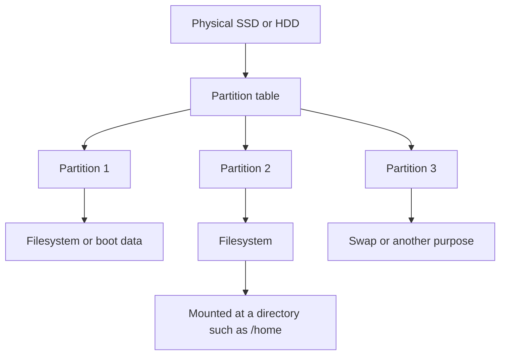

| Term | Meaning |
|---|---|
| **Partition** | Logical region of a disk |
| **Partition table** | Metadata describing the partitions (GPT/MBR) |
| **Filesystem** | Structure organising files (ext4, XFS, Btrfs) |
| **Mount point** | Directory where a filesystem is attached |
| **Swap** | Disk-backed virtual-memory space (not mounted normally) |
| **ESP** | FAT partition holding UEFI bootloader files |
| **LVM** | Flexible logical-volume layer |

## 6.2 Why partition?

| Benefit | Reality check |
|---|---|
| **Isolation of space** — a full `/var/log` won't eat `/` | A full partition still breaks its own services |
| **Easier reinstalls** — reuse `/home` | **Not a backup**; may still break with different UIDs |
| **Mount policies** — `ro`, `noexec`, `nosuid`, `nodev` | Defence in depth, not a malware blocker |
| **Capacity planning** — separate DB/logs | Adds sizing complexity |

## 6.3 Common mount points

| Mount | Typical size | Purpose |
|---|---|---|
| `/` | 30–80 GB | OS + apps |
| `/home` | Remaining / 60–150+ GB | User data |
| `swap` | Workload-dependent | Memory pressure, hibernation |
| `/boot` | 1–2 GB | Kernel + initramfs |
| `/boot/efi` | 500 MB–1 GB | ESP (FAT32) |
| `/var` | 10–100 GB | Logs, caches, spools |
| `/tmp` | 2–30 GB | Temporary (often `tmpfs`) |
| `/srv`, `/data` | Remaining | Served/app data |
| `/var/lib/mysql`, `/var/www`, `/var/log` | Enterprise split | DB, web, logs |

## 6.4 MBR vs GPT (and BIOS vs UEFI)

| Feature | MBR | GPT |
|---|---|---|
| Full name | Master Boot Record | GUID Partition Table |
| Usual firmware | Legacy BIOS | UEFI |
| Limits | ~2 TiB (512 B sectors), 4 primary entries | Large disks, many partitions |
| Redundancy | Metadata only in MBR | Primary + backup + checksums |
| Recommendation | Legacy systems | New UEFI systems |

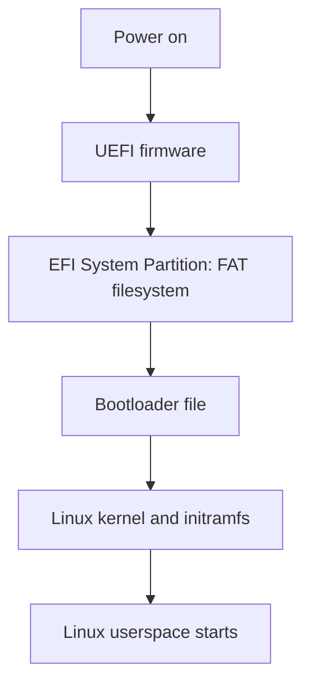

> ⭐ **GPT is a partition-table format; UEFI is a firmware interface.** Related, not synonyms.

## 6.5 Dual-boot with Windows 11

**Before:** full backup → save **BitLocker recovery key** → check Fast Startup/hibernation → shrink Windows volume via Disk Management → confirm UEFI mode + identify existing ESP → verify installer USB.

| Partition | FS | Example size | Mount |
|---|---|---|---|
| Existing ESP | FAT32 | Reuse | `/boot/efi` |
| Windows C: | NTFS | ~200 GB | keep intact |
| Linux root | ext4/Btrfs | 40–60 GB | `/` |
| Linux home | ext4/Btrfs | 60–150+ GB | `/home` |
| Swap | swap | 4–8 GB | swap |
| Shared data (opt.) | exFAT | remaining | mount when needed |

⚠️ Never format a partition you cannot positively identify. Reuse the existing ESP.

## 6.6 Layouts

**Home / SOHO (500 GB):** ESP 512 MB–1 GB · `/` 50–80 GB · `/home` remaining (~400 GB) · swap 4 GB (or sized for hibernation).

**Server (1 TB):** `/boot/efi` 1 GB · `/boot` 1 GB · `/` 40 GB · swap 8–16 GB · `/var` 100 GB · `/srv`/`/data` remaining (~840 GB).

**Enterprise LAMP (1 TB):**

| Area | Size | Mount | FS | Options |
|---|---|---|---|---|
| ESP | 1 GB | `/boot/efi` | FAT32 | `defaults` |
| Boot | 2 GB | `/boot` | ext4 | `defaults` |
| Root | 40 GB | `/` | ext4 | `errors=remount-ro` |
| MySQL | 400 GB | `/var/lib/mysql` | XFS | `noatime,nodiratime` |
| Web | 300 GB | `/var/www` | ext4 | `defaults,nosuid,nodev` |
| Logs | 100 GB | `/var/log` | ext4 | `defaults,nosuid,nodev,noexec` |
| Temp | 30 GB | `/tmp` | ext4 | `defaults,nosuid,nodev,noexec` |
| Swap | 32 GB | — | swap | `sw` |
| Reserve | ~95 GB | — | — | contingency |

**ext4 vs Btrfs:** ext4 = mature, universal, simple default. Btrfs = snapshots + subvolumes, needs management. Neither replaces backups.

## 6.7 Mount options

| Option | Effect | Caveat |
|---|---|---|
| `defaults` | `rw,suid,dev,exec,auto,nouser,async` | Varies by FS |
| `ro` | Read-only | Not encryption |
| `noexec` | No direct binary execution | Not a full malware block |
| `nosuid` | Ignores SUID/SGID | Not a replacement for least privilege |
| `nodev` | Ignores device-special files | Defence in depth |
| `noatime` / `nodiratime` | Skip access-time writes | Check app needs |
| `errors=remount-ro` | Remount read-only on FS error | Not a recovery guarantee |
| `nofail` | Boot continues if device missing | Essential for removable/NAS |

**fstab line format:**

```text
UUID=<filesystem-uuid>  /data  ext4  defaults  0  2
# device | mountpoint | type | options | dump | pass
```

## 6.8 Static partitions vs LVM

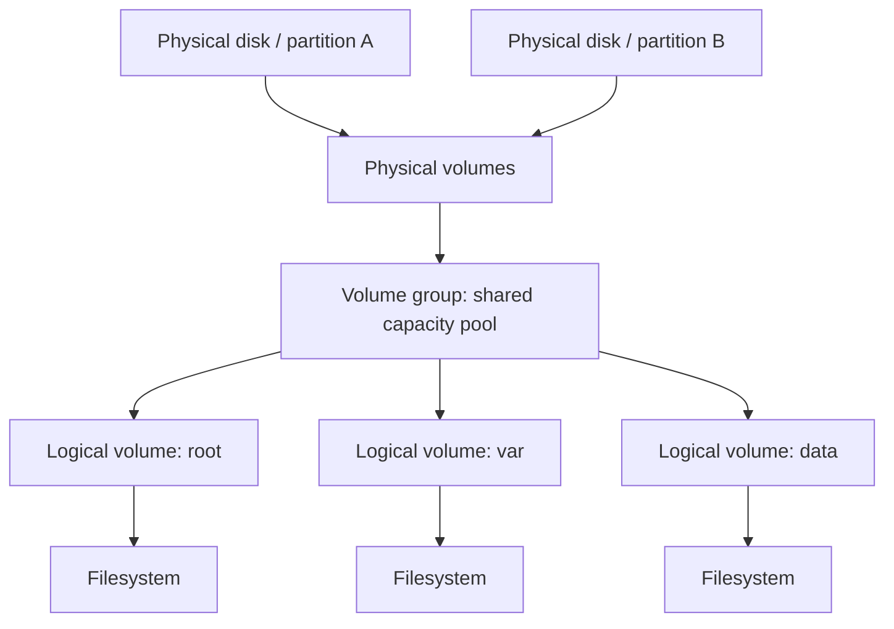

| Term | Meaning |
|---|---|
| **PV** | Physical Volume — disk/partition initialised for LVM |
| **VG** | Volume Group — pool of capacity |
| **LV** | Logical Volume — virtual block device from the pool |

**LVM pros:** grow volumes from free VG space, span disks, abstract physical layout.
**Limits:** VG must have free space; shrinking is risky; still needs filesystem resize.

## 6.9 Planning workflow

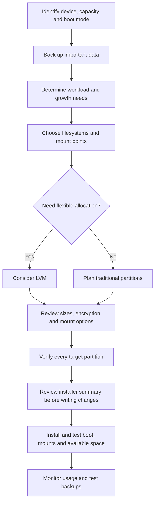

Inspection: `lsblk -f` · `findmnt` · `df -hT` · `pvs`/`vgs`/`lvs` · `blkid`.

## ✅ Exam hits — Chapter 6

- Partition ≠ filesystem ≠ mount point.
- **GPT ≠ UEFI.** `/boot` ≠ `/boot/efi`.
- `/home` partition is **not a backup**.
- Swap is **slow**, not "extra RAM".
- `noexec/nosuid/nodev` reduce risk; they do not eliminate it.
- LVM order: **PV → VG → LV → filesystem**.

---
---

# PART III — COMMAND LINE & ACCESS CONTROL

---

# 7. Linux Command Line

> **In one line:** The terminal displays, the shell interprets, the kernel executes.

## 7.1 Shell vs terminal

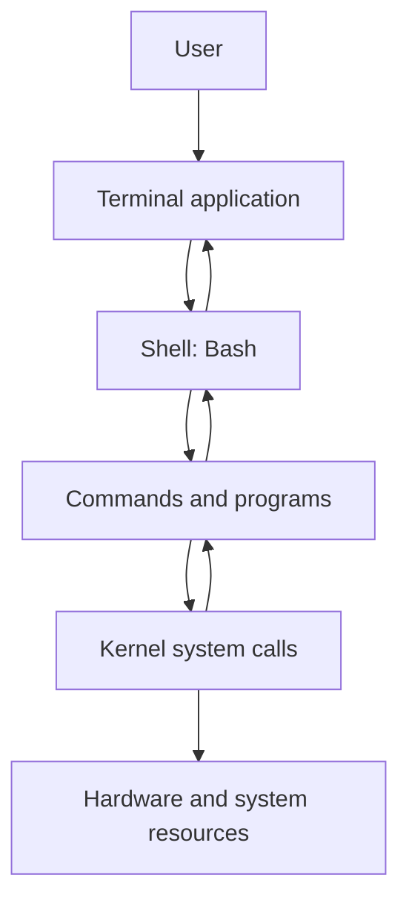

| Term | Meaning |
|---|---|
| **Shell** | Command interpreter (Bash, Zsh, Fish) |
| **Bash** | Bourne Again Shell — Linux's default + scripting language |
| **Terminal emulator** | GUI app showing a terminal session |
| **Virtual console (TTY)** | Text-only login session |

**Shell functions:** parse commands → execute programs → handle I/O (pipes/redirection) → run scripts → manage environment.

## 7.2 The prompt

```text
sandra@localhost:~$
```

| Part | Meaning |
|---|---|
| `sandra` | Username |
| `localhost` | Hostname |
| `~` | Home directory |
| `$` | Normal user (`#` = root) |

Verify identity with `whoami` — symbols are conventions, not guarantees.

## 7.3 Paths

```mermaid
flowchart TD
    R["/ (root directory)"] --> H["/home"]
    R --> E["/etc"]
    R --> U["/usr"]
    R --> V["/var"]
    H --> D["/home/sandra"]
    D --> DL["Downloads"]
    D --> DOC["Documents"]
```

| Symbol | Meaning |
|---|---|
| `/` | Root + separator |
| `.` | Current directory |
| `..` | Parent |
| `~` | Home |
| `-` (in `cd -`) | Previous directory |

| Absolute path | Relative path |
|---|---|
| Starts at `/`, location-independent | Interpreted from the current directory |
| `/home/sandra/Downloads` | `Downloads`, `../notes.md` |

Navigation: `pwd` (`-L` logical, `-P` physical) · `cd /etc` · `cd ..` · `cd ~` · `cd -`.

## 7.4 Getting help

| Tool | Purpose |
|---|---|
| `man ls` | Full manual page |
| `ls --help` | Short option summary |
| `help cd` | Bash built-ins |
| `info coreutils` | GNU Info docs |
| `apropos partition` | Search descriptions |
| `whatis ls` | One-line description |

`man` keys: `Space`/`b` page · `/word` search · `n` next · `q` quit.

## 7.5 Files and names

- Case-sensitive; leading `.` = hidden; extensions are conventions only.
- Name component limit ≈ **255 bytes** (FS-dependent).
- Avoid spaces; quote/escape if needed.

| Command | Purpose |
|---|---|
| `ls -l` | Long format |
| `ls -a` | Include hidden |
| `ls -lh` | Human-readable sizes |
| `ls -t` / `-r` | By time / reverse |
| `ls -R` | Recursive |
| `ls -S` | By size |
| `ls -i` | Inode numbers |
| `ls -F` | Type indicators |

Viewing: `cat` (short) · `less` (long, `q` quits) · `head -n 5` · `tail -n 10` · `tail -f log`.

## 7.6 File operations

```mermaid
flowchart TD
    A[Choose source path] --> B{Desired action?}
    B -->|Duplicate| C[cp source destination]
    B -->|Move or rename| D[mv source destination]
    B -->|Create| E[touch or mkdir]
    B -->|Delete| F[rm or rmdir]
    F --> G[Check path and target carefully]
```

| Command | Purpose |
|---|---|
| `touch f` | Create empty / update timestamps |
| `mkdir d` / `mkdir -p a/b/c` | Create dir / nested dirs |
| `cp f g` / `cp -r dir dir2` | Copy / recursive copy |
| `mv old new` | Move or rename |
| `rm f` / `rm -r dir` | Delete / recursive delete |
| `rmdir d` | Delete **empty** dir |

> ⚠️ `rm` has **no trash**. Check `pwd` and `ls` first. `shred` is **not** reliable on SSDs, CoW filesystems, RAID, or network storage.

## 7.7 Wildcards (globbing)

The **shell** expands patterns before the command runs.

| Pattern | Matches |
|---|---|
| `*` | Zero or more characters (not leading `.`) |
| `?` | Exactly one character |
| `[abc]` | One char from the set |
| `[a-d]` | One char in the range |
| `[!abc]` | One char **not** in the set |

With `file1.log fileA.log file10.log notes notes.txt .env`:
- `file?.log` → `file1.log`, `fileA.log` (not `file10.log`)
- `*.txt` → `notes.txt`
- `*.*` → requires a dot → misses `notes`

> ⚠️ **Preview before deleting:** `ls -- a*.txt` or `printf '%s\n' a*.txt`.

## 7.8 System information

| Command | Shows |
|---|---|
| `date`, `date -u`, `date +%D`, `date +%T` | Local/UTC/formatted time |
| `free -h` | RAM + swap |
| `df -hT` | Filesystem usage + type |
| `du -sh dir/` | Directory size |
| `uname -a` | Kernel/system info |
| `lscpu` | CPU topology |
| `lsblk -f` | Block devices + FS |
| `lsusb`, `lshw` | USB / hardware inventory |
| `whoami`, `id` | Identity / UID+GIDs |
| `last -n 2` | Recent logins |
| `dmesg` | Kernel ring buffer |

**`df` vs `du`:** `df` = whole mounted filesystem; `du` = space used by given paths.

## 7.9 Productivity

| Action | Effect |
|---|---|
| ↑ / ↓ | Browse history |
| `Ctrl + R` | Search history |
| `Tab` / `Tab Tab` | Complete / list completions |

| Command | Purpose |
|---|---|
| `which python3` | Find executable in `PATH` (unreliable for built-ins) |
| `command -v cd` | Shell's resolution |
| `type ls` | How Bash interprets a name |
| `alias gtd='cd ~/Documents'` | Define shortcut (persist in `~/.bashrc`) |

## 7.10 Privileges

| Level | Rights |
|---|---|
| Standard user | Limited |
| Root | Unrestricted |
| Sudo-enabled user | Selected commands elevated |

| Command | Purpose |
|---|---|
| `sudo -l` | List permitted commands |
| `sudo cmd` | Run one command elevated |
| `sudo -i` | Root login shell |
| `su -` | Switch user (root by default) |
| `passwd` | Change own password |
| `sudo passwd alice` | Change another's password |

```mermaid
flowchart TD
    A[Need to perform an admin task] --> B[Can it be done as a normal user?]
    B -->|Yes| C[Use normal user privileges]
    B -->|No| D[Check authorization with sudo -l]
    D --> E[Run only the required command with sudo]
    E --> F[Verify the result]
```

Ubuntu-style desktops disable direct root login → use `sudo`.

## ✅ Exam hits — Chapter 7

- Terminal ≠ shell ≠ kernel.
- Absolute path starts with `/`; relative depends on CWD.
- `*` does not match hidden files; `*.*` misses extensionless names.
- `df` = filesystem, `du` = directory usage.
- `sudo` = one command with **your** password; `su` = switch account with **that account's** password.

---

# 8. Linux Access Control

> **In one line:** Every access asks three questions — *who are you*, *what may you become*, *what may you touch*.

## 8.1 The multi-user model

Linux is multi-user and multi-tasking: users share the machine but are **isolated** by permissions.

| Pillar | Question | Mechanism |
|---|---|---|
| **Identity** | Who are you? | UID/GID, `/etc/passwd` |
| **Privilege delegation** | What may you become? | `sudo`, `/etc/sudoers` |
| **Resource protection** | What may you touch? | Permission bits, ownership, `umask` |

```mermaid
flowchart TD
    A[User logs in] --> B{Who are you?<br/>Identity Management<br/>UID / GID from /etc/passwd}
    B --> C{What may you do?<br/>Privilege Delegation<br/>sudo + /etc/sudoers}
    C --> D{What may you touch?<br/>Resource Protection<br/>Permission bits on files}
    D --> E[Access Granted / Denied]
```

## 8.2 Account types

| Type | UID (Debian/Ubuntu) | UID (RHEL/CentOS) | Purpose |
|---|---|---|---|
| **root** | `0` | `0` | Unrestricted |
| **System** | `1–999` | `1–499` | Services (`www-data`, `sshd`) — no login shell |
| **Regular** | `1000+` | `500+` (historically) | Human users |

The kernel only ever uses the **number**. System accounts use `/sbin/nologin` or `/bin/false` → least privilege.

## 8.3 Root

- UID **0**; bypasses permission checks (even mode `000` is readable).
- Can bind **privileged ports (<1024)**.
- Manages credentials, hardware, system state.
- ⚠️ One typo (`rm -rf /`) destroys the system — hence `sudo`.

## 8.4 sudo

Runs a command as root using **your own password**, with logging and per-command rules.

| Benefit | Explanation |
|---|---|
| **Least privilege** | Work unprivileged, elevate only when needed |
| **Audit trail** | Logged (`/var/log/auth.log` Debian, `/var/log/secure` RHEL) |
| **Fine-grained** | Limit users to exact commands |

**Flow:** `sudo cmd` → check `/etc/sudoers` + `/etc/sudoers.d/` → prompt for **your** password → run elevated → log → drop back.

`su` switches accounts (needs the target's password); `sudo` runs one command.

## 8.5 Configuration files

```mermaid
flowchart LR
    ETC["/etc"] --> P["/etc/passwd<br/>User account database<br/>(world-readable, 644)"]
    ETC --> S["/etc/shadow<br/>Encrypted passwords + policy<br/>(root-only, 600/640)"]
    ETC --> G["/etc/group<br/>Group definitions<br/>(world-readable, 644)"]
    ETC --> SU["/etc/sudoers<br/>sudo authorization rules<br/>(edit with visudo)"]
    P -. "hash actually stored here" .-> S
```

### `/etc/passwd` — 7 fields, mode 644

```
username:password_placeholder:UID:GID:GECOS:home_directory:login_shell
gaurav:x:1001:1001:Gaurav Pant,,,:/home/gaurav:/bin/bash
```

| # | Field | Meaning |
|---|---|---|
| 1 | Username | Login name |
| 2 | Password | `x` = hash in `/etc/shadow`; `*`/`!` = login disabled |
| 3 | UID | `0` root · `1–999` system · `1000+` regular |
| 4 | GID | Primary group |
| 5 | GECOS | Comment: full name, office, phone |
| 6 | Home | Absolute path |
| 7 | Shell | `/bin/bash` or `nologin`/`false` |

Tools: `getent passwd` · `vipw` (locking editor).

### `/etc/shadow` — 9 fields, mode 600/640

```
username:hash:last_changed:min:max:warn:inactive:expires:reserved
gaurav:$6$vQ9x...$8Z1y:19820:0:90:7:::
```

| # | Field | Meaning |
|---|---|---|
| 1 | Username | Matches passwd |
| 2 | Hash | `$id$salt$hash` — `$1$` MD5, `$5$` SHA-256, `$6$` SHA-512, `$y$` yescrypt; `!`/`*` = locked |
| 3 | Last change | Days since epoch |
| 4 | Min age | Days before password may change again |
| 5 | Max age | Days before mandatory change |
| 6 | Warn | Days of warning before expiry |
| 7 | Inactive | Days after expiry before account disabled |
| 8 | Expires | Absolute expiry (days since epoch) |
| 9 | Reserved | Unused |

**Salt** → identical passwords get different hashes → defeats rainbow tables.
Tools: `chage`, `passwd`, `vipw -s`.

### `/etc/group` — 4 fields, mode 644

```
group_name:group_password:GID:user_list
developers:x:1005:gaurav,alice,bob
```

| Type | Defined in | Effect |
|---|---|---|
| **Primary group** | `/etc/passwd` field 4 | Owns newly created files |
| **Secondary groups** | `/etc/group` | Extra permissions; zero or many |

⚠️ `usermod -G` **replaces**; always `usermod -aG`. `vigr` for safe edits.

### `/etc/sudoers`

```
gaurav ALL=(ALL:ALL) ALL
# user | hosts | (run-as user:group) | commands
```

Edit only with **`visudo`** — it validates syntax before saving.

## 8.6 Permission model

Each file has **owner**, **group**, and **mode bits**. Checks are **exclusive**, in order:

```mermaid
flowchart TD
    A[Process requests access] --> B{Is process UID ==<br/>file owner UID?}
    B -- Yes --> C[Apply OWNER<br/>permission bits - stop]
    B -- No --> D{Is process GID in<br/>file's group?}
    D -- Yes --> E[Apply GROUP<br/>permission bits - stop]
    D -- No --> F[Apply OTHERS<br/>permission bits]
```

> ⭐ If you own the file, **owner bits apply — even if stricter than group bits.**

| Bit | On a file | On a directory | Value |
|---|---|---|---|
| **r** | Read contents | List names | 4 |
| **w** | Modify contents | Create/delete/rename entries | 2 |
| **x** | Execute | Enter/traverse (`cd`) | 1 |

> Deleting a file needs **write on the directory**, not on the file (unless the sticky bit applies).

## 8.7 Symbolic vs octal

```
  -   r w x   r - x   r - -
  │   └─────┘ └─────┘ └─────┘
  │    User    Group  Others
  │      7       5       4
  └─ file type (- = regular file)
              → mode 754
```

| Symbolic | Binary | Octal |
|---|---|---|
| `---` | 000 | 0 |
| `--x` | 001 | 1 |
| `-w-` | 010 | 2 |
| `-wx` | 011 | 3 |
| `r--` | 100 | 4 |
| `r-x` | 101 | 5 |
| `rw-` | 110 | 6 |
| `rwx` | 111 | 7 |

First char = type (`-` file, `d` dir, `l` symlink) — **not** part of the mode.

## 8.8 chmod / chown / chgrp

```bash
chmod 755 script.sh              # octal: set all nine bits
chmod u+x,g-w file               # symbolic: who(+/-/=)perm
chmod -R 750 dir                 # recursive

chown gaurav:developers app.py   # owner + group
chown :developers app.py         # group only
chgrp -R analytics /var/log/app  # group, recursive
```

| Command | Changes |
|---|---|
| `chmod` | Permission bits |
| `chown` | Owner (+ optional group) — usually root |
| `chgrp` | Group only |

## 8.9 umask

Base permissions: **files 666**, **directories 777** (dirs need `x` to traverse).

```
Final = Base AND NOT (umask)   ≈ Base − umask   (for simple masks)
```

| umask | New file | New dir | Use case |
|---|---|---|---|
| `022` | `644` `rw-r--r--` | `755` `rwxr-xr-x` | Default desktop |
| `027` | `640` `rw-r-----` | `750` `rwxr-x---` | Secure server |
| `077` | `600` `rw-------` | `700` `rwx------` | Private |

```bash
umask                 # show current (e.g. 0022)
umask 027             # session only
echo "umask 027" >> ~/.bashrc   # persistent for user
```

> umask affects **new** files only. Existing files → use `chmod`.

## 8.10 Special bits

| Bit | Value | On a file | On a directory |
|---|---|---|---|
| **SUID** | `4000` | Runs as **file owner** (e.g. `/usr/bin/passwd`) | No effect |
| **SGID** | `2000` | Runs as **file group** | New files **inherit the directory's group** |
| **Sticky** | `1000` | No effect | Only owners may delete/rename their files (`/tmp`) |

**Why SUID exists:** `passwd` must edit `/etc/shadow` (root-only) → it runs with root's privileges for that one controlled operation.

**Why sticky exists:** `/tmp` is world-writable → without sticky, anyone could delete anyone's files.

Display: `rws` (SUID+exec) · `r-S` (SUID, no exec) · `rwt` (sticky+exec) · `rwT` (sticky, no exec).

```bash
chmod 4755 /usr/local/bin/tool    # SUID
chmod 2775 /var/shared_projects/  # SGID dir
chmod 1777 /var/tmp_upload/       # sticky
```

⚠️ SUID on shell scripts is ignored by the kernel; SUID binaries are privilege-escalation targets. Audit: `find / -perm -4000 -type f 2>/dev/null`.

## 8.11 Comparison tables

| Feature | `/etc/passwd` | `/etc/shadow` | `/etc/group` |
|---|---|---|---|
| Stores | Accounts | Hashes + aging | Groups |
| Fields | 7 | 9 | 4 |
| Mode | 644 | 600/640 | 644 |
| Safe editor | `vipw` | `vipw -s` | `vigr` |

| Feature | Octal | Symbolic |
|---|---|---|
| Semantics | **Set** exactly | **Modify** specific bits |
| Special bits | Prefix digit (`4755`) | `u+s`, `g+s`, `+t` |
| Best for | Scripts, precision | Small tweaks |

## ✅ Exam hits — Chapter 8

- Root UID **0**; system `1–999`; regular `1000+`.
- `666 − 022 = 644`; `777 − 027 = 750`; `777 − 077 = 700`.
- **Owner bits are exclusive** — not cumulative with group bits.
- Deleting a file needs **directory** write.
- 3-digit `chmod` **clears** special bits.
- `usermod -G` without `-a` wipes secondary groups.

---

# 9. User & Group Management

> **In one line:** `useradd`/`usermod`/`userdel` for people, `groupadd`/`groupmod`/`gpasswd` for teams, `chage` for expiry.

## 9.1 Accounts and groups

| Type | UID | Purpose |
|---|---|---|
| root | `0` | Unrestricted |
| System | `1–999` | Service accounts, `nologin` shell |
| Regular | `1000+` | Humans |

| Group type | Assigned | Effect |
|---|---|---|
| **Primary** | At creation | New files inherit this group |
| **Secondary** | Later | Extra privileges (`sudo`, `docker`, `wheel`) |

```
                 ┌───────────────────────────┐
                 │        User: jerry        │
                 └───────────────────────────┘
                       │              │
             PRIMARY (1 only)   SECONDARY (many)
                       │              │
                ┌──────┴───┐   ┌──────┼────────┐
                │ jerry    │   │ docker│ sudo  │
                │ (GID 1050)│  │      │       │
                └──────────┘   └──────┴───────┘
                New files →           Extra access →
                owned by "jerry"      docker cmds, sudo rights
```

## 9.2 Config files

| File | Contents | Mode |
|---|---|---|
| `/etc/passwd` | Accounts (7 fields) | 644 |
| `/etc/shadow` | Hashes + aging (9 fields) | 600/640 |
| `/etc/group` | Groups (4 fields) | 644 |
| `/etc/gshadow` | Group passwords + **group admins** | 600/640 |

`gshadow` is to `group` what `shadow` is to `passwd`.

## 9.3 Managing users

### Create

```bash
sudo useradd -m tom                      # with home directory
sudo useradd -u 1050 -m -d /opt/devs/jerry -s /bin/zsh \
             -g developers -G docker,sudo jerry
sudo useradd -r -s /usr/sbin/nologin mickey_service   # service account
```

| Option | Meaning |
|---|---|
| `-m` | Create home (copy skeleton) |
| `-u UID` | Explicit UID |
| `-d DIR` | Custom home |
| `-s SHELL` | Login shell |
| `-g GROUP` | **Primary** group |
| `-G g1,g2` | **Secondary** groups (no spaces) |
| `-r` | System account |
| `-e DATE` | Account expiry |

| `useradd` | `adduser` |
|---|---|
| Low-level, all distros, scriptable | Interactive Perl script (Debian/Ubuntu); on RHEL it is often a symlink to `useradd` |

⚠️ Without `-m`, many distros create **no home directory**. New accounts have no password until `passwd`.

### Modify

```bash
sudo usermod -aG sudo tom                                  # -a = append (never replace)
sudo usermod -l tom_new -d /home/tom_new -m tom            # rename + move home
sudo usermod -L tom                                        # lock (prepend !)
sudo usermod -U tom                                        # unlock
```

> ⭐ `usermod -G sudo tom` **replaces all** secondary groups. Always `-aG`.
> Locking with `-L` blocks password auth only — SSH keys may still work.

### Passwords & aging

```bash
sudo passwd tom              # set password
sudo passwd -e tom           # expire → must change at next login
sudo chage -M 90 -m 7 -W 14 tom
sudo chage -E 2026-12-31 tom # account expiry
sudo chage -l tom            # view policy
```

| `chage` flag | Shadow field |
|---|---|
| `-M` | Max age |
| `-m` | Min age |
| `-W` | Warning days |
| `-E` | Account expiry date |
| `-l` | List policy |

### Delete

```bash
sudo userdel tom       # keep home
sudo userdel -r tom    # remove home + mail spool  ⚠️ destructive
```

Files owned elsewhere become **orphaned** (raw UID, no account). `userdel` refuses if the user is logged in.

## 9.4 Managing groups

```bash
sudo groupadd engineering          # create
sudo groupadd -r sys_audit         # system group
sudo groupmod -n devops engineering# rename
sudo groupmod -g 2005 devops       # change GID
sudo groupdel devops               # delete
```

⚠️ `groupdel` refuses a user's **primary** group. Changing a GID does **not** re-own existing files → `chgrp -R`.

### gpasswd

```bash
sudo gpasswd -a jerry engineering   # add member
sudo gpasswd -d jerry engineering   # remove member
sudo gpasswd -A tom engineering     # make group admin (recorded in /etc/gshadow)
```

| `usermod -aG group user` | `gpasswd -a user group` |
|---|---|
| Edits the **user's** group list | Edits the **group's** member list |
| Needs root | Root **or** group admin |
| Admin scripting | Delegated team management |

## 9.5 Three worked scenarios

### Scenario 1 — Shared team directory (SGID)

```bash
sudo groupadd developers
sudo usermod -aG developers daffy
sudo usermod -aG developers goofy
sudo mkdir -p /srv/projects/alpha
sudo chgrp -R developers /srv/projects/alpha
sudo chmod -R 2770 /srv/projects/alpha
ls -ld /srv/projects/alpha
# drwxrws---  root developers  /srv/projects/alpha
```

`rws` in the group position = **SGID** → new files inherit group `developers`.
Without SGID, files get the creator's primary group and teammates can't edit.

> Members must re-login (or `newgrp`) for membership to apply. Their `umask` must allow group writes (`002`).

### Scenario 2 — Department isolation (no SGID)

```bash
sudo groupadd hr_dept
sudo groupadd fin_dept
sudo usermod -aG hr_dept bugs_bunny
sudo usermod -aG fin_dept porky_pig
sudo mkdir -p /data/hr /data/finance
sudo chown -R root:hr_dept /data/hr
sudo chmod 770 /data/hr
sudo chown -R root:fin_dept /data/finance
sudo chmod 770 /data/finance
# drwxrwx---  root hr_dept   /data/hr
```

HR users fall into **others** for `/data/finance` → denied.

| Goal | Mode | Why |
|---|---|---|
| **Isolation** | `770` | No group inheritance needed |
| **Shared creation** | `2770` | SGID forces group inheritance |

### Scenario 3 — Temporary auditor

```bash
sudo useradd -m -s /bin/bash -e 2026-10-24 donald_duck
echo "donald_duck:TempPassword123!" | sudo chpasswd   # ⚠️ shell history
sudo passwd -e donald_duck                            # force change at first login
sudo groupadd -f audit_team
sudo usermod -aG audit_team donald_duck
sudo chage -l donald_duck
```

| Requirement | Mechanism |
|---|---|
| Expires in 30 days | `useradd -e` / `chage -E` |
| Restricted | Regular account, no sudo groups |
| Forced first-login change | `chpasswd` + `passwd -e` |

Relative date: `sudo chage -E $(date -d "+30 days" +%Y-%m-%d) user`.

## 9.6 Best practices

| # | Practice | Command |
|---|---|---|
| 1 | **Least privilege** | Use `sudoers`/`sudoers.d`, don't log in as root |
| 2 | **Disable unused shells** | `-s /usr/sbin/nologin` or `/bin/false` |
| 3 | **Audit periodically** | See below |
| 4 | **Restrictive umask** | `umask 027`/`077` in `/etc/profile` |

```bash
# accounts with empty/locked passwords
sudo awk -F: '($2 == "" || $2 == "!") {print $1}' /etc/shadow
# non-root UID 0 (red flag)
sudo awk -F: '($3 == 0 && $1 != "root")' /etc/passwd
# orphaned files
sudo find / -nouser -o -nogroup 2>/dev/null
# accounts with usable shells
grep -vE '(nologin|false)$' /etc/passwd
```

## ✅ Exam hits — Chapter 9

- One primary group, **zero or many** secondary groups.
- `-aG` is non-negotiable; without `-a` you wipe memberships.
- `userdel -r` removes home **and** mail spool.
- `gpasswd -A` = group admin, stored in `/etc/gshadow`.
- `2770` → `drwxrws---`; `770` → `drwxrwx---`.
- Group membership does **not** apply to already-running sessions.

---
---

# PART IV — DATA & AUTOMATION

---

# 10. Archiving & Compression

> **In one line:** **Archive = put many things in one box** (no shrink). **Compress = vacuum-seal** (shrink). `tar.gz` does both.

## 10.1 The two operations

| Feature | Archiving | Compression |
|---|---|---|
| Goal | Bundle many files → one | Reduce physical size |
| Size impact | None / slight increase | Large decrease |
| Inputs | Many files + directories | One file/stream |
| Tools | `tar`, `ar`, `cpio` | `gzip`, `bzip2`, `xz`, `zstd` |

```
        ARCHIVING (tar)                COMPRESSION (gzip)
 ┌────────────────────────────┐   ┌────────────────────────────┐
 │ file1.txt  file2.txt       │   │                            │
 │ dirA/  dirB/  ...          │ ─▶│      one big stream        │ ─▶  backup.tar.gz
 └────────────────────────────┘   └────────────────────────────┘
      "bundle into one"              "shrink via redundancy"
           size ≈ same                    size ≪ original
```

`tar -czvf` performs both steps in one command.

## 10.2 How compression works

| Algorithm | Used by | Idea |
|---|---|---|
| **DEFLATE** | gzip | Replace repeated sequences with short back-references |
| **Burrows–Wheeler** | bzip2 | Reorder data so similar chars cluster, then compress |
| **LZMA** | xz | Large dictionaries, best ratio, slowest |

Already-compressed data (MP3/JPEG/MP4) is **entropy-coded** → no redundancy → no gain.

## 10.3 Utilities

| Utility | Basis | Character | Best for |
|---|---|---|---|
| `tar` | Tape Archive | Bundle only, no compression | Backups, metadata preservation |
| `gzip` | DEFLATE | Fast, moderate ratio | Logs, general use |
| `bzip2` | Burrows-Wheeler | Slower, higher ratio | Text archives |
| `xz` | LZMA | Slowest, best ratio | Releases, long-term storage |
| `zip` / `7z` | Archiver + compressor | Cross-platform | Sharing with Windows/macOS |

```
 FASTER  ◀────────────────────────────────────────────▶ SMALLER
 (less ratio)                                      (more ratio)

   gzip ────────────── bzip2 ────────────── xz/lzma
   DEFLATE            Burrows-Wheeler       LZMA
   ~good balance      higher ratio          best ratio,
   fast               slower                slowest compress
```

## 10.4 tar

| Flag | Meaning |
|---|---|
| `-c` | **C**reate |
| `-x` | E**x**tract |
| `-t` | **T**able of contents (list) |
| `-v` | **V**erbose |
| `-f` | **F**ilename — must come last |

```bash
tar -cvf backup.tar /path/to/documents   # create, no compression
tar -tvf backup.tar                      # list
tar -xvf backup.tar                      # extract
```

### Compression flags

| Flag | Filter | Extension | Ratio |
|---|---|---|---|
| `-z` | gzip | `.tar.gz` / `.tgz` | Moderate |
| `-j` | bzip2 | `.tar.bz2` / `.tbz2` | High |
| `-J` | xz | `.tar.xz` / `.txz` | Highest |

```
       operation  compression  verbose  file
gzip:     tar -c    z           v  f  →  .tar.gz
bzip2:    tar -c    j           v  f  →  .tar.bz2
xz:       tar -c    J           v  f  →  .tar.xz
                    ▲
        z (lower) < j < J (upper) as ratio increases
```

```bash
tar -czvf archive.tar.gz /data
tar -cJvf archive.tar.xz /data
tar -xzvf archive.tar.gz -C /dest
```

⚠️ `tar -fcv name.tar` is wrong — `-f` consumes `cv` as the filename. `tar` **overwrites** an existing archive without asking.

## 10.5 Standalone compressors

| Command | Original file? |
|---|---|
| `gzip f` | ❌ replaced by `f.gz` |
| `gzip -k f` | ✔ kept |
| `bzip2 f` | ❌ replaced by `f.bz2` |
| `bzip2 -k f` | ✔ kept |
| `xz f` | ❌ replaced by `f.xz` |
| `xz -k f` | ✔ kept |

Decompress: `gunzip`, `bunzip2`, `unxz`, `unzip`, `xz -d`.

## 10.6 Cross-platform

```bash
zip -r project.zip /path/to/project   # -r required for directories
unzip project.zip
unzip -l project.zip                  # list
unzip project.zip -d /target/dir      # extract elsewhere

7z a collection.7z /path/to/files     # a = add
7z x collection.7z                    # x = extract WITH paths
7z e collection.7z                    # e = extract FLAT (avoid)
```

## 10.7 Best practices

1. **Test restore** — `tar -tzvf a.tar.gz`, `gzip -t`, `7z t`. An untested backup is only a hope.
2. **Don't double-compress** media (`--exclude='*.mp4'`).
3. **Preserve permissions** — `tar -p` restores **permissions**; **ownership** needs root (`--same-owner`).

```bash
sudo tar -czvpf etc_backup.tar.gz /etc
sudo tar -xzvpf etc_backup.tar.gz -C /
```

## 10.8 Lifecycle example

```bash
mkdir -p demo/docs
echo "meeting notes" > demo/docs/notes.txt
tar -czvf demo_backup.tar.gz demo/
tar -tzvf demo_backup.tar.gz        # verify BEFORE needing it
rm -rf demo
tar -xzvf demo_backup.tar.gz        # restore
```

## ✅ Exam hits — Chapter 10

- Archive ≠ compress. `tar` alone never shrinks.
- `-z` gzip · `-j` bzip2 · `-J` xz (ratio increases z → j → J).
- `-f` must be **last**.
- `gzip` replaces the original; `-k` keeps it.
- `zip` needs `-r` for directories.
- `-p` = permissions; ownership needs root.

---

# 11. I/O Redirection & Piping

> **In one line:** Every command has three belts — input (0), output (1), errors (2). Redirection re-points a belt; a pipe connects two machines.

## 11.1 The three streams

| Stream | FD | Default |
|---|---|---|
| **stdin** | `0` | Keyboard |
| **stdout** | `1` | Terminal |
| **stderr** | `2` | Terminal |

A **file descriptor** is an integer index into the process's open-file table. Every process starts with 0, 1, 2 open. Redirection simply re-points them before the command runs.

> stderr is separate so results and diagnostics can be routed independently. stderr is typically **unbuffered** → errors appear immediately.

## 11.2 Output redirection

| Operator | Effect |
|---|---|
| `>` | stdout → file, **overwrites** |
| `>>` | stdout → file, **appends** |
| `2>` | stderr → file |
| `2>>` | stderr → file, append |
| `2>&1` | stderr → wherever stdout points |
| `&>` | shorthand for `> f 2>&1` |

```bash
ls -l /var/log > log_files.txt
date >> system_activity.log
find /etc -name "*.conf" > config_files.txt 2> error.log
systemctl status nginx > service_status.txt 2>&1
grep -r "main" /usr/include 2> /dev/null
```

```
find /etc ... ──stdout(FD 1)──▶ config_files.txt
              └─stderr(FD 2)──▶ error.log        (screen: nothing)
```

> ⭐ **Order matters:** `> file 2>&1` merges correctly. `2>&1 > file` does **not** — stderr is pointed at the old stdout (the screen) before stdout moves.

⚠️ `>` destroys existing content with no undo. `set -o noclobber` prevents accidental overwrite.

## 11.3 Input redirection

| Syntax | Name | Feeds |
|---|---|---|
| `< file` | Input redirection | File contents |
| `<< EOF` | Here-document | Multi-line block until delimiter |
| `<<< "text"` | Here-string | One string |

```bash
wc -l < inventory.csv      # 42 (no filename printed)
sort < unsorted.txt

cat << EOF > summary.txt
Project Name: Core Engine
Status: Production
EOF

base64 <<< "LinuxSystem"   # TGludXhTeXN0ZW0K
```

| `wc -l inventory.csv` | `wc -l < inventory.csv` |
|---|---|
| Command opens the file | **Shell** opens it and pipes to stdin |
| Output: `42 inventory.csv` | Output: `42` |

`<< 'EOF'` (quoted) disables variable expansion.

## 11.4 Pipes

```
+---------------+          +---------------+
|   Command A   | -- (stdout) -> | Command B |
+---------------+  [Pipe |]  +---------------+
```

```bash
command1 | command2 | command3
```

- Kernel creates an in-memory **pipe buffer**; both commands run **concurrently**.
- No temp files; data streams as produced.
- ⚠️ Pipes carry **stdout only** — stderr does not travel down a pipe (use `2>&1`).

### Examples

```bash
ps aux | grep "python"

cat access.log | awk '{print $1}' | sort | uniq -c | sort -nr
```

| Stage | Does |
|---|---|
| `awk '{print $1}'` | Extracts IPs |
| `sort` | Groups duplicates adjacently |
| `uniq -c` | Counts adjacent duplicates |
| `sort -nr` | Numeric, reverse → top visitors |

> `uniq` only collapses **adjacent** duplicates → `sort` must come first.

## 11.5 tee and xargs

```bash
df -h | tee disk_usage.txt | grep "/dev/sda"   # save + continue
find . -name "*.tmp" | xargs rm -f             # stdin → arguments
find . -name "*.tmp" -print0 | xargs -0 rm -f  # safe with spaces
```

| `cmd > file` | `cmd \| tee file` |
|---|---|
| File gets data ✔ | ✔ |
| Screen shows output ❌ | ✔ |
| Pipeline continues ❌ | ✔ |

| `a \| b` | `a \| xargs b` |
|---|---|
| `b` reads **stdin** | `b` gets **arguments** |
| Works for `grep`, `sort`, `wc` | Works for `rm`, `cp`, `kill` |

## 11.6 Combining both

```
Input File (<) --> Command 1 --> Pipe (|) --> Command 2 --> Output File (>)
```

```bash
grep "HTTP/1.1 500" /var/log/nginx/access.log | awk '{print $7}' |
sort | uniq -c > internal_errors.txt
```

```
 access.log ─▶ grep "500" ─▶ awk $7 ─▶ sort ─▶ uniq -c ─▶ internal_errors.txt
  (raw lines)  (error lines)  (URIs)  (grouped) (counted)   (final report)
```

The final `>` captures the output of the **entire pipeline**.

## 11.7 Quick reference

| Symbol | Type | Purpose |
|---|---|---|
| `>` | Redirection | stdout → file (overwrite) |
| `>>` | Redirection | stdout → file (append) |
| `<` | Redirection | file → stdin |
| `2>` | Redirection | stderr → file |
| `2>&1` | Redirection | merge stderr into stdout |
| `\|` | Piping | stdout → next stdin |
| `tee` | Utility | write to file **and** stdout |
| `xargs` | Utility | stdin → command arguments |

## ✅ Exam hits — Chapter 11

- **0/1/2** = stdin/stdout/stderr.
- `> file 2>&1` — order matters; the reverse does not merge.
- Pipes carry **stdout only**.
- `uniq` needs sorted input.
- `rm` ignores stdin → needs `xargs`.
- `>` destroys silently; `>>` is for logs.

---

# 12. Filesystem Mounting & Mount Points

> **In one line:** Windows has many buildings (C:, D:). Linux has **one building** — mounting installs a new room inside it.

## 12.1 Mounting vs drive letters

| Windows | Linux |
|---|---|
| Multiple trees `C:\`, `D:\` | **One** tree from `/` |
| New storage = new drive letter | Contents appear **inside** a directory |
| Automatic | Needs `mount` or `/etc/fstab` |
| `D:\data\file.txt` | `/mnt/storage/data/file.txt` |

- **Mounting** — attaching a filesystem (partition, USB, network share, ISO) to a directory.
- **Mount point** — the (ideally empty) directory used as the access portal.

```
                      /  (root)
                      │
        ┌─────────────┼──────────────┐
      /home         /etc           /mnt
        │                           │
        │                        /storage   ◀── MOUNT POINT (empty dir)
        │                           ║
        │                    ┌──────╨───────┐
        │                    │  /dev/sdb1   │  ◀── physical device
        │                    │  (ext4)      │      attached by "mounting"
        │                    └──────────────┘
   everything above ── lives on the ROOT filesystem (e.g., /dev/sda1)
   everything below /mnt/storage ── lives on the MOUNTED device
```

## 12.2 Under the hood

- **VFS** creates `struct mount` + `struct super_block` and flags the mount-point **dentry**.
- Path lookup **pivots** into the mounted filesystem's root when that path is resolved.
- **Shadowing:** files that existed in the mount point become invisible until unmount.

> Favourite troubleshooting question: *"I mounted a disk and my files vanished!"* — they are **shadowed**, not deleted. Always mount on empty directories.

## 12.3 System files

| File | Nature | Tells you |
|---|---|---|
| `/etc/fstab` | Static (admin edits) | What **should** mount at boot |
| `/proc/mounts` | Dynamic (kernel) | What **is** mounted now |
| `/etc/mtab` | Symlink → `/proc/mounts` | Legacy name |
| `/proc/filesystems` | Dynamic (kernel) | Supported filesystem **types** |

### The six fstab fields

| # | Field | Example |
|---|---|---|
| 1 | Device | `UUID=...` (preferred) or `/dev/sdb1` |
| 2 | Mount point | `/mnt/storage` |
| 3 | Type | `ext4`, `xfs`, `vfat`, `ntfs`, `nfs` |
| 4 | Options | `defaults,nofail` |
| 5 | **dump** | `0` = off, `1` = enable (legacy tool) |
| 6 | **pass** | `1` = root `/`, `2` = others, `0` = skip |

```
UUID=e4d2a1b3-7c89-4f56-9101-abcdef123456  /mnt/storage  ext4  defaults,nofail  0  2
└──────────── field 1: device ────────────┘ └─ f2: point ─┘ └f3┘ └──f4: options──┘ │  └ f6: pass
                                                                                   └ f5: dump
```

> ⭐ Prefer **UUID**: device names (`sdb1`) can change between boots; UUIDs are fixed at filesystem creation.
> ⚠️ A malformed fstab can stop the system from booting — always test with `sudo mount -a`.

## 12.4 Tools

| Command | Function |
|---|---|
| `lsblk -f` | Block devices + FS + UUID + mount point |
| `blkid` | Device attributes, **UUIDs** |
| `mount` | Mount, or list mounts with no args |
| `umount` | Unmount |
| `findmnt --real` | Tree of real (device-backed) mounts |
| `mountpoint /dir` | Is it a mount point? (exit 0 = yes) |

```bash
mountpoint -q /mnt/storage || sudo mount /dev/sdb1 /mnt/storage
```

```
$ lsblk -f
NAME   FSTYPE FSVER LABEL UUID                                 FSAVAIL MOUNTPOINT
sda
├─sda1 ext4   1.0         a1b2...                                20G    /
└─sda2 swap   1           c3d4...                                [SWAP]
sdb
└─sdb1 ext4   1.0         e4d2a1b3-7c89-4f56-9101-abcdef123456   98G
```

## 12.5 Four worked examples

### 1 — Temporary mount

```bash
lsblk
sudo mkdir -p /mnt/storage
sudo mount -t ext4 /dev/sdb1 /mnt/storage
findmnt /mnt/storage
```

Disappears at reboot.

### 2 — Persistent via fstab

```bash
sudo blkid /dev/sdb1
# /dev/sdb1: UUID="e4d2..." TYPE="ext4"
# add to /etc/fstab:
# UUID=e4d2... /mnt/storage ext4 defaults,nofail 0 2
sudo mount -a          # silent = valid
sudo findmnt --verify  # static check on systemd systems
```

### 3 — Bind mount

```bash
sudo mkdir -p /mnt/logs_mirror
sudo mount --bind /var/log /mnt/logs_mirror
sudo mount --bind -o ro /var/log /mnt/logs_mirror   # read-only view
```

Same data at a second path — **not a copy**. Used by containers/chroots.

### 4 — ISO loop mount

```bash
sudo mount -o loop ubuntu-installer.iso /mnt/iso_image
```

A **loop device** presents a regular file as a block device.

## 12.6 Mount options

| Option | Effect |
|---|---|
| `defaults` | `rw,suid,dev,exec,auto,nouser,async` |
| `ro` / `rw` | Read-only / read-write |
| `noexec` | Block binary execution |
| `nosuid` | Ignore SUID/SGID |
| `nodev` | Ignore device-special files |
| `nofail` | Boot continues if device missing |
| `user` | Allow unprivileged mount (implies `noexec,nosuid,nodev`) |

Hardening pattern for removable media:

```
UUID=...  /mnt/usb  vfat  defaults,noexec,nosuid,nodev  0  0
```

`async` (default) caches writes → **always unmount before unplugging**.

## 12.7 Troubleshooting "target is busy"

```
umount: /mnt/storage: target is busy
```

Most common cause: **your own shell's CWD is inside the mount**.

```bash
sudo fuser -mv /mnt/storage      # PIDs using the filesystem
sudo lsof +D /mnt/storage        # every open file under the tree
sudo umount -l /mnt/storage      # lazy unmount
```

**Lazy unmount:** detaches from the tree immediately; open files keep working until the last reference closes. Prefer finding and stopping the process.

## 12.8 Comparisons

| Temporary `mount` | fstab entry |
|---|---|
| Lost at reboot | Persists |
| Tests, removable media, ISOs | Servers, fixed disks, NAS |

| Bind mount | Copy | Symlink |
|---|---|---|
| Same data, second path ✔ | Duplicate ❌ | Path alias ✔ |
| Survives original rename ✔ | ✔ | Breaks ❌ |
| Containers, chroots | Backups | Shortcuts |

| `umount` | `umount -l` |
|---|---|
| Fails if busy | Succeeds anyway |
| Safe default | Use only when you know why |

## ✅ Exam hits — Chapter 12

- **6 fstab fields** — device, mount point, type, options, dump, pass.
- `pass`: `1` root, `2` other, `0` skip.
- fstab = plan; `/proc/mounts` = reality.
- UUID > `/dev/sdX` because names shift.
- Mounting over a non-empty dir **shadows** files.
- `mount --bind` is not a copy; `-o loop` makes a file a block device.

---

# 13. Shell Scripting

> **In one line:** A script is a recipe — a text file of commands run line by line by an interpreter.

## 13.1 Shebang & execution

```bash
#!/bin/bash
```

```mermaid
flowchart TD
    A["Write script.sh<br/>(plain text + shebang)"] --> B["chmod +x script.sh"]
    B --> C["./script.sh"]
    C --> D{"First line starts<br/>with '#!'?"}
    D -- Yes --> E["Kernel launches the<br/>named interpreter /bin/bash"]
    D -- No --> F["Shell may fail or<br/>use a default interpreter"]
    E --> G["Interpreter executes<br/>commands line-by-line"]
```

```bash
chmod +x script.sh
./script.sh
```

- The kernel reads `#!` and uses the **rest of the line** as the interpreter path.
- `./` is required: the shell does **not** search the current directory (only `$PATH`).

## 13.2 Variables & input

```bash
SERVER_NAME="prod-web-01"
PORT=8080
read -p "Enter environment name: " ENV_NAME
echo "Deploying to $SERVER_NAME ($ENV_NAME) on port $PORT"
```

| Rule | Detail |
|---|---|
| No types | Everything is a string unless used arithmetically |
| **No spaces around `=`** | `X=1` ✔ · `X = 1` ✘ (runs command `X`) |
| Read | `$VAR` or `${VAR}` |
| Quote | `"$VAR"` prevents word splitting/globbing |
| Export | `export VAR` to pass to child processes |

## 13.3 Conditionals

```bash
if [ condition ]; then
    ...
elif [ another_condition ]; then
    ...
else
    ...
fi
```

```mermaid
flowchart TD
    S([Start]) --> A{"if [ condition ]<br/>exit status = 0?"}
    A -- true --> T["Execute THEN block"]
    A -- false --> B{"elif [ another_condition ]<br/>true?"}
    B -- true --> E1["Execute ELIF block"]
    B -- false --> E2["Execute ELSE block"]
    T --> F([fi — continue])
    E1 --> F
    E2 --> F
```

| Rule | Wrong → Right |
|---|---|
| Spaces inside brackets | `[-f f]` ✘ → `[ -f f ]` ✔ |
| Semicolon or newline before `then` | `if [ -f f ] then` ✘ |
| Terminator | `fi` |
| Quote variables | `[ -f "$FILE" ]` |

> `[` is really the `test` command → it needs spaces between arguments.

## 13.4 Three test constructs

| Construct | Name | Properties |
|---|---|---|
| `[ ... ]` | POSIX test | Spaces mandatory; portable; integers need `-gt`, `-lt` |
| `[[ ... ]]` | Bash extended test | Regex `=~`, wildcards, unescaped `&&`/`\|\|` |
| `(( ... ))` | Arithmetic evaluation | Natural `> < <= == !=`; no `$` needed |

```bash
[ "$a" -gt 10 ]     # POSIX
[[ $a -gt 10 ]]     # bash
(( a > 10 ))        # arithmetic
```

## 13.5 Operators

| Category | Operator | Meaning |
|---|---|---|
| Integer | `-eq` / `-ne` | Equal / not equal |
| Integer | `-gt` / `-lt` | Greater / less |
| Integer | `-ge` / `-le` | ≥ / ≤ |
| String | `=` / `==` | Equal |
| String | `!=` | Not equal |
| String | `-z` | Empty (zero length) |
| String | `-n` | Non-empty |
| File | `-f` | Regular file |
| File | `-d` | Directory |
| File | `-e` | Exists (any type) |
| File | `-r` / `-w` / `-x` | Readable / writable / executable |

> ⚠️ Inside `[ ]`, **never** use `<`, `>` or `==` for integers — use `-lt`, `-gt`, `-eq`.

## 13.6 Conditional examples

```bash
read -p "Enter a number: " NUM

if (( NUM > 0 )); then
    echo "$NUM is positive."
elif (( NUM < 0 )); then
    echo "$NUM is negative."
else
    echo "The number is zero."
fi
```

```bash
CONFIG_FILE="/etc/myapp/config.conf"

if [ -f "$CONFIG_FILE" ]; then
    echo "Configuration file found."
    if [ -r "$CONFIG_FILE" ]; then
        echo "Reading configuration..."
    fi
else
    echo "Error: Configuration file $CONFIG_FILE missing." >&2
    exit 1
fi
```

```mermaid
flowchart TD
    A([Start]) --> B{"[ -f config ]<br/>file exists?"}
    B -- "no" --> C["Error message → stderr >&2<br/>exit 1"]
    B -- "yes" --> D["'Configuration file found.'"]
    D --> E{"[ -r config ]<br/>readable?"}
    E -- yes --> F["'Reading configuration...'"]
    E -- no --> G["(nothing — silently skipped)"]
    F --> H([End])
    G --> H
    C --> H
```

Errors go to **stderr** so callers/cron can separate success from failure.

## 13.7 Loops

### for

```bash
for i in {1..5}; do echo "Item number: $i"; done
for REGION in us-east-1 us-west-2 eu-central-1; do echo "Deploying to $REGION"; done
for (( i=1; i<=5; i++ )); do echo "Iteration: $i"; done
```

```
for (( i=1 ;  i<=5 ;  i++ ))
        │      │       │
     initialize check  update
     (once)   (each pass)(after each pass)
```

### while

```bash
COUNT=1
while [ $COUNT -le 5 ]; do
    echo "Current Count: $COUNT"
    ((COUNT++))
done
```

```mermaid
flowchart TD
    A([Start · COUNT=1]) --> B{"[ $COUNT -le 5 ]<br/>true?"}
    B -- true --> C["echo Current Count<br/>(COUNT++ update)"]
    C --> B
    B -- false --> D([done — exit loop])
```

> Forgetting the update → **infinite loop** (the #1 while bug).

### Reading a file line by line

```bash
while IFS= read -r LINE; do
    echo "LOG ENTRY: $LINE"
done < "$LOG_FILE"
```

| Piece | Purpose |
|---|---|
| `read LINE` | One line per iteration; false at EOF |
| `IFS=` | Preserve leading/trailing whitespace |
| `-r` | Raw — backslashes not interpreted |
| `done < file` | Input redirection into the loop |

### until

```bash
ATTEMPTS=1
until [ $ATTEMPTS -gt 3 ]; do
    echo "Connection attempt $ATTEMPTS..."
    ((ATTEMPTS++))
done
```

```mermaid
flowchart TD
    A([Start · ATTEMPTS=1]) --> B{"[ $ATTEMPTS -gt 3 ]<br/>true?"}
    B -- "false (keep going)" --> C["echo attempt<br/>(ATTEMPTS++ update)"]
    C --> B
    B -- "true (stop)" --> D([done — exit loop])
```

> `while` runs **while true**; `until` runs **while false** (logical inverses).

| Loop | Runs while | Best for |
|---|---|---|
| `for` | Items remain | Known collections/ranges |
| `while` | Condition true | Unknown count, reading streams |
| `until` | Condition **false** | Retry/wait patterns |

## 13.8 break / continue

```mermaid
flowchart TD
    A["Next iteration begins"] --> B{"if NUM -eq 3?"}
    B -- yes --> C["continue<br/>skip rest of body"]
    B -- no --> D{"if NUM -eq 7?"}
    D -- yes --> E["break<br/>EXIT the loop entirely"]
    D -- no --> F["echo Value: NUM"]
    C --> G["Loop condition re-evaluated<br/>(next NUM)"]
    G --> A
    F --> A
    E --> H([After the loop])
    A -- "list exhausted" --> H
```

```bash
for NUM in {1..10}; do
    if [ $NUM -eq 3 ]; then continue; fi
    if [ $NUM -eq 7 ]; then break; fi
    echo "Value: $NUM"
done
```

| NUM | Result |
|---|---|
| 1, 2 | printed |
| 3 | `continue` → skipped |
| 4, 5, 6 | printed |
| 7 | `break` → loop ends |

**Output:** `Value: 1, 2, 4, 5, 6`

| `continue` | `break` |
|---|---|
| Skips rest of body | Skips rest of body |
| Goes to **next iteration** | **Exits the loop** |

In nested loops both affect only the **innermost** (`break 2` exits two levels).

## 13.9 Best practices

### Quote variables

```bash
FILE="my report.txt"
rm $FILE     # ✘ → rm my report.txt (deletes TWO files)
rm "$FILE"   # ✔ → deletes one file

[ -f $FILE ]    # ✘ → 3 args → syntax error
[ -f "$FILE" ]  # ✔
```

### Strict flags

```bash
set -e              # exit on any failing command
set -u              # unset variable = error
set -o pipefail     # pipeline fails if ANY stage fails
set -euo pipefail   # all three
```

| Flag | Catches |
|---|---|
| `set -e` | Silent mid-script failures |
| `set -u` | Typo'd variable names acting as empty |
| `set -o pipefail` | `false \| true` reporting success |

### Exit codes

`exit 0` = success · `exit 1`–`255` = failure. Caller reads `$?`.

## 13.10 Comparisons

| Feature | `[ ]` | `[[ ]]` | `(( ))` |
|---|---|---|---|
| Standard | POSIX ✔ | Bash-only | Bash-only |
| Integers | `-gt -lt -eq` | Both | `> < <= ==` |
| Strings | `=`, `!=` | `==`, `=~`, patterns | N/A |
| `&&` / `\|\|` | ✘ (needs `-a`/`-o`) | ✔ | ✔ |
| Quoting | Required | Optional | Not needed |

| `$VAR` unquoted | `"$VAR"` quoted |
|---|---|
| Spaces split into words | One word |
| `*` globs | Literal `*` |
| Empty value risks syntax error | Safe |

## ✅ Exam hits — Chapter 13

- `X=1` — **no spaces** around `=`.
- `[ ]` needs spaces; integers use `-lt`/`-gt`, never `<`/`>`.
- `(( ))` = arithmetic, natural operators.
- `while` = while true; `until` = while false.
- `break` exits; `continue` skips one iteration.
- `set -euo pipefail`; errors → `>&2`; success → `exit 0`.

---
---

# Appendix: Rapid-Fire Revision

## A1. One-liners

| Concept | One line |
|---|---|
| OS | Hardware manager + abstraction layer |
| Kernel | Always-resident privileged core |
| Monolithic | Everything in Ring 0 — fast, fragile |
| Microkernel | Minimal kernel + user-space servers — safe, slow |
| Hybrid | Modular but critical services in Ring 0 |
| Multiprogramming | Keep CPU busy while another job does I/O |
| Timesharing | Rapid CPU multiplexing → illusion of exclusivity |
| Process | Program in execution + address space + PCB |
| Thread | Execution unit sharing the process address space |
| Context switch | Save A's state, load B's state |
| Zombie | Exited child awaiting `wait()` |
| Orphan | Child whose parent died → adopted by PID 1 |
| Deadlock | Circular wait on held resources |
| Race condition | Result depends on timing |
| FOSS | Freedom, not price |
| Linux | The kernel only |
| Distro | Kernel + system software |
| Partition | Region of a disk |
| Filesystem | Structure organising files on a volume |
| Mount point | Directory where a filesystem is attached |
| LVM | PV → VG → LV → filesystem |
| inode | Filesystem metadata record (no filename) |
| umask | Mask subtracted from base perms for new files |
| SUID | Run as file owner |
| SGID | Run as file group / inherit dir group |
| Sticky | Only owners delete their files in shared dirs |
| Archiving | Bundle many → one (no shrink) |
| Compression | Shrink via redundancy removal |
| Redirection | Re-point a file descriptor |
| Pipe | stdout of A → stdin of B |
| Shebang | `#!` line naming the interpreter |

## A2. Numbers to memorise

| Fact | Value |
|---|---|
| Root UID | `0` |
| System UIDs | `1–999` (Debian) / `1–499` (RHEL) |
| Regular UIDs | `1000+` / `500+` (historical RHEL) |
| `/etc/passwd` fields | 7 |
| `/etc/shadow` fields | 9 |
| `/etc/group` fields | 4 |
| `/etc/fstab` fields | 6 |
| Base file / dir perms | `666` / `777` |
| r / w / x | 4 / 2 / 1 |
| SUID / SGID / Sticky | 4000 / 2000 / 1000 |
| umask 022 → | `644` file, `755` dir |
| umask 027 → | `640` file, `750` dir |
| umask 077 → | `600` file, `700` dir |
| stdin / stdout / stderr | 0 / 1 / 2 |
| Privileged ports | < 1024 |
| fsck pass | 1 root, 2 others, 0 skip |
| tar gzip / bzip2 / xz | `-z` / `-j` / `-J` |
| Hard link limit (ext4) | 65000 |
| Filename component limit | ~255 bytes |

## A3. Commands you must be able to write from memory

```bash
# permissions
chmod 750 dir ; chmod u+x,g-w file ; chmod 2770 shared ; chmod 1777 /tmp_upload
chown user:group file ; chgrp -R group dir
umask 027 ; ls -ld dir ; ls -l file

# users & groups
useradd -m -s /bin/bash -e 2026-12-31 user
usermod -aG group user ; usermod -L user ; passwd -e user
chage -M 90 -m 7 -W 14 user ; chage -l user
userdel -r user
groupadd -r grp ; groupmod -n NEW OLD ; groupmod -g 2000 grp
gpasswd -a user grp ; gpasswd -d user grp ; gpasswd -A user grp

# storage
lsblk -f ; blkid ; findmnt --real ; df -hT ; du -sh dir
mount -t ext4 /dev/sdb1 /mnt/data ; umount /mnt/data
mount --bind /var/log /mnt/mirror ; mount -o loop file.iso /mnt/iso
mount -a ; findmnt --verify ; mountpoint -q /mnt/data
fuser -mv /mnt/data ; lsof +D /mnt/data ; umount -l /mnt/data

# archives
tar -czvf a.tar.gz dir/ ; tar -tzvf a.tar.gz ; tar -xzvf a.tar.gz -C /dest
tar -cJvf a.tar.xz dir/ ; gzip -k file ; bzip2 -k file
zip -r a.zip dir/ ; unzip a.zip ; 7z a a.7z dir/ ; 7z x a.7z

# redirection & pipes
cmd > out.txt ; cmd >> log.txt ; cmd 2> err.txt ; cmd > all.txt 2>&1
cmd < in.txt ; cmd << EOF ... EOF ; cmd <<< "str"
cmd1 | cmd2 | cmd3 ; cmd | tee out.txt ; find . -name '*.tmp' | xargs rm -f

# scripting
#!/bin/bash
set -euo pipefail
if [ -f "$F" ]; then ... elif ... else ... fi
for i in {1..5}; do ... done
while [ "$C" -le 5 ]; do ...; done
until [ "$A" -gt 3 ]; do ...; done
while IFS= read -r L; do ...; done < file
echo "err" >&2 ; exit 1
```

## A4. Top 20 exam traps

1. Kernel **≠** OS.
2. `fork()` returns **0 in the child**, PID in the parent.
3. Thread switch ≠ process switch — no TLB flush for threads.
4. Zombie ≠ orphan.
5. Mutex has ownership; semaphore does not.
6. Microkernel is slower due to **message-passing context switches**.
7. `GPT` is a partition table; `UEFI` is firmware.
8. `/boot` ≠ `/boot/efi`.
9. `/home` partition is **not** a backup.
10. `df` = filesystem; `du` = directory.
11. `*.*` does not match extensionless files.
12. Owner permission bits apply **exclusively**.
13. Deleting a file requires **directory** write.
14. `usermod -G` **replaces** secondary groups.
15. `gzip` **replaces** the original (use `-k`).
16. `tar -f` must be **last**.
17. `2>&1 > file` does **not** merge — order matters.
18. Pipes carry **stdout only**.
19. `until` runs while the condition is **false**.
20. `[ ]` integers use `-lt`/`-gt`, never `<`/`>`.

## A5. Diagram checklist (draw these from memory)

- [ ] OS layered stack: hardware → kernel → system calls → apps → users
- [ ] Process state diagram (New → Ready → Running → Waiting → Terminated)
- [ ] System call sequence (TRAP → IVT → dispatch → IRET)
- [ ] Boot sequence (power → firmware → bootloader → kernel → PID 1 → login)
- [ ] Monolithic vs microkernel vs hybrid layout
- [ ] OS evolution timeline
- [ ] VFS dispatch (app → VFS → ext4/NTFS/NFS → disk)
- [ ] Linux boot process (BIOS/UEFI → GRUB → kernel → initramfs → root → systemd)
- [ ] FHS tree
- [ ] Disk → partition table → partitions → filesystems → mount point
- [ ] LVM: PV → VG → LV → filesystem
- [ ] Access-check flow: owner → group → others
- [ ] 10-character `ls -l` breakdown
- [ ] SUID/SGID/sticky positions (`s`, `s`, `t`)
- [ ] Three standard streams with FDs 0/1/2
- [ ] Pipe flow: A --stdout--> [pipe] --> B
- [ ] Mount tree with `/mnt/storage` on `/dev/sdb1`
- [ ] fstab 6-field anatomy
- [ ] Script execution: shebang → chmod +x → ./script → interpreter
- [ ] if/elif/else, while, until, break/continue flowcharts

---

*End of compiled notes.*

