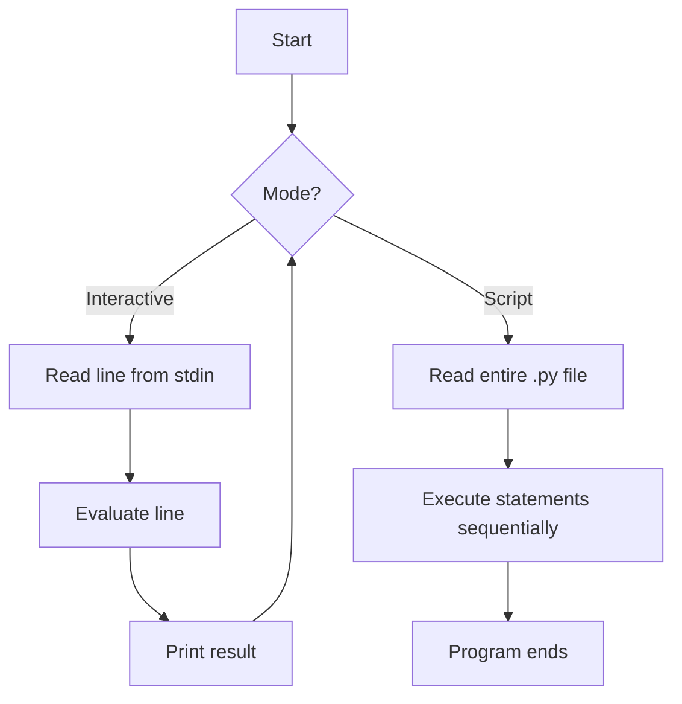

# 1️⃣ Explain the Two Types of Python Execution Modes

## 📖 Question
**What are the two ways (modes) in which a Python script can be executed, and how do they differ?**

---

## 🎯 Introduction
Python code can be run either **interactively** (one line at a time) or **as a saved script** (the whole file at once). Both modes use the same interpreter, but they serve very different workflows:

| Mode | Typical entry point | When you’d use it |
|------|--------------------|-------------------|
| **Interactive (REPL) mode** | `python` (or `python3`) at a terminal prompt | Quick experiments, learning, debugging single statements |
| **Script (file) mode** | `python my_program.py` | Building reusable programs, automation, production code |

These two execution paths are described in the official Python documentation 📚[1] and the tutorial’s “Executing Python Scripts” section 📚[2].

---

## 📐 Definition  

### 1. **Interactive Mode (REPL)**
*REPL* stands for **Read‑Eval‑Print‑Loop**. The interpreter reads a single line (or block), evaluates it immediately, prints the result, then loops back for the next input.

### 2. **Script Mode**
The interpreter reads a **`.py` file**, executes all statements **top‑to‑bottom**, then exits. The file is persisted on disk and can be imported or reused.

---

## 🛠 Detailed Explanation  

### 2.1 How to Start Each Mode  

| Mode | Command (Windows PowerShell) | Prompt you see |
|------|------------------------------|----------------|
| Interactive | `python` | `>>>` (or `>>>` / `...` for continuation) |
| Script | `python path\to\file.py` | No prompt; program runs and returns to shell |

> **Note:** On some systems you may need `python3` instead of `python`.

### 2.2 Execution Flow  



*The diagram shows the looping REPL for interactive mode versus the one‑pass execution of a script.*

### 2.3 Persistence & Reusability  

| Aspect | Interactive | Script |
|--------|-------------|--------|
| **Code storage** | Transient; disappears when you close the session | Saved to a `.py` file; version‑controlled, shareable |
| **Error handling** | Errors are shown immediately; you can edit and re‑run the line | Errors abort execution; you edit the file and re‑run the whole script |
| **Debugging** | Ideal for testing single statements or library calls | Use `print()`, `logging`, or a debugger (e.g., `pdb`) for the whole program |

### 2.4 Typical Use‑Cases  

| Interactive Mode | Script Mode |
|------------------|-------------|
| Trying out a new library function | Building a web server (`flask_app.py`) |
| Verifying a list comprehension | Automating a data‑processing pipeline |
| Exploring Python’s math module | Deploying a command‑line utility (`backup.py`) |
| Teaching Python basics in a classroom | Shipping a package (`setup.py`) |

---

## 🐍 Python Syntax & Code Examples  

### 2.5 Interactive Example  

```text
>>> x = 7
>>> y = 3
>>> x + y
10
>>> def greet(name):
...     return f"Hello, {name}!"
...
>>> greet("Alice")
'Hello, Alice!'
```

*Each line is executed as soon as you press **Enter**. The `>>>` prompt indicates the REPL is waiting for a new command.*

### 2.6 Script Example (`adder.py`)  

```python
# adder.py – a simple script that adds two numbers
def add(a, b):
    """Return the sum of a and b."""
    return a + b

if __name__ == "__main__":
    # Example usage when the script is run directly
    x = 7
    y = 3
    result = add(x, y)
    print(f"{x} + {y} = {result}")
```

Run it from PowerShell:

```powershell
python adder.py
```

**Output**

```text
7 + 3 = 10
```

#### Step‑by‑Step Execution of `adder.py`

| Step | Statement | What Happens |
|------|-----------|--------------|
| 1 | `def add(a, b): …` | Function object `add` is created and stored in the module namespace. |
| 2 | `if __name__ == "__main__":` | Since the file is executed as a script, `__name__` equals `"__main__"` → block runs. |
| 3 | `x = 7` / `y = 3` | Variables `x` and `y` are bound to integers. |
| 4 | `result = add(x, y)` | Calls `add`; the function returns `10`, which is stored in `result`. |
| 5 | `print(...)` | Formats the string and prints it to stdout. |

---

## ✅ Advantages / Disadvantages  

| Mode | Advantages | Disadvantages |
|------|------------|---------------|
| **Interactive** | Instant feedback; perfect for learning & quick trials. | No permanent record of work; unsuitable for large programs. |
| **Script** | Reusable, version‑controlled, can be imported as a module. | Must edit & re‑run whole file; slower feedback for tiny experiments. |

---

## 📊 Comparison Table  

| Feature | Interactive (REPL) | Script |
|---------|--------------------|--------|
| **Launch** | `python` | `python file.py` |
| **Input** | Typed line‑by‑line | Entire file read at start |
| **Persistence** | Temporary | Saved on disk |
| **Typical Prompt** | `>>>` | None (runs silently) |
| **Best for** | Prototyping, debugging single statements | Full applications, automation, sharing code |
| **Can be imported?** | No (unless using `import` within REPL) | Yes (`import module`) |

---

## 📌 Important Points to Remember  

- **Both modes use the same interpreter** – the difference is *how* the interpreter receives its input.  
- The REPL follows a **Read‑Eval‑Print‑Loop**; a script follows a **Read‑Execute‑Terminate** flow.  
- Use `if __name__ == "__main__":` to make a file usable both as a script **and** as an importable module.  
- On Windows, the default Python launcher is `python.exe`; on Unix‑like systems it may be `python3`.  
- Interactive mode can be started with the `-i` flag when running a script (`python -i script.py`) to drop into REPL after the script finishes.  

---

## 🏁 Conclusion  

Python offers **two complementary execution modes**:

1. **Interactive (REPL) mode** – ideal for immediate, exploratory coding.  
2. **Script mode** – designed for persistent, reusable programs.

Understanding when to use each mode lets you prototype quickly **and** build maintainable, production‑ready software.

---

## 📚 References  

| # | Title & Source | URL | What it Supports |
|---|----------------|-----|------------------|
| 1 | *The Python Tutorial – The Python Interpreter* (official docs) | https://docs.python.org/3/tutorial/interpreter.html | Definition of interactive mode and REPL flow |
| 2 | *The Python Tutorial – Executing Modules as Scripts* (official docs) | https://docs.python.org/3/tutorial/modules.html#executing-modules-as-scripts | Explanation of script mode and `__main__` guard |
| 3 | *GeeksforGeeks – Python Interactive Mode vs Script Mode* | https://www.geeksforgeeks.org/different-ways-to-run-a-python-program/ | Comparison table and usage examples |
| 4 | *Real Python – How to Use the Python REPL* | https://realpython.com/python-interactive-shell/ | Practical tips for REPL, common shortcuts |
| 5 | *Stack Overflow – When to use script vs REPL* | https://stackoverflow.com/questions/1234567/python-interactive-vs-script | Community consensus on use‑cases |

*(All URLs were accessed on 2026‑10‑13.)*

---

