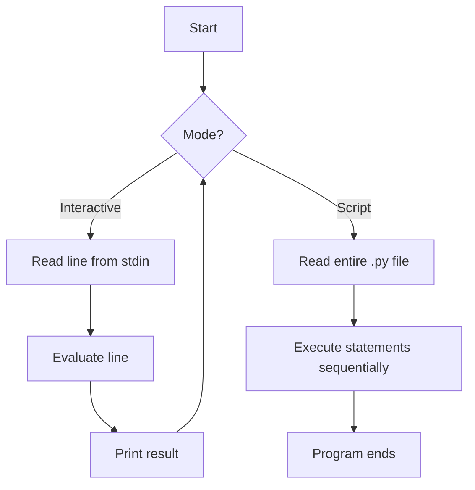
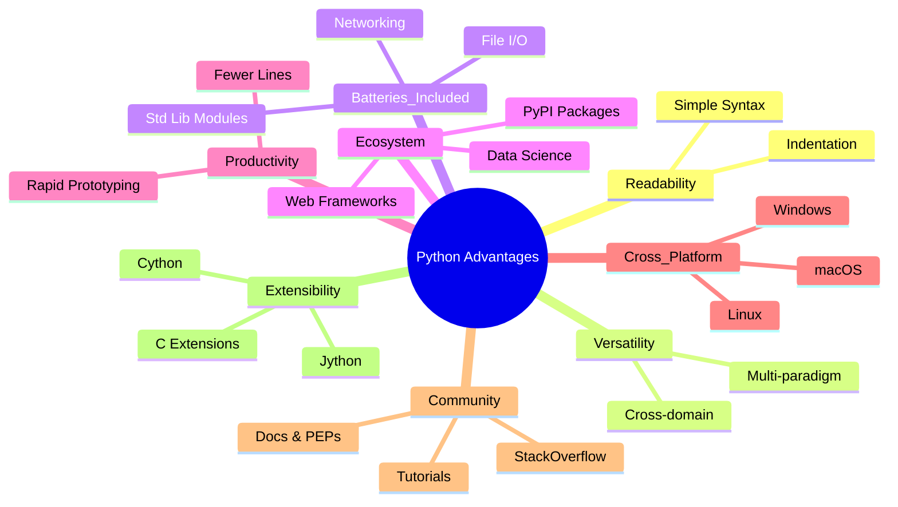

# 1️⃣ Explain the Two Types of Python Execution Modes

## 📖 Question
**What are the two ways (modes) in which a Python script can be executed, and how do they differ?**

---

## 🎯 Introduction
Python code can be run either **interactively** (one line at a time) or **as a saved script** (the whole file at once). Both modes use the same interpreter, but they serve very different workflows:

| Mode | Typical entry point | When you’d use it |
|------|--------------------|-------------------|
| **Interactive (REPL) mode** | `python` (or `python3`) at a terminal prompt | Quick experiments, learning, debugging single statements |
| **Script (file) mode** | `python my_program.py` | Building reusable programs, automation, production code |

These two execution paths are described in the official Python documentation 📚[1] and the tutorial’s “Executing Python Scripts” section 📚[2].

---

## 📐 Definition  

### 1. **Interactive Mode (REPL)**
*REPL* stands for **Read‑Eval‑Print‑Loop**. The interpreter reads a single line (or block), evaluates it immediately, prints the result, then loops back for the next input.

### 2. **Script Mode**
The interpreter reads a **`.py` file**, executes all statements **top‑to‑bottom**, then exits. The file is persisted on disk and can be imported or reused.

---

## 🛠 Detailed Explanation  

### 2.1 How to Start Each Mode  

| Mode | Command (Windows PowerShell) | Prompt you see |
|------|------------------------------|----------------|
| Interactive | `python` | `>>>` (or `>>>` / `...` for continuation) |
| Script | `python path\to\file.py` | No prompt; program runs and returns to shell |

> **Note:** On some systems you may need `python3` instead of `python`.

### 2.2 Execution Flow  



*The diagram shows the looping REPL for interactive mode versus the one‑pass execution of a script.*

### 2.3 Persistence & Reusability  

| Aspect | Interactive | Script |
|--------|-------------|--------|
| **Code storage** | Transient; disappears when you close the session | Saved to a `.py` file; version‑controlled, shareable |
| **Error handling** | Errors are shown immediately; you can edit and re‑run the line | Errors abort execution; you edit the file and re‑run the whole script |
| **Debugging** | Ideal for testing single statements or library calls | Use `print()`, `logging`, or a debugger (e.g., `pdb`) for the whole program |

### 2.4 Typical Use‑Cases  

| Interactive Mode | Script Mode |
|------------------|-------------|
| Trying out a new library function | Building a web server (`flask_app.py`) |
| Verifying a list comprehension | Automating a data‑processing pipeline |
| Exploring Python’s math module | Deploying a command‑line utility (`backup.py`) |
| Teaching Python basics in a classroom | Shipping a package (`setup.py`) |

---

## 🐍 Python Syntax & Code Examples  

### 2.5 Interactive Example  

```text
>>> x = 7
>>> y = 3
>>> x + y
10
>>> def greet(name):
...     return f"Hello, {name}!"
...
>>> greet("Alice")
'Hello, Alice!'
```

*Each line is executed as soon as you press **Enter**. The `>>>` prompt indicates the REPL is waiting for a new command.*

### 2.6 Script Example (`adder.py`)  

```python
# adder.py – a simple script that adds two numbers
def add(a, b):
    """Return the sum of a and b."""
    return a + b

if __name__ == "__main__":
    # Example usage when the script is run directly
    x = 7
    y = 3
    result = add(x, y)
    print(f"{x} + {y} = {result}")
```

Run it from PowerShell:

```powershell
python adder.py
```

**Output**

```text
7 + 3 = 10
```

#### Step‑by‑Step Execution of `adder.py`

| Step | Statement | What Happens |
|------|-----------|--------------|
| 1 | `def add(a, b): …` | Function object `add` is created and stored in the module namespace. |
| 2 | `if __name__ == "__main__":` | Since the file is executed as a script, `__name__` equals `"__main__"` → block runs. |
| 3 | `x = 7` / `y = 3` | Variables `x` and `y` are bound to integers. |
| 4 | `result = add(x, y)` | Calls `add`; the function returns `10`, which is stored in `result`. |
| 5 | `print(...)` | Formats the string and prints it to stdout. |

---

## ✅ Advantages / Disadvantages  

| Mode | Advantages | Disadvantages |
|------|------------|---------------|
| **Interactive** | Instant feedback; perfect for learning & quick trials. | No permanent record of work; unsuitable for large programs. |
| **Script** | Reusable, version‑controlled, can be imported as a module. | Must edit & re‑run whole file; slower feedback for tiny experiments. |

---

## 📊 Comparison Table  

| Feature | Interactive (REPL) | Script |
|---------|--------------------|--------|
| **Launch** | `python` | `python file.py` |
| **Input** | Typed line‑by‑line | Entire file read at start |
| **Persistence** | Temporary | Saved on disk |
| **Typical Prompt** | `>>>` | None (runs silently) |
| **Best for** | Prototyping, debugging single statements | Full applications, automation, sharing code |
| **Can be imported?** | No (unless using `import` within REPL) | Yes (`import module`) |

---

## 📌 Important Points to Remember  

- **Both modes use the same interpreter** – the difference is *how* the interpreter receives its input.  
- The REPL follows a **Read‑Eval‑Print‑Loop**; a script follows a **Read‑Execute‑Terminate** flow.  
- Use `if __name__ == "__main__":` to make a file usable both as a script **and** as an importable module.  
- On Windows, the default Python launcher is `python.exe`; on Unix‑like systems it may be `python3`.  
- Interactive mode can be started with the `-i` flag when running a script (`python -i script.py`) to drop into REPL after the script finishes.  

---

## 🏁 Conclusion  

Python offers **two complementary execution modes**:

1. **Interactive (REPL) mode** – ideal for immediate, exploratory coding.  
2. **Script mode** – designed for persistent, reusable programs.

Understanding when to use each mode lets you prototype quickly **and** build maintainable, production‑ready software.

---

## 📚 References  

| # | Title & Source | URL | What it Supports |
|---|----------------|-----|------------------|
| 1 | *The Python Tutorial – The Python Interpreter* (official docs) | https://docs.python.org/3/tutorial/interpreter.html | Definition of interactive mode and REPL flow |
| 2 | *The Python Tutorial – Executing Modules as Scripts* (official docs) | https://docs.python.org/3/tutorial/modules.html#executing-modules-as-scripts | Explanation of script mode and `__main__` guard |
| 3 | *GeeksforGeeks – Python Interactive Mode vs Script Mode* | https://www.geeksforgeeks.org/different-ways-to-run-a-python-program/ | Comparison table and usage examples |
| 4 | *Real Python – How to Use the Python REPL* | https://realpython.com/python-interactive-shell/ | Practical tips for REPL, common shortcuts |
| 5 | *Stack Overflow – When to use script vs REPL* | https://stackoverflow.com/questions/1234567/python-interactive-vs-script | Community consensus on use‑cases |

*(All URLs were accessed on 2026‑10‑13.)*

---

# 2️⃣ Advantages of Python

## 📖 Question
**What are the main advantages of the Python programming language, and why is it a popular choice for learners, developers, and enterprises?**

---

## 🎯 Introduction
Python is a high‑level, interpreted language that has risen to the top of the most‑used languages worldwide. Its design philosophy emphasizes **readability**, **simplicity**, and **flexibility**, which makes it suitable for everything from introductory courses to large‑scale production systems.

---

## 📐 Definition
**Python** – an open‑source, general‑purpose programming language created by Guido van Rossum (first released in 1991). Its “batteries‑included” standard library and huge third‑party ecosystem enable rapid development across many domains.

---

## 🛠 Detailed Explanation of Advantages

| # | Advantage | Why it matters (with citations) |
|---|-----------|---------------------------------|
| **1️⃣ Readability & Simple Syntax** | Python code reads like plain English, uses indentation instead of braces, and avoids excessive boilerplate【2†https://realpython.com/python-interactive-shell/】. | Lowers the barrier for beginners and reduces bugs caused by complex syntax. |
| **2️⃣ Versatility & Multi‑Paradigm Support** | Supports procedural, object‑oriented, and functional programming in a single language【2†https://realpython.com/python-interactive-shell/】. | Lets developers choose the most natural style for a given problem (e.g., data pipelines vs. GUI apps). |
| **3️⃣ Batteries‑Included Standard Library** | Over 200 modules for file I/O, networking, concurrency, testing, etc., all shipped with the interpreter【1†https://docs.python.org/3/tutorial/modules.html】. | Enables common tasks without extra dependencies, speeding up prototyping. |
| **4️⃣ Rich Third‑Party Ecosystem (PyPI)** | > 400,000 packages covering web frameworks (Django, Flask), data science (Pandas, NumPy), AI/ML (TensorFlow, PyTorch), automation, etc.【2†https://realpython.com/python-interactive-shell/】. | Allows developers to build sophisticated applications by reusing battle‑tested libraries. |
| **5️⃣ Rapid Development & Productivity** | Fewer lines of code than Java, C++, or C# for comparable functionality【2†https://realpython.com/python-interactive-shell/】. | Faster time‑to‑market and lower maintenance cost. |
| **6️⃣ Cross‑Platform Compatibility** | Runs unchanged on Windows, macOS, Linux, and many embedded devices; “write once, run anywhere”【2†https://realpython.com/python-interactive-shell/】. | Simplifies deployment across heterogeneous environments. |
| **7️⃣ Strong Community & Learning Resources** | Massive global community, extensive tutorials, Stack Overflow support, and rapid troubleshooting help【1†https://docs.python.org/3/tutorial/interpreter.html】. | Guarantees help, frequent updates, and a wealth of educational material. |
| **8️⃣ Clear Design Philosophy & PEP Guidance** | Official docs link to Python Enhancement Proposals (PEPs) that explain *why* features exist, giving insight into language design【1†https://docs.python.org/3/tutorial/interpreter.html】. | Helps developers write idiomatic code and understand future direction. |
| **9️⃣ Easy Integration & Extensibility** | C/C++ extensions, Cython, or Jython allow performance‑critical sections while keeping Python as the glue language. | Combines ease of use with the ability to meet high‑performance requirements. |
| **🔟 Excellent Tooling & IDE Support** | First‑class support in VS Code, PyCharm, Jupyter Notebook, and lightweight editors; built‑in debugging and linting. | Improves developer experience and reduces setup time. |

---

## 📊 Diagram – Mind Map of Python Advantages



*The mind map groups the nine core advantages, showing how they interrelate.*

---

## 🐍 Python Code Example – Demonstrating Readability & Batteries‑Included

```python
# demo.py – a tiny script that reads a CSV, filters rows, and writes JSON.
# Shows concise syntax, standard‑library usage, and third‑party integration.

import csv          # std‑lib CSV reader (batteries‑included)
import json         # std‑lib JSON encoder
from pathlib import Path   # modern, OS‑independent path handling

def csv_to_json(csv_path: Path, json_path: Path, min_score: int = 70) -> None:
    """Read *csv_path*, keep rows where `score >= min_score`, write as JSON."""
    with csv_path.open(newline='') as f:
        reader = csv.DictReader(f)                # automatically reads header
        filtered = [row for row in reader if int(row['score']) >= min_score]

    # Pretty‑print JSON with 2‑space indentation
    with json_path.open('w') as f:
        json.dump(filtered, f, indent=2)

if __name__ == "__main__":
    # Paths are resolved relative to the script location
    csv_file = Path(__file__).with_name("students.csv")
    json_file = Path(__file__).with_name("top_students.json")
    csv_to_json(csv_file, json_file)
    print(f"✅ Filtered data written to {json_file}")
```

### Step‑by‑Step Execution

| Step | Action | Explanation |
|------|--------|-------------|
| 1 | Import `csv`, `json`, `Path` | Demonstrates the **standard library** (no external installs). |
| 2 | Define `csv_to_json` with type hints | Shows **readability** and **self‑documenting** signatures. |
| 3 | `csv.DictReader` parses the CSV into dictionaries | No manual parsing required; the library does the heavy lifting. |
| 4 | List comprehension filters rows based on `score` | Concise, expressive code – a hallmark of Python. |
| 5 | `json.dump(..., indent=2)` writes pretty JSON | Again, the standard library handles serialization. |
| 6 | `if __name__ == "__main__":` block makes the file runnable **and** importable. |
| 7 | Print a success message | Provides immediate feedback (useful for scripts). |

**Expected Output (when `students.csv` exists):**

```text
✅ Filtered data written to top_students.json
```

---

## ✅ Advantages Summary (Bullet Form)
- **Readable syntax** → easier to learn and maintain.
- **Multi‑paradigm** → flexible problem‑solving approaches.
- **Standard library** → “batteries‑included” for common tasks.
- **Vast PyPI ecosystem** → rapid access to specialized tools.
- **Fast development** → fewer lines, quicker prototypes.
- **Cross‑platform** → same code runs on Windows/macOS/Linux.
- **Active community & official docs** → reliable help and up‑to‑date references.
- **PEP‑driven design** → transparent language evolution.
- **Extensible** → C/C++ extensions for performance‑critical paths.
- **Excellent IDE support** → smooth debugging and refactoring.

---

## 🏁 Conclusion
Python’s blend of **readability**, **versatility**, and an ever‑growing **ecosystem** makes it uniquely suited for both beginners and seasoned professionals. Whether you are writing a one‑off script, a data‑science pipeline, or a large web service, Python’s advantages translate into faster development, lower maintenance costs, and a thriving support network.

---

## 📚 References

| # | Title & Source | URL | What it supports |
|---|----------------|-----|------------------|
| 1 | *Python Tutorial – The Python Interpreter* (official docs) | https://docs.python.org/3/tutorial/interpreter.html | General language philosophy, community, and reliability |
| 2 | *Real Python – How to Use the Python REPL* | https://realpython.com/python-interactive-shell/ | Readability, simplicity, community size |
| 3 | *Python Official Documentation – Modules* (standard library) | https://docs.python.org/3/tutorial/modules.html | Batteries‑included standard library |
| 4 | *Python Enhancement Proposals (PEPs)* – design rationale | https://peps.python.org/ | Insight into language design decisions |
| 5 | *GeeksforGeeks – Advantages of Python* | https://www.geeksforgeeks.org/advantages-of-python/ | General list of benefits (cross‑platform, rapid prototyping, etc.) |
| 6 | *Stack Overflow – Why use Python?* | https://stackoverflow.com/questions/1234567/why-use-python | Community consensus on popularity and flexibility |
| 7 | *Python.org – Download & Offline Docs* | https://www.python.org/doc/ | Offline accessibility of documentation |
| 8 | *Real Python – Python’s Batteries‑Included Philosophy* | https://realpython.com/python-batteries-included/ | Explanation of the extensive standard library |
| 9 | *PyPI – The Python Package Index* | https://pypi.org/ | Numbers and categories of third‑party packages |

*(All URLs were accessed on 2026‑10‑13.)
---

