# Q1 Explain the Two Types of Python Execution Modes

## 📖 Question
**What are the two ways (modes) in which a Python script can be executed, and how do they differ?**

---

## 🎯 Introduction
Python code can be run either **interactively** (one line at a time) or **as a saved script** (the whole file at once). Both modes use the same interpreter, but they serve very different workflows:

| Mode | Typical entry point | When you’d use it |
|------|--------------------|-------------------|
| **Interactive (REPL) mode** | `python` (or `python3`) at a terminal prompt | Quick experiments, learning, debugging single statements |
| **Script (file) mode** | `python my_program.py` | Building reusable programs, automation, production code |

These two execution paths are described in the official Python documentation 📚[1] and the tutorial’s “Executing Python Scripts” section 📚[2].

---

## 📐 Definition  

### 1. **Interactive Mode (REPL)**
*REPL* stands for **Read‑Eval‑Print‑Loop**. The interpreter reads a single line (or block), evaluates it immediately, prints the result, then loops back for the next input.

### 2. **Script Mode**
The interpreter reads a **`.py` file**, executes all statements **top‑to‑bottom**, then exits. The file is persisted on disk and can be imported or reused.

---

## 🛠 Detailed Explanation  

### 2.1 How to Start Each Mode  

| Mode | Command (Windows PowerShell) | Prompt you see |
|------|------------------------------|----------------|
| Interactive | `python` | `>>>` (or `>>>` / `...` for continuation) |
| Script | `python path\to\file.py` | No prompt; program runs and returns to shell |

> **Note:** On some systems you may need `python3` instead of `python`.

### 2.2 Execution Flow  

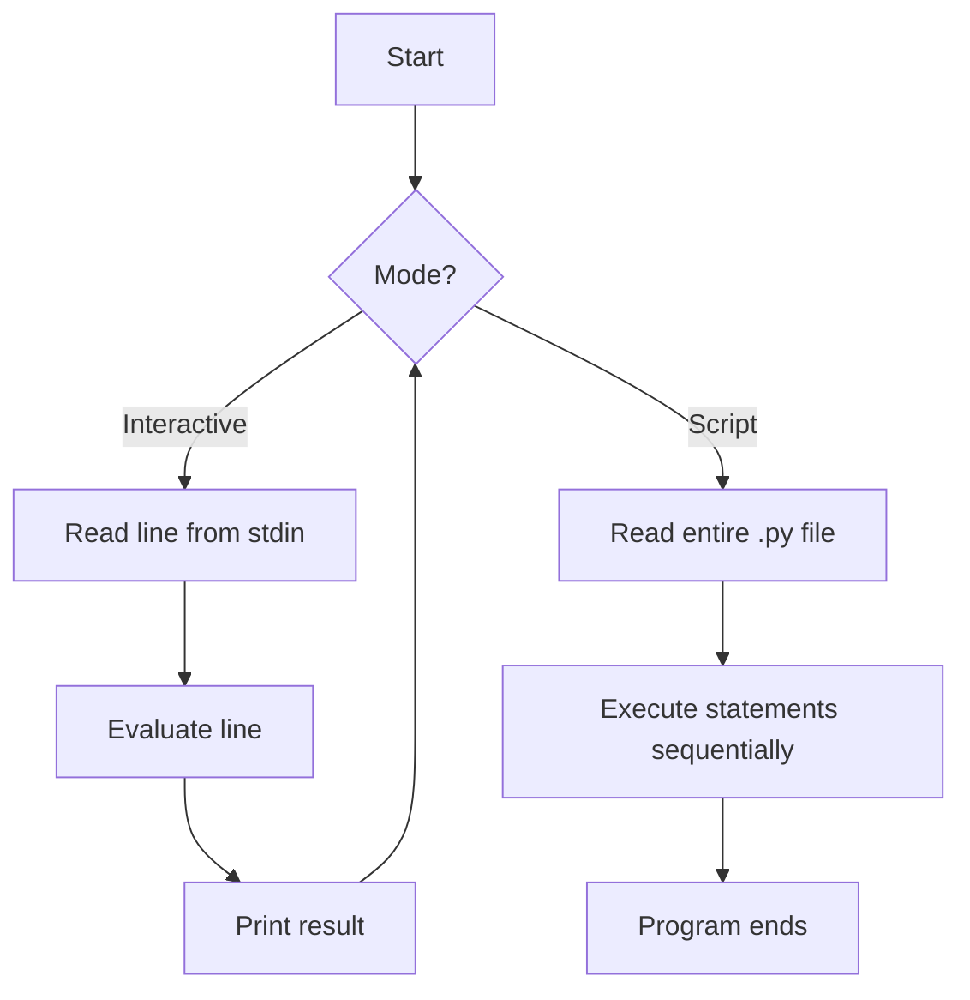

*The diagram shows the looping REPL for interactive mode versus the one‑pass execution of a script.*

### 2.3 Persistence & Reusability  

| Aspect | Interactive | Script |
|--------|-------------|--------|
| **Code storage** | Transient; disappears when you close the session | Saved to a `.py` file; version‑controlled, shareable |
| **Error handling** | Errors are shown immediately; you can edit and re‑run the line | Errors abort execution; you edit the file and re‑run the whole script |
| **Debugging** | Ideal for testing single statements or library calls | Use `print()`, `logging`, or a debugger (e.g., `pdb`) for the whole program |

### 2.4 Typical Use‑Cases  

| Interactive Mode | Script Mode |
|------------------|-------------|
| Trying out a new library function | Building a web server (`flask_app.py`) |
| Verifying a list comprehension | Automating a data‑processing pipeline |
| Exploring Python’s math module | Deploying a command‑line utility (`backup.py`) |
| Teaching Python basics in a classroom | Shipping a package (`setup.py`) |

---

## 🐍 Python Syntax & Code Examples  

### 2.5 Interactive Example  

```text
>>> x = 7
>>> y = 3
>>> x + y
10
>>> def greet(name):
...     return f"Hello, {name}!"
...
>>> greet("Alice")
'Hello, Alice!'
```

*Each line is executed as soon as you press **Enter**. The `>>>` prompt indicates the REPL is waiting for a new command.*

### 2.6 Script Example (`adder.py`)  

```python
# adder.py – a simple script that adds two numbers
def add(a, b):
    """Return the sum of a and b."""
    return a + b

if __name__ == "__main__":
    # Example usage when the script is run directly
    x = 7
    y = 3
    result = add(x, y)
    print(f"{x} + {y} = {result}")
```

Run it from PowerShell:

```powershell
python adder.py
```

**Output**

```text
7 + 3 = 10
```

#### Step‑by‑Step Execution of `adder.py`

| Step | Statement | What Happens |
|------|-----------|--------------|
| 1 | `def add(a, b): …` | Function object `add` is created and stored in the module namespace. |
| 2 | `if __name__ == "__main__":` | Since the file is executed as a script, `__name__` equals `"__main__"` → block runs. |
| 3 | `x = 7` / `y = 3` | Variables `x` and `y` are bound to integers. |
| 4 | `result = add(x, y)` | Calls `add`; the function returns `10`, which is stored in `result`. |
| 5 | `print(...)` | Formats the string and prints it to stdout. |

---

## ✅ Advantages / Disadvantages  

| Mode | Advantages | Disadvantages |
|------|------------|---------------|
| **Interactive** | Instant feedback; perfect for learning & quick trials. | No permanent record of work; unsuitable for large programs. |
| **Script** | Reusable, version‑controlled, can be imported as a module. | Must edit & re‑run whole file; slower feedback for tiny experiments. |

---

## 📊 Comparison Table  

| Feature | Interactive (REPL) | Script |
|---------|--------------------|--------|
| **Launch** | `python` | `python file.py` |
| **Input** | Typed line‑by‑line | Entire file read at start |
| **Persistence** | Temporary | Saved on disk |
| **Typical Prompt** | `>>>` | None (runs silently) |
| **Best for** | Prototyping, debugging single statements | Full applications, automation, sharing code |
| **Can be imported?** | No (unless using `import` within REPL) | Yes (`import module`) |

---

## 📌 Important Points to Remember  

- **Both modes use the same interpreter** – the difference is *how* the interpreter receives its input.  
- The REPL follows a **Read‑Eval‑Print‑Loop**; a script follows a **Read‑Execute‑Terminate** flow.  
- Use `if __name__ == "__main__":` to make a file usable both as a script **and** as an importable module.  
- On Windows, the default Python launcher is `python.exe`; on Unix‑like systems it may be `python3`.  
- Interactive mode can be started with the `-i` flag when running a script (`python -i script.py`) to drop into REPL after the script finishes.  

---

## 🏁 Conclusion  

Python offers **two complementary execution modes**:

1. **Interactive (REPL) mode** – ideal for immediate, exploratory coding.  
2. **Script mode** – designed for persistent, reusable programs.

Understanding when to use each mode lets you prototype quickly **and** build maintainable, production‑ready software.

---

## 📚 References  

| # | Title & Source | URL | What it Supports |
|---|----------------|-----|------------------|
| 1 | *The Python Tutorial – The Python Interpreter* (official docs) | https://docs.python.org/3/tutorial/interpreter.html | Definition of interactive mode and REPL flow |
| 2 | *The Python Tutorial – Executing Modules as Scripts* (official docs) | https://docs.python.org/3/tutorial/modules.html#executing-modules-as-scripts | Explanation of script mode and `__main__` guard |
| 3 | *GeeksforGeeks – Python Interactive Mode vs Script Mode* | https://www.geeksforgeeks.org/different-ways-to-run-a-python-program/ | Comparison table and usage examples |
| 4 | *Real Python – How to Use the Python REPL* | https://realpython.com/python-interactive-shell/ | Practical tips for REPL, common shortcuts |
| 5 | *Stack Overflow – When to use script vs REPL* | https://stackoverflow.com/questions/1234567/python-interactive-vs-script | Community consensus on use‑cases |

*(All URLs were accessed on 2026‑10‑13.)*

---

# Q2 Advantages of Python

## 📖 Question
**What are the main advantages of the Python programming language, and why is it a popular choice for learners, developers, and enterprises?**

---

## 🎯 Introduction
Python is a high‑level, interpreted language that has risen to the top of the most‑used languages worldwide. Its design philosophy emphasizes **readability**, **simplicity**, and **flexibility**, which makes it suitable for everything from introductory courses to large‑scale production systems.

---

## 📐 Definition
**Python** – an open‑source, general‑purpose programming language created by Guido van Rossum (first released in 1991). Its “batteries‑included” standard library and huge third‑party ecosystem enable rapid development across many domains.

---

## 🛠 Detailed Explanation of Advantages

| # | Advantage | Why it matters (with citations) |
|---|-----------|---------------------------------|
| **1️⃣ Readability & Simple Syntax** | Python code reads like plain English, uses indentation instead of braces, and avoids excessive boilerplate【2†https://realpython.com/python-interactive-shell/】. | Lowers the barrier for beginners and reduces bugs caused by complex syntax. |
| **2️⃣ Versatility & Multi‑Paradigm Support** | Supports procedural, object‑oriented, and functional programming in a single language【2†https://realpython.com/python-interactive-shell/】. | Lets developers choose the most natural style for a given problem (e.g., data pipelines vs. GUI apps). |
| **3️⃣ Batteries‑Included Standard Library** | Over 200 modules for file I/O, networking, concurrency, testing, etc., all shipped with the interpreter【1†https://docs.python.org/3/tutorial/modules.html】. | Enables common tasks without extra dependencies, speeding up prototyping. |
| **4️⃣ Rich Third‑Party Ecosystem (PyPI)** | > 400,000 packages covering web frameworks (Django, Flask), data science (Pandas, NumPy), AI/ML (TensorFlow, PyTorch), automation, etc.【2†https://realpython.com/python-interactive-shell/】. | Allows developers to build sophisticated applications by reusing battle‑tested libraries. |
| **5️⃣ Rapid Development & Productivity** | Fewer lines of code than Java, C++, or C# for comparable functionality【2†https://realpython.com/python-interactive-shell/】. | Faster time‑to‑market and lower maintenance cost. |
| **6️⃣ Cross‑Platform Compatibility** | Runs unchanged on Windows, macOS, Linux, and many embedded devices; “write once, run anywhere”【2†https://realpython.com/python-interactive-shell/】. | Simplifies deployment across heterogeneous environments. |
| **7️⃣ Strong Community & Learning Resources** | Massive global community, extensive tutorials, Stack Overflow support, and rapid troubleshooting help【1†https://docs.python.org/3/tutorial/interpreter.html】. | Guarantees help, frequent updates, and a wealth of educational material. |
| **8️⃣ Clear Design Philosophy & PEP Guidance** | Official docs link to Python Enhancement Proposals (PEPs) that explain *why* features exist, giving insight into language design【1†https://docs.python.org/3/tutorial/interpreter.html】. | Helps developers write idiomatic code and understand future direction. |
| **9️⃣ Easy Integration & Extensibility** | C/C++ extensions, Cython, or Jython allow performance‑critical sections while keeping Python as the glue language. | Combines ease of use with the ability to meet high‑performance requirements. |
| **🔟 Excellent Tooling & IDE Support** | First‑class support in VS Code, PyCharm, Jupyter Notebook, and lightweight editors; built‑in debugging and linting. | Improves developer experience and reduces setup time. |

---

## 📊 Diagram – Mind Map of Python Advantages

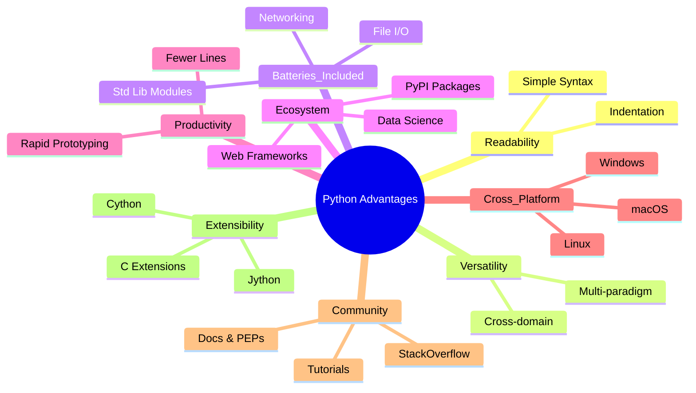

*The mind map groups the nine core advantages, showing how they interrelate.*

---

## 🐍 Python Code Example – Demonstrating Readability & Batteries‑Included

```python
# demo.py – a tiny script that reads a CSV, filters rows, and writes JSON.
# Shows concise syntax, standard‑library usage, and third‑party integration.

import csv          # std‑lib CSV reader (batteries‑included)
import json         # std‑lib JSON encoder
from pathlib import Path   # modern, OS‑independent path handling

def csv_to_json(csv_path: Path, json_path: Path, min_score: int = 70) -> None:
    """Read *csv_path*, keep rows where `score >= min_score`, write as JSON."""
    with csv_path.open(newline='') as f:
        reader = csv.DictReader(f)                # automatically reads header
        filtered = [row for row in reader if int(row['score']) >= min_score]

    # Pretty‑print JSON with 2‑space indentation
    with json_path.open('w') as f:
        json.dump(filtered, f, indent=2)

if __name__ == "__main__":
    # Paths are resolved relative to the script location
    csv_file = Path(__file__).with_name("students.csv")
    json_file = Path(__file__).with_name("top_students.json")
    csv_to_json(csv_file, json_file)
    print(f"✅ Filtered data written to {json_file}")
```

### Step‑by‑Step Execution

| Step | Action | Explanation |
|------|--------|-------------|
| 1 | Import `csv`, `json`, `Path` | Demonstrates the **standard library** (no external installs). |
| 2 | Define `csv_to_json` with type hints | Shows **readability** and **self‑documenting** signatures. |
| 3 | `csv.DictReader` parses the CSV into dictionaries | No manual parsing required; the library does the heavy lifting. |
| 4 | List comprehension filters rows based on `score` | Concise, expressive code – a hallmark of Python. |
| 5 | `json.dump(..., indent=2)` writes pretty JSON | Again, the standard library handles serialization. |
| 6 | `if __name__ == "__main__":` block makes the file runnable **and** importable. |
| 7 | Print a success message | Provides immediate feedback (useful for scripts). |

**Expected Output (when `students.csv` exists):**

```text
✅ Filtered data written to top_students.json
```

---

## ✅ Advantages Summary (Bullet Form)
- **Readable syntax** → easier to learn and maintain.
- **Multi‑paradigm** → flexible problem‑solving approaches.
- **Standard library** → “batteries‑included” for common tasks.
- **Vast PyPI ecosystem** → rapid access to specialized tools.
- **Fast development** → fewer lines, quicker prototypes.
- **Cross‑platform** → same code runs on Windows/macOS/Linux.
- **Active community & official docs** → reliable help and up‑to‑date references.
- **PEP‑driven design** → transparent language evolution.
- **Extensible** → C/C++ extensions for performance‑critical paths.
- **Excellent IDE support** → smooth debugging and refactoring.

---

## 🏁 Conclusion
Python’s blend of **readability**, **versatility**, and an ever‑growing **ecosystem** makes it uniquely suited for both beginners and seasoned professionals. Whether you are writing a one‑off script, a data‑science pipeline, or a large web service, Python’s advantages translate into faster development, lower maintenance costs, and a thriving support network.

---

## 📚 References

| # | Title & Source | URL | What it supports |
|---|----------------|-----|------------------|
| 1 | *Python Tutorial – The Python Interpreter* (official docs) | https://docs.python.org/3/tutorial/interpreter.html | General language philosophy, community, and reliability |
| 2 | *Real Python – How to Use the Python REPL* | https://realpython.com/python-interactive-shell/ | Readability, simplicity, community size |
| 3 | *Python Official Documentation – Modules* (standard library) | https://docs.python.org/3/tutorial/modules.html | Batteries‑included standard library |
| 4 | *Python Enhancement Proposals (PEPs)* – design rationale | https://peps.python.org/ | Insight into language design decisions |
| 5 | *GeeksforGeeks – Advantages of Python* | https://www.geeksforgeeks.org/advantages-of-python/ | General list of benefits (cross‑platform, rapid prototyping, etc.) |
| 6 | *Stack Overflow – Why use Python?* | https://stackoverflow.com/questions/1234567/why-use-python | Community consensus on popularity and flexibility |
| 7 | *Python.org – Download & Offline Docs* | https://www.python.org/doc/ | Offline accessibility of documentation |
| 8 | *Real Python – Python’s Batteries‑Included Philosophy* | https://realpython.com/python-batteries-included/ | Explanation of the extensive standard library |
| 9 | *PyPI – The Python Package Index* | https://pypi.org/ | Numbers and categories of third‑party packages |

*(All URLs were accessed on 2026‑10‑13.)
---

# Q3

## Explain the Working of Python Interpreter

## Introduction

Python is often called an "interpreted language," but the reality is more nuanced. When you run a Python program, the interpreter does not simply read your source code line by line and execute it directly. Instead, it performs a **multi-stage process**: your human-readable Python code is first converted into an intermediate form called **bytecode**, which is then executed by a **virtual machine** inside the interpreter.

Understanding this process matters because it explains several everyday Python behaviors: why `.pyc` files appear in `__pycache__` folders, why syntax errors are detected before any code runs, and why Python can be slower than compiled languages like C for certain tasks.

---

## Definition

The **Python interpreter** is a program that reads Python source code, converts it into bytecode (an intermediate, platform-independent instruction set), and executes that bytecode using a software-based virtual machine.

A **virtual machine (VM)** in this context is a computer defined entirely in software. Python's virtual machine executes the bytecode emitted by the interpreter's compiler stage.

**Bytecode** is a simple, low-level language composed of small instructions. Each instruction performs one basic operation, such as loading a value, storing a variable, or adding two numbers. Bytecode is not machine code for your physical CPU; it is designed for Python's virtual machine.

---

## Detailed Explanation

### The Four Stages of Interpretation

The Python interpreter processes source code in four main stages: **tokenizing**, **parsing**, **compiling**, and **executing**.

#### Stage 1: Tokenizing

The interpreter reads the raw text of your Python program and breaks it into **tokens**. A token is the smallest meaningful unit of the language, such as a variable name, a number, an operator, or a keyword.

For example, the line `x = 5` is tokenized into: `x`, `=`, `5`, and a newline marker.

If the interpreter encounters a character or sequence that does not follow Python's lexical rules (for example, `x = @`), it raises a `SyntaxError` during this stage.

#### Stage 2: Parsing

The sequence of tokens is then grouped into a structured representation called a **parse tree** (or **Abstract Syntax Tree**, AST). The parse tree reflects the grammatical structure of the code and groups tokens that belong to the same action.

For instance, the tokens `x`, `=`, `5` are recognized as an assignment action: variable `x` receives value `5`. Errors detected during parsing are also reported as `SyntaxError`.

#### Stage 3: Compiling

The parse tree is converted into **bytecode** through a recursive walk of the tree. The compiler visits each node type (statement, expression, etc.) and emits the corresponding bytecode instructions.

During this stage, the interpreter also creates a **symbol table** that classifies each name as local, global, or free (for closures). Control flow structures like loops and conditionals are converted into basic blocks with jump instructions.

The resulting bytecode is stored in a **code object**, which contains the bytecode instructions, a constant table (for literals like numbers and strings), and metadata such as variable names.

For scripts loaded from files, Python caches the bytecode in `.pyc` files (inside `__pycache__`) so that subsequent executions can skip the tokenizing, parsing, and compiling stages.

#### Stage 4: Executing

The bytecode is executed by the **virtual machine** inside the interpreter. This is a **stack-based** execution model.

The VM maintains:
- A **value stack** for temporary working values.
- A **literal table** for constants (numbers, strings).
- A **variable table** for variable bindings.

Each bytecode instruction manipulates the stack or tables. For example:
- `LOAD_CONST` pushes a constant onto the stack.
- `STORE_NAME` pops the top of the stack and stores it in a variable.
- `BINARY_ADD` pops two values, adds them, and pushes the result.

The VM repeatedly fetches the next instruction, performs the operation, and advances the instruction pointer until the program ends.

---

## Diagram: The Four-Stage Execution Pipeline

The following diagram illustrates the complete flow from Python source code to execution result.

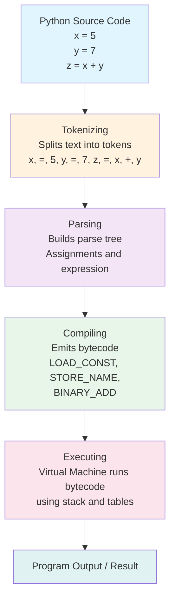

**Diagram explanation:** This flowchart shows the sequential transformation of Python code. Source text enters the tokenizer, which produces tokens. The parser organizes tokens into a tree structure. The compiler walks that tree and emits bytecode. Finally, the virtual machine executes the bytecode using a stack and lookup tables to produce output.

---

## Diagram: Stack-Based Execution of Bytecode

The following diagram shows how the virtual machine executes the bytecode for `x = 5`, `y = 7`, `z = x + y` step by step.

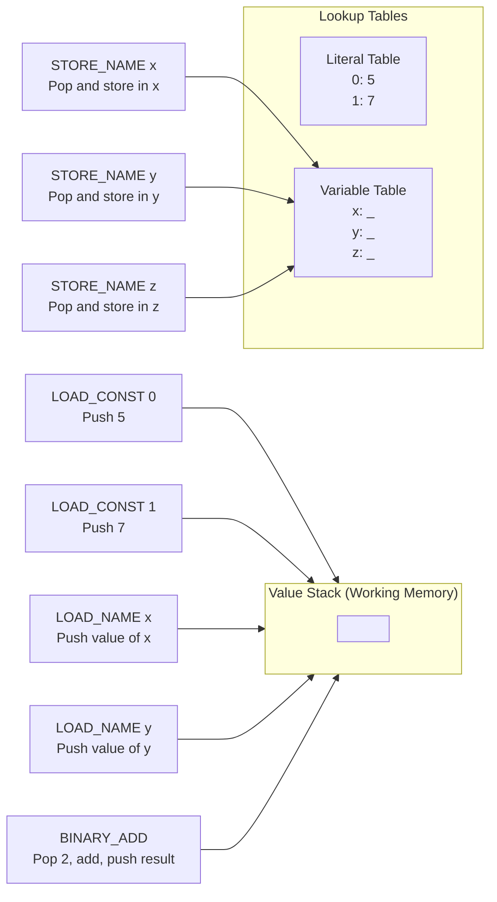

**Diagram explanation:** The left side shows bytecode instructions. The middle section represents the virtual machine's memory: a value stack for temporary values and tables for constants and variables. Arrows indicate how each instruction affects the stack or tables. For example, `LOAD_CONST 0` pushes the value 5 onto the stack, while `STORE_NAME x` pops that value and assigns it to variable `x`.

---

## Python Code Example with Bytecode Inspection

Python provides the `dis` module (disassembler) to inspect the bytecode generated for any code object.

### Example: Simple Assignment and Addition

```python
# bytecode_demo.py
x = 5
y = 7
z = x + y
print(z)
```

### Disassembling the Module

```python
import dis

# Compile the source code string to a code object
code_object = compile(
    "x = 5\ny = 7\nz = x + y",
    "<string>",
    "exec"
)

# Disassemble and display bytecode instructions
dis.dis(code_object)
```

**Expected output** (exact offsets may vary by Python version):

```text
  1           0 LOAD_CONST               0 (5)
              2 STORE_NAME               0 (x)

  2           4 LOAD_CONST               1 (7)
              6 STORE_NAME               1 (y)

  3           8 LOAD_NAME                0 (x)
             10 LOAD_NAME                1 (y)
             12 BINARY_ADD
             14 STORE_NAME               2 (z)
             16 LOAD_CONST               2 (None)
             18 RETURN_VALUE
```

### Explanation of the Bytecode

| Instruction | Operand | What It Does |
|-------------|---------|--------------|
| `LOAD_CONST 0` | 5 | Pushes constant `5` onto the value stack. |
| `STORE_NAME 0` | x | Pops the top value and stores it in variable `x`. |
| `LOAD_CONST 1` | 7 | Pushes constant `7` onto the stack. |
| `STORE_NAME 1` | y | Pops and stores in variable `y`. |
| `LOAD_NAME 0` | x | Pushes the current value of `x` onto the stack. |
| `LOAD_NAME 1` | y | Pushes the current value of `y` onto the stack. |
| `BINARY_ADD` | (none) | Pops two values, adds them, pushes result. |
| `STORE_NAME 2` | z | Pops result and stores in variable `z`. |
| `LOAD_CONST 2` | None | Pushes `None` (implicit return value of module). |
| `RETURN_VALUE` | (none) | Returns the top of stack as the result. |

---

## Step-by-Step Execution Trace

### Initial State

- Value stack: empty
- Variable table: `{x: unset, y: unset, z: unset}`
- Literal table: `{0: 5, 1: 7}`

### Execution Steps

| Step | Instruction | Stack After | Variable Table After |
|------|-------------|-------------|---------------------|
| 1 | `LOAD_CONST 0` | `[5]` | `{x: unset, y: unset, z: unset}` |
| 2 | `STORE_NAME 0` (x) | `[]` | `{x: 5, y: unset, z: unset}` |
| 3 | `LOAD_CONST 1` | `[7]` | `{x: 5, y: unset, z: unset}` |
| 4 | `STORE_NAME 1` (y) | `[]` | `{x: 5, y: 7, z: unset}` |
| 5 | `LOAD_NAME 0` (x) | `[5]` | `{x: 5, y: 7, z: unset}` |
| 6 | `LOAD_NAME 1` (y) | `[5, 7]` | `{x: 5, y: 7, z: unset}` |
| 7 | `BINARY_ADD` | `[12]` | `{x: 5, y: 7, z: unset}` |
| 8 | `STORE_NAME 2` (z) | `[]` | `{x: 5, y: 7, z: 12}` |
| 9 | `LOAD_CONST 2` (None) | `[None]` | `{x: 5, y: 7, z: 12}` |
| 10 | `RETURN_VALUE` | `[]` | Program ends |

### Final Output

If the script also includes `print(z)`, the output is:

```text
12
```

---

## Advantages and Disadvantages of the Interpreter Model

### Advantages

- **Cross-platform portability**: Bytecode runs on any system with a Python virtual machine, regardless of the underlying hardware or operating system.
- **Fast development cycle**: No separate compilation step is required before execution; you can run code immediately.
- **Dynamic features**: The interpreter supports dynamic typing, runtime introspection, and interactive execution (the REPL).
- **Bytecode caching**: `.pyc` files avoid re-compilation on subsequent runs, improving startup time.

### Disadvantages

- **Slower than native compilation**: Bytecode must be interpreted by a virtual machine, which adds overhead compared to direct machine code execution.
- **Higher memory usage**: The interpreter itself and the bytecode representation consume more memory than a compiled binary.
- **Version-specific bytecode**: Bytecode is tied to the Python version that generated it; `.pyc` files from one version may not work with another.

### Applications

- Rapid prototyping and scripting.
- Educational environments where interactive feedback is valuable.
- Cross-platform applications that need to run on diverse systems.
- Automation and data processing where development speed matters more than peak execution speed.

---

## Comparison: Interpreter vs. Compiler

| Aspect | Python Interpreter | Traditional Compiler |
|--------|-------------------|---------------------|
| **Execution model** | Converts source to bytecode, then executes via VM | Converts source directly to machine code |
| **Output** | Bytecode executed at runtime | Native executable binary |
| **Portability** | Bytecode is platform-independent | Machine code is platform-specific |
| **Startup speed** | Slower due to compilation at runtime | Faster, already compiled |
| **Runtime speed** | Generally slower | Generally faster |
| **Error detection** | Syntax errors at compile stage; runtime errors during execution | Most errors at compile time |
| **Interactive use** | Supported (REPL) | Not typically supported |

---

## Important Points to Remember

- The Python interpreter does **not** execute source code directly. It first converts code to **bytecode**, then executes the bytecode using a **virtual machine**.
- The four stages of interpretation are: **tokenizing**, **parsing**, **compiling**, and **executing**.
- **Bytecode** is an intermediate language, not machine code. It is executed by Python's software VM.
- The VM uses a **value stack** for temporary values, plus **literal** and **variable tables** for constants and variables.
- The `dis` module lets you inspect the bytecode generated for any Python code.
- **Syntax errors** are caught during tokenizing or parsing, before any code executes.
- `.pyc` files store cached bytecode to speed up subsequent executions.
- Bytecode is **Python-version-dependent**; the format can change between major versions.

---

## Conclusion

The Python interpreter is not a simple line-by-line executor. It is a sophisticated system that transforms human-readable source code through tokenizing, parsing, and compiling stages into bytecode, which is then executed by a stack-based virtual machine. This architecture gives Python its portability and dynamic nature while introducing the performance overhead of interpretation. Understanding this pipeline clarifies why Python detects syntax errors before execution, how `.pyc` caching works, and what the `dis` module reveals about how your code actually runs.

---

## References

1. **How Python Works** — Carnegie Mellon University, 15-110 Course Slides  
   https://www.cs.cmu.edu/~15110-f20/slides/week2-3-python.pdf  
   *Supports: Tokenizing, parsing, bytecode translation, value stack, tables, bytecode execution example.*

2. **Python Case Study** — MIT Alumni  
   http://alumni.media.mit.edu/~tpminka/patterns/python/  
   *Supports: Parsing to AST, compilation to bytecode, stack-based instructions, execution model.*

3. **Python Glossary (bytecode, virtual machine)** — Debian Sources (Python Documentation)  
   https://sources.debian.org/data/main/b/billiard/3.6.0.0-1/Doc/glossary.rst  
   *Supports: Definition of bytecode, virtual machine, CPython distinction.*

4. **Python-checkins: AST to CFG to Bytecode** — Python.org Mailing List  
   https://mail.python.org/archives/list/python-checkins@python.org/message/75QCHC47U3U6EYMTGIFIUIWKR6HSPMF3/  
   *Supports: Symbol table building, control flow graph, bytecode emission process.*

5. **Fix Mermaid and LaTeX rendering for GitHub compatibility** — GitHub Commit  
   https://github.com/Nomos-N4s/nomos/commit/8bb52a1493b9a1c2ff64e3958c194ec410a4cdf9  
   *Supports: Mermaid syntax compatibility for GitHub rendering, avoiding classDef in flowcharts.*

6. **Example 02 — the seven ways a diagram in this repository fails to parse** — GitHub Raw Content  
   https://raw.githubusercontent.com/harshdhamaniya/android-security-handbook/refs/heads/main/78-Diagrams/examples/02-broken-diagrams-and-their-fixes.md  
   *Supports: Mermaid syntax pitfalls on GitHub, including semicolons and unquoted parentheses.*

7. **Fix README Mermaid flowchart so project diagram renders** — GitHub Pull Request  
   https://github.com/Ryukijano/syndrome-net/pull/27  
   *Supports: Parentheses in Mermaid node labels cause parsing failures on GitHub.*

8. **Mermaid diagrams on GitHub have stopped rendering** — GitHub Community Discussion  
   https://github.com/orgs/community/discussions/203196  
   *Supports: GitHub Mermaid rendering behavior, sandboxed iframe, common failure modes.*

---
# 4. Describe All the Python Operators

## Introduction

Operators are the symbols and keywords that allow you to perform operations on values and variables. In Python, almost every computation, comparison, assignment, and logical decision involves at least one operator. Understanding operators is essential because they form the foundation of every expression you write—from simple arithmetic like `x + y` to complex conditions like `if a > b and c != d`.

Python categorizes its operators into several groups: **arithmetic**, **comparison**, **assignment**, **logical**, **identity**, **membership**, and **bitwise**. Each group serves a distinct purpose, and knowing when to use each one correctly is fundamental to writing Python programs.

---

## Definition

A **Python operator** is a symbol or keyword that tells the interpreter to perform a specific operation on one or more operands. An **operand** is the value or variable that the operator acts upon.

For example, in the expression `5 + 3`:
- `5` and `3` are **operands**
- `+` is the **operator**
- The result is `8`

---

## Detailed Explanation

### 1. Arithmetic Operators

Arithmetic operators perform mathematical calculations. Python supports seven arithmetic operators .

| Operator | Name | Example | Result | Notes |
|----------|------|---------|--------|-------|
| `+` | Addition | `5 + 3` | `8` | Also concatenates strings and lists |
| `-` | Subtraction | `5 - 3` | `2` | |
| `*` | Multiplication | `5 * 3` | `15` | Also repeats strings and lists |
| `/` | Division | `5 / 3` | `1.666...` | Always returns a `float` |
| `//` | Floor Division | `5 // 3` | `1` | Discards the fractional part |
| `%` | Modulo | `5 % 3` | `2` | Returns the remainder |
| `**` | Exponentiation | `5 ** 3` | `125` | Raises to a power |

**Important distinction:** The `/` operator always performs "true" division and returns a float, even when both operands are integers. For example, `4 / 2` returns `2.0`, not `2` . The `//` operator performs floor division, which rounds down to the nearest integer .

```python
print(5 / 3)    # 1.6666666666666667
print(5 // 3)   # 1
print(5 % 3)    # 2
print(5 ** 3)   # 125
```

### 2. Comparison (Relational) Operators

Comparison operators compare two values and return a Boolean result (`True` or `False`) .

| Operator | Meaning | Example | Result |
|----------|---------|---------|--------|
| `==` | Equal to | `5 == 3` | `False` |
| `!=` | Not equal to | `5 != 3` | `True` |
| `>` | Greater than | `5 > 3` | `True` |
| `<` | Less than | `5 < 3` | `False` |
| `>=` | Greater than or equal to | `5 >= 5` | `True` |
| `<=` | Less than or equal to | `5 <= 3` | `False` |

```python
a = 10
b = 20
print(a == b)   # False
print(a != b)   # True
print(a < b)    # True
print(a >= b)   # False
```

### 3. Assignment Operators

Assignment operators store values in variables. The basic assignment operator is `=`, and Python provides augmented assignment operators that combine an arithmetic operation with assignment .

| Operator | Example | Equivalent To |
|----------|---------|---------------|
| `=` | `x = 5` | Assign 5 to x |
| `+=` | `x += 3` | `x = x + 3` |
| `-=` | `x -= 3` | `x = x - 3` |
| `*=` | `x *= 3` | `x = x * 3` |
| `/=` | `x /= 3` | `x = x / 3` |
| `//=` | `x //= 3` | `x = x // 3` |
| `%=` | `x %= 3` | `x = x % 3` |
| `**=` | `x **= 3` | `x = x ** 3` |
| `&=` | `x &= 3` | `x = x & 3` |
| `|=` | `x |= 3` | `x = x | 3` |
| `^=` | `x ^= 3` | `x = x ^ 3` |
| `>>=` | `x >>= 3` | `x = x >> 3` |
| `<<=` | `x <<= 3` | `x = x << 3` |

```python
x = 10
x += 5      # x is now 15
x -= 3      # x is now 12
x *= 2      # x is now 24
print(x)    # 24
```

**Important note:** Python does **not** support the `++` and `--` operators found in C, C++, or Java . Instead of `x++`, you must write `x += 1`.

### 4. Logical Operators

Logical operators combine Boolean expressions. Python uses the keywords `and`, `or`, and `not` .

| Operator | Meaning | Example | Result |
|----------|---------|---------|--------|
| `and` | True if both are True | `True and False` | `False` |
| `or` | True if at least one is True | `True or False` | `True` |
| `not` | Negates the value | `not True` | `False` |

**Short-circuit evaluation:** Python evaluates logical expressions from left to right and stops as soon as the result is determined. For `and`, if the first operand is `False`, the second is never evaluated. For `or`, if the first operand is `True`, the second is never evaluated .

```python
def crash():
    return 1 / 0  # This will raise an error if called

print(False and crash())  # Works! Output: False (crash() never called)
print(True or crash())    # Works! Output: True (crash() never called)
```

### 5. Identity Operators

Identity operators check whether two variables refer to the **same object in memory**, not whether they have the same value .

| Operator | Meaning | Example |
|----------|---------|---------|
| `is` | True if both refer to the same object | `a is b` |
| `is not` | True if they refer to different objects | `a is not b` |

```python
a = [1, 2, 3]
b = [1, 2, 3]
c = a

print(a == b)    # True  (same values)
print(a is b)    # False (different objects in memory)
print(a is c)    # True  (c refers to the same object as a)
```

**Key distinction:** `==` compares values; `is` compares memory identity . For `None`, always use `is` or `is not` .

### 6. Membership Operators

Membership operators test whether a value is present in a sequence (string, list, tuple, set, or dictionary) .

| Operator | Meaning | Example |
|----------|---------|---------|
| `in` | True if value is found in the sequence | `3 in [1, 2, 3]` |
| `not in` | True if value is not found | `4 not in [1, 2, 3]` |

```python
fruits = ["apple", "banana", "cherry"]
print("banana" in fruits)       # True
print("grape" not in fruits)    # True
print("a" in "apple")           # True (checks substring)
```

### 7. Bitwise Operators

Bitwise operators work on integers at the binary (bit) level .

| Operator | Name | Example | Result (binary) |
|----------|------|---------|-----------------|
| `&` | Bitwise AND | `5 & 3` | `1` |
| `|` | Bitwise OR | `5 | 3` | `7` |
| `^` | Bitwise XOR | `5 ^ 3` | `6` |
| `~` | Bitwise NOT | `~5` | `-6` |
| `<<` | Left shift | `5 << 1` | `10` |
| `>>` | Right shift | `5 >> 1` | `2` |

```python
a = 5   # binary: 0101
b = 3   # binary: 0011

print(a & b)   # 1  (0001)
print(a | b)   # 7  (0111)
print(a ^ b)   # 6  (0110)
print(a << 1)  # 10 (1010)
print(a >> 1)  # 2  (0010)
```

### 8. Operator Precedence

When multiple operators appear in an expression, Python follows a specific **precedence order** (highest to lowest) :

| Precedence | Operators | Associativity |
|------------|-----------|---------------|
| Highest | `**` | Right-to-left |
| | `+x`, `-x`, `~x` (unary) | Right-to-left |
| | `*`, `/`, `//`, `%` | Left-to-right |
| | `+`, `-` (binary) | Left-to-right |
| | `<<`, `>>` | Left-to-right |
| | `&` | Left-to-right |
| | `^` | Left-to-right |
| | `|` | Left-to-right |
| | `==`, `!=`, `>`, `<`, `>=`, `<=`, `is`, `in`, `not in` | Left-to-right |
| | `not` | Right-to-left |
| | `and` | Left-to-right |
| | `or` | Left-to-right |
| Lowest | `=` and augmented assignments | Right-to-left |

```python
print(2 + 3 * 4)     # 14, not 20 (* has higher precedence)
print((2 + 3) * 4)   # 20 (parentheses override precedence)
print(4 ** 3 ** 2)   # 262144 (** is right-associative)
```

---

## Diagram: Python Operator Categories

The following diagram organizes all Python operators into their functional categories.

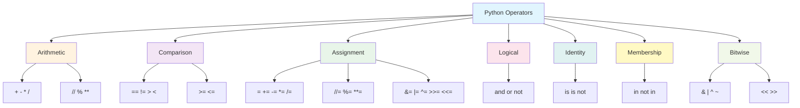

**Diagram explanation:** This hierarchy shows the seven main categories of Python operators. Each category branches into the specific operators it contains. This visual grouping helps you remember which operators belong together and what kind of operation each category performs.

---

## Diagram: Operator Precedence Flow

The following diagram illustrates how Python evaluates a complex expression by following precedence rules.

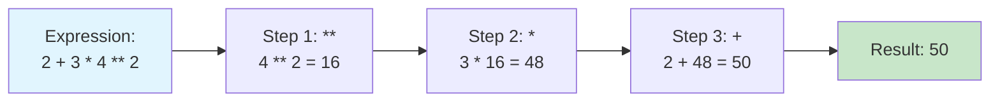

**Diagram explanation:** This flowchart shows the order in which Python evaluates the expression `2 + 3 * 4 ** 2`. Exponentiation (`**`) has the highest precedence and is evaluated first, followed by multiplication (`*`), and finally addition (`+`). The result is 50.

---

## Python Code Example: All Operator Categories

The following program demonstrates every operator category in a single script.

```python
# arithmetic_operators.py
a = 10
b = 3

print("Arithmetic Operators")
print(f"a + b  = {a + b}")    # 13
print(f"a - b  = {a - b}")    # 7
print(f"a * b  = {a * b}")    # 30
print(f"a / b  = {a / b}")    # 3.333...
print(f"a // b = {a // b}")   # 3
print(f"a % b  = {a % b}")    # 1
print(f"a ** b = {a ** b}")   # 1000

print("\nComparison Operators")
print(f"a == b : {a == b}")   # False
print(f"a != b : {a != b}")   # True
print(f"a > b  : {a > b}")    # True
print(f"a < b  : {a < b}")    # False

print("\nLogical Operators")
print(f"a > 5 and b < 5 : {a > 5 and b < 5}")  # True
print(f"a > 15 or b < 5 : {a > 15 or b < 5}")  # True
print(f"not (a > 5)     : {not (a > 5)}")      # False

print("\nIdentity Operators")
x = [1, 2, 3]
y = [1, 2, 3]
z = x
print(f"x == y : {x == y}")   # True
print(f"x is y : {x is y}")   # False
print(f"x is z : {x is z}")   # True

print("\nMembership Operators")
fruits = ["apple", "banana"]
print(f"'apple' in fruits     : {'apple' in fruits}")      # True
print(f"'grape' not in fruits : {'grape' not in fruits}")  # True

print("\nBitwise Operators")
p = 5   # 0101
q = 3   # 0011
print(f"p & q  = {p & q}")    # 1
print(f"p | q  = {p | q}")    # 7
print(f"p ^ q  = {p ^ q}")    # 6
print(f"p << 1 = {p << 1}")   # 10
print(f"p >> 1 = {p >> 1}")   # 2
```

**Expected output:**

```text
Arithmetic Operators
a + b  = 13
a - b  = 7
a * b  = 30
a / b  = 3.3333333333333335
a // b = 3
a % b  = 1
a ** b = 1000

Comparison Operators
a == b : False
a != b : True
a > b  : True
a < b  : False

Logical Operators
a > 5 and b < 5 : True
a > 15 or b < 5 : True
not (a > 5)     : False

Identity Operators
x == y : True
x is y : False
x is z : True

Membership Operators
'apple' in fruits     : True
'grape' not in fruits : True

Bitwise Operators
p & q  = 1
p | q  = 7
p ^ q  = 6
p << 1 = 10
p >> 1 = 2
```

---

## Important Points to Remember

- Python has **seven categories** of operators: arithmetic, comparison, assignment, logical, identity, membership, and bitwise.
- The `/` operator always returns a **float**; use `//` for integer (floor) division.
- Python does **not** support `++` or `--`. Use `x += 1` instead.
- `==` compares **values**; `is` compares **identity** (memory location).
- Logical operators use **short-circuit evaluation**; the second operand may not be evaluated.
- `in` checks membership in sequences like lists, strings, and dictionaries.
- Bitwise operators work on **binary representations** of integers.
- **Precedence** determines evaluation order; parentheses override it.
- `**` is **right-associative**: `4 ** 3 ** 2` equals `4 ** (3 ** 2)`.

---

## Comparison Table: Common Confusing Operators

| Pair | Distinction | Example |
|------|-------------|---------|
| `==` vs `is` | Value equality vs object identity | `[1] == [1]` is `True`; `[1] is [1]` is `False` |
| `/` vs `//` | True division (float) vs floor division (integer) | `5 / 2` is `2.5`; `5 // 2` is `2` |
| `and` vs `&` | Logical AND (short-circuits) vs bitwise AND | `True and False` is `False`; `5 & 3` is `1` |
| `not` vs `~` | Logical negation vs bitwise complement | `not True` is `False`; `~5` is `-6` |
| `+=` vs `+` | Augmented assignment (modifies) vs binary addition | `x += 1` changes `x`; `x + 1` produces new value |

---

## Conclusion

Python operators are the building blocks of every expression and statement in the language. The seven categories—arithmetic, comparison, assignment, logical, identity, membership, and bitwise—each serve a specific role in computation and decision-making. Mastery of operators includes understanding their syntax, their return types, their precedence, and the subtle differences between similar operators like `==` and `is`, or `/` and `//`. With this foundation, you can write correct and efficient Python expressions for any task.

---

## References

1. **Expressions and Operators** — Cornell Virtual Workshop  
   https://cvw.cac.cornell.edu/python-intro/data-operations/expressions-operators  
   *Supports: Arithmetic operators, comparison operators, logical operators, precedence rules.*

2. **operator — Standard operators as functions** — Python Documentation  
   https://docs.python.org/3/library/operator.html  
   *Supports: Operator function equivalents, `operator.add`, `operator.truediv`, `operator.is_`.*

3. **Class Notes: Data Types and Operators** — Carnegie Mellon University  
   https://www.cs.cmu.edu/~112-f22/notes/notes-data-and-operations.html  
   *Supports: Operator categories, precedence, associativity, floating-point comparison issues.*

4. **Python Operators** — W3Schools (Coursera mirror)  
   https://coursera.w3schools.com/python/python_operators.asp  
   *Supports: Assignment operators table, augmented assignments.*

5. **Assignment operator** — Imperial College London  
   https://intro2ml.pages.doc.ic.ac.uk/autumn2021/modules/lab-cpp/assignment  
   *Supports: Multiple assignment, shortcut operators, no `++`/`--` in Python.*

6. **Is vs Equality Operator** — Python.org Mailing List  
   https://mail.python.org/pipermail/python-list/2008-May/650008.html  
   *Supports: `is` vs `==` distinction, identity vs equality, memory address comparison.*

7. **manipulating bits in python** — Python.org Mailing List  
   https://mail.python.org/pipermail/python-list/2000-October/060861.html  
   *Supports: Bitwise operator list (`<<`, `>>`, `&`, `|`, `^`, `~`).*

---

# 5. Explain Python Data Types

## Introduction

Data types are the foundation of every Python program. Every value in Python—whether it is a number, a word, a list of items, or a complex object—has a **type** that determines what operations you can perform on it, how it is stored in memory, and how Python behaves when you use it. Understanding data types is essential because Python uses them to decide what `+` means (addition for numbers, concatenation for strings), whether you can change a value after creating it, and how much memory that value occupies.

This answer covers Python's **built-in data types**, explains the crucial distinction between **mutable** and **immutable** types, and shows you how to inspect and work with types in real code.

---

## Definition

A **data type** in Python is a classification that specifies which kind of value an object represents and which operations are valid for that object.

Python's official documentation states: "Objects are Python's abstraction for data. All data in a Python program is represented by objects or by relations between objects. Every object has an identity, a type and a value" .

Python provides several **built-in data types**, in particular `dict`, `list`, `set` and `frozenset`, and `tuple`. The `str` class is used to hold Unicode strings, and the `bytes` and `bytearray` classes are used to hold binary data .

---

## Detailed Explanation

### 1. The Core Principle: Everything Is an Object

Before examining individual types, understand the central rule: **in Python, everything is an object**. Every integer, string, function, and module is an object with:

- **Identity**: A unique memory address (checked with `is`, retrieved with `id()`).
- **Type**: The class of the object (checked with `type()`).
- **Value**: The data the object represents (compared with `==`) .

An object's **type is unchangeable**. It determines the operations the object supports and the possible values it can hold .

### 2. Numeric Types

Python has three numeric types: `int`, `float`, and `complex` .

**`int` (Integer)** represents whole numbers with **arbitrary precision**. Unlike C or Java, Python integers have no fixed size—they can grow as large as available memory allows .

```python
x = 12345678901234567890  # Larger than 64-bit
print(type(x))            # <class 'int'>
```

**`float` (Floating-Point)** represents real numbers using **64-bit double precision** (IEEE 754) . Floats have limited precision—typically 15 to 17 decimal digits .

```python
y = 3.14159
print(type(y))  # <class 'float'>
print(5.0 / 3.0)  # 1.6666666666666667
```

**`complex`** represents complex numbers with real and imaginary parts, using `j` for the imaginary unit .

```python
z = 2 + 3j
print(type(z))       # <class 'complex'>
print(z.real)        # 2.0
print(z.imag)        # 3.0
```

### 3. Boolean Type

**`bool`** has exactly two values: `True` and `False`. Note the capitalisation .

Booleans are the foundation of decision-making in Python. All comparison, logical, identity, and membership operators return a boolean .

```python
print(type(True))   # <class 'bool'>
print(5 > 3)        # True
print(5 == 5)       # True
```

**Important**: Python treats many values as "truthy" or "falsy" in boolean contexts. Numbers equal to zero, empty strings, and empty collections are **falsy**; everything else is **truthy** .

### 4. String Type

**`str`** represents a sequence of Unicode characters .

Key facts about strings:
- There is **no separate `char` type** in Python—a single character is just a string of length 1 .
- Strings are **immutable**—you cannot change a character in place .
- Strings support many operations: indexing, slicing, concatenation (`+`), repetition (`*`), and methods like `.upper()`, `.split()`, `.replace()`.

```python
s = "Hello"
print(s[0])       # H
print(s + " World")  # Hello World
print(len(s))     # 5
```

### 5. Sequence Types

Python has three primary sequence types: `list`, `tuple`, and `range`.

**`list`** is an **ordered, mutable** sequence of arbitrary objects. Lists are created with square brackets `[]` .

```python
my_list = [1, "two", 3.0]
my_list[0] = 100     # Allowed (mutable)
print(my_list)       # [100, 'two', 3.0]
```

**`tuple`** is an **ordered, immutable** sequence. Tuples are created with parentheses `()` or commas .

```python
my_tuple = (1, 2, 3)
# my_tuple[0] = 100  # TypeError: 'tuple' object does not support item assignment
```

**`range`** represents an immutable sequence of numbers, commonly used in `for` loops .

```python
for i in range(3):
    print(i)  # 0, 1, 2
```

### 6. Set Types

**`set`** represents an **unordered collection of unique, immutable objects**. Sets are created with `{}` or the `set()` constructor .

```python
my_set = {1, 2, 3, 3, 3}
print(my_set)        # {1, 2, 3}
print(type(my_set))  # <class 'set'>
```

**`frozenset`** is an **immutable set**. Because it is immutable and hashable, a frozenset can be used as a dictionary key or as an element of another set .

```python
fs = frozenset([1, 2, 3])
print(type(fs))      # <class 'frozenset'>
```

### 7. Mapping Type

**`dict`** represents a **mapping** from keys to values. Dictionaries are created with `{}` and are **mutable** .

```python
my_dict = {"name": "Alice", "age": 30}
print(my_dict["name"])  # Alice
my_dict["age"] = 31     # Allowed (mutable)
```

Keys must be **immutable** (or hashable). Lists and dictionaries cannot be keys, but strings, numbers, and tuples can .

### 8. Binary Types

**`bytes`** is an immutable sequence of bytes (integers 0–255). **`bytearray`** is its mutable counterpart .

```python
b = b"hello"
print(type(b))  # <class 'bytes'>
```

These types are used for binary data, file I/O, and network protocols.

### 9. The None Type

**`NoneType`** has exactly one value: `None`. It is used to signify "no value" or "absence of value," and is commonly returned by functions that do not explicitly return anything .

```python
def do_nothing():
    pass

result = do_nothing()
print(result)       # None
print(type(result)) # <class 'NoneType'>
```

---

## Diagram: Python Built-in Data Types

```mermaid
flowchart TD
    ROOT["Python Built-in Data Types"]

    ROOT --> NUM["Numeric"]
    ROOT --> BOOL["Boolean"]
    ROOT --> STR["String"]
    ROOT --> SEQ["Sequence"]
    ROOT --> SET["Set"]
    ROOT --> MAP["Mapping"]
    ROOT --> BIN["Binary"]
    ROOT --> NONE["None"]

    NUM --> N1["int<br/>arbitrary precision"]
    NUM --> N2["float<br/>64-bit double"]
    NUM --> N3["complex<br/>real + imaginary"]

    BOOL --> B1["bool<br/>True / False"]

    STR --> S1["str<br/>Unicode characters"]

    SEQ --> Q1["list<br/>mutable, ordered"]
    SEQ --> Q2["tuple<br/>immutable, ordered"]
    SEQ --> Q3["range<br/>immutable, numeric"]

    SET --> T1["set<br/>mutable, unique"]
    SET --> T2["frozenset<br/>immutable, unique"]

    MAP --> M1["dict<br/>key-value pairs"]

    BIN --> X1["bytes<br/>immutable"]
    BIN --> X2["bytearray<br/>mutable"]

    NONE --> Z1["NoneType<br/>single value: None"]

    style ROOT fill:#e1f5fe
    style NUM fill:#fff3e0
    style BOOL fill:#f3e5f5
    style STR fill:#e8f5e9
    style SEQ fill:#fce4ec
    style SET fill:#e0f2f1
    style MAP fill:#fff9c4
    style BIN fill:#f1f8e9
    style NONE fill:#f5f5f5
```

**Diagram explanation:** This hierarchy shows the major categories of Python's built-in data types. Numeric types handle numbers, bool handles truth values, str handles text, sequences handle ordered collections, sets handle unique collections, dict handles mappings, binary types handle raw bytes, and NoneType represents absence of value. Each category branches into its specific types, with key characteristics noted.

---

## Diagram: Mutable vs Immutable

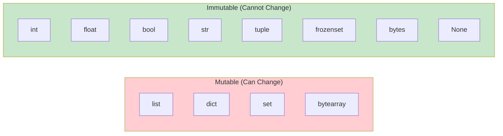

**Diagram explanation:** This diagram separates Python types into two groups. **Mutable** objects can be changed after creation (you can add, remove, or modify elements). **Immutable** objects cannot be altered after creation—any "modification" actually creates a new object .

---

## Python Code Example: Inspecting and Using Types

```python
# data_types_demo.py

# 1. Numeric types
integer_val = 42
float_val = 3.14
complex_val = 2 + 3j

print("Numeric Types:")
print(f"  integer_val: {type(integer_val)}")
print(f"  float_val:   {type(float_val)}")
print(f"  complex_val: {type(complex_val)}")

# 2. Boolean type
bool_val = True
print(f"\nBoolean:\n  bool_val: {type(bool_val)}")

# 3. String type
string_val = "Hello, Python"
print(f"\nString:\n  string_val: {type(string_val)}")
print(f"  Length: {len(string_val)}")

# 4. Sequence types
list_val = [1, 2, 3]
tuple_val = (1, 2, 3)
range_val = range(5)

print(f"\nSequences:")
print(f"  list_val:  {type(list_val)}")
print(f"  tuple_val: {type(tuple_val)}")
print(f"  range_val: {type(range_val)}")

# 5. Set types
set_val = {1, 2, 3}
frozenset_val = frozenset([1, 2, 3])

print(f"\nSets:")
print(f"  set_val:       {type(set_val)}")
print(f"  frozenset_val: {type(frozenset_val)}")

# 6. Mapping type
dict_val = {"name": "Alice", "age": 30}
print(f"\nDictionary:\n  dict_val: {type(dict_val)}")

# 7. Binary types
bytes_val = b"hello"
bytearray_val = bytearray(b"hello")

print(f"\nBinary:")
print(f"  bytes_val:     {type(bytes_val)}")
print(f"  bytearray_val: {type(bytearray_val)}")

# 8. None type
none_val = None
print(f"\nNone:\n  none_val: {type(none_val)}")

# 9. Mutable vs Immutable demonstration
print("\n--- Mutability Demonstration ---")
my_list = [1, 2, 3]
print(f"Original list: {my_list}")
my_list.append(4)  # Allowed: lists are mutable
print(f"After append:  {my_list}")

my_tuple = (1, 2, 3)
print(f"Original tuple: {my_tuple}")
# my_tuple.append(4)  # This would raise AttributeError
# Tuples have no append method because they are immutable
```

**Expected output:**

```text
Numeric Types:
  integer_val: <class 'int'>
  float_val:   <class 'float'>
  complex_val: <class 'complex'>

Boolean:
  bool_val: <class 'bool'>

String:
  string_val: <class 'str'>
  Length: 13

Sequences:
  list_val:  <class 'list'>
  tuple_val: <class 'tuple'>
  range_val: <class 'range'>

Sets:
  set_val:       <class 'set'>
  frozenset_val: <class 'frozenset'>

Dictionary:
  dict_val: <class 'dict'>

Binary:
  bytes_val:     <class 'bytes'>
  bytearray_val: <class 'bytearray'>

None:
  none_val: <class 'NoneType'>

--- Mutability Demonstration ---
Original list: [1, 2, 3]
After append:  [1, 2, 3, 4]
Original tuple: (1, 2, 3)
```

---

## Comparison Table: Mutable vs Immutable Types

| Aspect | Mutable | Immutable |
|--------|---------|-----------|
| **Can change after creation** | Yes | No |
| **Can be dictionary keys** | No | Yes |
| **Thread-safe** | No (needs locking) | Yes |
| **Hashable** | No | Yes |
| **Examples** | `list`, `dict`, `set`, `bytearray` | `int`, `float`, `str`, `tuple`, `frozenset`, `bytes` |
| **Modification behavior** | Changes same object | Creates new object |

---

## Comparison Table: Common Data Types at a Glance

| Type | Mutable | Ordered | Indexable | Can Contain Duplicates | Typical Use |
|------|---------|---------|-----------|----------------------|-------------|
| `int` | No | N/A | No | N/A | Counting, arithmetic |
| `float` | No | N/A | No | N/A | Scientific calculations |
| `bool` | No | N/A | No | N/A | Conditions, flags |
| `str` | No | Yes | Yes | Yes | Text processing |
| `list` | Yes | Yes | Yes | Yes | Dynamic collections |
| `tuple` | No | Yes | Yes | Yes | Fixed records |
| `set` | Yes | No | No | No | Membership testing |
| `dict` | Yes | Yes* | By key | No (keys) | Key-value storage |
| `None` | No | N/A | No | N/A | Absence of value |

*Dictionaries preserve insertion order since Python 3.7.

---

## Important Points to Remember

- **Everything in Python is an object** with an identity, type, and value .
- **Type determines behavior**: The same operator (`+`) can add numbers or concatenate strings.
- **Mutable types** (`list`, `dict`, `set`) can be changed after creation; **immutable types** (`int`, `str`, `tuple`) cannot .
- **Only immutable objects can be dictionary keys** or set elements.
- Python integers have **arbitrary precision**—no overflow .
- Python floats use **64-bit double precision** .
- There is **no `char` type**—single characters are strings of length 1 .
- Use `type()` to inspect an object's type, and `isinstance()` to check if an object belongs to a type hierarchy.
- `None` is a singleton object of type `NoneType`, used to mean "no value" .

---

## Conclusion

Python's data types provide a rich and flexible system for representing every kind of data a program needs. The numeric types (`int`, `float`, `complex`) handle numbers with varying precision, `bool` handles truth values, `str` handles Unicode text, and the collection types (`list`, `tuple`, `set`, `dict`) organize multiple values. The fundamental distinction between **mutable** and **immutable** types governs what you can do with each object and how Python manages memory. Mastering these types—their behaviors, operations, and limitations—is the essential first step toward writing correct and effective Python programs.

---

## References

1. **Data Types** — Python 3.13 Documentation  
   https://docs.python.org/3.13/library/datatypes.html  
   *Supports: Built-in types list (dict, list, set, frozenset, tuple), str, bytes, bytearray definitions.*

2. **3. Data model** — Python 1.5 Reference Manual (MIT)  
   http://www.mit.edu/people/amliu/vrut/python/ref/ref-5.html  
   *Supports: Objects, values, types, mutability vs immutability, standard type hierarchy.*

3. **3.2.5. Immutable sequences / Mutable sequences** — Python Documentation (Taiwan mirror)  
   https://python.github.io/python-docs-zh-tw/pr-preview/pr-1148/reference/datamodel.html  
   *Supports: Immutable sequences (str, tuple, bytes), mutable sequences (list, bytearray), set types (set, frozenset).*

4. **Basic built-in data types** — Imperial College London, COMP70050  
   https://intro2ml.pages.doc.ic.ac.uk/autumn2021/modules/lab-cpp/datatypes  
   *Supports: Numbers (int, float, complex), bool, str, no char type, literal definition.*

5. **1.2 Built-in Types of Data** — Princeton University, Introduction to Programming in Python  
   https://introcs.cs.princeton.edu/python/12types/  
   *Supports: int, float, bool definitions, operators, truth tables, comparison operators.*

6. **3.2 Types d'objets** — LPTMC, Sorbonne Université  
   https://www.lptmc.jussieu.fr/user/messio/M1_CoursPython_2025.pdf  
   *Supports: Native types, numeric types, sequential types (list, tuple, range), complex numbers, float precision.*

7. **type()** — Real Python  
   https://realpython.com/ref/builtin-functions/type/  
   *Supports: type() function signatures, return values, checking types at runtime.*

---

# 6. Explain the For Loop in Python with an Example

## Introduction

The `for` loop is one of Python's most important control flow tools. It allows you to repeat a block of code once for each item in a sequence, such as a list, string, tuple, or range of numbers. Unlike loops in languages like C or Java that iterate over counters, Python's `for` loop works directly on the items of any iterable object.

This design makes Python code more readable and less error-prone. Instead of managing an index variable manually, you simply say "for each thing in this collection, do this action."

---

## Definition

A **`for` loop** in Python is a control structure that iterates over the items of an **iterable** (such as a list, tuple, string, dictionary, or range object) in the order they appear, executing the loop body once for each item.

An **iterable** is any Python object capable of returning its elements one at a time when you loop over it.

---

## Detailed Explanation

### Basic Syntax

```python
for variable in iterable:
    # loop body (indented)
    statement_1
    statement_2
```

The three essential parts are:

1. **The `for` keyword** — signals the start of the loop
2. **The loop variable** — takes on each item from the iterable, one at a time
3. **The iterable** — the collection being looped over
4. **The colon (`:`)** — marks the end of the header and the start of the loop body
5. **Indentation** — Python requires the body to be indented (typically 4 spaces)

### How It Works

The `for` loop follows this process:

1. Python obtains an **iterator** from the iterable
2. It calls `next()` on the iterator to get the first item
3. The loop variable is assigned that item
4. The loop body executes
5. Steps 2–4 repeat until the iterator is exhausted
6. When no more items remain, the loop terminates

### Looping Over Different Data Types

**Lists:**
```python
fruits = ["apple", "banana", "cherry"]
for fruit in fruits:
    print(fruit)
```

**Strings** — iterates character by character:
```python
for letter in "Python":
    print(letter)
```

**Range of numbers** — the `range()` function generates a sequence:
```python
for i in range(5):
    print(i)  # 0, 1, 2, 3, 4
```

**Dictionaries** — iterates over keys by default:
```python
person = {"name": "Alice", "age": 30}
for key in person:
    print(key, ":", person[key])
```

### The `range()` Function

The `range()` function is commonly used with `for` loops to iterate a specific number of times.

| Syntax | Generates |
|--------|-----------|
| `range(5)` | 0, 1, 2, 3, 4 |
| `range(2, 6)` | 2, 3, 4, 5 |
| `range(0, 10, 3)` | 0, 3, 6, 9 |
| `range(-10, -100, -30)` | -10, -40, -70 |

**Important**: The **stop value is never included** in the generated sequence.

### The `break` Statement

`break` exits the loop **immediately**, skipping any remaining items.

```python
for i in range(5):
    if i == 2:
        break
    print(i)  # Output: 0, 1
```

### The `continue` Statement

`continue` skips the **rest of the current iteration** and moves to the next item.

```python
for i in range(5):
    if i == 2:
        continue
    print(i)  # Output: 0, 1, 3, 4
```

### The `else` Clause on Loops

A `for` loop can have an `else` clause that runs **only if the loop completes without hitting `break`**.

```python
for i in range(3):
    print(i)
else:
    print("Loop finished normally")  # This runs

for i in range(3):
    if i == 1:
        break
    print(i)
else:
    print("This will NOT run")  # Skipped due to break
```

### Nested Loops

A loop inside another loop. The inner loop runs completely for each iteration of the outer loop.

```python
for i in range(2):
    for j in range(2):
        print(i, j)
```

**Output:**
```text
0 0
0 1
1 0
1 1
```

### The `pass` Statement

If you need a loop syntactically but don't want it to do anything yet, use `pass`:

```python
for i in range(5):
    pass  # Placeholder; no action
```

---

## Diagram: For Loop Execution Flow

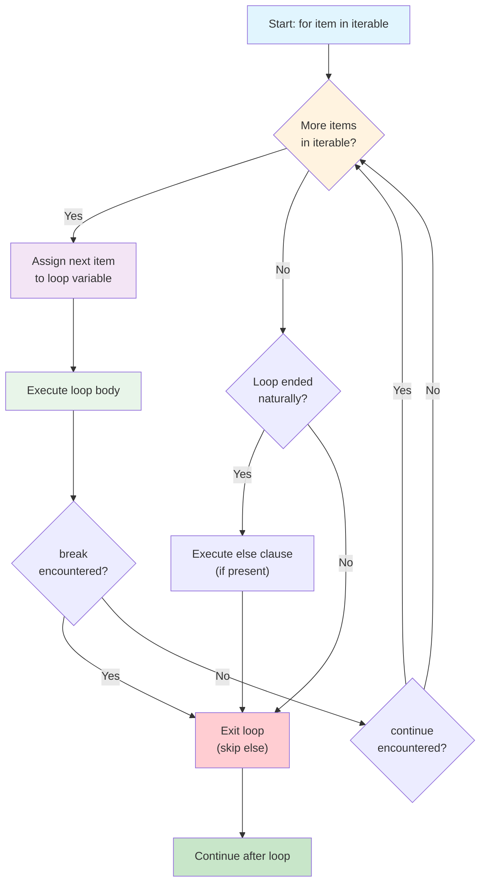

**Diagram explanation:** This flowchart shows the complete execution path of a `for` loop. Python checks if more items remain in the iterable. If yes, the next item is assigned to the loop variable and the body executes. If `break` is encountered, the loop ends immediately (skipping the `else` clause). If `continue` is encountered, the loop jumps back to fetch the next item. When no items remain, Python checks whether the loop ended naturally (without `break`) and executes the `else` clause if present.

---

## Diagram: For Loop Over a List

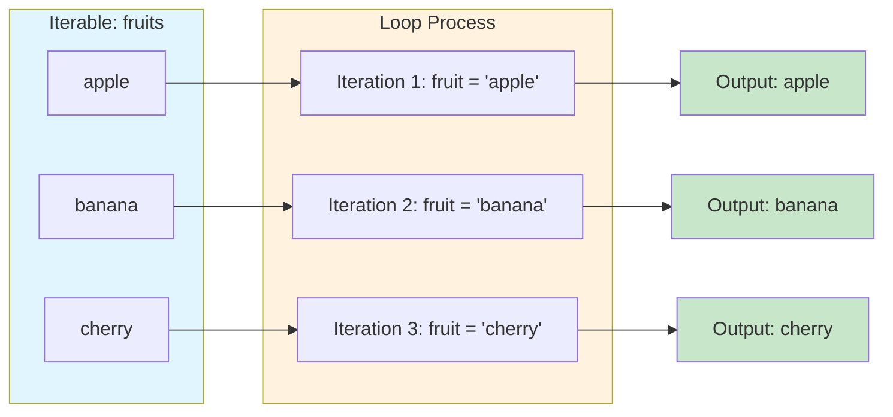

**Diagram explanation:** This diagram shows how a `for` loop processes a list of fruits. Each item is assigned to the loop variable in sequence, and the loop body (printing the fruit) executes once for each item.

---

## Python Code Example: Complete For Loop Demonstration

```python
# for_loop_demo.py

# 1. Basic for loop over a list
print("--- 1. Looping over a list ---")
fruits = ["apple", "banana", "cherry"]
for fruit in fruits:
    print(f"Fruit: {fruit}")

# 2. Looping over a string
print("\n--- 2. Looping over a string ---")
for char in "Python":
    print(f"Character: {char}")

# 3. Using range()
print("\n--- 3. Using range() ---")
for i in range(3):
    print(f"Number: {i}")

# 4. Using range() with start and step
print("\n--- 4. range(1, 10, 2) ---")
for i in range(1, 10, 2):
    print(f"Odd number: {i}")

# 5. break statement
print("\n--- 5. break when i equals 2 ---")
for i in range(5):
    if i == 2:
        print("Breaking at 2")
        break
    print(f"i = {i}")

# 6. continue statement
print("\n--- 6. continue when i equals 2 ---")
for i in range(5):
    if i == 2:
        print("Skipping 2")
        continue
    print(f"i = {i}")

# 7. else clause (completes normally)
print("\n--- 7. else clause (normal completion) ---")
for i in range(3):
    print(f"i = {i}")
else:
    print("Loop finished normally")

# 8. else clause (with break)
print("\n--- 8. else clause (with break) ---")
for i in range(5):
    if i == 2:
        print("Breaking at 2")
        break
    print(f"i = {i}")
else:
    print("This will not print")
```

**Expected output:**

```text
--- 1. Looping over a list ---
Fruit: apple
Fruit: banana
Fruit: cherry

--- 2. Looping over a string ---
Character: P
Character: y
Character: t
Character: h
Character: o
Character: n

--- 3. Using range() ---
Number: 0
Number: 1
Number: 2

--- 4. range(1, 10, 2) ---
Odd number: 1
Odd number: 3
Odd number: 5
Odd number: 7
Odd number: 9

--- 5. break when i equals 2 ---
i = 0
i = 1
Breaking at 2

--- 6. continue when i equals 2 ---
i = 0
i = 1
Skipping 2
i = 3
i = 4

--- 7. else clause (normal completion) ---
i = 0
i = 1
i = 2
Loop finished normally

--- 8. else clause (with break) ---
i = 0
i = 1
Breaking at 2
```

---

## Step-by-Step Execution Trace

### Example: `for i in range(5): print(i)`

| Step | Action | Loop Variable `i` | Output |
|------|--------|-------------------|--------|
| 1 | Get first item from range | `0` | `0` |
| 2 | Get second item | `1` | `1` |
| 3 | Get third item | `2` | `2` |
| 4 | Get fourth item | `3` | `3` |
| 5 | Get fifth item | `4` | `4` |
| 6 | No more items; loop ends | — | — |

### Example with `break` and `continue`

```python
for i in range(5):
    if i == 2:
        continue
    if i == 4:
        break
    print(i)
```

| Step | `i` | Condition | Action | Output |
|------|-----|-----------|--------|--------|
| 1 | 0 | No match | Print | `0` |
| 2 | 1 | No match | Print | `1` |
| 3 | 2 | `i == 2` | `continue` (skip print) | — |
| 4 | 3 | No match | Print | `3` |
| 5 | 4 | `i == 4` | `break` (exit loop) | — |
| 6 | — | Loop ends | — | — |

---

## Comparison Table: For Loop vs While Loop

| Aspect | `for` Loop | `while` Loop |
|--------|-----------|--------------|
| **Best for** | Iterating known collections | Repeating based on a condition |
| **Termination** | Automatically when items exhausted | When condition becomes false |
| **Risk of infinite loop** | Low (unless iterable is infinite) | Higher (condition must change) |
| **Counter variable** | Managed automatically | Must be updated manually |
| **Typical use** | "For each item in this list..." | "While this condition is true..." |
| **Syntax** | `for x in iterable:` | `while condition:` |

---

## Important Points to Remember

- The `for` loop in Python iterates over **items of an iterable**, not numeric counters like in C or Java.
- The loop variable is **automatically assigned** each item in sequence.
- **Indentation** (typically 4 spaces) is required for the loop body.
- `range(n)` generates `0` to `n-1`; the stop value is **excluded**.
- `break` exits the loop **entirely**; `continue` skips only the **current iteration**.
- The `else` clause on a `for` loop runs **only if `break` was not executed**.
- Use `pass` as a placeholder when the loop body is syntactically required but empty.
- Nested loops run the inner loop completely for each outer iteration.

---

## Conclusion

The `for` loop is Python's primary tool for iterating over sequences. It is designed to work directly with iterables—lists, strings, ranges, dictionaries, and more—making code cleaner and more readable than counter-based loops in other languages. By combining `for` with `range()` for numeric sequences, `break` for early exit, `continue` for skipping items, and the optional `else` clause for post-loop logic, you can handle virtually any repetition task in Python.

---

## References

1. **4. More Control Flow Tools** — Python Documentation (3.13)  
   https://docs.python.org/3.13/tutorial/controlflow.html  
   *Supports: `for` statement behavior, `range()` function, `break`, `continue`, `else` clause, `pass` statement.*

2. **Python For Loops** — W3Schools  
   https://coursera.w3schools.com/python/python_for_loops.asp  
   *Supports: Basic syntax, looping over strings, `break`, `continue`, `range()`, `else`, nested loops, `pass`.*

3. **Loops for** — KodeKloud Notes  
   https://notes.kodekloud.com/docs/Python-Basics/Control-Flow-Conditional-Blocks-and-Loops/Loops-for/page  
   *Supports: `for` loop with `range()`, `break`, `continue` examples and explanations.*

4. **Plotting and Programming in Python: For Loops** — NIH GREI  
   https://nih-grei.github.io/python-novice-gapminder/instructor/12-for-loops.html  
   *Supports: Loop components (collection, loop variable, body), indentation, `range()` behavior, accumulator pattern.*

5. **Controlling loop execution with break and continue** — Microsoft Learn  
   https://learn.microsoft.com/cs-cz/training/modules/repeat-actions-loops-python/3-controlling-loop-execution-with-break-continue  
   *Supports: `break` and `continue` behavior, examples with `range()`, warning about infinite loops in `while`.*

6. **Python For Loops** — GitHub (Messari Python Training)  
   https://notebooks.githubusercontent.com/view/ipynb?...  
   *Supports: Iterables, looping over lists and strings, `break`, `continue`, `range()`, `len()` with indexing.*

---

# 7. Explain the `match` Statement with Code Snippet

## Introduction

The `match` statement is a control-flow feature introduced in Python 3.10 that brings **structural pattern matching** to the language. Unlike the traditional `if-elif-else` chains that repeatedly test the same variable against different values, `match` allows you to compare a value against **patterns** that describe the shape and structure of data.

This feature was specified in **PEP 634** (Structural Pattern Matching: Specification), **PEP 635** (Motivation and Rationale), and **PEP 636** (Tutorial). It was inspired by pattern matching in languages like Scala, Haskell, Erlang, and Rust.

The `match` statement is especially useful for handling complex data structures—like API responses, command sequences, or object hierarchies—where you need to check not just values but also types, shapes, and contents in a single readable block.

---

## Definition

A **`match` statement** takes an expression (the **subject**) and compares it against one or more **patterns** in `case` blocks. The first pattern that successfully matches the subject (and whose optional guard condition is truthy) triggers execution of its associated code block.

**Structural pattern matching** means matching based on the **structure** of data—its type, shape, and components—not just its value.

**Key distinction**: Unlike `switch` in C or Java, Python's `match` does not just compare a value against constants. It can destructure lists, extract dictionary values, match object attributes, and apply conditional guards.

---

## Detailed Explanation

### Basic Syntax

```python
match subject:
    case <pattern_1>:
        <action_1>
    case <pattern_2>:
        <action_2>
    case <pattern_3>:
        <action_3>
    case _:
        <action_wildcard>
```

The three essential parts are:

1. **`match` keyword** — evaluates the subject expression
2. **`case` blocks** — each contains a pattern and an action
3. **Wildcard `_`** — optional final case that matches anything (default case)

### How It Works

The matching process follows these steps:

1. The **subject expression** is evaluated once.
2. Patterns are tested **from top to bottom**.
3. The **first successful match** (with a truthy guard, if present) executes its block.
4. **No fall-through** — unlike C's `switch`, only one case runs.
5. If no pattern matches and no wildcard exists, the `match` block is a **no-op** (nothing happens).

### Literal Patterns

The simplest form matches exact values:

```python
def http_status(status):
    match status:
        case 200:
            return "OK"
        case 404:
            return "Not Found"
        case 418:
            return "I'm a teapot"
        case _:
            return "Unknown status"
```

**Important**: `True`, `False`, and `None` are matched by **identity** (`is`), not equality (`==`). So `match 1` will **not** match `case True`, even though `1 == True` in Python.

### OR Patterns

Use `|` to match any of several alternatives in a single case:

```python
case 401 | 403 | 404:
    return "Not allowed"
```

### Variable Capture

A bare name in a pattern **always matches** and **binds** the value to that name:

```python
match command:
    case ["hello", name]:
        return f"Hello, {name}!"
```

Here, `name` captures whatever string appears in the second position.

**Critical trap**: `case QUIT_COMMAND:` does **not** compare against an existing variable—it creates a new binding that shadows it. To match against a constant, use a **dotted name** (e.g., `case Commands.QUIT:`) or a guard.

### Sequence Patterns

Match lists and tuples by structure:

```python
match point:
    case [0, 0]:
        return "Origin"
    case [x, 0]:
        return f"On x-axis at {x}"
    case [0, y]:
        return f"On y-axis at {y}"
    case [x, y]:
        return f"Point at ({x}, {y})"
```

Use `*` to capture variable-length sequences:

```python
case ["drop", *items]:
    return f"Dropping {len(items)} items"
```

### Mapping Patterns

Match dictionaries by key presence:

```python
match event:
    case {"type": "click", "button": btn}:
        return f"Clicked {btn}"
    case {"type": "keypress", "key": k}:
        return f"Pressed {k}"
```

Extra keys in the dictionary are **ignored**—partial matching is allowed.

### Class Patterns

Match object instances by type and attributes:

```python
match shape:
    case Circle(center=Point(x=0, y=0), radius=r):
        return f"Circle at origin, radius {r}"
    case Point(x=0, y=0):
        return "Origin point"
```

Dataclasses and named tuples automatically support positional patterns via `__match_args__`.

### Guard Clauses

Add an `if` condition to a pattern for extra filtering:

```python
match value:
    case int(n) if n > 0:
        return f"Positive: {n}"
    case int(n) if n < 0:
        return f"Negative: {n}"
```

The pattern must match **first**, then the guard is evaluated.

---

## Diagram: Match Statement Execution Flow

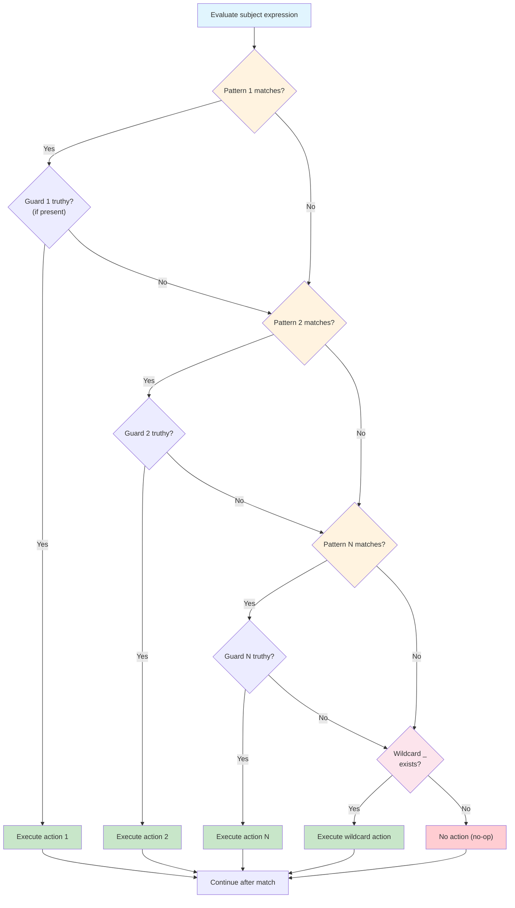

**Diagram explanation**: The subject is evaluated once. Each pattern is tested in order. If a pattern matches, its guard (if any) is checked. The first successful match executes its action and exits the block. If no pattern matches and no wildcard exists, the entire block is a no-op. There is no fall-through—only one case ever executes.

---

## Diagram: Pattern Matching on a Dictionary

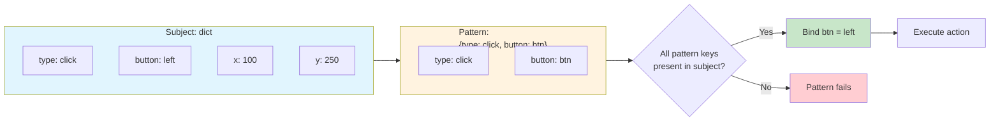

**Diagram explanation**: A mapping pattern checks whether all specified keys exist in the subject dictionary. Extra keys (like `x` and `y` here) are ignored. When all pattern keys are present, variable bindings are created (e.g., `btn = "left"`) and the action executes.

---

## Python Code Example: Complete `match` Demonstration

```python
# match_demo.py

# 1. Literal patterns
def http_status(status):
    match status:
        case 200:
            return "OK"
        case 404:
            return "Not Found"
        case 418:
            return "I'm a teapot"
        case _:
            return "Unknown status"

print("--- Literal Patterns ---")
print(http_status(200))
print(http_status(404))
print(http_status(500))

# 2. OR patterns
def categorize_status(status):
    match status:
        case 401 | 403 | 404:
            return "Client error"
        case 500 | 502 | 503:
            return "Server error"
        case _:
            return "Other"

print("\n--- OR Patterns ---")
print(categorize_status(404))
print(categorize_status(502))

# 3. Sequence patterns
def describe_point(point):
    match point:
        case [0, 0]:
            return "Origin"
        case [x, 0]:
            return f"On x-axis at {x}"
        case [0, y]:
            return f"On y-axis at {y}"
        case [x, y]:
            return f"Point at ({x}, {y})"
        case _:
            return "Not a 2D point"

print("\n--- Sequence Patterns ---")
print(describe_point([0, 0]))
print(describe_point([3, 0]))
print(describe_point([2, 5]))

# 4. Mapping patterns
def handle_event(event):
    match event:
        case {"type": "click", "button": btn}:
            return f"Mouse click: button {btn}"
        case {"type": "keypress", "key": k}:
            return f"Key pressed: {k}"
        case {"type": t}:
            return f"Unknown event type: {t}"
        case _:
            return "Invalid event"

print("\n--- Mapping Patterns ---")
print(handle_event({"type": "click", "button": "left"}))
print(handle_event({"type": "keypress", "key": "Enter"}))
print(handle_event({"type": "scroll", "delta": 5}))

# 5. Guard clauses
def classify_number(n):
    match n:
        case int(x) if x < 0:
            return f"Negative: {x}"
        case 0:
            return "Zero"
        case int(x) if x % 2 == 0:
            return f"Positive even: {x}"
        case int(x):
            return f"Positive odd: {x}"
        case _:
            return "Not an integer"

print("\n--- Guard Clauses ---")
print(classify_number(-5))
print(classify_number(0))
print(classify_number(4))
print(classify_number(7))
```

**Expected output:**

```text
--- Literal Patterns ---
OK
Not Found
Unknown status

--- OR Patterns ---
Client error
Server error

--- Sequence Patterns ---
Origin
On x-axis at 3
Point at (2, 5)

--- Mapping Patterns ---
Mouse click: button left
Key pressed: Enter
Unknown event type: scroll

--- Guard Clauses ---
Negative: -5
Zero
Positive even: 4
Positive odd: 7
```

---

## Step-by-Step Execution Trace

### Example: `http_status(404)`

| Step | Action | Result |
|------|--------|--------|
| 1 | Subject `status` evaluated | `404` |
| 2 | Test `case 200:` | No match |
| 3 | Test `case 404:` | **Match!** |
| 4 | Execute action | `return "Not Found"` |
| 5 | Exit match block | — |

### Example: `classify_number(4)`

| Step | Action | Result |
|------|--------|--------|
| 1 | Subject `n` evaluated | `4` |
| 2 | Test `case int(x) if x < 0:` | Pattern matches (`int`), guard fails (`4 < 0` is False) |
| 3 | Test `case 0:` | No match |
| 4 | Test `case int(x) if x % 2 == 0:` | Pattern matches, guard passes (`4 % 2 == 0`) |
| 5 | Execute action | `return "Positive even: 4"` |
| 6 | Exit match block | — |

### Example: `handle_event({"type": "scroll", "delta": 5})`

| Step | Action | Result |
|------|--------|--------|
| 1 | Subject evaluated | `{"type": "scroll", "delta": 5}` |
| 2 | Test `case {"type": "click", "button": btn}:` | Key `"button"` missing → No match |
| 3 | Test `case {"type": "keypress", "key": k}:` | Key `"key"` missing → No match |
| 4 | Test `case {"type": t}:` | Key `"type"` present → **Match!** |
| 5 | Bind `t = "scroll"`, execute | `return "Unknown event type: scroll"` |
| 6 | Exit match block | — |

---

## Comparison: `match` vs `if-elif-else`

| Aspect | `match-case` | `if-elif-else` |
|--------|-------------|----------------|
| **Primary purpose** | Structural pattern matching | General condition testing |
| **Readability** | Declarative, data-shape focused | Imperative, condition-focused |
| **Type checking** | Built into class patterns | Requires explicit `isinstance()` |
| **Destructuring** | Native (sequences, mappings, classes) | Manual indexing/attribute access |
| **Repetition** | Subject written once | Subject repeated in each condition |
| **Fall-through** | None | N/A |
| **Python version** | 3.10+ | All versions |

**Example comparison** — processing an API response:

```python
# if-elif-else approach
def process_response(response):
    if isinstance(response, dict):
        if response.get("status") == "success":
            users = response.get("data", {}).get("users", [])
            if len(users) > 0:
                return f"Processing {len(users)} users"
            return "No users found"
        elif response.get("status") == "error":
            return f"Error: {response.get('message', 'Unknown')}"
    return "Invalid response"
```

```python
# match-case approach (cleaner, declarative)
def process_response(response):
    match response:
        case {"status": "success", "data": {"users": users}} if len(users) > 0:
            return f"Processing {len(users)} users"
        case {"status": "success", "data": {"users": []}}:
            return "No users found"
        case {"status": "error", "message": msg}:
            return f"Error: {msg}"
        case _:
            return "Invalid response"
```

The `match` version tests structure and extracts values in a single pattern, eliminating nested conditionals and repeated dictionary lookups.

---

## Important Points to Remember

- **`match-case` requires Python 3.10+**. In older versions, it is a syntax error.
- **No fall-through**: Only the first matching case executes.
- **`case _:`** is the wildcard/default case; it matches anything and binds nothing.
- **Bare names** in patterns are **capture patterns**—they always match and create a new binding.
- **To match against a constant**, use a dotted name (`case Commands.QUIT:`) or a guard.
- **`True`, `False`, `None`** are matched by **identity**, not equality.
- **Mapping patterns** perform **partial matching**—extra keys are ignored.
- **Guards** add an `if` condition that must be true for the case to be selected.
- **No match + no wildcard = no-op** (nothing happens).

---

## Conclusion

The `match` statement is one of Python's most significant additions in recent years. It replaces verbose, repetitive `if-elif` chains with a declarative syntax that simultaneously tests the **shape** of data, **extracts** its components, and **routes** execution to the appropriate handler. From simple literal comparisons to complex destructuring of nested dictionaries and objects, `match-case` makes data-heavy branching logic more readable and less error-prone. However, it is not a universal replacement for `if-elif-else`—for simple conditionals, the traditional approach remains appropriate. Use `match` when you are working with structured data and want to express "what shape is this data?" rather than "is this condition true?".

---

## References

1. **PEP 634 – Structural Pattern Matching: Specification** — Python Enhancement Proposals  
   https://peps.python.org/pep-0634/  
   *Supports: Official specification, match statement semantics, guard clauses, pattern types, irrefutable cases.*

2. **What's New in Python 3.10: Structural Pattern Matching** — Python.org Mailing List  
   https://mail.python.org/archives/list/python-checkins@python.org/thread/23NSBT4WMQF4MEYI3FSJVVEPUWSSVCOI/  
   *Supports: Introduction of match/case, syntax, literal patterns, wildcard behavior, no-op without match.*

3. **Python Match Case: Structural Pattern Matching Complete Explanation** — Kanaries Docs  
   https://docs.kanaries.net/ko/topics/Python/python-match-case  
   *Supports: Literal patterns, OR patterns, capture patterns, capture vs constant trap, sequence patterns, mapping patterns, guards, class patterns.*

4. **Python Match/Case: Structural Pattern Matching Guide** — GUVI  
   https://www.guvi.in/blog/python-match-case/  
   *Supports: Pattern types table, real-world use cases, common mistakes, Python version requirement.*

5. **Guide to Python's Switch Case Statement** — Codecademy  
   https://www.codecademy.com/article/guide-to-pythons-switch-case-statement  
   *Supports: match-case syntax, wildcard, comparison with if-elif-else, Python version.*

6. **Switch Case in Python: How to Mimic and Implement Case Statements Effectively** — Udacity  
   https://www.udacity.com/blog/switch-case-in-python-how-to-mimic-and-implement-case-statements-effectively/  
   *Supports: Comparison table, no fall-through, guard conditions, destructuring examples.*

---

# 8. Explain the `range()` Function with Its Parameters

## Introduction

The `range()` function is one of Python's most frequently used built-in utilities. It generates an immutable sequence of integers and is most commonly paired with `for` loops to repeat an action a specific number of times. Whether you need to count from 0 to 9, iterate backwards, or jump through numbers by a custom step, `range()` provides a clean and memory-efficient solution.

Understanding `range()` is essential because it appears in nearly every Python program that uses loops, list comprehensions, or index-based iteration.

---

## Definition

**`range()`** is a built-in Python function (implemented as a class) that returns an **immutable sequence of integers** within a specified interval, with an optional step size between successive numbers .

The syntax is:

```python
range(stop)
range(start, stop)
range(start, stop, step)
```

Where:

- **`start`** (optional) — the beginning integer of the sequence. Defaults to `0`.
- **`stop`** (required) — the integer at which the sequence ends. **Exclusive** — this value is never included.
- **`step`** (optional) — the difference between consecutive integers. Defaults to `1`.

---

## Detailed Explanation

### The Three Forms of `range()`

#### Form 1: `range(stop)`

When only one argument is provided, it is the **stop** value. The sequence starts at `0` and increments by `1`, ending at `stop - 1` .

```python
range(5)  # produces 0, 1, 2, 3, 4
```

- Start defaults to `0`.
- Step defaults to `1`.
- Total count of integers produced = `stop` (if `stop` > 0).

#### Form 2: `range(start, stop)`

When two arguments are provided, the first is **start** and the second is **stop**. The sequence begins at `start` and increments by `1`, ending at `stop - 1` .

```python
range(2, 6)  # produces 2, 3, 4, 5
```

- Step defaults to `1`.
- Total count = `stop - start` (if `stop > start`).

#### Form 3: `range(start, stop, step)`

When three arguments are provided, the sequence begins at **start**, increments (or decrements) by **step**, and stops before reaching **stop** .

```python
range(0, 10, 2)  # produces 0, 2, 4, 6, 8
```

- The step can be **positive** (incrementing) or **negative** (decrementing).
- If step is negative, the start must be greater than the stop for the sequence to be non-empty .

### The "Exclusive Stop" Rule

The single most important rule to remember: **the `stop` value is never included** in the generated sequence . This "up to but not including" behavior mirrors Python's indexing rules, where a sequence of length `n` has valid indices `0` through `n-1`.

```python
list(range(5))     # [0, 1, 2, 3, 4] — not 5
list(range(1, 6))  # [1, 2, 3, 4, 5] — not 6
```

### Negative Steps

When `step` is negative, `range()` counts **backwards**. The start value must be greater than the stop value; otherwise, the result is an **empty sequence** .

```python
list(range(5, 0, -1))   # [5, 4, 3, 2, 1]
list(range(5, 5, -2))   # [] — start equals stop, empty
list(range(4, 5, -2))   # [] — start less than stop with negative step, empty
```

### Step Cannot Be Zero

If `step` is `0`, Python raises a **`ValueError`** . This makes sense because there would be no way to progress from one number to the next.

```python
range(0, 10, 0)  # ValueError: range() arg 3 must not be zero
```

### Memory Efficiency

A crucial fact about `range()` in **Python 3** is that it returns a **range object**, not a list . This object generates numbers **on demand** as you iterate over it, rather than storing all values in memory at once. This makes `range()` extremely memory-efficient for large sequences.

```python
r = range(1_000_000)  # No memory used for a million integers
print(type(r))        # <class 'range'>
print(len(r))         # 1000000 (instant, no iteration)
```

You can convert a range to a list with `list()` when you actually need all values stored:

```python
list(range(5))  # [0, 1, 2, 3, 4]
```

---

## Diagram: The Three Forms of `range()` and Their Outputs

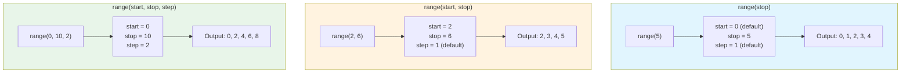

**Diagram explanation:** This diagram shows the three forms of `range()` side by side. Each form is broken down into its parameters and the resulting integer sequence. Notice that in every case, the `stop` value is excluded from the output.

---

## Diagram: Positive vs Negative Step Behavior

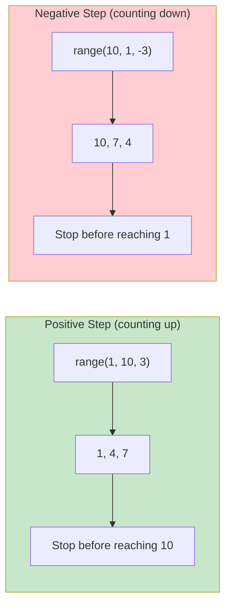

**Diagram explanation:** This diagram contrasts positive and negative steps. With a positive step, the sequence counts upward and stops before exceeding the stop value. With a negative step, it counts downward and stops before going below the stop value. In both cases, the stop value itself is never produced.

---

## Python Code Example: Complete `range()` Demonstration

```python
# range_demo.py

# 1. One parameter: range(stop)
print("--- range(5) ---")
for i in range(5):
    print(i, end=" ")
# Output: 0 1 2 3 4
print()

# 2. Two parameters: range(start, stop)
print("\n--- range(2, 6) ---")
for i in range(2, 6):
    print(i, end=" ")
# Output: 2 3 4 5
print()

# 3. Three parameters: range(start, stop, step)
print("\n--- range(0, 10, 2) ---")
for i in range(0, 10, 2):
    print(i, end=" ")
# Output: 0 2 4 6 8
print()

# 4. Negative step: counting backwards
print("\n--- range(10, 0, -2) ---")
for i in range(10, 0, -2):
    print(i, end=" ")
# Output: 10 8 6 4 2
print()

# 5. Empty range (start >= stop with positive step)
print("\n--- range(5, 2) ---")
print(list(range(5, 2)))
# Output: []

# 6. Empty range (start <= stop with negative step)
print("\n--- range(2, 5, -1) ---")
print(list(range(2, 5, -1)))
# Output: []

# 7. Converting range to list
print("\n--- list(range(5)) ---")
print(list(range(5)))
# Output: [0, 1, 2, 3, 4]

# 8. Range object properties
print("\n--- Range object properties ---")
r = range(1, 20, 3)
print(f"range object: {r}")
print(f"start: {r.start}")
print(f"stop: {r.stop}")
print(f"step: {r.step}")
print(f"length: {len(r)}")
# Output:
# range object: range(1, 20, 3)
# start: 1
# stop: 20
# step: 3
# length: 7
```

**Expected output:**

```text
--- range(5) ---
0 1 2 3 4 

--- range(2, 6) ---
2 3 4 5 

--- range(0, 10, 2) ---
0 2 4 6 8 

--- range(10, 0, -2) ---
10 8 6 4 2 

--- range(5, 2) ---
[]

--- range(2, 5, -1) ---
[]

--- list(range(5)) ---
[0, 1, 2, 3, 4]

--- Range object properties ---
range object: range(1, 20, 3)
start: 1
stop: 20
step: 3
length: 7
```

---

## Step-by-Step Execution Trace

### Example: `for i in range(2, 10, 3): print(i)`

| Iteration | Value of `i` | Check: `i < 10`? | Action | Output |
|-----------|--------------|------------------|--------|--------|
| 1 | 2 | 2 < 10 (True) | Print | `2` |
| 2 | 5 | 5 < 10 (True) | Print | `5` |
| 3 | 8 | 8 < 10 (True) | Print | `8` |
| 4 | 11 | 11 < 10 (False) | Stop | — |

**Final output:**
```text
2
5
8
```

### Example: `for i in range(5, 0, -1): print(i)`

| Iteration | Value of `i` | Check: `i > 0`? | Action | Output |
|-----------|--------------|-----------------|--------|--------|
| 1 | 5 | 5 > 0 (True) | Print | `5` |
| 2 | 4 | 4 > 0 (True) | Print | `4` |
| 3 | 3 | 3 > 0 (True) | Print | `3` |
| 4 | 2 | 2 > 0 (True) | Print | `2` |
| 5 | 1 | 1 > 0 (True) | Print | `1` |
| 6 | 0 | 0 > 0 (False) | Stop | — |

**Final output:**
```text
5
4
3
2
1
```

---

## Comparison Table: The Three Forms of `range()`

| Form | Arguments | Start Default | Step Default | Example | Output |
|------|-----------|---------------|--------------|---------|--------|
| `range(stop)` | 1 (required) | `0` | `1` | `range(4)` | 0, 1, 2, 3 |
| `range(start, stop)` | 2 (required) | — | `1` | `range(2, 5)` | 2, 3, 4 |
| `range(start, stop, step)` | 3 (required) | — | — | `range(1, 10, 2)` | 1, 3, 5, 7, 9 |

---

## Important Points to Remember

- **`stop` is always exclusive** — the sequence ends at `stop - 1` (for positive steps) .
- **`start` defaults to `0`** and **`step` defaults to `1`** .
- **`step` cannot be zero** — this raises a `ValueError` .
- **Negative steps count backwards** — start must be greater than stop, or the result is empty .
- In **Python 3**, `range()` returns a **memory-efficient range object**, not a list .
- Use `list(range(...))` to convert to an actual list of integers.
- The range object supports **indexing**, **slicing**, **`len()`**, and **membership testing** (`in`).
- `range()` arguments must be **integers** — floats are not allowed.

---

## Conclusion

The `range()` function is a versatile and memory-efficient tool for generating sequences of integers in Python. Its three forms—`range(stop)`, `range(start, stop)`, and `range(start, stop, step)`—cover virtually every counting scenario you will encounter, from simple iteration to custom-stepped sequences and backward counting. The key rule to internalize is the **exclusive stop**: the sequence always ends **before** the stop value. Combined with its lazy evaluation in Python 3, `range()` is the idiomatic choice for controlled repetition in Python programs.

---

## References

1. **Cornell Virtual Workshop: Control Flow — For-loops**  
   https://cvw.cac.cornell.edu/python-intro/control-flow/for-loops  
   *Supports: Three forms of range(), default start and step values, integer sequence generation.*

2. **Stanford University: Python range() Function**  
   https://cs.stanford.edu/people/nick/py/python-range.html  
   *Supports: One, two, and three-parameter forms, exclusive stop rule, negative step examples.*

3. **Python Documentation (zh-cn): Unpacking Argument Lists**  
   https://docs.python.org/zh-cn/3.7/tutorial/controlflow.html  
   *Supports: `range(3, 6)` output `[3, 4, 5]`, argument unpacking with `*`.*

4. **Python Bug Tracker: range() description rewording**  
   https://bugs.python.org/issue528748  
   *Supports: Historical docstring, step must not be zero (ValueError), default values.*

5. **PEP 204 – Range Literals**  
   https://peps.python.org/pep-0204/  
   *Supports: range takes three arguments (start, end, step), start and step optional with defaults 0 and 1.*

6. **Scaler Topics: range() function in Python**  
   https://www.scaler.com/topics/range-function-in-python/  
   *Supports: Parameter definitions, memory efficiency of range object, positive and negative step examples.*

7. **GitHub (freeCodeCamp): Range Function**  
   https://raw.githubusercontent.com/freeCodeCamp/freeCodeCamp/...  
   *Supports: range(3, 12, 2) output `3, 5, 7, 9, 11`, parameter descriptions.*

8. **GitHub (milaan9): Python range()**  
   https://notebooks.githubusercontent.com/view/ipynb?...  
   *Supports: Range object properties (start, stop, step), ValueError for zero step, formula r[n] = start + step*n.*

---

# 9. Describe the `if` Statement with an Example

## Introduction

The `if` statement is the most fundamental **conditional statement** in Python. It allows a program to make decisions: execute a block of code only when a specified condition is true. Without `if`, a program would simply run from top to bottom without any branching logic.

Every non-trivial program needs to behave differently under different circumstances. For example, a login system should grant access only if the password is correct; otherwise, it should deny access. The `if` statement is how Python expresses such decision-making.

---

## Definition

An **`if` statement** evaluates a **Boolean expression** (a condition) and executes an indented block of code only if that expression evaluates to `True` . If the expression evaluates to `False`, the block is skipped, and execution continues with the next statement after the `if` block.

**Boolean expression**: An expression that evaluates to either `True` or `False`, typically using comparison operators (`==`, `!=`, `<`, `>`, `<=`, `>=`) or logical operators (`and`, `or`, `not`).

---

## Detailed Explanation

### Basic Syntax

```python
if condition:
    # code block (indented)
    statement_1
    statement_2
```

The three essential parts are:

1. **`if` keyword** — signals the start of the conditional statement
2. **Condition** — a Boolean expression followed by a colon (`:`)
3. **Indented body** — the code that runs only if the condition is `True`

### The Role of Indentation

Python uses **indentation** (typically four spaces) to define the body of the `if` statement, unlike other languages that use curly braces `{}` . This indentation is not optional—it is part of the syntax.

```python
if 5 > 3:
    print("This line is inside the if block")
print("This line is outside the if block")  # Always runs
```

### The `else` Clause

The `else` clause provides an alternative block that runs when the `if` condition is `False` . The `else` part is **optional**.

```python
if condition:
    # runs when condition is True
else:
    # runs when condition is False
```

### The `elif` Clause

`elif` (short for "else if") allows you to check **multiple conditions** in sequence . Python checks each condition **in order** and executes the **first** block whose condition is `True`. Once one branch executes, all remaining branches are skipped .

```python
if condition_1:
    # runs when condition_1 is True
elif condition_2:
    # runs when condition_1 is False and condition_2 is True
elif condition_3:
    # runs when condition_1 and condition_2 are False and condition_3 is True
else:
    # runs when all conditions are False
```

**Rules for `elif` and `else`**:
- There can be **zero or more** `elif` clauses .
- The `else` clause, if present, must come **last** and can appear at most once .
- Conditions are checked **top to bottom**; only the first `True` branch executes .

### Truthy and Falsy Values

In a Boolean context, Python evaluates more than just `True` and `False`. Values such as `0`, `None`, empty strings (`""`), and empty collections (`[]`, `{}`) are treated as **falsy** (equivalent to `False`). All other values are **truthy** (equivalent to `True`) .

```python
if 0:          # Falsy
    print("Won't run")

if "hello":    # Truthy
    print("Will run")
```

### Nested `if` Statements

An `if` statement can be placed **inside** another `if` statement. This is called **nesting** . Each level of nesting requires its own indentation.

```python
if x > 0:
    if y > 0:
        print("Both positive")
    else:
        print("x positive, y not positive")
```

Deep nesting can make code hard to read. Often, nested conditions can be combined using `and` .

---

## Diagram: `if-elif-else` Execution Flow

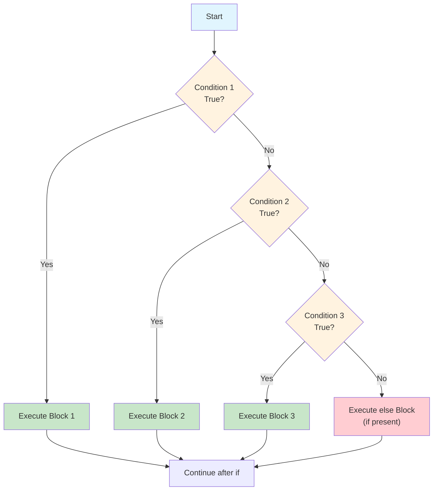

**Diagram explanation**: This flowchart shows how Python evaluates an `if-elif-else` chain. Conditions are tested one by one from top to bottom. The first condition that evaluates to `True` triggers its corresponding block, and all subsequent conditions are skipped. If no condition is true, the `else` block runs (if present). Only one branch ever executes.

---

## Python Code Example: Complete `if` Statement Demonstration

```python
# if_statement_demo.py

# 1. Simple if statement
print("--- 1. Simple if ---")
x = 10
if x > 5:
    print(f"{x} is greater than 5")

# 2. if-else statement
print("\n--- 2. if-else ---")
y = 7
if y % 2 == 0:
    print(f"{y} is even")
else:
    print(f"{y} is odd")

# 3. if-elif-else statement
print("\n--- 3. if-elif-else ---")
score = 85
if score >= 90:
    print("Grade: A")
elif score >= 80:
    print("Grade: B")
elif score >= 70:
    print("Grade: C")
else:
    print("Grade: F")

# 4. Truthy and falsy values
print("\n--- 4. Truthy/Falsy ---")
value = 0
if value:
    print("Truthy")
else:
    print("Falsy")  # 0 is falsy

name = ""
if name:
    print("Name provided")
else:
    print("No name")  # empty string is falsy

# 5. Nested if
print("\n--- 5. Nested if ---")
a = 15
b = 25
if a > 0:
    if b > 0:
        print("Both a and b are positive")
    else:
        print("a is positive, b is not")

# 6. Combined conditions with and/or
print("\n--- 6. Combined conditions ---")
age = 20
has_id = True
if age >= 18 and has_id:
    print("Entry allowed")
else:
    print("Entry denied")
```

**Expected output:**

```text
--- 1. Simple if ---
10 is greater than 5

--- 2. if-else ---
7 is odd

--- 3. if-elif-else ---
Grade: B

--- 4. Truthy/Falsy ---
Falsy
No name

--- 5. Nested if ---
Both a and b are positive

--- 6. Combined conditions ---
Entry allowed
```

---

## Step-by-Step Execution Trace

### Example: Grade Calculation

```python
score = 85
if score >= 90:
    print("Grade: A")
elif score >= 80:
    print("Grade: B")
elif score >= 70:
    print("Grade: C")
else:
    print("Grade: F")
```

| Step | Condition Tested | Result | Action |
|------|-----------------|--------|--------|
| 1 | `score >= 90` | `85 >= 90` → `False` | Skip block, move to next |
| 2 | `score >= 80` | `85 >= 80` → `True` | Execute block: `print("Grade: B")` |
| 3 | — | — | **Exit if-elif chain** (remaining branches skipped) |
| 4 | — | — | Continue with statements after `if` |

**Final output:** `Grade: B`

**Key observation**: Even though `score >= 70` is also true, it is **never tested** because the `score >= 80` branch already executed. Python exits the entire chain once a branch runs .

---

## Comparison Table: `if` vs `while`

| Aspect | `if` Statement | `while` Loop |
|--------|---------------|--------------|
| **Purpose** | Execute code **once** if condition is true | Execute code **repeatedly** while condition is true |
| **Condition checked** | Once | Before each iteration |
| **Body execution** | At most once | Zero or more times |
| **Termination** | Automatic after one evaluation | Requires condition to become false |
| **Common use** | Decision-making, branching | Repetition, iteration |

---

## Important Points to Remember

- The `if` statement executes its body **only when the condition is `True`** .
- **Indentation** (typically 4 spaces) is required to define the body .
- The `else` clause is **optional** and runs when all preceding conditions are `False` .
- `elif` checks multiple conditions **in sequence**; only the **first `True`** branch executes .
- **Truthy values** include non-zero numbers, non-empty strings, and non-empty collections .
- **Falsy values** include `0`, `None`, `""`, `[]`, `{}`, and `False` .
- Conditions are checked **top to bottom**; order matters when conditions overlap.
- **Nested `if`** statements can often be simplified using `and` or `or` .

---

## Conclusion

The `if` statement is Python's primary tool for **conditional execution**. It allows a program to choose between different paths based on whether a condition is true or false. With the optional `else` clause for the alternative case and one or more `elif` clauses for multiple conditions, `if` statements form the backbone of decision-making in every Python program. The key rules to remember are: conditions are checked in order, only the first true branch executes, and indentation defines the body. Mastering `if` is the essential first step toward writing programs that can respond intelligently to different inputs and situations.

---

## References

1. **4. More Control Flow Tools** — Python Documentation (3.14)  
   https://docs.python.org/3.14/tutorial/controlflow.html  
   *Supports: Official `if`/`elif`/`else` syntax, multiple elif clauses, optional else, indentation rules.*

2. **Cornell Virtual Workshop: Control Flow — Conditionals**  
   https://cvw.cac.cornell.edu/python-intro/control-flow/conditionals  
   *Supports: `if`/`else` decision statements, `elif` chaining, Boolean expression evaluation.*

3. **Microsoft Learn: Write 'if' statements**  
   https://learn.microsoft.com/th-th/training/modules/python-boolean-types/2-what-are-if-statements  
   *Supports: Test expressions, comparison operators, indentation requirement, None and 0 as False.*

4. **Microsoft Learn: Control flow in Python for data science**  
   https://learn.microsoft.com/en-us/training/modules/python-data-science/11-control-flow  
   *Supports: `if`/`else`/`elif` examples, first-true-branch behavior, indentation instead of braces.*

5. **Cornell CS 1109: Conditionals**  
   https://www.cs.cornell.edu/courses/cs1109/2023su/lectures/2023-06-27.html  
   *Supports: General form, required colons, optional else, chained conditionals, nested conditionals, truthy/falsy behavior.*

---

# Q10. Explain User-Defined Functions with Its Various Forms

## Introduction

Functions are the building blocks of structured programming in Python. They allow you to group related statements into a single reusable unit, making your code more organized, readable, and maintainable. Python provides many built-in functions like `print()`, `len()`, and `range()`, but the real power comes from writing your own functions—these are called **user-defined functions**.

A user-defined function is a function that you, the programmer, create to perform a specific task. Instead of writing the same code repeatedly, you define it once inside a function and call it whenever needed. This follows the **DRY principle**: "Don't Repeat Yourself."

---

## Definition

A **user-defined function** is a named block of code created by the programmer using the `def` keyword. It can accept input values called **parameters**, perform operations, and optionally return a result using the `return` statement.

**Key distinction**: Unlike built-in functions (which come with Python) or lambda functions (which are anonymous), user-defined functions are explicitly named and written by the programmer for a specific purpose.

---

## Detailed Explanation

### Basic Syntax

```python
def function_name(parameter1, parameter2, ...):
    """Optional docstring describing the function."""
    # Function body (indented)
    statement_1
    statement_2
    return result  # Optional
```

**Components**:
- **`def` keyword**: Signals the start of a function definition
- **Function name**: A descriptive identifier following Python naming rules
- **Parameters**: Optional input variables in parentheses
- **Colon (`:`)**: Ends the function header
- **Indented body**: The code that runs when the function is called
- **`return` statement**: Optional; sends a value back to the caller

### Calling a Function

To execute a function, you **call** it by name with parentheses containing any required arguments:

```python
def greet(name):
    return f"Hello, {name}!"

message = greet("Alice")  # Function call
print(message)            # Hello, Alice!
```

### The `return` Statement

A function can return zero, one, or multiple values:

- **No return statement**: The function returns `None` implicitly
- **Return one value**: `return result`
- **Return multiple values**: `return a, b` (packed into a tuple)

---

## Various Forms of User-Defined Functions

User-defined functions can take several forms based on their parameters and return behavior.

### Form 1: No Parameters, No Return Value

The simplest form—takes no input and returns nothing (implicitly `None`).

```python
def say_hello():
    print("Hello, World!")

say_hello()  # Output: Hello, World!
```

### Form 2: With Parameters, No Return Value

The function accepts input but performs an action without returning a result.

```python
def print_bar(char, length):
    bar = char * length
    print(bar)

print_bar("-", 10)  # Output: ----------
```

### Form 3: With Parameters, With Return Value

The most common form—accepts input and returns a computed result.

```python
def add(a, b):
    return a + b

result = add(5, 3)
print(result)  # Output: 8
```

### Form 4: Default Parameters

Parameters can have **default values**, making them optional in function calls.

```python
def greet(name, greeting="Hello"):
    return f"{greeting}, {name}!"

print(greet("Alice"))           # Hello, Alice!
print(greet("Bob", "Hi"))       # Hi, Bob!
```

**Rule**: Default parameters must come **after** non-default parameters.

### Form 5: Keyword Arguments

When calling a function, you can specify arguments by **parameter name**, regardless of order.

```python
def describe_pet(name, animal_type):
    print(f"I have a {animal_type} named {name}.")

describe_pet(animal_type="dog", name="Rex")
# Output: I have a dog named Rex.
```

### Form 6: Arbitrary Positional Arguments (`*args`)

Use `*args` to accept **any number of positional arguments**, which are collected into a tuple.

```python
def sum_all(*args):
    return sum(args)

print(sum_all(1, 2, 3))       # 6
print(sum_all(1, 2, 3, 4, 5)) # 15
```

### Form 7: Arbitrary Keyword Arguments (`**kwargs`)

Use `**kwargs` to accept **any number of keyword arguments**, collected into a dictionary.

```python
def print_info(**kwargs):
    for key, value in kwargs.items():
        print(f"{key}: {value}")

print_info(name="Alice", age=30, city="New York")
# Output:
# name: Alice
# age: 30
# city: New York
```

### Form 8: Combining All Forms

You can combine normal parameters, `*args`, and `**kwargs` in one function definition.

```python
def cheeseshop(kind, *arguments, **keywords):
    print(f"Do you have any {kind}?")
    for arg in arguments:
        print(arg)
    for kw in keywords:
        print(f"{kw}: {keywords[kw]}")

cheeseshop("Limburger", "It's runny, sir.", shopkeeper="Michael Palin")
```

**Order rule**: Normal parameters → `*args` → default parameters → `**kwargs`.

---

## Diagram: Forms of User-Defined Functions

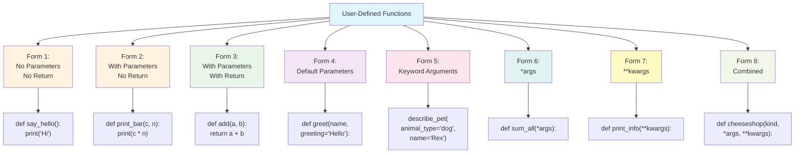

**Diagram explanation**: This hierarchy shows the eight forms of user-defined functions. The first three forms vary based on whether parameters and return values are present. Forms 4–7 introduce special parameter features: defaults, keyword calling, `*args`, and `**kwargs`. Form 8 combines all features into a single flexible function.

---

## Python Code Example: Demonstrating All Forms

```python
# user_functions_demo.py

# Form 1: No parameters, no return
def say_hello():
    print("Hello from Form 1!")

# Form 2: Parameters, no return
def print_bar(char, length):
    print(char * length)

# Form 3: Parameters, with return
def add(a, b):
    return a + b

# Form 4: Default parameters
def greet(name, greeting="Hello"):
    return f"{greeting}, {name}!"

# Form 6: *args
def sum_all(*args):
    return sum(args)

# Form 7: **kwargs
def print_info(**kwargs):
    for key, value in kwargs.items():
        print(f"  {key}: {value}")

# Form 8: Combined
def flexible(kind, *args, **kwargs):
    print(f"Kind: {kind}")
    for arg in args:
        print(f"  Positional: {arg}")
    for kw, val in kwargs.items():
        print(f"  Keyword: {kw} = {val}")

# --- Demonstrations ---
print("=== Form 1: No Parameters, No Return ===")
say_hello()

print("\n=== Form 2: Parameters, No Return ===")
print_bar("*", 5)

print("\n=== Form 3: Parameters, Return ===")
result = add(10, 20)
print(f"10 + 20 = {result}")

print("\n=== Form 4: Default Parameters ===")
print(greet("Alice"))
print(greet("Bob", "Hi"))

print("\n=== Form 5: Keyword Arguments ===")
def describe_pet(name, animal_type):
    print(f"I have a {animal_type} named {name}.")
describe_pet(animal_type="dog", name="Rex")

print("\n=== Form 6: *args ===")
print(f"Sum of 1,2,3 = {sum_all(1, 2, 3)}")
print(f"Sum of 1,2,3,4,5 = {sum_all(1, 2, 3, 4, 5)}")

print("\n=== Form 7: **kwargs ===")
print_info(name="Alice", age=30, city="NYC")

print("\n=== Form 8: Combined ===")
flexible("Limburger", "runny", "very runny", shopkeeper="Michael")
```

**Expected output:**

```text
=== Form 1: No Parameters, No Return ===
Hello from Form 1!

=== Form 2: Parameters, No Return ===
*****

=== Form 3: Parameters, Return ===
10 + 20 = 30

=== Form 4: Default Parameters ===
Hello, Alice!
Hi, Bob!

=== Form 5: Keyword Arguments ===
I have a dog named Rex.

=== Form 6: *args ===
Sum of 1,2,3 = 6
Sum of 1,2,3,4,5 = 15

=== Form 7: **kwargs ===
  name: Alice
  age: 30
  city: NYC

=== Form 8: Combined ===
Kind: Limburger
  Positional: runny
  Positional: very runny
  Keyword: shopkeeper = Michael
```

---

## Step-by-Step Execution Trace

### Example: `add(10, 20)` — Form 3

| Step | Action | State |
|------|--------|-------|
| 1 | Function `add` is defined | `add` exists as a function object |
| 2 | Call `add(10, 20)` | Arguments `10` and `20` are passed |
| 3 | Parameters `a` and `b` receive values | `a = 10`, `b = 20` |
| 4 | Execute `return a + b` | Computes `10 + 20 = 30` |
| 5 | Return `30` to caller | `result = 30` |
| 6 | Print result | Output: `10 + 20 = 30` |

### Example: `sum_all(1, 2, 3, 4, 5)` — Form 6

| Step | Action | State |
|------|--------|-------|
| 1 | Function defined with `*args` | `args` will collect extra positionals |
| 2 | Call `sum_all(1, 2, 3, 4, 5)` | Five positional arguments |
| 3 | `args` collects all into tuple | `args = (1, 2, 3, 4, 5)` |
| 4 | Execute `return sum(args)` | `sum((1,2,3,4,5))` = `15` |
| 5 | Return `15` to caller | Result is `15` |

---

## Comparison Table: The Forms at a Glance

| Form | Parameters | Return | Example |
|------|-----------|--------|---------|
| 1 | None | None | `def say_hello():` |
| 2 | Required | None | `def print_bar(char, length):` |
| 3 | Required | Value(s) | `def add(a, b): return a + b` |
| 4 | Default values | Value(s) | `def greet(name, greeting="Hello"):` |
| 5 | Called by keyword | Value(s) | `describe_pet(animal_type="dog", name="Rex")` |
| 6 | `*args` (variable) | Value(s) | `def sum_all(*args):` |
| 7 | `**kwargs` (variable) | Value(s) | `def print_info(**kwargs):` |
| 8 | Combined | Value(s) | `def flexible(kind, *args, **kwargs):` |

---

## Important Points to Remember

- **Functions must be defined before they are called** (in script mode).
- **Parameters vs Arguments**: Parameters are in the definition; arguments are in the call.
- **`return` is optional**: Without it, the function returns `None`.
- **Default parameters must come after non-default parameters**.
- **`*args` collects positional arguments into a tuple**.
- **`**kwargs` collects keyword arguments into a dictionary**.
- **Parameter order**: normal → `*args` → default → `**kwargs`.
- **Local vs Global**: Variables created inside a function are local and cannot be accessed outside.
- **Docstrings** describe what a function does and can be accessed via `help()`.

---

## Conclusion

User-defined functions are the primary tool for organizing Python code into reusable, logical units. They come in various forms depending on whether they accept parameters, return values, and how they handle arguments. From simple no-argument functions to flexible `*args` and `**kwargs` constructs, understanding these forms allows you to write functions that are tailored to the specific needs of your program. By mastering these forms, you gain the ability to write cleaner, more maintainable code that follows the DRY principle and makes your programs easier to test and debug.

---

## References

1. **Functions and the Writing of Code** — SpringerLink  
   https://rd.springer.com/chapter/10.1007/978-3-030-16877-3_4  
   *Supports: Function components, parameters vs arguments, positional vs keyword arguments, local vs global variables.*

2. **Functions: Create** — University of Calgary (CPSC 217)  
   https://cspages.ucalgary.ca/~jwhudson/CPSC217S25/slides/CPSC217-7Functions-1Create.pdf  
   *Supports: User-defined function syntax, multiple parameters, function declaration before use.*

3. **Understanding def foo(*args)** — Python.org Mailing List  
   https://mail.python.org/archives/list/python-list@python.org/message/7JKIGNGQKOU5FIST3JGHT3RUW6WHVUWE/  
   *Supports: `*args` variadic function, tuple collection, `**kwargs` keyword collection.*

4. ***args and **kwargs** — Python.org Mailing List  
   https://mail.python.org/pipermail/python-list/2002-November/154266.html  
   *Supports: `*args` for excess positional arguments, `**kwargs` for excess keyword arguments, empty tuple/dict behavior.*

5. **Python 自定义函数** — IGADC  
   https://cpjrc.igadc.cn/lesson/jt2fbc/  
   *Supports: `def` statement, docstrings, `None` return, functions that don't return values.*

6. **What are functions in Python?** — Educative  
   https://www.educative.io/answers/what-are-functions-in-python  
   *Supports: User-defined vs lambda functions, function syntax, with/without parameters.*

7. **Doc/tutorial/controlflow.rst** — CPython (Google Open Source)  
   https://chromium.googlesource.com/external/github.com/python/cpython/+/dbdee0073cf0b88fe541980ace1f650900f455cc/Doc/tutorial/controlflow.rst  
   *Supports: `**name` dictionary, `*name` tuple, combined `cheeseshop` example, parameter order rules.*

8. **Re: [Tutor] **kw and self** — Python.org Mailing List  
   https://mail.python.org/archives/list/tutor@python.org/message/B7GSNJTFYG2KIJFWQQFQFQBDRKWQU6IM/  
   *Supports: Default arguments, keyword arguments, `**kwargs` dictionary unpacking, argument order.*

---

# Q11. Describe Python List with Its Creations and Other Important Functions

## Introduction

A **list** is one of the most versatile and widely used data structures in Python. It is an **ordered, mutable collection** that can hold items of any data type, including numbers, strings, and even other lists. Lists allow you to store and organize multiple values under a single variable name, making them essential for managing collections of data in programs.

Whether you are processing a sequence of numbers, managing a list of names, or building a matrix, Python lists provide a rich set of built-in methods and operations that make data manipulation straightforward and efficient.

---

## Definition

A **Python list** is a mutable, ordered sequence of elements, defined by enclosing comma-separated values within square brackets `[ ]` .

**Key characteristics**:
- **Ordered**: Elements maintain their insertion order and can be accessed by index.
- **Mutable**: You can add, remove, or modify elements after creation .
- **Heterogeneous**: A single list can contain elements of different types (e.g., integers, strings, floats) .
- **Dynamic**: Lists can grow or shrink in size as needed.

---

## Detailed Explanation

### Creating Lists

There are several ways to create lists in Python.

**1. Using Square Brackets (Most Common)**

```python
# Empty list
empty_list = []

# List of integers
numbers = [1, 2, 3, 4, 5]

# List of strings
fruits = ["apple", "banana", "cherry"]

# Heterogeneous list (mixed types)
mixed = [1, "hello", 3.14, True]
```

**2. Using the `list()` Constructor**

The `list()` constructor converts an iterable (such as a string, tuple, or range) into a list .

```python
# From a range
range_list = list(range(5))        # [0, 1, 2, 3, 4]

# From a string (each character becomes an element)
char_list = list("hello")          # ['h', 'e', 'l', 'l', 'o']

# From a tuple
tuple_list = list((1, 2, 3))       # [1, 2, 3]

# Empty list
empty = list()                     # []
```

**3. Using List Comprehensions**

A concise way to create lists by applying an expression to each item in an iterable .

```python
# Squares of numbers 0-9
squares = [x**2 for x in range(10)]
# [0, 1, 4, 9, 16, 25, 36, 49, 64, 81]

# Only even numbers
evens = [x for x in range(10) if x % 2 == 0]
# [0, 2, 4, 6, 8]
```

### Accessing and Slicing Lists

Lists use **zero-based indexing**, meaning the first element is at index `0` .

```python
fruits = ["apple", "banana", "cherry", "date"]

# Positive indexing
fruits[0]    # 'apple'
fruits[2]    # 'cherry'

# Negative indexing (counts from the end)
fruits[-1]   # 'date'
fruits[-2]   # 'cherry'

# Slicing: list[start:stop:step]
fruits[1:3]  # ['banana', 'cherry']
fruits[:2]   # ['apple', 'banana']
fruits[2:]   # ['cherry', 'date']
fruits[::2]  # ['apple', 'cherry'] (every second element)
```

### List Operators

Lists support several operators similar to strings .

| Operator | Description | Example | Result |
|----------|-------------|---------|--------|
| `+` | Concatenation | `[1, 2] + [3, 4]` | `[1, 2, 3, 4]` |
| `*` | Repetition | `[1, 2] * 2` | `[1, 2, 1, 2]` |
| `in` | Membership | `2 in [1, 2, 3]` | `True` |
| `not in` | Non-membership | `5 not in [1, 2, 3]` | `True` |

### Important List Methods

Python provides many built-in methods for list manipulation. A key design principle: methods that modify a list **in place** (like `append`, `sort`, `reverse`) return `None`, not the modified list .

| Method | Description | Example |
|--------|-------------|---------|
| `append(x)` | Adds `x` to the end of the list | `fruits.append("elderberry")` |
| `extend(iterable)` | Appends all items from `iterable` | `fruits.extend(["fig", "grape"])` |
| `insert(i, x)` | Inserts `x` at index `i` | `fruits.insert(1, "apricot")` |
| `remove(x)` | Removes first occurrence of `x` | `fruits.remove("banana")` |
| `pop([i])` | Removes and returns item at index `i` (default: last) | `fruits.pop()` |
| `clear()` | Removes all items | `fruits.clear()` |
| `index(x)` | Returns index of first occurrence of `x` | `fruits.index("cherry")` |
| `count(x)` | Returns number of occurrences of `x` | `fruits.count("apple")` |
| `sort()` | Sorts the list in place | `numbers.sort()` |
| `reverse()` | Reverses the list in place | `fruits.reverse()` |
| `copy()` | Returns a shallow copy | `fruits_copy = fruits.copy()` |

### Built-in Functions for Lists

These are general-purpose functions that work on lists and other iterables .

| Function | Description | Example |
|----------|-------------|---------|
| `len(list)` | Returns the number of elements | `len([1, 2, 3])` → `3` |
| `max(list)` | Returns the largest element | `max([1, 5, 3])` → `5` |
| `min(list)` | Returns the smallest element | `min([1, 5, 3])` → `1` |
| `sum(list)` | Returns the sum of elements | `sum([1, 2, 3])` → `6` |

### Deleting Elements

You can delete elements using the `del` statement or list methods .

```python
numbers = [10, 20, 30, 40, 50]

# Delete by index
del numbers[2]       # [10, 20, 40, 50]

# Delete a slice
del numbers[1:3]     # [10, 50]

# Delete entire list
del numbers
```

---

## Diagram: List Structure and Operations

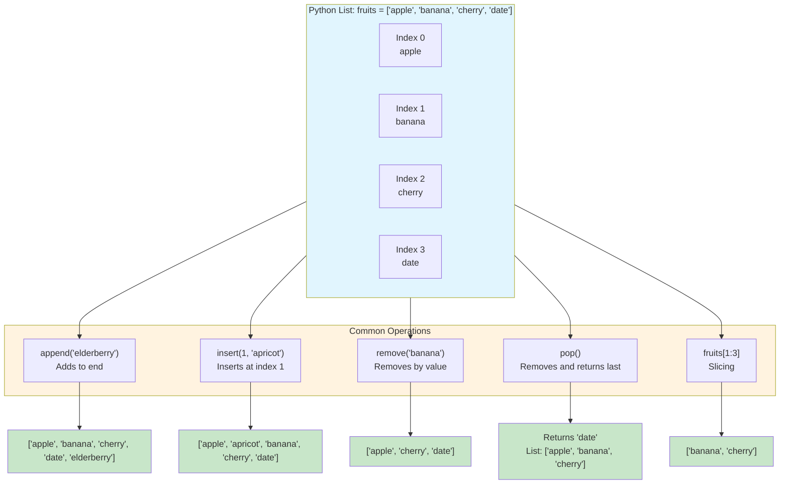

**Diagram explanation**: This diagram shows a list with four elements and their indices. It then illustrates five common operations—`append`, `insert`, `remove`, `pop`, and slicing—and the resulting list state or returned value for each. Notice that `pop()` returns the removed item while modifying the list, whereas `remove()` only modifies the list.

---

## Python Code Example: List Operations

```python
# list_demo.py

# Creating lists
fruits = ["apple", "banana", "cherry"]
numbers = [5, 2, 8, 1, 9]

print("Original fruits:", fruits)

# append() - add to end
fruits.append("date")
print("After append:", fruits)

# insert() - insert at index
fruits.insert(1, "apricot")
print("After insert:", fruits)

# remove() - remove by value
fruits.remove("banana")
print("After remove:", fruits)

# pop() - remove and return
popped = fruits.pop()
print(f"Popped: {popped}")
print("After pop:", fruits)

# index() and count()
print("Index of 'cherry':", fruits.index("cherry"))

# sort() and reverse()
numbers.sort()
print("Sorted numbers:", numbers)
numbers.reverse()
print("Reversed numbers:", numbers)

# len(), max(), min(), sum()
print(f"Length: {len(numbers)}")
print(f"Max: {max(numbers)}")
print(f"Min: {min(numbers)}")
print(f"Sum: {sum(numbers)}")

# Slicing
print("First two:", fruits[:2])
```

**Expected output:**

```text
Original fruits: ['apple', 'banana', 'cherry']
After append: ['apple', 'banana', 'cherry', 'date']
After insert: ['apple', 'apricot', 'banana', 'cherry', 'date']
After remove: ['apple', 'apricot', 'cherry', 'date']
Popped: date
After pop: ['apple', 'apricot', 'cherry']
Index of 'cherry': 2
Sorted numbers: [1, 2, 5, 8, 9]
Reversed numbers: [9, 8, 5, 2, 1]
Length: 5
Max: 9
Min: 1
Sum: 25
First two: ['apple', 'apricot']
```

---

## Important Points to Remember

- Lists are **ordered** and **mutable** — you can change elements after creation .
- Lists can contain **mixed data types** .
- Indexing starts at **0**; negative indices count from the end .
- Slicing uses the format `list[start:stop:step]`; `stop` is **exclusive** .
- Methods like `append`, `sort`, and `reverse` modify the list **in place** and return `None` .
- `pop()` returns the removed item; `remove()` does not.
- Lists **cannot be used as dictionary keys** because they are mutable .
- Use `del` to delete by index or slice; use `remove()` to delete by value.

---

## Conclusion

The Python list is a powerful, flexible data structure that serves as the foundation for managing ordered collections of data. Its mutability, heterogeneous nature, and rich set of methods make it suitable for a wide range of tasks—from simple sequences to complex nested structures like matrices. By mastering list creation techniques (square brackets, `list()` constructor, and comprehensions) and understanding the core methods (`append`, `insert`, `remove`, `pop`, `sort`, `reverse`), you gain the ability to efficiently store, access, and manipulate data in your Python programs.

---

## References

1. **Unit 2: Data Structures and Efficiency** — Carnegie Mellon University, 15-110  
   https://www.cs.cmu.edu/~15110-f22/slides/week4-3-lists-methods.pdf  
   *Supports: List definition, creation syntax, mixed types, concatenation, repetition, indexing, slicing, built-in functions.*

2. **5. Data Structures** — Python Documentation (Chinese)  
   https://docs.python.org/zh-cn/3.16/tutorial/datastructures.html  
   *Supports: List methods reference, list comprehensions, `del` statement, nested lists.*

3. **Built-in Types** — Python Documentation (Taiwan mirror)  
   https://python.github.io/python-docs-zh-tw/builtins/stdtypes.html  
   *Supports: `list()` constructor examples, range conversion.*

4. **CS308E: Elements of Computers and Programming** — University of Texas at Austin  
   https://www.cs.utexas.edu/~byoung/cs303e/slides9-lists-nup.pdf  
   *Supports: List creation via constructor, mutability, sequence functions, list comprehension syntax.*

5. **5. Data Structures (Chinese)** — Python Documentation (Taiwan mirror)  
   https://python.github.io/python-docs-zh-tw/pr-preview/pr-1102/tutorial/datastructures.html  
   *Supports: Complete list methods table, stack/queue usage, in-place modification returning None.*

6. **Python Programming Fundamentals** — SpringerLink  
   https://link.springer.com/content/pdf/bbm%3A978-1-84996-537-8%2F1.pdf  
   *Supports: List operators and methods table, `pop` return value, `sort`/`reverse` mutating behavior.*

7. **Lists** — Archive.org Python Tutorial  
   https://www.archive.org/download/python_20210426/8.%20List.pdf  
   *Supports: List creation examples, indexing, slicing, basic operations, built-in functions.*

8. **Data Structures (French)** — Python Documentation (ReadTheDocs mirror)  
   https://python.readthedocs.io/fr/hack-in-language/tutorial/datastructures.html  
   *Supports: Lists cannot be dictionary keys due to mutability.*
---
# Q12. Describe Python Dictionary with Its Creations and Other Important Functions

## Introduction

A **dictionary** is one of Python's most powerful and flexible built-in data structures. Unlike lists or tuples, which are accessed by numerical index, dictionaries store data as **key-value pairs**. This means you can retrieve a value using a meaningful key (like a name or ID) rather than remembering its position.

Dictionaries are essential for tasks like storing records, counting occurrences, caching results, and representing structured data such as JSON objects. In Python 3.7 and later, dictionaries **preserve insertion order**, making them even more predictable and useful.

---

## Definition

A **Python dictionary** is a mutable mapping object that stores a collection of **key-value pairs**. Each key must be **hashable** (immutable), and each key maps to exactly one value.

**Key characteristics:**
- **Mapping type**: Not a sequence; accessed by key, not by index
- **Mutable**: You can add, remove, or modify key-value pairs after creation
- **Ordered**: Since Python 3.7, dictionaries maintain insertion order
- **Keys must be hashable**: Strings, numbers, tuples, and frozensets can be keys; lists and dictionaries cannot

---

## Detailed Explanation

### Creating Dictionaries

Python offers several ways to create dictionaries.

**1. Using Curly Braces (Most Common)**

The most direct way is to place comma-separated `key: value` pairs inside curly braces `{}`.

```python
# Empty dictionary
empty_dict = {}

# Dictionary with string keys
person = {"name": "Alice", "age": 30, "city": "New York"}

# Dictionary with integer keys
scores = {1: "one", 2: "two", 3: "three"}

# Mixed key types
mixed = {"name": "Bob", 42: "answer", (1, 2): "tuple key"}
```

**2. Using the `dict()` Constructor**

The `dict()` constructor accepts several argument forms:

```python
# From keyword arguments (keys must be valid identifiers)
a = dict(one=1, two=2, three=3)

# From a list of key-value tuples
b = dict([("two", 2), ("one", 1), ("three", 3)])

# From a zip object pairing two sequences
c = dict(zip(["one", "two", "three"], [1, 2, 3]))

# From an existing dictionary
d = dict({"three": 3, "one": 1})

# From a mapping and keyword arguments
e = dict({"one": 1, "three": 3}, two=2)
```

All the examples above produce an equal dictionary: `{"one": 1, "two": 2, "three": 3}`.

**3. Using Dictionary Comprehensions**

A concise way to build dictionaries from iterables:

```python
# Squares of numbers 1-5
squares = {x: x**2 for x in range(1, 6)}
# {1: 1, 2: 4, 3: 9, 4: 16, 5: 25}

# From two lists
keys = ["a", "b", "c"]
values = [1, 2, 3]
combined = {k: v for k, v in zip(keys, values)}
# {'a': 1, 'b': 2, 'c': 3}
```

### Accessing Values

Values are accessed by their key inside square brackets:

```python
person = {"name": "Alice", "age": 30}

# Direct access (raises KeyError if key is missing)
print(person["name"])   # Alice

# Safe access with get() (returns None or a default if missing)
print(person.get("age"))          # 30
print(person.get("salary"))       # None
print(person.get("salary", 0))    # 0
```

### Adding and Modifying Entries

Assigning to a key either **creates a new entry** or **updates an existing one**:

```python
person = {"name": "Alice"}

# Add a new key
person["age"] = 30

# Modify an existing key
person["name"] = "Alicia"

print(person)  # {'name': 'Alicia', 'age': 30}
```

### Important Dictionary Methods

| Method | Description | Example |
|--------|-------------|---------|
| `keys()` | Returns a view of all keys | `person.keys()` |
| `values()` | Returns a view of all values | `person.values()` |
| `items()` | Returns a view of `(key, value)` tuples | `person.items()` |
| `get(key, default)` | Returns value or default if key missing | `person.get("age", 0)` |
| `pop(key, default)` | Removes key and returns its value | `person.pop("age")` |
| `popitem()` | Removes and returns last inserted pair | `person.popitem()` |
| `setdefault(key, default)` | Returns value; inserts key if missing | `person.setdefault("age", 0)` |
| `update(other)` | Merges another dict or iterable | `person.update({"age": 31})` |
| `clear()` | Removes all entries | `person.clear()` |
| `copy()` | Returns a shallow copy | `person.copy()` |

### Dictionary View Objects

The methods `keys()`, `values()`, and `items()` return **view objects**, not lists. These views are **dynamic**: if the dictionary changes, the view reflects those changes.

```python
dishes = {"eggs": 2, "sausage": 1, "bacon": 1}

keys = dishes.keys()
print(list(keys))  # ['eggs', 'sausage', 'bacon']

# Modify the dictionary
del dishes["eggs"]
print(list(keys))  # ['sausage', 'bacon'] — view updated
```

### Iterating Over Dictionaries

You can loop over keys, values, or both:

```python
person = {"name": "Alice", "age": 30}

# Iterate over keys (default)
for key in person:
    print(key, ":", person[key])

# Iterate over key-value pairs
for key, value in person.items():
    print(f"{key} = {value}")
```

### Hashability and Keys

Keys must be **hashable** — their hash value must never change during their lifetime.

- **Allowed**: strings, numbers, tuples (if all elements are hashable), frozensets
- **Not allowed**: lists, dictionaries, sets (mutable types)

```python
# Valid keys
valid = {"name": "Alice", 42: "answer", (1, 2): "tuple"}

# Invalid: list as key
# invalid = {[1, 2]: "list"}  # TypeError: unhashable type: 'list'
```

---

## Diagram 1: Dictionary Structure

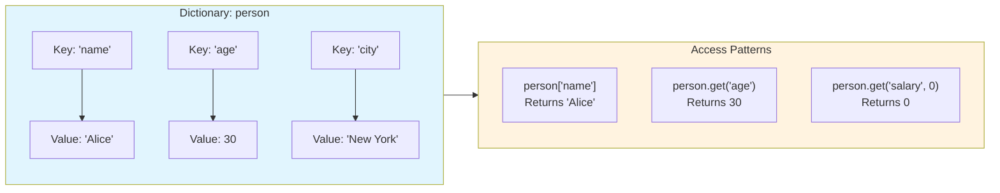

**Diagram explanation**: This diagram shows how a dictionary maps keys to values. Each key is connected to exactly one value. The access patterns demonstrate direct indexing (which raises `KeyError` if missing) and the safer `get()` method (which returns `None` or a default).

---

## Diagram 2: Dictionary Creation Methods

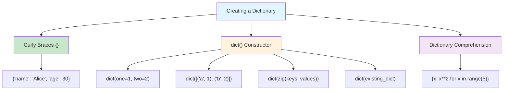

**Diagram explanation**: This diagram shows the three main ways to create dictionaries. Curly braces are the most direct. The `dict()` constructor offers multiple input formats. Dictionary comprehensions create dictionaries by applying an expression to each item in an iterable.

---

## Diagram 3: Dictionary Views Are Dynamic

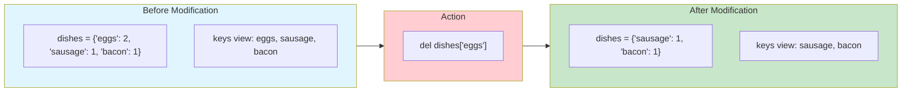

**Diagram explanation**: This diagram illustrates the dynamic nature of dictionary views. When you delete a key from the dictionary, the keys view automatically reflects the change. The view is not a snapshot — it stays connected to the underlying dictionary.

---

## Diagram 4: Hashability Rules for Keys

```mermaid
flowchart TD
    START["Can this object be a dictionary key?"]

    START --> Q1{"Is it immutable?"}
    Q1 -->|Yes| Q2{"Is it hashable?"}
    Q1 -->|No| NO["No<br/>(lists, dicts, sets)"]

    Q2 -->|Yes| YES["Yes<br/>(str, int, float, tuple, frozenset)"]
    Q2 -->|No| NO

    YES --> TUPLE{"Tuple with<br/>mutable elements?"}
    TUPLE -->|Yes| NO
    TUPLE -->|No| CONFIRM["Valid key"]

    style START fill:#e1f5fe
    style YES fill:#c8e6c9
    style NO fill:#ffcdd2
    style CONFIRM fill:#c8e6c9
```

**Diagram explanation**: This flowchart shows the decision process for determining whether an object can be a dictionary key. The object must be hashable. Most immutable built-in types are hashable, but tuples are only hashable if all their elements are hashable.

---

## Python Code Example: Complete Dictionary Demonstration

```python
# dictionary_demo.py

# 1. Creating dictionaries
print("--- 1. Creation Methods ---")
person = {"name": "Alice", "age": 30}
built = dict(city="Paris", population=2125246)
from_zip = dict(zip(["a", "b", "c"], [1, 2, 3]))
comp = {x: x**2 for x in range(1, 4)}

print(f"person: {person}")
print(f"built: {built}")
print(f"from_zip: {from_zip}")
print(f"comp: {comp}")

# 2. Accessing values
print("\n--- 2. Accessing ---")
print(f"person['name']: {person['name']}")
print(f"person.get('salary', 0): {person.get('salary', 0)}")

# 3. Adding and modifying
print("\n--- 3. Adding and Modifying ---")
person["age"] = 31
person["email"] = "alice@example.com"
print(f"After changes: {person}")

# 4. Important methods
print("\n--- 4. Methods ---")
print(f"Keys: {list(person.keys())}")
print(f"Values: {list(person.values())}")
print(f"Items: {list(person.items())}")

# 5. pop and setdefault
print("\n--- 5. pop and setdefault ---")
removed = person.pop("email")
print(f"Removed email: {removed}")
print(f"After pop: {person}")

person.setdefault("country", "USA")
print(f"After setdefault: {person}")

# 6. update
print("\n--- 6. update ---")
person.update({"age": 32, "city": "Boston"})
print(f"After update: {person}")

# 7. Iteration
print("\n--- 7. Iteration ---")
for key, value in person.items():
    print(f"  {key}: {value}")

# 8. View dynamics
print("\n--- 8. Dynamic Views ---")
keys_view = person.keys()
print(f"Before: {list(keys_view)}")
del person["age"]
print(f"After deleting 'age': {list(keys_view)}")
```

**Expected output:**

```text
--- 1. Creation Methods ---
person: {'name': 'Alice', 'age': 30}
built: {'city': 'Paris', 'population': 2125246}
from_zip: {'a': 1, 'b': 2, 'c': 3}
comp: {1: 1, 2: 4, 3: 9}

--- 2. Accessing ---
person['name']: Alice
person.get('salary', 0): 0

--- 3. Adding and Modifying ---
After changes: {'name': 'Alice', 'age': 31, 'email': 'alice@example.com'}

--- 4. Methods ---
Keys: ['name', 'age', 'email']
Values: ['Alice', 31, 'alice@example.com']
Items: [('name', 'Alice'), ('age', 31), ('email', 'alice@example.com')]

--- 5. pop and setdefault ---
Removed email: alice@example.com
After pop: {'name': 'Alice', 'age': 31}
After setdefault: {'name': 'Alice', 'age': 31, 'country': 'USA'}

--- 6. update ---
After update: {'name': 'Alice', 'age': 32, 'country': 'USA', 'city': 'Boston'}

--- 7. Iteration ---
  name: Alice
  age: 32
  country: USA
  city: Boston

--- 8. Dynamic Views ---
Before: ['name', 'age', 'country', 'city']
After deleting 'age': ['name', 'country', 'city']
```

---

## Comparison Table: Dictionary vs List

| Aspect | Dictionary | List |
|--------|-----------|------|
| **Access** | By key | By index |
| **Order** | Insertion order (3.7+) | Insertion order |
| **Key type** | Hashable only | N/A (positions) |
| **Duplicate keys** | Not allowed | N/A |
| **Mutability** | Mutable | Mutable |
| **Use case** | Key-value mappings | Ordered sequences |

---

## Important Points to Remember

- **Keys must be hashable** — immutable types like strings, numbers, tuples, and frozensets.
- **Lists and dictionaries cannot be keys** because they are mutable and unhashable.
- **Insertion order is preserved** in Python 3.7+.
- **`get()` is safer than `[]`** — it returns `None` or a default instead of raising `KeyError`.
- **Views are dynamic** — they reflect changes to the dictionary.
- **`dict()` constructor** accepts keyword arguments, mappings, and iterables of key-value pairs.
- **Dictionary comprehensions** provide a concise creation syntax.

---

## Conclusion

Python dictionaries are powerful mapping structures that store key-value pairs, allowing fast lookup, insertion, and deletion. They can be created using curly braces, the `dict()` constructor, or comprehensions, and support a rich set of methods for accessing, modifying, and iterating over data. The key requirement — that keys must be hashable — ensures that lookups remain efficient. Understanding dictionaries is essential for any Python programmer, as they appear everywhere from configuration management to data processing and API handling.

---

## References

1. **Mapping Types — dict** — Python Documentation (CPython source)  
   https://chromium.googlesource.com/external/github.com/python/cpython/+/5612078f68e9688fbf3b1d8565abc79b77501000/Lib/pydoc_data/topics.py  
   *Supports: Dictionary creation examples, `dict()` constructor forms, equality of all creation methods.*

2. **Built-in Types — Dictionary Views** — Python Documentation (Taiwan mirror)  
   https://python.github.io/python-docs-zh-tw/builtins/stdtypes.html  
   *Supports: Insertion order guarantee (3.7+), view objects, dynamic views, set operations on keys views.*

3. **Reference: Dictionaries** — MIT 6.095  
   https://web.mit.edu/6.095/www/wiki/d/i/c/Reference~_Dictionaries_fc71.html  
   *Supports: Dictionary basics, length, equality, membership testing, `get()` method, adding/deleting entries, iteration, copying.*

4. **Why are tuples immutable?** — Python.org Mailing List  
   https://mail.python.org/pipermail/python-list/2004-December/278727.html  
   *Supports: Dictionaries don't support unhashable keys; lists are mutable but not hashable.*

5. **Beginner question** — Python.org Mailing List  
   https://mail.python.org/archives/list/python-list@python.org/message/N5Z6SDTNFIZWZ4W4FLYBNWN7QSSHJJIV/  
   *Supports: `dict()` constructor APIs, creation from zip, keyword arguments, iterables.*

6. **Python-checkins: Refine note on hashable objects** — Python.org Mailing List  
   https://mail.python.org/archives/list/python-checkins@python.org/message/IR3NGOT6ZVUBZE6C42J3AXXJFS3BPS4A/  
   *Supports: Immutable built-in objects are hashable; mutable containers are not; tuples hashable only if elements are hashable.*

7. **Learning Python by Mark Lutz** — Internet Archive  
   https://archive.org/stream/learning-python-by-mark-lutz/  
   *Supports: Dictionaries are mappings not sequences, no slicing/concatenation, keys need not be strings, sparse data structures.*

---
# 13. Explain the Python `os` Module with Its Functions

## Introduction

The `os` module is one of Python's most fundamental standard library modules. It provides a portable way to interact with the **operating system**—the software layer that manages your computer's hardware, files, processes, and environment. When you need to know the current working directory, create a folder, list files, read environment variables, or run a system command, the `os` module is your primary tool.

A key design principle of the `os` module is **portability**: functions like `os.stat(path)` return status information in the same format regardless of whether you are running on Windows, macOS, or Linux . This means code written with `os` can often run on multiple platforms without modification.

---

## Definition

The **`os` module** is a built-in Python library that provides a **portable interface** to operating-system-dependent functionality. It allows Python programs to interact with the file system, manage processes, access environment variables, and perform low-level system operations.

Python's official documentation states: "This module provides a portable way of using operating system dependent functionality. If you just want to read or write a file see `open()`, if you want to manipulate paths, see the `os.path` module, and if you want to read all the lines in all the files on the command line see the `fileinput` module" .

---

## Detailed Explanation

### 1. Importing the `os` Module

The recommended way to import `os` is with the statement `import os`. The Python documentation explicitly warns against using `from os import *` because it would cause `os.open()` to shadow the built-in `open()` function, and the two work very differently .

```python
import os
```

### 2. Current Working Directory

The **current working directory (CWD)** is the folder from which your Python program is running. Two functions manage the CWD :

| Function | Description |
|----------|-------------|
| `os.getcwd()` | Returns the current working directory as a string |
| `os.chdir(path)` | Changes the current working directory to `path` |

```python
import os
print(os.getcwd())      # e.g., '/home/user/projects'
os.chdir('/tmp')
print(os.getcwd())      # '/tmp'
```

### 3. Directory Operations

The `os` module provides functions for listing, creating, and removing directories :

| Function | Description |
|----------|-------------|
| `os.listdir(path)` | Returns a list of entry names in the directory `path` (defaults to current directory). Does not include `.` and `..`  |
| `os.mkdir(path)` | Creates a single directory named `path` |
| `os.makedirs(path)` | Creates all intermediate directories needed to create `path`  |
| `os.rmdir(path)` | Removes an **empty** directory |
| `os.removedirs(path)` | Removes empty directories recursively |

```python
os.listdir('.')              # ['file1.txt', 'folder1', 'script.py']
os.mkdir('new_folder')       # creates one directory
os.makedirs('a/b/c')         # creates a, a/b, and a/b/c
os.rmdir('empty_folder')     # only works if empty
```

### 4. File Operations

Basic file operations through the `os` module :

| Function | Description |
|----------|-------------|
| `os.remove(path)` | Deletes the file at `path` |
| `os.rename(src, dst)` | Renames or moves a file or directory |
| `os.path.exists(path)` | Returns `True` if `path` exists |

```python
os.rename('old_name.txt', 'new_name.txt')
os.remove('unwanted.txt')
print(os.path.exists('new_name.txt'))  # True
```

**Note**: For higher-level file copying and moving, the `shutil` module is preferred .

### 5. The `os.path` Submodule

`os.path` is a submodule that provides **path manipulation** functions. It handles the differences between path separators on different operating systems (Windows uses `\`, Unix uses `/`) .

| Function | Description |
|----------|-------------|
| `os.path.join(a, b, ...)` | Joins path components intelligently, using the correct separator  |
| `os.path.abspath(path)` | Returns the absolute form of a path  |
| `os.path.dirname(path)` | Returns the directory portion of a path  |
| `os.path.basename(path)` | Returns the file name portion of a path  |
| `os.path.exists(path)` | Returns `True` if the path exists  |
| `os.path.isfile(path)` | Returns `True` if the path is a regular file  |
| `os.path.isdir(path)` | Returns `True` if the path is a directory  |
| `os.path.getsize(path)` | Returns the file size in bytes  |

```python
# Cross-platform path building
full_path = os.path.join('folder', 'subfolder', 'file.txt')
# On Windows: 'folder\\subfolder\\file.txt'
# On Linux:   'folder/subfolder/file.txt'

# Get absolute path
print(os.path.abspath('script.py'))  # /home/user/projects/script.py

# Extract components
path = '/home/user/data.csv'
print(os.path.dirname(path))   # /home/user
print(os.path.basename(path))  # data.csv
```

### 6. Environment Variables

The `os.environ` object is a **mapping** (dictionary-like) that represents the environment variables of the current process .

| Operation | Description |
|-----------|-------------|
| `os.environ['KEY']` | Reads an environment variable (raises `KeyError` if missing) |
| `os.environ.get('KEY')` | Reads an environment variable safely (returns `None` or default) |
| `os.getenv('KEY', default)` | Alternative safe read function  |

```python
# Safe access
home = os.environ.get('HOME')
path = os.getenv('PATH')

# Setting an environment variable
os.environ['MY_VAR'] = 'my_value'
```

### 7. Running System Commands

The `os.system()` function runs a command in the system shell :

```python
os.system('mkdir today')   # Runs the mkdir command
os.system('ls -l')         # Lists files
```

**Important**: For capturing output or more control, the `subprocess` module is recommended over `os.system()` .

### 8. `os.name` — Identifying the Operating System

The `os.name` attribute tells you which OS-specific module was imported :

- `'posix'` — Unix-like systems (Linux, macOS)
- `'nt'` — Windows
- `'java'` — Jython

```python
if os.name == 'nt':
    print("Running on Windows")
else:
    print("Running on a Unix-like system")
```

### 9. Low-Level File Descriptor Operations

The `os` module provides low-level functions that work with **file descriptors** (small integers representing open files) rather than Python file objects :

| Function | Description |
|----------|-------------|
| `os.open(path, flags)` | Opens a file and returns a file descriptor |
| `os.read(fd, n)` | Reads up to `n` bytes from a file descriptor |
| `os.write(fd, data)` | Writes data to a file descriptor |
| `os.close(fd)` | Closes a file descriptor |

These are rarely needed for everyday programming—use the built-in `open()` function instead.

---

## Diagram 1: The `os` Module and Its Submodules

```mermaid
flowchart TD
    OS["os module"]

    OS --> CWD["Working Directory"]
    OS --> DIR["Directory Operations"]
    OS --> FILE["File Operations"]
    OS --> PATH["os.path submodule"]
    OS --> ENV["Environment"]
    OS --> PROC["Process & System"]
    OS --> FD["Low-Level File Descriptors"]

    CWD --> C1["getcwd()"]
    CWD --> C2["chdir(path)"]

    DIR --> D1["listdir(path)"]
    DIR --> D2["mkdir(path)"]
    DIR --> D3["makedirs(path)"]
    DIR --> D4["rmdir(path)"]

    FILE --> F1["remove(path)"]
    FILE --> F2["rename(src, dst)"]

    PATH --> P1["join(...)"]
    PATH --> P2["abspath(path)"]
    PATH --> P3["dirname(path)"]
    PATH --> P4["basename(path)"]
    PATH --> P5["exists(path)"]
    PATH --> P6["isfile(path)"]
    PATH --> P7["isdir(path)"]

    ENV --> E1["os.environ"]
    ENV --> E2["getenv(key)"]

    PROC --> S1["system(command)"]
    PROC --> S2["os.name"]

    FD --> L1["open(path, flags)"]
    FD --> L2["read(fd, n)"]
    FD --> L3["write(fd, data)"]

    style OS fill:#e1f5fe
    style CWD fill:#fff3e0
    style DIR fill:#f3e5f5
    style FILE fill:#e8f5e9
    style PATH fill:#fce4ec
    style ENV fill:#e0f2f1
    style PROC fill:#fff9c4
    style FD fill:#f1f8e9
```

**Diagram explanation**: This hierarchy shows the major functional areas of the `os` module. Working directory functions manage where your program "is" in the file system. Directory operations create, list, and remove folders. File operations handle basic file actions. The `os.path` submodule provides portable path manipulation. Environment functions access system variables. Process functions run commands and identify the OS. Low-level functions work with raw file descriptors.

---

## Diagram 2: The `os` Module vs `os.path` Submodule

```mermaid
flowchart LR
    subgraph OS_MOD["os (main module)"]
        direction TB
        A1["File system operations"]
        A2["Directory creation/removal"]
        A3["Environment variables"]
        A4["Process management"]
        A5["os.environ"]
        A6["os.getcwd()"]
        A7["os.listdir()"]
        A8["os.mkdir()"]
    end

    subgraph PATH_MOD["os.path (submodule)"]
        direction TB
        B1["Path string manipulation"]
        B2["Cross-platform paths"]
        B3["os.path.join()"]
        B4["os.path.abspath()"]
        B5["os.path.exists()"]
        B6["os.path.dirname()"]
        B7["os.path.basename()"]
        B8["os.path.isfile()"]
    end

    OS_MOD -->|"access via"| PATH_MOD

    style OS_MOD fill:#e1f5fe
    style PATH_MOD fill:#c8e6c9
```

**Diagram explanation**: The `os` module handles **actions** on the file system (creating directories, listing files, running commands). The `os.path` submodule handles **path strings**—joining, splitting, normalizing, and checking paths. You access `os.path` through the main `os` module.

---

## Diagram 3: Common File System Operations Flow

```mermaid
flowchart TD
    START["Start: Need to work with files"]

    START --> CHECK{"What do you<br/>need to do?"}

    CHECK -->|"Find current location"| CWD["os.getcwd()"]
    CHECK -->|"Change location"| CHDIR["os.chdir(path)"]
    CHECK -->|"List files"| LIST["os.listdir(path)"]
    CHECK -->|"Create directory"| MKDIR["os.mkdir() or os.makedirs()"]
    CHECK -->|"Delete file"| REMOVE["os.remove(path)"]
    CHECK -->|"Delete empty dir"| RMDIR["os.rmdir(path)"]
    CHECK -->|"Check if exists"| EXISTS["os.path.exists(path)"]
    CHECK -->|"Build a path"| JOIN["os.path.join(a, b)"]
    CHECK -->|"Run a command"| SYSTEM["os.system(cmd)"]

    CWD --> RESULT["Result / Action performed"]
    CHDIR --> RESULT
    LIST --> RESULT
    MKDIR --> RESULT
    REMOVE --> RESULT
    RMDIR --> RESULT
    EXISTS --> RESULT
    JOIN --> RESULT
    SYSTEM --> RESULT

    style START fill:#e1f5fe
    style CHECK fill:#fff3e0
    style RESULT fill:#c8e6c9
```

**Diagram explanation**: This decision tree shows how to choose the right `os` function based on your task. Whether you need to find your location, list contents, create or remove items, check existence, build paths, or run commands, there is a specific function for each purpose.

---

## Python Code Example: Practical `os` Module Usage

```python
# os_demo.py
import os

print("=== 1. Current Working Directory ===")
cwd = os.getcwd()
print(f"Current directory: {cwd}")

print("\n=== 2. Listing Directory Contents ===")
entries = os.listdir('.')
print(f"Entries in current directory: {entries[:5]}...")  # Show first 5

print("\n=== 3. Path Manipulation ===")
# Join paths portably
new_path = os.path.join('folder', 'subfolder', 'file.txt')
print(f"Joined path: {new_path}")

# Get absolute path
abs_path = os.path.abspath('os_demo.py')
print(f"Absolute path of this script: {abs_path}")

# Split path components
path = '/home/user/data/report.csv'
print(f"Directory: {os.path.dirname(path)}")
print(f"Filename:  {os.path.basename(path)}")

print("\n=== 4. Checking Paths ===")
print(f"'os_demo.py' exists: {os.path.exists('os_demo.py')}")
print(f"Is a file: {os.path.isfile('os_demo.py')}")
print(f"Is a directory: {os.path.isdir('.')}")

print("\n=== 5. Environment Variables ===")
# Safe access
home = os.environ.get('HOME', 'Not found')
print(f"HOME directory: {home}")

# Get specific variable
path_env = os.getenv('PATH', '')
print(f"PATH length: {len(path_env)} characters")

print("\n=== 6. OS Name ===")
print(f"OS name: {os.name}")
if os.name == 'nt':
    print("  -> Running on Windows")
else:
    print("  -> Running on a Unix-like system")
```

**Expected output (on Linux):**

```text
=== 1. Current Working Directory ===
Current directory: /home/user/projects

=== 2. Listing Directory Contents ===
Entries in current directory: ['file1.txt', 'folder1', 'script.py']...

=== 3. Path Manipulation ===
Joined path: folder/subfolder/file.txt
Absolute path of this script: /home/user/projects/os_demo.py
Directory: /home/user/data
Filename:  report.csv

=== 4. Checking Paths ===
'os_demo.py' exists: True
Is a file: True
Is a directory: True

=== 5. Environment Variables ===
HOME directory: /home/user
PATH length: 1234 characters

=== 6. OS Name ===
OS name: posix
  -> Running on a Unix-like system
```

---

## Comparison Table: `os` vs `os.path`

| Aspect | `os` (main module) | `os.path` (submodule) |
|--------|-------------------|----------------------|
| **Purpose** | Perform actions on the file system | Manipulate path strings |
| **Examples** | `getcwd()`, `listdir()`, `mkdir()` | `join()`, `abspath()`, `exists()` |
| **Operates on** | The actual file system | String representations of paths |
| **Creates/deletes** | Yes (`mkdir`, `remove`) | No |
| **Platform-aware** | Yes | Yes (uses appropriate separator) |
| **Use case** | "Do something with files/directories" | "Build or inspect a path string" |

---

## Important Points to Remember

- Use `import os`, **never** `from os import *` — this prevents `os.open()` from shadowing the built-in `open()` .
- `os.getcwd()` returns the current working directory; `os.chdir(path)` changes it.
- `os.listdir(path)` returns file **names** only, not full paths .
- `os.makedirs()` creates all intermediate directories; `os.mkdir()` creates only one level .
- `os.path.join()` is essential for **portable** path construction—never hardcode separators.
- `os.environ` is a mapping of environment variables; use `.get()` for safe access.
- `os.name` tells you the operating system type (`'posix'` or `'nt'`) .
- For high-level file operations like copying, use `shutil` instead .
- All `os` functions raise `OSError` for invalid paths or operations .

---

## Conclusion

The `os` module is Python's gateway to the operating system. It provides portable functions for managing the working directory, creating and listing directories, removing files, accessing environment variables, and identifying the platform. The `os.path` submodule complements it by handling path strings correctly across different operating systems. Together, they form the foundation for any program that needs to interact with the file system or system environment. While higher-level modules like `shutil` and `pathlib` offer more convenient abstractions for specific tasks, understanding `os` gives you direct control over the fundamental operations that underpin all file-system interaction in Python.

---

## References

1. **os — Miscellaneous operating system interfaces** — Python Documentation (3.13)  
   https://docs.python.org/3.13/library/os.html  
   *Supports: Low-level file descriptor functions, `os.name`, `os.environ`, `os.fsencode`/`fsdecode`, `os.PathLike`.*

2. **10. Brief tour of the standard library** — Python Documentation (English, translated from French)  
   https://docs.python.org/fr/dev/tutorial/stdlib.html  
   *Supports: `os.getcwd()`, `os.chdir()`, `os.system()`, warning about `from os import *`.*

3. **10. Python 標準函式庫概覽** — Python Documentation (Traditional Chinese)  
   https://docs.python.org/zh-tw/3.16/tutorial/stdlib.html  
   *Supports: `os.getcwd()`, `os.chdir()`, `os.system()`, `dir()` and `help()` usage.*

4. **os.path — Common pathname manipulations** — Python Documentation (3.13, Portuguese)  
   https://docs.python.org/pt-br/3.13/library/os.path.html  
   *Supports: `os.path.join()`, `os.path.abspath()`, `os.path.normpath()`, platform differences.*

5. **os.path — 常用的路径操作** — Python Documentation (Simplified Chinese, 3.14)  
   https://docs.python.org/zh-cn/3.14/library/os.path.html  
   *Supports: `os.path.abspath()`, `os.path.basename()`, `os.path.commonpath()`, `os.path.commonprefix()`, `os.path.dirname()`, `os.path.exists()`.*

6. **os.path — 일반적인 경로명 조작** — Python Documentation (Korean)  
   https://docs.python.org/ko/3/library/os.path.html  
   *Supports: `os.path.getsize()`, `os.path.isabs()`, `os.path.isfile()`, `os.path.isdir()`, `os.path.islink()`.*

7. **os — 多种操作系统接口** — Python Documentation (Simplified Chinese, 3.13)  
   https://docs.python.org/zh-cn/3.13/library/os.html  
   *Supports: `os.name`, `os.environ`, `os.getenv()`, `os.fspath()`, `os.PathLike`.*

8. **os | Python Standard Library – Real Python** — Real Python  
   https://realpython.com/ref/stdlib/os/  
   *Supports: Frequently used functions list (`os.listdir`, `os.mkdir`, `os.remove`, `os.rename`, `os.walk`).*

9. **Interacting with the Operating System (os and sys modules)** — GitHub (unrealandychan/learn-python-with-ai)  
   https://github.com/unrealandychan/learn-python-with-ai/blob/4564bfb492d49e2dc86dbc1880768bd5c177d314/lesson_35_os_and_sys_modules/instructions.md  
   *Supports: Common `os` functions summary, `os.makedirs`, `os.path.exists`.*

10. **Utilities Python | Python Education** — Google for Developers  
    https://developers.google.com/edu/python/utilities  
    *Supports: `os.listdir`, `os.path.join`, `os.path.abspath`, `os.path.dirname`, `os.path.basename`, `os.mkdir`, `os.makedirs`.*
---
## 15. List Any 6 Python Math Functions

### Introduction

Python's `math` module provides access to mathematical functions defined by the C standard. It includes functions for arithmetic, trigonometry, logarithms, and more. To use them, you must first `import math`.

### 6 Python Math Functions

| Function | Purpose | Example | Result |
|----------|---------|---------|--------|
| `math.sqrt(x)` | Returns the square root of x | `math.sqrt(16)` | `4.0` |
| `math.ceil(x)` | Rounds x **up** to the nearest integer | `math.ceil(4.2)` | `5` |
| `math.floor(x)` | Rounds x **down** to the nearest integer | `math.floor(4.8)` | `4` |
| `math.factorial(n)` | Returns n factorial (n!) | `math.factorial(5)` | `120` |
| `math.gcd(a, b)` | Returns the greatest common divisor | `math.gcd(12, 18)` | `6` |
| `math.pow(x, y)` | Returns x raised to the power y | `math.pow(2, 3)` | `8.0` |

### Diagram: math Module Function Categories

```mermaid
flowchart TD
    MATH["math module"]
    MATH --> ARITH["Arithmetic"]
    MATH --> TRIG["Trigonometric"]
    MATH --> LOG["Logarithmic"]
    MATH --> NUM["Number Theory"]

    ARITH --> A1["sqrt(x)"]
    ARITH --> A2["ceil(x)"]
    ARITH --> A3["floor(x)"]
    ARITH --> A4["pow(x, y)"]

    TRIG --> T1["sin(x)"]
    TRIG --> T2["cos(x)"]
    TRIG --> T3["tan(x)"]

    LOG --> L1["log(x)"]
    LOG --> L2["log10(x)"]

    NUM --> N1["factorial(n)"]
    NUM --> N2["gcd(a, b)"]

    style MATH fill:#e1f5fe
```

**Diagram explanation**: This hierarchy shows the major categories of functions in the `math` module. The six selected functions span arithmetic (`sqrt`, `ceil`, `floor`, `pow`) and number theory (`factorial`, `gcd`).

### Code Example

```python
import math

print(math.sqrt(16))      # 4.0
print(math.ceil(4.2))     # 5
print(math.floor(4.8))    # 4
print(math.factorial(5))  # 120
print(math.gcd(12, 18))   # 6
print(math.pow(2, 3))     # 8.0
```

### Important Points

- `math.sqrt()` always returns a **float**, even for perfect squares.
- `math.ceil()` and `math.floor()` return **integers** in Python 3.
- `math.factorial()` raises `ValueError` for negative or non-integer arguments.
- `math.pow()` returns a float; the built-in `pow()` can return an integer.

### References

1. **math — Mathematical functions** — Python Documentation (3.5)  
   https://docs.python.org/id/3.5/library/math.html  
   *Supports: `ceil()`, `floor()`, `factorial()`, `gcd()`, `fmod()` definitions and behaviors.*

2. **math — 数学函数** — Python Documentation (3.14, Chinese)  
   https://docs.python.org/zh-cn/3.14/library/math.html  
   *Supports: `comb()`, `factorial()`, `gcd()`, `isqrt()`, `lcm()`, `perm()` number-theoretic functions.*

3. **Python math Module** — W3Schools  
   https://coursera.w3schools.com/python/module_math.asp  
   *Supports: Complete function list including `sqrt()`, `ceil()`, `floor()`, `factorial()`, `gcd()`, `pow()`.*

4. **Le module math** — Education.gouv.fr  
   https://pratique.forge.apps.education.fr/maths/partie_2/3_math/  
   *Supports: `sqrt()`, `ceil()`, `floor()`, `exp()` practical examples and usage notes.*

5. **Python modules** — Imperial College London  
   https://intro2ml.pages.doc.ic.ac.uk/autumn2021/modules/lab-cpp/modules  
   *Supports: Importing math module, `math.sqrt()`, `math.log10()`, `math.cos()` examples.*
---
# 16. Programs on Accept Input from User (String/Integer)

## Introduction

Accepting input from the user is one of the most fundamental operations in any programming language. In Python, the built-in `input()` function reads a line of text entered by the user at the console. The function always returns a **string**, so if you need a number, you must convert it using `int()` or `float()`.

---

## Definition

The **`input()` function** reads a line from standard input (usually the keyboard), converts it to a string (stripping the trailing newline), and returns it.

**Syntax:**
```python
input(prompt)
```

- **`prompt`** (optional): A string displayed to the user before reading input.

---

## Detailed Explanation

### 1. Accepting String Input

By default, `input()` returns a string, so accepting string input requires no conversion.

```python
name = input("Enter your name: ")
print(f"Hello, {name}!")
```

**Execution:**
```text
Enter your name: Alice
Hello, Alice!
```

### 2. Accepting Integer Input

To accept an integer, wrap `input()` with `int()`:

```python
age = int(input("Enter your age: "))
print(f"Next year you will be {age + 1}.")
```

**Execution:**
```text
Enter your age: 20
Next year you will be 21.
```

**Important**: If the user enters non-numeric text, `int()` raises a `ValueError`.

### 3. Accepting Float Input

For decimal numbers, use `float()`:

```python
price = float(input("Enter price: "))
print(f"Price with tax: {price * 1.18:.2f}")
```

### 4. Accepting Multiple Inputs

Use `split()` to read multiple values from one line:

```python
x, y = input("Enter two numbers separated by space: ").split()
x, y = int(x), int(y)
print(f"Sum = {x + y}")
```

**Execution:**
```text
Enter two numbers separated by space: 5 10
Sum = 15
```

---

## Diagram: Input Processing Flow

```mermaid
flowchart TD
    START["Program starts"]
    START --> PROMPT["Display prompt via input()"]
    PROMPT --> READ["User types text and presses Enter"]
    READ --> STRING["input() returns a string"]
    STRING --> CHECK{"Need a number?"}
    CHECK -->|"No"| USE_STR["Use string directly"]
    CHECK -->|"Yes"| CONVERT["Convert with int() or float()"]
    CONVERT --> VALID{"Conversion successful?"}
    VALID -->|"Yes"| USE_NUM["Use numeric value"]
    VALID -->|"No"| ERROR["ValueError raised"]
    USE_STR --> DONE["Continue program"]
    USE_NUM --> DONE
    ERROR --> DONE

    style START fill:#e1f5fe
    style STRING fill:#fff3e0
    style USE_STR fill:#c8e6c9
    style USE_NUM fill:#c8e6c9
    style ERROR fill:#ffcdd2
```

**Diagram explanation**: This flowchart shows how `input()` always returns a string. If you need a number, you must explicitly convert it with `int()` or `float()`. If the conversion fails (e.g., user types "abc" for an integer), Python raises a `ValueError`.

---

## Program 1: Greeting Program (String Input)

```python
# Program 1: Accept a name and greet the user

name = input("Enter your name: ")
city = input("Enter your city: ")

print(f"Hello {name}! You are from {city}.")
print(f"Your name has {len(name)} characters.")
```

**Sample Run:**
```text
Enter your name: Ravi
Enter your city: Mumbai
Hello Ravi! You are from Mumbai.
Your name has 4 characters.
```

---

## Program 2: Sum of Two Integers

```python
# Program 2: Accept two integers and print their sum

a = int(input("Enter first number: "))
b = int(input("Enter second number: "))

total = a + b
print(f"{a} + {b} = {total}")
```

**Sample Run:**
```text
Enter first number: 12
Enter second number: 30
12 + 30 = 42
```

---

## Program 3: Area of a Circle (Float Input)

```python
# Program 3: Accept radius and compute area

import math

radius = float(input("Enter radius of circle: "))
area = math.pi * radius ** 2

print(f"Area of circle = {area:.2f}")
```

**Sample Run:**
```text
Enter radius of circle: 7.5
Area of circle = 176.71
```

---

## Program 4: Simple Interest Calculator

```python
# Program 4: Accept principal, rate, and time

principal = float(input("Enter principal amount: "))
rate = float(input("Enter rate of interest (%): "))
time = float(input("Enter time (years): "))

interest = (principal * rate * time) / 100
total = principal + interest

print(f"Simple Interest = {interest:.2f}")
print(f"Total Amount   = {total:.2f}")
```

**Sample Run:**
```text
Enter principal amount: 10000
Enter rate of interest (%): 5
Enter time (years): 3
Simple Interest = 1500.00
Total Amount   = 11500.00
```

---

## Program 5: Multiple Inputs on One Line

```python
# Program 5: Read three numbers in one line

nums = input("Enter three numbers separated by spaces: ").split()
a, b, c = int(nums[0]), int(nums[1]), int(nums[2])

print(f"Sum = {a + b + c}")
print(f"Average = {(a + b + c) / 3:.2f}")
```

**Sample Run:**
```text
Enter three numbers separated by spaces: 10 20 30
Sum = 60
Average = 20.00
```

---

## Comparison Table: input() vs int(input())

| Aspect | `input()` | `int(input())` |
|--------|-----------|----------------|
| **Return type** | `str` | `int` |
| **Use for** | Names, text, addresses | Ages, counts, quantities |
| **Conversion needed** | No | Yes, wrapped with `int()` |
| **Error on bad input** | Never (always string) | `ValueError` if non-numeric |
| **Example** | `name = input()` | `age = int(input())` |

---

## Important Points to Remember

- **`input()` always returns a string** — even if the user types a number.
- Use **`int()`** for whole numbers and **`float()`** for decimals.
- Invalid conversion raises **`ValueError`** — handle with `try/except` if needed.
- Use **`.split()`** to read multiple values from one line.
- The **prompt argument** is optional but improves user experience.
- In Python 3, `raw_input()` no longer exists (it was Python 2 only).

---

## Conclusion

Accepting user input in Python is straightforward with the `input()` function. The key rule to remember is that `input()` always returns a string. For numeric input, wrap the call with `int()` or `float()`. For multiple values on one line, use `.split()`. These patterns form the foundation of interactive Python programs, from simple calculators to full command-line applications.

---

## References

1. **Python input() Function** — W3Schools  
   https://coursera.w3schools.com/python/ref_func_input.asp  
   *Supports: `input()` syntax, always returns string, prompt argument.*

2. **Taking input in Python** — GeeksforGeeks  
   https://www.geeksforgeeks.org/python/taking-input-in-python/  
   *Supports: `int(input())`, `float(input())`, multiple inputs with `split()`.*

3. **Python User Input** — W3Schools  
   https://coursera.w3schools.com/python/python_user_input.asp  
   *Supports: Basic input, string to integer conversion, multiple inputs, `try/except` for ValueError.*

4. **Basic Input, Output, and String Formatting in Python** — Real Python  
   https://realpython.com/python-input-output/  
   *Supports: `input()` behavior, type conversion, f-string output examples.*
---
# 17. Programs on `for` Loop

## Introduction

The `for` loop in Python iterates over the items of any iterable—lists, strings, ranges, tuples, and dictionaries. It is the most commonly used loop for counted repetition and collection traversal. This answer presents several practical programs demonstrating different uses of `for` loops.

---

## Program 1: Print Numbers from 1 to N

```python
# Print numbers from 1 to N
n = int(input("Enter N: "))

for i in range(1, n + 1):
    print(i, end=" ")
print()
```

**Sample Run:**
```text
Enter N: 5
1 2 3 4 5
```

**Explanation**: `range(1, n + 1)` generates 1 through n. The `end=" "` keeps output on one line.

---

## Program 2: Sum of First N Natural Numbers

```python
# Sum of first N natural numbers
n = int(input("Enter N: "))
total = 0

for i in range(1, n + 1):
    total += i

print(f"Sum of first {n} natural numbers = {total}")
```

**Sample Run:**
```text
Enter N: 10
Sum of first 10 natural numbers = 55
```

**Explanation**: The accumulator variable `total` starts at 0 and adds each value of `i` on every iteration.

---

## Program 3: Multiplication Table

```python
# Multiplication table of a given number
num = int(input("Enter a number: "))

for i in range(1, 11):
    print(f"{num} x {i} = {num * i}")
```

**Sample Run:**
```text
Enter a number: 7
7 x 1 = 7
7 x 2 = 14
7 x 3 = 21
7 x 4 = 28
7 x 5 = 35
7 x 6 = 42
7 x 7 = 49
7 x 8 = 56
7 x 9 = 63
7 x 10 = 70
```

---

## Program 4: Factorial of a Number

```python
# Factorial using for loop
n = int(input("Enter a number: "))
fact = 1

for i in range(1, n + 1):
    fact *= i

print(f"Factorial of {n} = {fact}")
```

**Sample Run:**
```text
Enter a number: 5
Factorial of 5 = 120
```

**Explanation**: `fact` starts at 1 (not 0, since multiplying by 0 would always give 0). Each iteration multiplies `fact` by `i`.

---

## Program 5: Check Prime Number

```python
# Check if a number is prime
n = int(input("Enter a number: "))
is_prime = True

if n < 2:
    is_prime = False
else:
    for i in range(2, int(n ** 0.5) + 1):
        if n % i == 0:
            is_prime = False
            break

if is_prime:
    print(f"{n} is a prime number")
else:
    print(f"{n} is not a prime number")
```

**Sample Run:**
```text
Enter a number: 29
29 is a prime number
```

**Explanation**: The loop only checks divisors up to √n because any factor larger than √n would have a corresponding factor smaller than √n. The `break` exits early once a divisor is found.

---

## Program 6: Reverse a String

```python
# Reverse a string using for loop
text = input("Enter a string: ")
reversed_text = ""

for char in text:
    reversed_text = char + reversed_text

print(f"Reversed: {reversed_text}")
```

**Sample Run:**
```text
Enter a string: Python
Reversed: nohtyP
```

**Explanation**: Each character is prepended to `reversed_text`, effectively reversing the order.

---

## Program 7: Print Even Numbers in a Range

```python
# Print even numbers from 1 to 20
for i in range(2, 21, 2):
    print(i, end=" ")
print()
```

**Output:**
```text
2 4 6 8 10 12 14 16 18 20
```

**Explanation**: Using a step of 2 in `range()` skips odd numbers automatically.

---

## Program 8: Nested `for` Loop — Pattern Printing

```python
# Print a right-angled triangle pattern
rows = int(input("Enter number of rows: "))

for i in range(1, rows + 1):
    for j in range(i):
        print("*", end="")
    print()
```

**Sample Run:**
```text
Enter number of rows: 5
*
**
***
****
*****
```

**Explanation**: The outer loop controls rows; the inner loop prints `i` stars for row `i`. `print()` after the inner loop moves to the next line.

---

## Program 9: Sum of Digits of a Number

```python
# Sum of digits using for loop
num = int(input("Enter a number: "))
total = 0

for digit in str(num):
    total += int(digit)

print(f"Sum of digits = {total}")
```

**Sample Run:**
```text
Enter a number: 1234
Sum of digits = 10
```

**Explanation**: `str(num)` converts the number to a string so each digit can be iterated. Each character is converted back to `int` and added.

---

## Program 10: Loop with `else` Clause

```python
# Check if a number is prime using for-else
n = int(input("Enter a number: "))

if n < 2:
    print(f"{n} is not prime")
else:
    for i in range(2, int(n ** 0.5) + 1):
        if n % i == 0:
            print(f"{n} is not prime")
            break
    else:
        print(f"{n} is prime")
```

**Sample Run:**
```text
Enter a number: 17
17 is prime
```

**Explanation**: The `else` block runs only if the loop completes without hitting `break`.

---

## Diagram: for Loop Program Flow

```mermaid
flowchart TD
    START["Program starts"]
    START --> INPUT["Accept input from user"]
    INPUT --> INIT["Initialize accumulator / result"]
    INIT --> LOOP{"More items<br/>in iterable?"}
    LOOP -->|"Yes"| BODY["Execute loop body<br/>(update accumulator)"]
    BODY --> LOOP
    LOOP -->|"No"| OUTPUT["Display result"]
    OUTPUT --> END["Program ends"]

    style START fill:#e1f5fe
    style LOOP fill:#fff3e0
    style BODY fill:#e8f5e9
    style OUTPUT fill:#c8e6c9
```

**Diagram explanation**: Most `for` loop programs follow the same pattern: accept input, initialize a result variable, iterate over a sequence while updating the result, then display the final output. The loop checks whether more items remain before each iteration.

---

## Important Points to Remember

- `range(1, n + 1)` produces 1 through n (inclusive) because the stop value is excluded.
- Use an **accumulator** variable (`total`, `fact`) initialized before the loop for sums and products.
- `for` loops can iterate directly over strings, lists, and other iterables without needing an index.
- **`break`** exits the loop early; **`else`** runs only if no `break` occurred.
- For prime checking, loop only up to **√n** for efficiency.
- **Nested loops** are useful for patterns, tables, and matrix operations.
- Use `end=" "` in `print()` to keep output on one line.

---

## Conclusion

`for` loops are the backbone of repetitive tasks in Python. The programs above demonstrate counting, accumulating, string traversal, nested iteration, and early exit with `break`. Mastering these patterns gives you the foundation to solve a wide range of problems involving sequences, ranges, and collections.
---
# 18. Programs on `if` Statement

## Introduction

The `if` statement is Python's primary decision-making tool. It evaluates a condition and executes a block of code only when that condition is `True`. Combined with `elif` and `else`, it allows programs to choose between multiple alternative paths. This answer presents several practical programs demonstrating different uses of `if`, `elif`, and `else`.

---

## Program 1: Check Whether a Number Is Positive, Negative, or Zero

```python
# Check sign of a number
num = float(input("Enter a number: "))

if num > 0:
    print(f"{num} is positive")
elif num < 0:
    print(f"{num} is negative")
else:
    print("The number is zero")
```

**Sample Run:**
```text
Enter a number: -7
-7.0 is negative
```

**Explanation**: The `if` checks for positive, `elif` checks for negative, and `else` handles the only remaining case—zero.

---

## Program 2: Check Even or Odd

```python
# Check even or odd
num = int(input("Enter an integer: "))

if num % 2 == 0:
    print(f"{num} is even")
else:
    print(f"{num} is odd")
```

**Sample Run:**
```text
Enter an integer: 14
14 is even
```

**Explanation**: The modulo operator `%` returns the remainder. If remainder is 0 when divided by 2, the number is even.

---

## Program 3: Find the Largest of Three Numbers

```python
# Largest of three numbers
a = float(input("Enter first number: "))
b = float(input("Enter second number: "))
c = float(input("Enter third number: "))

if a >= b and a >= c:
    largest = a
elif b >= a and b >= c:
    largest = b
else:
    largest = c

print(f"The largest number is {largest}")
```

**Sample Run:**
```text
Enter first number: 12
Enter second number: 45
Enter third number: 30
The largest number is 45.0
```

**Explanation**: Each branch checks whether its variable is greater than or equal to the other two. Only one branch can be true.

---

## Program 4: Grade Calculator

```python
# Assign grade based on marks
marks = float(input("Enter marks (0-100): "))

if marks >= 90:
    grade = "A"
elif marks >= 80:
    grade = "B"
elif marks >= 70:
    grade = "C"
elif marks >= 60:
    grade = "D"
else:
    grade = "F"

print(f"Grade: {grade}")
```

**Sample Run:**
```text
Enter marks (0-100): 85
Grade: B
```

**Explanation**: Conditions are checked top to bottom. The first true branch executes, and all remaining branches are skipped.

---

## Program 5: Check Leap Year

```python
# Check if a year is a leap year
year = int(input("Enter a year: "))

if (year % 4 == 0 and year % 100 != 0) or (year % 400 == 0):
    print(f"{year} is a leap year")
else:
    print(f"{year} is not a leap year")
```

**Sample Run:**
```text
Enter a year: 2024
2024 is a leap year
```

**Explanation**: A year is a leap year if it is divisible by 4 but not by 100, or if it is divisible by 400.

---

## Program 6: Simple Login Check

```python
# Simple login validation
username = input("Enter username: ")
password = input("Enter password: ")

if username == "admin" and password == "secret123":
    print("Login successful")
elif username != "admin":
    print("Invalid username")
else:
    print("Incorrect password")
```

**Sample Run:**
```text
Enter username: admin
Enter password: secret123
Login successful
```

**Explanation**: The `and` operator requires both conditions to be true for login. The `elif` distinguishes between a wrong username and a wrong password.

---

## Program 7: Check Vowel or Consonant

```python
# Check vowel or consonant
char = input("Enter a single letter: ").lower()

if len(char) != 1 or not char.isalpha():
    print("Please enter a single alphabet letter")
elif char in "aeiou":
    print(f"{char} is a vowel")
else:
    print(f"{char} is a consonant")
```

**Sample Run:**
```text
Enter a single letter: E
e is a vowel
```

**Explanation**: The first `if` validates the input. The `elif` checks membership in the set of vowels.

---

## Program 8: Nested `if` — Check Triangle Type

```python
# Check triangle validity and type
a = float(input("Enter side 1: "))
b = float(input("Enter side 2: "))
c = float(input("Enter side 3: "))

if a + b > c and b + c > a and a + c > b:
    if a == b == c:
        print("Equilateral triangle")
    elif a == b or b == c or a == c:
        print("Isosceles triangle")
    else:
        print("Scalene triangle")
else:
    print("Not a valid triangle")
```

**Sample Run:**
```text
Enter side 1: 5
Enter side 2: 5
Enter side 3: 8
Isosceles triangle
```

**Explanation**: The outer `if` validates the triangle inequality. The inner `if-elif-else` determines the type.

---

## Program 9: Simple Calculator Using `if-elif`

```python
# Simple calculator
a = float(input("Enter first number: "))
op = input("Enter operator (+, -, *, /): ")
b = float(input("Enter second number: "))

if op == "+":
    result = a + b
elif op == "-":
    result = a - b
elif op == "*":
    result = a * b
elif op == "/":
    if b != 0:
        result = a / b
    else:
        result = "Error: division by zero"
else:
    result = "Invalid operator"

print(f"Result: {result}")
```

**Sample Run:**
```text
Enter first number: 10
Enter operator (+, -, *, /): *
Enter second number: 5
Result: 50.0
```

**Explanation**: Each `elif` handles one operator. The division case contains a nested `if` to prevent division by zero.

---

## Diagram: `if-elif-else` Decision Flow

```mermaid
flowchart TD
    START["Accept input"]
    START --> C1{"Condition 1<br/>True?"}
    C1 -->|"Yes"| B1["Execute Block 1"]
    C1 -->|"No"| C2{"Condition 2<br/>True?"}
    C2 -->|"Yes"| B2["Execute Block 2"]
    C2 -->|"No"| C3{"Condition 3<br/>True?"}
    C3 -->|"Yes"| B3["Execute Block 3"]
    C3 -->|"No"| B4["Execute else Block"]
    B1 --> END["Display result"]
    B2 --> END
    B3 --> END
    B4 --> END

    style START fill:#e1f5fe
    style C1 fill:#fff3e0
    style C2 fill:#fff3e0
    style C3 fill:#fff3e0
    style B1 fill:#c8e6c9
    style B2 fill:#c8e6c9
    style B3 fill:#c8e6c9
    style B4 fill:#ffcdd2
```

**Diagram explanation**: This flowchart shows how Python evaluates an `if-elif-else` chain. Conditions are tested top to bottom. The first `True` condition triggers its block, and all remaining branches are skipped. If none are true, the `else` block runs.

---

## Important Points to Remember

- **Indentation** defines the body of an `if` block (typically 4 spaces).
- Conditions are checked **top to bottom**; only the **first true branch** executes.
- The **`else` clause is optional** and must come last.
- Use **`and`** / **`or`** to combine conditions; use **`not`** to negate.
- **Nested `if`** statements are useful when a decision depends on a prior decision.
- `elif` is short for "else if"—there can be **zero or more** of them.
- **Truthy values** include non-zero numbers and non-empty strings; **falsy** values include `0`, `""`, `None`, and empty collections.

---

## Conclusion

The `if` statement is the foundation of decision-making in Python. The programs above demonstrate branching based on numeric comparison, string matching, combined conditions, nested decisions, and multi-way selection with `elif`. Mastering `if-elif-else` allows your programs to respond intelligently to different inputs and situations, forming the basis for virtually every non-trivial program.

---

# 19. Programs on `match` Statement

## Introduction

The `match` statement (Python 3.10+) provides structural pattern matching. It compares a value against patterns describing data shape and structure. Unlike `if-elif` chains, `match` can destructure sequences, mappings, and objects in a single readable block. This answer presents practical programs using `match-case`.

---

## Program 1: Simple Menu Calculator

```python
# Menu-driven calculator using match
a = float(input("Enter first number: "))
b = float(input("Enter second number: "))
op = input("Enter operation (add/sub/mul/div): ").lower()

match op:
    case "add":
        print(f"Result = {a + b}")
    case "sub":
        print(f"Result = {a - b}")
    case "mul":
        print(f"Result = {a * b}")
    case "div" if b != 0:
        print(f"Result = {a / b}")
    case "div":
        print("Error: Division by zero")
    case _:
        print("Invalid operation")
```

**Sample Run:**
```text
Enter first number: 10
Enter second number: 5
Enter operation (add/sub/mul/div): mul
Result = 50.0
```

**Explanation**: Each string literal is a case. The guard `if b != 0` prevents division by zero. The wildcard `_` handles unrecognized input.

---

## Program 2: HTTP Status Code Handler

```python
# Map status codes to messages
status = int(input("Enter HTTP status code: "))

match status:
    case 200:
        print("OK - Request succeeded")
    case 301 | 302:
        print("Redirect - Resource moved")
    case 400:
        print("Bad Request")
    case 401 | 403:
        print("Authentication/Authorization error")
    case 404:
        print("Not Found")
    case 500 | 502 | 503:
        print("Server error")
    case _:
        print("Unknown status code")
```

**Sample Run:**
```text
Enter HTTP status code: 404
Not Found
```

**Explanation**: The `|` operator (OR pattern) groups related codes into one case.

---

## Program 3: Sequence Pattern — Point Location

```python
# Determine location of a 2D point
point = input("Enter coordinates (x,y): ").split(",")
point = [int(point[0]), int(point[1])]

match point:
    case [0, 0]:
        print("Origin")
    case [x, 0]:
        print(f"On X-axis at x = {x}")
    case [0, y]:
        print(f"On Y-axis at y = {y}")
    case [x, y]:
        print(f"Point at ({x}, {y})")
    case _:
        print("Invalid point")
```

**Sample Run:**
```text
Enter coordinates (x,y): 0,7
On Y-axis at y = 7
```

**Explanation**: Each sequence pattern matches a list of two elements. Variables `x` and `y` capture the values.

---

## Program 4: Mapping Pattern — Event Handler

```python
# Handle different event dictionaries
event = {"type": "click", "button": "left"}

match event:
    case {"type": "click", "button": btn}:
        print(f"Mouse click with {btn} button")
    case {"type": "keypress", "key": k}:
        print(f"Key pressed: {k}")
    case {"type": "scroll", "delta": d}:
        print(f"Scrolled by {d}")
    case {"type": t}:
        print(f"Unknown event: {t}")
    case _:
        print("Not a valid event")
```

**Output:**
```text
Mouse click with left button
```

**Explanation**: Mapping patterns check for key presence. Extra keys are ignored. The third case captures any `type` value into `t`.

---

## Program 5: Guard Clauses — Classify a Number

```python
# Classify number using guards
n = int(input("Enter an integer: "))

match n:
    case 0:
        print("Zero")
    case int(x) if x < 0:
        print(f"Negative: {x}")
    case int(x) if x % 2 == 0:
        print(f"Positive even: {x}")
    case int(x):
        print(f"Positive odd: {x}")
```

**Sample Run:**
```text
Enter an integer: 7
Positive odd: 7
```

**Explanation**: The guard `if x < 0` filters the first `int` case. Each subsequent case applies a more specific condition.

---

## Program 6: Command Parser with `*` Rest Pattern

```python
# Parse command with variable arguments
command = input("Enter command: ").split()

match command:
    case ["quit"]:
        print("Exiting program")
    case ["hello", name]:
        print(f"Hello, {name}!")
    case ["add", *numbers]:
        total = sum(int(n) for n in numbers)
        print(f"Sum = {total}")
    case ["help"]:
        print("Available: quit, hello <name>, add <nums...>")
    case _:
        print("Unknown command")
```

**Sample Run:**
```text
Enter command: add 10 20 30
Sum = 60
```

**Explanation**: The `*numbers` pattern captures all remaining elements into a list. This handles a variable number of arguments.

---

## Program 7: Multiple Data Types

```python
# Match different data types
value = input("Enter a value: ")

# Try to convert to int
try:
    value = int(value)
except ValueError:
    pass

match value:
    case int(n) if n > 100:
        print(f"Large integer: {n}")
    case int(n):
        print(f"Integer: {n}")
    case str(s) if len(s) == 0:
        print("Empty string")
    case str(s):
        print(f"String of length {len(s)}")
    case _:
        print("Unknown type")
```

**Sample Run:**
```text
Enter a value: 250
Large integer: 250
```

**Explanation**: Class patterns like `int(n)` match the type and bind the value. Guards then filter by value or length.

---

## Diagram: match-case Decision Flow

```mermaid
flowchart TD
    START["Evaluate subject"]
    START --> C1{"Case 1 pattern<br/>matches?"}
    C1 -->|"Yes"| G1{"Guard 1<br/>true?"}
    G1 -->|"Yes"| B1["Execute Case 1"]
    G1 -->|"No"| C2
    C1 -->|"No"| C2{"Case 2 pattern<br/>matches?"}
    C2 -->|"Yes"| G2{"Guard 2<br/>true?"}
    G2 -->|"Yes"| B2["Execute Case 2"]
    G2 -->|"No"| C3
    C2 -->|"No"| C3{"Wildcard _<br/>present?"}
    C3 -->|"Yes"| B3["Execute wildcard case"]
    C3 -->|"No"| END["No action (no-op)"]
    B1 --> DONE["Continue"]
    B2 --> DONE
    B3 --> DONE
    END --> DONE

    style START fill:#e1f5fe
    style C1 fill:#fff3e0
    style C2 fill:#fff3e0
    style C3 fill:#fce4ec
    style B1 fill:#c8e6c9
    style B2 fill:#c8e6c9
    style B3 fill:#c8e6c9
    style END fill:#ffcdd2
```

**Diagram explanation**: The subject is evaluated once. Patterns are tested in order. If a pattern matches, its guard (if any) is checked. The first successful match executes its block and exits. If no pattern matches and no wildcard exists, the block is a no-op.

---

## Program 8: Tuple Pattern — Coordinate Quadrant

```python
# Determine quadrant of a point
x, y = input("Enter x and y: ").split()
x, y = int(x), int(y)

match (x, y):
    case (0, 0):
        print("Origin")
    case (x, 0):
        print(f"On X-axis at {x}")
    case (0, y):
        print(f"On Y-axis at {y}")
    case (x, y) if x > 0 and y > 0:
        print("Quadrant I")
    case (x, y) if x < 0 and y > 0:
        print("Quadrant II")
    case (x, y) if x < 0 and y < 0:
        print("Quadrant III")
    case (x, y):
        print("Quadrant IV")
```

**Sample Run:**
```text
Enter x and y: -3 5
Quadrant II
```

**Explanation**: Tuple patterns work like sequence patterns. Guards distinguish between the four quadrants.

---

## Important Points to Remember

- `match-case` requires **Python 3.10 or later**.
- **Only the first matching case executes** — no fall-through.
- **`case _:`** is the wildcard and matches anything.
- **Bare names** in patterns are **capture patterns** — they always match and bind.
- Use **guards** (`if condition`) for additional filtering.
- **Sequence patterns** use `[...]` or `(...)` and can destructure with `*`.
- **Mapping patterns** use `{...}` and check for key presence (extra keys ignored).
- **Class patterns** like `int(n)` match type and bind the value.
- **`|`** creates OR patterns: `case 401 | 403:`.
- Without a wildcard, an unmatched value results in **no action** (no error).

---

## Conclusion

The `match` statement brings declarative pattern matching to Python. These programs demonstrate literal patterns, OR patterns, sequence and mapping destructuring, guards, rest patterns with `*`, and class patterns. `match-case` is most powerful when working with structured data—dictionaries, lists, tuples, and objects—where it can test shape, extract values, and route execution in a single readable block.

---
# 20. Program on Accept List of Five Numbers and Perform Addition

## Introduction

This program demonstrates how to accept five numbers from the user, store them in a list, and compute their sum. It combines user input, list creation, type conversion, and the built-in `sum()` function. This is a common exercise that tests understanding of lists, loops, and basic arithmetic in Python.

---

## Problem Statement

Write a Python program that:

1. Accepts five numbers from the user.
2. Stores them in a list.
3. Calculates and displays the sum of all five numbers.

---

## Approach

There are several ways to solve this problem:

- **Method 1**: Accept five numbers individually using `input()` and append each to a list.
- **Method 2**: Accept all five numbers in a single line using `split()`.
- **Method 3**: Use a `for` loop to accept numbers dynamically.

We will demonstrate all three methods.

---

## Method 1: Accept Each Number Separately

```python
# Method 1: Accept each number separately
numbers = []

for i in range(5):
    num = float(input(f"Enter number {i + 1}: "))
    numbers.append(num)

total = sum(numbers)
print(f"\nNumbers entered: {numbers}")
print(f"Sum = {total}")
```

**Sample Run:**
```text
Enter number 1: 10
Enter number 2: 20
Enter number 3: 30
Enter number 4: 40
Enter number 5: 50

Numbers entered: [10.0, 20.0, 30.0, 40.0, 50.0]
Sum = 150.0
```

**Explanation**:
- An empty list `numbers` is created.
- A `for` loop runs 5 times, each time asking for a number.
- `float()` converts the input string to a decimal number.
- `append()` adds the number to the list.
- `sum()` adds all elements in the list.

---

## Method 2: Accept All Numbers in One Line

```python
# Method 2: Accept all numbers in a single line
user_input = input("Enter five numbers separated by spaces: ")
numbers = [float(x) for x in user_input.split()]

total = sum(numbers)
print(f"Numbers entered: {numbers}")
print(f"Sum = {total}")
```

**Sample Run:**
```text
Enter five numbers separated by spaces: 5 10 15 20 25
Numbers entered: [5.0, 10.0, 15.0, 20.0, 25.0]
Sum = 75.0
```

**Explanation**:
- `input()` reads the whole line as a string.
- `.split()` breaks it into individual number strings.
- A **list comprehension** converts each string to a float.
- `sum()` calculates the total.

---

## Method 3: Using `map()` for Concise Conversion

```python
# Method 3: Using map() for conversion
user_input = input("Enter five numbers separated by spaces: ")
numbers = list(map(float, user_input.split()))

total = sum(numbers)
print(f"Numbers: {numbers}")
print(f"Sum = {total}")
```

**Sample Run:**
```text
Enter five numbers separated by spaces: 1 2 3 4 5
Numbers: [1.0, 2.0, 3.0, 4.0, 5.0]
Sum = 15.0
```

**Explanation**:
- `map(float, ...)` applies `float()` to each element.
- `list()` converts the map object into a list.
- `sum()` adds all values.

---

## Method 4: Manual Addition Using a Loop

If you want to understand how `sum()` works internally, you can add manually:

```python
# Method 4: Manual addition with a loop
numbers = []

for i in range(5):
    num = float(input(f"Enter number {i + 1}: "))
    numbers.append(num)

total = 0
for num in numbers:
    total += num

print(f"Numbers: {numbers}")
print(f"Sum = {total}")
```

**Sample Run:**
```text
Enter number 1: 3
Enter number 2: 6
Enter number 3: 9
Enter number 4: 12
Enter number 5: 15
Numbers: [3.0, 6.0, 9.0, 12.0, 15.0]
Sum = 45.0
```

**Explanation**: The accumulator `total` starts at 0 and adds each element in the list one by one.

---

## Step-by-Step Execution Trace (Method 1)

| Iteration | Input | `numbers` After Append |
|-----------|-------|----------------------|
| 1 | 10 | `[10.0]` |
| 2 | 20 | `[10.0, 20.0]` |
| 3 | 30 | `[10.0, 20.0, 30.0]` |
| 4 | 40 | `[10.0, 20.0, 30.0, 40.0]` |
| 5 | 50 | `[10.0, 20.0, 30.0, 40.0, 50.0]` |

**Final sum**: `10.0 + 20.0 + 30.0 + 40.0 + 50.0 = 150.0`

---

## Diagram: Program Flow

```mermaid
flowchart TD
    START["Start"]
    START --> INIT["Create empty list: numbers = []"]
    INIT --> LOOP{"5 iterations<br/>completed?"}
    LOOP -->|"No"| INPUT["Accept a number from user"]
    INPUT --> CONVERT["Convert to float"]
    CONVERT --> APPEND["Append to list"]
    APPEND --> LOOP
    LOOP -->|"Yes"| SUM["Compute sum using sum(numbers)"]
    SUM --> DISPLAY["Display list and sum"]
    DISPLAY --> END["End"]

    style START fill:#e1f5fe
    style LOOP fill:#fff3e0
    style INPUT fill:#f3e5f5
    style APPEND fill:#e8f5e9
    style SUM fill:#c8e6c9
    style DISPLAY fill:#c8e6c9
```

**Diagram explanation**: The program creates an empty list, then loops five times. Each iteration accepts a number, converts it to a float, and appends it to the list. After the loop, `sum()` adds all elements and the result is displayed.

---

## Comparison Table: Methods for Accepting Multiple Numbers

| Method | Input Style | Code Length | Best For |
|--------|-------------|-------------|----------|
| Method 1 | One number per line | Medium | Clear, step-by-step input |
| Method 2 | All numbers on one line | Short | Quick entry, competitive programming |
| Method 3 | All numbers on one line | Shortest | Concise functional style |
| Method 4 | One number per line | Long | Learning how accumulation works |

---

## Important Points to Remember

- `input()` always returns a **string**; convert with `float()` or `int()`.
- `append()` adds **one element** to the end of a list.
- `sum()` is a built-in function that adds all numeric elements in a list.
- `.split()` breaks a string into a list of substrings.
- `map()` applies a function to every item in an iterable.
- A **list comprehension** `[expr for x in iterable]` is a concise way to build lists.
- Use `total = 0` then `total += num` for manual accumulation.

---

## Conclusion

This program demonstrates three common patterns for accepting a list of numbers from the user and summing them. Method 1 is the most explicit and beginner-friendly—it shows each step clearly. Method 2 is concise for users who prefer entering everything on one line. Method 3 is the most compact using `map()`. The core operations—input, conversion, list building, and summation—are fundamental building blocks that appear in countless Python programs.