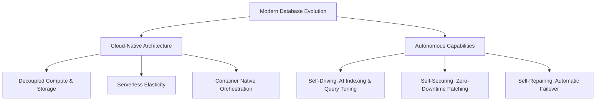
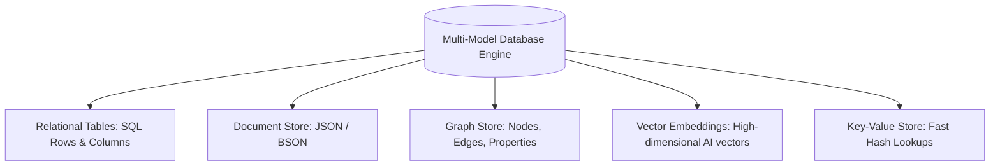
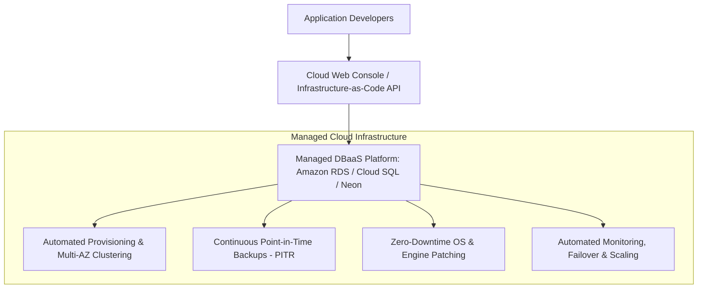
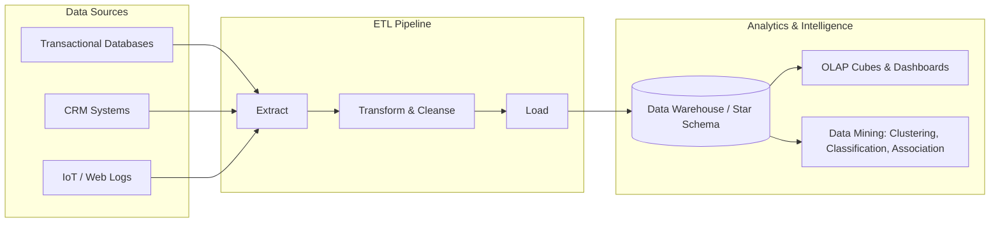
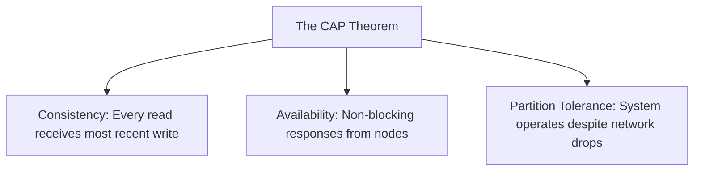

# 10. Current Trends in Databases
**Course:** Relational Database Management Systems (RDBMS Sem-1)  
**Topic:** Current Trends & Emerging Paradigms in Modern Database Engineering  
**Scope:** Monolithic On-Premises vs. Cloud-Native & Autonomous DBs, Multi-Model, Vector DBs & Generative AI, HTAP, DBaaS, Parallel & Spatial Architectures, Distributed Consensus, DWDM, and NoSQL with High-Scale Case Studies  

---

## Table of Contents
1. [Evolution: Monolithic On-Premises to Modern Data Architectures](#1-evolution-monolithic-on-premises-to-modern-data-architectures)
2. [Cloud-Native & Autonomous Databases](#2-cloud-native--autonomous-databases)
   - [Decoupled Compute and Storage](#21-decoupled-compute-and-storage)
   - [Serverless Elasticity & Container Orchestration](#22-serverless-elasticity--container-orchestration)
   - [Autonomous Capabilities: Self-Driving, Self-Securing, Self-Repairing](#23-autonomous-capabilities)
3. [Multi-Model Databases](#3-multi-model-databases)
   - [Unified Structural Paradigms](#31-unified-structural-paradigms)
   - [Cross-Model Querying & Unified ACID](#32-cross-model-querying--unified-acid)
4. [Vector Databases & Generative AI Memory Systems](#4-vector-databases--generative-ai-memory-systems)
   - [Vector Embeddings & Semantic Search](#41-vector-embeddings--semantic-search)
   - [Approximate Nearest Neighbor (ANN) Indexing](#42-approximate-nearest-neighbor-ann-indexing)
   - [Retrieval-Augmented Generation (RAG) Architecture](#43-retrieval-augmented-generation-rag-architecture)
5. [Hybrid Transactional / Analytical Processing (HTAP)](#5-hybrid-transactional--analytical-processing-htap)
   - [OLTP vs. OLAP Convergence](#51-oltp-vs-olap-convergence)
   - [Dual Storage Engines: Row-Store + Column-Store](#52-dual-storage-engines-row-store--column-store)
6. [Database as a Service (DBaaS)](#6-database-as-a-service-dbaas)
7. [Parallel Database Architectures](#7-parallel-database-architectures)
   - [Shared-Memory Architecture](#71-shared-memory-architecture)
   - [Shared-Disk Architecture](#72-shared-disk-architecture)
   - [Shared-Nothing Architecture](#73-shared-nothing-architecture)
   - [Architectural Comparison Matrix](#74-architectural-comparison-matrix)
8. [Spatial Databases & Multi-Dimensional Indexing](#8-spatial-databases--multi-dimensional-indexing)
   - [Spatial Primitives & Geometries](#81-spatial-primitives--geometries)
   - [Multi-Dimensional Indexing: R-Trees & Quadtrees](#82-multi-dimensional-indexing-r-trees--quadtrees)
   - [Spatial Query Operators & Predicates](#83-spatial-query-operators--predicates)
9. [Distributed Databases & Global Consensus](#9-distributed-databases--global-consensus)
   - [Fragmentation, Replication & Location Transparency](#91-fragmentation-replication--location-transparency)
   - [Consensus Protocols: Paxos, Raft & 2PC](#92-consensus-protocols-paxos-raft--2pc)
10. [Data Warehousing & Data Mining (DWDM)](#10-data-warehousing--data-mining-dwdm)
    - [ETL Pipeline Architecture](#101-etl-pipeline-architecture)
    - [Dimensional Modeling: Star vs. Snowflake Schemas](#102-dimensional-modeling-star-vs-snowflake-schemas)
    - [Core Data Mining Paradigms](#103-core-data-mining-paradigms)
11. [NoSQL ("Not Only SQL") Databases](#11-nosql-not-only-sql-databases)
    - [The Four NoSQL Families](#111-the-four-nosql-families)
    - [ACID vs. BASE & The CAP Theorem](#112-acid-vs-base--the-cap-theorem)
    - [Comprehensive RDBMS vs. NoSQL Comparison](#113-comprehensive-rdbms-vs-nosql-comparison)
    - [Underlying Storage Mechanics: LSM-Trees vs. B-Trees](#114-underlying-storage-mechanics-lsm-trees-vs-b-trees)
12. [In-Depth Case Study: Fleet Telemetry (10M Vehicles)](#12-in-depth-case-study-fleet-telemetry-10m-vehicles)
13. [Exam Revision Cheat Sheet & Conceptual Review](#13-exam-revision-cheat-sheet--conceptual-review)

---

## 1. Evolution: Monolithic On-Premises to Modern Data Architectures

### 1.1 Overview of Monolithic On-Premises Databases
For decades, relational databases operated primarily under the **monolithic, on-premises paradigm**. In this traditional model, data management software, physical execution servers, memory buffers, and persistent disk arrays were deployed and maintained directly within an organization’s proprietary local data center.

```text
Monolithic On-Premises Architecture:
┌────────────────────────────────────────────────────────┐
│               Dedicated Local Server Hardware          │
│                                                        │
│  ┌──────────────────────────────────────────────────┐  │
│  │     Monolithic RDBMS Software Stack              │  │
│  │   (Query Optimizer + Transaction Engine + Locks) │  │
│  └──────────────────────────────────────────────────┘  │
│                           │                            │
│  ┌──────────────────────────────────────────────────┐  │
│  │    Local Memory (RAM Buffer Pool / OS Cache)     │  │
│  └──────────────────────────────────────────────────┘  │
│                           │ (Internal Shared Bus)      │
│  ┌──────────────────────────────────────────────────┐  │
│  │    Direct Attached Storage (DAS / Local RAID)    │  │
│  └──────────────────────────────────────────────────┘  │
└────────────────────────────────────────────────────────┘
```

#### Key Characteristics:
- **Tightly Coupled Architecture:** Query processing, transaction management, lock management, buffer caching, and physical storage access are tightly integrated on a single server or proprietary hardware cluster.
- **Vertical Scaling (Scale-Up):** Increasing processing throughput or storage capacity necessitates upgrading the single server's physical resources (installing faster multi-core CPUs, expanding RAM from 64GB to 512GB, or adding high-density disk arrays).
- **Direct Physical Control & Compliance:** Organizations maintain sovereign custody over the physical hardware, security firewalls, and regulatory governance parameters.

---

### 1.2 Core Challenges of the Monolithic Paradigm

| Challenge | Impact on Modern Applications |
|---|---|
| **High Capital Expenditure (CapEx)** | Massive upfront financial commitments for high-spec enterprise servers, proprietary RDBMS software licenses (e.g., per-core licensing), power supply redundancy, cooling, and data center facilities. |
| **Limited Elasticity** | Provisioning additional capacity is bounded by physical hardware procurement lead times (weeks or months). The database cannot dynamically scale down during idle hours or burst upward during flash sales. |
| **Operational Maintenance Overhead** | Database Administrators (DBAs) must manually orchestrate operating system patching, database version upgrades, hardware component replacements, storage backups, and complex disaster recovery plans. |
| **Hardware Bottlenecks (The Scale-Up Ceiling)** | Single servers hit physical physical limits: CPU socket limits, memory bus bandwidth ceilings, and thermal dissipation thresholds. |

---

## 2. Cloud-Native & Autonomous Databases

Modern database engineering has moved away from static single-server systems toward **cloud-native, horizontally scalable, self-managing distributed systems**.



---

### 2.1 Decoupled Compute and Storage
The core architectural breakthrough of cloud-native databases is the **strict separation of stateless compute nodes from distributed storage volumes**.

```text
Traditional Monolithic:           Cloud-Native Decoupled Architecture:
   [ Compute + Storage ]               [ Compute Node 1 ]   [ Compute Node 2 ]   [ Compute Node 3 ]
       (Coupled Node)                         \                  |                  /
                                               \                 |                 /
Scaling compute requires                        ▼                ▼                ▼
replicating entire storage!         ┌───────────────────────────────────────────────────────┐
                                    │      Shared Distributed Storage Fabric                │
                                    │   (Amazon S3 / Aurora Storage Engine / Google Colossus)
                                    └───────────────────────────────────────────────────────┘
```

- **Instantaneous Scaling:** Compute clusters (query processing nodes) can be scaled up, scaled down, or spun up in seconds without copying, migrating, or re-indexing the underlying data blocks.
- **Independent Economics:** Organizations pay separately for storage capacity (gigabytes/terabytes) and computational consumption (CPU hours/query credits).
- **Industry Implementations:**
  - **Snowflake:** Virtual compute warehouses query a unified cloud storage layer (Amazon S3 / Azure Blob / GCS).
  - **Amazon Aurora:** Compute instances connect to an SSD-backed distributed storage volume that replicates data 6 ways across 3 availability zones.

---

### 2.2 Serverless Elasticity & Container Orchestration
- **Serverless Elasticity:** Automatically scales computational allocation dynamically in real time based on incoming application query traffic. During idle periods, systems can **scale to zero**, completely eliminating compute costs (e.g., Amazon Aurora Serverless v2, CockroachDB Serverless).
- **Container-Native Integration:** Modern databases are packaged as cloud-native operators running on container platforms like **Kubernetes**, supporting auto-healing, rolling updates, and multi-tenant isolation across regions (e.g., Vitess for MySQL, CloudNativePG for PostgreSQL).

---

### 2.3 Autonomous Capabilities
Autonomous databases utilize applied machine learning models and automated heuristics to eliminate manual administration:

1. **Self-Driving:** Continuously monitors live query execution plans and query patterns. Machine learning algorithms automatically detect performance bottlenecks, generate or drop secondary indexes, adjust buffer allocations, and optimize query plans without human DBA intervention (e.g., **Oracle Autonomous Database**).
2. **Self-Securing:** Automatically downloads, tests, and applies security patches, kernel updates, and continuous data-at-rest and data-in-transit encryption while maintaining zero downtime.
3. **Self-Repairing:** Employs predictive telemetry to identify hardware component failures, network degradation, or disk bit-rot. Automatically reroutes live client traffic to healthy standby replicas, achieving **$99.995\%$ to $99.999\%$ availability** (e.g., Google Cloud Spanner).

---

## 3. Multi-Model Databases

### 3.1 Unified Structural Paradigms
Historically, organizations addressed diverse data needs through **Polyglot Persistence**—operating separate specialized databases for each data format (e.g., relational for transactions, MongoDB for JSON documents, Neo4j for graphs, Redis for caching, Elasticsearch for text search). This created fragile, complex ETL synchronization pipelines.

> **Multi-Model Database:** A single, unified database engine capable of natively storing, querying, and indexing multiple data models—such as **Relational (tabular), Document (JSON), Graph (nodes/edges), Key-Value, and Vectors**—within a single platform.



---

### 3.2 Cross-Model Querying & Unified ACID
- **Cross-Model Queries:** Allows a single query to join and aggregate data across different structural paradigms in one execution plan. For example, a query can join a relational `orders` table with a JSONB `user_preferences` document and execute a graph traversal across `user_friends` in a single SQL statement.
- **Unified ACID & Security:** Eliminates eventual consistency discrepancies between disparate systems. ACID guarantees, centralized access control, and unified backup snapshots apply across all data types.
- **Industry Examples:**
  - **PostgreSQL:** Handles relational tables, JSONB documents, spatial geometries via PostGIS, vector similarity via `pgvector`, and graph queries via Apache AGE.
  - **ArangoDB:** Native multi-model engine combining Documents, Key-Value, and Graphs via AQL (ArangoDB Query Language).
  - **Azure Cosmos DB:** Globally distributed engine supporting Document, Key-Value, Graph (Gremlin), and Relational (SQL) APIs.

---

## 4. Vector Databases & Generative AI Memory Systems

### 4.1 Vector Embeddings & Semantic Search
Machine Learning models and Large Language Models (LLMs) convert unstructured data (text, images, audio, video) into dense arrays of floating-point numbers called **Vector Embeddings** (e.g., 1536-dimensional vectors for OpenAI's `text-embedding-3`).

```text
Unstructured Text              Machine Learning Model           High-Dimensional Vector
"Network connection lost" ──► [ Embedding Transformer ] ──► [ -0.021, 0.432, 0.008, ..., 0.129 ]
"Wi-Fi routing problem"   ──► [ Embedding Transformer ] ──► [ -0.019, 0.428, 0.011, ..., 0.134 ]
                                                                      │
                                                High Geometric Cosine Similarity!
```

> **Vector Database:** A specialized database system engineered to store, index, and execute high-speed mathematical distance calculations over high-dimensional vector embeddings.

- **Semantic Retrieval vs. Keyword Search:** Traditional databases rely on exact lexical keyword matches (`LIKE '%Wi-Fi%'`). Vector databases match **underlying conceptual meaning** based on proximity in vector space.

---

### 4.2 Approximate Nearest Neighbor (ANN) Indexing
Searching millions of 1536-dimensional vectors using exhaustive brute-force calculations ($K$-Nearest Neighbors) requires $O(n \cdot d)$ time, which is too slow for real-time applications. Vector databases utilize **Approximate Nearest Neighbor (ANN)** indexing algorithms:

1. **HNSW (Hierarchical Navigable Small World):** Builds a multi-layer graph where upper layers have long-range links (fast skipping) and bottom layers have dense local links. Achieves logarithmic query time ($O(\log n)$) with high recall.
2. **IVF (Inverted File Index):** Partitions vector space into Voronoi cells using $k$-means clustering, searching only the centroids closest to the query vector.
3. **Geometric Distance Metrics:**
   - **Cosine Similarity:** Measures the cosine of the angle between two vectors (measures semantic orientation, ignoring vector magnitude).
   - **Euclidean Distance ($L_2$ Norm):** Measures straight-line distance in geometric space.
   - **Dot Product:** Measures directional alignment weighted by magnitude.

---

### 4.3 Retrieval-Augmented Generation (RAG) Architecture
Vector databases serve as the persistent, long-term memory layer for Generative AI applications and LLMs:

```text
User Query: "How do I configure SSO in our company?"
    │
    ▼
[ Embedding Model ] ──► Query Vector
                           │
                           ▼
                  [ Vector Database ] ──► (Performs ANN Search over Indexed Company PDFs)
                           │
                           ▼
           Retrieved Context Excerpts: [ "SSO Guide 2024...", "Policy Doc..." ]
                           │
                           ▼
[ LLM: GPT-4 / Claude ] ◄── Appends Context to Original Prompt
    │
    ▼
Accurate, Hallucination-Free Answer Grounded in Real Enterprise Data!
```

- **Specialized Vector Platforms:** Pinecone, Milvus, Qdrant, Weaviate, Chroma.
- **Integrated Vector Extensions:** `pgvector` for PostgreSQL, Redis Vector Search, OpenSearch.

---

## 5. Hybrid Transactional / Analytical Processing (HTAP)

### 5.1 OLTP vs. OLAP Convergence
Historically, enterprise data architectures maintained two strictly separated database systems:
1. **OLTP (Online Transaction Processing):** Fast, row-oriented, highly concurrent read/write queries handling mission-critical business transactions (e.g., MySQL, PostgreSQL).
2. **OLAP (Online Analytical Processing):** Complex, read-heavy multi-table aggregations and historical reporting running on column-oriented data warehouses (e.g., Snowflake, Teradata).
- Connecting them required brittle, high-latency **ETL (Extract, Transform, Load)** pipelines run overnight.

> **HTAP Database:** A unified database engine capable of executing high-frequency **OLTP transactions** and complex **OLAP analytical queries** simultaneously on the same platform against real-time operational data without requiring an ETL pipeline.

---

### 5.2 Dual Storage Engines: Row-Store + Column-Store

```text
                        Incoming Client Requests
                       ┌────────────────────────┐
                       │  HTAP Database Engine  │
                       └───────────┬────────────┘
                                   │
                 ┌─────────────────┴─────────────────┐
                 ▼                                   ▼
        [ Row-Oriented Store ]              [ Column-Oriented Store ]
      (Optimized for Writes / OLTP)       (Optimized for Reads / OLAP)
      Tuple: [ID, Name, Balance, Date]    ID:    [ 1,  2,  3,  4 ]
      Appends whole records fast!         Bal:   [100, 200, 150, 400]
                                          Scans single columns instantly!
```

- **Mechanics:** Transactional updates land in the row-store for sub-millisecond writes, and are asynchronously replicated in memory into an in-memory columnar format for analytical scans.
- **Real-Time Decisioning:** Enables instant fraud detection during active payment flows or dynamic ride-hail surge pricing calculated directly from live database state.
- **Industry Platforms:** TiDB (TiKV row-store + TiFlash column-store), SingleStore, SAP HANA, Oracle HeatWave.

---

## 6. Database as a Service (DBaaS)

### 6.1 Architectural Model
**Database as a Service (DBaaS)** is a fully managed cloud service model where public cloud providers (AWS, GCP, Azure) or specialized database companies handle the underlying infrastructure, provisioning, maintenance, and reliability engineering.



---

### 6.2 Key Capabilities & Enterprise Benefits
1. **Automated Elasticity & Scaling:** Compute and storage scale on demand. Modern serverless DBaaS platforms (like Neon or Aurora Serverless) pause compute when traffic drops to zero and resume within milliseconds upon query arrival.
2. **Automated High Availability & Failover:** Automatically creates synchronized standby replicas across multiple geographic availability zones. If the primary node fails, health-checks trigger an automated DNS switchover within seconds.
3. **Continuous Point-in-Time Recovery (PITR):** Continuously flushes write-ahead logs to object storage, allowing restoration of the database to any millisecond within the retention window (e.g., immediately before an accidental `DROP TABLE` command).
4. **Relational vs. NoSQL DBaaS Providers:**
   - **Relational:** Amazon RDS, Google Cloud SQL, Azure SQL Database, Neon.
   - **NoSQL / Serverless:** MongoDB Atlas, Supabase, DataStax Astra DB, Firebase Realtime Database.

---

## 7. Parallel Database Architectures

Parallel database systems use multiple processing units (CPUs), memory banks, and storage controllers simultaneously to execute data operations in parallel, overcoming single-node performance bottlenecks.

---

### 7.1 Shared-Memory Architecture
- **Structure:** All CPUs share a centralized pool of main memory (RAM) and physical disk storage via a shared internal high-speed bus.
- **Mechanics:** Processors communicate directly through shared memory spaces; query coordination is fast and simple.
- **Bottleneck:** Severe hardware contention on the shared memory bus caps scalability to roughly 32–64 processors.
- **Example:** High-end Symmetric Multiprocessing (SMP) enterprise servers running PostgreSQL or SQL Server.

```text
Shared-Memory:
  [ CPU 1 ]    [ CPU 2 ]    [ CPU 3 ]    [ CPU 4 ]
      │            │            │            │
  ────┴────────────┴─────┬──────┴────────────┴──── (High-Speed Memory Bus)
                         │
                 [ Shared RAM ]
                         │
                [ Shared Disks ]
```

---

### 7.2 Shared-Disk Architecture
- **Structure:** Each processing node has its own private CPU and dedicated main memory (RAM), but all nodes share a common, centralized disk subsystem connected via a Storage Area Network (SAN) or Network-Attached Storage (NAS).
- **Mechanics:** High availability and fault tolerance: if node 1 crashes, node 2 can query the shared storage without data migration.
- **Bottleneck:** The central storage network and disk controller become an I/O bottleneck as processing nodes are added.
- **Example:** **Oracle RAC (Real Application Clusters)**, IBM Db2 pureScale.

```text
Shared-Disk:
  [ Node 1 ]       [ Node 2 ]       [ Node 3 ]
  ┌────────┐       ┌────────┐       ┌────────┐
  │  CPU   │       │  CPU   │       │  CPU   │
  │  RAM   │       │  RAM   │       │  RAM   │
  └────┬───┘       └────┬───┘       └────┬───┘
       │                │                │
  ─────┴────────────────┴────────────────┴──── (Storage Area Network - SAN)
                         │
              [ Central Shared Disk Array ]
```

---

### 7.3 Shared-Nothing Architecture
- **Structure:** Each node is completely autonomous, possessing its own private CPU, private memory, and local disk storage. Nodes share no physical hardware and communicate exclusively via high-speed network messaging.
- **Mechanics:** Data is **partitioned (sharded)** across all nodes. Each node executes queries locally over its assigned data slice.
- **Scalability:** Delivers true **linear horizontal scalability** to hundreds or thousands of nodes.
- **Bottleneck:** Cross-node joins require network-intensive "data shuffling" across nodes.
- **Example:** **Teradata, Amazon Redshift, ClickHouse, Greenplum**.

```text
Shared-Nothing:
  ┌─────────────────┐       ┌─────────────────┐       ┌─────────────────┐
  │     Node 1      │       │     Node 2      │       │     Node 3      │
  │ ┌────┐   ┌────┐ │       │ ┌────┐   ┌────┐ │       │ ┌────┐   ┌────┐ │
  │ │CPU │   │RAM │ │       │ │CPU │   │RAM │ │       │ │CPU │   │RAM │ │
  │ └────┘   └────┘ │       │ └────┘   └────┘ │       │ └────┘   └────┘ │
  │    [ Disk 1 ]   │       │    [ Disk 2 ]   │       │    [ Disk 3 ]   │
  └────────┬────────┘       └────────┬────────┘       └────────┬────────┘
           │                         │                         │
  ─────────┴─────────────────────────┴─────────────────────────┴──────── (Network Interconnect)
```

---

### 7.4 Architectural Comparison Matrix

| Metric | Shared-Memory | Shared-Disk | Shared-Nothing |
|---|:---:|:---:|:---:|
| **Cost** | High (proprietary SMP hardware) | High (SAN storage arrays) | **Low** (commodity server clusters) |
| **Scalability** | Poor (32–64 CPUs max) | Moderate (dozens of nodes) | **Infinite / Linear** (thousands of nodes) |
| **Interconnect Bottleneck** | Memory bus bandwidth | Central SAN disk I/O | Network communication / Data shuffling |
| **Fault Tolerance** | Low (single host failure drops DB) | High (nodes fail independently) | High (nodes replicate data across peers) |
| **Best Suited Workload** | Traditional OLTP | Enterprise high-availability OLTP | Massively Parallel Processing (MPP) OLAP |

---

## 8. Spatial Databases & Multi-Dimensional Indexing

### 8.1 Spatial Primitives & Geometries
A **Spatial Database** enhances relational capabilities with optimized geometric data types, multi-dimensional indexes, and spatial query operators defined in a geometric or geographic coordinate reference system (CRS).

- **Core Primitives:**
  - `Point`: A single coordinate $(X, Y)$ (e.g., GPS latitude/longitude of a delivery driver).
  - `LineString`: A series of connected line segments (e.g., a road, river, or transit route).
  - `Polygon`: A closed ring boundary enclosing a surface area (e.g., municipal district, delivery zone).
  - `MultiPolygon` / `TIN`: Complex 3D topographies, triangulated irregular networks, and territorial boundaries.

---

### 8.2 Multi-Dimensional Indexing: R-Trees & Quadtrees
Standard 1-dimensional **B-Trees** cannot index 2D or 3D coordinate space efficiently because multidimensional data lacks a natural total ordering. Spatial engines use specialized multi-dimensional access methods:

```text
R-Tree Concept (Minimum Bounding Boxes):
┌───────────────────────────────────────────────┐
│ R1 (Outer Root Bounding Box)                  │
│   ┌──────────────────────┐  ┌──────────────┐  │
│   │ R3                   │  │ R4           │  │
│   │    ┌─────┐   ┌─────┐ │  │    ┌───────┐ │  │
│   │    │Obj A│   │Obj B│ │  │    │ Obj C │ │  │
│   │    └─────┘   └─────┘ │  │    └───────┘ │  │
│   └──────────────────────┘  └──────────────┘  │
└───────────────────────────────────────────────┘
```

- **R-Tree (Rectangle Tree):** Groups geometric objects into hierarchical **Minimum Bounding Boxes (MBR)**. Searching for a location prunes large geographical spaces without scanning individual rows.
- **Quadtree:** Recursively divides a 2D space into four quadrants ($NW, NE, SW, SE$) down to a specified resolution.

---

### 8.3 Spatial Query Operators & Predicates
Spatial databases implement OpenGIS / SQL-MM standard functions:
- `ST_Contains(A, B)`: Returns true if Polygon $A$ geometrically encloses Point/Geometry $B$.
- `ST_Intersects(A, B)`: Returns true if geometries $A$ and $B$ share any physical space.
- `ST_Distance(A, B)`: Calculates the geodetic distance between two coordinates in meters.
- **Industry Spatial Engines:** **PostGIS** (PostgreSQL extension), Oracle Spatial, MySQL Spatial Extensions, SpatiaLite.

---

## 9. Distributed Databases & Global Consensus

### 9.1 Fragmentation, Replication & Location Transparency
A **Distributed Database** manages database nodes distributed across multiple physical machines, data centers, or geographic regions connected via networks.

- **Data Fragmentation:**
  - **Horizontal Fragmentation (Sharding):** Distributes rows across nodes based on a partition key (e.g., European users stored on Frankfurt nodes, Asian users on Tokyo nodes).
  - **Vertical Fragmentation:** Splits columns of a table across nodes based on access patterns.
- **Data Replication:** Copies data partitions across multiple availability zones to ensure data survives hardware outages.
- **Location Transparency:** Client applications issue standard SQL queries (`SELECT * FROM customers`) without needing to know which physical machine or continent stores the record.

---

### 9.2 Consensus Protocols: Paxos, Raft & 2PC
Coordinating atomic operations and ordering transactions across distributed nodes requires formal consensus protocols:

1. **Two-Phase Commit (2PC):** A coordination protocol ensuring atomic distributed transactions across multiple database nodes:
   - **Phase 1 (Prepare):** Coordinator node asks all participant nodes if they can commit. Nodes acquire locks, flush undo/redo logs, and reply `READY` or `ABORT`.
   - **Phase 2 (Commit):** If all participants vote `READY`, coordinator broadcasts `GLOBAL_COMMIT`. If any node votes `ABORT`, coordinator broadcasts `GLOBAL_ROLLBACK`.
2. **Consensus Protocols (Paxos & Raft):** Modern distributed databases (**Google Cloud Spanner, CockroachDB, YugabyteDB**) use Raft or Paxos to maintain consistent replication across quorum majorities, surviving minority node failures without human intervention.

---

## 10. Data Warehousing & Data Mining (DWDM)

Data Warehousing consolidates historical enterprise data into a centralized analytical repository, while Data Mining applies machine learning and statistical models to uncover actionable predictive insights.



---

### 10.1 ETL Pipeline Architecture
- **Extraction (E):** Ingests raw data from disparate operational transactional systems, ERP software, web telemetry, and external APIs.
- **Transformation (T):** Cleanses data, eliminates duplicates, reconciles schemas, standardizes currency and timestamps, and validates referential integrity.
- **Loading (L):** Writes the refined, denormalized records into the centralized data warehouse tables.

---

### 10.2 Dimensional Modeling: Star vs. Snowflake Schemas

```text
Star Schema (Denormalized Dimensions):
               ┌───────────────────────┐
               │    Dim_Customer       │
               └───────────┬───────────┘
                           │
┌───────────────────────┐  │  ┌───────────────────────┐
│      Dim_Time         ├──┼──┤      Dim_Store        │
└───────────────────────┘  │  └───────────────────────┘
                           │
               ┌───────────┴───────────┐
               │      FACT_SALES       │
               │ (Units, Revenue, Tax) │
               └───────────┬───────────┘
                           │
               ┌───────────┴───────────┐
               │     Dim_Product       │
               └───────────────────────┘
```

| Dimension | Star Schema | Snowflake Schema |
|---|---|---|
| **Structure** | Central Fact table surrounded by **denormalized** Dimension tables. | Central Fact table surrounded by **normalized** dimensions split into sub-dimensions. |
| **Join Complexity** | **Low:** Single-level joins between Fact and Dimensions (faster query performance). | **High:** Multi-level hierarchical joins across normalized tables. |
| **Storage Overhead** | Higher (stores redundant dimension attributes). | Lower (normal form reduces data redundancy). |
| **Best Suited For** | Fast analytical queries, business dashboards, and OLAP cubes. | Large dimension datasets with strict storage constraints. |

---

### 10.3 Core Data Mining Paradigms
1. **Predictive Classification (Supervised Learning):** Maps records into discrete categorical classes based on labeled training data (e.g., scoring bank loan applications as *Approved* or *High Risk*).
2. **Unsupervised Clustering:** Groups unlabelled records into natural clusters based on mathematical distance metrics (e.g., $k$-means clustering segmenting e-commerce users into behavioral buyer personas).
3. **Association Rule Mining:** Discovers relationships between items purchased together in transactional datasets (e.g., **Market Basket Analysis** using the Apriori algorithm: discovering that buying product $A$ frequently co-occurs with product $B$).
4. **Outlier / Anomaly Detection:** Flags statistical departures from normal operational baselines (e.g., credit card fraud detection identifying anomalous foreign transactions).

---

## 11. NoSQL ("Not Only SQL") Databases

### 11.1 The Four NoSQL Families
NoSQL databases emerged to handle distributed web-scale traffic, rapid schema changes, and high-velocity unstructured data streams:

1. **Document Stores:** Stores semi-structured records as hierarchical JSON, BSON, or XML documents. Ideal for content management, user profiles, and e-commerce catalogs (**MongoDB, Couchbase**).
2. **Key-Value Stores:** Minimalist schema where unique string keys map to arbitrary data blobs. Delivers sub-millisecond lookups. Ideal for session caches, shopping carts, and leaderboard tracking (**Redis, Amazon DynamoDB**).
3. **Wide-Column Stores:** Stores data in tables with dynamic column families distributed across nodes. Ideal for time-series logging, IoT telemetry, and large-scale analytical ingestion (**Apache Cassandra, Apache HBase**).
4. **Graph Databases:** Stores data as nodes (entities) and edges (relationships) with associated key-value properties. Enables fast relationship traversals. Ideal for social networks, fraud rings, and recommendation engines (**Neo4j, Amazon Neptune**).

---

### 11.2 ACID vs. BASE & The CAP Theorem



According to **Brewer's CAP Theorem**, a distributed data store can guarantee at most **two out of three** properties simultaneously in the presence of a network partition:
- **CP Systems (Consistency + Partition Tolerance):** Rejects writes or blocks requests if nodes cannot achieve consensus (e.g., Google Spanner, MongoDB default).
- **AP Systems (Availability + Partition Tolerance):** Continues accepting reads and writes across partitioned nodes at the cost of returning stale data (e.g., Apache Cassandra, DynamoDB).

#### Relational ACID vs. NoSQL BASE:
- **ACID (Pessimistic Consistency):** Atomicity, Consistency, Isolation, Durability. Favored by RDBMS systems where transactional correctness is paramount.
- **BASE (Optimistic Availability):**
  - **Basically Available:** System remains operational despite localized node failures.
  - **Soft-state:** State of the system can shift over time without user input due to background data synchronization.
  - **Eventual Consistency:** Given enough time without new updates, all replicas eventually converge to the same value.

---

### 11.3 Comprehensive RDBMS vs. NoSQL Comparison

| Architectural Feature | RDBMS (Relational) | NoSQL (Non-Relational) |
|---|---|---|
| **Data Model** | Rigid, 2D tabular relations (Rows & Columns). | Flexible (JSON Documents, Key-Value, Graphs, Wide-Columns). |
| **Schema Paradigm** | **Schema-on-Write:** Predefined, rigid DDL schemas validated upon insertion. | **Schema-on-Read / Dynamic:** Fields can be added dynamically on the fly without table migrations. |
| **Scaling Strategy** | **Vertical Scaling (Scale-Up):** Adding CPU/RAM/NVMe to a single central server. | **Horizontal Scaling (Scale-Out):** Sharding across clusters of commodity servers. |
| **Transactional Guarantees** | Strict **ACID** compliance across all operations. | **BASE** model (prioritizes availability and eventual consistency). |
| **Query Mechanism** | Standardized **SQL** (`JOIN`, window functions, sub-queries). | Proprietary APIs, JSON queries, or specialized graph languages (e.g., Cypher, Gremlin). |
| **Complex Joins** | Highly optimized via query engines (Hash Join, Merge Join). | Poor or non-existent; joins must be orchestrated in the application code. |
| **Best Suited Applications** | Banking ledgers, ERP, HR systems, accounting systems. | High-scale web telemetry, mobile apps, social graphs, streaming IoT. |

---

### 11.4 Underlying Storage Mechanics: LSM-Trees vs. B-Trees

A key technical reason why NoSQL databases outperform traditional RDBMSs on write-heavy workloads is their choice of storage engine data structure:

```text
B-Tree Engine (Traditional RDBMS: InnoDB, Postgres):
  Incoming Write ──► Find Specific Leaf Page on Disk ──► Random Disk In-Place Update
  (Random I/O causes high write latency and disk seek bottlenecks!)

LSM-Tree Engine (NoSQL: Cassandra, RocksDB, ScyllaDB):
  Incoming Write ──► [ RAM Memtable (SkipList) ]  (Sub-millisecond in-memory write)
                            │ (Flushed sequentially when full)
                            ▼
                     [ Immutable SSTables on Disk ]  (Pure Sequential Append I/O!)
                            │ (Background Compaction)
                            ▼
                     [ Merged Final SSTables ]
```

- **B-Trees (Read-Optimized):** Update data in-place on 8KB/16KB disk pages. Every write incurs random disk I/O, hitting an I/O ceiling under heavy write streams.
- **LSM-Trees (Write-Optimized):** Buffer writes in an in-memory **Memtable** and append sequentially to disk as immutable **SSTables (Sorted String Tables)**. By eliminating random disk seeks, LSM-tree systems sustain hundreds of thousands of concurrent writes per second.

---

## 12. In-Depth Case Study: Fleet Telemetry (10M Vehicles)

### Problem Definition:
An electric vehicle manufacturer collects real-time per-second telemetry data from **10 million active connected cars** across the globe. Each vehicle transmits battery cell temperatures, GPS locations, tire pressure, motor RPM, and diagnostic fault codes.

$$\text{Incoming Write Ingestion Rate} = 10,000,000 \text{ writes/second}$$

---

### Why Traditional RDBMS Fails for This Workload:
1. **Write Bottlenecks from ACID & B-Tree Overhead:** Relational engines update B-Tree indexes and write to transactional tables in-place. Sustaining 10 million concurrent random writes per second creates lock contention, checkpoint stalls, and storage I/O exhaustion.
2. **Schema Rigidity & Operational Downtime:** Different vehicle models and firmware versions emit varying telemetry schemas (e.g., electric models report battery state of charge, whereas hybrid models report fuel flow). Adding a new metric to an RDBMS requires running `ALTER TABLE` on multi-billion-row tables, triggering table locks and service interruptions.
3. **Hardware Scaling Ceiling:** Relational databases struggle with horizontal write scaling. Scaling up would require single enterprise servers that exceed physical hardware limits and become cost-prohibitive.

---

### Why NoSQL (e.g., Apache Cassandra, DynamoDB) Excels:
1. **LSM-Tree Sequential Write Ingestion:** Cassandra and DynamoDB use append-only log-structured storage engines, converting millions of incoming writes into sequential disk operations with sub-millisecond write latency.
2. **Dynamic Schemas:** A car on firmware v2.1 can send 10 metrics, while a car on firmware v3.0 sends 40 metrics. NoSQL engines store these fields dynamically without requiring pre-altered schemas.
3. **Linear Horizontal Scale-Out:** The dataset is partitioned across hundreds of commodity server nodes using a composite partition key:
   $$\text{Partition Key} = (\text{vehicle\_id}, \text{bucket\_date})$$
   Throughput scales linearly: adding 20 more cluster nodes expands write capacity by a proportional 20%.

---

## 13. Exam Revision Cheat Sheet & Conceptual Review

### Key Technical Concepts:
- **Decoupled Compute and Storage:** The hallmark of cloud-native systems (e.g., Snowflake, Aurora). Compute can scale to zero while storage persists.
- **Autonomous DB Pillars:** Self-driving (ML-based tuning/indexing), self-securing (zero-downtime patching), self-repairing (automatic failover).
- **Multi-Model Engine:** Single engine supporting relational, document, graph, and vector models (e.g., PostgreSQL with `pgvector` and `JSONB`).
- **Vector DB Metric:** Cosine similarity measures angle/orientation; HNSW provides $O(\log n)$ Approximate Nearest Neighbor search for RAG workflows.
- **HTAP:** Eliminates ETL by running OLTP (row-store) and OLAP (column-store) simultaneously in one database.
- **Parallel Architectures:** Shared-Memory (bus contention, $<64$ CPUs) vs. Shared-Disk (SAN bottleneck) vs. Shared-Nothing (linear horizontal scaling, used in data warehouses).
- **Spatial Indexing:** R-Trees group geometries into Minimum Bounding Boxes (MBR) for fast multi-dimensional spatial queries.
- **NoSQL Advantage:** Horizontal scale-out and dynamic schemas; uses LSM-trees to optimize high-velocity append-only writes.
- **CAP Theorem:** In a distributed network partition ($P$), a database must choose between Consistency ($C$) or Availability ($A$).
