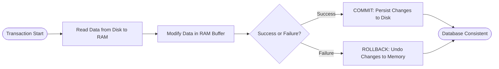
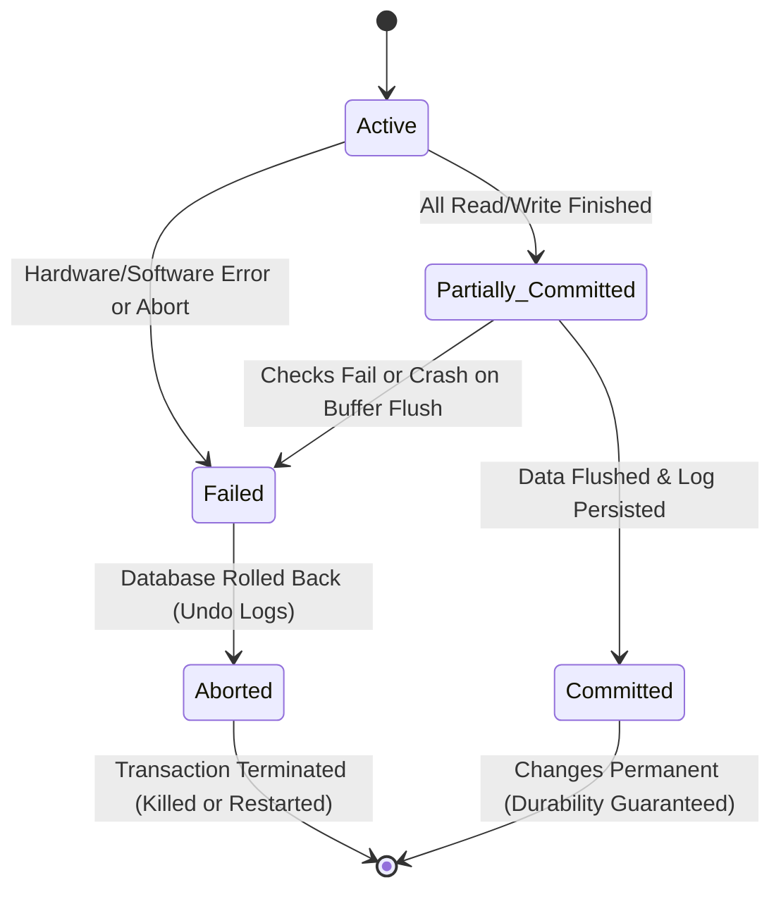
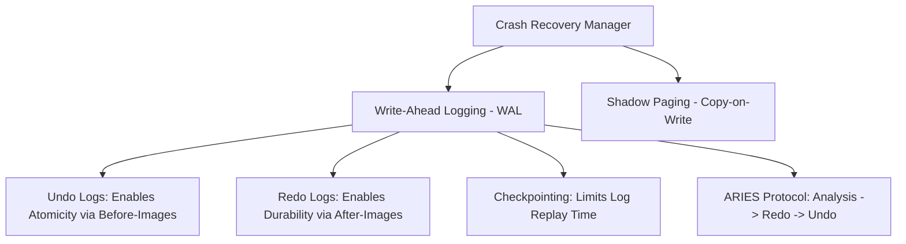

# 9. Transaction Management and Concurrency Control
**Course:** Relational Database Management Systems (RDBMS Sem-1)  
**Topic:** Transaction Processing, ACID Properties, Crash Recovery (WAL, ARIES, Shadow Paging), and Concurrency Control (2PL, Timestamp Ordering, MVCC)  
**Scope:** Exhaustive Academic Lecture Notes, Step-by-Step Execution Traces, Crash Protocols, Anomaly Isolation Matrix & Exam Revision Guide  

---

## Table of Contents
1. [Overview of Transaction Management](#1-overview-of-transaction-management)
2. [Operations of a Transaction & Concrete Traces](#2-operations-of-a-transaction--concrete-traces)
3. [Transaction Lifecycle & State Transitions](#3-transaction-lifecycle--state-transitions)
4. [The ACID Properties Framework](#4-the-acid-properties-framework)
5. [Implementation of Atomicity and Durability (Crash Recovery)](#5-implementation-of-atomicity-and-durability-crash-recovery)
   - [Write-Ahead Logging (WAL) Architecture](#51-write-ahead-logging-wal-architecture)
   - [The ARIES Recovery Protocol](#52-the-aries-recovery-protocol)
   - [Checkpointing: Optimizing WAL Recovery](#53-checkpointing-optimizing-wal-recovery)
   - [Alternative Strategy: Shadow Paging](#54-alternative-strategy-shadow-paging)
   - [Recovery Architecture Comparison: WAL vs. Shadow Paging](#55-recovery-architecture-comparison-wal-vs-shadow-paging)
6. [Concurrency Control & The Four Data Anomalies](#6-concurrency-control--the-four-data-anomalies)
   - [Dirty Read (Uncommitted Dependency)](#61-dirty-read-uncommitted-dependency)
   - [Lost Update (Overwrite Hazard)](#62-lost-update-overwrite-hazard)
   - [Unrepeatable Read (Non-Repeatable Read)](#63-unrepeatable-read-non-repeatable-read)
   - [Phantom Read (Predicate Anomaly)](#64-phantom-read-predicate-anomaly)
   - [SQL Standard Isolation Levels Matrix](#65-sql-standard-isolation-levels-matrix)
7. [Concurrency Control Protocols](#7-concurrency-control-protocols)
   - [Lock-Based Protocols: Two-Phase Locking (2PL)](#71-lock-based-protocols-two-phase-locking-2pl)
   - [Timestamp Ordering Protocols](#72-timestamp-ordering-protocols)
   - [Multi-Version Concurrency Control (MVCC)](#73-multi-version-concurrency-control-mvcc)
8. [Master Protocol Comparison Matrix](#8-master-protocol-comparison-matrix)
9. [Exam Revision Cheat Sheet & Practice Questions](#9-exam-revision-cheat-sheet--practice-questions)

---

## 1. Overview of Transaction Management

### 1.1 What is a Transaction?
> **Transaction:** A transaction is a single logical unit of database processing that includes one or more database access or manipulation operations (such as `read`, `write`, `insert`, `update`, or `delete`).

A transaction represents a boundary around a set of operations to guarantee that either **all operations are executed to completion and permanently stored**, or in the event of an error or system crash, **none of the operations take effect** (the database is restored to its exact pre-transaction state).



---

### 1.2 Real-World Metaphor: ATM Cash Withdrawal
When a user withdraws cash from an automated teller machine (ATM), the interaction involves multiple sequential steps that must operate as an indivisible unit:
1. Transaction Start.
2. Insert ATM Card & authenticate.
3. Select Language.
4. Select Account Type (Savings / Current).
5. Enter Withdrawal Amount.
6. Enter Secret PIN.
7. System processes transaction (validates balance, debits core database, logs audit record).
8. Dispense Cash.
9. Transaction Completed.

If the machine suffers a power outage or hardware jamming after step 7 (debiting the account) but before step 8 (dispensing the cash), the transaction **must not partially succeed**. The database must execute a **rollback** to refund the debited amount immediately.

---

### 1.3 Primitive Database Access Operations

| Operation Symbol | Technical Definition | System Mechanism |
|---|---|---|
| **$R(X)$ (Read)** | Retrieves the data item $X$ from physical disk storage and loads it into a variable inside main memory (RAM buffer). | Disk I/O $\to$ Database Buffer Pool. Does not alter the underlying data. |
| **$W(X)$ (Write)** | Transcribes the updated value of memory variable $X$ from RAM buffers back into persistent database disk storage. | RAM Buffer Pool $\to$ OS Page Cache $\to$ Storage Controller. |
| **Commit** | A Transaction Control Language (TCL) directive signaling successful completion. | Flushes logs to non-volatile disk, releasing transaction locks and making modifications permanent. |
| **Rollback** | An abort directive executed upon failure or constraint violation. | Replays undo records backward to revert all partial modifications back to their baseline state. |

---

## 2. Operations of a Transaction & Concrete Traces

### 2.1 Classic Banking Transfer Trace ($A \to B$)
**Scenario:** Transfer ₹$50$ from Account $A$ to Account $B$.  
**Initial Balances:** Account $A = ₹500$, Account $B = ₹800$.  
**Total Database Money (System Invariant):** $500 + 800 = ₹1300$.

```text
Sequence of Execution Steps:
1.  R(A)      --> Fetch current balance of A (500) from disk into RAM buffer.
2.  A = A - 50 --> Calculate deducted balance in CPU register: 500 - 50 = 450.
3.  W(A)      --> Write updated balance (450) into database RAM buffer.
4.  R(B)      --> Fetch current balance of B (800) from disk into RAM buffer.
5.  B = B + 50 --> Calculate incremented balance in CPU register: 800 + 50 = 850.
6.  W(B)      --> Write updated balance (850) into database RAM buffer.
7.  COMMIT    --> Flush log records to disk, making ₹450 and ₹850 permanently persistent.
```

- **Invariant Check:** Final sum $= 450 + 850 = ₹1300$ (preserved!).
- If a crash strikes between Step 3 and Step 4, Account $A$ loses ₹$50$ without Account $B$ receiving it unless the recovery system steps in.

---

### 2.2 Formal Database SQL Operations

#### 1. Read Operation (`Read(X)`)
Reads the attribute value from storage into application memory buffers.
```sql
SELECT balance FROM accounts WHERE account_id = 'A123';
```
- Retrieves data for calculation or display; leaves persistent records unmodified.

#### 2. Write Operation (`Write(X)`)
Writes modified memory values back to the relational tables.
```sql
UPDATE accounts SET balance = balance - 100 WHERE account_id = 'A123';
```

#### 3. Commit (`COMMIT`)
Finalizes all uncommitted buffer modifications made during the current transaction lifecycle.
```sql
COMMIT;
```

#### 4. Rollback (`ROLLBACK`)
Cancels all intermediate changes if any error, system check failure, or deadlock strikes.
```sql
ROLLBACK;
```

---

## 3. Transaction Lifecycle & State Transitions

During execution, every transaction progresses through an explicit finite state machine:



### 3.1 State Definitions

1. **Active:**
   - The initial state. The transaction enters this state immediately upon invocation.
   - Operations (`SELECT`, `INSERT`, `UPDATE`, `DELETE`) are executing in main memory buffers.
   - Data records are under manipulation in volatile RAM and **have not been permanently committed to disk**.

2. **Partially Committed:**
   - The transaction has completed its final read/write statement, but changes remain in temporary volatile buffers.
   - The DBMS performs final integrity constraint checks and flushes log records to non-volatile disk.
   - If log writes succeed, the state transitions to **Committed**; if a crash occurs during flush, it transitions to **Failed**.

3. **Committed:**
   - Reached when all operations and the `COMMIT` record have successfully been written to non-volatile storage.
   - Marks the irrevocable success of the transaction; changes are guaranteed to survive subsequent crashes.

4. **Failed:**
   - Entered if an internal error occurs (division by zero, constraint violation, insufficient balance) or an external failure strikes (power loss, network interruption) during the Active or Partially Committed states.
   - Halts all further forward execution.

5. **Aborted:**
   - The database recovery subsystem undoes all incomplete changes using undo logs, returning the database to its pre-transaction state.
   - Upon aborting, the recovery system executes one of two paths:
     - **Kill:** Permanently terminate the transaction if the failure is unrecoverable (e.g., bad user logic, data constraint violation).
     - **Restart:** Revert the transaction to the **Active** state with a new timestamp if the failure was transient (e.g., lock deadlock, network timeout).

---

## 4. The ACID Properties Framework

To maintain relational data integrity across concurrent execution and unexpected system failures, every database transaction must satisfy the four foundational **ACID** properties:

```text
       +-------------------------------------------------------------+
       |                        A C I D                              |
       +--------------+--------------+---------------+---------------+
       |  ATOMICITY   | CONSISTENCY  |   ISOLATION   |  DURABILITY   |
       |              |              |               |               |
       | All-or-None  | Preserves DB | Concurrency   | Survives      |
       |  Execution   | Constraints  | Independence  | System Crash  |
       +--------------+--------------+---------------+---------------+
```

---

### 4.1 Atomicity ("All or Nothing")
> **Definition:** Ensures that all operations within a transaction are treated as a single, indivisible unit of execution. Either **all** operations succeed and reflect in the database, or **none** do.

- **Failure Scenario:** In transferring $100 from Account $A$ to Account $B$, the system crashes immediately after debiting $A$.
- **Atomicity Enforcement:** The partial debit of $A$ is undone (rolled back) using undo logs, ensuring money does not disappear into an intermediate void.

---

### 4.2 Consistency ("Preserving Invariants")
> **Definition:** Guarantees that a transaction transforms the database from one valid, consistent state satisfying all rules, schemas, and integrity constraints to another valid state.

- **Constraints Preserved:** Primary key uniqueness, foreign key referential integrity, `CHECK` constraints, domain ranges, cascading rules, and trigger logic.
- **Example:** If a checking account has a rule `CHECK (balance >= 0)`, an attempt to withdraw $150 from an account containing only $100 violates consistency. The DBMS aborts the transaction and reverts any provisional updates.

---

### 4.3 Isolation ("Independence of Execution")
> **Definition:** Ensures that the concurrent execution of multiple transactions results in a system state identical to what would be obtained if those transactions had run serially (one after another).

- **Principle:** Intermediate, uncommitted states of active transactions must remain invisible to other concurrent transactions.
- **Example:** While Transaction $T_1$ calculates the sum of all bank balances, Transaction $T_2$ transfers money between two accounts. Isolation guarantees $T_1$ will never read an intermediate state where funds have left Account $A$ but have not yet been deposited into Account $B$.

---

### 4.4 Durability ("Survivability of Changes")
> **Definition:** Guarantees that once a transaction successfully commits, its effects are permanently recorded in non-volatile storage (disk/SSD). These committed changes are guaranteed to survive subsequent power outages, hardware failures, or operating system crashes.

- **Example:** When an online flight booking transaction displays a confirmation screen and commits, the seat reservation remains intact even if the primary server crashes immediately afterward.

---

## 5. Implementation of Atomicity and Durability (Crash Recovery)

Atomicity (undoing uncommitted changes) and Durability (persisting committed updates) are tightly coupled and managed by the **DBMS Recovery Manager**.



---

### 5.1 Write-Ahead Logging (WAL) Architecture

**Write-Ahead Logging** is the industry standard crash recovery protocol utilized by relational engines (PostgreSQL, MySQL InnoDB, Oracle, Microsoft SQL Server).

> **The WAL Golden Rule:**  
> 1. Before an updated data page in volatile memory (RAM) is written to database disk storage, the corresponding **undo log record** must be flushed to non-volatile disk (**WAL Principle for Atomicity**).  
> 2. Before a transaction can successfully commit, its **redo log records** must be flushed to non-volatile disk (**WAL Principle for Durability**).

#### Undo Logs vs. Redo Logs

```text
Log Record Structure: <Transaction_ID, Data_Item, Old_Value, New_Value>
                                                    |           |
                              Undo (Before-Image) --+           +-- Redo (After-Image)
```

- **Undo Log (Atomicity):** Records the *before-image* (original state). If a transaction crashes or aborts, the recovery engine scans the undo log backward to revert changes.
- **Redo Log (Durability):** Records the *after-image* (new modified state). When a transaction commits, its redo log is immediately forced to disk. If power fails before modified RAM buffers are flushed to database data files, the recovery engine replays the redo log forward upon reboot.

---

#### Step-by-Step WAL Execution Trace
**Scenario:** Transaction $T_1$ updates Account Balance from ₹$500$ to ₹$450$.

```text
Step 1: Write transaction start record to disk:          <T1, Start>
Step 2: Write data modification log record to disk:       <T1, Balance, 500, 450>
        - Before-Image (Undo): 500
        - After-Image (Redo):  450
Step 3: Modify the data page inside RAM buffer pool (Balance becomes 450 in RAM).

--- CASE A: CRASH BEFORE COMMIT ---
System crashes while processing subsequent steps.
Recovery Action:
  1. Recovery engine scans log backward.
  2. Finds <T1, Balance, 500, 450> without any matching <T1, Commit>.
  3. Applies Undo: Restores Balance to 500.
  ===> ATOMICITY PRESERVED!

--- CASE B: CRASH AFTER COMMIT ---
Step 4: Transaction completes. Flush commit record to disk: <T1, Commit>
Step 5: Power outage strikes before the RAM buffer page is written to database files!
Recovery Action upon Reboot:
  1. Recovery engine inspects disk logs.
  2. Finds <T1, Commit>, confirming T1 is officially committed.
  3. Applies Redo: Replays after-image (450) and writes it into persistent database files.
  ===> DURABILITY PRESERVED!
```

---

### 5.2 The ARIES Recovery Protocol
Modern relational engines use **ARIES** (*Algorithm for Recovery and Isolation Exploiting Semantics*), executing recovery in three successive phases:

```text
                Crash Point
                     │
     Scan Backward   │   Scan Forward
     ◄───────────────┼───────────────►
       Phase 3: UNDO │ Phase 1: ANALYSIS  ──►  Phase 2: REDO
```

1. **Analysis Phase:** Scans the log forward from the most recent checkpoint to determine the system state at crash time: identifies all dirty pages in memory and builds a list of active (uncommitted) transactions.
2. **Redo Phase (Repeating History):** Scans the log forward from the earliest unwritten dirty page, replaying all logged operations (both committed and uncommitted) to return the database to the exact state it was in at the instant of failure.
3. **Undo Phase:** Scans backward from the crash point, rolling back every operation belonging to uncommitted ("loser") transactions identified during Analysis.

---

### 5.3 Checkpointing: Optimizing WAL Recovery
Scanning an entire multi-gigabyte log file from the beginning of database inception upon every crash is computationally unacceptable.

> **Checkpointing:** An optimization mechanism where the DBMS periodically flushes all dirty memory pages in the buffer pool to persistent disk and writes a `<CHECKPOINT>` record into the log.

During recovery, the engine only needs to process log records starting from the **most recent valid checkpoint**, bounding recovery time to seconds.

```text
Log Sequence:
<T1, Start> ... <T1, Commit> ... <T2, Start> ... <CHECKPOINT> ... <T3, Start> ... <T2, Update> ... [CRASH]
                                                       ^
                                                       |
                                Recovery scans backward and stops here!
```
- **Recovery Action:** $T_1$ completed and flushed before the checkpoint; it is ignored. Only transactions active during or initiated after the checkpoint ($T_2, T_3$) are analyzed and undone.

---

### 5.4 Alternative Strategy: Shadow Paging
**Shadow Paging** provides Atomicity and Durability without relying on extensive undo/redo logs by utilizing a **Copy-on-Write** page directory strategy.

```text
Initial State:
Shadow Page Directory ──► [ Page 1: Block A ]
                      ──► [ Page 2: Block B ]

During Write on Page 2:
Shadow Page Directory ──► [ Page 1: Block A ]
                      ──► [ Page 2: Block B ]  (Original intact on disk)
                                  
Current Page Directory ──► [ Page 1: Block A ]
                       ──► [ Page 2: Block C ]  (New data written to new Block C)
```

- **Atomicity on Abort:** If the transaction fails, the DBMS simply discards the `Current Page Directory` pointer. The `Shadow Page Directory` remains active, leaving data unmodified.
- **Durability on Commit:** When the transaction commits, all newly allocated blocks (Block $C$) are flushed to disk, and the master pointer is **atomically swapped** to point to the `Current Page Directory`, making it the new `Shadow Directory`.

---

### 5.5 Recovery Architecture Comparison: WAL vs. Shadow Paging

| Comparison Dimension | Write-Ahead Logging (WAL) | Shadow Paging |
|---|---|---|
| **Primary Mechanism** | Sequential log append (Undo/Redo records). | Copy-on-Write page directories. |
| **Disk Overhead** | High log writing, but contiguous and sequential (fast). | Data blocks become non-contiguous (severe physical fragmentation). |
| **Commit Overhead** | Low (flushes only small sequential log buffers). | Higher (must flush all modified data blocks plus directory). |
| **Recovery Mechanism** | Replays redo forward, rolls back undo backward. | Discards pointer to current directory; instant recovery. |
| **Industry Adoption** | Universal (PostgreSQL, MySQL InnoDB, Oracle, SQLite WAL). | Specialized engines (CouchDB, SQLite default rollback journal). |

---

## 6. Concurrency Control & The Four Data Anomalies

When multiple transactions execute concurrently without adequate isolation, interleaved reads and writes produce severe data corruption phenomena known as **concurrency anomalies**.

---

### 6.1 Dirty Read (Uncommitted Dependency)
> **Definition:** Occurs when Transaction $T_2$ reads a data item modified by Transaction $T_1$ **before $T_1$ commits**. If $T_1$ subsequently aborts and rolls back, $T_2$ has operated on phantom, invalid data that never officially existed.

```text
Initial Balance: X = $100

      Transaction 1 (T1)                Transaction 2 (T2)
-----------------------------------------------------------------
  1. UPDATE accounts SET X = 200;
     (Uncommitted write: X = 200)
  2.                                    SELECT balance FROM accounts;
                                        (T2 reads DIRTY value: X = $200)
  3.                                    interest = X * 0.05; // $10 interest
  4. ROLLBACK;
     (T1 aborts! X reverts to $100)
-----------------------------------------------------------------
Result: T2 calculated financial values based on an uncommitted state ($200) 
        that was aborted!
```

---

### 6.2 Lost Update (Overwrite Hazard)
> **Definition:** Occurs when two transactions concurrently read the identical initial state of a record, and both calculate updates based on that value. The transaction that writes second blindly overwrites the modifications made by the first, causing the first update to be completely lost.

```text
Initial Inventory: Count X = 10 items

      Transaction 1 (T1)                Transaction 2 (T2)
-----------------------------------------------------------------
  1. SELECT count FROM stock;           
     (Reads X = 10)
  2.                                    SELECT count FROM stock;
                                        (Reads X = 10)
  3. (User buys 2 items: 10 - 2 = 8)    (User buys 3 items: 10 - 3 = 7)
  4. UPDATE stock SET count = 8;
  5. COMMIT;
  6.                                    UPDATE stock SET count = 7;
  7.                                    COMMIT;
-----------------------------------------------------------------
Result: T1's deduction of 2 items was completely overwritten. 
        Final count is 7 instead of the correct value 5 (10 - 2 - 3 = 5)!
```

---

### 6.3 Unrepeatable Read (Non-Repeatable Read)
> **Definition:** Occurs when Transaction $T_1$ reads a row, and subsequently Transaction $T_2$ updates or deletes that same row and commits. When $T_1$ re-reads the row within its same transaction scope, it observes a different value or finds the row missing.

```text
Initial Balance: X = $500

      Transaction 1 (T1)                Transaction 2 (T2)
-----------------------------------------------------------------
  1. SELECT balance FROM accounts;
     (T1 reads X = $500)
  2.                                    UPDATE accounts SET balance = 200;
  3.                                    COMMIT;
  4. SELECT balance FROM accounts;
     (T1 reads X = $200!)
-----------------------------------------------------------------
Result: Within a single transaction lifecycle, T1 observed two different 
        values ($500 and $200) for the exact same record!
```

---

### 6.4 Phantom Read (Predicate Anomaly)
> **Definition:** Occurs when Transaction $T_1$ executes a range query selecting all rows satisfying a predicate condition. Transaction $T_2$ then inserts new rows (or deletes rows) matching that predicate and commits. When $T_1$ re-executes the exact same query, it receives a different set of rows (a "phantom" row has appeared).

```text
Initial State: Department 10 contains 2 employees (Emp 1, Emp 2)

      Transaction 1 (T1)                Transaction 2 (T2)
-----------------------------------------------------------------
  1. SELECT COUNT(*) FROM emp
     WHERE dept_id = 10;
     (T1 gets Count = 2)
  2.                                    INSERT INTO emp VALUES (3, 'Bob', 10);
  3.                                    COMMIT;
  4. SELECT COUNT(*) FROM emp
     WHERE dept_id = 10;
     (T1 gets Count = 3!)
-----------------------------------------------------------------
Result: A new record materialized out of nowhere inside T1's read scope, 
        violating reproducible query results.
```

---

### 6.5 SQL Standard Isolation Levels Matrix

The ANSI/ISO SQL-92 standard defines four isolation levels based on which concurrency anomalies they prevent:

| Isolation Level | Dirty Read | Non-Repeatable Read | Phantom Read | Lost Update |
|---|:---:|:---:|:---:|:---:|
| **Read Uncommitted** | **Allowed** | **Allowed** | **Allowed** | Prevented via write locks |
| **Read Committed** | **Prevented** | **Allowed** | **Allowed** | Prevented |
| **Repeatable Read** | **Prevented** | **Prevented** | **Allowed** *(MySQL InnoDB prevents via Next-Key Locks)* | Prevented |
| **Serializable** | **Prevented** | **Prevented** | **Prevented** | Prevented |

---

## 7. Concurrency Control Protocols

To prevent data anomalies while achieving maximum throughput, database engines employ formal concurrency control protocols.

---

### 7.1 Lock-Based Protocols: Two-Phase Locking (2PL)

#### Lock Modes & Compatibility
- **Shared Lock ($S$-Lock):** Acquired for read operations (`SELECT`). Multiple transactions can simultaneously hold shared locks on the same data item.
- **Exclusive Lock ($X$-Lock):** Acquired for write operations (`INSERT`, `UPDATE`, `DELETE`). Only one transaction can hold an exclusive lock; all other requests are blocked.

```text
Lock Compatibility Matrix:
                 Requested Lock
              |  Shared (S)  |  Exclusive (X)
  Holding:----+--------------+----------------
   Shared (S) |   COMPATIBLE |   CONFLICT (Wait)
   Excl. (X)  |   CONFLICT   |   CONFLICT (Wait)
```

---

#### The Two-Phase Locking (2PL) Rule
> **2PL Protocol Rule:** A transaction must execute in two distinct sequential phases:
> 1. **Growing Phase:** The transaction may acquire locks, but is **strictly forbidden from releasing any lock**.
> 2. **Shrinking Phase:** Once the transaction releases its very first lock, it enters the shrinking phase and is **strictly forbidden from acquiring any new locks**.

```text
Lock Count
    ▲
    │         Growing Phase           Lock Point            Shrinking Phase
    │          (Acquiring)            (Max Locks)             (Releasing)
    │                                     ▲
    │                                   ┌─┴─┐
    │                              ┌────┘   └────┐
    │                         ┌────┘             └────┐
    │                    ┌────┘                       └────┐
    │               ┌────┘                                 └────┐
    └───────────────┴───────────────────────────────────────────┴──────► Time
```

- **Guaranteed Property:** Basic 2PL mathematically guarantees **Conflict Serializability**.
- **Limitation:** Basic 2PL is vulnerable to **cascading aborts** (if $T_1$ releases an $X$-lock and subsequently aborts, dependent transactions must also abort) and **deadlocks**.

---

#### Variants of 2PL
1. **Strict 2PL:** All **Exclusive ($X$) locks** must be held until the transaction commits or aborts. (Eliminates cascading rollbacks; used in most commercial RDBMSs).
2. **Rigorous 2PL:** **All locks ($S$ and $X$)** must be held until the transaction terminates. (Guarantees strict serializability).
3. **Conservative 2PL:** Acquires all required locks before beginning execution. (Deadlock-free, but requires knowing all required data items in advance).

---

### 7.2 Timestamp Ordering Protocols

Instead of dynamic locking, **Timestamp Ordering** pre-determines the serializability order prior to execution using monotonic logical clock timestamps ($TS(T_i)$).

#### Timestamp Rules:
For each data item $X$, the database maintains:
- $W\text{-}TS(X)$: Largest timestamp of any transaction that successfully wrote $X$.
- $R\text{-}TS(X)$: Largest timestamp of any transaction that successfully read $X$.

Let transaction $T_i$ with timestamp $TS(T_i)$ issue an operation:

```text
1. When T_i issues Read(X):
   - If TS(T_i) < W-TS(X): A younger transaction has already overwritten X.
     ===> REJECT Read(X); ABORT and RESTART T_i with new timestamp.
   - If TS(T_i) >= W-TS(X): Read is valid!
     ===> EXECUTE Read(X); Update R-TS(X) = max(R-TS(X), TS(T_i)).

2. When T_i issues Write(X):
   - If TS(T_i) < R-TS(X): A younger transaction has already read the older value.
     ===> REJECT Write(X); ABORT and RESTART T_i.
   - If TS(T_i) < W-TS(X): A younger transaction has already written an updated value.
     ===> REJECT Write(X); ABORT and RESTART T_i (or ignore via Thomas' Write Rule).
   - Otherwise:
     ===> EXECUTE Write(X); Update W-TS(X) = TS(T_i).
```

- **Advantage:** **Deadlock-Free**! Transactions never block waiting on locks; they simply abort if an ordering violation occurs.
- **Disadvantage:** High abort-and-restart frequency under high-contention write workloads (starvation risk).

---

### 7.3 Multi-Version Concurrency Control (MVCC)

#### Fundamental Principle
> **The MVCC Mantra:**  
> **"Readers never block Writers; Writers never block Readers."**

Instead of updating data in place and locking out readers, an MVCC engine creates a **new timestamped version** of the tuple whenever a write occurs. When a transaction performs a read, it is routed to the historical snapshot version corresponding to its start timestamp.

```text
Version History of Tuple X:
+-------------+---------------+---------------+
| Version     | Value         | Created At TS |
+-------------+---------------+---------------+
| Version 1   | $100          | TS = 10       |
| Version 2   | $200          | TS = 20       |
| Version 3   | $250          | TS = 35       |
+-------------+---------------+---------------+

Scenario:
Transaction T_read starts at TS = 15.
When T_read queries X:
- Version 3 is invisible (Created at 35 > 15).
- Version 2 is invisible (Created at 20 > 15).
- MVCC serves Version 1 ($100), because it was the active committed version at TS = 15!
```

- **Implementation in PostgreSQL & MySQL InnoDB:**
  - Updates write a new tuple to the table or undo segment.
  - Transactions maintain a read view / snapshot timestamp.
  - Background processes (Vacuum in Postgres, Purge threads in InnoDB) garbage-collect historical versions once no active transaction needs them.

---

## 8. Master Protocol Comparison Matrix

| Dimension | Two-Phase Locking (2PL) | Timestamp Ordering (T/O) | Multi-Version Concurrency Control (MVCC) |
|---|---|---|---|
| **Underlying Approach** | Pessimistic locking. | Monotonic timestamp sequencing. | Version snapshot isolation. |
| **Deadlock Vulnerability** | **Yes** (requires detection / timeouts). | **No** (deadlock-free). | **No** for pure readers; possible between concurrent writers. |
| **Reader / Writer Conflict** | Writers block readers; readers block writers. | Conflicts trigger immediate aborts. | **Zero blocking** between readers and writers. |
| **Overhead** | Lock manager hash tables and latch contention. | Storing read/write timestamps per data item. | Storage overhead for multiple tuple versions & undo tables. |
| **Typical Use Case** | Low-contention write workloads; banking ledgers. | High-throughput distributed environments. | Modern mixed read/write workloads (MySQL, Postgres, Oracle). |

---

## 9. Exam Revision Cheat Sheet & Practice Questions

### Key Formulations & Definitions
1. **Transaction:** Logical unit of database work satisfying the all-or-nothing principle.
2. **ACID:** Atomicity (all-or-nothing), Consistency (invariants preserved), Isolation (concurrency independence), Durability (persists after commit).
3. **Write-Ahead Logging (WAL):** Log records must hit non-volatile disk before dirty data pages are flushed. Undo logs enable Atomicity; Redo logs enable Durability.
4. **ARIES 3 Phases:** Analysis (scan forward) $\to$ Redo (replay forward) $\to$ Undo (rollback backward).
5. **2PL Growing vs. Shrinking:** Growing phase acquires locks; shrinking phase releases locks. Cannot acquire new locks once shrinking begins.
6. **MVCC Core Benefit:** Readers do not block writers, and writers do not block readers.

---

### Practice Problem 1: Anomaly Identification
**Question:** Transaction $T_1$ executes `UPDATE accounts SET balance = balance + 50 WHERE id = 1;` but does not commit. Transaction $T_2$ executes `SELECT balance FROM accounts WHERE id = 1;` and prints the incremented balance. $T_1$ then executes `ROLLBACK;`. What concurrency anomaly occurred?  
**Answer:** **Dirty Read** (Uncommitted Dependency). $T_2$ read transient data written by $T_1$ that was subsequently aborted.

---

### Practice Problem 2: Checkpoint Log Analysis
**Question:** During crash recovery, the DBMS observes the following log:
$$\langle T_1, \text{Start} \rangle, \, \langle T_1, \text{Commit} \rangle, \, \langle T_2, \text{Start} \rangle, \, \langle \text{CHECKPOINT} \rangle, \, \langle T_3, \text{Start} \rangle, \, \langle T_2, \text{Write}, \dots \rangle, \, [\text{CRASH}]$$
Which transactions must be redone, and which must be undone?  
**Answer:**
- $T_1$ committed prior to the checkpoint; its pages were already flushed to disk. It requires **no action**.
- $T_2$ was active at crash time without a commit record. It must be **undone** (rolled back).
- $T_3$ was initiated after the checkpoint without a commit record. It must be **undone** (rolled back).
