# RDBMS — Complete Compiled Notes (Semester 1)

> Compiled from 10 topic files (Parts 1–10). Theory is condensed for fast revision; diagrams, tables, and key SQL examples are preserved.
> 🔑 = exam tip | 🗣️ = interview one-liner

---

## Table of Contents

1. [Introduction to RDBMS](#1-introduction-to-rdbms)
2. [More about Databases](#2-more-about-databases)
3. [Three-Schema Architecture & Database Languages](#3-three-schema-architecture--database-languages)
4. [Relations, Entities & ER Modeling](#4-relations-entities--er-modeling)
5. [Relationship Types, Constraints & ER Mapping](#5-relationship-types-constraints--er-mapping)
6. [The Relational Model](#6-the-relational-model)
7. [Relational Schema — Formal Concepts](#7-relational-schema--formal-concepts)
8. [MySQL & MariaDB](#8-mysql--mariadb)
9. [Transaction Management & Concurrency Control](#9-transaction-management--concurrency-control)
10. [Current Trends in Databases](#10-current-trends-in-databases)
11. [Rapid-Fire Revision Sheet](#11-rapid-fire-revision-sheet)

---

# 1. Introduction to RDBMS

## 1.1 Data vs. Information vs. Metadata

- **Data:** Raw facts/concepts/instructions; passive, no context on its own. Becomes **Information** once processed in a meaningful framework.
- **Metadata** = *data about data*. Stored in a protected internal area called the **Data Dictionary / System Catalog**.
```sql
SELECT column_name, data_type, is_nullable
FROM information_schema.columns
WHERE table_name = 'users';   -- returns metadata, NOT user data
```

## 1.2 Types of Data

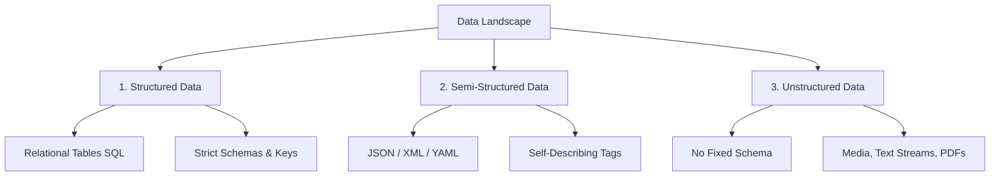

| Type | Meaning | Examples |
|---|---|---|
| Structured | Strict schema, rows & columns | SQL tables |
| Semi-Structured | Tags/markers, no rigid schema | JSON, XML, NoSQL docs |
| Unstructured | No predefined model | Video, audio, PDFs |

## 1.3 Data Lifecycle

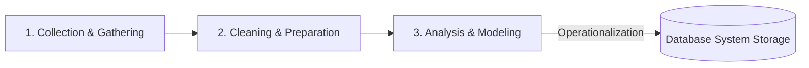
- **Collect:** capture raw signals (logs, sensors, forms).
- **Clean (ETL):** fix missing values, dedupe, validate types, reformat.
- **Analyze:** apply logic/statistics/indexing → actionable insights.

## 1.4 Data Storage Hierarchy

```
[ Database Volume ]
   └── [ Table Files / Extents ]
         └── [ Blocks / Pages ] (4KB–8KB units)
               └── [ Records / Rows ]
                     └── [ Fields / Attributes ]
                           └── [ Bytes / Bits ]
```
- **Logical organization** = user's conceptual view (tables, constraints, views).
- **Physical organization** = hardware-facing view (pages, sectors, indexes, buffers).

## 1.5 Why File Systems Failed (Pre-Database Problem)

1. **Redundancy & Inconsistency** — same data duplicated in many files; updates missed in some.
2. **Data/Structural Dependence** — file layout hardcoded into apps; any change breaks code.
3. **Poor Security** — OS gives only read/write/execute; no row/column-level control.
4. **No Concurrency / Atomicity** — simultaneous updates corrupt data; no logs to roll back crashes.

## 1.6 Database vs. DBMS — Three Pillars

- **Database** = passive collection of data/ indexes/ logs on disk.
- **DBMS** = the active software managing it (queries, security, I/O, recovery).

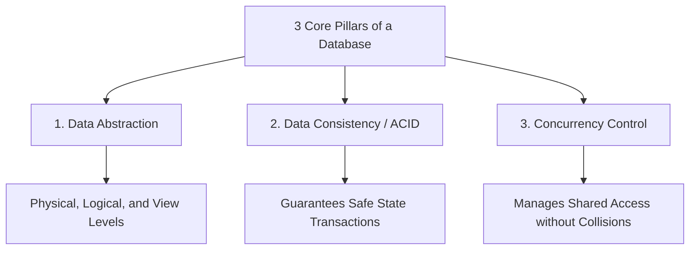

## 1.7 Evolution of Databases

| Era | Model | Key idea | Examples |
|---|---|---|---|
| 1960s | Hierarchical / Network | Rigid trees/graphs + physical pointers | IMS, IDS |
| 1970s–80s | **Relational (RDBMS)** | Tables + declarative **SQL** (E.F. Codd) | Oracle, DB2, PostgreSQL, MySQL |
| 2000s | NoSQL | Drop strict schema/ACID for scale + speed | MongoDB, Cassandra, Redis |
| 2010s+ | NewSQL / Distributed SQL | NoSQL scalability **+** ACID + SQL | Google Spanner, CockroachDB |

> 🔑 **Schema vs. State:** *Schema* = permanent logical design (DDL, rarely changes). *State/Instance* = actual data snapshot at a moment (DML, changes constantly).
>
> 🗣️ SQL won over navigational databases because it is **declarative** — you say *what* you want; the DBMS decides *how* to fetch it.

---

# 2. More about Databases

## 2.1 Database Categories

| Category | Profile | Examples |
|---|---|---|
| OLTP (Relational) | Short, high-concurrency ACID transactions | Banking, e-commerce checkout |
| NoSQL Document/KV | Schemaless, horizontal scale ingestion | Social feeds, session stores |
| OLAP / Columnar | Bulk analytics over billions of rows | BI dashboards, clickstream analytics |
| Time-Series / Graph | Specialized temporal / relationship data | IoT telemetry, social graphs |

## 2.2 Four Core Characteristics of the Database Approach

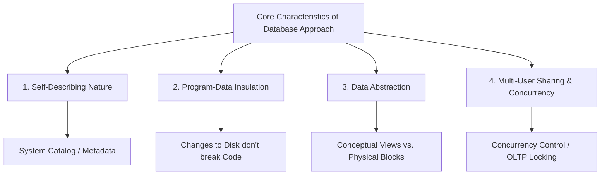

1. **Self-describing** — DB stores its own structure (metadata) in the **DBMS Catalog**, unlike file systems where layout is hardcoded.
2. **Program-data independence** — schema can evolve without breaking app code.
3. **Multiple views** — different users see different virtual subsets (**Views**).
4. **Multi-user sharing** — a **Transaction Processing Subsystem** enforces ACID under concurrency.

## 2.3 Database Actors

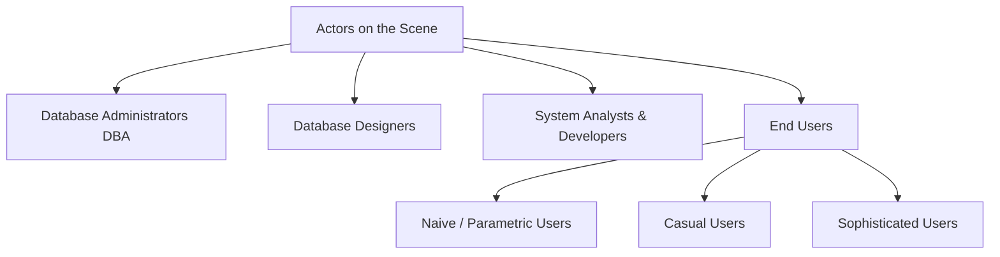

**On the scene:**
- **DBA** — privileges, performance tuning, backups, security.
- **Designers** — entities, relationships, constraints, ER diagrams.
- **Analysts / Programmers** — requirements specs / app code embedding SQL.
- **End Users:**
  - *Naive/Parametric* — use pre-built apps only (bank tellers, clerks).
  - *Casual* — occasional ad-hoc queries.
  - *Sophisticated* — write raw complex SQL/scripts (analysts, engineers).

**Behind the scene:** DBMS designers/implementers, tool developers, operators & maintenance staff.

## 2.4 Advantages of the DBMS Approach

| Advantage | One-line explanation |
|---|---|
| Controls redundancy | Centralized data; managed sync prevents anomalies |
| Restricts unauthorized access | RBAC/ABAC down to row/column level |
| Persistent storage for program objects | ORM maps objects ↔ disk |
| Efficient query structures | B+ Trees, LSM Trees, inverted indexes → minimal I/O |
| Backup & recovery | **Write-Ahead Log (WAL)** → rollback incomplete writes |
| Multiple user interfaces | SQL shells, GUI tools, ODBC/JDBC APIs, web forms |
| Complex relationships | Explicit FKs / graph edges |
| Integrity constraints | Key, referential (FK), domain, CHECK |
| Active rules (Triggers) | Auto-run logic on INSERT/UPDATE events |

> 🔑 **WAL rule:** logs are written to disk **before** the modified data pages — guarantees crash-safe recovery.
>
> 🔑 **FK DELETE options:** `RESTRICT/NO ACTION` (block) · `CASCADE` (delete children) · `SET NULL / SET DEFAULT` (keep children, null the FK).
>
> 🗣️ Naive users are high-risk → they're isolated behind parameterized apps & stored procedures, never given direct DB access.

---

# 3. Three-Schema Architecture & Database Languages

## 3.1 ANSI-SPARC Three-Schema Architecture

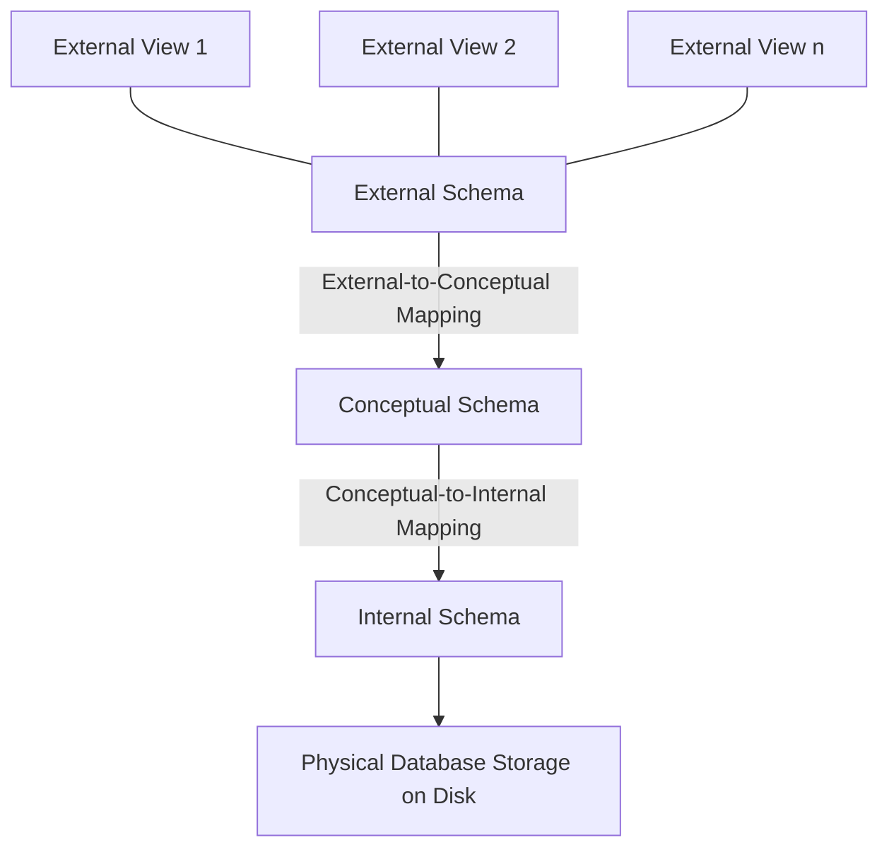

| Level | What it describes |
|---|---|
| **External (View)** | Individual user views / application subsets |
| **Conceptual (Logical)** | Global structure: entities, relationships, constraints, security |
| **Internal (Physical)** | On-disk reality: files, indexes, pages, compression |

## 3.2 Data Independence

| Type | Change allowed | Mapping used |
|---|---|---|
| **Logical** | Modify Conceptual schema (add column, split table) without breaking apps | External↔Conceptual |
| **Physical** | Modify Internal schema (new index, SSD, partitioning) without touching logic | Conceptual↔Internal |

> 🔑 Example: DBA splits a table → rewrites a view with a `JOIN` → apps see the same columns and never notice (**logical independence in action**).

## 3.3 Database Languages

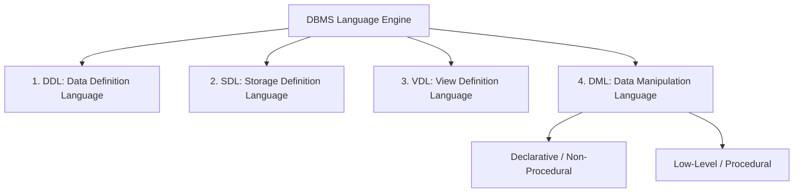

| Language | Purpose | Modern note |
|---|---|---|
| **DDL** | Define tables, domains, constraints | DDL compiler writes rules into the **System Catalog**; implicit commit |
| **SDL** | Internal/physical storage spec | Mostly obsolete; absorbed into DDL storage clauses |
| **VDL** | Define user views | Now part of DDL: `CREATE VIEW` |
| **DML** | Read/insert/update/delete data | High-level declarative (SQL) vs. low-level procedural |

```sql
-- DDL
CREATE TABLE accounts (
    account_id INT PRIMARY KEY,
    balance NUMERIC(12,2) CHECK (balance >= 0),
    created_at TIMESTAMP DEFAULT CURRENT_TIMESTAMP
);

-- VDL (View)
CREATE VIEW public_employee_directory AS
SELECT employee_id, first_name, department
FROM employees WHERE status = 'Active';

-- DML (declarative: say WHAT, not HOW)
```

**DML flavors:**
- **Non-procedural (SQL):** user states *what*; the **Query Optimizer** picks *how* (index stats, join orders, cost models).
- **QBE:** visual grid-based querying.
- **Procedural (low-level):** navigates record-by-record with loops/pointers — legacy style.

## 3.4 Host Language & Interfaces

- SQL is embedded in a **Host Language** (Java/C++/Python) via **JDBC/ODBC** drivers.
- **Interfaces:** Form-based (naive users) · GUI admin consoles (DBAs) · CLIs like `psql`/`mysql` (sophisticated users) · Programmatic APIs (apps).

> 🔑 **Execution paths:** DDL → DDL Compiler → updates **Catalog**. DML → DML Compiler + Query Optimizer → touches **user data files**.
>
> 🗣️ Optimizers beat manual loops because they cost-optimize hundreds of plans using live statistics.

---

# 4. Relations, Entities & ER Modeling

## 4.1 ER Model Building Blocks (Peter Chen, 1976)

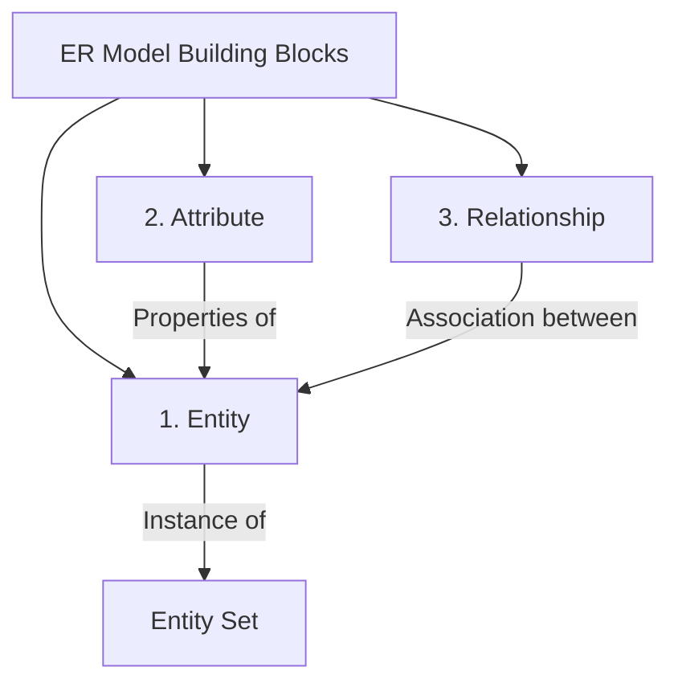

- **Entity:** distinguishable real-world object (employee) or concept (bank account).
- **Attribute:** property describing an entity (name, salary).
- **Relationship:** meaningful association (Employee *Works_For* Department).

## 4.2 ER Model in the Design Process

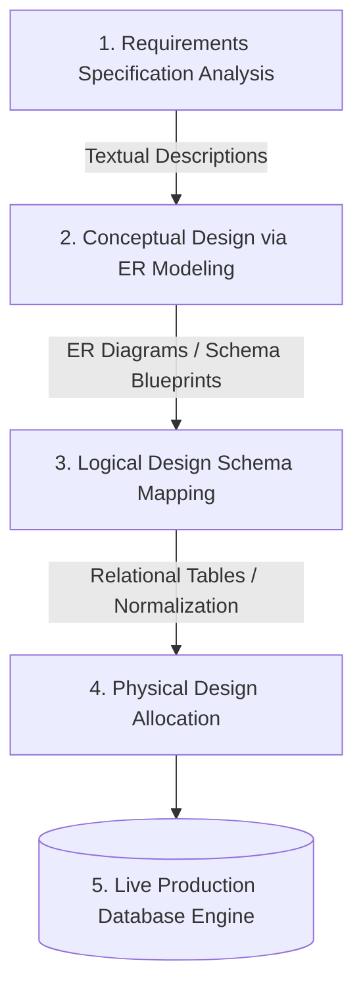

**Uses of ER diagrams:** communication with stakeholders · database blueprinting · direct schema generation.

## 4.3 Attribute Taxonomy

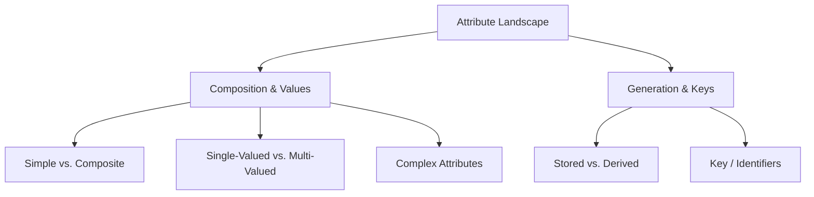

| Type | Meaning | Example |
|---|---|---|
| **Simple (atomic)** | Cannot be divided | `Salary`, `SSN` |
| **Composite** | Split into sub-attributes | `Name` → First/Middle/Last |
| **Single-valued** | One value per entity | `Date_of_Birth` |
| **Multi-valued** | Set of values per entity | `Phone_Numbers`, `College_Degrees` |
| **Stored** | Physically saved | `Birth_Date` |
| **Derived** | Computed at runtime from stored | `Age` (from `Birth_Date`) |
| **Complex** | Nested composite + multi-valued | Address list with multiple phones per address |
| **Key attribute** | Unique per instance | `Student_ID` (underlined in ERD) |

🔑 **Multi-valued attributes must be split into a separate child table** — e.g. `Employee_Phones(Emp_ID, Phone_Number)` with composite PK → satisfies **1NF**.

## 4.4 Chen Notation

| Symbol | Meaning |
|---|---|
| Rectangle | Strong entity |
| Double rectangle | Weak entity |
| Oval | Attribute |
| Underlined oval | Key attribute |
| Double oval | Multi-valued attribute |
| Dashed oval | Derived attribute |
| Diamond | Relationship |

## 4.5 Example ER Schema

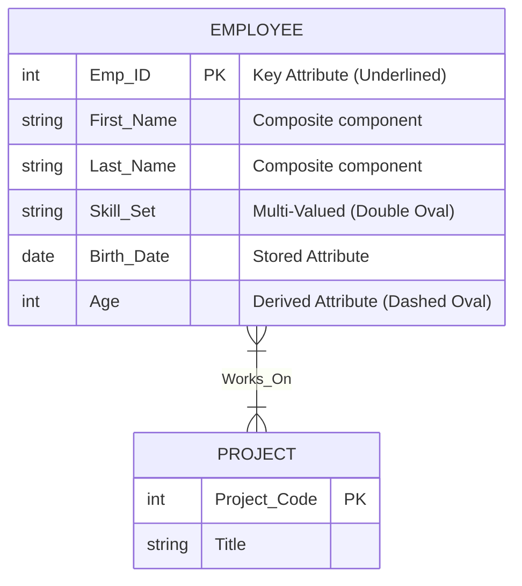

> 🔑 **Weak entity recap:** no key of its own → uses parent PK + **discriminator (partial key)**; joined by an **identifying relationship** (double diamond).
>
> 🗣️ Don't store derived attributes on disk (they go stale) — except in OLAP where results are **materialized** and refreshed by triggers.

---

# 5. Relationship Types, Constraints & ER Mapping

## 5.1 Formal Base

- **Entity set:** collection of similar entities.
- **Relationship set:** $R \subseteq E_1 \times E_2 \times \dots \times E_n$ (subset of Cartesian product).

## 5.2 Degree of a Relationship

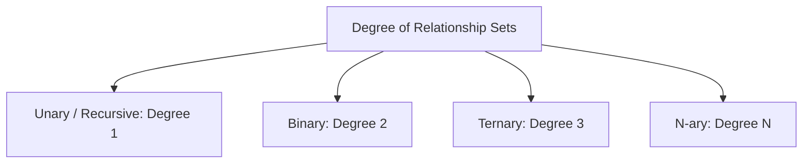

### Unary (recursive): R ⊆ E × E
Employee manages Employee (Supervisor/Supervisee roles). Mapped with a **self-referencing FK**:
```sql
CREATE TABLE Employee (
    employee_id INT PRIMARY KEY,
    first_name VARCHAR(50) NOT NULL,
    last_name VARCHAR(50) NOT NULL,
    supervisor_id INT,  -- self FK
    FOREIGN KEY (supervisor_id) REFERENCES Employee(employee_id)
        ON DELETE SET NULL
);
```

### Binary: R ⊆ E₁ × E₂ — most common (Student–Course, Customer–Order).

### Ternary: R ⊆ E₁ × E₂ × E₃ — **atomic 3-way association, NOT 3 binary relations!**
`Teaches(Instructor, Course, Semester)` — all three must coexist per tuple.
```sql
CREATE TABLE Teaches (
    instructor_id INT, course_id INT, semester_id INT,
    PRIMARY KEY (instructor_id, course_id, semester_id),
    FOREIGN KEY (instructor_id) REFERENCES Instructor(instructor_id),
    FOREIGN KEY (course_id) REFERENCES Course(course_id),
    FOREIGN KEY (semester_id) REFERENCES Semester(semester_id)
);
```

🔑 **Proof (lossy join):** with $R=\{(a_1,b_1,c_1),(a_1,b_2,c_2)\}$, projecting to 3 binary sets and re-joining produces spurious tuples like $(a_1,b_1,c_2)$ → $R' \neq R$. Binary decomposition is lossy.

### N-ary (N > 3) — reduce by introducing a **junction entity**.

## 5.3 Structural Constraints

```
| Mapping Cardinality (UPPER bound)  | Participation (LOWER bound)  |
| 1:1, 1:N, N:1, M:N                 | Total (1) vs Partial (0)     |
```

### Cardinality ratios
- **1:1** — Dept ↔ Dept_Head
- **1:N** — Dept employs Employees
- **N:1** — Student belongs to College
- **M:N** — Student enrolls in Course

### Participation
- **Total** (double line): every entity must participate (min = 1). Every Loan must belong to a Customer.
- **Partial** (single line): some may not (min = 0). Not every Customer has a Loan.

### (min, max) notation (Abrial)
Each entity tagged with ($min \ge 1$ = total, $max$ = cardinality):
```
Employee ──(1,1)══ Works_For ──(0,N)── Department
```

## 5.4 Strong vs. Weak Entities

| Strong | Weak |
|---|---|
| Has own primary key | No key; needs owner |
| Exists independently | Existence-dependent |
| Single rectangle | **Double rectangle** |
| Simple/composite key | PK = **Parent PK + Discriminator** (dashed underline) |

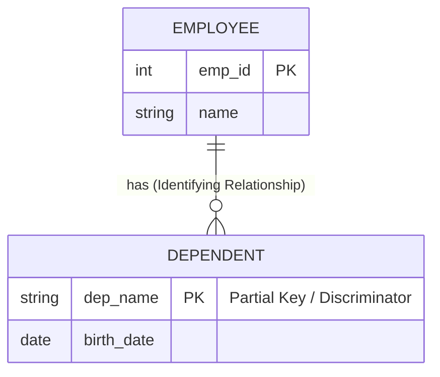
```sql
CREATE TABLE Dependent (
    emp_id INT,
    dep_name VARCHAR(50),
    birth_date DATE,
    relationship VARCHAR(30),
    PRIMARY KEY (emp_id, dep_name),
    FOREIGN KEY (emp_id) REFERENCES Employee(emp_id)
        ON DELETE CASCADE   -- delete dependents with parent
);
```
🔑 Weak entities **must** use `ON DELETE CASCADE` (orphans are meaningless).

## 5.5 ER → Relational Mapping Algorithm (7 Steps)

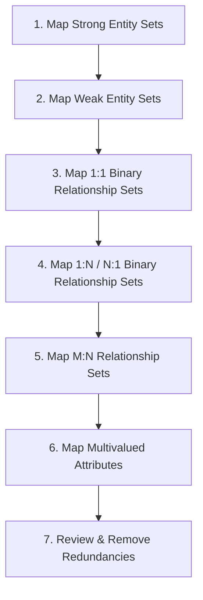

| Step | Rule |
|---|---|
| 1. Strong entity | One table with all simple attributes; pick PK |
| 2. Weak entity | Table = simple attrs + owner PK as FK; PK = owner PK + discriminator |
| 3. **1:1** | B total → put A's PK as NOT NULL FK in B · both total → **merge tables** · both partial → separate table |
| 4. **1:N** | Put primary-side PK as FK on the **N-side** (+ relationship attrs there). Never FK the 1-side (would need arrays → violates 1NF) |
| 5. **M:N** | New **junction table**: PKs of both as FKs; composite PK (A_PK, B_PK); add relationship attributes |
| 6. Multi-valued attr | New table: (owner PK, attribute); composite PK |
| 7. Review | Drop redundant 1:N relationship tables |

```sql
-- M:N junction example
CREATE TABLE Enrolls (
    student_id INT, course_id INT,
    enrollment_date DATE, grade VARCHAR(2),
    PRIMARY KEY (student_id, course_id),
    FOREIGN KEY (student_id) REFERENCES Student(student_id),
    FOREIGN KEY (course_id) REFERENCES Course(course_id)
);
```

## 5.6 Advanced Abstractions

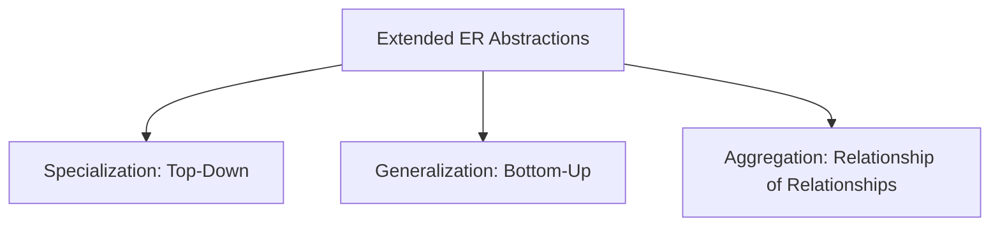

- **Specialization (top-down):** EMPLOYEE → ENGINEER / SECRETARY / MANAGER. Subclasses **inherit** superclass attributes + add local ones.
- **Generalization (bottom-up):** Car + Truck → Vehicle.

**Hierarchy constraints:**
- **Disjoint** (one subclass max) vs. **Overlapping** (multiple allowed)
- **Total** (must belong to ≥ 1 subclass) vs. **Partial** (optional)

**Inheritance → SQL strategies:**
1. Superclass + subclass tables (normalized; PK/FK shared).
2. Subclass tables only (repeat superclass attrs).
3. Single table with `type` discriminator + nullable columns (fastest reads).

- **Aggregation:** when a **relationship itself** must participate in another relationship. `Works_On(Employee, Project)` is wrapped as one entity, then relations with `Job_Role` via `Uses`.

```sql
CREATE TABLE Uses (
    emp_id INT, project_id INT, role_id INT,
    PRIMARY KEY (emp_id, project_id, role_id),
    FOREIGN KEY (emp_id, project_id) REFERENCES Works_On(emp_id, project_id),
    FOREIGN KEY (role_id) REFERENCES Job_Role(role_id)
);
```

> 🎯 **N-ary vs Aggregation:** N-ary when N entities act in **one atomic event**; Aggregation when an existing relationship later needs further relationships.
>
> 🔑 Foreign key goes on the **MANY side** in 1:N; M:N always needs a standalone junction table.

---

# 6. The Relational Model

## 6.1 Historical Context (Codd, 1970)

Legacy models (Hierarchical = tree, Network = graph) used **physical pointers** → structural dependency, navigational code, M:N pain.

**Codd:** *"A Relational Model of Data for Large Shared Data Banks"* (CACM, June 1970) — applied **Set Theory + Predicate Logic**: data = tables (relations), accessed declaratively.

## 6.2 What is the Relational Model?

All data (entities **and** relationships) stored as 2-D **Relations (tables)**.

```
Relation Schema: STUDENT
  student_id  │  first_name  │  gpa
  ────────────┼──────────────┼──────
      101     │    Alice     │  3.8
      102     │    Bob       │  3.5
```

**Formal:** Schema $R = (A_1:D_1, \dots, A_n:D_n)$; Instance $r(R) \subseteq D_1 \times \dots \times D_n$ (subset of Cartesian product); each element = an **n-tuple (row)**.

## 6.3 Terminology Mapping (memorize!)

| Formal (Codd) | SQL term | File term |
|---|---|---|
| Relation | Table | File |
| Tuple | Row | Record |
| Attribute | Column | Field |
| Domain | Data type | Permissible set |
| **Degree** | # Columns | Field count |
| **Cardinality** | # Rows | Record count |
| Intension (Schema) | Table definition | File structure |
| Extension (Instance) | Table data | File contents |

## 6.4 Key Features

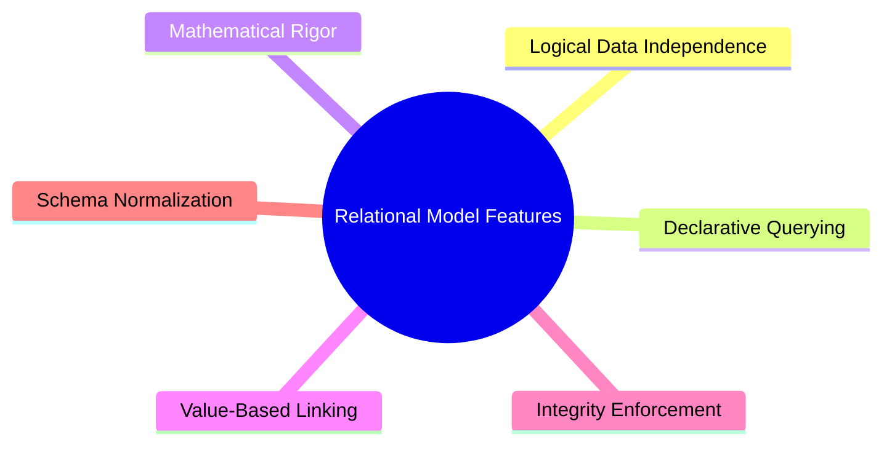

1. **Logical data independence** — storage changes don't break apps.
2. **Value-based linking (no pointers!)** — FK matches PK by *value*; storage can move freely.
3. **Declarative processing** — WHAT not HOW.
4. **Mathematical grounding** — Relational Algebra/Calculus → predictable results.
5. **Atomic domains only** — no multivalued/nested attributes (1NF).
6. **Uniform simplicity** — entities, relationships, even the **system catalog are all tables**.

## 6.5 Keys & Referential Integrity

```
Super Key      → any unique attribute set
Candidate Key  → minimal super key
Primary Key    → chosen candidate key
Foreign Key    → attribute set in R2 matching a candidate key in R1
```

**Referential Integrity:** every FK value is either **NULL** or an existing PK value in the referenced table.

```sql
CREATE TABLE Employee (
    emp_id INT PRIMARY KEY,
    emp_name VARCHAR(50) NOT NULL,
    dept_id INT,
    CONSTRAINT fk_emp_dept FOREIGN KEY (dept_id)
        REFERENCES Department(dept_id)
        ON DELETE SET NULL
        ON UPDATE CASCADE
);
```

## 6.6 Normalization & Anomalies

Un-normalized flat table `Emp_Dept_Bad(emp_id, emp_name, dept_id, dept_name, dept_location)` → 3 anomalies:
- **Insertion:** can't add a new department until it has an employee.
- **Deletion:** deleting the last employee of D02 loses all knowledge of that department.
- **Update:** department moves → must update EVERY employee row; missing one = inconsistency.

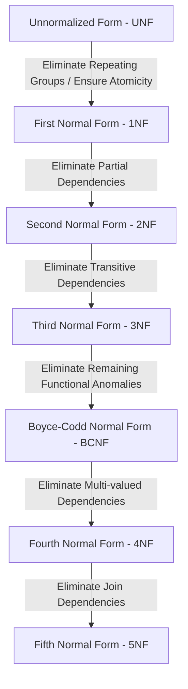

| NF | Rule |
|---|---|
| **1NF** | Atomic values, no repeating groups |
| **2NF** | 1NF + no **partial dependency** (non-prime attr depends on part of a candidate key) |
| **3NF** | 2NF + no **transitive dependency** ($X \to A$: X is super key or A is prime) |
| **BCNF** | 3NF + every determinant $X$ must be a **super key** |

🔑 Splitting example: `R(Student_ID, Course_ID, Instructor_Name, Instructor_Office)` with partial deps → decompose to 3 tables; office update then changes **1 row**, not 6.

## 6.7 Declarative Query Processing

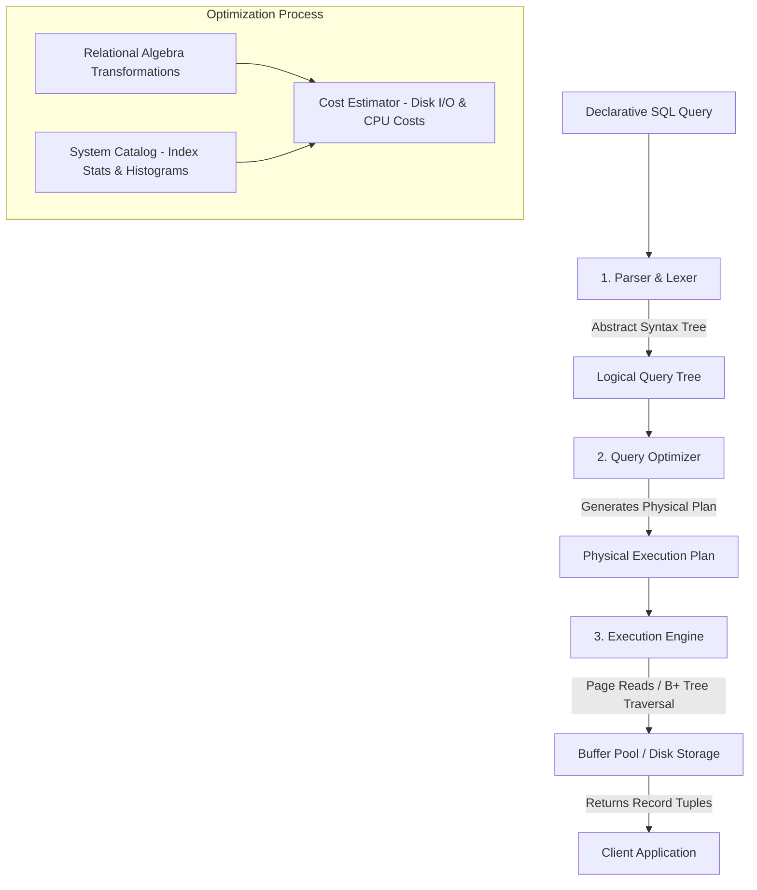

Steps: Parse → Logical plan (relational algebra; push filters early) → Physical plan (nested-loop vs hash vs sort-merge join) → Execute via buffer pool.

## 6.8 Model Comparison

| Dimension | Hierarchical | Network | Relational |
|---|---|---|---|
| Structure | Tree | Graph | Tables (sets) |
| Linkage | Physical pointers | Physical pointers | **Value-based keys** |
| Query style | Navigational | Navigational | **Declarative** |
| Data independence | Low | Low | **High** |
| Redundancy | Poor | Moderate | **High control** (normalization) |

> 🗣️ SQL ≠ pure relational theory: SQL allows duplicate rows (multiset/"bag"), NULL (3-valued logic), and ordered columns.

---

# 7. Relational Schema — Formal Concepts

## 7.1 Domain & NULL

- **Domain:** set of atomic values, e.g. `Age = {x ∈ ℕ | 0 ≤ x ≤ 120}`.
- **NULL:** *unknown / missing / inapplicable* — not 0, not `""`; belongs to every domain unless `NOT NULL`.

## 7.2 Relation Schema (Intension) vs. Relation Instance (Extension)

**Schema** $R(A_1:D_1,\dots,A_n:D_n)$ — static blueprint, changed only via **DDL**.
**Instance** $r(R)$ — dynamic set of tuples at time *t*, changed via **DML**.

```
INTENSION (CREATE TABLE)              EXTENSION (rows at time t)
CREATE TABLE Student (                101 │ Alice   │ 3.9
  student_id INT PRIMARY KEY,         102 │ Bob     │ 3.5
  name VARCHAR(50),                   103 │ Charlie │ 3.7
  gpa FLOAT );
```

| Dimension | Schema | Instance |
|---|---|---|
| Behavior | Static (DDL, rare) | Dynamic (DML, constant) |
| Analogy | Class declaration | Object in memory |
| Determines | **Degree** (# columns) | **Cardinality** (# rows) |

## 7.3 Formal Properties of a Relation Instance

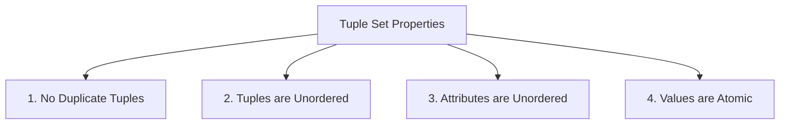
Because $r(R)$ is a mathematical **set**: no duplicates, row order irrelevant, attribute access is by name not position, values atomic.

## 7.4 Database Schema & Instance

- **Database Schema** $\mathcal{S} = (\{R_1, \dots, R_m\}, \mathcal{IC})$ — set of relation schemas + global **integrity constraints**.
- **Database Instance** $\mathcal{db} = \{r_1, \dots, r_m\}$ — one instance per schema; **valid** iff all constraints hold.

```mermaid
graph TD
    subgraph Relational Database Schema S
        S1[R1: STUDENT Schema]
        S2[R2: COURSE Schema]
        S3[R3: ENROLLMENT Schema]

        S3 -->|FK: student_id| S1
        S3 -->|FK: course_id| S2
    end

    subgraph Integrity Constraints IC
        IC1[Primary Key Rules]
        IC2[Foreign Key Rules]
        IC3[Check Constraints]
    end

    Relational Database Schema S --> Integrity Constraints IC
```

## 7.5 Key Hierarchy

```
Super Key (SK) — any unique combination
   ▼
Candidate Key (CK) — minimal SK (irreducible)
   ├──► Primary Key (PK) — chosen CK
   └──► Alternate Key (AK) — unchosen CKs
```

## 7.6 Integrity Constraint Types

1. **Domain:** $t[A_i] \in dom(A_i) \cup \{NULL\}$
2. **Entity Integrity:** **PK can never be NULL**.
3. **Referential Integrity:** FK is NULL **or** matches an existing PK.
4. **User-defined:** `CHECK (salary > 0)`, triggers.

## 7.7 Other Schema Components

- **View:** virtual table from a stored query → gives **logical data independence**.
```sql
CREATE VIEW HighGPAStudents AS
SELECT student_id, name, gpa FROM Student WHERE gpa >= 3.8;
```
- **Data Dictionary / System Catalog:** metadata (schemas, keys, privileges) stored in *queryable relational tables* (`information_schema.tables`).

## 7.8 Complete SQL Example

```sql
CREATE TABLE Department (
    dept_id INT NOT NULL,
    dept_name VARCHAR(100) NOT NULL,
    budget DECIMAL(12,2) DEFAULT 0.00,
    CONSTRAINT pk_department PRIMARY KEY (dept_id),
    CONSTRAINT unq_dept_name UNIQUE (dept_name),
    CONSTRAINT chk_budget CHECK (budget >= 0.00)
);

CREATE TABLE Employee (
    emp_id INT NOT NULL,
    first_name VARCHAR(50) NOT NULL,
    last_name VARCHAR(50) NOT NULL,
    salary DECIMAL(10,2) NOT NULL,
    dept_id INT,
    CONSTRAINT pk_employee PRIMARY KEY (emp_id),
    CONSTRAINT chk_salary CHECK (salary >= 30000.00),
    CONSTRAINT fk_emp_dept FOREIGN KEY (dept_id)
        REFERENCES Department(dept_id)
        ON DELETE SET NULL
        ON UPDATE CASCADE
);
```

> 🎯 **Super key count:** candidate key of $k$ attributes in an $n$-attribute schema → $2^{n-k}$ super keys.
>
> 🔑 `ON DELETE/UPDATE` actions: **CASCADE** · **SET NULL** · **RESTRICT/NO ACTION** · **SET DEFAULT**.
>
> 🗣️ SQL allows duplicate rows because uniqueness checks are costly; pure set semantics are enforced manually via `PRIMARY KEY`/`UNIQUE`/`DISTINCT`.

---

# 8. MySQL & MariaDB

## 8.1 What is MySQL?

Open-source **RDBMS** built on SQL; data in tables with PK/FK constraints.

```
Client Application ──SQL──► MySQL/MariaDB
  ┌────────────────────────────────────────────┐
  │ SQL Parser & Optimizer                     │
  │        ▼ Pluggable Storage Engine API      │
  │ [InnoDB] [Aria/MyISAM] [ColumnStore] [Memory] [CSV] │
  └────────────────────────────────────────────┘
```

**History:**
- **1995** — MySQL AB (Michael "Monty" Widenius, David Axmark, Allan Larsson); named after Monty's daughter *My*.
- **2008** — Sun Microsystems buys MySQL AB ($1B).
- **2010** — Oracle buys Sun → MySQL under Oracle.
- **Licensing:** dual model — Community Server (free, GPL v2) + Enterprise (paid, extra security/monitoring).
- **Releases:** **LTS** (8 yrs support, e.g. 8.4 LTS) + quarterly **Innovation** releases.

## 8.2 What is MariaDB?

Fork created **2009** by Monty Widenius (named after his younger daughter *Maria*) after the Oracle acquisition — a fully open-source GPL v2 alternative. Governed by the MariaDB Foundation (+ MariaDB plc).

| Feature | MySQL | MariaDB |
|---|---|---|
| Main engine | InnoDB (Oracle-enhanced) | InnoDB + **Aria** (crash-safe MyISAM) |
| Analytics | HeatWave (commercial cloud) | **ColumnStore** (open source) |
| Replication | Group Replication, InnoDB Cluster | **Galera Cluster**, multi-source |
| JSON | Binary native JSON type | Text-based JSON + path functions |
| Licensing | GPL v2 + proprietary Enterprise | Strictly GPL v2 |

## 8.3 Client-Server Architecture

```
[ Clients ] ──TCP/IP (port 3306) / socket──► [ Network Listener ]
            → Thread Pool/Handshake → Parser & Lexer (AST)
            → Optimizer (cost model) → Execution Engine
            → Pluggable Engine API → [InnoDB / Aria]
```
- Daemon: `mysqld` / `mariadbd`; connection manager authenticates + handles TLS.
- Drivers: `libmysqlclient`, JDBC, ODBC, Python `mysql-connector`.

## 8.4 ACID via InnoDB

| Property | Mechanism |
|---|---|
| **A**tomicity | **Undo logs** (rollback) |
| **C**onsistency | FK/unique/CHECK + **Doublewrite Buffer** (no partial pages) |
| **I**solation | **MVCC** + row locks (Read Committed / Repeatable Read / Serializable) |
| **D**urability | **Redo logs** (`ib_logfile`) + flush policy (`innodb_flush_log_at_trx_commit=1`) |

## 8.5 Pluggable Storage Engines

Engine chosen per table: `CREATE TABLE ... ENGINE = InnoDB;`

```mermaid
graph TD
    Engines[Pluggable Storage Engines] --> InnoDB[InnoDB: Transactional OLTP]
    Engines --> Aria[Aria / MyISAM: Non-Transactional / Fast Read]
    Engines --> Memory[Memory / Heap: In-RAM Execution]
    Engines --> ColumnStore[ColumnStore: Columnar Analytics]
    Engines --> CSV[CSV: Flat File Format]
```

| Engine | Use |
|---|---|
| **InnoDB** (default) | Transactions, row locks, MVCC, FKs, crash recovery |
| **Aria/MyISAM** | Read-heavy, table locks (Aria = crash-safe) |
| **Memory** | In-RAM hash tables; lost on restart |
| **ColumnStore** | OLAP analytics |
| **CSV** | Plain-text data exchange |

## 8.6 Data Types & Limits (key facts)

- Numeric: `TINYINT…BIGINT`, `DECIMAL` (exact — financial data), `FLOAT/DOUBLE`.
- Strings: `VARCHAR` (max row 65,535 bytes shared), `CHAR`, `TEXT`, `BLOB`.
- Date/Time: `DATE`, `TIME`, `DATETIME`, `TIMESTAMP` (UTC, Unix epoch), `YEAR`.
- Also: `JSON`, `VECTOR` (AI embeddings), Spatial (`POINT`, `POLYGON`, R-Tree indexes).

| Limit | Value |
|---|---|
| Max table size (InnoDB) | **64 TB** |
| Max row size | 65,535 bytes |
| Max columns (InnoDB) | 1,017 |
| Index columns | 16 per composite index |

## 8.7 Security Hardening Script

Run `mysql_secure_installation` / `mariadb-secure-installation` after install:

```mermaid
sequenceDiagram
    autonumber
    actor Admin
    participant Script as Installation Script
    participant DB as MySQL/MariaDB Core

    Admin->>Script: Execute secure installation script
    Script->>DB: 1. Set / Validate Root Password
    Script->>DB: 2. Remove Anonymous Users
    Script->>DB: 3. Disallow Remote Root Login
    Script->>DB: 4. Remove Test Database
    Script->>DB: 5. Reload Privilege Tables (FLUSH PRIVILEGES)
```

1. Set strong root password (auth plugin).
2. Drop anonymous accounts (`User=''`).
3. Root restricted to `localhost` only.
4. Drop `test` DB + wildcard grants.
5. `FLUSH PRIVILEGES` to reload grant tables.

---

# 9. Transaction Management & Concurrency Control

## 9.1 What is a Transaction?

> A **logical unit of work**: a set of operations that must execute **completely or not at all** (rollback restores the exact pre-transaction state).

```mermaid
graph LR
    Start([Transaction Start]) --> Read[Read Data from Disk to RAM]
    Read --> Modify[Modify Data in RAM Buffer]
    Modify --> Decision{Success or Failure?}
    Decision -->|Success| Commit[COMMIT: Persist Changes to Disk]
    Decision -->|Failure| Rollback[ROLLBACK: Undo Changes to Memory]
    Commit --> Done([Database Consistent])
    Rollback --> Done
```

- **R(X):** read item X from disk → RAM. **W(X):** write updated value back.
- **COMMIT:** flush log to disk, release locks, make permanent. **ROLLBACK:** undo everything.
- 🏧 *ATM metaphor:* debit step succeeded but cash not dispensed → system must automatically roll back the debit.

🏦 **Transfer example:** Transfer ₹50 from A(500) to B(800):
```
R(A)=500 → A=A-50 → W(A)=450 → R(B)=800 → B=B+50 → W(B)=850 → COMMIT
Invariant: 450+850 = 1300 = 500+800 ✔ (crash between W(A) and W(B) must be recovered)
```

## 9.2 Transaction States

```mermaid
stateDiagram-v2
    [*] --> Active
    Active --> Partially_Committed: All Read/Write Finished
    Active --> Failed: Hardware/Software Error or Abort
    Partially_Committed --> Committed: Data Flushed & Log Persisted
    Partially_Committed --> Failed: Checks Fail or Crash on Buffer Flush
    Failed --> Aborted: Database Rolled Back (Undo Logs)
    Aborted --> [*]: Transaction Terminated (Killed or Restarted)
    Committed --> [*]: Changes Permanent (Durability Guaranteed)
```

| State | Meaning |
|---|---|
| **Active** | Executing in RAM buffers; not yet durable |
| **Partially Committed** | Final statement done; logs flushing |
| **Committed** | Commit record + changes persisted; irreversible |
| **Failed** | Internal error or crash halts execution |
| **Aborted** | Undo complete → then **Kill** (bad logic) or **Restart** (transient failure like deadlock) |

## 9.3 ACID Properties

| Property | Guarantee | Enforced by |
|---|---|---|
| **Atomicity** | All-or-nothing | Undo logs |
| **Consistency** | Valid state → valid state (constraints hold) | FK/PK/CHECK/domain, triggers |
| **Isolation** | Concurrent result = serial result | Locks / MVCC |
| **Durability** | Committed changes survive crashes | Redo logs (WAL) |

- Consistency example: `CHECK (balance >= 0)` blocks an over-withdrawal; transaction aborts.
- Isolation example: T₁ summing balances never sees money that left A but hasn't reached B.

## 9.4 Crash Recovery

### Write-Ahead Logging (WAL) — industry standard
**Golden rule:**
1. **Undo** log record hits disk **before** the dirty data page is written (→ Atomicity).
2. **Redo** log records hit disk **before** a transaction may commit (→ Durability).

```
Log record: <Transaction_ID, Data_Item, Old_Value, New_Value>
                              │                └── Redo (after-image)
                              └── Undo (before-image)
```

Trace for Balance 500 → 450:
```
<T1, Start> → <T1, Balance, 500, 450> → RAM update
  Crash before commit? → no <T1, Commit> in log → UNDO to 500  (Atomicity)
  Commit: <T1, Commit>, then crash before page flush?
          → <T1, Commit> found on disk → REDO 450 to disk     (Durability)
```

### ARIES Protocol (3 phases)
```
◄── UNDO (scan backward) ──┤ CRASH ├── ANALYSIS → REDO (forward) ──►
```
1. **Analysis** (forward): find dirty pages + active transactions from last checkpoint.
2. **Redo** ("repeat history", forward): replay ALL logged ops to restore crash state.
3. **Undo** (backward): roll back losers (uncommitted transactions).

### Checkpoints
Periodically flush all dirty buffer pages + write `<CHECKPOINT>`. Recovery starts from the **last checkpoint** only → bounded, fast recovery.

```
<T1,Start> <T1,Commit> <T2,Start> <CHECKPOINT> <T3,Start> <T2,Write> [CRASH]
T1 → no action (seen by checkpoint, committed)
T2, T3 → UNDO (active at crash, no commit)
```

### Shadow Paging (alternative)
Copy-on-write page directories:
- Writes go to **new pages**; a **Current directory** points to them, the **Shadow directory** stays on the originals.
- **Abort** → discard current directory (instant, no undo). **Commit** → atomically swap master pointer.

| Dimension | WAL | Shadow Paging |
|---|---|---|
| Mechanism | Sequential log append | Copy-on-write directories |
| Commit overhead | Low (small sequential log flush) | High (flush data blocks + directory) |
| Fragmentation | None (sequential) | Severe (non-contiguous blocks) |
| Recovery | Redo forward + undo backward | Instant (discard pointer) |
| Adoption | PostgreSQL, MySQL InnoDB, Oracle, SQLite WAL | CouchDB, SQLite rollback journal |

## 9.5 Concurrency Anomalies (the Big Four)

| Anomaly | Definition | T1 | T2 |
|---|---|---|---|
| **Dirty Read** | Read another tx's **uncommitted** data, which then rolls back | `UPDATE X=200` (no commit) | reads 200 ❌ |
| **Lost Update** | Two read same value; second write blindly overwrites first | reads 10, writes 8 | reads 10, writes 7 → should be 5! |
| **Unrepeatable Read** | Re-read of a **row** differs (T2 updated/committed between) | reads 500 … reads 200 ❌ | UPDATE 200, commit |
| **Phantom Read** | Re-run of a **predicate/range query** returns new rows | `COUNT(dept=10)` = 2 … = 3 ❌ | INSERT new row in dept 10 |

Key difference: **Unrepeatable read = same row changes; Phantom read = new/removed rows matching a predicate.**

### SQL Isolation Levels Matrix

| Level | Dirty Read | Non-Repeatable | Phantom | Lost Update |
|---|:---:|:---:|:---:|---|
| Read Uncommitted | ✅ Allowed | ✅ Allowed | ✅ Allowed | prevented (write locks) |
| Read Committed | 🚫 Prevented | ✅ Allowed | ✅ Allowed | prevented |
| Repeatable Read | 🚫 | 🚫 | ✅ Allowed *(MySQL InnoDB blocks it via Next-Key locks)* | prevented |
| Serializable | 🚫 | 🚫 | 🚫 | prevented |

## 9.6 Concurrency Control Protocols

### Two-Phase Locking (2PL)
- **S-lock** (read): many holders ok. **X-lock** (write): exclusive; others wait.
- Compatibility: S-S ✓ · S-X ✗ · X-S ✗ · X-X ✗.

**Rule:** (1) **Growing** phase — acquire locks only; (2) once the **first lock is released** → **Shrinking** phase — release only, never acquire again.
→ Guarantees **Conflict Serializability**. Weaknesses: deadlocks + cascading aborts.

```
Locks: grows ↑        lock point (peak)        shrinks ↓ over time
```

**Variants:**
- **Strict 2PL:** X-locks held until commit/abort → no cascading rollbacks (most commercial systems).
- **Rigorous 2PL:** ALL locks held until commit → strict serializability.
- **Conservative 2PL:** acquire everything upfront → **deadlock-free** (but needs to know all items in advance).

### Timestamp Ordering (T/O)
Each item keeps `W-TS(X)` and `R-TS(X)`. Transaction $T_i$ ($TS(T_i)$):
- **Read(X):** if $TS(T_i) < W\text{-}TS(X)$ → too late, older write exists → **ABORT & restart**. Else execute; set $R\text{-}TS(X)=\max(\cdot)$.
- **Write(X):** if $TS(T_i) < R\text{-}TS(X)$ or $TS(T_i) < W\text{-}TS(X)$ → **ABORT** (or ignore via *Thomas' Write Rule*). Else execute; set $W\text{-}TS(X)=TS(T_i)$.

✔ **Deadlock-free** (no waiting) ✗ high abort rate under write contention.

### MVCC
> "Readers never block Writers; Writers never block Readers."

Each write creates a **new versioned tuple**; readers get the snapshot active at their start timestamp.

```
X history: v1=$100@TS10, v2=$200@TS20, v3=$250@TS35
Reader starting at TS=15 → sees v1 ($100) only.
```
- PostgreSQL = Vacuum, MySQL InnoDB = Purge threads, GC old versions.
- Versions stored via undo segments.

### Protocol Comparison

| Dimension | 2PL | T/O | MVCC |
|---|---|---|---|
| Approach | Pessimistic locking | Timestamp sequencing | Snapshot/versioning |
| Deadlocks | **Yes** | **No** | No (readers); rare (writers) |
| Reader↔Writer | Block each other | Conflicts abort instantly | **Zero blocking** |
| Use case | Low-contention writes (banking) | Distributed high-throughput | Modern mixed workloads (MySQL, Postgres, Oracle) |

> 🎯 Log-analysis answers: committed before checkpoint → nothing to do; active at crash without commit record → **UNDO**.

---

# 10. Current Trends in Databases

## 10.1 Evolution: Monolithic → Cloud-Native

**Monolithic on-premises:** DB + RAM + disks all coupled on owned servers. Vertical scale-up only.
Pain: high CapEx · no elasticity · heavy manual DBA ops · hardware ceilings.

## 10.2 Cloud-Native & Autonomous Databases

```mermaid
graph TD
    CloudDB[Modern Database Evolution]
    CloudDB --> CloudNative[Cloud-Native Architecture]
    CloudDB --> Autonomous[Autonomous Capabilities]

    CloudNative --> Decoupled[Decoupled Compute & Storage]
    CloudNative --> Serverless[Serverless Elasticity]
    CloudNative --> Kubernetes[Container Native Orchestration]

    Autonomous --> SelfDrive[Self-Driving: AI Indexing & Query Tuning]
    Autonomous --> SelfSecure[Self-Securing: Zero-Downtime Patching]
    Autonomous --> SelfRepair[Self-Repairing: Automatic Failover]
```

- **Decoupled compute & storage:** stateless compute nodes scale independently over shared storage (Snowflake over S3; Aurora replicates 6-way across 3 AZs).
- **Serverless elasticity:** scale-to-zero when idle (Aurora Serverless, CockroachDB Serverless); Kubernetes-native operators for auto-healing.
- **Autonomous DB pillars:**
  - **Self-Driving** — ML tunes indexes/buffers (Oracle Autonomous DB).
  - **Self-Securing** — zero-downtime auto patching + encryption.
  - **Self-Repairing** — predictive failover to replicas (99.995–99.999%, Google Spanner).

## 10.3 Multi-Model Databases

One engine natively stores & queries **several models** — replaces brittle "polyglot persistence" ETL sync:

```mermaid
graph TD
    MMD[(Multi-Model Database Engine)]
    MMD --> Rel[Relational Tables: SQL Rows & Columns]
    MMD --> Doc[Document Store: JSON / BSON]
    MMD --> Grph[Graph Store: Nodes, Edges, Properties]
    MMD --> Vec[Vector Embeddings: High-dimensional AI vectors]
    MMD --> KV[Key-Value Store: Fast Hash Lookups]
```
Cross-model joins in one query + unified ACID/security. Examples: PostgreSQL (JSONB + PostGIS + pgvector + Apache AGE), ArangoDB, Azure Cosmos DB.

## 10.4 Vector Databases & Generative AI

- **Embeddings:** ML models convert unstructured data → high-dimensional float vectors (e.g., 1536-d); similar meaning = nearby vectors (**semantic search**, not keyword match).

```
"Network connection lost"  ──[Embedding Model]──► [ -0.021, 0.432, ..., 0.129 ]
"Wi-Fi routing problem"    ──[Embedding Model]──► [ -0.019, 0.428, ..., 0.134 ]  (~similar!)
```

- **ANN indexes** (brute-force KNN is $O(n \cdot d)$, too slow):
  - **HNSW:** multi-layer proximity graph → ~$O(\log n)$.
  - **IVF:** k-means Voronoi cells; search only nearest centroids.
- **Distance metrics:** Cosine similarity (angle/semantics) · Euclidean $L_2$ · Dot product.
- **RAG pipeline (LLM long-term memory):**

```
User query → Embedding model → Vector DB (ANN over company docs)
  → retrieved context appended to prompt → LLM answers grounded in real data
```
Platforms: Pinecone, Milvus, Qdrant, Weaviate, Chroma; extensions: pgvector, Redis vector search.

## 10.5 HTAP (Hybrid Transactional / Analytical Processing)

- Legacy: **OLTP** (row-store, fast writes) vs. **OLAP** (columnar, analytics) split by overnight ETL.
- **HTAP:** both workloads, same DB, real-time data, **no ETL**.

```
        [ HTAP Engine ]
         ├── Row-Store  → OLTP writes   ([ID, Name, Bal] whole records)
         └── Column-Store → OLAP scans  (ID:[1,2,3..] Bal:[100,200..] — scan one column fast)
```
Real uses: instant fraud checks, dynamic surge pricing. Platforms: TiDB (TiKV+TiFlash), SingleStore, SAP HANA, Oracle HeatWave.

## 10.6 DBaaS (Database as a Service)

Cloud-managed DBs: automated provisioning, multi-AZ failover, **PITR** (point-in-time recovery from logs — restores to any millisecond, e.g. pre-`DROP TABLE`), zero-downtime patching, scale-to-zero.
- Relational: Amazon RDS, Cloud SQL, Azure SQL, Neon. NoSQL: MongoDB Atlas, Supabase, Firebase.

## 10.7 Parallel Database Architectures

| Architecture | Structure | Bottleneck | Example |
|---|---|---|---|
| **Shared-Memory** | All CPUs share RAM + disks via one bus | Memory bus → ≤32–64 CPUs | SMP servers |
| **Shared-Disk** | Private CPU+RAM per node; shared SAN | SAN I/O | Oracle RAC, Db2 pureScale |
| **Shared-Nothing** | Fully independent nodes, own CPU+RAM+disk, data **sharded**, talk via network | Network "data shuffling" | Teradata, Redshift, ClickHouse |

```
Shared-Memory: CPUs ─┬─ shared bus ─ RAM ─ disks
Shared-Disk:   [CPU+RAM]… ─ SAN ─ central disk array
Shared-Nothing:[CPU+RAM+Disk] × N ─ network interconnect
```

| Metric | Shared-Memory | Shared-Disk | Shared-Nothing |
|---|:---:|:---:|:---:|
| Cost | High | High | **Low** (commodity) |
| Scalability | Poor | Moderate | **Linear (thousands of nodes)** |
| Fault tolerance | Low | High | High |
| Best for | Traditional OLTP | HA OLTP | MPP OLAP |

## 10.8 Spatial Databases

- Primitives: `Point`, `LineString`, `Polygon`, `MultiPolygon` (in a CRS).
- Why not B-Tree? 2D/3D data has **no natural ordering** → need special indexes:
  - **R-Tree:** hierarchical **Minimum Bounding Boxes (MBR)**; prune space quickly.
  - **Quadtree:** recursive 4-way subdivision (NW/NE/SW/SE).
- Operators: `ST_Contains(A,B)`, `ST_Intersects(A,B)`, `ST_Distance(A,B)`.
- Engines: **PostGIS**, Oracle Spatial, MySQL Spatial, SpatiaLite.

## 10.9 Distributed Databases & Consensus

- **Sharding:** Horizontal (rows by partition key) · Vertical (columns by access pattern).
- **Replication:** copies across AZs for fault tolerance.
- **Location transparency:** client SQL never mentions physical nodes.
- **2PC:** Phase 1 *Prepare* (all nodes vote READY/ABORT) → Phase 2 *Commit/Rollback* broadcast. Atomic across nodes.
- **Paxos / Raft:** quorum-majority consensus used by Spanner, CockroachDB, YugabyteDB to survive minority failures.

## 10.10 DWDM (Data Warehousing & Mining)

```mermaid
graph LR
    subgraph Data Sources
    OLTP[Transactional Databases]
    CRM[CRM Systems]
    Logs[IoT / Web Logs]
    end

    subgraph ETL Pipeline
    E[Extract] --> T[Transform & Cleanse] --> L[Load]
    end

    OLTP --> E
    CRM --> E
    Logs --> E

    L --> DW[(Data Warehouse / Star Schema)]

    subgraph Analytics & Intelligence
    DW --> OLAP[OLAP Cubes & Dashboards]
    DW --> DM[Data Mining: Clustering, Classification, Association]
    end
```

**ETL:** Extract from sources → Transform (cleanse, dedupe, standardize) → Load (warehouse).

**Star vs Snowflake:**

| Dimension | Star | Snowflake |
|---|---|---|
| Dimensions | Denormalized (flat) | Normalized (split) |
| Joins | Fewer/faster | Multi-level hierarchies |
| Storage | More redundancy | Less |
| Best for | Fast OLAP dashboards | Big dimensions, tight storage |

**Data mining paradigms:** Classification (supervised, e.g., loan risk) · Clustering (k-means, unsupervised) · Association rules (Apriori / market-basket) · Anomaly detection (fraud).

## 10.11 NoSQL Databases

**Four families:**

| Family | Model | Ideal for | Examples |
|---|---|---|---|
| Document | JSON/BSON | Profiles, CMS, catalogs | MongoDB, Couchbase |
| Key-Value | key → blob | Sessions, carts, leaderboards | Redis, DynamoDB |
| Wide-Column | Column families | IoT, telemetry, logs | Cassandra, HBase |
| Graph | Nodes + edges | Social networks, fraud rings | Neo4j, Neptune |

### CAP Theorem
Distributed store can guarantee only **2 of 3**: Consistency, Availability, Partition tolerance (P is unavoidable in distributed systems → choose C or A during a partition).
- **CP:** Spanner, MongoDB default. **AP:** Cassandra, DynamoDB.

### ACID vs. BASE
- **ACID:** strict correctness (RDBMS).
- **BASE:** Basically Available · Soft state · **Eventual consistency** (replicas converge if updates stop).

### RDBMS vs. NoSQL

| Feature | RDBMS | NoSQL |
|---|---|---|
| Schema | **Schema-on-Write** (rigid DDL) | **Schema-on-Read** (dynamic) |
| Scaling | Vertical (scale-up) | **Horizontal (scale-out/sharding)** |
| Guarantees | ACID | BASE / eventual |
| Joins | Optimized | Poor → done in app code |
| Best for | Banking, ERP, accounting | Telemetry, social graphs, streaming |

### LSM-Trees vs. B-Trees (storage engine mechanics)

- **B-Tree** (RDBMS): in-place updates → **random I/O** → write ceiling.
- **LSM-Tree** (NoSQL): writes to in-RAM **Memtable** → flushed sequentially to immutable **SSTables** → background compaction. Pure sequential I/O → massive write throughput.

## 10.12 Case Study: 10M-Vehicle Fleet Telemetry

**10,000,000 writes/sec.** RDBMS fails because of: B-Tree random-write + lock contention · `ALTER TABLE` downtime on billions of rows (rigid schema) · scale-up hardware ceiling.
NoSQL (Cassandra/DynamoDB) wins: LSM sequential ingestion · per-vehicle dynamic schemas (firmware-dependent metrics) · partition key `(vehicle_id, bucket_date)` with **linear** horizontal scale-out.

## 10.13 Cheat Sheet (Part 10)

- Cloud-native hallmark = **decoupled compute/storage** (Snowflake, Aurora).
- Autonomous = self-driving / self-securing / self-repairing.
- Vector DB = embeddings + ANN (HNSW) + cosine similarity → powers **RAG**.
- HTAP kills ETL: row-store for OLTP + column-store for OLAP in one engine.
- Parallel: Shared-Memory (bus cap) → Shared-Disk (SAN cap) → **Shared-Nothing (linear scale)**.
- Spatial = R-Tree (MBR) / Quadtree indexing.
- CAP: during a partition (P) choose **C or A**. NoSQL favors BASE + eventual consistency.
- NoSQL write speed secret = **LSM-trees** (sequential append, no random seeks).

---

# 11. Rapid-Fire Revision Sheet

1. **Data vs Metadata** — metadata lives in the **System Catalog / Data Dictionary**.
2. **File system flaws** — redundancy, data/structural dependence, weak security, no concurrency/recovery.
3. **DB approach 4 traits** — self-describing, program-data independence, views, multi-user ACID sharing.
4. **ANSI-SPARC** — External / Conceptual / Internal; **Logical** vs **Physical** data independence.
5. **Languages** — DDL (catalog), SDL (physical), VDL (`CREATE VIEW`), DML (SQL declarative).
6. **ER** — Entity / Attribute / Relationship; multi-valued → child table (1NF); derived → computed.
7. **Cardinality** — 1:1 (case-based FK/merge), **1:N → FK on N-side**, **M:N → junction table**.
8. **Weak entity** — PK = Parent PK + discriminator; `ON DELETE CASCADE`.
9. **Specialization** (top-down) / **Generalization** (bottom-up); Disjoint/Overlapping × Total/Partial; **Aggregation** = relationship of relationships.
10. **Relational model** — set theory; no duplicate/ordered tuples; value-based (FK↔PK) linking.
11. **Terminology** — Relation=Table, Tuple=Row, Attribute=Column, Degree=cols, Cardinality=rows.
12. **Keys** — Super ⊇ Candidate (minimal) ⊇ Primary chosen; Alternate = unchosen.
13. **NFs** — 1NF atomic → 2NF no partial → 3NF no transitive → BCNF determinant = super key.
14. **MySQL** — 1995 MySQL AB → Sun (2008) → Oracle (2010); MariaDB = 2009 fork (Monty). InnoDB = InnoDB, port 3306, `mysql_secure_installation`.
15. **InnoDB ACID** — Undo (A) · constraints+doublewrite (C) · MVCC (I) · Redo (D).
16. **Transaction states** — Active → Partially Committed → Committed / Failed → Aborted (Kill or Restart).
17. **WAL** — undo log before page write; redo log before commit. **ARIES** = Analysis → Redo → Undo. **Checkpoint** bounds recovery.
18. **Anomalies** — dirty read, lost update, unrepeatable read (row), phantom read (predicate).
19. **Isolation** — Read Uncommitted < Read Committed < Repeatable Read < Serializable.
20. **2PL** — growing → shrinking; Strict holds X-locks to commit; deadlock risk. T/O = deadlock-free but aborty. **MVCC** = readers/writers never block each other.
21. **Trends** — decoupled compute/storage, autonomous DBs, multi-model, vector DBs (HNSW + cosine + RAG), HTAP, DBaaS (PITR), parallel SH/SD/SN, R-Tree/Quadtree, 2PC/Raft, Star vs Snowflake, 4 NoSQL families, **CAP**, BASE, **LSM vs B-Tree**.

Good luck with the exam! 🚀
