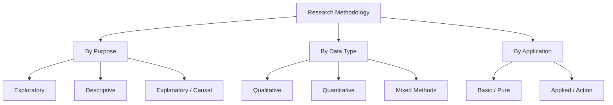
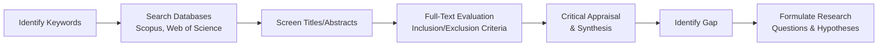
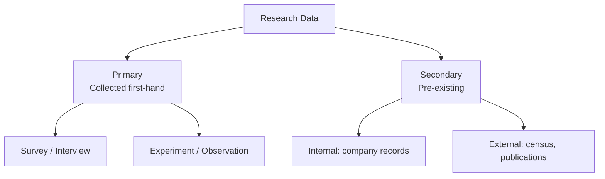
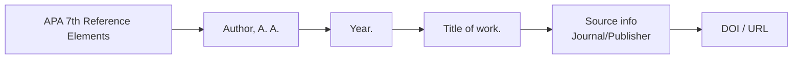
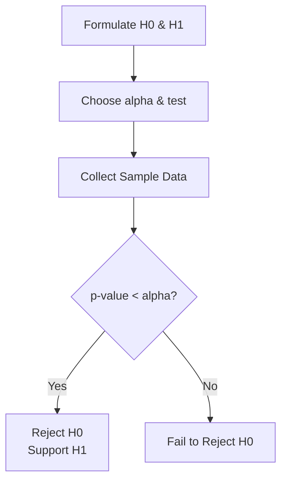
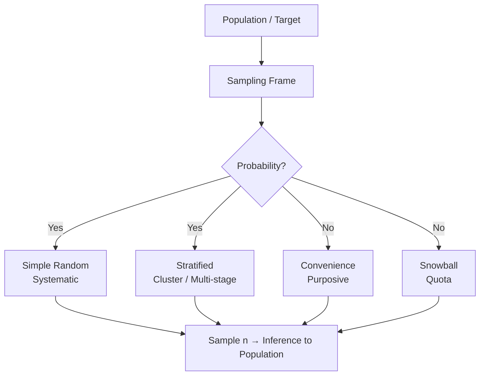
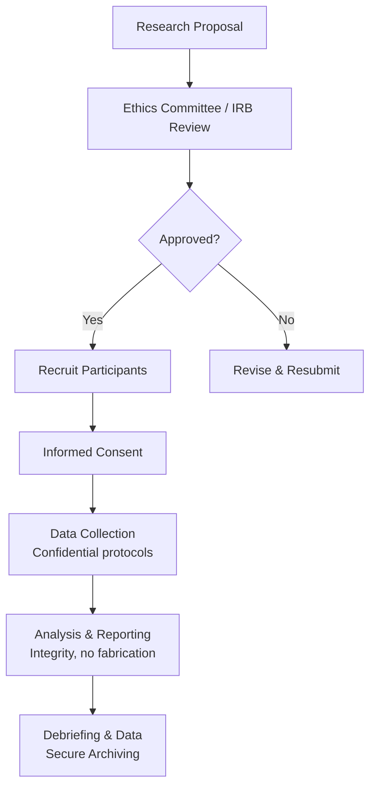
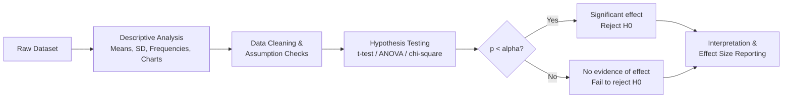
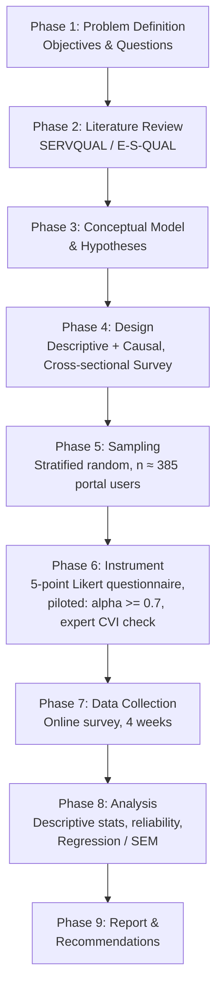

# Research Methodology: Comprehensive Academic Answers

---

## Question 1: Explain the Research Methodology and its types of research in brief

### 1. Conceptual Overview & Core Definition

**Research Methodology** is the systematic, theoretical analysis of the methods applied to a field of study. It encompasses the principles, procedures, and strategies by which knowledge is acquired, verified, and disseminated. According to Kothari (2004), research methodology is "a way to systematically solve the research problem," including the logic behind the methods chosen, rather than merely the methods themselves.

### 2. Detailed Explanation & Theoretical Framework

Methodology answers three fundamental questions: *What data will be collected? How will it be collected? Why is this approach appropriate?* The major types of research are classified along several dimensions:

| Classification Basis | Types | Description |
|---|---|---|
| **Purpose** | Exploratory, Descriptive, Explanatory (Causal) | Seeks insight vs. describes phenomena vs. tests cause–effect |
| **Data Type** | Qualitative, Quantitative, Mixed Methods | Non-numeric vs. numeric vs. integration of both |
| **Application** | Basic (Pure) vs. Applied | Knowledge generation vs. problem-solving |
| **Logic** | Inductive vs. Deductive | Theory-building vs. theory-testing |
| **Time Dimension** | Cross-sectional, Longitudinal | One point in time vs. repeated over time |

**Key types in brief:**
- **Exploratory:** Flexible, open-ended; often qualitative; identifies variables for later study.
- **Descriptive:** Portrays characteristics of a population or phenomenon (surveys, case studies).
- **Explanatory/Causal:** Establishes relationships via controlled manipulation (experiments).
- **Qualitative:** Ethnography, phenomenology, grounded theory — meaning-centered.
- **Quantitative:** Statistical, measurement-based, often uses probability sampling.
- **Mixed Methods:** Triangulation; sequential or concurrent designs (Creswell & Plano Clark).

### 3. Visual Representation / Diagram



### 4. Practical Application & Real-World Example

A pharmaceutical company testing a new drug uses **quantitative, applied, explanatory** research: a Randomized Controlled Trial (RCT) with experimental and control groups measures efficacy (e.g., reduction in blood pressure), analyzed via t-tests or ANOVA.

### 5. Key Strengths & Limitations / Best Practices

- **Strength:** A sound methodology ensures replicability, transparency, and scientific rigor.
- **Limitation:** Each type carries trade-offs — internal validity (experiments) vs. ecological validity (ethnography).
- **Best Practice:** Justify the chosen paradigm explicitly in the methodology chapter; align research questions, design, sampling, and analysis coherently ("methodological coherence").

---

## Question 2: Why literature review is important in research

### 1. Conceptual Overview & Core Definition

A **literature review (LR)** is a systematic, critical, and comprehensive survey of existing scholarly work relevant to a research problem. It is both a *process* (searching, evaluating, synthesizing) and a *product* (a written synthesis section/chapter).

### 2. Detailed Explanation & Theoretical Framework

Hart (1998) describes the LR as identifying "what has already been established and what remains unknown." Its functions include:

1. **Establishing context and rationale** — situating the study in the body of knowledge.
2. **Identifying the research gap** — revealing unanswered questions, contradictions, or methodological weaknesses in prior work.
3. **Theoretical framing** — selecting models and constructs that guide variable identification.
4. **Methodological guidance** — revealing which instruments, sampling strategies, and analytical techniques have proven effective.
5. **Avoiding duplication** — ensuring originality and efficient use of resources.
6. **Building hypotheses** — deductive studies derive testable hypotheses from prior findings.
7. **Demonstrating scholarship** — evidencing the researcher's command of the field.

**Types:** Narrative (traditional), Systematic (PRISMA protocol), Meta-analysis (statistical synthesis), Scoping review.

### 3. Visual Representation / Diagram



### 4. Practical Application & Real-World Example

Before studying remote-work productivity, a researcher reviews 80 studies (2015–2024), finds most measured self-reported productivity (a bias), and frames their study around objective output metrics — the gap justifies the study's contribution.

### 5. Key Strengths & Limitations / Best Practices

- **Strength:** Anchors the study; supports grant/funding justification; reveals theoretical frameworks.
- **Limitation:** Publication bias, database coverage gaps, risk of plagiarism/paraphrasing errors.
- **Best Practice:** Use PRISMA flow diagrams for systematic reviews; maintain a reference manager (Zotero/Mendeley); cite only sources actually read; prioritize peer-reviewed, recent (typically last 5–10 years) sources.

---

## Question 3: Short Notes

### (a) Primary and Secondary Data

**1. Conceptual Overview**
- **Primary data:** Original data collected first-hand by the researcher for the specific research purpose (surveys, interviews, experiments, observations).
- **Secondary data:** Data previously collected by others and repurposed (government census, journal articles, organizational records, databases).

**2. Detailed Explanation**

| Criterion | Primary Data | Secondary Data |
|---|---|---|
| Source | First-hand, original | Pre-existing records |
| Cost & Time | High | Low |
| Relevance/Fit | Precise fit to objectives | May need redefinition |
| Control over quality | Full (researcher-defined) | Limited (unknown biases) |
| Risk | Sampling errors, non-response | Outdated or misaligned data |
| Examples | Questionnaire responses | Census data, IMF/World Bank datasets |

**3. Visual Representation**



**4. Practical Application:** A market researcher may first mine secondary data (industry reports) to scope the problem, then collect primary data via a survey to answer the specific question.

**5. Best Practices:** Pilot-test primary instruments; verify secondary data provenance, currency, and methodology before use. Triangulation of both maximizes validity.

---

### (b) APA Reference Styles

**1. Conceptual Overview**
APA style (American Psychological Association, 7th edition, 2020) is an author–date citation system widely used in social and behavioral sciences.

**2. Detailed Explanation & Formats**
- **In-text (paraphrase):** (Kothari, 2004)
- **In-text (quote):** (Kothari, 2004, p. 12)
- **Journal article:** Author, A. A. (Year). Title of article. *Journal Name, Volume*(Issue), pages. https://doi.org/xxxx
- **Book:** Author, A. A. (Year). *Title of book* (edition). Publisher.
- **Multiple authors:** Two authors joined by "and"/"&"; 3+ authors → (First author et al., Year). Two or more works in one parenthesis ordered alphabetically, separated by semicolons.

**3. Visual Representation**



**4. Practical Example (Reference List):**
> Creswell, J. W., & Creswell, J. D. (2018). *Research design: Qualitative, quantitative, and mixed methods approaches* (5th ed.). SAGE Publications.

**5. Best Practices:** Use hanging indentation; alphabetize by first author surname; include DOIs whenever available; every in-text citation must appear in the reference list and vice versa.

---

### (c) Hypothesis in Research

**1. Conceptual Overview**
A **hypothesis** is a testable, falsifiable statement predicting a relationship between two or more variables (Popper's falsifiability criterion).

**2. Detailed Explanation & Types**
- **Null hypothesis (H₀):** No effect/relationship (e.g., μ₁ = μ₂).
- **Alternative hypothesis (H₁/Hₐ):** An effect exists (μ₁ ≠ μ₂, directional or non-directional).
- **Directional (one-tailed) vs. non-directional (two-tailed).**
- **Simple vs. complex; research hypothesis vs. statistical hypothesis.**
- Testing involves setting α (typically 0.05), computing a test statistic, and comparing with critical values or using p-values. Errors: **Type I** (false positive, probability α) and **Type II** (false negative, probability β); power = 1 − β.

**3. Visual Representation**



**4. Practical Example:** H₀: "There is no significant difference in satisfaction scores between Android and iOS users." Tested via an independent-samples t-test at α = 0.05.

**5. Best Practices:** Hypotheses must be *a priori* (pre-registered), operationalized (variables measurable), and singular (one relationship each). Never "accept" H₀ — only fail to reject it.

---

### (d) Sample Design for Research

**1. Conceptual Overview**
**Sample design** is the definite plan for obtaining a sample from a population, specifying the sampling frame, technique, and sample size — ensuring the sample is representative and estimates are generalizable.

**2. Detailed Explanation**

| Category | Techniques | Key Feature |
|---|---|---|
| **Probability** | Simple random, Systematic, Stratified, Cluster, Multi-stage | Known, non-zero selection probability |
| **Non-probability** | Convenience, Purposive, Snowball, Quota | Selection by judgment/availability |

**Sample size considerations:** population size, desired precision (margin of error *e*), confidence level (Z = 1.96 at 95%), variance. Cochran's formula for large populations:
$$n_0 = \frac{Z^2 \cdot p \cdot (1-p)}{e^2}$$
(e.g., Z = 1.96, p = 0.5, e = 0.05 → n₀ ≈ 385).

**3. Visual Representation**



**4. Practical Example:** To survey 10,000 university students, a researcher stratifies by faculty (ensuring subgroup representation), then applies simple random sampling within each stratum, targeting n = 370 (adjusted for finite population).

**5. Best Practices:** Define the target population precisely; minimize sampling frame coverage error; report response rates; avoid over-reliance on convenience samples (limits external validity).

---

## Question 4: Explain the ethical issues in research

### 1. Conceptual Overview & Core Definition

**Research ethics** comprises the moral principles governing the conduct of research, protecting participants, ensuring integrity of findings, and safeguarding public trust. Foundations include the **Nuremberg Code (1947)**, **Declaration of Helsinki (1964)**, and the **Belmont Report (1979)** — articulating *respect for persons, beneficence, and justice*.

### 2. Detailed Explanation & Theoretical Framework

| Issue | Description | Safeguard |
|---|---|---|
| **Informed Consent** | Voluntary, informed agreement without coercion | Consent forms, plain language |
| **Confidentiality & Anonymity** | Protecting identities and responses | Coding, encryption, aggregation |
| **Plagiarism & Fabrication/Falsification** | Misrepresenting work or data | Citations, data audits |
| **Vulnerable populations** | Children, patients, prisoners — reduced autonomy | Guardian consent, extra oversight |
| **Harm minimization** | Physical, psychological, social, economic harm | Risk–benefit analysis, debriefing |
| **Conflict of interest** | Funding bias, dual roles | Disclosure statements |
| **Authorship & data ownership** | Credit misallocation, data misuse | Authorship criteria (ICMJE) |
| **Deception** | Withholding/misstating study purpose | Justification + debriefing |

### 3. Visual Representation / Diagram



### 4. Practical Application & Real-World Example

Historical violations — the **Tuskegee Syphilis Study (1932–1972)** and **Milgram's obedience experiments** — drove modern mandates: IRB approval, informed consent, and the right to withdraw. Today, an online survey researcher must obtain consent, anonymize IP addresses, and comply with GDPR for EU respondents.

### 5. Key Strengths & Limitations / Best Practices

- **Strength:** Protects participants and researcher credibility; required for publication.
- **Limitation:** Overly rigid protocols can impede socially valuable research; grey areas (deception, secondary data reuse).
- **Best Practice:** Obtain IRB/Ethics Committee approval *before* data collection; pre-register studies; report honestly, including null results; make data and code available with proper consent.

---

## Question 5: Differentiate between Descriptive Analysis and Hypothesis Testing in data interpretation

### 1. Conceptual Overview & Core Definition

- **Descriptive analysis** summarizes and describes the main features of a dataset *without generalizing beyond it* — measures of central tendency, dispersion, frequency, and visualization.
- **Hypothesis testing (inferential analysis)** uses sample statistics to make probability-based decisions about population parameters — testing H₀ against H₁ with formal statistical tests.

### 2. Detailed Explanation & Theoretical Framework

| Dimension | Descriptive Analysis | Hypothesis Testing |
|---|---|---|
| **Objective** | Summarize/organize data | Generalize/infer; test claims |
| **Scope** | The sample only | Sample → population |
| **Tools** | Mean, median, mode, SD, skewness, histograms, box plots | t-test, ANOVA, χ², regression, p-values, CIs |
| **Output** | Numbers, tables, charts | Decision (reject/fail to reject H₀) |
| **Probabilistic statement** | None | Yes (α, p-value, power) |
| **Error risk** | Misleading visuals/averages | Type I (α) & Type II (β) errors |
| **Sequence** | Typically first | After descriptive screening |

Conceptually, descriptive analysis is the *exploratory foundation*; hypothesis testing is the *confirmatory layer*. EDA (Tukey, 1977) bridges the two.

### 3. Visual Representation / Diagram



### 4. Practical Application & Real-World Example

A study of 200 students' exam scores:
- **Descriptive:** Mean = 68.4, SD = 12.1, distribution slightly left-skewed.
- **Hypothesis testing:** H₀: μ_male = μ_female. Independent t-test → t(198) = 2.31, p = 0.022, d = 0.33 → reject H₀; females significantly outperform males (small-to-moderate effect).

### 5. Key Strengths & Limitations / Best Practices

- **Strengths:** Descriptive statistics are intuitive and assumption-light; hypothesis testing enables evidence-based generalization.
- **Limitations:** Descriptive stats can mask distributions (Anscombe's quartet); hypothesis testing over-relies on p-values, ignores effect size.
- **Best Practice:** Always report descriptive statistics first; accompany p-values with **effect sizes (Cohen's d, η²)** and **confidence intervals**; check assumptions (normality, homogeneity of variance) before inferential tests; avoid p-hacking and HARKing.

---

## Question 6: Explain the advantages of Reliability and Validity tests in research instruments

### 1. Conceptual Overview & Core Definition

- **Reliability:** The consistency, stability, and repeatability of an instrument's measurements across time, items, or raters.
- **Validity:** The extent to which an instrument measures *what it purports to measure* (accuracy/truthfulness).

An analogy: reliability is the *consistency* of a weighing scale; validity is whether it actually measures *weight* and not height.

### 2. Detailed Explanation & Theoretical Framework

**Types of Reliability:**
| Type | Method | Statistic |
|---|---|---|
| Test–retest | Same test, two occasions | Pearson r / ICC |
| Inter-rater | Agreement between raters | Cohen's κ |
| Internal consistency | Item homogeneity | Cronbach's α (≥ 0.70 acceptable) |
| Split-half | Correlate two halves | Spearman–Brown |

**Types of Validity:**
| Type | Meaning |
|---|---|
| Face / Content | Items represent the construct domain (expert panel, CVI) |
| Criterion-related | Correlates with external standard (concurrent & predictive) |
| Construct | Measures the theoretical construct (factor analysis, convergent/discriminant) |
| Internal/External | Causal correctness; generalizability |

**Relationship:** Validity presupposes reliability — an unreliable instrument cannot be valid — but a reliable instrument may still be invalid (consistently measuring the wrong thing).

### 3. Visual Representation / Diagram

```
   Target (True Construct) ●

   HIGH RELIABILITY +   HIGH RELIABILITY +   LOW RELIABILITY +
   HIGH VALIDITY        LOW VALIDITY         LOW VALIDITY
        ●  ●                 ✗   ✗  ✗          ✗   ●   ✗
       ● ● ●                ✗ ✗ ✗ ✗            ●  ✗  ● ✗

   (Clustered & on     (Clustered but      (Scattered &
    target)             off target)          off target)
```

### 4. Practical Application & Real-World Example

A researcher develops an "E-Commerce Satisfaction Scale" (20 items). They:
1. Pilot it on 100 users; **Cronbach's α = 0.86** → strong internal consistency.
2. Have 5 experts rate item relevance; **CVI = 0.92** → content validity.
3. Run exploratory factor analysis → 4 factors (usability, price, delivery, service) → construct validity.
4. Correlate with repurchase intention (r = 0.61) → criterion validity.
The validated instrument is then used confidently in the main study.

### 5. Key Strengths & Limitations / Best Practices

- **Advantages:** Enhances credibility and replicability of findings; strengthens statistical power (reduced measurement error → attenuated correlations are corrected); supports cross-cultural/cross-study comparisons; a prerequisite for publication and scale commercialization.
- **Limitations:** Testing is time-consuming and sample-demanding; high reliability can reflect item redundancy; validity is context-bound (valid in one population may not transfer).
- **Best Practice:** Pilot-test instruments before main studies; report reliability coefficients in the methodology chapter; validate within the target population; re-assess reliability for translated/adapted instruments.

---

## Question 7: Create a small research plan to study consumer satisfaction in an e-commerce portal

### 1. Conceptual Overview & Core Definition

A **research plan** is a structured roadmap specifying objectives, design, sampling, instruments, analysis, timeline, and ethics for a study. Here, the target construct is **consumer satisfaction** with an e-commerce portal — commonly modeled via SERVQUAL/E-S-QUAL dimensions: *efficiency, system availability, fulfillment, privacy*, plus perceived value, delivery experience, and customer service.

### 2. Detailed Explanation & Theoretical Framework

**Proposed framework:**
- **Independent variables:** Website usability, product assortment/price, delivery timeliness, customer service, payment security.
- **Dependent variable:** Overall consumer satisfaction (and optionally: repurchase intention, loyalty).

### 3. Visual Representation / Diagram



**Sample Research Plan (Tabular):**

| Element | Specification |
|---|---|
| **Title** | "Determinants of Consumer Satisfaction in E-Commerce Portals: An Empirical Study" |
| **Objectives** | (1) Measure satisfaction levels; (2) Identify key drivers; (3) Examine demographic differences |
| **Hypotheses (examples)** | H1: Delivery timeliness positively affects satisfaction. H2: Website usability positively affects satisfaction. H3: Satisfaction differs by age group |
| **Design** | Cross-sectional, quantitative, descriptive–explanatory survey |
| **Population & Sampling** | Adults (18+) who purchased within 6 months; stratified random sampling by age/gender; **n ≈ 385** (95% CI, 5% margin) |
| **Instrument** | Structured questionnaire (Likert 1–5); adapted from E-S-QUAL; ~30 items across 5 constructs |
| **Data Collection** | Online survey link distributed via email/portal pop-up; 4-week window; consent + anonymity assured |
| **Analysis Plan** | Descriptive statistics → reliability (Cronbach's α) → validity (EFA/CFA) → multiple regression/SEM → t-test/ANOVA for demographic differences |
| **Ethics** | Informed consent, no personal identifiers, IRB approval, voluntary participation, secure data storage |
| **Timeline** | Weeks 1–2: LR & instrument; Week 3: pilot; Weeks 4–7: data collection; Weeks 8–9: analysis; Week 10: report |
| **Budget (indicative)** | Survey platform, incentives, software licenses (SPSS/AMOS/R — free) |
| **Limitations** | Self-report bias, single-portal scope, cross-sectional (no causality over time) |

### 4. Practical Application & Real-World Example

An MBA capstone study on "Portal X": 420 responses collected (response rate 62%); regression revealed **delivery timeliness (β = 0.38, p < .001)** as the strongest satisfaction driver, followed by customer service (β = 0.27). Recommendations: invest in same-day logistics and live-chat support; track satisfaction quarterly via Net Promoter Score (NPS) and CSAT.

### 5. Key Strengths & Limitations / Best Practices

- **Strengths:** Cost-effective, scalable, generalizable within the user base; clear KPIs for management action.
- **Limitations:** Online sampling skews toward digital natives; satisfaction is dynamic (cross-sectional snapshot); common method bias in single-source surveys.
- **Best Practices:** Pilot-test and validate instruments; use validated scales rather than ad hoc items; combine quantitative scores with a small qualitative follow-up (interviews/reviews mining) for triangulation; report response rate, non-response bias checks, and effect sizes.

---

## Concluding Note

These seven questions collectively span the research lifecycle: **paradigm selection (Q1) → gap identification (Q2) → foundational elements (Q3) → ethics (Q4) → analysis (Q5) → measurement quality (Q6) → applied planning (Q7)**. Mastery lies in *methodological coherence* — ensuring the question, design, sampling, instrument, and analysis form a logically consistent whole, executed ethically and reported transparently.