# Software Engineering (Agile Practices) — Complete Notes

> **Compiled from 21 topic files.** Theory is deliberately compressed: one-line definitions, tables, and diagrams. Overlapping notes (`01`, `02`, and `03`) are merged; repeated comparison tables are consolidated.
>
> **How to use:** read the *In one line* box → study the diagram → memorise the table → check the *Exam hits* bullets. Revise only the tables, diagrams, and Part V appendix before the exam.

---

## Contents

**Part I — Foundations**
1. [Systems, Software & Software Engineering](#1-systems-software--software-engineering)
2. [Software Process Models](#2-software-process-models)
3. [Why Agile Emerged](#3-why-agile-emerged)
4. [The Agile Manifesto](#4-the-agile-manifesto)
5. [Agile Core Concepts](#5-agile-core-concepts)

**Part II — Agile Frameworks**
6. [Scrum](#6-scrum)
7. [Kanban](#7-kanban)
8. [Extreme Programming (XP)](#8-extreme-programming-xp)
9. [Lean Project Management](#9-lean-project-management)
10. [Scaling Agile: LeSS & SAFe](#10-scaling-agile-less--safe)
11. [Comparing Scrum, Kanban & XP](#11-comparing-scrum-kanban--xp)

**Part III — Planning & Delivery**
12. [Agile Estimation](#12-agile-estimation)
13. [Agile Release Planning](#13-agile-release-planning)
14. [Configuration Management & Version Control](#14-configuration-management--version-control)
15. [DevOps & CI/CD](#15-devops--cicd)

**Part IV — Testing & Metrics**
16. [Agile Testing: Principles, Life Cycle & Quadrants](#16-agile-testing-principles-life-cycle--quadrants)
17. [Agile Testing Methodologies](#17-agile-testing-methodologies)
18. [Agile Metrics & KPIs](#18-agile-metrics--kpis)

**Part V — Appendix** — [Rapid-Fire Revision](#part-v--rapid-fire-revision)

---
---

# PART I — FOUNDATIONS

---

# 1. Systems, Software & Software Engineering

> **In one line:** Software engineering is the **systematic, disciplined, quantifiable** approach that turns an ambiguous problem into reliable, maintainable software — and manages the risk along the way.

## 1.1 Systems

A **system** is a set of **interrelated components working together toward a common goal**.

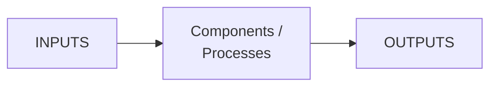

| Characteristic | Meaning |
|---|---|
| **Organization** | Structure and order |
| **Interconnectivity** | Components are connected and affect one another |
| **Interdependence** | No component works in isolation; change one, affect others |
| **Integration** | Parts work together in harmony |
| **Synergy** | Whole > sum of parts |

**Component** = a distinct part performing a specific function and interacting with other parts.

## 1.2 Software

**Software** = a collection of **programs, procedures, and associated documentation** concerned with the operation of a data processing system.

| Type | Role | Examples |
|---|---|---|
| **System software** | Manages hardware, platform for apps | OS, drivers |
| **Application software** | User tasks | Browser, word processor |
| **Embedded software** | Built into hardware | Firmware, IoT |
| **Utility software** | Maintains/optimises system | Antivirus, disk cleaner |
| **Middleware** | Connects applications | APIs, message brokers |

**Characteristics of software:** intangibility, complexity, evolvability, invisibility, reusability, **no manufacturing** (logical, not mass-produced).

**Hardware** = the physical, tangible components: input, output, storage, and internal components (CPU, motherboard, RAM).

## 1.3 Attributes of good software

| Attribute | Test question |
|---|---|
| **Correctness** | Does it meet functional requirements? |
| **Reliability** | Does it behave consistently under expected conditions? |
| **Efficiency** | Does it use CPU/memory well? |
| **Maintainability** | Can it be fixed, updated, enhanced? |
| **Portability** | Does it run across environments? |
| **Usability** | Can the target user learn and use it? |
| **Reusability** | Can components be reused? |
| **Security** | Is data protected from unauthorised access/failure? |

## 1.4 Why software needs engineering

| Reason | Explanation |
|---|---|
| **Complexity** | Millions of lines, many interacting parts |
| **Scale** | Global systems, millions of users |
| **Cost & risk** | Failure costs money, reputation, sometimes lives |
| **Predictability** | Safety-critical systems need consistent results |
| **Quality assurance** | Systematic verification and validation |
| **Maintainability** | Engineered systems evolve and scale better |

**Traditional engineering vs software engineering**

| Traditional | Software |
|---|---|
| Bridge | Banking system |
| Blueprint | Design |
| Materials | Code/components |
| Construction | Development |
| Inspection | Testing |
| Maintenance | Updates/bug fixes |
| Safety standards | Coding standards |
| Project manager | Scrum Master / PM |

> **Exam hit:** Software borrows **design before construction, inspection, maintenance, and standards** — but software is **mutable, intangible, and has no physical manufacturing phase**.

## 1.5 The software crisis and ad hoc failure

**Ad hoc development** (code-and-fix, no formal process) fails because of:

- no formal process or methodology;
- minimal planning;
- limited documentation;
- no version control or traceability;
- decisions driven by individuals rather than systems.

Result: **unpredictable quality, uncontrolled change, missed deadlines, project failure**.

The **software crisis** (late 1960s) — projects over budget, late, unreliable — is why engineering discipline was applied to software.

## 1.6 Definition and core components

> **Software engineering** = the application of a **systematic, disciplined, quantifiable** approach to the **development, operation, and maintenance** of software.

- **Systematic** — structured, methodical.
- **Disciplined** — follows rules and standards.
- **Quantifiable** — measurable, metric-driven.

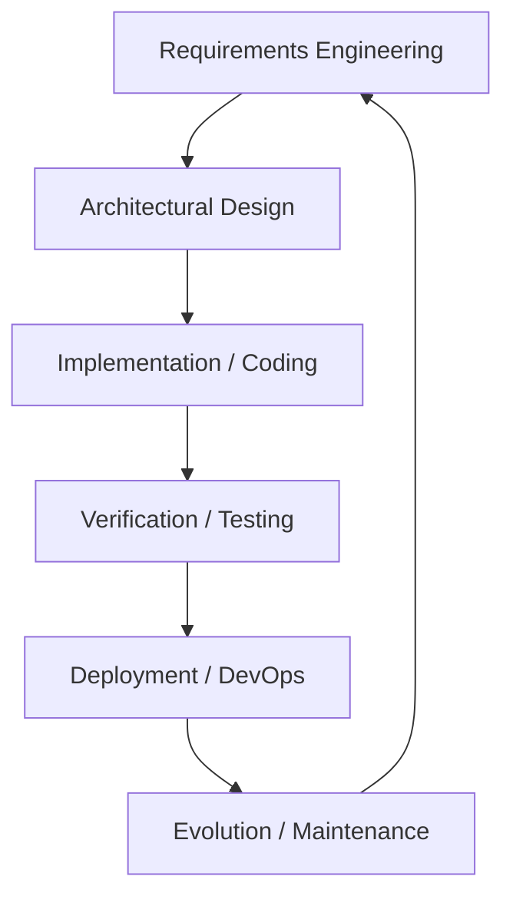

| Core component | What it does |
|---|---|
| **Requirements engineering** | Identify, analyse, document, manage needs |
| **Design** | Architecture and detailed component design |
| **Implementation** | Translate design into programs |
| **Testing** | Verify and validate |
| **Deployment** | Deliver to users |
| **Maintenance** | Fix, enhance, update after delivery |
| **Project management** | Plan, schedule, budget, track |
| **Configuration management** | Control changes to code/docs/artefacts |

**Scope — activities:** process models, planning and estimation, risk management, team coordination, quality assurance, documentation/training, customer support.

**Stakeholders:** software engineers, analysts, designers, QA engineers, customers/end users, product owners/managers.

## 1.7 Risk management

> A **risk** is a potential problem that might affect project success.  
> **Risk exposure (RE) = Probability (P) × Impact/Loss (L).**

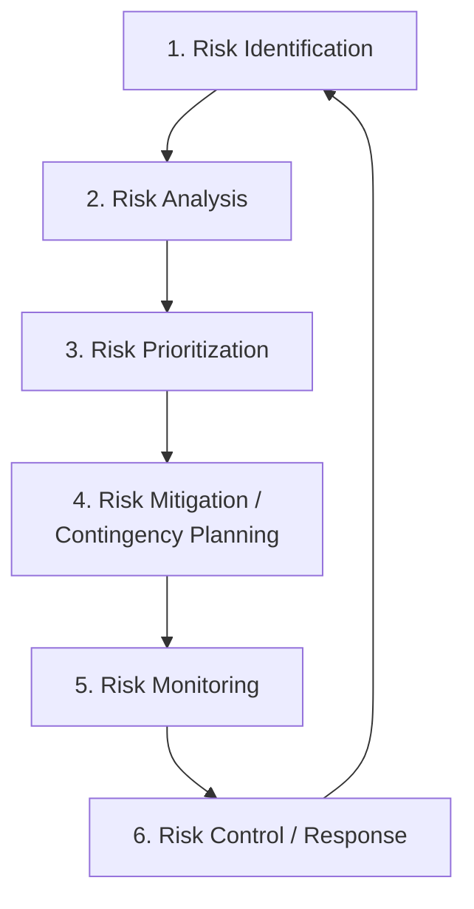

| Step | What happens |
|---|---|
| **1 Identification** | Find threats; record in a **risk register** |
| **2 Analysis** | Estimate probability and impact |
| **3 Prioritization** | Rank by exposure; address critical first |
| **4 Mitigation / planning** | Reduce probability/impact; prepare contingency |
| **5 Monitoring** | Track throughout the project |
| **6 Control** | Execute contingency when threshold is crossed; update register |

**Risk categories**

| Category | Examples | What is threatened |
|---|---|---|
| **Technical** | Architectural infeasibility, technical debt, integration clashes, performance limits | Quality and structural integrity |
| **Project** | Estimation error, staff turnover, scope creep, supplier delay | Schedule, budget, resources |
| **Business** | Market misalignment, regulatory change, funding cuts, obsolete feature | Commercial viability and value |

**Risk responses:** **mitigate** (reduce P or L), **transfer** (insurance/SLA/outsourcing), **avoid** (change scope/approach), **accept** (contingency budget).

| Risk | P | L | RE | Mitigation | Contingency |
|---|---|---|---|---|---|
| Key developer leaves | 4 | 5 | 20 | Cross-train, document, retention | Reassign, contractor, re-plan |
| Server crash at peak | 3 | 5 | 15 | Load test, monitoring, redundancy | Failover, notify, recover |
| Late requirement change | 4 | 3 | 12 | Frequent reviews, change control | Re-estimate, adjust sprint |

## 1.8 Benefits and challenges of engineering software

| Engineering principle | Benefit |
|---|---|
| **Risk management** | Identify and mitigate technical, schedule, and market risks early |
| **Planning & estimation** | Realistic timelines and budgets based on models, not intuition |
| **Design before code** | Better modularity, performance, and reusability |
| **Verification & validation** | Early defect detection, fewer post-deployment bugs |
| **Change management** | Controlled incorporation of new requirements |
| **Documentation & standards** | Easier onboarding, support, and auditing |

| Advantages | Challenges |
|---|---|
| Structured, systematic approach | Requirements keep changing |
| Predictable schedules and budgets | Time and budget constraints |
| Quality assurance and early defect detection | No universal standards across projects |
| Proactive risk management | Large-system complexity |
| Maintainable, scalable systems | Ad hoc development still causes failure |
| Documentation and auditability | Overhead if applied too heavily |

> **Exam hits — Chapter 1**
> - System = **interrelated components + common goal**; five characteristics = **O-I-I-I-S**.
> - Software = **programs + procedures + documentation**, not just code.
> - Eight quality attributes: **correctness, reliability, efficiency, maintainability, portability, usability, reusability, security**.
> - SE = **systematic, disciplined, quantifiable**.
> - Risk priority = **likelihood × impact**; mitigation ≠ contingency.
> - Agile handles risk in **short loops, spikes, reviews, retrospectives** — not one front-loaded register.

---

# 2. Software Process Models

> **In one line:** A process model is a **template for sequencing work, roles, deliverables, and checks**; the right model is chosen by **project characteristics**, not by industry or fashion.

## 2.1 Evolution of software development

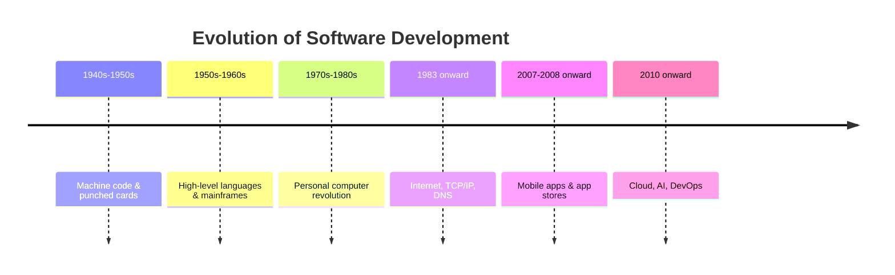

| Stage | Era | Key highlights |
|---|---|---|
| **1** | Early programming (1940s–50s) | Binary/assembly, punched cards, hardware-focused |
| **2** | High-level languages (1950s–60s) | FORTRAN, COBOL, mainframes, IBM IMS |
| **3** | PC revolution (1970s–80s) | Apple I, IBM PC, personal software |
| **4** | Internet (1983+) | TCP/IP, DNS, global connectivity |
| **5** | Mobile (2007–08+) | iPhone, app stores, frequent updates |
| **6** | AI & cloud (2010+) | AWS/Azure, microservices, AI, CI/CD |

**Driver of evolution:** each era tried to manage **scale and uncertainty** better — from ad hoc code-and-fix, to plan-driven bureaucracy, to iterative/Agile and DevOps.

## 2.2 What is a process model?

> A **software process model** is a standardised framework defining the **sequence and flow of tasks, activities, milestones, roles, and validation gates** across the software lifecycle.

**Why use one:** structure and predictability; planning and risk management; clear roles; quality assurance; communication; visibility and traceability.

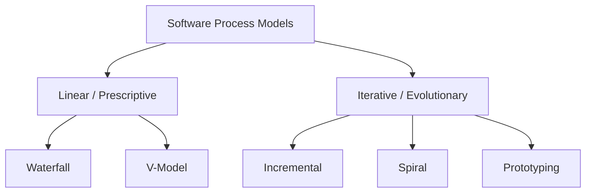

## 2.3 Waterfall

**Linear-sequential**: each phase is completed, verified, and signed off before the next begins. Popularised by Winston Royce (1970) — ironically, Royce warned that the pure sequence was risky.

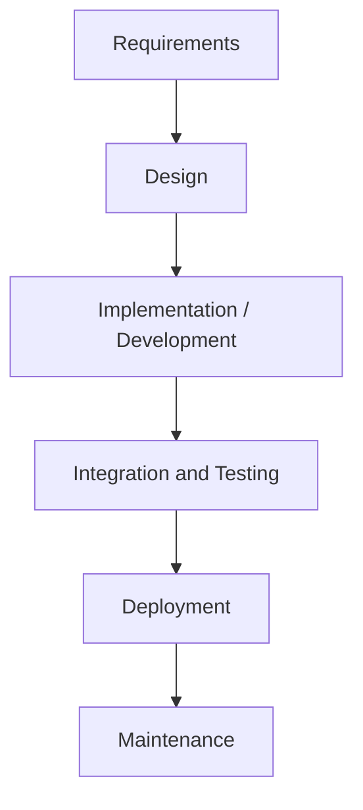

| Phase | Output |
|---|---|
| Requirements | SRS / requirement baseline |
| Design | Architecture + detailed design |
| Implementation | Source code modules |
| Testing | Integrated, validated build |
| Deployment | Installed release |
| Maintenance | Fixes and enhancements |

**Use when:** requirements are stable and well understood; project is short/simple; technology is familiar; changes are unlikely; documentation and formal sign-off are required.

**Limitations:** no going back without expensive rework; testing is late; working software appears late; integration crisis (“wall of tears”); poor fit for evolving requirements.

**Best for:** government contracts, regulated/stable backends, re-engineering with a fixed scope.

## 2.4 V-Model (Verification & Validation)

The V-Model is **Waterfall bent into a V**: every development phase on the left has a matching test phase on the right.

- **Verification** — “Are we building the product right?” (reviews, static analysis, design checks).
- **Validation** — “Are we building the right product?” (unit → integration → system → acceptance testing).

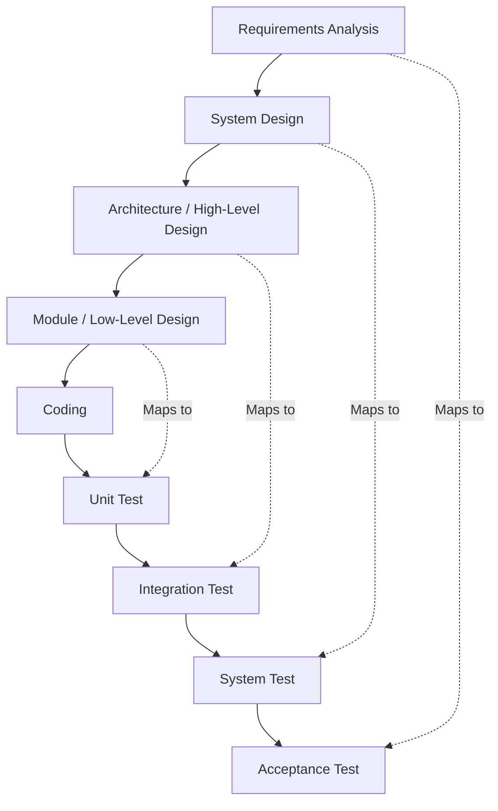

| Development stage | Test planned in parallel | What is validated |
|---|---|---|
| Requirements | Acceptance test | Business needs, UAT |
| System design | System test | End-to-end behaviour, security, performance |
| High-level design | Integration test | Interfaces, data flow between modules |
| Low-level design | Unit test | Functions, logic, boundaries |
| Coding | — | Basis for all testing |

**Traceability:** every requirement must link to design → code → test. This proves every requirement is **developed and tested**, and none is forgotten.

**Advantages over Waterfall:** test planning starts early; defects found before coding; explicit verification gates; strong requirement-to-test coverage.

**Limitations:** still rigid and document-heavy; no early working software; poor fit for changing requirements.

**Best for:** safety-critical and regulated systems — medical devices, avionics, automotive safety, defence.

## 2.5 Incremental model

The system is divided into **increments/builds**; each increment adds a fully tested slice of functionality.

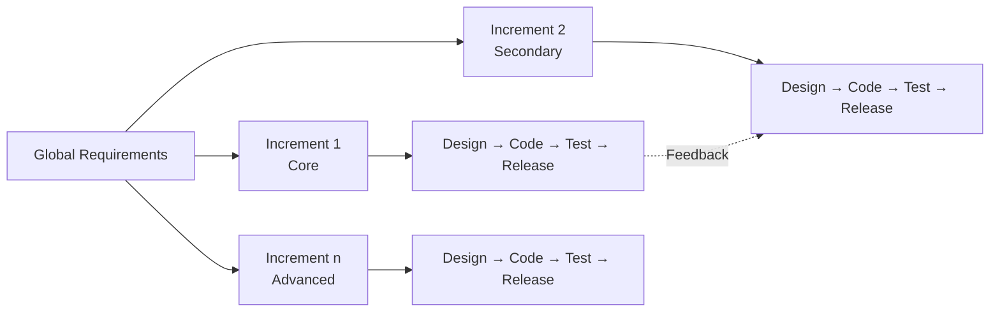

| Step | Action |
|---|---|
| 1 | Analyse overall requirements and partition into increments |
| 2 | Design/build/test the first increment |
| 3 | Release usable functionality |
| 4 | Repeat, integrating each increment with the core |
| 5 | Final integration and system validation |

**Use when:** overall requirements are known but full delivery in one go is impractical; early value is needed; requirements can be prioritised.

**Avoid when:** system is tightly coupled (hard to slice); architecture is unstable; safety-critical system requires full-system verification before any release.

**Advantages:** early delivery, early feedback, manageable risk, distributable funding.  
**Limitations:** integration overhead, architecture must support increments, possible rework, total cost can rise if interfaces keep changing.

## 2.6 Prototyping model

Build a **quick, simplified working version** to clarify requirements, then engineer the final system.

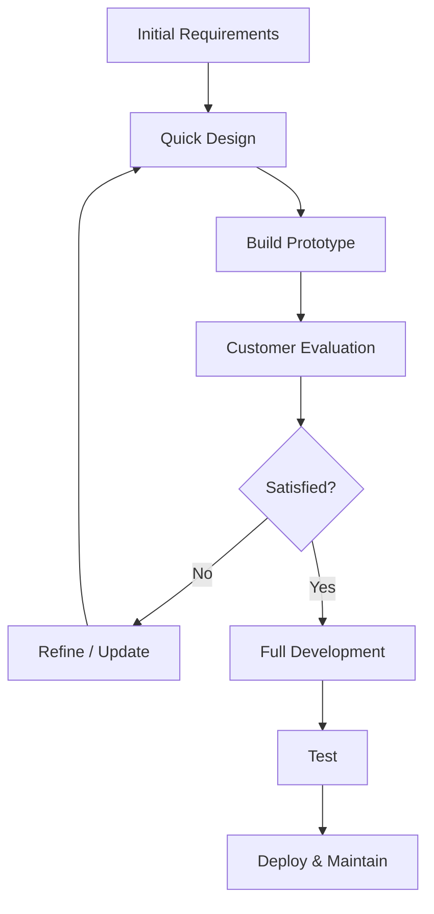

| Prototype type | Purpose |
|---|---|
| **Throwaway / rapid** | Learn requirements, then discard |
| **Evolutionary** | Refine continuously; becomes the product |
| **Incremental** | Multiple functional prototypes integrated |
| **Extreme** | High-fidelity, UX-heavy |

**Use when:** requirements are unclear, users cannot articulate needs, UI/UX is novel, or a technical algorithm needs validation.

**Advantages:** clarifies requirements, high user involvement, early usability feedback.  
**Limitations:** users may mistake prototype for final product; scope creep; documentation neglect; throwaway work can inflate cost.

## 2.7 Spiral model (Boehm, 1988)

**Risk-driven iterative model**: each loop is one iteration with four quadrants.

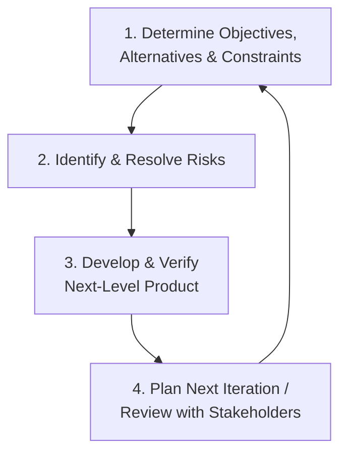

| Quadrant | Key question |
|---|---|
| **1 Objective setting** | What are we trying to achieve? What alternatives exist? |
| **2 Risk analysis** | What could go wrong? How do we resolve or reduce it? |
| **3 Development & validation** | Build and verify the next version |
| **4 Planning** | Review results and plan the next loop |

**Spiral levels (example):**

| Spiral | Focus | Example: AI trading system |
|---|---|---|
| **1 Concept** | Feasibility | Backtest algorithm on historical data |
| **2 Design** | Architecture / performance | Paper trading with live simulated feeds; latency controls |
| **3 Prototype** | Functional prototype / security | Integrate transactions, encryption, audits |
| **4 Operational** | Final engineering | CI/CD, full testing, production handover |

**Key principle:** **resources are not committed unless risks are understood**.

**Use when:** large, high-risk, mission-critical, new technology, unfamiliar architecture, long-lived product.

**Advantages:** excellent risk management, evolving requirements, stakeholder review each loop.  
**Limitations:** complex, expensive, needs risk expertise, schedule hard to predict, overkill for small projects.

## 2.8 Choosing a model

> **Core principle:** choose by **project characteristics**, not by application domain.

| Question | If yes | If no |
|---|---|---|
| **Are requirements stable?** | Waterfall / V-Model | Agile / iterative / incremental |
| **Is technology familiar?** | Waterfall / V-Model | Spiral / prototyping / Agile |
| **Is the system safety/business critical?** | V-Model / formal Waterfall | Agile / incremental |
| **Is early delivery required?** | Incremental / Agile | Waterfall |
| **Are users clear about what they want?** | Waterfall / V-Model | Prototyping / Agile |

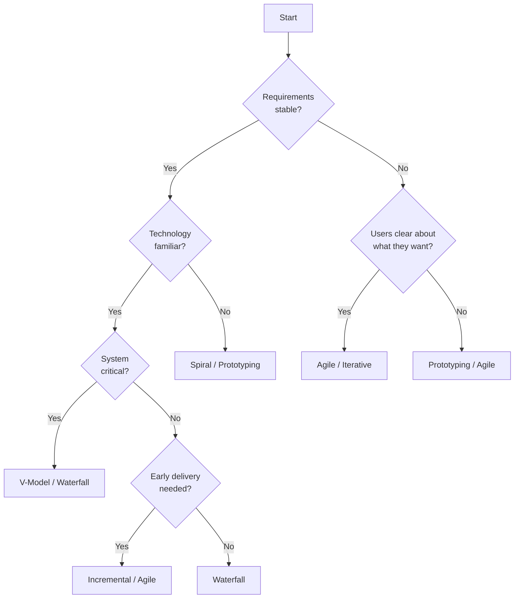

**Master comparison**

| Criteria | Waterfall | V-Model | Incremental | Prototype | Spiral | Agile |
|---|---|---|---|---|---|---|
| **Approach** | Linear | Linear + paired tests | Builds | Feedback loops | Risk-driven loops | Iterative + incremental |
| **Requirements** | Fixed | Fixed | Prioritised | Unclear, refined | Evolving | Evolving |
| **Risk handling** | Poor | Moderate | Good | Good | Excellent | Excellent |
| **Customer involvement** | Low | Low | Moderate | High | Moderate–high | High |
| **Delivery** | Single final | Single final | Multiple increments | Prototype then final | Iterative releases | Continuous |
| **Testing** | Late | Early/parallel | Continuous | Continuous | Continuous | Continuous |
| **Documentation** | Heavy | Heavy | Moderate | Light | Moderate | Light |
| **Change** | Difficult | Difficult | Easy | Easy | Moderate | Easy |
| **Best for** | Stable scope | Safety-critical | Early delivery | Unclear needs | High-risk/large | Changing needs |
| **Cost profile** | Low upfront, high on change | Medium–high | Medium | High exploration | High | Low–moderate |

> **Exam hits — Chapter 2**
> - **Waterfall** = sequential, late testing, stable requirements.
> - **V-Model** = Waterfall + **verification/validation pairing + traceability**; not merely a testing model.
> - **Incremental** = deliver **functional slices**; **iterative** = refine the whole system repeatedly. *Incremental expands, iterative refines.*
> - **Prototype** types: throwaway, evolutionary, incremental, extreme.
> - **Spiral** = **risk-driven**; 4 quadrants; resources committed only after risks are understood.
> - Model choice depends on **requirements stability, technology familiarity, criticality, delivery urgency, user clarity**.
> - No model is universally best; hybrids are valid.

---

# 3. Why Agile Emerged

> **In one line:** Agile emerged because **plan-driven, late-testing, document-heavy processes could not absorb fast-changing requirements** in a networked, competitive, always-on software market.

## 3.1 The root cause

Traditional models were designed for **predictable, well-defined projects**:

- assumed **stable requirements**;
- relied on **upfront planning**;
- expected **minimal change** during development.

They adapted poorly to:

| Challenge | Consequence |
|---|---|
| **Frequent requirement changes** | Rework, expired specifications |
| **User feedback loops** | Feedback arrives only at the end |
| **Rapid delivery needs** | Long cycles lose market opportunities |

## 3.2 Limitations of traditional models

| Model | Characteristic | Core limitation |
|---|---|---|
| **Waterfall** | Sequential phases | Late testing, rigid scope |
| **V-Model** | Verification/validation pairs | Still plan-driven, expensive change |
| **Spiral** | Risk-driven iterations | Heavy planning, complex, costly |

**Common failures**

| Problem | Why it happens | Impact |
|---|---|---|
| **Late bug discovery** | Testing is a final phase | Expensive fixes, delays |
| **Scope creep** | Inflexible process can't absorb change | Uncontrolled expansion |
| **Minimal customer involvement** | Customer appears at start and end | Product misses real needs |
| **Poor risk management** | Risks surface late | Costly mitigation or failure |

## 3.3 Industry shifts (1990s–2000s)

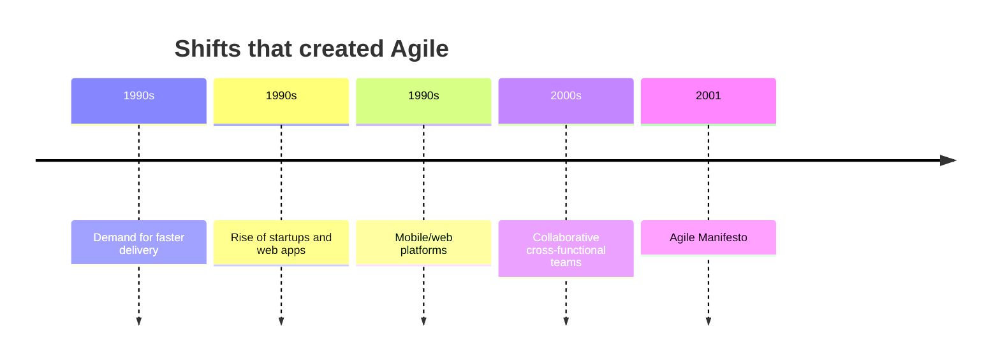

| Before | After |
|---|---|
| Slow sequential development | Fast iterative development |
| Isolated analysts/developers/testers | Collaborative cross-functional teams |
| Desktop, packaged software | Web, mobile, continuously updated services |
| Long release cycles | Frequent releases |
| Physical distribution | Instant online deployment |

**Why the Internet mattered:** distribution became cheap and instant, so requirements and competition moved faster; a two-year specification could be obsolete before release.

## 3.4 Traditional challenge → Agile solution

| Traditional challenge | Agile response |
|---|---|
| Long wait before delivery | Deliver working software **early and often** |
| Fixed upfront requirements | **Welcome change**, even late |
| Heavy documentation | **Working software** + just enough documentation |
| Minimal customer input | **Continuous customer collaboration** |
| Poor success rates | **Short cycles + adaptive planning** |
| Big-bang integration | Continuous integration and testing |

## 3.5 Business and technical drivers

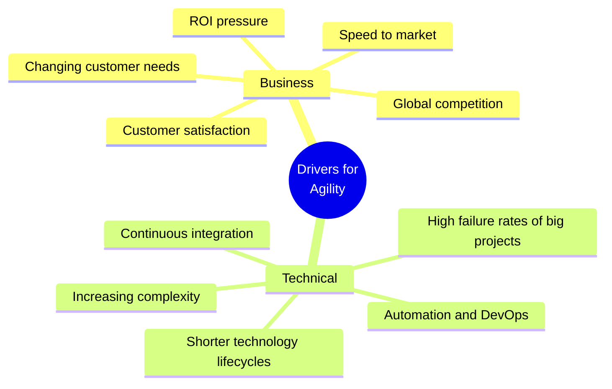

| Category | Driver | Explanation |
|---|---|---|
| **Business** | Speed to market | First/relevant mover advantage |
| **Business** | Changing customer needs | Requirements evolve during the project |
| **Business** | Global competition | Pressure to innovate and adapt |
| **Business** | Customer satisfaction | judged on meeting user expectations |
| **Business** | ROI pressure | Partial early delivery generates revenue sooner |
| **Technical** | Increasing complexity | Interconnected systems need flexible planning |
| **Technical** | Continuous integration | Frequent build/test/deploy cycles |
| **Technical** | Shorter technology lifecycles | Stacks and platforms change rapidly |
| **Technical** | High failure rates of big projects | Large plan-driven projects often fail |
| **Technical** | Automation and DevOps | Agile fits automated testing and delivery |

**Evidence:** the **Standish Group CHAOS Report** consistently showed high failure/challenge rates for large traditional projects. High-profile failures (e.g., the initial Healthcare.gov launch) are used as cautionary examples of late testing and big-bang integration.

## 3.6 Advantages and challenges of Agile

| Advantages | Challenges |
|---|---|
| Faster delivery and early ROI | Cultural shift from command-and-control |
| Flexibility and adaptability | Requires available, engaged customer |
| Continuous customer collaboration | Documentation balance |
| Early risk detection | Scaling to large organisations |
| Continuous testing and quality | Needs discipline; looks informal |
| Better communication | Estimation is relative and uncertain |

> **Exam hits — Chapter 3**
> - Agile is a **response to real failures**, not a random methodology.
> - Traditional models were designed for **predictability**, not volatility.
> - Four rigid-methodology problems: **late bugs, scope creep, low customer involvement, poor risk management**.
> - Business drivers: **speed, changing needs, competition, satisfaction, ROI**.
> - Technical drivers: **complexity, CI, short tech lifecycles, big-project failure, DevOps/automation**.
> - Internet + startups + mobile/web + cross-functional teams = the context for Agile.

---

# 4. The Agile Manifesto

> **In one line:** The Agile Manifesto (February 2001, Snowbird, Utah) defines Agile by **four values and twelve principles**: people, working software, collaboration, and change.

## 4.1 History

| Detail | Fact |
|---|---|
| **Date** | **February 2001** |
| **Location** | **Snowbird, Utah** (ski resort) |
| **Attendees** | **17 representatives** from programming/development backgrounds |
| **Purpose** | Find an alternative to the heavy processes they were frustrated with |
| **Outcome** | **Manifesto for Agile Software Development** signed |
| **Organisation** | Attendees became the **Agile Alliance**, now a global non-profit with **72,000+ members** |

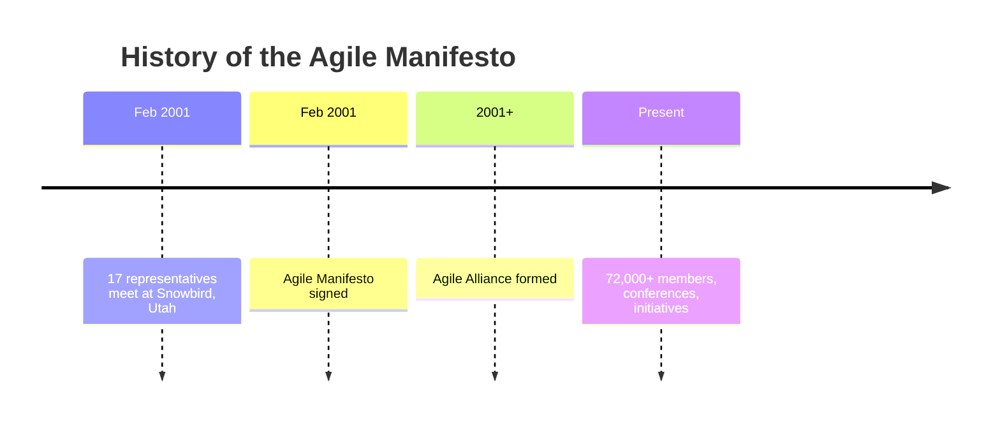

## 4.2 The four values

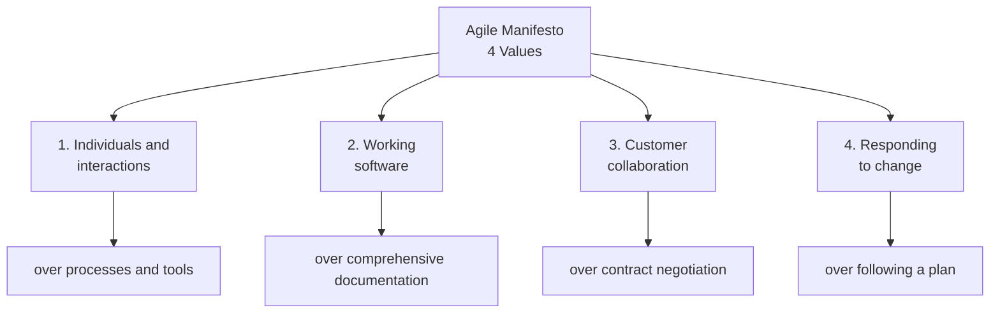

| Value | Interpretation | Not a rejection of… |
|---|---|---|
| **Individuals and interactions** | People and communication outperform perfect tools | processes/tools — use them to support people |
| **Working software** | Deliverable software is the measure of value | documentation — keep useful, living docs |
| **Customer collaboration** | Involve customers continuously | contracts — contracts still exist |
| **Responding to change** | Adapt plans as learning grows | planning — plan continuously |

> **Critical nuance:** the values are **preferences, not absolutes**. “Working software over comprehensive documentation” does **not** mean “no documentation.”

**Real-life mapping**

| Scenario | Value |
|---|---|
| Tool is down, team syncs at a whiteboard | Individuals and interactions |
| Less time on test documents, more on running/fixing tests | Working software |
| Product Owner joins daily stand-ups and reprioritises weekly | Customer collaboration |
| Client requests a dashboard change during UAT | Responding to change |

## 4.3 The twelve principles

| # | Principle | Practical meaning |
|---|---|---|
| **1** | Early and continuous delivery of valuable software | Satisfy the customer early and keep delivering |
| **2** | Welcome changing requirements, even late | Change creates competitive advantage |
| **3** | Deliver working software frequently (weeks, not months) | Short release cadence |
| **4** | Business and developers work together daily | Continuous alignment |
| **5** | Build projects around motivated individuals | Trust, support, empower |
| **6** | Face-to-face conversation is best | Rich, fast communication |
| **7** | Working software is the primary measure of progress | Demos over status reports |
| **8** | Sustainable development pace | No burnout; steady pace |
| **9** | Continuous attention to technical excellence | Good design enables agility |
| **10** | Simplicity — maximising work **not** done | Avoid unnecessary features |
| **11** | Best architectures, requirements, designs emerge from self-organising teams | Team owns technical decisions |
| **12** | Reflect regularly and adjust (retrospective) | Continuous improvement |

**Memory categories**

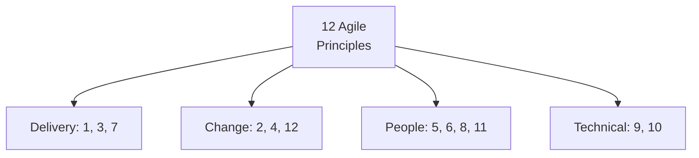

**Values vs principles:** **values = what we believe; principles = how we act on those beliefs.**

## 4.4 Common misconceptions

| Misconception | Reality |
|---|---|
| “Agile means no documentation” | Just enough documentation: user stories, acceptance criteria, Definition of Done |
| “Agile means no planning” | Continuous adaptive planning: roadmap, release, sprint, daily |
| “Agile means no discipline” | Strong discipline: defined roles, cadences, TDD/CI/refactoring |

> **Exam hit:** Agile looks informal but is **highly structured**; the discipline is what makes self-organisation work.

## 4.5 Why Agile is popular

Satisfied customers · improved quality · adaptability · predictability through short iterations · reduced risk · better communication.

**Real-world examples:** Spotify (autonomous squads), Amazon (frequent deployment), Netflix (thousands of deployments/day), Google (reliability + innovation), startups (fast time to market).

> **Exam hits — Chapter 4**
> - **February 2001, Snowbird, Utah, 17 attendees, Agile Alliance, 72,000+ members.**
> - Four values: **individuals & interactions, working software, customer collaboration, responding to change**.
> - Twelve principles grouped as **delivery, change, people, technical**.
> - Values = beliefs; principles = behaviour.
> - Agile ≠ no documentation, no planning, no discipline.
> - Simplicity = **maximising the amount of work not done**.

---

# 5. Agile Core Concepts

> **In one line:** Agile builds software in **small repeated cycles**, using **direct communication, continuous feedback, continuous quality, and adaptive planning** instead of a single predictive plan.

## 5.1 Iterative, incremental, evolutionary

| Concept | Definition | Focus | Example |
|---|---|---|---|
| **Iterative** | Build, review, improve the same software repeatedly | **Refinement** | Improve search UI after user feedback |
| **Incremental** | Deliver the software in small functional parts | **Expansion** | V1 login → V2 search → V3 cart |
| **Evolutionary** | Software continuously changes as needs arise | **Learning/adaptation** | Food app adds live tracking and payments later |

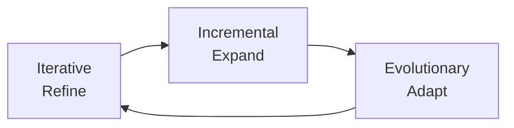

> **Exam trap:** *Iterative expands… no — iterative **refines**, incremental **expands**, evolutionary **adapts**.*

## 5.2 Face-to-face communication

The most effective way to convey information: fast clarification, fewer misunderstandings, faster decisions, stronger collaboration, immediate feedback.

**Benefits:** immediate answers; tone/context preserved; no email ping-pong; trust; real-time adjustment.

## 5.3 Feedback loops

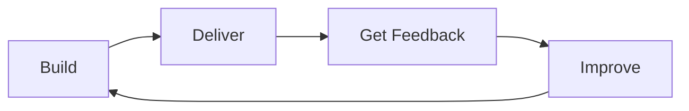

Feedback comes from **customers, end users, and team members**. Benefits: problems found earlier, easier change, higher satisfaction, a product that actually fits user needs.

## 5.4 Quality focus

Quality is **continuous, not a phase**. Every stage — requirements, design, code, test, deploy, monitor — carries quality checks.

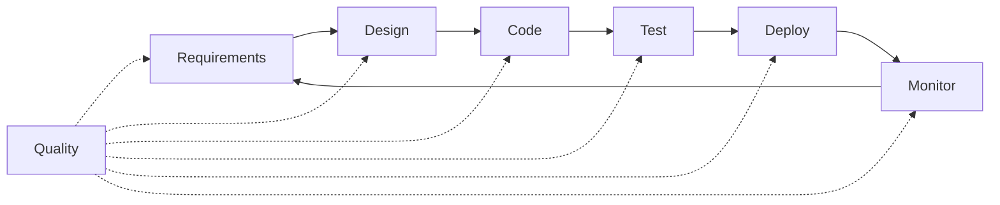

**Benefits:** better quality, fewer errors, less rework, higher customer confidence.

## 5.5 Predictive vs adaptive

| Predictive (plan-driven) | Adaptive (change-driven) |
|---|---|
| Requirements fixed early | Requirements may evolve |
| Detailed upfront plan | Planning evolves continuously |
| Change discouraged | Change welcomed |
| Best for stable projects | Best for changing projects |
| **Examples:** Waterfall, V-Model | **Example:** Agile |

> **Exam line:** *Predictive = plan-driven; adaptive = change-driven.*

## 5.6 Working software vs documentation

Agile says documentation should **support** development, not become the objective.

**Good documentation:** explains critical information, helps developers understand the system, assists future maintenance.

**Agile rule:** build useful software, maintain **necessary** documentation, avoid documents with little practical value.

## 5.7 Waterfall vs iterative

| Waterfall | Iterative |
|---|---|
| Sequential development | Repeated cycles |
| Single final delivery | Multiple improved versions |
| Late customer feedback | Continuous feedback |
| Change is difficult | Change is accommodated |
| Big-bang integration | Integration every cycle |

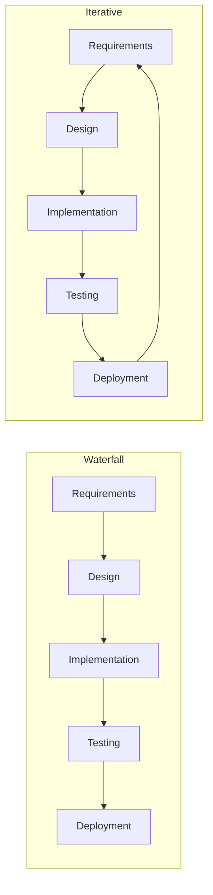

## 5.8 Advantages and challenges

| Advantages | Challenges |
|---|---|
| Flexibility | Requires discipline |
| Early value delivery | Cultural shift |
| Continuous feedback | Documentation balance |
| Better collaboration | Customer availability |
| Continuous quality focus | Scaling |
| Reduced risk | Relative estimation difficulty |

> **Exam hits — Chapter 5**
> - **Iterative = refine; incremental = expand; evolutionary = adapt.**
> - Face-to-face is the **most effective** communication form.
> - Feedback loops are **continuous**, not one-off.
> - Quality is **not a phase**.
> - Predictive = Waterfall/V-Model; adaptive = Agile.
> - “Working software over documentation” ≠ “no documentation”.

---
---

# PART II — AGILE FRAMEWORKS

---

# 6. Scrum

> **In one line:** Scrum is a lightweight empirical framework in which a self-organising team delivers a **usable increment every Sprint**, then **inspects and adapts** through four time-boxed events.

## 6.1 Definition and history

**Scrum** = a lightweight Agile framework for developing **complex products** by delivering usable increments in **short, fixed cycles (Sprints)** and continuously inspecting and adapting.

| Year | Event |
|---|---|
| **1986** | Takeuchi & Nonaka publish *The New New Product Development Game*; the "rugby" approach |
| **1993** | Jeff Sutherland implements the first formal Scrum process at Easel Corporation |
| **1995** | Sutherland & Ken Schwaber present *The SCRUM Development Process* at OOPSLA |
| **2001** | Sutherland & Schwaber help write the Agile Manifesto |
| **2010** | First official **Scrum Guide** standardises roles, artefacts, events, rules |

## 6.2 The five Scrum values

**Commitment · Focus · Openness · Respect · Courage**

| Value | In practice |
|---|---|
| **Commitment** | Team commits to Sprint goals and to each other |
| **Focus** | Primary focus on the Sprint and its goal |
| **Openness** | Transparent about progress, problems, risks |
| **Respect** | Respect for skills, backgrounds, contributions |
| **Courage** | Admit mistakes, raise risks, reject poor quality, say requirements changed |

## 6.3 Three roles

```mermaid
mindmap
  root((Scrum<br/>Roles))
    Product Owner
      WHAT to build
      Product vision
      Backlog ordering
    Scrum Master
      PROCESS
      Coach & facilitator
      Impediment remover
    Developers
      HOW to build
      Cross-functional
      Self-organising
```

| Role | Owns | Key question | Must not do |
|---|---|---|---|
| **Product Owner** | **WHAT** to build and in what order | What is most valuable next? | Dictate technical implementation |
| **Scrum Master** | **PROCESS** and effectiveness | Is Scrum being applied well? | Act as boss/project manager |
| **Developers** | **HOW** to build | How do we deliver a quality increment? | Let scope be imposed mid-Sprint |

**Product Owner responsibilities:** product vision and goal; voice of the customer; create, order, and communicate the Product Backlog; maximise value; make timely decisions.

**Developers:** cross-functional and self-organising; collectively own architecture, database, UI, coding, testing; deliver a tested, usable increment each Sprint. **T-shaped professional** = deep expertise in one area, broad understanding of others.

**Scrum Master:** guardian of Scrum, coach/facilitator, impediment remover, servant leader — **not the boss**; guides events, coaches the PO and Developers, protects the team from disruption.

## 6.4 Three artefacts

```mermaid
mindmap
  root((Scrum<br/>Artifacts))
    Product Backlog
      Ordered list
      Single source of work
      Product Goal
    Sprint Backlog
      Subset for the Sprint
      Sprint Goal
      Owned by Developers
    Increment
      Usable outcome
      Meets Definition of Done
      Cumulative
```

| Artefact | Definition | Owner | Commitment |
|---|---|---|---|
| **Product Backlog** | Ordered, dynamic, transparent list of everything that might be needed | Product Owner | **Product Goal** |
| **Sprint Backlog** | Subset selected for the Sprint + plan to deliver it | Developers | **Sprint Goal** |
| **Increment** | Usable, cumulative outcome meeting the Definition of Done | Developers | **Definition of Done (DoD)** |

- **Product Goal** = long-term objective; sits at the top of the Product Backlog and directs multiple Sprints.
- **Sprint Goal** = single-Sprint objective; answers “why this Sprint?”.
- **Definition of Done** = shared quality bar. Work that does not meet DoD is **not an Increment**.
- An Increment must be **releasable** every Sprint, even if the business chooses not to release it.

## 6.5 Sprint events

```mermaid
flowchart TD
    A[Sprint] --> B[Sprint Planning]
    B --> C[Daily Scrum]
    C --> D[Sprint Review]
    D --> E[Sprint Retrospective]
    E --> A
    F[Backlog Refinement] -.-> B
    F -.-> A
```

| Event | Time-box (4-week Sprint) | Purpose | Who attends |
|---|---|---|---|
| **Sprint** | 2–4 weeks | Create a usable, valuable increment | Scrum Team |
| **Sprint Planning** | 8 hours | Decide *what* and *how* | Scrum Team |
| **Daily Scrum** | 15 min, daily | Inspect progress and re-plan the day | Developers (SM ensures; PO may attend) |
| **Sprint Review** | 4 hours | Inspect the Increment, get stakeholder feedback, adapt backlog | Scrum Team + stakeholders |
| **Sprint Retrospective** | 3 hours | Inspect process, people, tools, DoD; improve | Scrum Team only |
| **Backlog Refinement** | Ongoing | Review, refine, re-order backlog items | Scrum Team |

**The Sprint:** fixed length, never extended; a new Sprint starts immediately; contains all work needed for the Sprint Goal; the “heartbeat” of Scrum.

**Daily Scrum — three questions:** what did I do yesterday toward the Sprint Goal? what will I do today? any impediments? It is **not a status report**; it is the Developers' planning session.

**Sprint Review vs Retrospective:** Review = **product** + stakeholders; Retrospective = **process** + Scrum Team only.

## 6.6 Scrum flow

```mermaid
flowchart TD
    A[Product Vision] --> B[Product Backlog]
    B --> C[Sprint Planning]
    C --> D[Sprint Backlog]
    D --> E[Implementation]
    E --> F[Daily Scrum]
    F --> E
    E --> G[Increment]
    G --> H[Sprint Review]
    H --> I[Sprint Retrospective]
    I --> J[Backlog Refinement]
    J --> B
```

**Three pillars of empiricism:** **transparency, inspection, adaptation**.

## 6.7 Advantages and challenges

| Advantages | Challenges |
|---|---|
| Flexibility and adaptability | Requires discipline |
| Transparency | Cultural shift |
| Frequent feedback | Role confusion (PO vs SM vs PM) |
| Continuous improvement | Meeting overhead |
| Team empowerment and self-organisation | Not ideal for every project |
| Predictable rhythm | Scaling needs LeSS/SAFe |
| Early value delivery | Story points are relative |
| Risk reduction via small increments | — |

> **Exam hits — Chapter 6**
> - **PO = WHAT, Developers = HOW, Scrum Master = PROCESS.**
> - 3 artefacts = Product Backlog, Sprint Backlog, Increment; commitments = Product Goal, Sprint Goal, DoD.
> - 5 events = Sprint, Planning, Daily Scrum, Review, Retrospective (Refinement is ongoing, not a formal event).
> - Daily Scrum = 15 min, Developers only required, not a status report.
> - Review = product + stakeholders; Retrospective = process + team only.
> - Sprint = time-boxed, never extended; Increment must meet DoD.

---

# 7. Kanban

> **In one line:** Kanban is a **visual, evolutionary workflow method**: make work visible, **cap WIP**, manage flow, make policies explicit, and improve continuously.

## 7.1 Definition

**Kanban** = a **visual workflow management method** that optimises delivery by **visualising tasks**, **limiting work in progress**, and **focusing on flow efficiency**. Work is **pulled** through the system as capacity frees up.

**Best for:** continuous incoming work, volatile priorities, maintenance/support, DevOps, mature teams, organisations resistant to Scrum.

## 7.2 Six core practices

```mermaid
mindmap
  root((Kanban<br/>Core Practices))
    Visualize Work
      Boards, cards, columns
    Limit WIP
      Prevent overload
      Expose bottlenecks
    Manage Flow
      Cycle time
      Throughput
    Make Policies Explicit
      Written rules
      Team ownership
    Implement Feedback Loops
      Daily meeting
      Replenishment
    Improve Continuously
      Kaizen
      Data-driven
```

| # | Practice | Meaning |
|---|---|---|
| 1 | **Visualise work** | Boards, cards, columns show all work in real time |
| 2 | **Limit WIP** | Strict caps prevent overload and expose bottlenecks |
| 3 | **Manage flow** | Actively steer work, measure cycle time/throughput |
| 4 | **Make policies explicit** | Write and own the rules for moving work |
| 5 | **Implement feedback loops** | Daily Kanban meeting, replenishment meeting |
| 6 | **Improve continuously** | Small, data-driven Kaizen changes |

## 7.3 Board anatomy

| Element | Meaning | Question it answers |
|---|---|---|
| **Card** | One piece of work: title, assignee, metadata | **WHAT** |
| **Column** | Workflow state/phase | **WHERE** |
| **WIP limit** | Maximum cards allowed in a column | **HOW MANY** |
| **Explicit policy** | Written rule for moving work | **HOW** |

```mermaid
flowchart LR
    A[Backlog] --> B[To Do]
    B --> C[In Progress<br/>WIP: 2]
    C --> D[Review<br/>WIP: 1]
    D --> E[Done]
```

Basic board columns: **To Do → Work In Progress → Complete**. Columns can be added/changed and represent states, so they expose flow and bottlenecks.

## 7.4 WIP limits

> A **WIP limit** is a strict cap on the number of cards allowed in a column at one time. A WIP limit of 2 means a third card cannot be pulled in — at all.

**Benefits:** eliminates multitasking; exposes bottlenecks; forces collaboration (if a column is full, help clear it rather than start new work); shortens cycle time.

```mermaid
flowchart LR
    A[Developer finishes<br/>email verification] --> B{Testing column full?}
    B -->|Yes| C[Cannot start new work]
    C --> D[Pair with tester<br/>to unblock pipeline]
    D --> E[Testing completes]
    E --> F[Work flows]
```

## 7.5 Explicit policies

A **policy** is a clear, written agreement about how work is managed and moved. Policies remove guesswork, are owned by the team, and are posted on the board.

| Transition | Example policy |
|---|---|
| Backlog → Ready | Product Owner ranks items in absolute priority order |
| Ready → In Progress | Pull the top card only when capacity opens |
| In Progress → Done | Must meet the full Definition of Done (tests, review, security, deployment) |

## 7.6 Feedback loops

| Meeting | Frequency | Purpose |
|---|---|---|
| **Kanban (daily) meeting** | Daily, ~10 min | Stand at the board, work **right to left**, ask what blocks items from Done and how to unblock them |
| **Replenishment meeting** | Weekly / bi-weekly | Review the backlog and pull the next highest-priority items into To Do |

## 7.7 Continuous improvement (Kaizen)

**Kaizen** = “change for the better”. Kanban improvement is:
- **small and steady** — many incremental changes rather than one disruptive reorganisation;
- **data-driven** — use lead time, cycle time, and bottleneck data from the board.

## 7.8 Swimlanes

**Swimlanes** are **horizontal rows** that separate classes of work while sharing the same columns.

| Swimlane | Purpose | Example |
|---|---|---|
| **Expedite** (top) | Critical emergencies; bypass normal rules | Live login page crashed |
| **Standard work** (middle) | Regular feature flow | Google login, profile dashboard |
| **Bugs / maintenance** (bottom) | Minor fixes and upkeep | Fix login button alignment |

## 7.9 History

```mermaid
timeline
    title History of Kanban
    1940s : Toyota improves production
    1940s : Taiichi Ohno observes grocery "pull" replenishment
    1950s : Just-in-time production at Toyota
    2004 : Kanban reaches software development at Microsoft
    2007 : David J. Anderson publishes software Kanban principles
```

Pull system: stock/serve only what is needed, when it is needed.

## 7.10 Scrumban and evolution

- **Scrum → Kanban:** mature Scrum teams outgrow sprint boundaries and want continuous pull.
- **Traditional → Kanban:** Kanban is **evolutionary** and non-disruptive; Scrum is **revolutionary** and changes roles/meetings/timelines from day one.
- **Scrumban** = hybrid: Scrum structure + Kanban flow/WIP limits.

| Aspect | Scrum | Kanban |
|---|---|---|
| Change type | Revolutionary | Evolutionary |
| Cadence | Sprints 2–4 weeks | Continuous flow |
| WIP limits | Implicit via sprint planning | Explicit caps |
| Roles | PO, SM, Developers | Not strictly defined |
| Change mid-cycle | Discouraged | Allowed anytime |
| Key metrics | Velocity, burndown | Cycle time, lead time, throughput |

## 7.11 Choosing Scrum vs Kanban

| Choose Scrum when… | Choose Kanban when… |
|---|---|
| Planned product releases | Continuous, flow-based delivery |
| Priorities stay fixed 2+ weeks | Priorities change day to day |
| New Agile team needing guardrails | Mature, disciplined team |
| Need structure, roles, ceremonies | Organisation too rigid for Scrum |
| Complex product discovery | Support, maintenance, DevOps, ops |

## 7.12 Advantages and challenges

| Advantages | Challenges |
|---|---|
| Flexible; changes anytime | No fixed cadence |
| Visual and transparent | Less structure for Agile beginners |
| WIP limits prevent overload | WIP limits need discipline |
| Continuous delivery | Metrics need maturity |
| Easy, non-disruptive adoption | Can become chaotic without policies |
| Data-driven improvement | Not ideal for feature-rich product planning |
| Forces collaboration | — |
| Reduces multitasking | — |

> **Exam hits — Chapter 7**
> - Kanban = **visual workflow management**, not a full methodology.
> - Six practices: **visualise, limit WIP, manage flow, explicit policies, feedback loops, continuous improvement**.
> - **Card = WHAT; column = WHERE; WIP limit = HOW MANY; policy = HOW.**
> - WIP limit is a **strict cap**; it exposes bottlenecks and forces collaboration.
> - Swimlanes = **horizontal**; expedite lane handles crises.
> - History: **Toyota 1940s → Microsoft 2004 → Anderson 2007**.
> - Scrum = revolutionary; Kanban = evolutionary; Scrumban = hybrid.

---

# 8. Extreme Programming (XP)

> **In one line:** XP is Agile's **engineering discipline**: take good practices to the extreme — test before code, review continuously, integrate constantly, design simply, and refactor relentlessly.

## 8.1 Definition and relationship to Scrum

**Extreme Programming (XP)** = an Agile methodology that applies proven development practices to their **extreme end**.

| If this is good… | Do it extremely… | XP practice |
|---|---|---|
| Code review | Review continuously | **Pair Programming** |
| Test before deployment | Test before writing code | **TDD** |
| Short releases | Integrate/deploy many times a day | **Continuous Integration** |

> **Scrum says:** deliver a usable increment each Sprint.  
> **XP shows:** how to make that increment **high-quality and reliable**.

XP is especially useful when requirements change constantly and constant change threatens code quality.

## 8.2 Technical practices

```mermaid
mindmap
  root((XP Technical<br/>Practices))
    TDD
      Red
      Green
      Refactor
    Pair Programming
      Driver
      Navigator
    Continuous Integration
      Merge often
      Automated tests
    Refactoring
      5-minute rule
    Simple Design
      Passes tests
      Reveals intent
      DRY
      Fewest elements
    Collective Ownership
      Anyone can change any code
```

### Pair programming

Two developers, one workstation:
- **Driver** — types the code.
- **Navigator** — reviews in real time, thinks about design, security, edge cases.
- Switch roles frequently.

**Benefits:** continuous code review, knowledge sharing, fewer defects, better design, reduced bus factor.

### Test-Driven Development (TDD)

```mermaid
flowchart LR
    A[Red<br/>Write a failing test] --> B[Green<br/>Write just enough code]
    B --> C[Refactor<br/>Clean up without changing behaviour]
    C --> A
```

| Phase | Action |
|---|---|
| **Red** | Write a test for behaviour that does not exist; watch it fail |
| **Green** | Write the minimum code needed to pass |
| **Refactor** | Improve structure while keeping tests green |

TDD is **test-first**, not test-after. The test drives the design and provides a regression safety net.

### Continuous Integration (CI)

Developers merge into the shared mainline **multiple times a day**; automated build/tests run immediately. This prevents long-lived branches and late integration surprises.

```mermaid
sequenceDiagram
    participant Dev1 as Developer 1
    participant Dev2 as Developer 2
    participant Repo as Shared Codebase
    participant CI as CI Server
    Dev1->>Repo: Merge code
    Dev2->>Repo: Merge code
    Repo->>CI: Trigger build & tests
    CI->>CI: Run automated tests
    alt Tests pass
        CI->>Repo: Build successful
    else Tests fail
        CI->>Dev1: Notify failure
        CI->>Dev2: Notify failure
    end
```

### Refactoring

**Refactoring** = improving the internal design of code **without changing its behaviour**.

- Done continuously, not as a separate phase.
- **5-minute rule:** if you cannot understand code within five minutes, refactor it.
- Prevents technical debt and keeps the codebase malleable.

### Simple Design — four rules

1. **Passes all tests.**
2. **Reveals intent** — clear, readable, no clever tricks.
3. **No duplicate code (DRY).**
4. **Fewest possible elements** — classes, methods, lines.

| Acronym | Meaning | Rule |
|---|---|---|
| **YAGNI** | You Aren't Gonna Need It | Do not build for hypothetical future needs |
| **DRY** | Don't Repeat Yourself | Centralise duplicated logic; duplicates multiply bugs |

### Collective code ownership

The whole team owns the codebase; **anyone may change any line at any time**. This removes key-person dependency, spreads knowledge, and enables continuous refactoring.

It works only with safety nets:
- **Pair programming** — a second pair of eyes prevents careless changes.
- **TDD** — automated tests immediately reveal breakage.

## 8.3 Team practices

| Practice | Meaning |
|---|---|
| **Sustainable pace** | Roughly a 40-hour week; overtime is rare, not routine |
| **On-site customer** | Business expert available to clarify requirements, priorities, feedback |
| **Coding standards** | Consistent style so code looks written by one developer |
| **Planning Game** | Customers decide scope/priority/dates/budget; developers estimate effort/technology/capacity |
| **Small releases** | Deploy the smallest viable increment frequently |

**Planning Game split:** **business decisions** = scope, priority, release dates, budget; **technical decisions** = estimates, technology choices, team capacity.

## 8.4 XP life cycle

```mermaid
flowchart TD
    A[Stories] --> B[Release Planning]
    A --> C[Test Scenarios]
    B --> D[Iteration 1-2 weeks]
    C --> D
    D --> E[Acceptance Test]
    E --> F[Customer Approval]
    F --> G[Small Release]
    H[Spike] --> A
    H --> B
```

| Step | What happens |
|---|---|
| 1 | Customer writes **user stories** |
| 2 | **Spike** reduces technical uncertainty |
| 3 | Developers produce honest estimates |
| 4 | **Release Planning** matches scope to budget/time |
| 5 | Customer defines **test scenarios/acceptance criteria** |
| 6 | **Iteration** (1–2 weeks) uses TDD + pair programming |
| 7 | **Acceptance tests** validate behaviour |
| 8 | On-site customer gives **sign-off** |
| 9 | **Small release** goes live |

**Phases:** Exploration → Planning → Iterations to Release → Production.

## 8.5 Spike and Slack

**Spike** = short, time-boxed research/experiment to answer a technical question or reduce uncertainty before estimating/implementing.

- Usually hours to 1–2 days.
- Output = knowledge, notes, diagram, throwaway prototype.
- **Not production code.**

**Slack** = planned flexibility, typically **10–20% of iteration capacity**, reserved for optional work:
refactoring, extra tests, infrastructure, learning/spikes. Slack can be skipped if urgent work appears.

```mermaid
flowchart LR
    A[Iteration Planning] --> B[Select Stories]
    B --> C[Reserve 10-20% Slack]
    C --> D[Slack Stories]
    D --> D1[Refactoring]
    D --> D2[Extra tests]
    D --> D3[Infrastructure]
    D --> D4[Learning / Spike]
    D --> E{Urgent work?}
    E -->|Yes| F[Skip slack]
    E -->|No| G[Complete slack]
```

## 8.6 Roles

| Role | Responsibility |
|---|---|
| **Customer** | On-site; prioritises stories, answers questions, participates in acceptance testing |
| **Programmers** | Estimate, write tests, implement stories |
| **Coach** | Ensures practices become habits; optional |
| **Tracker** | Tracks metrics (velocity, burndown), identifies roadblocks |

## 8.7 The 14 XP principles

| # | Principle | Meaning |
|---|---|---|
| 1 | **Humanity** | Balance people's needs with project needs |
| 2 | **Economics** | Someone pays; keep budget in mind |
| 3 | **Mutual benefit** | Practices should benefit individual, team, customer |
| 4 | **Self-similarity** | Same pattern at monthly, weekly, daily scales |
| 5 | **Improvement** | Do your best today; get better tomorrow |
| 6 | **Diversity** | Different perspectives produce better solutions |
| 7 | **Reflection** | Notice what works and what doesn't |
| 8 | **Flow** | Continuous development, not distinct phases |
| 9 | **Opportunity** | Problems are learning opportunities |
| 10 | **Redundancy** | Some redundancy prevents major quality failures |
| 11 | **Failure** | It is safe to try and learn from failure |
| 12 | **Quality** | You cannot go faster by lowering quality |
| 13 | **Accepted responsibility** | Responsibility must come with authority |
| 14 | **Baby steps** | Adopt changes incrementally |

## 8.8 When to use XP

Small team · constant customer contact · adaptable team · technically skilled developers · volatile requirements · high quality demands.

| Advantages | Challenges |
|---|---|
| High code quality | Steep learning curve |
| Frequent feedback | Requires on-site customer |
| Adaptability | Best for small teams |
| Knowledge sharing | Resistance to pair programming |
| Reduced integration risk | Cultural shift |
| Sustainable pace | Not for every project |
| Technical excellence | — |

> **Exam hits — Chapter 8**
> - XP = **technical/engineering discipline**; Scrum = project-management framework.
> - **TDD = Red → Green → Refactor.**
> - Pair programming = **Driver + Navigator**, switch often.
> - **Simple Design 4 rules:** tests, intent, DRY, fewest elements.
> - **YAGNI** = don't build hypothetical features; **DRY** = don't duplicate.
> - Collective ownership works because of **pair programming + TDD**.
> - **Spike** = time-boxed throwaway research; **Slack** = 10–20% planned flexibility.
> - Roles: Customer, Programmers, Coach (optional), Tracker.
> - 14 principles include humanity, economics, mutual benefit, self-similarity, improvement, diversity, reflection, flow, opportunity, redundancy, failure, quality, accepted responsibility, baby steps.

---

# 9. Lean Project Management

> **In one line:** Lean is a **philosophy** — maximise customer value and minimise waste — applied through five principles, flow, pull, and relentless Kaizen.

## 9.1 Definition and history

**Lean Project Management** = managing projects to **maximise customer value** and **minimise waste** across the lifecycle, using principles from Lean manufacturing.

> **Lean is not a methodology** like Scrum or Waterfall. It is a **set of principles** that can be combined with any methodology.

```mermaid
timeline
    title Evolution of Lean
    1948-1975 : Toyota Production System
    1988 : John Krafcik coins "Lean Production System"
    1990s : "The Toyota Way" documented by Liker
    2000s : Lean spreads to software and IT
    2003 : Lean Software Development (Poppendiecks)
    2010s : Kanban evolves as a Lean method (Anderson)
```

| Milestone | Contribution |
|---|---|
| **Toyota Production System** (1948–75) | Waste elimination, flow, pull, JIT |
| **John Krafcik** (1988) | Coined “Lean Production System” |
| **Jeffrey Liker** | *The Toyota Way* — documented principles |
| **Mary & Tom Poppendieck** | *Lean Software Development* |
| **David J. Anderson** | Kanban as a Lean method for software |

## 9.2 Five Lean principles

```mermaid
flowchart TD
    A[1. Identify Value] --> B[2. Map the Value Stream]
    B --> C[3. Create Flow]
    C --> D[4. Establish Pull]
    D --> E[5. Continuous Improvement]
    E --> A
```

| # | Principle | Key question / action |
|---|---|---|
| 1 | **Identify value** | What does the customer truly value? |
| 2 | **Map the value stream** | Which steps create value, which are necessary NVA, which are pure waste? |
| 3 | **Create flow** | Remove bottlenecks, inconsistency, and waste so work moves smoothly |
| 4 | **Establish pull** | Pull work only when capacity is available; do not push |
| 5 | **Continuous improvement** | **Kaizen** — always “better,” never “best” |

**Value-stream categories**

| Category | Meaning | Action |
|---|---|---|
| **Value-adding (VA)** | Directly creates what the customer wants | Keep/optimise |
| **Necessary non-value-adding** | Compliance, approvals, required admin | Minimise |
| **Unnecessary non-value-adding** | Excessive docs, long meetings, waiting | Eliminate |

## 9.3 The 3M of flow

| Term | Meaning | Problem | Fix |
|---|---|---|---|
| **Muri** | Overburden | Bottlenecks, overloaded people | Add capacity, rebalance, improve process |
| **Mura** | Inconsistency | Variable quality, defects, uneven flow | Standardise, reduce variation |
| **Muda** | Waste | Non-value-adding work | Eliminate |

```mermaid
mindmap
  root((Create Flow<br/>3M))
    Muri
      Overburden
      Bottlenecks
    Mura
      Inconsistency
      Defects
    Muda
      Waste
      Non-value tasks
```

## 9.4 The 8 wastes (software)

| Waste | Software example |
|---|---|
| **Defects** | Bugs and rework |
| **Overproduction** | Features nobody requested; gold plating |
| **Waiting** | Waiting for approvals, dependencies, environments |
| **Non-utilised talent** | Skilled developers doing repetitive manual work |
| **Transportation** | Excessive handoffs, context switching |
| **Inventory** | Large backlog of unfinished stories |
| **Motion** | Searching for documents/code, tool switching |
| **Extra processing** | Unnecessary reports, redundant documentation |

> **Mnemonic:** **DOWNTIME** — Defects, Overproduction, Waiting, Non-utilised talent, Transportation, Inventory, Motion, Extra processing.

## 9.5 Implementing Lean — seven practices

Eliminate waste · small batches · continuous delivery · limit WIP · automation · build quality in · continuous improvement.

## 9.6 Lean vs Kanban

| Lean | Kanban |
|---|---|
| **Philosophy** — what principles to follow | **Tool/method** — how to apply them |
| Organisation/project-wide | Team/task-level |
| Eliminate waste, maximise value | Visualise work, limit WIP, manage flow |
| Long-term continuous improvement | Ongoing workflow management |
| Metrics: lead time, throughput, value | Metrics: WIP, cycle time, cumulative flow |

```mermaid
flowchart LR
    A[Lean Principles] --> B[Kanban Practices]
    A --> A1[Eliminate waste]
    A --> A2[Deliver value]
    A --> A3[Improve flow]
    A --> A4[Kaizen]
    B --> B1[Visualise work]
    B --> B2[Limit WIP]
    B --> B3[Pull work]
    B --> B4[Measure flow]
```

## 9.7 Value Stream Mapping (VSM)

**VSM** = a detailed flowchart of the steps, wait times, and information flow required to deliver value; used to expose waste and design a better future state.

**Current-state example — login module**

| # | Step | Type | Days | VA/NVA |
|---|---|---|---|---|
| 1 | PO writes requirements | Process | 1 | VA |
| 2 | Wait for approval | Wait | 1 | NVA |
| 3 | Set up environment | Process | 0.5 | VA |
| 4 | Wait for DB access | Wait | 0.5 | NVA |
| 5 | Code login | Process | 2 | VA |
| 6 | Wait for code review | Wait | 1 | NVA |
| 7 | Peer review | Process | 0.5 | VA |
| 8 | Fix review comments | Process | 0.5 | VA |
| 9 | Wait for CI/CD | Wait | 0.25 | NVA |
| 10 | QA tests | Process | 1 | VA |
| 11 | Fix bug | Process | 1 | VA |
| 12 | Wait for re-test | Wait | 0.25 | NVA |
| 13 | Retest and close | Process | 0.25 | VA |

```mermaid
flowchart LR
    A[Requirements<br/>1d VA] --> B[Approval wait<br/>1d NVA]
    B --> C[Env setup<br/>0.5d VA]
    C --> D[DB wait<br/>0.5d NVA]
    D --> E[Code<br/>2d VA]
    E --> F[Review wait<br/>1d NVA]
    F --> G[Peer review<br/>0.5d VA]
    G --> H[Fix comments<br/>0.5d VA]
    H --> I[CI/CD wait<br/>0.25d NVA]
    I --> J[QA test<br/>1d VA]
    J --> K[Fix bug<br/>1d VA]
    K --> L[Retest wait<br/>0.25d NVA]
    L --> M[Retest & close<br/>0.25d VA]
```

**Calculations**

```
VA  = 6.75 days
NVA = 3.00 days
Lead time = VA + NVA = 9.75 days ≈ 10 days
```

**Future state (after automation, pre-approved access, faster reviews):**

```
VA  = 4.25 days
NVA = 0.45 days
Lead time = 4.7 days  (down from 10 days, ~53% improvement)
```

**VSM improvement loop:** analyse current state → discuss with team → define future state → create Lean action plan → implement and monitor.

## 9.8 Advantages and challenges

| Advantages | Challenges |
|---|---|
| Customer focus | Cultural shift |
| Waste reduction | Initial training/process investment |
| Improved flow | Resistance to change |
| Kaizen mindset | Value/waste can be subjective |
| Builds quality in | Long-term commitment |
| Fits any methodology | Results take time |
| Empowers teams | — |

> **Exam hits — Chapter 9**
> - Lean = **philosophy**, not methodology; Kanban = **tool** within Lean.
> - Five principles: **identify value → map value stream → create flow → establish pull → improve continuously**.
> - **Muri = overburden; Mura = inconsistency; Muda = waste.**
> - Eight wastes = **DOWNTIME**.
> - **Lead time = VA + NVA**; only unnecessary NVA is eliminated.
> - VSM example: **10 days → 4.7 days** after improvement.
> - **Kaizen** = continuous improvement; **pull** = make only when needed.

---

# 10. Scaling Agile: LeSS & SAFe

> **In one line:** Scaling frameworks keep Agile's essence while coordinating many teams on one product — **LeSS** does it minimally with Scrum, **SAFe** does it comprehensively for the enterprise.

## 10.1 Why scale?

Agile began with **small co-located teams (5–9 people)**. Modern products need dozens/hundreds of developers across teams, time zones, and domains. The challenge: **keep collaboration, transparency, and continuous improvement with 20+ teams on one product.**

```mermaid
mindmap
  root((Scaling<br/>Agile))
    LeSS
      LeSS 2-8 teams
      LeSS Huge 8+ teams
      Requirement Areas
    SAFe
      ART
      PI Planning
      New roles
      4 configurations
```

## 10.2 LeSS — Large-Scale Scrum

> **LeSS = Scrum applied to many teams working together on one product** — same principles, rules, elements, and purpose, as simply as possible.

| Framework | Team count | Key idea |
|---|---|---|
| **LeSS** | **2–8 teams** | One Product Owner, one Product Backlog, one product, one Sprint |
| **LeSS Huge** | **8+ teams** | Adds **Requirement Areas** and **Area Product Owners** |

**LeSS structure — four layers**

```mermaid
flowchart TD
    A[Principles<br/>core mindset] --> B[Rules<br/>mandatory framework]
    B --> C[Guides<br/>recommended practices]
    C --> D[Experiments<br/>ideas to try]
```

| Layer | Meaning |
|---|---|
| **Principles** | Core values and mindset |
| **Rules** | Mandatory framework elements |
| **Guides** | Optional but recommended (“good practice”) |
| **Experiments** | Ideas to try; not universally recommended; may intentionally challenge norms |

**The 10 LeSS principles**

| # | Principle | Core idea |
|---|---|---|
| 1 | **Large-Scale Scrum is Scrum** | Scale Scrum simply; don't invent a new method |
| 2 | **Transparency** | Everyone sees progress, problems, challenges |
| 3 | **More with Less** | Reduce complexity/overhead, not people |
| 4 | **Whole-Product Focus** | One backlog, one PO, one shippable product, one Sprint |
| 5 | **Customer-Centric** | Learn and solve real customer problems; reduce their wait time |
| 6 | **Continuous Improvement Towards Perfection** | Strive for a perfect value stream; never assume “done” |
| 7 | **Lean Thinking** | Maximise value, minimise waste |
| 8 | **Systems Thinking** | Optimise the whole; local optimisation sub-optimises the system |
| 9 | **Empirical Process Control** | Inspect and adapt product, process, organisation |
| 10 | **Queuing Theory** | Reduce batch size, WIP, handoffs, overload, and delays |

**LeSS framework (2–8 teams)**

- **One Product Owner** and **one Product Backlog** for all teams.
- Cross-functional **feature teams**, each with a Scrum Master.
- **Two-part Sprint Planning:**
  - **Part 1:** all teams + PO decide **what** to build and agree a shared Sprint Goal.
  - **Part 2:** each team independently decides **how** to implement its portion.
- **Joint Sprint Review** with all teams and stakeholders.
- **Team retrospectives + Overall Retrospective** with team representatives, Scrum Masters, and PO.
- Coordination is **direct between teams**, with no extra management layer.

```mermaid
flowchart LR
    A[One PO<br/>One Product Backlog] --> B[Sprint Planning 1<br/>All teams: WHAT]
    B --> C[Sprint Planning 2<br/>Each team: HOW]
    C --> D[Team Sprint Backlogs]
    D --> E[Daily Scrums]
    E --> F[Joint Sprint Review]
    F --> G[Team Retrospectives]
    G --> H[Overall Retrospective]
    H --> B
```

**LeSS Huge (8+ teams)**

```mermaid
flowchart TD
    A[Chief Product Owner] --> B[Global Product Backlog]
    B --> C[Area 1 Backlog]
    B --> D[Area 2 Backlog]
    B --> E[Area N Backlog]
    C --> C1[Area PO 1 + 4-8 teams]
    D --> D1[Area PO 2 + 4-8 teams]
    E --> E1[Area PO N + 4-8 teams]
    C1 --> F[Shared Sprint]
    D1 --> F
    E1 --> F
    F --> G[Shared Sprint Review]
    G --> H[Overall Retrospective]
```

**Requirement Areas** partition the global backlog by customer value/domain. Each area has an **Area Product Owner** and **4–8 feature teams**. One **Chief Product Owner** owns the global backlog and overall product direction.

**Guides vs experiments**

| Guides | Experiments |
|---|---|
| Recommended good practice | Ideas to try |
| One Definition of Done; rotate Scrum Masters; cross-functional feature teams | No Sprint Planning 1; rotate product areas; remove PO for a Sprint |
| Generally beneficial, adapt to context | Not universally recommended; test boundaries |

## 10.3 SAFe — Scaled Agile Framework

> **SAFe** is a comprehensive **knowledge base** of principles, practices, and competencies for applying Agile at enterprise scale.

Built from **Lean + Agile + DevOps + Systems Thinking**. Attractive in regulated/complex enterprises because it supports budgeting, compliance, and multiple value streams.

**The 10 SAFe principles**

| # | Principle | Meaning |
|---|---|---|
| 1 | **Take an economic view** | Cost of delay, lead time, value |
| 2 | **Apply systems thinking** | Optimise the whole system |
| 3 | **Assume variability; preserve options** | Set-based design; decide late where useful |
| 4 | **Build incrementally with fast, integrated learning cycles** | Short feedback loops |
| 5 | **Base milestones on objective evaluation of working systems** | Demonstrated increments, not documents |
| 6 | **Visualise and limit WIP, reduce batch sizes, manage queues** | Lean/queueing flow |
| 7 | **Apply cadence, synchronise with cross-domain planning** | PI planning aligns teams |
| 8 | **Unlock intrinsic motivation of knowledge workers** | Empower, purpose, mastery |
| 9 | **Decentralise decision-making** | Decide at the lowest responsible level |
| 10 | **Organise around value** | Align teams/ARTs to end-to-end value |

**ART and PI**

- **Agile Release Train (ART)** = a long-lived **team of teams** (typically 50–125 people) with a shared vision, backlog, roadmap, and fixed schedule.
- **Program Increment (PI)** = a **timeboxed planning and execution cycle of 8–12 weeks**, containing PI Planning, iterations, system demos, and Inspect & Adapt.

```mermaid
flowchart LR
    A[PI Planning] --> B[Iteration 1]
    B --> C[Iteration 2]
    C --> D[Iteration 3]
    D --> E[Iteration 4]
    E --> F[System Demo]
    F --> G[Inspect & Adapt]
    G --> A
```

**SAFe roles vs Scrum**

| Scrum | SAFe | Works across | Responsibility |
|---|---|---|---|
| Product Owner | **Product Manager** | All POs | Prioritises **features** for the ART |
| Scrum Master | **Release Train Engineer (RTE)** | All SMs | Coordinates ART, removes cross-team impediments, facilitates PI Planning |
| Developers | **System Architect/Engineering** | All teams | Technical architecture and guidance |
| Stakeholders | **Business Owners** | PMs and ART | Business priorities, evaluate delivered value |

**Four SAFe configurations**

| Configuration | Scope |
|---|---|
| **Essential SAFe** | Foundation: ART, PI Planning, basic roles |
| **Large Solution SAFe** | Multiple ARTs building one large solution |
| **Portfolio SAFe** | Portfolio strategy, Lean budgeting, value streams |
| **Full SAFe** | Most comprehensive; all levels |

**Banking example:** one transformation with multiple ARTs — Digital Banking Experience, Core Banking Integration, Compliance & Risk, Customer Insights, DevOps Enablement. Each ART contains teams such as Account Access, Fund Transfer, BillPay, Mobile UX, Notifications, Help & Support, Security, Integration.

## 10.4 LeSS vs SAFe

| Aspect | LeSS | SAFe |
|---|---|---|
| **Philosophy** | Scrum applied to many teams | Comprehensive enterprise Agile framework |
| **Complexity** | Minimal | High; many roles/artefacts/ceremonies |
| **Team count** | 2–8; Huge 8+ | Hundreds of teams |
| **Product ownership** | One PO; Huge: Chief PO + APOs | Product Manager + POs |
| **Planning** | Two-part Sprint Planning | PI Planning (8–12 weeks) |
| **New roles** | Area POs (Huge) | RTE, System Architect, Business Owners |
| **Best for** | Simple Scrum scaling | Regulated, complex enterprises |
| **Principles** | 10 | 10 |
| **Configurations** | LeSS / LeSS Huge | Essential / Large Solution / Portfolio / Full |

## 10.5 Advantages and challenges

| LeSS advantages | LeSS challenges |
|---|---|
| Simple, stays true to Scrum | Requires organisational change |
| Minimal overhead | Not for very large enterprises |
| Whole-product focus | Needs disciplined teams |
| Transparency and empiricism | Coordination is hard |
| Huge scales to 8+ teams | Limited budgeting/compliance support |

| SAFe advantages | SAFe challenges |
|---|---|
| Comprehensive, all levels | Complex, heavy process |
| Supports budgeting/compliance | Can be bureaucratic |
| PI Planning aligns many teams | Steep learning curve |
| Enterprise roles | May dilute Agile values |
| Widely adopted | Expensive to implement |

> **Exam hits — Chapter 10**
> - **LeSS = Scrum at scale**, 2–8 teams; **LeSS Huge = 8+ teams + Requirement Areas + Area POs**.
> - LeSS: **one PO, one backlog, one product, one Sprint**; two-part planning; joint review; overall retrospective.
> - **Guides = recommended; Experiments = optional boundary tests.**
> - **SAFe = Lean + Agile + DevOps + Systems Thinking**; 10 principles.
> - **ART = team of teams**; **PI = 8–12 weeks**.
> - SAFe roles: **Product Manager, RTE, System Architect, Business Owners**.
> - Four configurations: **Essential, Large Solution, Portfolio, Full**.

---

# 11. Comparing Scrum, Kanban & XP

> **In one line:** No framework is best — **Scrum** gives structure, **Kanban** gives flow, **XP** gives engineering quality; choose by work type, team, change rate, and customer access.

## 11.1 At a glance

| Dimension | **Scrum** | **Kanban** | **XP** |
|---|---|---|---|
| **Type** | Iterative + incremental, timeboxed | Flow-based, continuous | Engineering-focused, iterative |
| **Cadence** | Sprints 2–4 weeks | No fixed timebox | Iterations 1–2 weeks |
| **Roles** | PO, SM, Developers | Not strictly defined | Customer, Programmers, Coach, Tracker |
| **Change mid-cycle** | Limited/discouraged | Excellent — anytime | Excellent — short cycles + feedback |
| **Customer involvement** | Through PO; review each Sprint | Optional | High — on-site customer |
| **WIP control** | Via Sprint Planning | Explicit WIP limits | Small stories + iteration planning |
| **Feedback** | End-of-Sprint review | Continuous flow | Continuous after each small delivery |
| **Key practices** | Planning, Daily Scrum, Review, Retrospective, DoD | Visual board, WIP limits, pull, flow metrics | TDD, pair programming, CI, refactoring, simple design |
| **Learning curve** | Moderate | Easy to start | Steep (technical discipline) |
| **Team size** | Small–medium | Flexible | Small, highly collaborative |
| **Best for** | Feature-rich products with evolving scope | Maintenance, support, unpredictable flow | R&D, startups, high-quality/volatile work |

```mermaid
mindmap
  root((Agile<br/>Frameworks))
    Scrum
      Iterative
      Timeboxed
      Role-based
    Kanban
      Flow-based
      Visual
      WIP-limited
    XP
      Engineering-focused
      Quality-driven
      Customer-centric
```

## 11.2 When to choose each

| Choose… | When… |
|---|---|
| **Scrum** | Clear product vision, prioritised backlog, feature-rich development, client available for reviews, team needs roles/ceremonies |
| **Kanban** | Work arrives continuously/unpredictably, priorities shift, maintenance/support/DevOps, mature team, need minimal process change |
| **XP** | High code-quality demands, frequent customer feedback, small co-located team, volatile requirements, strong engineering skills |

**Framework selection criteria**

1. **Type of work** — new development vs maintenance/support.
2. **Team size** — small, medium, large.
3. **Frequency of change** — stable, evolving, volatile.
4. **Customer availability** — on-site, periodic, low.
5. **Flexibility required** — low, medium, high.
6. **Practices needed** — management vs engineering/quality.

## 11.3 Scenario selection

| Scenario | Recommendation | Why |
|---|---|---|
| **Real-time financial analytics dashboard**, small team, frequent feedback, high accuracy | **XP** | TDD/pairing/CI protect correctness; short cycles absorb market change; customer is available |
| **University LMS**, mid-sized team, well-defined modules, periodic feedback, evolving features | **Scrum** | Feature-rich backlog, clear cadence, PO + Sprint Reviews fit periodic client availability |
| **E-commerce customer support**, continuous bugs/enhancements, varying priority | **Kanban** | Unpredictable arrival, immediate attention, WIP limits and flow management |

## 11.4 Combining frameworks

Frameworks are not mutually exclusive:
- **Scrumban** = Scrum structure + Kanban board/WIP limits/flow.
- **XP inside Scrum** = Scrum for planning/roles, XP for engineering practices.
- **Kanban inside Scrum** = visualise the Sprint board and limit WIP.

## 11.5 Advantages and challenges

| Framework | Advantages | Challenges |
|---|---|---|
| **Scrum** | Clear roles, inspection/adaptation, transparency, predictable cadence | Mid-sprint change discouraged, ceremony overhead, discipline |
| **Kanban** | Flexible, visual, WIP limits, continuous delivery, easy adoption | No cadence, less structure, WIP discipline, metrics maturity |
| **XP** | High quality, frequent feedback, adaptability, engineering excellence | Steep learning curve, needs on-site customer, small teams, intense |

> **Exam hits — Chapter 11**
> - **Scrum = structure; Kanban = flow; XP = engineering discipline.**
> - Scrum discourages mid-sprint change; Kanban/XP embrace it.
> - Kanban has **no fixed timebox**; Scrum and XP do.
> - XP requires an **on-site customer**; Scrum uses a PO; Kanban has no required customer role.
> - WIP limits are **Kanban-specific**; Scrum controls WIP through Sprint Planning.
> - Scenario cues: accuracy + small team + feedback → **XP**; modules + periodic feedback → **Scrum**; continuous support → **Kanban**.
> - No best framework — justify with **context**.

---
---

# PART III — PLANNING & DELIVERY

---

# 12. Agile Estimation

> **In one line:** Agile estimation replaces **absolute hours** with **relative size** — story points, consensus techniques, and velocity — so forecasts stay useful while requirements keep changing.

## 12.1 Why estimate, and what we estimate

**Software estimation** = predicting the **size, effort, duration, resources, and cost** required to complete a project.

It answers four stakeholder questions: *How much will it cost? How long will it take? How many developers? When can we deliver?*

```mermaid
mindmap
  root((Software<br/>Estimation))
    Size
      Story Points
      Function Points
      Features
      Use Cases
    Effort
      Person-hours
      Person-days
      Person-weeks
    Duration
      Days
      Weeks
      Months
    Resources
      People
      Hardware
      Tools
      Environments
    Cost
      Effort x Rate
      Cloud Services
      Licenses
```

| Dimension | Question | Unit / method |
|---|---|---|
| **Size** | How big is it? | Story points, function points, features, use cases |
| **Effort** | How much work? | Person-hours / days / weeks |
| **Duration** | How long? | Calendar days, weeks, months |
| **Resources** | Who/what is needed? | People, hardware, tools, environments |
| **Cost** | How much money? | Effort × rate + cloud + licences |

**Who benefits:** client (budget, expectations), PM (resources, schedule), developers (workload), company (pricing, profit), test team (test effort), management (progress monitoring).

## 12.2 When we estimate

| Stage | Purpose | Scope |
|---|---|---|
| **Project initiation** | Plan the whole project | Whole project |
| **Release planning** | Estimate features for an upcoming release | Multiple sprints |
| **Sprint / iteration planning** | Select and estimate the next Sprint's work | Current Sprint |

```mermaid
flowchart LR
    A[Project Initiation<br/>whole project] --> B[Release Planning<br/>multiple sprints]
    B --> C[Sprint Planning<br/>current sprint]
    C --> D[Sprint Execution]
```

## 12.3 The estimation process

> **Key principle:** estimate **one primary quantity** — usually **size** or **effort**. Resources, duration, and cost are **derived**.

```mermaid
flowchart TD
    A[Estimate Size or Effort] --> B[Derive Resources]
    A --> C[Derive Duration]
    A --> D[Derive Cost]
    B --> E[Complete Project Estimate]
    C --> E
    D --> E
```

**Example flow:** size in story points → determine velocity → **duration = size ÷ velocity** → **cost = effort × rate + expenses**.

## 12.4 Traditional techniques (and why Agile moved on)

| Technique | Basic idea | Best when |
|---|---|---|
| **Expert judgment** | Experienced people estimate from knowledge | Experts are available |
| **Analogous** | Use a similar completed project | Historical analogues exist |
| **Top-down** | Estimate the whole, then distribute | Early high-level planning |
| **Bottom-up** | Estimate small tasks, then add up | Detailed requirements exist |

**Problems:** estimates in hours/days are hard to predict; depend on individual skill; break down when requirements change; force premature exact commitments.

> **Agile's answer:** **relative estimation** — compare work items with each other instead of predicting exact time.

## 12.5 Story points

**Story point** = a **relative measure of a user story's size**, based on **complexity, effort, uncertainty, and risk** — **not time**.

The key question is comparative: *"Compared to Login, how much bigger is Payment?"*

**Why not hours?** Two developers estimate the same feature differently (Login = 3 h vs 6 h). Hours measure the **person**; story points measure the **work**.

### Fibonacci scale

```
1, 2, 3, 5, 8, 13, 21, ...
```

**Why not linear?** Humans cannot reliably distinguish 9 from 10 points; wider gaps reflect **increasing uncertainty** as items grow.

| Scale | Values |
|---|---|
| **Fibonacci** | 1, 2, 3, 5, 8, 13, 21 |
| **Modified Fibonacci** | 0, 1, 2, 3, 5, 8, 13 |
| **T-shirt** | XS, S, M, L, XL |

| Points | Meaning | Example |
|---|---|---|
| **1** | Tiny, no risk | Change a text label |
| **2** | Small, well understood | Simple login validation |
| **3** | Medium, standard complexity | User profile page |
| **5** | Large, some unknowns | Basic third-party payment API |
| **8** | Very large, complex | Overhaul the database schema |
| **13+** | Too big — split it | Full reporting dashboard |

### Three factors

```mermaid
mindmap
  root((Story Points<br/>Factors))
    Risk
      New technology
      Unclear requirements
      External dependencies
      Team experience
    Complexity
      Technical difficulty
      Business logic
      Number of conditions
    Volume
      Screens
      Modules
      Amount of coding
      Activities
```

| Factor | Question | Includes |
|---|---|---|
| **Risk** | How much is unknown? | New tech, unclear requirements, dependencies, team experience |
| **Complexity** | How difficult? | Technical difficulty, business logic, conditions |
| **Volume** | How much work? | Screens, modules, coding, activities |

> Story points are **relative**: only their **ratios** matter, not the absolute number.

### Story point estimation steps

```mermaid
flowchart TD
    A[Select reference story] --> B[Understand new story]
    B --> C[Compare with reference]
    C --> D[Assign points as a team]
    D --> E{Consensus?}
    E -->|Yes| F[Record estimate]
    E -->|No| G[Discuss differences]
    G --> D
```

1. Select a **reference/baseline story**.
2. Understand the new story.
3. Compare: more/less complex? more/fewer activities? more unknowns?
4. Assign points **collectively**.
5. Discuss disagreements and re-estimate.

## 12.6 Planning Poker

**Planning Poker** = a **consensus-based** technique where each team member privately plays a card showing a size estimate, then all reveal simultaneously.

**Cards:** `0, 1, 2, 3, 5, 8, 13, 20, 40, 100, ? (uncertain), ∞ (too big)`.

```mermaid
sequenceDiagram
    participant PO as Product Owner
    participant Team as Team Members
    PO->>Team: Present user story and answer questions
    Team->>Team: Discuss complexity and risks
    Team->>Team: Each member selects a card privately
    Team->>Team: All reveal at once
    alt Estimates vary a lot
        Team->>Team: Lowest and highest explain why
        Team->>Team: Re-estimate
    else Consensus reached
        Team->>PO: Record estimate
    end
```

**Why it works:** prevents **anchoring bias** (independent first vote), encourages discussion, leverages collective intelligence, builds consensus. It produces **consensus, not an average**.

## 12.7 Fast relative techniques

### Affinity estimation

For **large, unestimated backlogs** (new projects, release-planning prep).

```mermaid
flowchart TD
    A[1. Silent relative sizing<br/>each person places stories alone] --> B[2. Editing the wall<br/>team rearranges until consensus]
    B --> C[3. Bucketing<br/>assign points to groups]
```

| Step | What happens |
|---|---|
| **1. Silent relative sizing** | Horizontal scale marked *smaller → larger*; each member places their subset **without discussion** |
| **2. Editing the wall** | Team collaboratively rearranges stories by relative size until consensus |
| **3. Bucketing** | Assign story-point values (1, 2, 3, 5, 8, 13) to groups |

### Bucket estimation

Group stories into **predefined buckets**, each representing a point value (e.g. 0, 1, 5, 8, 50, 70, 100, 200). Fast categorisation for large backlogs.

### T-shirt sizing

Relative labels: **XS, S, M, L, XL**.

- Best for **early estimation**, **roadmaps**, and **non-technical stakeholders**.
- Very fast, low precision; **no numerical value for velocity**, so not for Sprint planning.

## 12.8 Three-point (PERT) estimation

Used when a story is **highly uncertain**. PERT is **traditional, not Agile-native**.

| Estimate | Symbol | Meaning |
|---|---|---|
| **Optimistic** | O | Everything goes well |
| **Most likely** | M | Most realistic |
| **Pessimistic** | P | Everything goes wrong |

```
Triangular average:  E = (O + M + P) / 3        → equal weights
PERT (Beta):         E = (O + 4M + P) / 6       → biased to most likely
```

**Example:** O = 2, M = 3, P = 4 → triangular `9/3 = 3`; PERT `(2 + 12 + 4)/6 = 3`.

```mermaid
flowchart LR
    A[O = 2] --> D[Triangular: 3]
    B[M = 3] --> D
    C[P = 4] --> D
    A --> E[PERT: 3]
    B --> E
    C --> E
```

## 12.9 From size to duration: velocity

**Velocity** = the **average number of story points completed per sprint** — the bridge from abstract points to calendar time.

```
Velocity = Total Story Points Completed ÷ Number of Sprints
Duration (sprints) = Total Story Points ÷ Velocity
```

**Example:** backlog = 120 points, velocity = 30 points/sprint → **4 sprints**; with 2-week sprints → **8 weeks**.

```mermaid
flowchart LR
    A[Total points<br/>120] --> C[Duration<br/>4 sprints]
    B[Velocity<br/>30/sprint] --> C
    C --> D[8 weeks<br/>2-week sprints]
```

> Velocity is **team-specific**, an **average**, and **not a guarantee**. Never compare velocity across teams.

## 12.10 Comparing the techniques

| Technique | Type | Speed | Accuracy | Best for |
|---|---|---|---|---|
| **Story points** | Relative | Medium | High | General Agile estimation |
| **Planning Poker** | Consensus | Slow | Very high | Important stories, team alignment |
| **Affinity estimation** | Relative | Fast | Medium | Large backlogs, early projects |
| **Bucket estimation** | Relative | Fast | Medium | Quick categorisation |
| **T-shirt sizing** | Relative | Very fast | Low–medium | Early estimation, roadmaps |
| **PERT** | Absolute | Medium | High | High-uncertainty stories |

**Benefits of Agile estimation:** relative not time-based · accounts for complexity/risk/volume · encourages team discussion · stable over time · handles uncertainty.

**Limits:** abstract for stakeholders · team-specific · easily mistaken for time · needs a baseline · consensus techniques cost time.

> **Exam hits — Chapter 12**
> - Five dimensions: **size, effort, duration, resources, cost**; estimate one, derive the rest.
> - **Story point = relative size** (complexity, risk, volume) — **not hours**.
> - **Fibonacci 1, 2, 3, 5, 8, 13, 21**; widening gaps reflect uncertainty.
> - **Planning Poker = consensus**, simultaneous reveal, lowest/highest explain, re-vote.
> - **Affinity = silent sizing → wall editing → bucketing**; for large backlogs.
> - **T-shirt XS–XL** = fast/early, not Sprint planning.
> - **PERT:** `(O + 4M + P)/6`; triangular `(O + M + P)/3`.
> - **Duration = total points ÷ velocity**; velocity is a team-specific average.
> - **13+ points → split the story.**

---

# 13. Agile Release Planning

> **In one line:** Release planning is the **living map** from product vision to shipped features — prioritise with MoSCoW, size with story points, forecast with velocity, and re-plan every Sprint.

## 13.1 Definition and contrast with traditional

**Agile release planning** = mapping out **how and when features will be released** to users in a **frequent, iterative, low-risk** way.

It is a **project map** giving context and direction on product goals, vision, and expectations — **not a rigid contract**.

| Aspect | Traditional release management | Agile release planning |
|---|---|---|
| **Frequency** | Large, infrequent | Frequent, iterative |
| **Planning** | Upfront, detailed | Adaptive, rolling-wave |
| **Risk** | Higher (big bang) | Lower (small increments) |
| **Feedback** | Late | Continuous |
| **Flexibility** | Rigid | Flexible |

```mermaid
flowchart LR
    A[Product Vision] --> B[Product Roadmap]
    B --> C[Release Plan]
    C --> D[Sprint Planning]
    D --> E[Sprint Execution]
    E --> F[Release]
    F -->|Feedback| C
```

## 13.2 Purpose and scope

| Purpose | Description |
|---|---|
| **Align with business goals** | Delivery matches objectives and stakeholder expectations |
| **Define features and timing** | What is delivered, and when, across sprints |
| **Provide a high-level plan** | Supports roadmaps and customer commitments |

| Scope element | Description |
|---|---|
| **Multiple sprints** | Unlike Sprint planning (one Sprint) |
| **Feature delivery over time** | Features, not task-level detail |
| **Time horizon** | *What is feasible to release in the next 2–6 months?* |

> Release planning is **strategic/tactical** (weeks–months); Sprint planning is **operational** (days–weeks).

## 13.3 Release planning vs Sprint planning

| Aspect | Release planning | Sprint planning |
|---|---|---|
| **Focus** | Long-term feature delivery | Next Sprint's goal |
| **Horizon** | 1–3 months / multiple sprints | 1–4 weeks |
| **Output** | Release plan with prioritised features | Sprint backlog with tasks |
| **Based on** | Vision, roadmap, backlog priority | Sprint goal + velocity |
| **Attendees** | PO, SM, team, stakeholders | Scrum Team |
| **Frequency** | Quarterly / per release cycle | Every Sprint |
| **Detail** | High-level features | Task-level |

```mermaid
flowchart TD
    A[Product Vision & Roadmap] --> B[Release Planning<br/>1-3 months]
    B --> C[Sprint Planning<br/>1-4 weeks]
    C --> D[Sprint Execution<br/>Daily Scrum]
    D --> E[Sprint Review & Retro]
    E --> C
    E -->|Feedback| B
```

## 13.4 Inputs

```mermaid
mindmap
  root((Inputs to<br/>Release Planning))
    Product Vision
      High-level goal
      Guides direction
      PO / stakeholders
    Product Roadmap
      Timeline of features
      Sequence and timing
      Quarterly / MVP / major releases
    Prioritized Product Backlog
      Stories by value
      Top items refined
      Ready for release
```

| Input | Meaning |
|---|---|
| **Product vision** | High-level goal / problem solved; crafted by PO or stakeholders |
| **Product roadmap** | Timeline of features and milestones (quarters, MVP, v1/v2, releases) |
| **Prioritised product backlog** | Stories ordered by value/urgency; top items refined and release-ready |

**Prioritisation methods:** **MoSCoW**, **WSJF** (Weighted Shortest Job First), **Kano model**, **value vs effort matrix**.

## 13.5 MoSCoW and the MVP

```mermaid
mindmap
  root((MoSCoW<br/>Prioritization))
    Must Have
      Highest business value
      Defines USP
      Non-negotiable
    Should Have
      Important
      Significant value
      Painful workaround
    Could Have
      Nice to have
      Can be left out
    Won't Have
      Not a priority
      Explicitly excluded
```

| Category | Description | Example |
|---|---|---|
| **Must have** | Highest business value; defines the **USP**; non-negotiable | Login, payment processing |
| **Should have** | Important, significant value; workaround exists but is painful | Password reset, email notifications |
| **Could have** | Nice to have; low impact if omitted | Dark mode, social sharing |
| **Won't have** | Not a priority for this release; explicitly excluded | Voice commands, VR support |

```
MVP = All Must-Haves + Selected Should-Haves
```

The **Business Analyst** places must-haves in the MVP backlog; a few should-haves keep the product **competitive**.

## 13.6 Velocity and release capacity

**Velocity** = average story points completed per Sprint, from **historical data** (or a **trial Sprint** for new teams).

```
Velocity = Total Story Points Completed ÷ Number of Sprints
Release Capacity = Velocity × Number of Sprints
```

**Example:**

```
Sprints: 20 + 25 + 22 + 23 points over 4 sprints
Velocity = 90 / 4 = 22.5 points/sprint

Release duration = 3 sprints
Release capacity = 22.5 × 3 = 67.5 story points
```

```mermaid
flowchart LR
    A[Prioritized backlog] --> B[Estimate in story points]
    B --> C[Historical velocity]
    C --> D[Capacity = velocity x sprints]
    D --> E[Select backlog items that fit]
```

**Backlog selection example:**

| Priority | Story | Points | Cumulative | Included? |
|---|---|---|---|---|
| Must | Login | 8 | 8 | ✅ |
| Must | Payment | 13 | 21 | ✅ |
| Must | Dashboard | 13 | 34 | ✅ |
| Should | Notifications | 8 | 42 | ✅ |
| Should | Search | 13 | 55 | ✅ |
| Could | Dark Mode | 5 | 60 | ✅ |
| Could | Social Share | 8 | 68 | ✅ (partial) |
| Won't | VR Support | 21 | 89 | ❌ |

> **Setting release goals:** choose the timeframe → multiply velocity × sprints → select the highest-priority items that fit.

## 13.7 Types of release planning

```mermaid
flowchart TD
    A[Types of Release Planning] --> B[Feature-Based<br/>release when ready]
    A --> C[Time-Based<br/>fixed date, variable scope]
    A --> D[Continuous<br/>daily / weekly]
```

| Aspect | Feature-based | Time-based | Continuous |
|---|---|---|---|
| **Trigger** | Feature readiness | Fixed date | Continuous |
| **Scope** | Fixed | Variable | Variable |
| **Schedule** | Flexible | Fixed | Continuous |
| **Risk** | Medium | Medium | Low |
| **Feedback** | After release | After release | Continuous |
| **Best for** | Complex interdependent features | Deadlines, regulation, marketing | SaaS / web / mobile |

- **Feature-based** — group related features and release as a package when complete. *Banking app ships mobile cheque deposit only when capture, OCR, fraud detection, and backend integration are all done.*
- **Time-based** — date is fixed, scope flexes. *Tax software must ship by 1 January.*
- **Continuous** — frequent small releases, DevOps-aligned. *Netflix deploys thousands of times a day; Amazon averages every 11.7 seconds.*

## 13.8 Roadmap and sample release plan

A **product roadmap** = strategic visual summary of how the product evolves: **themes, timeframes, features, milestones, dependencies**.

```mermaid
gantt
    title Product Roadmap - Example
    dateFormat  YYYY-MM-DD
    section Q1
    User Authentication :a1, 2025-01-01, 30d
    Basic CRUD         :a2, after a1, 30d
    section Q2
    Real-time Editing  :b1, 2025-04-01, 45d
    Comments           :b2, after b1, 30d
    section Q3
    Dashboards         :c1, 2025-07-01, 45d
    Reports            :c2, after c1, 30d
    section Q4
    Mobile iOS         :d1, 2025-10-01, 60d
    Mobile Android     :d2, after d1, 60d
```

**Single-team release plan**

| Sprint | Sprint goal | Features | Points |
|---|---|---|---|
| Sprint 1 | Foundation | Login, Registration | 20 |
| Sprint 2 | Core features | Dashboard, Profile | 22 |
| Sprint 3 | Collaboration | Comments, Sharing | 25 |
| **Release 1** | **MVP** | All above | **67** |

**Multi-team release plan**

```mermaid
flowchart TD
    subgraph Backlog[Product Backlog]
        A1[Architectural Story 1]
        A2[Architectural Story 2]
        F1[Functional Story 1]
        F2[Functional Story 2]
        F3[Functional Story 3]
    end
    subgraph T1[Team 1]
        T1S1[Sprint 1]
        T1S2[Sprint 2]
        T1S3[Sprint 3]
    end
    subgraph T2[Team 2]
        T2S1[Sprint 1]
        T2S2[Sprint 2]
        T2S3[Sprint 3]
    end
    A1 --> T1S1
    A1 --> T2S1
    A2 --> T1S2
    A2 --> T2S2
    F1 --> T1S2
    F2 --> T1S3
    F3 --> T2S3
    T1S3 --> R1[Release 1]
    T2S3 --> R1
```

**Key observations:** architectural stories come **first** (foundation) → functional stories follow; dependencies are **explicitly tracked**; releases occur after **multiple sprints**; teams share one product backlog.

## 13.9 Release management in Agile

**Release management** ensures software is delivered **consistently, predictably, and safely**, coordinating **features, bug fixes, and improvements** from development to production.

```mermaid
flowchart TD
    A[PO prioritizes backlog] --> B[Team reviews story-point estimates]
    B --> C[Determine velocity]
    C --> D[Allocate stories to sprints]
    D --> E[Prepare release plan]
    E --> F[Sprint execution]
    F --> G[Sprint Review & Retro]
    G -->|Feedback & actual velocity| A
```

1. PO prioritises the backlog by business value.
2. Team reviews story-point estimates.
3. Velocity (average points/Sprint) is determined.
4. Stories are allocated to sprints by capacity.
5. The release plan states features per release.
6. After every Sprint, re-plan using **feedback + actual velocity**.

**Benefits:** high-priority features delivered early · predictable schedules · changing requirements accommodated · continuous customer feedback · lower risk through small increments.

## 13.10 Advantages and challenges

| Advantages | Challenges |
|---|---|
| Alignment with business goals | Estimation uncertainty (relative points) |
| Predictable releases | Velocity variability |
| Flexibility to change | Scope creep |
| Early value delivery | Fixed-date vs variable-scope tension |
| Continuous feedback | Multi-team coordination overhead |
| Risk reduction | Cross-team dependencies |

> **Exam hits — Chapter 13**
> - Release planning = **how/when features reach users**; a **living plan**, not a contract.
> - Three inputs: **product vision, product roadmap, prioritised backlog**.
> - **MoSCoW** = Must / Should / Could / Won't; **MVP = all Must + selected Should**.
> - `Velocity = completed points ÷ sprints`; **`Release capacity = velocity × sprints`**.
> - Release planning horizon **1–3 months** (sources also say 2–6); Sprint planning **1–4 weeks**.
> - Types: **feature-based** (ready), **time-based** (fixed date, variable scope), **continuous** (frequent).
> - Multi-team: **architectural stories first**, then functional; track dependencies.
> - Release management loop: **prioritise → estimate → velocity → allocate → plan → review**.

---

# 14. Configuration Management & Version Control

> **In one line:** Configuration management controls **what exists and how it changes**; version control is its backbone — every commit is a save point, every branch an isolated line of work.

## 14.1 Configuration management (CM)

**CM** = **identifying, organising, controlling, and tracking** software artefacts — source code, config files, documentation, test scripts — throughout the lifecycle.

**Four key verbs:** identify (what exists) · organise (structure) · control (manage change) · track (history and traceability).

**Four core practices**

```mermaid
flowchart TD
    A[Configuration Management] --> B[Version Control]
    A --> C[Change Tracking]
    A --> D[Branching & Merging]
    A --> E[Configuration Baselines]
    B --> B1[Store artifacts in VCS]
    C --> C1[Record who, when, why]
    D --> D1[Isolate work, merge after review]
    E --> E1[Maintain stable versions]
```

| Practice | Purpose |
|---|---|
| **Version control** | Store all artefacts in a VCS; enable simultaneous work |
| **Change tracking** | Record **who / when / why**; full traceability |
| **Branching & merging** | Isolate features/fixes; merge after review and testing |
| **Configuration baselines** | Stable versions that can be reproduced or restored |

**Without CM:** version conflicts, lost changes, inconsistent environments, unreproducible bugs, no audit trail.

> **CM ≠ VCS.** VCS is **one part** of configuration management.

## 14.2 Version control fundamentals

**Version control** = tracking and managing changes to digital assets over time.
**VCS** = the **tool** (Git, SVN, Mercurial, CVS, Perforce) that stores files and their history.

| Capability | What it gives you |
|---|---|
| **Collaboration** | Multiple developers share one repository |
| **Change history** | Audit trail — who, when, why |
| **CI/CD support** | A push triggers builds and pipelines |
| **Conflict resolution** | Detects overlapping edits, provides merge tools |
| **Branching** | Parallel feature, release, and hotfix work |
| **Small commits** | Incremental progress and easy rollback |

**Why it matters in Agile:** short iterations + frequent integration demand code integrity, collaboration, CI/CD triggers, conflict prevention, environment consistency, and a shared source of truth.

**Benefits:** single source of truth · full file history · concurrent development · better collaboration · automation support.

> **Analogy:** a VCS is a **time machine** for code — or a **save point** in a video game.

## 14.3 VCS workflow and Git's three states

```mermaid
flowchart LR
    A[Working Directory] -->|git add| B[Staging Area / Index]
    B -->|git commit| C[Local Repository]
    C -->|git push| D[Remote Repository]
    D -->|git pull| A
```

| Step | Action |
|---|---|
| **1. Create repository** | Main codebase; input to the CI/CD pipeline (CI/CD is not part of VCS) |
| **2. Clone / checkout** | Local copy for independent work |
| **3. Modify files** | Fix a bug or add a feature |
| **4. Stage** | Index the changes for the next commit |
| **5. Commit** | Snapshot saved to the **local** repository with a message |
| **6. Push** | Send local commits to the **remote** repository (any branch) |

| State | Meaning |
|---|---|
| **Working directory** | Where you edit files |
| **Staging area (index)** | Where changes are prepared for commit |
| **Local repository** | Where commits are stored locally |
| **Remote repository** | Shared repository (GitHub, GitLab) |

> **commit = local snapshot; push = send to remote; pull = fetch + merge; fetch = download without merging.**

## 14.4 Conflicts, backup and recovery

A **conflict** occurs when multiple people edit the **same part of the same file**; the VCS detects overlapping edits during merge and **prevents overwriting** work.

```mermaid
flowchart TD
    A[Developers edit same file] --> B[VCS detects conflict on merge]
    B --> C[Prevents overwriting]
    C --> D[Tools: markers, diff views, merge commands]
    D --> E[Developer keeps / modifies / combines]
    E --> F[Repository updated with integrated version]
```

```text
<<<<<<< HEAD
Change from the current branch
=======
Change from the incoming branch
>>>>>>> feature-branch
```

> Conflict **resolution is manual** — the tool detects and assists; a human decides.

**Backup and recovery:** every commit stores a snapshot; history is maintained; a bug can be reverted to the version **before** it was introduced; built-in redundancy and remote copies support disaster recovery.

| Feature | Effect |
|---|---|
| **Automatic backup** | Complete snapshot on every commit |
| **History tracking** | Full record of changes |
| **Bug recovery** | Revert to a previous good version |
| **Redundancy** | Another copy exists if one is lost |
| **Disaster recovery** | Restore deleted/corrupted files from a commit |

## 14.5 Branching

**Branching** = creating **independent copies** of the codebase so features, fixes, and experiments proceed without disturbing main.

**Why:** isolation · parallel development · safe experimentation · release preparation · fast hotfixes.

```mermaid
gitGraph
    commit id: "Initial"
    branch develop
    checkout develop
    commit id: "Feature A start"
    branch feature/login
    checkout feature/login
    commit id: "Add login"
    commit id: "Fix login bug"
    checkout develop
    merge feature/login
    branch release/1.0
    checkout release/1.0
    commit id: "Release prep"
    checkout main
    merge release/1.0 tag: "v1.0"
    branch hotfix/critical
    checkout hotfix/critical
    commit id: "Fix critical bug"
    checkout main
    merge hotfix/critical tag: "v1.0.1"
```

| Branch | Purpose | Lifespan | From | Merges into |
|---|---|---|---|---|
| **main / master** | Production-ready code; single source of truth for deployment | Permanent | — | — |
| **develop** | Integration branch where features converge | Permanent | main | main (via release) |
| **feature** | New features / experiments | Short-lived | develop / main | develop |
| **release** | Final polish, last-minute bug fixes, versioning | Medium | develop | main + develop |
| **hotfix** | Critical production fixes | Short-lived | **main** | main + develop |

**Main branch rules:** never commit directly in team settings; use pull/merge requests; protect the branch (reviews + passing tests).

**Release branch workflow:** create from main/develop → fix bugs, bump version, update docs → merge to main → **tag** (`v1.0.0`).

**Hotfix workflow:** branch from **main** → fix → test → merge to main (and develop) → deploy → tag (`v1.0.1`).

> **Git Flow** = main + develop + feature + release + hotfix. **GitHub Flow** = main + feature branches only. Agile teams often prefer the simpler flow.

## 14.6 Commit best practices

| Practice | Meaning |
|---|---|
| **Commit small, focused changes** | One logical change per commit |
| **Commit early and often** | Don't wait for a whole feature |
| **Write clear messages** | Explain **what** and **why**; imperative mood |
| **Keep builds green** | Never commit code that breaks the build |

| Bad | Good |
|---|---|
| "fixed stuff" | "Fix null pointer exception in user login" |
| "update" | "Update README with installation instructions" |
| "WIP" | "Refactor database connection pooling" |

**Conventional Commits:** `<type>(<scope>): <description>` — types `feat`, `fix`, `docs`, `style`, `refactor`, `test`, `chore`.

```text
feat(auth): add OAuth2 login support

Implements Google and GitHub OAuth2 providers.
Closes #123.
```

## 14.7 What belongs under version control

```mermaid
mindmap
  root((Artifacts Under<br/>Version Control))
    Code
      Source files
      Libraries
    Config
      Environment configs
      App settings
    Tests
      Scripts
      Test data
    Documentation
      README
      API docs
      User guides
    UI/UX Assets
      Images
      Fonts
      Design files
    Database
      Schemas
      Migrations
    Build & Deploy
      CI/CD configs
      Dockerfiles
    Analytics
      Templates
      Dashboards
```

> Rule of thumb: version **everything needed to build, test, deploy, and document** the project.

## 14.8 CM during Agile project execution

```mermaid
flowchart TD
    A[Version Control] --> B[Branches]
    B --> C[Commit & Merge]
    C --> D[Rollback]
    D --> E[Configuration Consistency]
```

| Practice | Description |
|---|---|
| **Version control** | Store source and important artefacts |
| **Branches** | Separate work instead of editing main directly |
| **Commit & merge** | Commit frequently with meaningful messages; merge after review |
| **Rollback** | Restore a stable version after serious defects |
| **Configuration consistency** | Keep dev / test / prod configs aligned |

```mermaid
sequenceDiagram
    participant PO as Product Owner
    participant Dev as Developer
    participant VCS as Version Control
    participant CI as CI/CD Pipeline
    participant QA as QA Team
    participant Prod as Production
    PO->>Dev: User story
    Dev->>VCS: Create feature branch
    Dev->>VCS: Commit and push
    VCS->>CI: Trigger build
    CI->>QA: Deploy to test
    QA->>VCS: Approve merge
    VCS->>Prod: Merge to main, deploy
    Prod->>VCS: Tag release
```

## 14.9 Advantages and challenges

| Advantages | Challenges |
|---|---|
| Full history and reversibility | Learning curve (Git commands) |
| Collaboration and branching | Merge conflicts can be time-consuming |
| Backup and recovery | Large repositories become slow |
| Traceability and audit trail | Poor handling of large binaries |
| CI/CD integration | Requires commit discipline |
| Conflict resolution and code integrity | Risk of committing secrets/credentials |

> **Exam hits — Chapter 14**
> - **CM = identify, organise, control, track**; four practices = **version control, change tracking, branching & merging, baselines**.
> - **Version control = process; VCS = tool** (Git, SVN, Mercurial); **CM ≠ VCS**.
> - Git flow: **working directory → staging → local repo → remote** (`add → commit → push`).
> - **Commit saves locally; push sends to remote; fetch downloads; pull fetches + merges.**
> - Conflicts = overlapping edits; **VCS detects, human resolves**.
> - Branch types: **main, develop, feature, release, hotfix**; **hotfix branches from main**.
> - **Git Flow** = 5 branch types; **GitHub Flow** = main + feature.
> - Commit rules: **small, frequent, clear message, green build**.
> - Version **code, configs, tests, docs, UI assets, DB schemas, build/deploy scripts**.

---

# 15. DevOps & CI/CD

> **In one line:** DevOps breaks the Dev–Ops silo with **shared responsibility and automation**; CI/CD turns integration, testing, and release into one fast, repeatable pipeline.

## 15.1 The problem before DevOps

Traditional IT ran **separate silos**:

```mermaid
flowchart LR
    A[Developers] -->|Package + docs| B[QA Team]
    B -->|Install & test| C[Production Operations]
    C -->|Deploy & manage| D[Production Environment]
    A -.->|Little direct interaction| C
```

**Operations responsibilities:** infrastructure provisioning · deployment and releases · monitoring and logging · configuration management · incident response / on-call.

**Problems:** siloed teams and poor communication · slow releases (months) · "works on my machine" · blame culture · manual, error-prone processes · late, costly feedback.

> **Why DevOps emerged:** break silos, deliver faster, automate, and share responsibility.

## 15.2 What DevOps is

**DevOps** = a **culture and set of practices** uniting **development** and **operations** to **shorten the lifecycle** and deliver **high-quality software continuously**.

- **Dev** = coding, building, testing.
- **Ops** = deployment, infrastructure, monitoring.

**Aims:** break down silos · faster, more frequent releases · improve quality and reliability · empower teams to respond to customers.

> DevOps is a **cultural philosophy and set of practices — not just a tool or technology.**

**Built on Agile + Lean:** incremental development, rapid delivery, accountability, collaboration, empathy, and **joint responsibility for business outcomes**.

```mermaid
flowchart TD
    A[Agile Principles] --> B[DevOps Culture]
    C[Lean Practices] --> B
    B --> D[Continuous Delivery]
    B --> E[Automation]
    B --> F[Shared Responsibility]
    D --> G[Faster Time to Market]
    E --> G
    F --> G
```

## 15.3 DevOps fundamentals

| Topic | Meaning |
|---|---|
| **Version control** | Track every change to source and files; related to **SCM** |
| **Agile** | Iterative, incremental, lean delivery |
| **Continuous Integration (CI)** | Frequently merge into main; auto-build and auto-test every change |
| **Continuous Delivery (CD)** | Automate infrastructure provisioning and release; software always release-ready |
| **Shift left** | Move **testing and security earlier** in the lifecycle |

## 15.4 How DevOps works

```mermaid
flowchart LR
    A[Plan Release] --> B[Develop Code]
    B --> C[Version Control]
    C --> D[Continuous Integration<br/>auto build + test]
    D --> E[Continuous Delivery<br/>auto deploy]
    E --> F[Infrastructure as Code]
    F --> G[Continuous Monitoring]
    G -->|Feedback| A
```

1. Plan the release collaboratively.
2. Develop code under version control.
3. Integrate continuously with automated builds and tests (CI).
4. Deploy automatically through CD.
5. Manage infrastructure as code (IaC).
6. Monitor continuously and feed lessons into the next release.

**DevOps model:** a unified Dev + Ops structure with two key concepts:

- **Delivery pipeline** — the stages software passes through before production (**Build → Test → Release**).
- **Continuous feedback loop** — learn from real-world performance (**Plan ↔ Monitor**) and improve.

## 15.5 DevOps life cycle

```mermaid
flowchart TD
    A[PLAN] --> B[CREATE]
    B --> C[VERIFY]
    C --> D[PACKAGE]
    D --> E[DEPLOY]
    E --> F[MONITOR]
    F --> A
    G[SECURE] -.-> A
    G -.-> B
    G -.-> C
    G -.-> D
    G -.-> E
    G -.-> F
    H[GOVERN] -.-> A
    H -.-> B
    H -.-> C
    H -.-> D
    H -.-> E
    H -.-> F
```

| Stage | Meaning |
|---|---|
| **Plan** | Define what to build from business needs |
| **Create** | Write the code |
| **Verify** | Test that it works |
| **Package** | Bundle into a deployable format (zip, container) |
| **Deploy** | Release to test or production |
| **Monitor** | Track performance and fix issues |
| **Secure** | Security built into **every** stage |
| **Govern** | Policy and compliance across **every** stage |

> **Secure and Govern are cross-cutting** — they apply to all six stages, not one.

## 15.6 Why automation is essential

Manual deployment, server configuration, and testing introduce **delays, errors, and inconsistency**.

| Benefit | Description |
|---|---|
| **Repeatability** | Every build/test/deploy/infrastructure setup is identical |
| **Consistency** | Same result across environments |
| **Speed** | Faster releases, smaller changes |
| **Fewer bugs** | Early detection, faster feedback |
| **Scalability** | 10 identical servers in seconds |
| **Reduced human error** | No manual mistakes |
| **Innovation focus** | Frees teams from repetitive work |

> Automation is **not only speed** — it reduces error, improves consistency, and frees capacity for innovation.

## 15.7 CI vs Continuous Delivery vs Continuous Deployment

**CI** = developers **frequently merge** into a central repository; **automated builds and tests** run on every change.

**Continuous Delivery** = after CI, software is **packaged with everything it needs** and is **always ready to deploy**; production release is a **manual approval**.

**Continuous Deployment** = every passing change is **released to production automatically**, with **no human intervention**.

```mermaid
flowchart LR
    A[Continuous<br/>Integration] --> B[Continuous<br/>Delivery]
    B --> C[Continuous<br/>Deployment]
    A -.->|can exist independently| A
    B -.->|requires CI| A
    C -.->|requires CD| B
```

| Aspect | **CI** | **Continuous Delivery** | **Continuous Deployment** |
|---|---|---|---|
| **Focus** | Merge + test code | Release-ready builds | Auto-release to production |
| **Automation** | Build + test | Build + test + staging | Build + test + staging + production |
| **Manual step** | — | **Manual approval** for production | **None** |
| **Prerequisite** | Version control | CI | CI + CD |
| **Frequency** | Multiple times/day | On demand | Every passing change |
| **Risk** | Low | Medium | Higher (mitigated) |

> **Exam critical:** you **can** have CI without CD; you **cannot** have CD/deployment without CI.

## 15.8 The CI/CD pipeline

A **CI/CD pipeline** = a series of **automated steps** from code change to deployment, combining CI, continuous delivery, and continuous deployment.

```mermaid
flowchart LR
    A[BUILD] --> B[TEST]
    B --> C[DELIVER]
    C --> D[DEPLOY]
    subgraph CI
        A
        B
    end
    subgraph CD
        C
        D
    end
```

| Stage | Phase | What happens |
|---|---|---|
| **1. Build** | CI | Push triggers the CI server to compile/build (Jenkins/GitHub Actions + Maven/npm) |
| **2. Test** | CI | Unit, integration, API, UI tests; **failure stops the pipeline** |
| **3. Deliver** | CD | Tested build packaged to **staging/pre-production**; ready for manual approval and UAT |
| **4. Deploy** | CD | Auto-deploy to production (e.g. Kubernetes/AWS, rolling, zero downtime) |

```mermaid
flowchart TD
    A[Code Commit] --> B[Build]
    B --> C[Automated Tests]
    C --> D{Tests pass?}
    D -->|No| E[Notify team, fix immediately]
    E --> A
    D -->|Yes| F[Security / quality checks]
    F --> G[Staging deployment]
    G --> H{Manual approval?}
    H -->|Reject| E
    H -->|Approve| I[Production deployment]
    I --> J[Monitoring & feedback]
    J --> A
```

## 15.9 Common CI/CD tools

```mermaid
mindmap
  root((CI/CD Tools))
    Version Control
      Git
      GitHub
      GitLab
    Build
      Jenkins
      Maven
      Gradle
      npm
    Test
      JUnit
      TestNG
      Selenium
      SonarQube
    Package
      Docker
      JFrog Artifactory
      Nexus
    Deploy
      Kubernetes
      Ansible
      ArgoCD
    Monitoring
      Prometheus
      Grafana
      ELK Stack
```

| Stage | Tools | Example |
|---|---|---|
| **Build** | Git, Jenkins, Maven, Gradle, npm | Jenkins triggers a Maven build producing a `.jar` |
| **Test** | JUnit, TestNG, Selenium, SonarQube | JUnit unit tests + Selenium UI tests; SonarQube quality scan |
| **Deliver** | Docker, GitHub Actions, JFrog Artifactory, Nexus | Package into a Docker image, store in Artifactory |
| **Deploy** | Kubernetes, Ansible, ArgoCD, Jenkins | Ansible configures staging; ArgoCD deploys to Kubernetes |

## 15.10 DevSecOps — CI/CD security

**DevSecOps** = **Dev** + **Sec** + **Ops**: security is **automated and built into every stage**, not bolted on at the end.

```mermaid
flowchart TD
    A[Planning] --> B[Coding]
    B --> C[CI]
    C --> D[CD]
    D --> E[Operations & Monitoring]
    A --> A1[Threat modeling<br/>security requirements]
    B --> B1[Secure coding<br/>static analysis]
    C --> C1[SAST<br/>dependency scanning]
    D --> D1[DAST<br/>container & IaC scanning]
    E --> E1[Detect suspicious activity<br/>auto-block malicious IPs]
```

| Stage | Activities |
|---|---|
| **Planning** | Threat modelling; define security requirements |
| **Coding** | Secure coding guidelines; static analysis before commit |
| **CI** | **SAST** scans source; **dependency scanning** checks third-party libraries |
| **CD** | **DAST** tests the running app; container-image and IaC scanning |
| **Operations** | Detect suspicious/failed logins and unusual API calls; auto-block or isolate |

| Aspect | **SAST** | **DAST** |
|---|---|---|
| **Full form** | Static Application Security Testing | Dynamic Application Security Testing |
| **Tests** | Source code | Running application |
| **When** | During build (CI) | During delivery/deployment (CD) |
| **Approach** | **White-box** | **Black-box** |
| **Finds** | Code-level vulnerabilities | Runtime vulnerabilities |
| **Examples** | SonarQube, Checkmarx | OWASP ZAP, Burp Suite |

## 15.11 Infrastructure as Code (IaC)

**IaC** = automating the **provisioning and management** of infrastructure with **configuration files** instead of manual processes — treating infrastructure as software.

```mermaid
flowchart LR
    A[Configuration Files] --> B[Version Control]
    B --> C[Review & Approval]
    C --> D[Automated Provisioning]
    D --> E[Servers, Networks,<br/>Databases, Security]
    E --> F[Monitoring]
    F -->|Feedback| A
```

| Aspect | Manual configuration | IaC |
|---|---|---|
| **Setup** | Individual server setup | Configuration files |
| **Management** | Console-based | Version-controlled |
| **Changes** | Often undocumented | Tracked, reviewed, rollback-able |
| **Speed** | Slow, error-prone | Fast, repeatable |
| **Consistency** | Inconsistent | Consistent |
| **Scalability** | Manual | Automated |

**Benefits:** no manual configuration · no undocumented changes · version control · review and rollback · consistency · faster provisioning · scalability.

| Tool | Type | Use case |
|---|---|---|
| **Terraform** | Declarative | Multi-cloud provisioning |
| **Ansible** | Procedural | Configuration management |
| **Puppet** | Declarative | Configuration management |
| **Chef** | Procedural | Configuration management |
| **CloudFormation** | Declarative | AWS provisioning |
| **Pulumi** | Declarative | Multi-cloud with general-purpose languages |

## 15.12 Advantages, challenges and metrics

| Advantages | Challenges |
|---|---|
| Faster delivery | Cultural resistance |
| Improved quality (automated testing) | Tool complexity |
| Better collaboration, no silos | High initial investment |
| Increased efficiency | Security concerns with rapid releases |
| Scalability and reliability | Legacy-system integration |
| Customer satisfaction | Skill gap (Dev + Ops + Security) |
| Reduced costs | Monitoring overhead |

**DORA metrics:** **deployment frequency**, **lead time for changes**, **mean time to recovery (MTTR)**, **change failure rate**.

**Deployment strategies:** **blue-green** (switch traffic between two identical environments; zero downtime, easy rollback) · **canary** (release to a small subset first, then widen).

> **Exam hits — Chapter 15**
> - DevOps = **culture + practices**, not a tool; breaks Dev/Ops silos and shares responsibility.
> - Built on **Agile + Lean**; key ideas = automation, CI/CD, continuous feedback.
> - Lifecycle: **Plan → Create → Verify → Package → Deploy → Monitor**; **Secure + Govern are cross-cutting**.
> - **CI = merge + auto build/test**; **Delivery = always release-ready, manual approval**; **Deployment = fully automatic**.
> - **CI without CD is possible; CD without CI is not.**
> - Pipeline: **Build → Test → Deliver → Deploy**; tests failing stop the pipeline.
> - **DevSecOps** = security in every stage; **SAST = source/white-box**, **DAST = running/black-box**.
> - **IaC** = infrastructure as versioned, reviewed, repeatable code (Terraform, Ansible, CloudFormation).
> - **DORA:** deployment frequency, lead time, MTTR, change failure rate.
> - **Shift left** = test and secure **earlier**.

---
---

# PART IV — TESTING & METRICS

---

# 16. Agile Testing: Principles, Life Cycle & Quadrants

> **In one line:** Agile testing is **continuous, collaborative quality work** woven through every Sprint — not a phase at the end — organised by quadrants and planned across Iteration 0 → Construction → End Game → Production.

## 16.1 What Agile testing is

**Agile testing** = the approach and practices used to test software **within an Agile environment**, with testing **integrated throughout** development rather than performed only afterwards.

| Characteristic | Meaning |
|---|---|
| **Iterative** | Work happens in short cycles |
| **Continuous** | Testing runs throughout development |
| **Collaborative** | Developers, testers, BAs, POs, stakeholders share quality goals |
| **Customer-focused** | Checks whether the product satisfies customer requirements |
| **Feedback-driven** | Findings communicated quickly so change happens early |
| **Adaptable** | Responds to changing requirements and increments |

**Why it matters:** deliver usable increments quickly · detect defects early · improve design through repeated feedback · confirm code matches requirements · raise customer satisfaction.

> The question changes from *"When does testing start?"* to *"How do we build quality into every increment?"*

## 16.2 Seven principles

| Principle | Explanation |
|---|---|
| **Shortened feedback iteration** | Collect feedback in short cycles so problems are fixed early |
| **Concurrent development and testing** | Dev and testing happen together, not in isolated phases |
| **Involvement of all team members** | Quality is a shared responsibility |
| **Lightweight documentation** | Useful, focused documentation; avoid overhead |
| **Clean code** | Understandable, maintainable, easy to test |
| **Continuous feedback loop** | Test results and stakeholder feedback continuously shape development |
| **Customer involvement and satisfaction** | Customers validate that the product meets expectations |

## 16.3 Main testing activities

| Activity | What testers do |
|---|---|
| **Requirement analysis** | Understand intended behaviour, find ambiguities, clarify acceptance criteria, spot risks/edge cases |
| **Test design** | Positive/negative cases, boundary values, business rules, integration and acceptance scenarios |
| **Test execution** | Manual/automated, functional, integration, regression, exploratory |
| **Defect management** | Identify, communicate, track and verify defects with developers |
| **Release management** | Check readiness, run final regression, report outstanding defects, support sign-off |

```mermaid
flowchart TD
    A[Defect discovered] --> B[Record and describe]
    B --> C[Developer investigates]
    C --> D[Defect fixed]
    D --> E[Tester retests]
    E --> F{Resolved?}
    F -->|Yes| G[Close defect]
    F -->|No| C
```

## 16.4 Agile testing life cycle in Scrum

```mermaid
flowchart TD
    A[Release Planning] --> B[Sprint Planning]
    B --> C[Sprint Execution]
    C --> D[Daily Scrum and Continuous Integration]
    D --> E[Sprint Review]
    E --> F[Sprint Retrospective]
    F --> G{More sprints?}
    G -->|Yes| B
    G -->|No| H[Release End Game]
    H --> I[Release Readiness and Sign-off]
```

| Scrum stage | Testing stage | Main activities |
|---|---|---|
| **Release planning** | Impact assessment | Scope, objectives, high-level test strategy, acceptance criteria |
| **Sprint planning** | Test planning | Break stories into test conditions, identify risks, prepare acceptance scenarios |
| **Sprint execution** | Test design & implementation | Test cases, test data, environments, automation |
| **Daily Scrum + CI** | Daily test execution | Functional, integration, regression, exploratory; feed defects back immediately |
| **Sprint review** | Test review / final Sprint execution | Demonstrate tested features, confirm acceptance criteria, gather feedback |
| **Sprint retrospective** | Test closure for Sprint | Wrap up documentation, lessons learned, update test repository |
| **Release end game** | Release readiness | Full regression, performance, security, UAT; reports, sign-off, defect triage |

> Testing is **not postponed to the end of the Sprint** — design, execution, feedback, and automation run during development.

## 16.5 Agile Testing Quadrants

The quadrants classify tests on two axes: **business-facing vs technology-facing**, and **supporting programming vs critiquing the product**.

```mermaid
quadrantChart
    title Agile Testing Quadrants
    x-axis Supports Programming --> Critiques Product
    y-axis Technology-facing --> Business-facing
    quadrant-1 Q3 Business-facing / Critique
    quadrant-2 Q2 Business-facing / Support
    quadrant-3 Q1 Technology-facing / Support
    quadrant-4 Q4 Technology-facing / Critique
```

| Quadrant | Orientation | Purpose | Typical tests |
|---|---|---|---|
| **Q1** | Technology-facing, **supports programming** | Rapid feedback on code and components | Unit, component, code review, API, smoke, TDD, integration |
| **Q2** | Business-facing, **supports programming** | Validate business behaviour and support construction | Functional, regression, end-to-end flow, business logic, usability checks |
| **Q3** | Business-facing, **critiques the product** | Feedback on usability, suitability, real-world behaviour | Exploratory, usability, UAT, complex scenarios, accessibility, alpha/beta |
| **Q4** | Technology-facing, **critiques the product** | Quality attributes and technical risk | Performance, security, reliability/recovery, interoperability, installation, compatibility |

**Q1** tests are usually **automated and repeated**; **Q2** mixes manual and automated; **Q3** is often **manual** with experienced QA/users; **Q4** targets **non-functional** quality.

> **Exam cue:** **Q1/Q2 support the build; Q3/Q4 critique it.** Q1/Q4 are technology-facing; Q2/Q3 are business-facing.

## 16.6 Agile testing strategy: four phases

The strategy is **time-phased across the whole project**, not just one Sprint.

```mermaid
flowchart LR
    A[Iteration 0<br/>prepare] --> B[Construction<br/>continuous testing]
    B --> C[End Game<br/>release validation]
    C --> D[Production<br/>monitor and fix]
```

### Iteration 0 — preparation

Set up the test environment · assemble the test team · prepare resources · verify business case and boundary conditions · confirm scope · summarise requirements/use cases · initial valuation · risk assessment.

> Without Iteration 0: missing environments, unclear scope, incomplete requirements, unidentified risks, missing resources.

### Construction — the core

```mermaid
flowchart TD
    A[Construction Iteration] --> B[Confirmatory Testing]
    A --> C[Investigative Testing]
    B --> D[Acceptance and functional testing]
    B --> E[Developer unit and integration testing]
    C --> F[Integration, load, security, stress testing]
    D --> G[Continuous feedback]
    E --> G
    F --> G
```

| Category | Purpose | Includes |
|---|---|---|
| **Confirmatory** | Checks the system meets **known stakeholder requirements** | Agile acceptance testing (acceptance + functional), developer unit/integration testing |
| **Investigative** | Searches for problems confirmatory testing may miss | Integration, load, security, stress testing |

### Release end game

Rigorous system testing · address defect stories · finalise documentation · train users · support operations · support release marketing · backup/restore procedures · release-readiness checks.

> The End Game is **not the first testing** — it is broader final validation after continuous construction testing.

### Production

Fix identified defects · finalise the product · prepare deployment · ensure operability · confirm end-user readiness · post-production monitoring and bug-fix verification.

## 16.7 Typical order of activities (with overlap)

| Phase | Activities |
|---|---|
| **Iteration 0** | Test strategy and environment planning → environment setup/configuration |
| **Construction** | Acceptance criteria → unit tests → automated regression in CI/CD → exploratory testing on increments → test-data refresh |
| **End game** | Load/performance testing on release candidate → UAT |
| **Production** | Post-production monitoring and bug-fix verification → support-ticket analysis |

**Overlap is normal:** acceptance criteria are refined during development, regression automation runs repeatedly, exploratory testing happens on multiple increments, test data is refreshed as needed, and monitoring continues after release.

## 16.8 Life cycle vs quadrants vs strategy

| Concept | Question it answers |
|---|---|
| **Life cycle** | *What testing activities happen during Agile work and Sprint events?* |
| **Quadrants** | *What categories of tests should we consider?* |
| **Strategy** | *When should testing happen across the project?* |

**Test types by phase and quadrant**

| Test type | Primary phase | Quadrant |
|---|---|---|
| Unit | Construction | Q1 |
| Integration | Construction | Q1 |
| System | Construction | Q1/Q2 |
| Regression | Construction + End Game | Q1/Q2 |
| Performance | Construction, sometimes End Game | Q4 |
| Security | Construction, sometimes End Game | Q4 |
| Usability | Construction | Q3 |
| Exploratory | Construction | Q3 |
| Compatibility | Construction, sometimes End Game | Q4 |
| Acceptance / UAT | End Game | Q3 |
| Alpha/Beta | End Game / Production | Q4 in source table (Q3 elsewhere) |
| Installation | End Game | Q4 |
| Recovery / failover | End Game / Production | Q4 |

> **Source inconsistency:** alpha/beta is listed under **Q3** in the quadrant descriptions but **Q4** in the test-type table. Note it, don't silently "fix" it.

## 16.9 Advantages and challenges

| Advantages | Challenges |
|---|---|
| Early defect detection | Test environments must be available early |
| Rapid feedback | Automation needs maintenance |
| Improved collaboration | Teams need close communication |
| Better customer alignment | Changing requirements force test updates |
| Adaptability | Test data must be managed/refreshed |
| Continuous quality improvement | Performance/security must not be postponed |
| Fewer release surprises | Release readiness needs cross-stakeholder coordination |

> **Exam hits — Chapter 16**
> - Agile testing = **continuous, collaborative, customer-focused**, not a final phase.
> - Seven principles: short feedback, concurrent dev+test, whole team, lightweight docs, clean code, continuous feedback, customer involvement.
> - Five activities: **requirement analysis, test design, execution, defect management, release management**.
> - Life cycle maps to Scrum: **release planning → Sprint planning → execution → daily/CI → review → retro → end game**.
> - Quadrants: **Q1 tech/support, Q2 business/support, Q3 business/critique, Q4 tech/critique**.
> - Strategy: **Iteration 0 → Construction → End Game → Production**.
> - Construction = **confirmatory** (known requirements) + **investigative** (unknown risks).
> - Q1 = unit/component; Q2 = functional/regression; Q3 = exploratory/UAT; Q4 = performance/security.

---

# 17. Agile Testing Methodologies

> **In one line:** **TDD** drives code from failing unit tests, **BDD** drives behaviour from plain-language scenarios, **ATDD** drives features from agreed acceptance tests, and **exploratory testing** finds what scripts miss.

## 17.1 The four methodologies

| Methodology | Main focus |
|---|---|
| **TDD** | Code correctness through tests written **before** implementation |
| **BDD** | Expected system **behaviour**, expressed understandably |
| **ATDD** | Business **acceptance criteria** agreed before coding |
| **Exploratory testing** | Discovering defects through active, flexible investigation |

**Prerequisite concepts:** unit, integration, functional, acceptance and regression testing; user stories and acceptance criteria; test automation; Definition of Done.

## 17.2 Test-Driven Development (TDD)

**TDD** = a development process where **tests are written before production code**: define expected behaviour with a failing test, write the **minimum** code to pass, then improve the design while tests stay green.

```text
Traditional:  Write code → Write tests → Run tests
TDD:          Write test → Write code → Refactor
```

**Objectives:** verify correctness · detect defects early · encourage simple design · fast feedback · improve maintainability · create a refactoring safety net · make expected behaviour explicit.

```mermaid
flowchart TD
    A[Understand requirement] --> B[Write failing test]
    B --> C[Run test]
    C --> D[Write minimum code]
    D --> E[Run test again]
    E --> F{Pass?}
    F -->|No| D
    F -->|Yes| G[Refactor]
    G --> H[Run all tests]
    H --> I{All pass?}
    I -->|No| G
    I -->|Yes| J[Add next test]
    J --> B
```

## 17.3 Red → Green → Refactor

```mermaid
flowchart LR
    A[Red<br/>write failing test] --> B[Green<br/>minimum code to pass]
    B --> C[Refactor<br/>improve design, keep behaviour]
    C --> A
```

| Phase | Action | Key point |
|---|---|---|
| **Red** | Write a test for missing behaviour and run it | It **must fail** — proves the test checks something real |
| **Green** | Write the **minimum** code to satisfy the test | Don't aim for a perfect design yet |
| **Refactor** | Remove duplication/complexity; rerun tests | Change **structure**, not external behaviour |

The cycle **repeats one behaviour at a time**; after each pass, add the next failing test and re-run the full suite to catch regressions.

## 17.4 TDD benefits and limits

| Benefits | Limitations |
|---|---|
| Ensures code correctness | Complex systems are hard to unit-test |
| Encourages simpler design | Overemphasis on unit-level behaviour |
| Early bug detection | Tests may be incomplete |
| Improves maintainability | Requires ongoing test maintenance |
| Boosts developer confidence | Doesn't replace integration/acceptance testing |
| Tests act as documentation | High coverage ≠ high quality |
| Faster feedback loop | — |

> Passing unit tests does **not** prove integration works, the full workflow works, UX is acceptable, business requirements are met, or performance/security are adequate.

## 17.5 Worked examples

### Calculator

1. Write `test_add` → **Red**.
2. Implement `add(a, b) → a + b` → **Green**.
3. Refactor; add tests for subtract, multiply, divide, and **divide-by-zero** (`ValueError`).

```python
def test_add():
    assert add(2, 3) == 5

def add(a, b):
    return a + b
```

### Password creation

**Story:** *As a user, I want my password to meet security requirements so my account is protected.*

**Acceptance criteria:** ≥ 8 characters · ≥ 1 digit · ≥ 1 uppercase · ≥ 1 special character.

| Test case | Example | Expected |
|---|---|---|
| Too short | `Ab1!` | Rejected |
| No uppercase | `password1!` | Rejected |
| No lowercase | `PASSWORD1!` | Rejected |
| No digit | `Password!` | Rejected |
| No special character | `Password1` | Rejected |
| Valid | `Password1!` | Accepted |

**Incremental workflow:** pick one rule → write one failing test → run full suite → implement → run full suite → next rule. Re-running earlier tests detects **regression** (a change breaking previously working behaviour).

**TDD frameworks:** JUnit, TestNG (Java) · NUnit, csUnit (.NET) · PyUnit, DocTest, pytest (Python).

## 17.6 Behaviour-Driven Development (BDD)

**BDD** = an evolution of TDD focused on the **expected behaviour of the system from the user's/stakeholder's perspective**, promoting collaboration between developers, testers, BAs, POs, and non-technical stakeholders.

| TDD | BDD |
|---|---|
| Code correctness | System behaviour |
| Unit-level | Feature/scenario-level |
| Developer-driven | Collaborative |
| Technical test format | Plain-language scenarios |
| Supports implementation design | Supports shared understanding |

**Why BDD:** clarify requirements · reduce ambiguity · shared understanding · connect business requirements to tests · **living documentation** · validate real-world behaviour.

### Gherkin: Given–When–Then

```gherkin
Given the customer has selected a coffee
When the customer confirms the order
Then the coffee should appear in the cart
```

| Keyword | Purpose |
|---|---|
| **Given** | Initial state / context |
| **When** | Action or event |
| **Then** | Expected outcome |
| **And** | Additional condition or step |

**BDD process:** define user story → write Gherkin scenarios → collaborate/review → automate → run → analyse → refine.

**Living documentation** = scenarios that describe expected behaviour and are linked to automated tests, so they stay current as requirements change.

**Café example**

```gherkin
Scenario: Successful order of a medium coffee with sugar
  Given the customer selects "Coffee"
  And chooses size "Medium"
  And adds "Sugar"
  When they confirm the order
  Then the system should show "Medium Coffee with Sugar" in the cart
  And display the correct price
```

Unavailable item → error *"Item not available"*; loyalty member → coffee displayed as *"Free"*.

## 17.7 Acceptance Test-Driven Development (ATDD)

**ATDD** = a collaborative practice where **business stakeholders, developers, and testers define acceptance criteria and acceptance tests before implementation**. The tests are a **shared contract**.

**Principles:** define first, code later · collaboration · executable specifications · validation focus.

```mermaid
flowchart TD
    A[Discuss business requirement] --> B[Define acceptance criteria]
    B --> C[Create acceptance tests]
    C --> D[Implement feature]
    D --> E[Execute acceptance tests]
    E --> F{Criteria met?}
    F -->|No| D
    F -->|Yes| G[Demonstrate feature]
    G --> H[Collect feedback]
    H --> I[Refine if required]
```

### The ATDD cycle: Discuss → Distil → Develop → Demo

| Stage | What happens |
|---|---|
| **Discuss** | PO, developers, testers, customers/domain experts clarify purpose, edge cases, ambiguities |
| **Distil** | Extract concise acceptance criteria (Given–When–Then, rule + example, tables) |
| **Develop** | Implement to the criteria; automate acceptance tests until they pass |
| **Demo** | Show the feature, run acceptance tests, collect feedback, adjust |

**Shopping cart scenario**

```gherkin
Scenario: Adding a product to an empty cart
  Given my cart is empty
  When I add a product called "Book TDD By Example" which costs $29 to my cart
  Then my cart should contain that product
  And the total should be $29
```

**Automation tools:** Selenium/Playwright (web UI) · REST Assured/Requests (API) · Appium (mobile) · Cucumber/SpecFlow/Behave (BDD).

## 17.8 TDD vs BDD vs ATDD

| Aspect | **TDD** | **BDD** | **ATDD** |
|---|---|---|---|
| **Focus** | Code correctness | Shared system behaviour | Business acceptance criteria |
| **Test basis** | Technical requirements/design | Business requirements as behaviour | User stories + acceptance criteria |
| **Test type** | Unit tests | Behaviour scenarios | Acceptance tests |
| **Participants** | Developers | BAs, developers, testers | Customers/POs, developers, testers |
| **Format** | Programming test framework | Natural language (Gherkin) | Natural language, tables, scenarios |
| **Workflow** | Red → Green → Refactor | Define → Implement → Test | Discuss → Distil → Develop → Demo |
| **Goal** | Code works correctly | Shared understanding of behaviour | Meets business expectations |
| **Tools** | JUnit, NUnit, pytest, xUnit | Cucumber, Behave, SpecFlow, JBehave | Cucumber, FitNesse, SpecFlow |
| **Level** | Unit | Acceptance/integration behaviour | Acceptance/functional |

```mermaid
flowchart TD
    A[Business need] --> B[Acceptance criteria]
    B --> C[BDD scenarios]
    B --> D[ATDD acceptance tests]
    C --> E[Implementation guidance]
    D --> E
    E --> F[TDD unit tests]
    F --> G[Implementation]
    G --> H[Run unit and acceptance tests]
```

> The three are **complementary**, not a rigid universal sequence: TDD = *does the code work?*; BDD = *do we agree how it behaves?*; ATDD = *does it satisfy acceptance?*

## 17.9 Exploratory testing

**Exploratory testing** = actively exploring software to find defects and assess experience **without relying exclusively on predefined test cases**. It uses tester judgement, domain knowledge, creativity, and learning while testing.

| Scripted testing | Exploratory testing |
|---|---|
| Predefined steps | Flexible, adaptive |
| Follows a script | Tester decides next step |
| Documented beforehand | Notes during/after |
| Strength: repeatability | Strength: discovery |
| Best for regression/known cases | Best for unknown risks, usability, change |

> Exploratory ≠ random. Good exploratory testing is guided by **charters, risk, time boxes, and structured notes**.

```mermaid
flowchart TD
    A[Define test charter] --> B[Set time box]
    B --> C[Explore application]
    C --> D[Observe and learn]
    D --> E[Record findings]
    E --> F{New risk or question?}
    F -->|Yes| G[Adjust focus]
    G --> C
    F -->|No| H[Prepare session report]
    H --> I[Share findings, plan follow-up]
```

### Three types

| Type | Description | Uses |
|---|---|---|
| **Freestyle** | Completely unstructured exploration | Quick verification, smoke testing, defect investigation, familiarisation |
| **Scenario-based** | Realistic user journeys (register, search, add/remove cart, invalid payment, reset password) | Finding issues in real workflows |
| **Strategy-based** | Experienced tester applies techniques | **Boundary value analysis**, **equivalence partitioning**, **risk-based testing** |

- **Boundary value analysis:** for range 1–100, test `0, 1, 2, 99, 100, 101`.
- **Equivalence partitioning:** for age 18–60, test `17` (below), `30` (valid), `61` (above).
- **Risk-based:** more effort where likelihood × impact of failure is highest.

**When to use:** time is limited · early development · complex/unfamiliar systems · to complement automation · requirements change rapidly · to assess UX/accessibility.

**Benefits:** quick feedback · adaptability · improved coverage · fits Agile · encourages learning.

**Principles:** **charter-based sessions** (goal-oriented mission) · **time-boxed** (e.g. **60–90 minutes**) · **simultaneous learning and execution** · **note-taking/session reporting** · **collaboration and pair testing**.

## 17.10 Latest evolution

### AI-augmented and agentic testing

AI coding agents can **author, maintain, repair, and adapt tests** when code changes break them — potentially **self-healing** suites with less human overhead.

**Benefits:** faster test creation · easier maintenance · less repetitive work · adaptation to changing code.

**Risks:** incorrect assumptions · tests tied to implementation details rather than behaviour · weakened assertions during auto-repair · missed edge cases · false confidence · security/privacy concerns.

> AI-generated or auto-repaired tests still need **human review**.

### Mutation testing

**Mutation testing** deliberately introduces small changes (**mutants**) into code to check whether the test suite detects them.

```python
def is_adult(age):          # original
    return age >= 18

def is_adult(age):          # mutant
    return age > 18
```

A test at the boundary (`is_adult(18) is True`) **kills** this mutant.

| Term | Meaning |
|---|---|
| **Mutant** | Deliberately modified code |
| **Mutation operator** | Rule used to introduce the change |
| **Killed mutant** | Detected by at least one failing test |
| **Surviving mutant** | Not detected — possible test weakness |
| **Mutation score** | `Killed ÷ (Total − Equivalent) × 100` |

**Process:** working code → introduce mutation → run suite → check failure → analyse survivors → improve tests. **Equivalent mutants** behave identically to the original and need special handling.

> **Exam hits — Chapter 17**
> - **TDD = test first**, cycle **Red → Green → Refactor**; write the **minimum** code to pass.
> - TDD limits: complex tests, unit-test overemphasis, incomplete coverage; **coverage ≠ quality**.
> - **BDD** = behaviour/stakeholder view, Gherkin **Given–When–Then**, living documentation.
> - **ATDD** = acceptance criteria/tests agreed before coding; cycle **Discuss → Distil → Develop → Demo**.
> - TDD = code correctness · BDD = shared behaviour · ATDD = business acceptance.
> - **Exploratory testing** is flexible, not random: **charter, time box (60–90 min), notes, pair testing**.
> - Exploratory types: **freestyle, scenario-based, strategy-based**; techniques include BVA, equivalence partitioning, risk-based.
> - **Mutation testing** = change code, see if tests catch it; **killed** vs **surviving** mutants.
> - AI testing helps author/maintain tests but needs **human review**.

---

# 18. Agile Metrics & KPIs

> **In one line:** Agile metrics make progress visible — **velocity** forecasts, **burndown** tracks what remains, **burn-up** shows completion against scope — but they inform decisions, never replace judgement.

## 18.1 Metrics, KPIs and continuous improvement

**Agile metrics** = quantifiable measurements of progress, performance, quality, and effectiveness.

| Metrics | KPIs |
|---|---|
| Quantifiable measurements | Measurements **connected to goals** |
| May be informational | Directly aligned with an objective |
| e.g. completed tasks | e.g. achieve a release target |

```mermaid
flowchart TD
    A[Collect metrics] --> B[Analyze results]
    B --> C[Identify issues]
    C --> D[Implement improvements]
    D --> E[Measure impact]
    E --> A
```

**Core metrics:** **velocity** (work completed) · **burndown** (work remaining) · **burn-up** (completed vs total scope).

## 18.2 Velocity

**Velocity** = the amount of work a team completes in a defined period — commonly one Sprint, measured in **story points**.

```
Sprint velocity = sum of completed story points
Team velocity   = total completed points ÷ number of sprints
```

| Story | Points | Status |
|---|---:|---|
| A | 5 | Done |
| B | 8 | Done |
| C | 3 | Done |
| D | 5 | Incomplete |

**Sprint velocity = 5 + 8 + 3 = 16 points** (only work meeting the **Definition of Done** counts).

**Team velocity example:** 20, 24, 28 → `(20 + 24 + 28) / 3 = 24 points/sprint`.

```mermaid
flowchart TD
    A[New team] --> B[Estimate Sprint Backlog]
    B --> C[Execute Sprint]
    C --> D[Check Definition of Done]
    D --> E[Calculate Sprint velocity]
    E --> F[Collect data across Sprints]
    F --> G[Calculate historical average]
    G --> H[Support future planning]
```

**Interpreting trends**

| Trend | Possible causes |
|---|---|
| **Variable** | Team changes, unstable requirements, dependencies, blockers, inconsistent estimation |
| **Decreasing** | Technical debt, growing complexity, blockers, reduced capacity |
| **Increasing** | Better collaboration, domain familiarity, fewer impediments, better estimation |

> Higher velocity does **not** automatically mean higher quality or business value.

**Forecasting:** remaining 120 points ÷ 24 points/sprint = **5 sprints** (an estimate, not a guarantee).

## 18.3 Burndown charts

A **burndown chart** shows **work remaining over time**.

| Component | Meaning |
|---|---|
| **X-axis** | Time (Sprint days) |
| **Y-axis** | Remaining work |
| **Ideal line** | Planned reduction |
| **Actual line** | Recorded remaining work |

```mermaid
flowchart TD
    A[Start Sprint] --> B[Define Sprint work]
    B --> C[Track remaining work]
    C --> D[Compare actual and ideal]
    D --> E{On track?}
    E -->|Yes| F[Continue monitoring]
    E -->|No| G[Investigate risks and blockers]
    G --> C
    F --> H[Complete Sprint]
```

**Reading the line**

| Pattern | Meaning |
|---|---|
| **Actual below ideal** | Less work remains than planned |
| **Actual above ideal** | More work remains than planned |
| **Flat line** | No progress — blockers, delays, or batch updates |
| **Sudden dip** | Several items completed/updated together |
| **Sudden spike** | Added work, scope change, or revised estimates |

## 18.4 Late-Sprint crash

A **late-Sprint crash** = a large amount of work is completed **near the end** of the Sprint instead of progressively.

**Causes:** large stories · excessive WIP · testing/integration delayed to the end · unclear requirements · blocked tasks · batch closure of work.

| Corrective action | Purpose |
|---|---|
| **Break down large stories** | Make work manageable |
| **Shift-left testing** | Find defects earlier |
| **Stop starting, start finishing** | Reduce WIP |
| **Address blockers quickly** | Prevent stuck work |
| **Integrate regularly** | Catch integration problems early |

```mermaid
flowchart LR
    A[Requirements] --> B[Development]
    B --> C[Early testing]
    C --> D[Integration]
    D --> E[Validation]
    E --> F[Done]
```

## 18.5 Burn-up charts

A **burn-up chart** shows **completed work compared with total scope** over time.

| Component | Description |
|---|---|
| **X-axis** | Time / Sprint number / iteration |
| **Y-axis** | Work units |
| **Completed-work line** | Rises as work is completed |
| **Total-scope line** | Total planned scope |
| **Ideal-progress line** | Optional planned reference |

```mermaid
flowchart TD
    A[Define initial scope] --> B[Track completed work]
    B --> C[Monitor total scope]
    C --> D{Scope changed?}
    D -->|Yes| E[Update scope measurement]
    D -->|No| F[Continue tracking]
    E --> F
    F --> G[Compare completed work with total scope]
    G --> H[Support progress and forecasting]
    H --> B
```

**Scope changes:** **increase** = new requirements, discovered work, stakeholder requests; **reduction** = removed, descoped, or deprioritised work.

## 18.6 Burndown vs burn-up

| Feature | Burndown | Burn-up |
|---|---|---|
| **Focus** | Work remaining | Completed work + total scope |
| **Scope visibility** | May be less obvious | Explicitly visible |
| **Common use** | Sprint tracking | Release/project tracking |
| **Main question** | *How much remains?* | *How much is complete vs scope?* |

## 18.7 Metrics in Scrum and Kanban

| Aspect | **Scrum** | **Kanban** |
|---|---|---|
| **Work structure** | Fixed-length Sprints | Continuous flow |
| **Common measure** | Story points per Sprint | **Throughput** or flow measures |
| **Burndown** | Sprint tracking | Defined work sets/releases |
| **Burn-up** | Release tracking | Scope and release tracking |

**Kanban throughput example:** 12, 15, 13 items/week → `(12 + 15 + 13) / 3 = 13.33 items/week`.

> Kanban throughput counts **items**, not necessarily story-point velocity.

## 18.8 Using metrics together

```mermaid
flowchart TD
    A[Agile project] --> B[Velocity]
    A --> C[Burndown]
    A --> D[Burn-up]
    B --> E[Planning and forecasting]
    C --> F[Sprint progress monitoring]
    D --> G[Scope and release tracking]
    E --> H[Data-informed decisions]
    F --> H
    G --> H
```

| Metric | Main question |
|---|---|
| **Velocity** | How much work has historically been completed? |
| **Burndown** | How much work remains? |
| **Burn-up** | How much is complete against total scope? |

| Metric | Advantages | Limitations |
|---|---|---|
| **Velocity** | Historical planning | Distorted by changed estimates or capacity |
| **Burndown** | Clearly shows remaining work | Scope changes may be hidden |
| **Burn-up** | Shows completion and scope | Needs accurate scope/completion data |

> Interpret metrics **in context**, never in isolation, and use them for **continuous improvement, not blame**.

> **Exam hits — Chapter 18**
> - **Metrics = measurements; KPIs = metrics tied to goals.**
> - **Sprint velocity = completed points in one Sprint; team velocity = average across Sprints.**
> - Only work meeting the **Definition of Done** counts toward velocity.
> - **Velocity forecasts:** `sprints = remaining points ÷ velocity`; it is an estimate.
> - **Burndown = work remaining over time**; **burn-up = completed work vs total scope**.
> - Burndown hides scope changes; burn-up makes scope explicit.
> - **Late-Sprint crash** = work done at the end; fix with small stories, shift-left, less WIP, fast blocker removal.
> - **Kanban measures throughput/flow**, not story-point velocity.
> - Higher velocity ≠ higher quality or value.

---
---

# PART V — RAPID-FIRE REVISION

> **Use this last.** If you can explain every row below in one sentence and draw the diagrams in A5 from memory, you can answer most of the paper.

## A1. One-liners

### Foundations & frameworks

| Term | One-line answer |
|---|---|
| **Software engineering** | Systematic, disciplined, quantifiable development, operation, and maintenance of software |
| **Software crisis** | Late-1960s wave of over-budget, late, unreliable projects that triggered engineering discipline |
| **Process model** | A structured framework for the activities, artefacts, and roles used to build software |
| **Waterfall** | Strictly sequential phases with late feedback and expensive change |
| **V-Model** | Waterfall with verification/validation planned in parallel at every level |
| **Incremental model** | Deliver the product in small functional parts, each adding capability |
| **Prototyping** | Build a partial version to clarify requirements and reduce uncertainty |
| **Spiral** | Risk-driven iterative model (Boehm, 1988) repeating planning, risk analysis, engineering, evaluation |
| **Agile** | Iterative, incremental, customer-focused delivery that welcomes change |
| **Agile Manifesto** | Four values and twelve principles published February 2001 at Snowbird, Utah |
| **Iterative** | Refine the same software repeatedly |
| **Incremental** | Expand the product by adding functional parts |
| **Evolutionary** | Adapt continuously as needs and learning change |
| **Predictive vs adaptive** | Plan-driven with fixed requirements vs change-driven with evolving requirements |
| **Scrum** | Lightweight empirical framework delivering a usable Increment every Sprint |
| **Sprint** | Fixed 2–4 week timebox that is never extended |
| **Product Owner** | Owns **what** to build and the order of the Product Backlog |
| **Scrum Master** | Owns the **process**, coaches, facilitates, and removes impediments — not a boss |
| **Developers** | Self-organising team that owns **how** to build the Increment |
| **Product Backlog** | Ordered, dynamic list of everything that might be needed; commitment = Product Goal |
| **Sprint Backlog** | Subset selected for the Sprint plus the plan; commitment = Sprint Goal |
| **Increment** | Usable, cumulative outcome meeting the Definition of Done |
| **Definition of Done** | Shared quality bar; work not meeting it is not an Increment |
| **Kanban** | Visual workflow method: visualise work, limit WIP, manage flow, make policies explicit |
| **WIP limit** | Cap on items allowed in a workflow stage; exposes bottlenecks and encourages pull |
| **Lead time** | Time from request/arrival to delivery |
| **Cycle time** | Time from starting work to finishing it |
| **Throughput** | Number of items completed per unit time |
| **XP** | Agile methodology applying good engineering practices to their extreme |
| **TDD** | Write a failing test, make it pass with minimum code, then refactor |
| **Pair programming** | Driver types, navigator reviews/designs; roles switch frequently |
| **Refactoring** | Improve internal structure without changing external behaviour |
| **Simple design** | Passes tests, reveals intent, no duplication, fewest elements |
| **Spike** | Time-boxed research to reduce uncertainty; output is knowledge, not production code |
| **Slack** | Planned 10–20% of iteration capacity for refactoring, tests, learning |
| **Lean** | Philosophy of maximising customer value and minimising waste |
| **Kaizen** | Continuous improvement — always “better,” never “best” |
| **Muda / Muri / Mura** | Waste / overburden / inconsistency |
| **Value stream map** | Flowchart of process and wait times used to expose waste and design a future state |
| **LeSS** | Scrum applied to **2–8 teams** on one product: one PO, one backlog, one Sprint |
| **LeSS Huge** | **8+ teams**, partitioned into Requirement Areas with Area POs |
| **SAFe** | Comprehensive enterprise Agile framework built on Lean + Agile + DevOps + systems thinking |
| **ART** | Agile Release Train — a long-lived team of teams (typically 50–125 people) |
| **PI** | Program Increment — an 8–12 week planning and execution cycle |

### Planning, delivery & testing

| Term | One-line answer |
|---|---|
| **Story point** | Relative measure of size based on complexity, risk, and volume — not time |
| **Planning Poker** | Consensus estimation: private card selection, simultaneous reveal, discuss, re-vote |
| **Affinity estimation** | Silent relative sizing → wall editing → bucketing, for large backlogs |
| **T-shirt sizing** | XS–XL relative sizing for early/roadmap estimates |
| **PERT** | Three-point estimate using optimistic, most likely, pessimistic values |
| **Velocity** | Average story points completed per Sprint; team-specific |
| **Release capacity** | Velocity × number of Sprints |
| **MoSCoW** | Must / Should / Could / Won't prioritisation |
| **MVP** | All Must-haves plus selected Should-haves |
| **Release planning** | Mapping how and when features will be released across multiple Sprints |
| **Feature-based release** | Release when the feature set is ready; schedule flexible |
| **Time-based release** | Fixed date, variable scope |
| **Continuous release** | Frequent small releases, often daily/weekly (DevOps) |
| **Configuration management** | Identify, organise, control, and track artefacts and their changes |
| **VCS** | Tool that tracks and manages changes to files (Git, SVN, Mercurial) |
| **Branch** | Independent line of development for a feature, release, or hotfix |
| **Merge conflict** | Overlapping edits to the same file region; VCS detects, human resolves |
| **Baseline** | Stable, reproducible version of a configuration |
| **DevOps** | Culture and practices uniting development and operations through automation and shared responsibility |
| **CI** | Frequently merge to a shared repo; auto-build and auto-test every change |
| **Continuous Delivery** | Always release-ready; production deployment needs manual approval |
| **Continuous Deployment** | Every passing change deploys to production automatically |
| **CI/CD pipeline** | Automated Build → Test → Deliver → Deploy flow |
| **DevSecOps** | DevOps with security automated into every stage |
| **SAST / DAST** | Static source-code testing (white-box) / dynamic running-app testing (black-box) |
| **IaC** | Managing infrastructure through versioned configuration files instead of manual setup |
| **Shift left** | Move testing and security earlier in the lifecycle |
| **Agile testing** | Continuous, collaborative, customer-focused testing integrated with development |
| **Q1 / Q2 / Q3 / Q4** | Tech/support · business/support · business/critique · tech/critique |
| **Iteration 0** | Preparation phase: environment, team, scope, risks, strategy |
| **Confirmatory testing** | Checks the system meets known stakeholder requirements |
| **Investigative testing** | Explores risks and problems that confirmatory tests may miss |
| **BDD** | Behaviour-focused TDD using plain-language Gherkin scenarios |
| **ATDD** | Acceptance criteria and acceptance tests agreed before implementation |
| **Exploratory testing** | Simultaneous learning, design, and execution guided by charters and time boxes |
| **Mutation testing** | Deliberately change code to see whether tests detect the change |
| **Metric vs KPI** | Quantifiable measurement vs measurement tied to a goal |
| **Burndown** | Work remaining over time |
| **Burn-up** | Completed work compared with total scope over time |
| **Late-Sprint crash** | Most work completed at the end of the Sprint instead of progressively |

## A2. Numbers to memorise

| Fact | Number |
|---|---|
| Agile Manifesto | **Feb 2001**, Snowbird (Utah), **17** attendees, **4** values, **12** principles |
| Agile Alliance membership (as cited) | **72,000+** |
| Scrum roles / artefacts / events / values | **3 / 3 / 5 / 5** |
| Scrum history | **1986** article → **1993** first Scrum → **1995** OOPSLA paper → **2001** Manifesto → **2010** first Scrum Guide |
| Sprint length | **2–4 weeks** (never extended) |
| Sprint Planning / Daily / Review / Retro (4-week Sprint) | **8 h / 15 min / 4 h / 3 h** |
| Kanban core practices | **6** |
| Kanban history | Toyota **1940s** → Microsoft **2004** → Anderson **2007** |
| XP iteration length | **1–2 weeks** |
| XP principles / roles / Simple Design rules | **14 / 4 / 4** |
| XP slack | **10–20%** of iteration capacity |
| XP refactoring rule / pace | **5-minute rule** / ~**40-hour week** |
| Lean principles / wastes / flow dimensions | **5 / 8 (DOWNTIME) / 3M** |
| VSM example improvement | **10 days → 4.7 days (~53%)** |
| LeSS / LeSS Huge | **2–8 teams / 8+ teams**; Area PO owns **4–8** teams |
| LeSS / SAFe principles | **10 / 10** |
| SAFe ART size | **50–125 people** |
| SAFe PI length | **8–12 weeks** |
| SAFe configurations | **4**: Essential, Large Solution, Portfolio, Full |
| Estimation dimensions / story-point factors | **5 / 3** (risk, complexity, volume) |
| Fibonacci scale | **1, 2, 3, 5, 8, 13, 21**; **13+ = split** |
| Planning Poker cards | 0, 1, 2, 3, 5, 8, 13, 20, 40, 100, ?, ∞ |
| PERT weights | **4× most likely**, divide by **6** |
| Release planning horizon | **1–3 months** (feasibility question: next **2–6 months**) |
| Sprint planning horizon | **1–4 weeks** |
| Git branch types (Git Flow) | **5**: main, develop, feature, release, hotfix |
| CI/CD pipeline stages | **4**: Build, Test, Deliver, Deploy |
| DevOps life-cycle stages / cross-cutting concerns | **6 / 2** (Secure, Govern) |
| DORA metrics | **4** |
| Agile testing principles / quadrants / strategy phases | **7 / 4 / 4** |
| Testing activities | **5**: requirement analysis, design, execution, defect management, release management |
| Exploratory session time box | **60–90 minutes** |
| Password example | ≥ **8** characters, ≥1 digit, ≥1 uppercase, ≥1 special |
| Amazon deployment frequency | every **11.7 seconds** (as cited) |

## A3. Formulas and calculations

```
Risk exposure          = Probability × Impact
Cost                   = (Effort × Rate) + Other expenses
Triangular estimate    = (O + M + P) / 3
PERT estimate          = (O + 4M + P) / 6
Duration (Sprints)     = Total Story Points ÷ Velocity
Velocity               = Total completed points ÷ Number of Sprints
Release capacity       = Velocity × Number of Sprints
Lead time (Lean)       = Value-adding time + Non-value-adding time
Throughput (Kanban)    = Items completed ÷ Time period
Mutation score         = Killed ÷ (Total − Equivalent) × 100
```

**Worked numbers**

- **Velocity:** 20 + 25 + 22 + 23 = 90 ÷ 4 = **22.5 points/Sprint**.
- **Release capacity:** 22.5 × 3 = **67.5 points**.
- **Forecast:** 120 remaining ÷ 24 = **5 Sprints**.
- **VSM:** VA 6.75 + NVA 3.00 = **9.75 ≈ 10 days**; future **4.7 days**.
- **Sprint velocity:** 5 + 8 + 3 = **16 points** (incomplete story excluded).
- **Kanban throughput:** (12 + 15 + 13) ÷ 3 = **13.33 items/week**.

## A4. Top exam traps

1. **Agile ≠ no documentation, no planning, no discipline.** Values are preferences, not absolutes.
2. **Iterative refines; incremental expands; evolutionary adapts.** Do not swap them.
3. **Scrum Review = product + stakeholders; Retrospective = process + team only.**
4. **Backlog Refinement is ongoing — not one of the five formal events.**
5. **PO owns WHAT; Developers own HOW; Scrum Master owns PROCESS.** The SM is not a project manager.
6. **A Sprint is never extended.** Scope may be renegotiated with the PO; the timebox stays.
7. **Velocity is team-specific and an average**, never a cross-team comparison or a guarantee.
8. **Story points measure relative size, not hours.** Hours are person-dependent.
9. **Planning Poker reaches consensus, not an average.**
10. **PERT is traditional, not Agile-native**; know both formulas.
11. **T-shirt sizing is for early/roadmap estimates, not Sprint planning** (no velocity value).
12. **Release planning ≠ Sprint planning:** months/multiple Sprints vs one Sprint.
13. **MVP = all Must-haves + selected Should-haves**, not “everything important.”
14. **Feature-based = scope fixed, date flexible; time-based = date fixed, scope variable.**
15. **CM ≠ VCS**, and **commit is local while push is remote**. `fetch` downloads; `pull` fetches + merges.
16. **Hotfix branches from main**, not develop.
17. **CI can exist without CD; CD cannot exist without CI.**
18. **Delivery vs Deployment:** delivery needs manual production approval; deployment is fully automatic.
19. **SAST = static/source/white-box; DAST = dynamic/running/black-box.**
20. **DevOps is a culture and set of practices**, not a tool; **Secure and Govern are cross-cutting**.
21. **Quadrants:** Q1 tech/support, Q2 business/support, Q3 business/critique, Q4 tech/critique.
22. **Confirmatory = known requirements; investigative = unknown risks.**
23. **TDD = code correctness; BDD = shared behaviour; ATDD = business acceptance.** They are complementary.
24. **Exploratory testing is not random** — charters, time boxes, notes, and pair testing guide it.
25. **Velocity up ≠ quality up.** Metrics must be read in context and never used for blame.
26. **Burndown hides scope changes; burn-up makes total scope explicit.**
27. **Late-Sprint crash** usually means large stories, high WIP, or testing left to the end.
28. **Lean is the philosophy; Kanban is a tool/method** that operationalises it.
29. **LeSS Huge is not a different framework** — it is LeSS with Requirement Areas at 8+ teams.
30. **SAFe ART ≠ PI:** ART is the team of teams; PI is the 8–12 week planning/execution cycle.

## A5. Diagram checklist — draw these from memory

| # | Diagram | Must show |
|---|---|---|
| 1 | **Waterfall vs iterative** | Sequential phases vs looping cycles |
| 2 | **Spiral model** | Four repeated quadrants: planning, risk analysis, engineering, evaluation |
| 3 | **Agile values → principles** | 4 values, 12 principles grouped delivery/change/people/technical |
| 4 | **Scrum flow** | Vision → Product Backlog → Sprint Planning → Sprint Backlog → Increment → Review → Retro |
| 5 | **Kanban board** | Columns, cards, WIP limits, pull, explicit policies |
| 6 | **XP Red–Green–Refactor** | Failing test → minimum code → refactor → repeat |
| 7 | **Lean 5 principles / VSM** | Value → value stream → flow → pull → improve; VA vs NVA timeline |
| 8 | **LeSS / SAFe** | One PO + backlog + shared Sprint vs ART + PI Planning + roles |
| 9 | **Estimation flow** | Estimate size/effort → derive resources, duration, cost |
| 10 | **Release planning chain** | Vision → roadmap → release plan → Sprint planning → release → feedback |
| 11 | **Git workflow / Git Flow** | Working dir → staging → local → remote; main/develop/feature/release/hotfix |
| 12 | **DevOps life cycle / CI-CD** | Plan→Create→Verify→Package→Deploy→Monitor; Secure + Govern; Build→Test→Deliver→Deploy |
| 13 | **Agile Testing Quadrants** | 2×2: Q1–Q4 with business/technology and support/critique axes |
| 14 | **Agile testing life cycle** | Release planning → Sprint planning → execution → daily/CI → review → retro → end game |
| 15 | **Burndown vs burn-up** | Remaining-work descending line vs completed-work ascending line + scope line |

## A6. Course map — 21 source files → 18 chapters

| Source file(s) | Chapter |
|---|---|
| `01. Introduction to SE`, `01. Introduction to System, Software, and SE` | 1 |
| `02. SE Models`, `02. Software Process Models`, `03. Comparing Software Process Models` | 2 |
| `04. Why Agile Emerged` | 3 |
| `05. The Agile Manifesto` | 4 |
| `06. Agile Core Concepts` | 5 |
| `07. Scrum` | 6 |
| `08. Kanban` | 7 |
| `09. Extreme Programming (XP)` | 8 |
| `10. Lean Project Management` | 9 |
| `11. Scaling Agile` | 10 |
| `12. Comparing Scrum, Kanban, and XP` | 11 |
| `13. Software Estimation in Agile` | 12 |
| `14. Agile Release Planning` | 13 |
| `15. Version Control` | 14 |
| `16. DevOps` | 15 |
| `17. Agile Testing Introduction` | 16 |
| `18. Agile Testing Methodologies` | 17 |
| `19. Agile Metrics` | 18 |

## A7. Last-30-minutes sheet

- **Agile:** 4 values, 12 principles, iterative vs incremental, predictive vs adaptive.
- **Scrum:** 3 roles, 3 artefacts + commitments, 5 events, 5 values, 3 pillars.
- **Kanban:** 6 practices, WIP limits, lead vs cycle time, pull, flow.
- **XP:** Red–Green–Refactor, pairing, CI, refactoring, simple design, spike, slack, 14 principles.
- **Lean:** 5 principles, 3M, DOWNTIME, VSM, Kaizen.
- **Scale:** LeSS 2–8 / Huge 8+, SAFe ART + PI 8–12 weeks + 4 configurations.
- **Estimate:** points ≠ hours, Fibonacci, Planning Poker consensus, affinity 3 steps, PERT formulas, velocity.
- **Release:** inputs, MoSCoW/MVP, capacity = velocity × Sprints, 3 release types.
- **Deliver:** CM 4 practices, Git flow, branch types, CI vs Delivery vs Deployment, DevSecOps, IaC.
- **Test:** 7 principles, 5 activities, 4 quadrants, Iteration 0 → Construction → End Game → Production, TDD/BDD/ATDD, exploratory, mutation.
- **Measure:** velocity, burndown vs burn-up, late-Sprint crash, Kanban throughput.
- **Golden rule:** define → explain → give an example → state the benefit/limitation. Use the *In one line* boxes as topic sentences.
